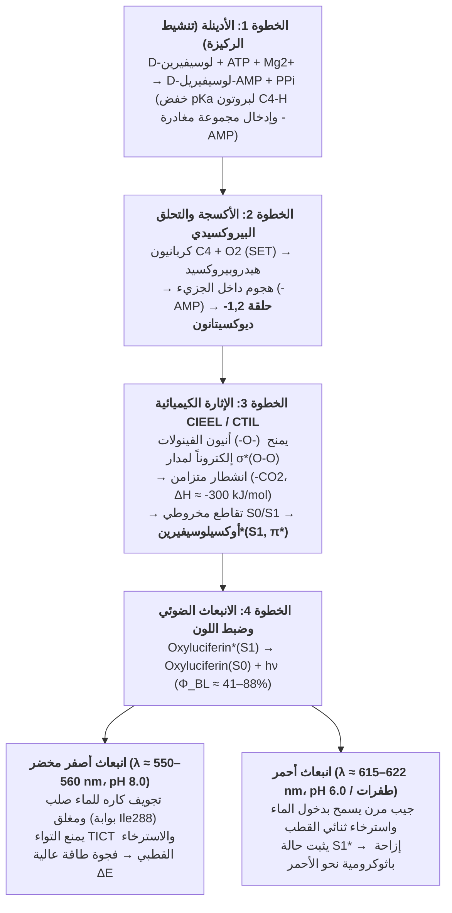

في أمسيات الصيف الدافئة، تحلّق آلاف اليراعات (*Photinus pyralis*، *Luciola cruciata*) في الظلام كأنها جمر زمردي معلّق في الهواء. وعلى عمق $1,000\,\text{m}$ تحت سطح المحيط — في المنطقتين الميزوبيلاجية والباثيبيلاجية المظلمتين تماماً حيث لا يصل أي فوتون شمسي — ينتج أكثر من $75\%$ من الكائنات البحرية، من الحبار مصاص الدماء (*Vampyroteuthis infernalis*) وأسماك الفانوس (*Myctophidae*) إلى أسماك أبو الشص وقنديل البحر الكريستالي (*Aequorea victoria*)، ومضات باهرة من الضوء الأزرق والأخضر.

تتطلب مصادر الضوء التقليدية مثل لهب الشمعة ($\sim 1,700\,\text{K}$) أو فتيل التنغستن في المصباح المتوهج ($\sim 2,800\,\text{K}$) درجات حرارة قصوى لإصدار الضوء المرئي، حيث يُهدر أكثر من $90\%$ من طاقتها كحرارة تحت حمراء. ومع ذلك، إذا وضعت يراعة مضيئة في كف يدك، فستجدها باردة تماماً وبدرجة حرارة الغرفة ($T \approx 295\text{–}300\,\text{K}$ أو $22\text{–}27\,^\circ\text{C}$). بل إن البروتينات والإنزيمات الحية تتعرض إلى <strong>تمسّخ حراري (Thermal Denaturation)</strong> غير عكوس إذا تجاوزت الحرارة $315\text{–}323\,\text{K}$ ($42\text{–}50\,^\circ\text{C}$).

كيف تتجاوز الحياة قوانين الإشعاع الحراري لتحوّل طاقة الروابط الكيميائية مباشرة إلى حالات إلكترونية مثارة أحادية ($S_1^*$) عند $300\,\text{K}$، منتجةً <strong>«ضوءاً بارداً» (Cold Light)</strong> بعائد كمومي يصل إلى $41\%\text{–}88\%$؟

---

## الفصل الأول: الإشعاع الحراري (التوهج) مقابل اللومينسنس (الضوء البارد)

### 1.1 الفجوة الهائلة بين طاقة الفوتون المرئي والطاقة الحرارية في درجة حرارة الغرفة ($k_B T$)

في الطيف المرئي ($\lambda = 400\text{–}700\,\text{nm}$)، تُعطى طاقة الفوتون الواحد والطاقة المولية المقابلة بعلاقة بلانك:

$$E_{\text{photon}} = h\nu = \frac{hc}{\lambda} \approx \frac{1239.8\,\text{eV}\cdot\text{nm}}{\lambda(\text{nm})}$$

- الضوء الأصفر المخضر لليراعة ($\lambda \approx 560\,\text{nm}$): $E_{\text{photon}} \approx 2.21\,\text{eV}$، $E_{\text{mol}} = N_A h\nu \approx 213.6\,\text{kJ/mol}$.
- الضوء الأزرق لكائنات الأعماق ($\lambda \approx 470\,\text{nm}$): $E_{\text{photon}} \approx 2.64\,\text{eV}$، $E_{\text{mol}} \approx 254.5\,\text{kJ/mol}$.

في المقابل، فإن متوسط الطاقة الحرارية $k_B T$ عند درجة حرارة الغرفة ($T = 300\,\text{K}$) لا يتجاوز:

$$k_B T \big|_{T=300\,\text{K}} \approx 0.02585\,\text{eV}, \qquad RT \big|_{T=300\,\text{K}} \approx 2.494\,\text{kJ/mol}$$

<strong>إن توليد فوتون مرئي واحد يتطلب طاقة مركزة تعادل قرابة 100 ضعف متوسط الكم الحراري في درجة حرارة الغرفة!</strong> وفي حالة التوازن الحراري عند $300\,\text{K}$، فإن معامل احتمالية بولتزمان لإثارة مستوى إلكتروني بفارق $\Delta E = 2.21\,\text{eV}$ تلقائياً هو $\exp(-\Delta E / k_B T) = \exp(-85.5) \approx 7.4 \times 10^{-38}$ — أي صفر فعلياً.

### 1.2 قانون بلانك لإشعاع الجسم الأسود وقانون فين للإزاحة

تخضع الإشعاعية الطيفية للجسم الأسود $B_\lambda(\lambda, T)$ إلى <strong>قانون بلانك</strong>، وطول موجة الذروة إلى <strong>قانون فين للإزاحة</strong>، والقدرة الإشعاعية الكلية إلى <strong>قانون ستيفان-بولتزمان</strong>:

$$B_\lambda(\lambda, T) = \frac{2hc^2}{\lambda^5} \frac{1}{\exp\left(\dfrac{hc}{\lambda k_B T}\right) - 1}, \qquad \lambda_{\max} \cdot T = 2.8978 \times 10^{-3}\,\text{m}\cdot\text{K}, \qquad J = \sigma T^4$$

عند $T = 300\,\text{K}$ تقع الذروة في الأشعة تحت الحمراء المتوسطة ($\lambda_{\max} \approx 9.66\,\mu\text{m}$). وحتى في فتيل التنغستن عند $2,800\,\text{K}$ تظل الذروة في الأشعة تحت الحمراء القريبة ($\lambda_{\max} \approx 1,035\,\text{nm}$)، مما يهدر $>90\%$ من الكهرباء كحرارة. ولا ينطبق الطيف مع وسط الضوء المرئي ($\lambda_{\max} \approx 501\,\text{nm}$) إلا عند درجة حرارة سطح الشمس ($T \approx 5,778\,\text{K}$).

### 1.3 اللومينسنس («الضوء البارد»): الإثارة الكمومية الانتقائية غير الحرارية

صاغ الفيزيائي الألماني إيلهارد فيدمان عام 1888 مصطلح <strong>اللومينسنس (Luminescence)</strong> لوصف أي انبعاث ضوئي لا ينتج عن ارتفاع الحرارة، حيث تُضخ طاقة قدرها $2\text{–}3\,\text{eV}$ انتقائياً في انتقال إلكتروني ($\text{HOMO} \to \text{LUMO}$، $S_0 \to S_1^*$) بينما يظل الوسط المحيط عند $300\,\text{K}$.

| فئة الانبعاث | مصدر الإثارة | الآلية الفيزيائية الكيميائية | أمثلة نموذجية | درجة الحرارة |
| :--- | :--- | :--- | :--- | :--- |
| <strong>التوهج الحراري (Incandescence)</strong> | الحركة الحرارية العشوائية ($k_B T$) | إثارة حرارية غير انتقائية لجميع الأنماط | الشمس، لهب الشمعة، مصباح التنغستن | $1,500\text{–}6,000\,\text{K}$ |
| <strong>الفلورية (Fluorescence)</strong> | امتصاص فوتون خارجي قصير الموجة ($h\nu_{\text{ex}}$) | انتقال مسموح مغزلياً $S_1 \to S_0$ ($\tau \sim 10^{-9}\,\text{s}$) | بروتين GFP (*Aequorea*)، أصباغ المرجان | حرارة الغرفة ($\sim 300\,\text{K}$) |
| <strong>الفسفورية (Phosphorescence)</strong> | امتصاص فوتون + عبور بين الأنظمة (ISC) | انتقال ممنوع مغزلياً $T_1 \to S_0$ ($\Delta S = 1, \tau \sim 10^{-3}\text{–}10^4\,\text{s}$) | دهانات الرؤية الليلية ($\text{SrAl}_2\text{O}_4:\text{Eu}^{2+}$) | حرارة الغرفة ($\sim 300\,\text{K}$) |
| <strong>التألق الكهربائي</strong> | مجال كهربائي / حقن حاملات الشحنة | إعادة اتحاد الإلكترونات والفجوات في أشباه الموصلات | ثنائيات LED ($\text{InGaN}$)، شاشات OLED | حرارة الغرفة |
| <strong>التألق الكيميائي</strong> | إعادة ترتيب روابط كيميائية طاردة للطاقة | انشطار بيروكسيد يغذي الحالة المثارة $S_1^*$ مباشرة | اللومينول الجنائي، العصي المضيئة (أوكسالات) | حرارة الغرفة |
| <strong>التألق الحيوي (Bioluminescence)</strong> | <strong>تألق كيميائي محفز بالإنزيمات</strong> | <strong>أكسدة اللوسيفيرين بواسطة اللوسيفيراز عبر 1,2-ديوكسيتانون</strong> | اليراعات، *Vargula*، السوطيات الدوارة، *Vibrio*، الفطريات | <strong>فسيولوجية ($275\text{–}310\,\text{K}$)</strong> |

---

## الفصل الثاني: التألق الحيوي مقابل الفلورية (GFP) والفسفورية وآلية BRET

```mermaid
flowchart TD
    subgraph INC ["1. التوهج الحراري (Incandescence / إشعاع الجسم الأسود)"]
        T1["تسخين شديد (T > 2,500 K)<br/>إثارة حرارية عشوائية لجميع درجات الحرية"] --> T2["طيف بلانك المستمر B_λ(T)<br/>(>90% مهدر كحرارة تحت حمراء؛ قاتل للبروتينات)"]
    end

    subgraph FL ["2. اللومينسنس الضوئي: الفلورية (GFP) والفسفورية"]
        F1["امتصاص فوتون خارجي (hν_ex: UV / أزرق)<br/>الحالة الأرضية S0 → الأحادية المثارة S1 (10^-15 s)"] --> F2["استرخاء اهتزازي (10^-12 s)<br/>إزاحة ستوكس (λ_em > λ_ex)"]
        F2 --> F3["فلورية مسموحة مغزلياً S1 → S0 + hν_em (10^-9 s)<br/>*مظلم تماماً بدون مصدر ضوء خارجي!*"]
        F2 -.->|"عبور بين الأنظمة (ISC: ΔS = 1)"| F4["فسفورية ممنوعة مغزلياً T1 → S0 + hν_ph<br/>(توهج يدوم من 10^-3 s إلى ساعات)"]
    end

    subgraph BL ["3. التألق الحيوي ('الضوء البارد' عند 300 K)"]
        B1["لوسيفيرين + O2 (+ ATP أو Ca2+)<br/>مرتبط بالموقع النشط للوسيفيراز عند 300 K"] --> B2["حلقة بيروكسيد رباعية عالية الإجهاد<br/>(وسيط 1,2-ديوكسيتانون)"]
        B2 --> B3["انشطار متزامن CIEEL وإثارة كيميائية (-CO2)<br/>تقاطع مباشر لأسطح الطاقة S0 → S1*"]
        B3 --> B4["أوكسيلوسيفيرين*(S1) → أوكسيلوسيفيرين(S0) + hν<br/>(لا يحتاج لضوء خارجي؛ عائد كمومي Φ_BL يبلغ 41–88%)"]
    end

    subgraph BRET_BOX ["4. نقل طاقة الرنين للتألق الحيوي (BRET في قنديل Aequorea victoria)"]
        BR1["إيكورين Aequorin (سيلينتيرازين + Ca2+)<br/>الإثارة الكيميائية تنشئ مانحاً أزرق S1* (470 nm)"] -->|"اقتران ثنائي قطب فورستر (r < 5 nm)<br/>نقل غير إشعاعي E = 1/(1+(r/R0)^6)"| BR2["يثير كروموفور GFP (Ser65-Tyr66-Gly67)<br/>يبعث فوتوناً أخضر (λ = 509 nm)"]
    end
```

من الضروري التمييز بدقة بين <strong>التألق الحيوي (Bioluminescence)</strong> و<strong>الفلورية الحيوية (Biofluorescence مثل GFP)</strong>:

1. <strong>الفلورية (مثل GFP)</strong> هي عملية <strong>فيزيائية ضوئية</strong> <strong>تتطلب حتماً امتصاص ضوء إثارة خارجي ($h\nu_{\text{ex}}$، فوق بنفسجي أو أزرق)</strong>. بعد الامتصاص ($10^{-15}\,\text{s}$) والاسترخاء الاهتزازي ($10^{-12}\,\text{s}$)، يبعث الجزيء خلال نانوثانية ($\tau \approx 10^{-9}\,\text{s}$) فوتوناً بطول موجي أطول (<strong>إزاحة ستوكس / Stokes Shift</strong>، $\lambda_{\text{em}} > \lambda_{\text{ex}}$). في الظلام الدامس دون مصباح خارجي، لا يمكن للبروتين الفلوري GFP أن يضيء إطلاقاً!
2. <strong>الفسفورية</strong> تتضمن <strong>عبوراً بين الأنظمة (ISC)</strong> من الحالة الأحادية $S_1$ ($\uparrow\downarrow, S=0$) إلى الحالة الثلاثية $T_1$ ($\uparrow\uparrow, S=1$)، حيث يكون الانتقال $T_1 \to S_0$ ممنوعاً مغزلياً ($\Delta S = 1$)، مما يطيل عمر الإشعاع من ملي ثانية إلى ساعات.
3. <strong>التألق الحيوي</strong> هو عملية <strong>كيميائية ضوئية (إثارة كيميائية / Chemiexcitation)</strong> تعمل في <strong>الظلام المطلق دون أي ضوء خارجي</strong>: حيث تؤدي أكسدة الركيزة <strong>لوسيفيرين (Luciferin)</strong> بإنزيم <strong>لوسيفيراز (Luciferase)</strong> إلى عبور سطح الطاقة الكامنة مباشرة نحو الحالة المثارة $\text{Oxyluciferin}^*(S_1)$.

### 2.2 أوسامو شيمومورا (جائزة نوبل 2008) وآلية BRET بين الإيكورين وGFP

أثناء دراسة قنديل البحر *Aequorea victoria* (الذي يتوهج <strong>باللون الأخضر عند $509\,\text{nm}$</strong>)، اكتشف <strong>أوسامو شيمومورا (Osamu Shimomura)</strong> أن البروتين الضوئي المعزول <strong>إيكورين (Aequorin)</strong> (المرتبط بالسيلينتيرازين والمحفز بأيونات $\text{Ca}^{2+}$) يبعث في أنبوب الاختبار <strong>ضوءاً أزرق ($\lambda_{\max} = 470\,\text{nm}$)</strong>! وفي العضو الضوئي للقنديل، ينقل الإيكورين طاقة إثارته بطريقة غير إشعاعية عبر مسافة $r \approx 2\text{–}5\,\text{nm}$ إلى <strong>البروتين الفلوري الأخضر (GFP)</strong> عبر آلية <strong>BRET (Bioluminescence Resonance Energy Transfer)</strong> وفق اقتران ثنائي القطب لفورستر:

$$E_{\text{BRET}} = \frac{1}{1 + \left(\dfrac{r}{R_0}\right)^6}, \qquad R_0^6 \propto \kappa^2 \, \Phi_D \, n^{-4} \int_0^\infty F_D(\lambda)\, \varepsilon_A(\lambda)\, \lambda^4 \, d\lambda$$

---

## الفصل الثالث: الكيمياء الكمومية لتفاعل اللوسيفيرين–لوسيفيراز في اليراعة

يجري التفاعل في البيروكسيسومات داخل الخلايا الضوئية لليراعة (*Photinus pyralis*، *Luciola*) باستخدام الركيزة <strong>D-لوسيفيرين</strong> وإنزيم <strong>اللوسيفيراز ($61\,\text{kDa}$)</strong> و$\text{ATP}$ و$\text{Mg}^{2+}$ و$\text{O}_2$ عبر أربع خطوات:

1. <strong>الخطوة 1: الأدينلة (تنشيط الركيزة) — تصحيح المغالطة الحرارية حول دور ATP</strong>
   $$\text{D-Luciferin} + \text{ATP} \xrightarrow{\text{Luciferase, Mg}^{2+}} \text{E}\cdot\text{D-Luciferyl-AMP} + \text{PP}_i$$
   <strong>تصحيح مفهومي جوهري</strong>: إن الطاقة الحرة الناتجة عن حلمهة ATP ($\Delta G^{\circ\prime} \approx -30.5\,\text{kJ/mol}$) <strong>لا</strong> تكفي إطلاقاً لتوليد فوتون بطول موجي $560\,\text{nm}$ ($214\,\text{kJ/mol}$)! بل يعمل ATP <strong>كمنشط حركي</strong>: إذ يحوّل مجموعة الكربوكسيل ($-\text{COO}^-$) إلى إستر أسيل-أدينيلات ساحبة للإلكترونات ($-\text{CO-AMP}$)، مما يخفض قيمة $pK_a$ لبروتون ذرة الكربون C4 لتسهيل تكوين الكربانيون، ويوفر مجموعة مغادرة ممتازة ($-\text{AMP}$).
2. <strong>الخطوة 2: نقل الإلكترون المفرد (SET) والأكسجة والتحلق إلى 1,2-ديوكسيتانون</strong>
   يتفاعل كربانيون C4 مع الأكسجين الثلاثي ($^3\text{O}_2$) عبر آلية SET لتكوين وسيط هيدروبيروكسيد يطرد مجموعة $\text{AMP}$ باستبدال محب للنواة داخل الجزيء، مغلقاً حلقة بيروكسيد رباعية شديدة الإجهاد: <strong>1,2-ديوكسيتانون (1,2-Dioxetanone / $\alpha$-peroxylactone)</strong>.
3. <strong>الخطوة 3: آلية CIEEL / CTIL والتقاطع المخروطي لأسطح الطاقة $S_0/S_1$</strong>
   يؤدي تفكك حلقة 1,2-ديوكسيتانون إلى <strong>أوكسيلوسيفيرين (Oxyluciferin)</strong> و$\text{CO}_2$ إلى تحرير طاقة هائلة ($\Delta H \approx -280\text{ to }-320\,\text{kJ/mol}$) نتيجة تحرير إجهاد الحلقة الرباعية ($\sim 110\,\text{kJ/mol}$) وكسر رابطة البيروكسيد الضعيفة $\text{O}-\text{O}$ ($\sim 140\,\text{kJ/mol}$) وتكوين رابطتين مزدوجتين فائقتي الاستقرار $\text{C}=\text{O}$ في جزيء $\text{CO}_2$.
   ووفقاً <strong>لقواعد وودوارد-هوفمان لتماثل المدارات</strong> وآلية <strong>CIEEL / CTIL</strong>، يمنح أنيون الفينولات منزوع البروتون ($-\text{O}^-$) إلكتروناً إلى المدار المضاد للترابط $\sigma^*(\text{O}-\text{O})$. وبسبب الحظر المداري للانشطار على السطح الأرضي $S_0$، يرتفع سطح الطاقة $S_0$ بحدة ويتقاطع مع سطح الحالة المثارة الأحادية $S_1$ في <strong>تقاطع مخروطي (Conical Intersection)</strong>. وعند انفصال $\text{CO}_2$، يعود الإلكترون مباشرة إلى مدار $\text{LUMO}(\pi^*)$، فينشأ الجزيء مباشرة في <strong>الحالة المثارة الأحادية $\text{Oxyluciferin}^*(S_1)$</strong>!
4. <strong>الخطوة 4: انبعاث الفوتون، العائد الكمومي ($\Phi_{\text{BL}}$)، وضبط لون الضوء</strong>
   $$\text{Oxyluciferin}^*(S_1) \longrightarrow \text{Oxyluciferin}(S_0) + h\nu \quad (\lambda_{\max} \approx 560\,\text{nm}), \qquad \Phi_{\text{BL}} = \Phi_{\text{chem}} \times \Phi_{\text{ex}} \times \Phi_{\text{fl}}$$
   أثبتت القياسات المطلقة بكرة التكامل أن العائد الكمومي لليراعة يبلغ $\Phi_{\text{BL}} = 41.0 \pm 7.4\%$ عند pH 8.5 (Ando et al., 2008, *Nature Photonics*).
   <strong>آلية ضبط اللون (من الأخضر $538\,\text{nm}$ إلى الأحمر $622\,\text{nm}$)</strong>: أثبت ناكاتسو وزملاؤه (Nakatsu et al., 2006, *Nature*) بالبلورات السينية أن الحمض الأميني <strong>Ile288</strong> يعمل كبوابة كارهة للماء تغلق الجيب النشط بإحكام لمنع الالتواء (TICT) ودخول الماء فينبعث ضوء أصفر مخضر ($560\,\text{nm}$)، بينما في الوسط الحمضي (pH 6.0) أو الطفرات يتراخى الجيب النشط مما يخفض طاقة $S_1^*$ ويزيح الانبعاث نحو اللون الأحمر ($615\,\text{nm}$، <strong>إزاحة باثوكرومية</strong>).

---

## الفصل الرابع: التطور التقاربي (40–90+ نشأة مستقلة) وبيئة أعماق البحار

نشأ التألق الحيوي بشكل مستقل <strong>ما بين 40 إلى أكثر من 90 مرة</strong> عبر شجرة الحياة (Haddock et al., 2010)، انطلاقاً من آليات مضادات الأكسدة لإزالة سمية أنواع الأكسجين التفاعلية (ROS):

1. <strong>أنظمة السيلينتيرازين والفارغولين (*Cypridina*) البحرية</strong>: أكثر من $75\%$ من كائنات المنطقة الميزوبيلاجية مضيئة حيوياً. يُستخدم <strong>السيلينتيرازين (Coelenterazine)</strong> في أكثر من تسع شعب حيوانية (وغالباً ما يُكتسب عبر السلسلة الغذائية) ويبعث ضوءاً أزرق ($\lambda_{\max} = 450\text{–}490\,\text{nm}$) يطابق نافذة النفاذية الضوئية القصوى لمياه البحر. أما قشريات *Vargula hilgendorfii* فتطلق سحباً مضيئة زرقاء ($462\,\text{nm}$) باستخدام <strong>الفارغولين (Vargulin)</strong>.
2. <strong>السوطيات الدوارة (*Noctiluca*) وقنوات البروتون المعتمدة على الجهد ($\text{H}_v1$)</strong>: يؤدي <strong>إجهاد القص الميكانيكي</strong> الناتج عن الأمواج إلى إزالة استقطاب غشاء الفجوة وفتح قنوات البروتون <strong>$\text{H}_v1$</strong>، مما يخفض pH داخل عضيات <strong>السينتيلون (Scintillons)</strong> من $8.0$ إلى $6.0$ خلال ملي ثانية، مطلقاً ومضة زرقاء مدتها $100\,\text{ms}$ ($475\,\text{nm}$) تعمل كـ«جرس إنذار ضد اللصوص» (*Burglar Alarm*).
3. <strong>أوبيرون البكتيريا المضيئة `luxCDABEG` واستشعار النصاب (Quorum Sensing)</strong>: تؤكسد بكتيريا *Aliivibrio fischeri* المتعايشة في العضو الضوئي للحبار *Euprymna scolopes* كلاً من $\text{FMNH}_2$ وألدهيد طويل السلسلة ($\text{RCHO}$) لإصدار ضوء أزرق مخضر ($490\,\text{nm}$) فقط عندما يتجاوز المحفز الذاتي <strong>AHL</strong> عتبة الكثافة الخلوية العالية ($>10^{10}\,\text{cells/mL}$).
4. <strong>دورة حمض الكافييك في الفطريات المضيئة (*Mycena*، *Neonothopanus*)</strong>: تحوّل أربعة إنزيمات (`HispS`، `H3H`، `Luz`، `CPH`) حمض الكافييك إلى <strong>3-هيدروكسي هيسبيدين</strong> الذي يبعث ضوءاً أخضر ($520\text{–}530\,\text{nm}$) ثم يُعاد تدويره إلى حمض الكافييك (Kotlobay et al., 2018, *PNAS*).
5. <strong>التمويه بالإضاءة المضادة (Counterillumination) وقناص الأشعة الحمراء (*Malacosteus niger*)</strong>: تلغي أسماك الفانوس ظلها البطني عبر إضاءة زرقاء مطابقة لضوء الشمس الهابط ($475\,\text{nm}$)، بينما تطلق سمكة التنين *Malacosteus niger* ضوءاً أحمر بعيداً/قريباً من تحت الأحمر ($>700\,\text{nm}$) مقترناً بمشتق كلوروفيل في شبكيتها لاصطياد الفرائس الحمراء بمنظار ليلي سري لا تراه الكائنات الأخرى.

---

## الفصل الخامس: التصوير الطبي الحيوي (AkaBLI)، فحص النظافة بـ ATP، والنباتات المضيئة ذاتياً

1. <strong>التصوير بالتألق الحيوي داخل الجسم الحي (In Vivo BLI) ونظام AkaBLI في الأشعة تحت الحمراء القريبة</strong>: يتميز تصوير BLI بانعدام الضوضاء الخلفية تماماً. وقد نجح فريق إيوانو ومياواكي في معهد RIKEN الياباني (Iwano et al., 2018, *Science*) في تطوير الزوج الاصطناعي <strong>AkaLumine-HCl / AkaLuc</strong> الذي يبعث في النافذة الحيوية للأشعة تحت الحمراء القريبة ($\lambda_{\max} = 677\,\text{nm}$)، مما ضاعف الحساسية في الأنسجة العميقة 1,000 مرة ومكّن من رصد <strong>خلية سرطانية نقيلية واحدة</strong> في رئة فأر حي وتصوير نشاط الدماغ في الرئيسيات.
2. <strong>إنزيم NanoLuc ومقاييس نظافة ATP</strong>: يتميز إنزيم <strong>NanoLuc ($19\,\text{kDa}$)</strong> المشتق من روبيان الأعماق *Oplophorus* بسطوع يفوق اليراعة بـ 150 ضعفاً؛ كما تتيح أجهزة قياس ATP المحمولة الكشف الفوري خلال 10 ثوانٍ عن $10^{-15}\text{–}10^{-18}\,\text{mol}$ من ATP الميكروبي في المستشفيات ومصانع الأغذية والمركبات الفضائية.
3. <strong>النباتات المضيئة ذاتياً (*Firefly Petunia*)</strong>: نظراً لأن حمض الكافييك وسيط أساسي لتصنيع اللغنين في جميع النباتات الوعائية، نجح فريق ساركيسيان ويامبولسكي (Mitiouchkina et al., 2020, *Nature Biotechnology*) في نقل الجينات الأربعة لدورة الفطريات المضيئة إلى نباتات التبغ والبيتونيا، لإنتاج نباتات تضيء ذاتياً بضوء أخضر مرئي للعين المجردة طوال دورة حياتها دون أي إضافات كيميائية خارجية.
