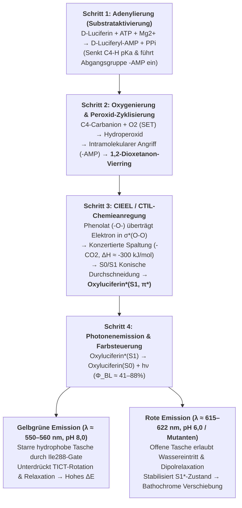

An lauen Sommerabenden schweben Glühwürmchen (*Lampyridae*, wie *Photinus pyralis* oder *Luciola cruciata*) wie smaragdgrüne Funken durch die Dunkelheit. Tausend Meter tief im Ozean – in der aphotischen Zone des Mesopelagials und Bathypelagials, wohin kein einziges Sonnenphoton vordringt – erzeugen über $75\%$ aller pelagischen Organismen, vom Vampirtintenfisch (*Vampyroteuthis infernalis*) und Laternenfischen (*Myctophidae*) bis hin zu Tiefsee-Anglerfischen und der Kristallqualle (*Aequorea victoria*), brillantes blaues und grünes Licht.

Klassische technische Lichtquellen wie eine Kerzenflamme ($\sim 1.700\,\text{K}$) oder der Wolframdraht einer Glühlampe ($\sim 2.800\,\text{K}$) benötigen extreme Hitze, um sichtbares Licht auszusenden, wobei über $90\%$ der Energie als Infrarotwärme verloren gehen. Ein leuchtendes Glühwürmchen auf der Handfläche fühlt sich hingegen vollkommen kühl an ($T \approx 295\text{–}300\,\text{K}$ bzw. $22\text{–}27\,^\circ\text{C}$). Da Proteine bereits oberhalb von $315\text{–}323\,\text{K}$ ($42\text{–}50\,^\circ\text{C}$) durch <strong>thermische Denaturierung</strong> irreversibel zerstört werden, müsste ein Organismus bei thermischer Lichterzeugung augenblicklich verbrennen.

Wie überlistet das Leben die Gesetze der Wärmestrahlung, um chemische Bindungsenergie bei Raumtemperatur direkt in elektronisch angeregte Singulett-Zustände ($S_1^*$) zu pumpen und <strong>„kaltes Licht“ (Cold Light)</strong> mit einer Quantenausbeute von bis zu $41\%\text{–}88\%$ zu emittieren?

---

## Kapitel 1: Thermische Strahlung (Inkandeszenz) vs. Lumineszenz

### 1.1 Die energetische Kluft zwischen sichtbaren Photonen und thermischer Energie ($k_B T$)

Sichtbares Licht ($\lambda = 400\text{–}700\,\text{nm}$) besitzt pro Photon bzw. pro Mol Photonen eine Energie von:

$$E_{\text{photon}} = h\nu = \frac{hc}{\lambda} \approx \frac{1239,8\,\text{eV}\cdot\text{nm}}{\lambda(\text{nm})}$$

- Gelbgrünes Glühwürmchenlicht ($\lambda \approx 560\,\text{nm}$): $E_{\text{photon}} \approx 2,21\,\text{eV}$, $E_{\text{mol}} = N_A h\nu \approx 213,6\,\text{kJ/mol}$.
- Blaues Tiefseelicht ($\lambda \approx 470\,\text{nm}$): $E_{\text{photon}} \approx 2,64\,\text{eV}$, $E_{\text{mol}} \approx 254,5\,\text{kJ/mol}$.

Demgegenüber beträgt die mittlere thermische Energie $k_B T$ bei Raumtemperatur ($T = 300\,\text{K}$) lediglich:

$$k_B T \big|_{T=300\,\text{K}} \approx 0,02585\,\text{eV}, \qquad RT \big|_{T=300\,\text{K}} \approx 2,494\,\text{kJ/mol}$$

Ein einzelnes sichtbares Photon erfordert somit <strong>fast das Hundertfache der mittleren thermischen Energie bei Raumtemperatur!</strong> Im thermischen Gleichgewicht ist die Boltzmann-Wahrscheinlichkeit für eine spontane thermische Anregung um $\Delta E = 2,21\,\text{eV}$ durch $\exp(-\Delta E / k_B T) = \exp(-85,5) \approx 7,4 \times 10^{-38}$ gegeben – physikalisch exakt null.

### 1.2 Plancksches Strahlungsgesetz und Wiensches Verschiebungsgesetz

Die spektrale Strahldichte $B_\lambda(\lambda, T)$ eines schwarzen Körpers folgt dem <strong>Planckschen Gesetz</strong>, das Emissionsmaximum dem <strong>Wienschen Verschiebungsgesetz</strong> und die Gesamtstrahlungsleistung dem <strong>Stefan-Boltzmann-Gesetz</strong>:

$$B_\lambda(\lambda, T) = \frac{2hc^2}{\lambda^5} \frac{1}{\exp\left(\dfrac{hc}{\lambda k_B T}\right) - 1}, \qquad \lambda_{\max} \cdot T = 2,8978 \times 10^{-3}\,\text{m}\cdot\text{K}, \qquad J = \sigma T^4$$

Bei $T = 300\,\text{K}$ liegt das Maximum bei $\lambda_{\max} \approx 9,66\,\mu\text{m}$ (mittleres Infrarot). Selbst in einer Wolfram-Glühlampe bei $T = 2.800\,\text{K}$ liegt $\lambda_{\max} \approx 1.035\,\text{nm}$ im nahen Infrarot, sodass $>90\%$ der elektrischen Leistung als Abwärme verloren gehen. Erst auf der Sonnenoberfläche ($T \approx 5.778\,\text{K}$) erreicht das Maximum $\lambda_{\max} \approx 501\,\text{nm}$.

### 1.3 Lumineszenz („Kaltes Licht“): Quantenselektive nicht-thermische Anregung

Der 1888 von Eilhardt Wiedemann geprägte Begriff <strong>Lumineszenz</strong> bezeichnet jede Lichtemission, die nicht auf einer Temperaturerhöhung beruht, sondern Energie gezielt in einen elektronischen Freiheitsgrad ($\text{HOMO} \to \text{LUMO}$, $S_0 \to S_1^*$) einspeist, während das umgebende Medium bei $300\,\text{K}$ verbleibt.

| Emissionsklasse | Anregungsquelle | Physikalisch-chemischer Mechanismus | Typische Beispiele | Temperatur |
| :--- | :--- | :--- | :--- | :--- |
| <strong>Inkandeszenz (Wärmestrahlung)</strong> | Thermische Bewegung ($k_B T$) | Unselektive thermische Anregung aller Moden | Sonne, Kerzenflamme, Glühlampe | $1.500\text{–}6.000\,\text{K}$ |
| <strong>Fluoreszenz (Photolumineszenz)</strong> | Absorption externer Photonen ($h\nu_{\text{ex}}$) | Spinerlaubter Zerfall $S_1 \to S_0$ ($\Delta S = 0, \tau \sim 10^{-9}\,\text{s}$) | GFP (*Aequorea*), Korallenpigmente, Textmarker | Raumtemp. ($\sim 300\,\text{K}$) |
| <strong>Phosphoreszenz</strong> | Photonenabsorption + Intersystem Crossing (ISC) | Spinverbotener Zerfall $T_1 \to S_0$ ($\Delta S = 1, \tau \sim 10^{-3}\text{–}10^4\,\text{s}$) | Nachleuchtende Pigmente ($\text{SrAl}_2\text{O}_4:\text{Eu}^{2+}$) | Raumtemp. ($\sim 300\,\text{K}$) |
| <strong>Elektrolumineszenz</strong> | Elektrisches Feld / Ladungsträgerinjektion | Rekombination von Elektronen und Löchern | $\text{InGaN}$-LEDs, OLED-Displays | Raumtemp. |
| <strong>Chemilumineszenz</strong> | Exotherme chemische Bindungsumlagerung | Peroxidspaltung bevölkert direkt $S_1^*$ (Chemieanregung) | Forensisches Luminol, Knicklichter (Oxalsäureester) | Raumtemp. |
| <strong>Biolumineszenz</strong> | <strong>Enzymkatalysierte Chemilumineszenz</strong> | <strong>Luciferin-Oxidation durch Luciferase über 1,2-Dioxetanon</strong> | Glühwürmchen, *Vargula*, Dinoflagellaten, *Vibrio*, Pilze | <strong>Physiologisch ($275\text{–}310\,\text{K}$)</strong> |

---

## Kapitel 2: Biolumineszenz vs. Fluoreszenz (GFP) vs. Phosphoreszenz und BRET

```mermaid
flowchart TD
    subgraph INC ["1. Thermische Strahlung (Inkandeszenz / Schwarzer Körper)"]
        T1["Extreme Aufheizung (T > 2.500 K)<br/>Unselektive thermische Anregung aller Freiheitsgrade"] --> T2["Kontinuierliches Planck-Spektrum B_λ(T)<br/>(>90% Infrarot-Wärmeverlust; tödlich für Proteine)"]
    end

    subgraph FL ["2. Photolumineszenz: Fluoreszenz (GFP) & Phosphoreszenz"]
        F1["Absorption externer Photonen (hν_ex: UV / Blau)<br/>Grundzustand S0 → Singulett S1 (10^-15 s)"] --> F2["Schwingungsrelaxation (10^-12 s)<br/>Stokes-Verschiebung (λ_em > λ_ex)"]
        F2 --> F3["Spinerlaubte Fluoreszenz S1 → S0 + hν_em (10^-9 s)<br/>*Ohne externe Lichtquelle vollkommen dunkel!*"]
        F2 -.->|"Intersystem Crossing (ISC: ΔS = 1)"| F4["Spinverbotene Phosphoreszenz T1 → S0 + hν_ph<br/>(10^-3 s bis Stunden Nachleuchten)"]
    end

    subgraph BL ["3. Biolumineszenz ('Kaltes Licht' bei 300 K)"]
        B1["Luciferin + O2 (+ ATP oder Ca2+)<br/>Im aktiven Zentrum der Luciferase bei 300 K"] --> B2["Gespannter Peroxid-Vierring<br/>(1,2-Dioxetanon-Intermediat)"]
        B2 --> B3["CIEEL-Spaltung & Chemieanregung (-CO2)<br/>Direkte S0 → S1* Flächenkreuzung"]
        B3 --> B4["Oxyluciferin*(S1) → Oxyluciferin(S0) + hν<br/>(Kein externes Licht nötig; Φ_BL bis 41–88%)"]
    end

    subgraph BRET_BOX ["4. Biolumineszenz-Resonanzenergietransfer (BRET in Aequorea victoria)"]
        BR1["Aequorin (Coelenterazin + Ca2+)<br/>Chemieanregung erzeugt blauen S1*-Donor (470 nm)"] -->|"Förster-Dipol-Dipol-Kopplung (r < 5 nm)<br/>Strahlungsloser Transfer E = 1/(1+(r/R0)^6)"| BR2["Regt GFP-Chromophor (Ser65-Tyr66-Gly67) an<br/>Emittiert grünes Photon (λ = 509 nm)"]
    end
```

In populärwissenschaftlichen Darstellungen werden <strong>Biolumineszenz</strong> und <strong>Biofluoreszenz (wie GFP)</strong> häufig verwechselt:

1. <strong>Fluoreszenz (z. B. GFP)</strong> ist ein <strong>photophysikalischer Prozess</strong> und erfordert zwingend <strong>externe Anregungsstrahlung ($h\nu_{\text{ex}}$, UV- oder Blaulicht)</strong>. Nach Absorption ($10^{-15}\,\text{s}$) und Schwingungsrelaxation ($10^{-12}\,\text{s}$) wird innerhalb von Nanosekunden ($\tau \approx 10^{-9}\,\text{s}$) ein energieärmeres Photon längerer Wellenlänge emittiert (<strong>Stokes-Verschiebung</strong>, $\lambda_{\text{em}} > \lambda_{\text{ex}}$). In völliger Dunkelheit ohne externe Lichtquelle leuchtet GFP überhaupt nicht!
2. <strong>Phosphoreszenz</strong> beinhaltet einen Spin-Flip durch <strong>Intersystem Crossing (ISC)</strong> vom Singulett-Zustand $S_1$ ($\uparrow\downarrow, S=0$) in den Triplett-Zustand $T_1$ ($\uparrow\uparrow, S=1$). Da der Übergang $T_1 \to S_0$ spinverboten ist ($\Delta S = 1$), dauert das Nachleuchten Millisekunden bis Stunden.
3. <strong>Biolumineszenz</strong> ist ein <strong>photochemischer Prozess (Chemieanregung / Chemiexcitation)</strong>, der <strong>ohne jegliches externes Licht</strong> in absoluter Finsternis funktioniert: Die enzymatische Oxidation von <strong>Luciferin</strong> durch <strong>Luciferase</strong> führt über eine Kreuzung der Potentialhyperflächen direkt in den angeregten Zustand $\text{Oxyluciferin}^*(S_1)$.

### 2.2 Osamu Shimomura (Nobelpreis 2008) und BRET zwischen Aequorin und GFP

<strong>Osamu Shimomura</strong> entdeckte 1961 bei der Kristallqualle *Aequorea victoria*, dass das isolierte Photoprotein <strong>Aequorin</strong> (mit gebundenem Coelenterazin) nach Zugabe von $\text{Ca}^{2+}$ <strong>blaues Licht ($\lambda_{\max} = 470\,\text{nm}$)</strong> aussendet, obwohl die lebende Qualle <strong>grün ($\lambda_{\max} = 509\,\text{nm}$)</strong> leuchtet. In den Leuchtorganen überträgt Aequorin seine Anregungsenergie im Abstand $r \approx 2\text{–}5\,\text{nm}$ strahlungslos per <strong>BRET (Biolumineszenz-Resonanzenergietransfer)</strong> über Förster-Dipol-Dipol-Wechselwirkung direkt auf das <strong>Grün fluoreszierende Protein (GFP)</strong>:

$$E_{\text{BRET}} = \frac{1}{1 + \left(\dfrac{r}{R_0}\right)^6}, \qquad R_0^6 \propto \kappa^2 \, \Phi_D \, n^{-4} \int_0^\infty F_D(\lambda)\, \varepsilon_A(\lambda)\, \lambda^4 \, d\lambda$$

---

## Kapitel 3: Quantenchemie der Glühwürmchen-Luciferin-Luciferase-Reaktion

Die Reaktion in den Peroxisomen der Leuchtzellen von *Photinus pyralis* oder *Luciola* verläuft mit <strong>D-Luciferin</strong>, der monomeren <strong>Luciferase ($61\,\text{kDa}$)</strong>, $\text{ATP}$, $\text{Mg}^{2+}$ und $\text{O}_2$ in vier Schritten:

1. <strong>Schritt 1: Adenylierung (Substrataktivierung) – Entlarvung des ATP-Energiemythos</strong>
   $$\text{D-Luciferin} + \text{ATP} \xrightarrow{\text{Luciferase, Mg}^{2+}} \text{E}\cdot\text{D-Luciferyl-AMP} + \text{PP}_i$$
   <strong>Wichtige Korrektur</strong>: Die freie Enthalpie der ATP-Hydrolyse ($\Delta G^{\circ\prime} \approx -30,5\,\text{kJ/mol}$) liefert <strong>nicht</strong> die Photonenenergie von $214\,\text{kJ/mol}$ ($560\,\text{nm}$)! ATP dient rein der <strong>kinetischen Aktivierung</strong>: Die Umwandlung der Carboxylatgruppe ($-\text{COO}^-$) in den elektronenziehenden Acyladenylatester ($-\text{CO-AMP}$) senkt den $pK_a$-Wert des C4-Protons drastisch zur Bildung eines Carbanions und schafft mit $-\text{AMP}$ eine exzellente Abgangsgruppe.
2. <strong>Schritt 2: Ein-Elektronen-Transfer (SET), Oxygenierung und Zyklisierung zum 1,2-Dioxetanon</strong>
   Das C4-Carbanion reagiert über SET mit Triplett-Sauerstoff ($^3\text{O}_2$) zum Hydroperoxid-Intermediat, welches durch intramolekulare nukleophile Substitution unter Abspaltung von $\text{AMP}$ den extrem gespannten Peroxid-Vierring <strong>1,2-Dioxetanon ($\alpha$-Peroxylacton)</strong> schließt.
3. <strong>Schritt 3: CIEEL / CTIL-Mechanismus und Orbitalsymmetrie-Kreuzung</strong>
   Der Zerfall von 1,2-Dioxetanon in <strong>Oxyluciferin</strong> und $\text{CO}_2$ setzt durch den Abbau der Vierring-Spannung ($\sim 110\,\text{kJ/mol}$), den Bruch der schwachen $\text{O}-\text{O}$-Bindung ($\sim 140\,\text{kJ/mol}$) und die Bildung zweier extrem stabiler $\text{C}=\text{O}$-Doppelbindungen im $\text{CO}_2$ schlagartig $\Delta H \approx -280\text{ bis }-320\,\text{kJ/mol}$ frei.
   Gemäß den <strong>Woodward-Hoffmann-Regeln</strong> und dem <strong>CIEEL- (Chemically Initiated Electron Exchange Luminescence) / CTIL-Mechanismus</strong> überträgt das deprotonierte Phenolat-Anion ($-\text{O}^-$) am Benzothiazolring Elektronendichte in das antibindende $\sigma^*(\text{O}-\text{O})$-Orbital. Da die konzertierte Spaltung auf der Grundzustandsfläche $S_0$ orbitalsymmetrieverboten ist, steigt die $S_0$-Energie steil an und schneidet die angeregte $S_1$-Fläche in einer <strong>konischen Durchschneidung (Conical Intersection)</strong>. Beim Austritt von $\text{CO}_2$ fließt das Elektron direkt in das $\text{LUMO}(\pi^*)$ zurück – das Molekül entsteht unmittelbar im <strong>angeregten Singulett-Zustand $\text{Oxyluciferin}^*(S_1)$</strong>!
4. <strong>Schritt 4: Photonenemission, Quantenausbeute ($\Phi_{\text{BL}}$) und Farbsteuerung</strong>
   $$\text{Oxyluciferin}^*(S_1) \longrightarrow \text{Oxyluciferin}(S_0) + h\nu \quad (\lambda_{\max} \approx 560\,\text{nm}), \qquad \Phi_{\text{BL}} = \Phi_{\text{chem}} \times \Phi_{\text{ex}} \times \Phi_{\text{fl}}$$
   Präzise Ulbrichtkugel-Messungen (Ando et al., 2008, *Nature Photonics*) belegen eine absolute Quantenausbeute von $\Phi_{\text{BL}} = 41,0 \pm 7,4\%$ bei pH 8,5 (mit einer Singulett-Anregungseffizienz $\Phi_{\text{ex}}$ von $60\text{–}90\%$).
   <strong>Farbsteuerung ($538\,\text{nm}$ Grün bis $622\,\text{nm}$ Rot)</strong>: Obwohl alle Leuchtkäfer (einschließlich des Eisenbahnwurms *Phrixothrix* mit roten Kopf- und grünen Seitenlaternen) dasselbe D-Luciferin nutzen, verschiebt sich die Emission bei saurem pH (6,0) oder Hitze von $560\,\text{nm}$ nach $615\,\text{nm}$ (<strong>bathochrome Verschiebung</strong>). Nakatsu et al. (2006, *Nature*) zeigten mittels Röntgenstrukturanalyse ($1,3\,\text{\AA}$), dass der Seitenketten-Riegel <strong>Ile288</strong> im geschlossenen Zustand Oxyluciferin starr einklemmt und Torsionsrelaxation (TICT) sowie Wassereintritt verhindert (grünes Licht), während eine geöffnete, polarere Tasche den $S_1^*$-Zustand absenkt (rotes Licht).

---

## Kapitel 4: Konvergente Evolution (40–90+ Ursprünge) und Tiefsee-Ökologie

Biolumineszenz entstand im Laufe der Evolution <strong>mindestens 40- bis über 90-mal unabhängig voneinander</strong> (Haddock et al., 2010), ursprünglich als <strong>Entgiftungsmechanismus gegen reaktive Sauerstoffspezies (ROS)</strong>:

1. <strong>Marine Coelenterazin- und Vargulin-Systeme</strong>: Über $75\%$ der mesopelagischen Tiefseebewohner leuchten. <strong>Coelenterazin</strong> dient in über neun Tierstämmen als universelles Substrat (oft über die Nahrungskette aufgenommen) und emittiert blaues Licht ($\lambda_{\max} = 450\text{–}490\,\text{nm}$) exakt im optischen Transmissionsfenster von Meerwasser. Der Muschelkrebs *Vargula hilgendorfii* stößt mit <strong>Vargulin</strong> blaue Leuchtwolken ($462\,\text{nm}$) zur Feindabwehr aus.
2. <strong>Dinoflagellaten (*Noctiluca*) und spannungsgesteuerte Protonenkanäle ($\text{H}_v1$)</strong>: Mechanische <strong>Scherkräfte</strong> durch Wellen oder Fressfeinde depolarisieren die Vakuolenmembran und öffnen <strong>$\text{H}_v1$-Protonenkanäle</strong>, wodurch der pH-Wert in den <strong>Scintillons</strong> binnen Millisekunden von $8,0$ auf $6,0$ fällt und einen $100\,\text{ms}$-Lichtblitz ($475\,\text{nm}$) als „Einbruchsalarm“ auslöst.
3. <strong>Bakterielles `luxCDABEG`-Operon und Quorum Sensing</strong>: Symbiontische Bakterien (*Aliivibrio fischeri*) im Leuchtorgan der Zwergsepia (*Euprymna scolopes*) oxidieren $\text{FMNH}_2$ und langkettige Aldehyde ($\text{RCHO}$) bei $490\,\text{nm}$ – gesteuert über den Autoinduktor <strong>AHL</strong> erst ab einer Zelldichte von $>10^{10}\,\text{Zellen/mL}$.
4. <strong>Pilz-Biolumineszenz (*Mycena*, *Neonothopanus*) über den Kaffeesäure-Zyklus</strong>: Vier Enzyme (`HispS`, `H3H`, `Luz`, `CPH`) wandeln Kaffeesäure über Hispidin in <strong>3-Hydroxyhispidin</strong> um, das bei $520\text{–}530\,\text{nm}$ grün leuchtet und wieder zu Kaffeesäure recycelt wird (Kotlobay et al., 2018, *PNAS*).
5. <strong>Counterillumination und Tiefsee-Infrarot-Scharfschützen (*Malacosteus niger*)</strong>: Laternenfische löschen ihre Silhouette gegen das Restlicht von oben durch ventrale Photophoren (Gegenbeleuchtung), während der Drachenfisch *Malacosteus niger* dunkelrotes/nahinfrarotes Licht ($>700\,\text{nm}$) aussendet und mit Chlorophyll-Sensibilisatoren in der Netzhaut rote Beutetiere völlig unbemerkt ins Visier nimmt.

---

## Kapitel 5: Anwendungen in Medizin (AkaBLI), Hygiene und Synthetischer Biologie

1. <strong>*In Vivo* Bioluminescence Imaging (BLI) und das Nahinfrarot-System „AkaBLI“</strong>: Da Säugetiergewebe im Dunkeln kein Eigenlicht abgibt, liefert BLI ein Hintergrundrauschen von null. Durch Kopplung des synthetischen Substrats <strong>AkaLumine-HCl</strong> mit der evolvierten Luciferase <strong>AkaLuc</strong> verschoben Iwano & Miyawaki et al. (2018, *Science*, RIKEN) die Emission ins <strong>optische Gewebefenster ($\lambda_{\max} = 677\,\text{nm}$)</strong>, steigerten die Empfindlichkeit um das 1.000-Fache und machten <strong>einzelne metastasierende Krebszellen</strong> in der Lunge lebender Mäuse sichtbar.
2. <strong>NanoLuc und Femtomol-ATP-Hygienemonitoring</strong>: Die winzige $19\,\text{kDa}$ <strong>NanoLuc</strong>-Luciferase aus der Tiefseegarnele *Oplophorus* leuchtet mit Furimazine $150\times$ heller als Glühwürmchen-Luciferase; tragbare ATP-Luminometer nutzen die strenge Proportionalität $I \propto [\text{ATP}]$ zum Sekundennachweis von Mikroorganismen ($10^{-15}\text{–}10^{-18}\,\text{mol}$ ATP) in Kliniken und der Raumfahrt.
3. <strong>Autonom leuchtende Pflanzen (*Firefly Petunia*)</strong>: Da Kaffeesäure in allen Gefäßpflanzen als Lignin-Vorstufe reichlich vorhanden ist, schufen Mitiouchkina, Sarkisyan & Yampolsky et al. (2020, *Nature Biotechnology*) durch Integration der vier Pilzgene (`HispS`, `H3H`, `Luz`, `CPH`) Pflanzen, die ohne externe Substratgabe lebenslang mit bloßem Auge sichtbar grün leuchten.
