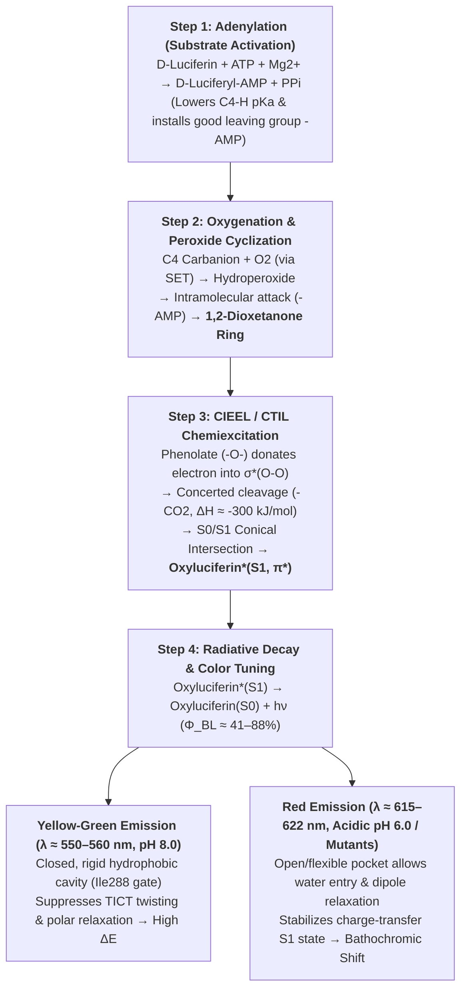

On a warm summer evening beside a quiet stream, thousands of fireflies (*Photinus pyralis*, *Luciola cruciata*) drift through the darkness like suspended emerald embers. A kilometer beneath the surface of the ocean—in the pitch-black mesopelagic and bathypelagic zones where not a single photon of sunlight penetrates—more than $75\%$ of pelagic creatures, from vampire squids (*Vampyroteuthis infernalis*) and lanternfish (*Myctophidae*) to deep-sea anglerfish and crystal jellyfish (*Aequorea victoria*), illuminate the abyss with brilliant flashes of sapphire and viridian light.

Throughout most of human history, generating visible light required extreme heat. A candle flame burns at roughly $1,700\,\text{K}$; a classic tungsten incandescent light bulb filament must be heated by electrical resistance to approximately $2,800\,\text{K}$ ($2,527\,^\circ\text{C}$); the photosphere of the Sun radiates at $5,778\,\text{K}$. Touching an operating incandescent bulb causes immediate thermal burns because over $90\%$ of its energy output is dissipated as infrared heat.

Yet if you gently cup a glowing firefly in your palm, its abdomen feels completely cool—at ambient temperature ($T \approx 295\text{–}300\,\text{K}$, or $22\text{–}27\,^\circ\text{C}$). In fact, biological macromolecules cannot tolerate thermal incandescence: proteins and enzymes undergo irreversible <strong>thermal denaturation</strong> above $315\text{–}323\,\text{K}$ ($42\text{–}50\,^\circ\text{C}$) as hydrogen bonds and hydrophobic cores unravel. If a firefly attempted to produce visible light through thermal radiation, its cells would vaporize long before emitting a perceptible glow.

How does living matter bypass the laws of thermal radiation to convert chemical bond energy directly into visible photons ($h\nu \approx 2.0\text{–}2.8\,\text{eV}$, or $190\text{–}270\,\text{kJ/mol}$) at room temperature, achieving a staggering quantum yield ($\Phi_{\text{BL}}$ reaching $41\%\text{ to }88\%$)?

The answer lies at the intersection of statistical thermodynamics, molecular orbital theory, and enzyme catalysis. Unlike <strong>incandescence (blackbody thermal radiation)</strong>—which indiscriminately excites all translational, rotational, and vibrational degrees of freedom of bulk matter—<strong>bioluminescence</strong> is an enzyme-catalyzed <strong>chemiluminescence</strong> process. Within the hydrophobic nanocavity of a <strong>luciferase</strong> enzyme, the oxidation of a small organic substrate (<strong>luciferin</strong>) by molecular oxygen ($\text{O}_2$) constructs a hyper-strained, four-membered peroxide ring intermediate: <strong>1,2-dioxetanone</strong>. When this ring cleaves via the <strong>CIEEL (Chemically Initiated Electron Exchange Luminescence)</strong> / <strong>CTIL (Charge-Transfer-Induced Luminescence)</strong> mechanism, orbital symmetry rules forbid simple thermal dissipation along the ground-state potential energy surface ($S_0$). Instead, the reaction trajectory crosses directly onto the electronically excited singlet surface ($S_1^*$), depositing nearly $300\,\text{kJ/mol}$ of chemical free energy into a single molecule's $\pi^*$ orbital without heating the surrounding solvent bath by even a millikelvin.

In this comprehensive treatise, we examine the statistical physics separating blackbody radiation from cold luminescence, clarify the widespread confusion between bioluminescence, fluorescence (GFP), phosphorescence, and <strong>BRET (Bioluminescence Resonance Energy Transfer)</strong>, dissect the four-step quantum-chemical cycle of the firefly luciferin–luciferase reaction and its active-site color-tuning mechanism, survey the convergent evolution of bioluminescence across more than 40 to 90 independent lineages, and explore how these natural photon engines now power single-cell *in vivo* cancer imaging (<strong>AkaBLI</strong>), femtomole ATP hygiene sensors, and genetically engineered self-sustained glowing plants.

---

## Chapter 1: The Physics of Thermal Radiation (Incandescence) vs. Luminescence ("Cold Light")

To appreciate why producing visible light at room temperature ($300\,\text{K}$) is a monumental physical feat, we must first compare the energy scale of a visible photon against the thermal energy bath of living tissue.

### 1.1 The Chasm Between Visible Photon Energy and Room-Temperature Thermal Energy ($k_B T$)

The human visual system detects electromagnetic radiation across the visible spectrum from approximately $\lambda = 400\,\text{nm}$ (violet) to $\lambda = 700\,\text{nm}$ (red). Using Planck's constant $h = 6.626 \times 10^{-34}\,\text{J}\cdot\text{s}$, the speed of light $c = 2.998 \times 10^8\,\text{m/s}$, and Avogadro's constant $N_A = 6.022 \times 10^{23}\,\text{mol}^{-1}$, the energy of a single photon $E_{\text{photon}}$ and the corresponding molar energy $E_{\text{mol}}$ at wavelength $\lambda$ are given by:

$$E_{\text{photon}} = h\nu = \frac{hc}{\lambda} \approx \frac{1239.8\,\text{eV}\cdot\text{nm}}{\lambda(\text{nm})}$$

For the yellow-green emission of a firefly ($\lambda \approx 560\,\text{nm}$):

$$E_{\text{photon}}(560\,\text{nm}) \approx 2.21\,\text{eV} \approx 3.55 \times 10^{-19}\,\text{J}, \qquad E_{\text{mol}}(560\,\text{nm}) = N_A h\nu \approx 213.6\,\text{kJ/mol}$$

For the blue emission typical of deep-sea marine organisms ($\lambda \approx 470\,\text{nm}$):

$$E_{\text{photon}}(470\,\text{nm}) \approx 2.64\,\text{eV}, \qquad E_{\text{mol}}(470\,\text{nm}) \approx 254.5\,\text{kJ/mol}$$

Now compare this with the characteristic thermal energy $k_B T$ available from random molecular collisions at room temperature $T = 300\,\text{K}$ (where $k_B = 1.381 \times 10^{-23}\,\text{J/K}$ is the Boltzmann constant and $R = N_A k_B = 8.314\,\text{J/(mol}\cdot\text{K)}$ is the universal gas constant):

$$k_B T \big|_{T=300\,\text{K}} \approx 0.02585\,\text{eV}, \qquad RT \big|_{T=300\,\text{K}} \approx 2.494\,\text{kJ/mol}$$

Here lies the fundamental thermodynamic barrier: <strong>creating a single visible photon requires $2.2\text{ to }2.6\,\text{eV}$ ($214\text{–}255\,\text{kJ/mol}$) of concentrated energy—nearly 100 times larger than the average thermal energy quantum ($0.026\,\text{eV}$ or $2.5\,\text{kJ/mol}$) at room temperature!</strong>

In any system at thermal equilibrium at temperature $T$, the probability that thermal fluctuations spontaneously populate an electronic state separated from the ground state by $\Delta E = 2.21\,\text{eV}$ is governed by the Boltzmann factor:

$$\frac{N_{\text{excited}}}{N_{\text{ground}}} \sim \exp\left(-\frac{\Delta E}{k_B T}\right) = \exp\left(-\frac{2.21\,\text{eV}}{0.02585\,\text{eV}}\right) = \exp(-85.5) \approx 7.4 \times 10^{-38}$$

A probability of $10^{-37}$ is effectively zero across the entire observable universe. Thermal agitation at $300\,\text{K}$ can never excite electrons across a $2.2\,\text{eV}$ HOMO–LUMO gap.

### 1.2 Planck's Law and Wien's Displacement Law: Why Incandescent Bulbs Waste $>90\%$ of Energy as Heat

If an engineer or nature attempts to generate light purely by heating matter (<strong>incandescence</strong>), the spectral radiance $B_\lambda(\lambda, T)$ emitted per unit surface area, per unit solid angle, per unit wavelength by an ideal blackbody at absolute temperature $T$ follows <strong>Planck's Law of Blackbody Radiation</strong> (1900):

$$B_\lambda(\lambda, T) = \frac{2hc^2}{\lambda^5} \frac{1}{\exp\left(\dfrac{hc}{\lambda k_B T}\right) - 1}$$

Differentiating $B_\lambda(\lambda, T)$ with respect to $\lambda$ yields <strong>Wien's Displacement Law</strong>, which relates the peak emission wavelength $\lambda_{\max}$ inversely to the absolute temperature $T$:

$$\lambda_{\max} \cdot T = b \approx 2.8978 \times 10^{-3}\,\text{m}\cdot\text{K}$$

Integrating Planck's distribution over all wavelengths and hemisphere solid angles yields the <strong>Stefan–Boltzmann Law</strong> for total radiant exitance $J$:

$$J = \sigma T^4 \qquad \left(\sigma = \frac{2\pi^5 k_B^4}{15 c^2 h^3} \approx 5.670 \times 10^{-8}\,\text{W}\cdot\text{m}^{-2}\cdot\text{K}^{-4}\right)$$

Let us evaluate three regimes:
1. <strong>Living Organisms at Ambient Temperature ($T = 300\,\text{K}$)</strong>: The emission peak lies at $\lambda_{\max} = \frac{2.8978 \times 10^{-3}}{300} \approx 9.66\,\mu\text{m}$ ($9,660\,\text{nm}$), deep in the <strong>mid-infrared (thermal IR)</strong> region. While thermal imaging cameras detect this $9.66\,\mu\text{m}$ radiation, emission in the $400\text{–}700\,\text{nm}$ visible band is zero.
2. <strong>Tungsten Incandescent Filament ($T \approx 2,800\,\text{K}$)</strong>: Even when heated close to tungsten's melting point ($3,695\,\text{K}$), the peak wavelength only shifts to $\lambda_{\max} \approx 1,035\,\text{nm}$ in the <strong>near-infrared</strong>. Consequently, <strong>$90\%$ to $95\%$ of the electrical power consumed by an incandescent bulb is radiated away as invisible infrared heat</strong>, leaving less than $5\%$ as visible light (a meager luminous efficacy of $\sim 15\,\text{lm/W}$).
3. <strong>Solar Photosphere ($T \approx 5,778\,\text{K}$)</strong>: Only at nearly $6,000\,\text{K}$ does the Wien peak reach $\lambda_{\max} \approx 501\,\text{nm}$ (blue-green), aligning with the center of the visible spectrum.

### 1.3 Luminescence ("Cold Light"): Quantum-Selective Non-Thermal Excitation

Coined in 1888 by the German physicist Eilhardt Wiedemann to denote "all phenomena of light that are not conditioned solely by a rise in temperature," <strong>luminescence</strong> bypasses thermal equilibrium altogether. Instead of heating every vibrational and translational mode of a macroscopic solid, luminescence channels energy directly into a single quantum degree of freedom—promoting an electron from the highest occupied molecular orbital ($\text{HOMO}$, ground singlet state $S_0$) to the lowest unoccupied molecular orbital ($\text{LUMO}$, excited state $S_1^*$ or $T_1^*$) while the bulk medium remains at ambient temperature ($T \approx 300\,\text{K}$).

Depending on the physical or chemical energy source used to pump the electron into the excited state, luminescence is classified into distinct categories:

| Emission Category | Excitation Driving Force | Physical / Chemical Mechanism | Representative Examples | Operating Temp |
| :--- | :--- | :--- | :--- | :--- |
| <strong>Incandescence (Blackbody)</strong> | Thermal agitation ($k_B T$) | Indiscriminate thermal population of vibrational/electronic states | Sun, candle flame, tungsten filament bulb | $1,500\text{–}6,000\,\text{K}$ |
| <strong>Fluorescence (Photoluminescence)</strong> | Absorption of external short-$\lambda$ photon ($h\nu_{\text{ex}}$) | Spin-allowed radiative decay $S_1 \to S_0$ ($\Delta S = 0, \tau \sim 10^{-9}\,\text{s}$) | GFP (*Aequorea*), fluorescent dyes, coral pigments | Ambient ($\sim 300\,\text{K}$) |
| <strong>Phosphorescence (Photoluminescence)</strong> | Photon absorption + Intersystem Crossing (ISC) | Spin-forbidden radiative decay $T_1 \to S_0$ ($\Delta S = 1, \tau \sim 10^{-3}\text{–}10^4\,\text{s}$) | Glow-in-the-dark $\text{SrAl}_2\text{O}_4:\text{Eu}^{2+}$, watch dials | Ambient ($\sim 300\,\text{K}$) |
| <strong>Electroluminescence</strong> | Electric field / charge carrier injection | Radiative recombination of electrons and holes across bandgap | $\text{InGaN}$ blue/white LEDs, OLED displays | Ambient |
| <strong>Mechanoluminescence / Triboluminescence</strong> | Mechanical fracture, shear, or piezoelectric deformation | Charge separation across fractured crystal planes | Crushing sucrose crystals or quartz in the dark | Ambient |
| <strong>Chemiluminescence</strong> | Exothermic chemical bond rearrangement | Peroxide cleavage populating excited state $S_1^*$ (chemiexcitation) | Forensic luminol $+\text{H}_2\text{O}_2$, diphenyl oxalate glow sticks | Ambient |
| <strong>Bioluminescence</strong> | <strong>Enzyme-catalyzed chemiluminescence</strong> | <strong>Luciferin oxidation by Luciferase via 1,2-dioxetanone / CIEEL</strong> | Fireflies, *Vargula*, dinoflagellates, *Vibrio*, *Mycena* fungi | <strong>Physiological ($275\text{–}310\,\text{K}$)</strong> |

Thus, <strong>bioluminescence is nature's enzyme-catalyzed chemiluminescence</strong>—operating at physiological temperatures with quantum yields that rival or surpass modern synthetic optoelectronics.

---

## Chapter 2: Bioluminescence vs. Fluorescence (GFP) vs. Phosphorescence, and the Physics of BRET

One of the most pervasive misconceptions in popular science—and even in introductory biology—is conflating <strong>bioluminescence</strong> with <strong>biofluorescence</strong> (such as Green Fluorescent Protein, GFP). Media reports of "glowing scorpions," "glowing sea turtles," or "GFP-engineered glowing mice" routinely confuse the two. From the standpoint of photophysics and thermodynamics, they are fundamentally distinct.

### 2.1 Jablonski Diagram Analysis: Photophysical vs. Photochemical Excitation

Let us trace the electronic transitions on a <strong>Jablonski Energy Diagram</strong>:

1. <strong>Fluorescence (e.g., GFP, Coral RFPs, Quinine) — Requires External Excitation Light ($h\nu_{\text{ex}}$)</strong>:
   A purely fluorescent organism or protein is <strong>completely dark in total darkness</strong>. It possesses no chemical fuel to generate photons on its own.
   - <strong>Photon Absorption ($\sim 10^{-15}\,\text{s}$, femtoseconds)</strong>: An external light source (such as a UV lamp or blue laser) must first supply a high-energy excitation photon $h\nu_{\text{ex}}$, promoting the chromophore from its ground singlet state $S_0$ to a higher vibrational level of the excited singlet state $S_1(v' > 0)$ or $S_2$.
   - <strong>Internal Conversion & Vibrational Relaxation ($\sim 10^{-12}\,\text{s}$, picoseconds)</strong>: The excited molecule rapidly dissipates excess vibrational energy as heat into surrounding solvent/protein modes, relaxing non-radiatively to the lowest vibrational level $S_1(v' = 0)$.
   - <strong>Fluorescence Emission ($\tau \approx 10^{-9}\text{–}10^{-8}\,\text{s}$, nanoseconds)</strong>: The electron returns to $S_0$ via a spin-allowed electric dipole transition ($\Delta S = 0$), emitting a photon $h\nu_{\text{em}}$. Because energy is lost during vibrational relaxation, the emitted photon always has lower energy (longer wavelength) than the absorbed photon: $h\nu_{\text{em}} < h\nu_{\text{ex}}$ ($\lambda_{\text{em}} > \lambda_{\text{ex}}$), known as the <strong>Stokes Shift</strong>. The instant the external excitation light is switched off, fluorescence ceases within nanoseconds.

2. <strong>Phosphorescence — Spin-Forbidden Triplet Afterglow</strong>:
   Following photon absorption into $S_1$ ($\uparrow\downarrow$, net spin $S = 0$, multiplicity $2S+1 = 1$), spin-orbit coupling can flip the spin of the excited electron via <strong>Intersystem Crossing (ISC)</strong> into the lower-energy <strong>excited triplet state $T_1$</strong> ($\uparrow\uparrow$, $S = 1$, multiplicity $3$). Because the radiative transition $T_1 \to S_0 + h\nu_{\text{ph}}$ requires a spin flip ($\Delta S = 1$), it is <strong>spin-forbidden</strong> by quantum-mechanical selection rules. Consequently, the radiative rate constant is tiny, and emission persists for milliseconds to hours after the excitation lamp is turned off.

3. <strong>Bioluminescence — Chemical Excitation in Complete Darkness</strong>:
   Bioluminescence requires <strong>zero external excitation photons</strong>. In the pitch-black abyssal ocean at $4,000\,\text{m}$ depth or on a moonless night, a bioluminescent organism generates light *de novo*. Instead of absorbing $h\nu_{\text{ex}}$ to climb from $S_0$ to $S_1$, an enzyme-catalyzed oxidation reaction converts chemical bond energy directly into an electronically excited singlet state $S_1^*$ via <strong>chemiexcitation</strong>—where the ground-state potential energy surface of the reactant intersects the excited-state potential energy surface of the product!

```mermaid
flowchart TD
    subgraph INC ["1. Incandescence (Blackbody Thermal Radiation)"]
        T1["Extreme Heating (T > 2,500 K)<br/>Indiscriminate thermal agitation of all modes"] --> T2["Continuous Planck Spectrum B_λ(T)<br/>(>90% wasted as IR heat; lethal to proteins)"]
    end

    subgraph FL ["2. Photoluminescence: Fluorescence (GFP) & Phosphorescence"]
        F1["External Photon Absorption (hν_ex: UV / Blue)<br/>Ground Singlet S0 → Excited Singlet S1 (10^-15 s)"] --> F2["Vibrational Relaxation (10^-12 s)<br/>Stokes Shift (λ_em > λ_ex)"]
        F2 --> F3["Spin-Allowed Fluorescence S1 → S0 + hν_em (10^-9 s)<br/>*Completely dark without external light!*"]
        F2 -.->|"Intersystem Crossing (ISC: ΔS = 1)"| F4["Spin-Forbidden Phosphorescence T1 → S0 + hν_ph<br/>(10^-3 s to hours afterglow)"]
    end

    subgraph BL ["3. Bioluminescence ('Cold Light' at 300 K)"]
        B1["Luciferin + O2 (+ ATP or Ca2+)<br/>Bound in Luciferase Active Site at 300 K"] --> B2["Strained Four-Membered Peroxide Ring<br/>(1,2-Dioxetanone Intermediate)"]
        B2 --> B3["CIEEL Concerted Cleavage & Chemiexcitation<br/>Direct S0 → S1* Surface Crossing (-CO2)"]
        B3 --> B4["Oxyluciferin*(S1) → Oxyluciferin(S0) + hν<br/>(Zero external light needed; Φ_BL up to 41–88%)"]
    end

    subgraph BRET_BOX ["4. Bioluminescence Resonance Energy Transfer (BRET in Aequorea victoria)"]
        BR1["Aequorin (Coelenterazine + Ca2+)<br/>Chemiexcitation creates Blue S1* Donor (470 nm)"] -->|"Förster Dipole-Dipole Coupling (r < 5 nm)<br/>Non-Radiative Transfer E = 1/(1+(r/R0)^6)"| BR2["Excites GFP Chromophore (Ser65-Tyr66-Gly67)<br/>Emits Green Photon (λ = 509 nm)"]
    end
```

### 2.2 Osamu Shimomura (Nobel Prize 2008), *Aequorea victoria*, and BRET Coupling Between Aequorin and GFP

Why, then, is GFP so famously associated with bioluminescent jellyfish? The historical and biophysical link was uncovered by <strong>Osamu Shimomura</strong> (Nobel Prize in Chemistry, 2008) in his landmark investigation of the crystal jellyfish <strong>*Aequorea victoria*</strong> at Friday Harbor Laboratories in 1961–1962.

Living *Aequorea victoria* jellyfish emit a bright <strong>green glow ($\lambda_{\max} = 509\,\text{nm}$)</strong> along the margin of their umbrella. However, when Shimomura isolated and purified the jellyfish's calcium-activated bioluminescent photoprotein—which he named <strong>Aequorin</strong>—he discovered a fascinating anomaly: in a purified test tube upon addition of $\text{Ca}^{2+}$, Aequorin emits <strong>blue light ($\lambda_{\max} = 470\,\text{nm}$)</strong>, not green!

Shimomura deduced that a second protein co-localized in the jellyfish photocytes must be capturing Aequorin's blue excitation energy and shifting it to green. He isolated this companion protein, which exhibited brilliant green fluorescence under ultraviolet light: <strong>Green Fluorescent Protein (GFP)</strong>, whose internal chromophore ($p$-hydroxybenzylideneimidazolinone) is formed autocatalytically by the cyclization and oxidation of three intrinsic amino acid residues (<strong>Ser65–Tyr66–Gly67</strong>).

Inside the intact light organs of *Aequorea victoria*, Aequorin and GFP form an intimate macromolecular complex separated by $r \approx 2\text{–}5\,\text{nm}$, executing a two-stage quantum relay known as <strong>BRET (Bioluminescence Resonance Energy Transfer)</strong>:

1. <strong>Stage 1 (Bioluminescent Chemiexcitation of the Donor)</strong>:
   <strong>Aequorin</strong> consists of an apoprotein (apoaequorin, $\sim 22\,\text{kDa}$) non-covalently bound to an oxygenated 2-hydroperoxycoelenterazine prosthetic group. When neuronal signaling releases $\text{Ca}^{2+}$ ions that bind to three EF-hand loops on Aequorin, a conformational change triggers intramolecular cyclization into a dioxetanone intermediate, which decarboxylates to produce protein-bound <strong>excited singlet coelenteramide ($\text{Coelenteramide}^*$, $S_1$)</strong>. In the absence of GFP, $\text{Coelenteramide}^*$ relaxes radiatively by emitting a $\lambda = 470\,\text{nm}$ blue photon.
2. <strong>Stage 2 (Förster Non-Radiative Dipole–Dipole Transfer to GFP Acceptor)</strong>:
   When GFP is complexed within a few nanometers of Aequorin, no blue photon is actually emitted and reabsorbed. Instead, the oscillating transition dipole of excited $\text{Coelenteramide}^*$ (the Donor $D$) couples directly via near-field electromagnetic <strong>dipole–dipole interaction</strong> to the chromophore of GFP (the Acceptor $A$). By <strong>Förster Resonance Energy Transfer (FRET/BRET)</strong> theory, the energy transfer rate $k_T$ and transfer efficiency $E_{\text{BRET}}$ scale inversely with the <strong>sixth power of the inter-chromophore distance $r$</strong>:

$$k_T = \frac{1}{\tau_D} \left(\frac{R_0}{r}\right)^6, \qquad E_{\text{BRET}} = \frac{k_T}{k_T + \tau_D^{-1}} = \frac{1}{1 + \left(\dfrac{r}{R_0}\right)^6}$$

Here, $\tau_D$ is the donor excited-state lifetime in the absence of acceptor, and $R_0$ is the characteristic <strong>Förster critical distance</strong> (typically $4\text{–}6\,\text{nm}$), defined by:

$$R_0^6 = \frac{9000 (\ln 10)\, \kappa^2 \, \Phi_D}{128 \pi^5 N_A n^4} J(\lambda), \qquad J(\lambda) = \int_0^\infty F_D(\lambda)\, \varepsilon_A(\lambda)\, \lambda^4 \, d\lambda$$

where $\kappa^2$ is the dipole orientation factor, $\Phi_D$ is the donor quantum yield, $n$ is the refractive index of the medium, and $J(\lambda)$ is the <strong>spectral overlap integral</strong> between the normalized donor emission spectrum $F_D(\lambda)$ of Aequorin ($\lambda_{\max} = 470\,\text{nm}$) and the molar extinction spectrum $\varepsilon_A(\lambda)$ of GFP (whose major B-band excitation peak lies at $475\,\text{nm}$). Because Aequorin's emission spectrum overlaps nearly perfectly with GFP's absorption spectrum and $r < R_0$, the excitation energy transfers non-radiatively to GFP with near-$100\%$ efficiency, and GFP subsequently emits a green photon at $\lambda_{\max} = 509\,\text{nm}$!

---

## Chapter 3: Quantum Chemistry of the Firefly Luciferin–Luciferase Reaction

Among all bioluminescent systems in nature, the reaction catalyzed by <strong>firefly luciferase</strong> (from beetles of the family *Lampyridae*, such as the North American firefly *Photinus pyralis* and Japanese fireflies *Luciola cruciata* and *Luciola lateralis*) stands as the gold standard of quantum efficiency and mechanistic elegance.

In 1885, the French physiologist Raphaël Dubois extracted two fractions from luminous click beetles (*Pyrophorus*) and piddock clams (*Pholas dactylus*): a heat-stable small-molecule substrate he named <strong>luciferin</strong> (from the Latin *Lucifer*, "light-bearer") and a heat-labile enzyme he named <strong>luciferase</strong>. In 1947, William D. McElroy at Johns Hopkins University demonstrated that firefly luminescence requires <strong>ATP (adenosine triphosphate)</strong> and $\text{Mg}^{2+}$, and in 1957 isolated crystalline firefly <strong>D-luciferin</strong>, determining its structure as (4S)-2-(6-hydroxy-1,3-benzothiazol-2-yl)-4,5-dihydrothiazole-4-carboxylic acid.

Let us examine the four sequential steps of the firefly luciferin–luciferase catalytic cycle inside the peroxisomes of photocyte cells, paying special attention to the quantum-chemical origin of chemiexcitation.

### 3.1 Step 1: Adenylation (Substrate Activation) — Debunking the ATP Energy Myth

In the first half-reaction, firefly luciferase (a $\sim 61\,\text{kDa}$ monomeric enzyme of 550 amino acids in *P. pyralis*) binds <strong>D-luciferin ($\text{D-LH}_2$)</strong> and <strong>$\text{Mg-ATP}$</strong>, catalyzing nucleophilic attack by the luciferin carboxylate oxygen on the $\alpha$-phosphate of ATP to form enzyme-bound <strong>D-luciferyl-adenylate ($\text{LH}_2\text{-AMP}$)</strong> and inorganic pyrophosphate ($\text{PP}_i$):

$$\text{D-Luciferin} + \text{ATP} \xrightarrow{\text{Luciferase, Mg}^{2+}} \text{E}\cdot\text{D-Luciferyl-AMP} + \text{PP}_i$$

At this point, we must dispel a widespread thermodynamic misconception found in many biology textbooks: <strong>ATP hydrolysis does NOT provide the energy of the emitted photon!</strong>
Recall from Chapter 1 that a mole of $560\,\text{nm}$ yellow-green photons carries $E_{\text{mol}} \approx 214\,\text{kJ/mol}$. By contrast, the standard free energy of ATP hydrolysis ($\text{ATP} \to \text{AMP} + \text{PP}_i$) is only $\Delta G^{\circ\prime} \approx -30.5\text{ to }-45\,\text{kJ/mol}$—less than one-fifth of the energy required to create a single visible photon!

Why, then, is ATP strictly required for firefly bioluminescence? Its role is purely <strong>kinetic substrate activation</strong>:
1. <strong>Acidifying the C4 Proton ($pK_a$ Lowering)</strong>: For D-luciferin to react with molecular oxygen ($\text{O}_2$), a proton must first be abstracted from carbon-4 (C4) of the thiazoline ring to generate a nucleophilic carbanion ($\text{C}4^-$). In free D-luciferin, the carboxylate group exists as a negatively charged anion ($-\text{COO}^-$) at physiological pH, which electrostatically opposes forming a second negative charge at the adjacent C4 position. Converting $-\text{COO}^-$ into the strongly electron-withdrawing acyl-adenylate ester ($-\text{CO-AMP}$) dramatically lowers the $pK_a$ of the C4-H proton, allowing a weak base in the luciferase active site to deprotonate C4 effortlessly.
2. <strong>Installing a Superior Leaving Group ($-\text{AMP}$)</strong>: In Step 2, when the distal peroxide oxygen attacks the carbonyl carbon to close the four-membered dioxetanone ring, $-\text{AMP}$ serves as an exceptional leaving group (whereas $-\text{O}^-$ in an unactivated carboxylate could never leave).

Indeed, if synthetic $\text{D-Luciferyl-AMP}$ is prepared chemically in the laboratory and added directly to firefly luciferase in the presence of $\text{O}_2$, the enzyme emits bright light <strong>with zero ATP present</strong>! The true thermodynamic fuel of the photon is the <strong>oxidative cleavage and decarboxylation of the luciferin core by $\text{O}_2$</strong>.

### 3.2 Step 2: Single-Electron Transfer (SET), Oxygenation, and Cyclization to 1,2-Dioxetanone

Once deprotonation at C4 produces the resonance-stabilized <strong>carbanion intermediate ($\text{E}\cdot\text{LH}^-\text{-AMP}$)</strong>, it reacts with molecular oxygen ($^3\text{O}_2$).

Because ground-state dioxygen is a spin triplet ($^3\Sigma_g^-$, two unpaired electrons $\uparrow\uparrow$) while the carbanion is a spin singlet ($\uparrow\downarrow$), direct concerted bond formation is spin-forbidden. Instead, the reaction proceeds via <strong>Single-Electron Transfer (SET)</strong> from the electron-rich carbanion to $^3\text{O}_2$, forming a caged radical pair $[\text{LH}^\bullet\text{-AMP} \cdots \text{O}_2^{\bullet-}]$. Rapid radical recombination yields the <strong>C4-hydroperoxide intermediate</strong>, which immediately undergoes intramolecular nucleophilic acyl substitution—expelling $\text{AMP}$ and closing a highly strained four-membered peroxide ring: <strong>1,2-dioxetanone ($\alpha$-peroxylactone)</strong>.

$$\text{E}\cdot\text{LH}^-\text{-AMP} + {}^3\text{O}_2 \xrightarrow{\text{SET}} [\text{LH}^\bullet\text{-AMP} \cdots \text{O}_2^{\bullet-}] \longrightarrow \text{E}\cdot\text{LH(OOH)-AMP} \xrightarrow{-\text{AMP}} \text{E}\cdot\text{1,2-Dioxetanone}$$

### 3.3 Step 3: CIEEL / CTIL Mechanism and Orbital Symmetry Crossing to Excited Singlet $\text{Oxyluciferin}^*(S_1)$

The four-membered <strong>1,2-dioxetanone ring</strong> ($\text{C}-\text{C}-\text{O}-\text{O}$ cycle) is a thermodynamic powder keg:
1. <strong>Extreme Ring Strain</strong>: Compressing $\text{C}-\text{C}$ and $\text{C}-\text{O}$ bond angles to $\sim 90^\circ$ stores $\sim 105\text{–}115\,\text{kJ/mol}$ of steric strain energy.
2. <strong>Weak $\text{O}-\text{O}$ Bond vs. Ultra-Stable $\text{CO}_2$ Formation</strong>: Cleaving the weak peroxide $\text{O}-\text{O}$ single bond ($\sim 140\,\text{kJ/mol}$) and the $\text{C}-\text{C}$ single bond simultaneously forms two exceptionally strong $\text{C}=\text{O}$ double bonds in carbon dioxide ($\text{O}=\text{C}=\text{O}$, bond energy $\sim 2 \times 800\,\text{kJ/mol}$) while increasing translational entropy.

Consequently, the decomposition of 1,2-dioxetanone into <strong>oxyluciferin</strong> and $\text{CO}_2$ releases a massive enthalpy of $\Delta H \approx -280\text{ to }-320\,\text{kJ/mol}$ ($\sim 3.0\,\text{eV}$) in a single concerted step—more than enough to populate the first excited singlet state $S_1^*$ of oxyluciferin ($\sim 214\,\text{kJ/mol}$).

Yet why does the molecule channel this energy into electronic excitation ($S_1^*$) rather than vibrating violently on the ground-state surface ($S_0$)? The mechanism is explained by <strong>Woodward–Hoffmann orbital symmetry rules</strong> and the <strong>CIEEL (Chemically Initiated Electron Exchange Luminescence)</strong> / <strong>CTIL (Charge-Transfer-Induced Luminescence)</strong> paradigm developed by McCapra, Schuster, Turro, and refined by modern multiconfigurational *ab initio* calculations (CASSCF/CASPT2; Isobe, Taketsugu, Lindh, & Navizet):

1. <strong>Phenolate Deprotonation Triggers Intramolecular Electron Transfer</strong>:
   Deprotonation of the 6'-hydroxyl group on the benzothiazole ring creates an electron-rich <strong>phenolate anion ($-\text{O}^-$)</strong>. This strong electron donor transfers electron density from its $\pi$ HOMO across the conjugated bridge into the low-lying antibonding $\sigma^*(\text{O}-\text{O})$ orbital of the strained dioxetanone ring.
2. <strong>Woodward–Hoffmann Barrier on $S_0$ and Conical Intersection with $S_1$</strong>:
   As the $\text{O}-\text{O}$ bond ruptures and the $\text{C}4-\text{C}_{\text{carbonyl}}$ bond stretches, a concerted retro-$[2+2]$ cleavage along the ground-state $S_0$ surface is orbital-symmetry forbidden because two $\sigma$ bonds cannot smoothly correlate with the ground-state $\pi$ orbitals of the carbonyl products without encountering a massive electronic energy barrier. Thus, the $S_0$ potential energy surface rises steeply along the reaction coordinate, intersecting (via an <strong>avoided crossing / conical intersection</strong>) the charge-transfer excited singlet surface $S_1$!
3. <strong>Back-Electron Transfer into the $\pi^*$ LUMO</strong>:
   As $\text{CO}_2$ departs, charge-transfer back-donation returns the electron not to the ground-state $\pi$ HOMO of the nascent oxyluciferin, but directly into its <strong>$\pi^*$ LUMO</strong>. The molecule emerges from the conical intersection trapped in the <strong>electronically excited singlet state $\text{Oxyluciferin}^*(S_1)$</strong> at $300\,\text{K}$!

### 3.4 Step 4: Photon Emission, Bioluminescence Quantum Yield ($\Phi_{\text{BL}}$), and Active-Site Color Tuning

Finally, excited singlet $\text{Oxyluciferin}^*(S_1)$ decays radiatively to the ground state $S_0$, emitting a visible photon:

$$\text{Oxyluciferin}^*(S_1) \longrightarrow \text{Oxyluciferin}(S_0) + h\nu \quad (\lambda_{\max} \approx 560\,\text{nm})$$

The overall <strong>Bioluminescence Quantum Yield ($\Phi_{\text{BL}}$)</strong>—defined as the ratio of total photons emitted to total luciferin molecules oxidized—is the product of three sequential efficiencies:

$$\Phi_{\text{BL}} = \Phi_{\text{chem}} \times \Phi_{\text{ex}} \times \Phi_{\text{fl}}$$

- $\Phi_{\text{chem}}$: Chemical yield of the dioxetanone pathway (excluding dark side-reactions that release $\text{H}_2\text{O}_2$ without forming dioxetanone, which account for $\sim 10\text{–}20\%$).
- $\Phi_{\text{ex}}$ (or $\Phi_S$): Singlet chemiexcitation yield—the fraction of decomposing dioxetanone intermediates that cross onto the $S_1^*$ excited surface rather than leaking to $S_0$.
- $\Phi_{\text{fl}}$: Fluorescence quantum yield of $\text{Oxyluciferin}^*(S_1)$ inside the luciferase active site.

While Seliger and McElroy's classic 1960 study estimated $\Phi_{\text{BL}} = 88 \pm 25\%$, definitive absolute measurements using a calibrated integrating sphere by Ando, Niwa, Ohmiya, and Akiyama (2008, *Nature Photonics*) established that *Photinus pyralis* firefly luciferase achieves <strong>$\Phi_{\text{BL}} = 41.0 \pm 7.4\%$ at optimal pH 8.5</strong> (with singlet chemiexcitation efficiency $\Phi_{\text{ex}}$ reaching $60\text{–}90\%$). By comparison, synthetic luminol chemiluminescence in aqueous solution has a quantum yield of only $\Phi_{\text{CL}} \approx 1.2\%$!

#### How One Substrate Produces Colors from Green ($538\,\text{nm}$) to Red ($622\,\text{nm}$)

A remarkable puzzle in photobiology is that all luminous beetles—whether green-glowing click beetles ($538\,\text{nm}$), yellow-green fireflies ($560\,\text{nm}$), or the South American railroad worm (*Phrixothrix hirtus*, which features green-glowing lateral photophores at $546\,\text{nm}$ and bright red-glowing head lanterns at $622\,\text{nm}$)—use the <strong>exact same chemical substrate (D-luciferin)</strong>! Furthermore, simply lowering the pH of firefly luciferase in solution from pH 8.0 to pH 6.0 (or raising the temperature or adding heavy metal cations like $\text{Zn}^{2+}$) shifts its emission from $560\,\text{nm}$ yellow-green to $615\,\text{nm}$ red (a classic pH-sensitive <strong>bathochromic shift</strong>).

How does the protein environment tune the HOMO–LUMO energy gap $\Delta E$ of $\text{Oxyluciferin}^*$ by up to $0.28\,\text{eV}$ ($65\,\text{nm}$)? High-resolution X-ray crystallography of Japanese *Luciola cruciata* luciferase by Nakatsu, Kato et al. (2006, *Nature*) combined with QM/MM simulations revealed three synergistic mechanisms:
1. <strong>Keto–Enol Tautomerism and Ionization State</strong>: Oxyluciferin can exist in phenolate-keto and phenolate-enol (or enolate dianion) tautomeric forms, stabilized differentially by hydrogen-bonding residues in the pocket.
2. <strong>Steric Rigidity and the Ile288 Conformational Gate</strong>: Nakatsu et al. demonstrated that during the excited-state step, the side chain of <strong>Isoleucine 288 (Ile288)</strong> rotates inward by $\sim 1.5\,\text{\AA}$ to clamp tightly against the benzothiazole–thiazolone core. In this rigid, closed conformation, rotation around the central $\text{C}2-\text{C}2^\prime$ bond (which would otherwise relax $S_1^*$ via Twisted Intramolecular Charge Transfer, TICT) and solvent reorganization are blocked, forcing emission from a high-energy state ($\lambda \approx 550\text{–}560\,\text{nm}$ green). Mutating Ile288 to a smaller residue (Val or Ala) or protonating key histidine/glutamate residues at acidic pH 6.0 loosens the cavity, allowing conformational relaxation and water entry that lowers the $S_1^*$ energy to emit red photons ($\lambda \approx 615\,\text{nm}$).
3. <strong>Active-Site Electrostatic Field (Internal Stark Effect)</strong>: Because the $\pi \to \pi^*$ excitation shifts electron density from the benzothiazole phenolate oxygen ($-\text{O}^-$) toward the thiazolone ring, positively charged residues (such as Arg218 and Lys529) positioned near the phenolate oxygen stabilize the ground state $S_0$ more strongly than the excited state $S_1^*$, widening the HOMO–LUMO energy gap (blue/green shift). Weakening this electrostatic interaction narrows $\Delta E$, shifting emission into the red.

---

## Chapter 4: Convergent Evolution Across 40–90+ Lineages and Deep-Sea Ecology

Unlike photosynthesis or animal vision—which evolved from ancient conserved molecular machinery—<strong>bioluminescence is one of the most spectacular examples of convergent evolution in the history of life</strong>, having originated independently <strong>between 40 and over 90 times</strong> across bacteria, dinoflagellates, fungi, radiolarians, cnidarians, ctenophores, mollusks, annelids, crustaceans, insects, echinoderms, tunicates, and vertebrates (Haddock, Moline, & Case, 2010; Davis et al., 2016).

### 4.1 The Oxygen Detoxification Hypothesis: Why Bioluminescence Evolved So Often

Why was it so easy for disparate lineages to invent entirely unrelated luciferases and luciferins from scratch?
According to the <strong>Oxygen Detoxification Hypothesis</strong> (Rees et al., 1998), as atmospheric and oceanic oxygen levels rose during the Phanerozoic, aerobic organisms evolved electron-rich antioxidant pigments to scavenge toxic <strong>Reactive Oxygen Species (ROS)</strong> such as superoxide radicals ($\text{O}_2^{\bullet-}$) and hydroperoxides. As we saw in Chapter 3, any electron-rich aromatic molecule that traps $\text{O}_2^{\bullet-}$ to form a dioxetanone or dioxetane intermediate will inherently undergo CIEEL chemiexcitation upon cleavage! Furthermore, firefly luciferase evolved via gene duplication from ubiquitous <strong>fatty acyl-CoA synthetases</strong>—metabolic enzymes already equipped with an ATP-adenylation domain and a hydrophobic binding pocket (Oba et al., 2003). Once early organisms migrated into dark mesopelagic waters or nocturnal terrestrial niches, this faint oxidative byproduct was co-opted by natural selection into high-efficiency visual signaling.

### 4.2 The Four Major Non-Beetle Biochemical Systems Across the Tree of Life

Let us survey the major biochemical architectures outside the beetles:

1. <strong>Marine Imidazolopyrazine Systems: Coelenterazine and *Cypridina* Luciferin (Vargulin)</strong>
   - <strong>Coelenterazine</strong> (synthesized from one phenylalanine and two tyrosine residues) is the "universal currency" of marine bioluminescence, utilized across <strong>more than nine animal phyla</strong>—including ctenophores (comb jellies), cnidarians (*Aequorea*, *Renilla* sea pansies), squids (*Watasenia scintillans* [firefly squid], *Vampyroteuthis* [vampire squid]), shrimp (*Oplophorus*), copepods, and mesopelagic fishes (*Myctophidae* lanternfish). Crucially, most luminous fishes and squids cannot synthesize coelenterazine *de novo*; they acquire it through their <strong>diet</strong> by preying on luminous copepods and crustaceans! Requiring only $\text{O}_2$ (plus $\text{Ca}^{2+}$ in photoproteins like Aequorin and Obelin), coelenterazine systems emit <strong>blue light ($\lambda_{\max} = 450\text{–}490\,\text{nm}$)</strong>—precisely tuned to the <strong>optical transmission window of seawater</strong> where attenuation by $\text{H}_2\text{O}$ overtone absorption is minimized.
   - <strong>Vargulin (*Cypridina* Luciferin)</strong>: Synthesized from tryptophan, isoleucine, and arginine by marine ostracod crustaceans such as <strong>*Vargula hilgendorfii* (Umi-hotaru / sea firefly)</strong>. When threatened, *Vargula* ejects luciferin and luciferase from separate glands into the seawater to create a brilliant $462\,\text{nm}$ blue luminescent cloud that blinds predators.

2. <strong>Dinoflagellates (*Noctiluca scintillans*, *Pyrocystis fusiformis*) — Shear-Stress Mechanosensing via $\text{H}_v1$ Proton Channels</strong>
   - Responsible for glowing blue waves ("sea sparkle") along coastlines at night, dinoflagellates use a linear tetrapyrrole luciferin (derived from chlorophyll) housed alongside Dinoflagellate Luciferase (LCF) and Luciferin-Binding Protein (LBP) inside specialized vesicles called <strong>scintillons</strong>.
   - How does a breaking wave trigger light? Hydrodynamic <strong>mechanical shear stress</strong> on the cell membrane activates mechanosensitive ion channels, generating an action potential across the acidic vacuolar membrane (tonoplast). This depolarization opens <strong>voltage-gated proton channels ($\text{H}_v1$)</strong>, flooding the scintillon with protons ($\text{H}^+$) from the vacuole and dropping the scintillon pH from $8.0$ to $6.0$ within milliseconds! At pH 6.0, LBP releases luciferin and LCF switches into its active conformation, firing a $100\,\text{ms}$ flash of $475\,\text{nm}$ blue light—acting as a <strong>"Burglar Alarm"</strong> that illuminates grazing copepods so that predatory fish can spot and devour the dinoflagellate's attacker!

3. <strong>Bacterial Bioluminescence (`luxCDABEG` Operon) and Quorum Sensing</strong>
   - Marine bacteria (*Aliivibrio fischeri*, *Photobacterium*, *Vibrio harveyi*) emit continuous blue-green light ($\lambda_{\max} \approx 490\,\text{nm}$) catalyzed by the heterodimeric enzyme $\text{LuxAB}$, which oxidizes <strong>reduced flavin mononucleotide ($\text{FMNH}_2$)</strong> and a <strong>long-chain aliphatic aldehyde ($\text{RCHO}$, e.g., tetradecanal)</strong> with $\text{O}_2$ via a 4a-peroxyflavin intermediate:
     $$\text{FMNH}_2 + \text{RCHO} + \text{O}_2 \xrightarrow{\text{LuxAB}} \text{FMN} + \text{RCOOH} + \text{H}_2\text{O} + h\nu_{490\,\text{nm}}$$
     while the fatty acid reductase complex ($\text{LuxCDE}$) recycles $\text{RCOOH} \to \text{RCHO}$ using $\text{ATP}$ and $\text{NADPH}$.
   - Discovered by Nealson and Hastings (1970), bacterial luminescence is governed by <strong>Quorum Sensing</strong>: free-living bacteria in open seawater do not waste metabolic energy glowing. Only when *A. fischeri* colonizes the light organ of the Hawaiian bobtail squid (*Euprymna scolopes*) or the esca lure of a deep-sea anglerfish at ultra-high cell density ($>10^{10}\,\text{cells/mL}$) does the secreted acyl-homoserine lactone autoinducer (<strong>AHL</strong>, synthesized by $\text{LuxI}$) accumulate above threshold, binding $\text{LuxR}$ to activate transcription of the `lux` operon!

4. <strong>Fungal Bioluminescence (*Mycena*, *Neonothopanus*) — The Caffeic Acid Cycle</strong>
   - Elucidated by Kotlobay, Sarkisyan, Yampolsky et al. (2018, *PNAS*), glowing mushrooms operate a closed 4-enzyme metabolic cycle starting from <strong>caffeic acid</strong>: Hispidin Synthase (`HispS`) condenses caffeic acid with malonyl-CoA to form <strong>hispidin</strong>; Hispidin-3-Hydroxylase (`H3H`) hydroxylates it into <strong>3-hydroxyhispidin</strong> (fungal luciferin); Fungal Luciferase (`Luz`) oxidizes 3-hydroxyhispidin with $\text{O}_2$ via an endoperoxide/$\alpha$-pyrone intermediate to emit $520\text{–}530\,\text{nm}$ green light, yielding caffeoylpyruvic acid; and Caffeoylpyruvate Hydrolase (`CPH`) cleaves off pyruvate to regenerate caffeic acid.

### 4.3 Deep-Sea Optical Warfare: Counterillumination and Red-Light Sniper Dragonfish

In the twilight zone ($200\text{–}1,000\,\text{m}$), bioluminescence drives remarkable evolutionary adaptations:
- <strong>Counterillumination Camouflage</strong>: Upward-looking predators hunt by scanning for the dark silhouettes of prey blocking downwelling sunlight or moonlight. Mesopelagic lanternfish (*Myctophidae*), hatchetfish (*Argyropelecus*), and squids (*Watasenia*, *Euprymna*) line their ventral undersides with downward-pointing photophores fitted with biological interference filters and lenses, matching the exact wavelength ($475\,\text{nm}$), intensity, and angular distribution of downwelling light to erase their own shadow!
- <strong>Far-Red Night-Vision Searchlights (*Malacosteus niger*)</strong>: Because seawater absorbs red light and virtually all deep-sea organisms possess visual pigments tuned strictly to $470\text{–}490\,\text{nm}$ blue light, red-colored shrimp appear invisible (black) in the deep sea. However, the loosejaw dragonfish <strong>*Malacosteus niger*</strong> evolved suborbital photophores that emit <strong>far-red / near-infrared light ($\lambda > 700\,\text{nm}$)</strong> coupled with a retinal photosensitizer derived from bacterial chlorophyll (Douglas et al., 1998, *Nature*)—giving it a private night-vision sniper scope to illuminate red prey without ever being seen!

---

## Chapter 5: Transformative Applications in Medicine, Hygiene, and Synthetic Biology

### 5.1 *In Vivo* Bioluminescence Imaging (BLI) and the Near-Infrared "AkaBLI" Breakthrough

When tracking cancer metastasis, viral infection, or gene therapy expression inside living animals, fluorescence imaging (GFP/RFP) suffers from severe tissue autofluorescence and scattering of the external excitation beam. By contrast, <strong>*In Vivo* Bioluminescence Imaging (BLI)</strong> requires no excitation light, yielding <strong>virtually zero background noise</strong> and an extraordinary signal-to-noise ratio.

However, native firefly yellow-green light ($560\,\text{nm}$) is strongly absorbed by hemoglobin and melanin below $600\,\text{nm}$. In 2018, Satoshi Iwano, Atsushi Miyawaki, and colleagues at RIKEN developed <strong>AkaBLI</strong> (Iwano et al., 2018, *Science*), pairing a $\pi$-extended synthetic luciferin (<strong>AkaLumine-HCl</strong>) with a 28-mutation engineered luciferase (<strong>AkaLuc</strong>). Emitting in the <strong>Near-Infrared Biological Window ($\lambda_{\max} = 677\,\text{nm}$)</strong> where tissue transparency is maximized, AkaBLI boosted deep-tissue sensitivity by <strong>100- to 1,000-fold</strong>—enabling non-invasive visualization of <strong>a single metastatic cancer cell</strong> lodged in the lungs of a living mouse and video-rate recording of striatal neurons in freely moving marmosets!

### 5.2 NanoLuc Biosensors, ATP Hygiene Luminometers, and Self-Sustaining Glowing Plants

- <strong>NanoLuc and NanoBRET</strong>: Engineered from the deep-sea shrimp *Oplophorus gracilirostris*, the compact $19\,\text{kDa}$ <strong>NanoLuc</strong> luciferase paired with <strong>furimazine</strong> produces light $150\times$ brighter than firefly luciferase without requiring ATP, revolutionizing high-throughput drug discovery and intracellular BRET protein-interaction assays.
- <strong>Femtomole ATP Hygiene Monitoring</strong>: Because firefly luciferase emission intensity $I \propto [\text{ATP}]$ is strictly linear down to $10^{-15}\text{–}10^{-18}\,\text{mol}$ of ATP, handheld luminometers verify surgical sterilization, hospital surface cleanliness, food safety, and NASA spacecraft planetary protection within 10 seconds.
- <strong>Autonomous Glowing Plants (*Light Bio*)</strong>: Because <strong>caffeic acid is already a universal intermediate of lignin biosynthesis in all vascular plants</strong>, Mitiouchkina, Sarkisyan, Yampolsky et al. (2020, *Nature Biotechnology*) transferred the 4-gene fungal caffeic acid cycle (`HispS`, `H3H`, `Luz`, `CPH`) from *Neonothopanus nambi* into tobacco and petunia (*Firefly Petunia*), creating <strong>self-sustained glowing plants</strong> visible to the naked eye that require zero external chemical substrates throughout their entire life cycle.

---

## References

1. Shimomura, O., Johnson, F. H., & Saiga, Y. (1962). Extraction, purification and properties of aequorin, a bioluminescent protein from the luminous hydromedusan, *Aequorea*. *Journal of Cellular and Comparative Physiology*, 59(3), 223–239.
2. Nakatsu, T., Ichiyama, S., Hiratake, J., Saldanha, A., Kobashi, N., Sakata, K., & Kato, H. (2006). Structural basis for the spectral difference in luciferase bioluminescence. *Nature*, 440(7082), 372–376.
3. Ando, Y., Niwa, K., Yamada, N., Enomoto, T., Irie, T., Kubota, H., Ohmiya, Y., & Akiyama, H. (2008). Firefly bioluminescence quantum yield and colour change by pH-sensitive green emission. *Nature Photonics*, 2(1), 44–47.
4. Haddock, S. H. D., Moline, M. A., & Case, J. F. (2010). Bioluminescence in the sea. *Annual Review of Marine Science*, 2, 443–493.
5. Kotlobay, A. A., Sarkisyan, K. S., Mokrushina, Y. A., et al., & Yampolsky, I. V. (2018). Genetically encodable bioluminescent system from fungi. *Proceedings of the National Academy of Sciences (PNAS)*, 115(50), 12728–12732.
6. Iwano, S., Sugiyama, M., Hama, H., Watakabe, A., Hasegawa, N., Kuchimaru, T., ... & Miyawaki, A. (2018). Single-cell bioluminescence imaging of deep tissue in freely moving animals. *Science*, 359(6378), 935–939.
7. Mitiouchkina, T., Mishin, A. S., Somermeyer, L. G., Markina, N. M., Chepurnyh, T. V., ... & Sarkisyan, K. S. (2020). Plants with self-sustained luminescence. *Nature Biotechnology*, 38(8), 944–946.
