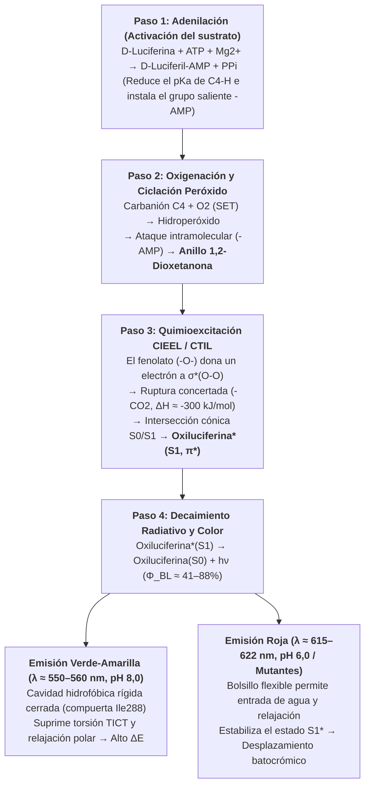

En una cálida noche de verano, miles de luciérnagas (*Photinus pyralis*, *Luciola cruciata*) flotan en la oscuridad como brasas esmeralda. A $1.000\,\text{m}$ bajo la superficie del océano —en las zonas mesopelágica y batipelágica donde no penetra ni un solo fotón solar— más del $75\%$ de los organismos pelágicos, desde el calamar vampiro (*Vampyroteuthis infernalis*) y los peces linterna (*Myctophidae*) hasta los peces abisales y la medusa cristal (*Aequorea victoria*), iluminan el abismo con destellos azules y verdes.

Las fuentes de luz tradicionales, como la llama de una vela ($\sim 1.700\,\text{K}$) o el filamento de tungsteno de una bombilla incandescente ($\sim 2.800\,\text{K}$), requieren temperaturas extremas para emitir luz visible, desperdiciando más del $90\%$ de su energía como calor infrarrojo. Sin embargo, si sostienes una luciérnaga en la palma de la mano, su abdomen se siente completamente frío, a temperatura ambiente ($T \approx 295\text{–}300\,\text{K}$, o $22\text{–}27\,^\circ\text{C}$). De hecho, las proteínas y enzimas sufren una <strong>desnaturalización térmica</strong> irreversible por encima de $315\text{–}323\,\text{K}$ ($42\text{–}50\,^\circ\text{C}$).

¿Cómo logra la vida sortear las leyes de la radiación térmica para convertir la energía de enlace químico directamente en estados electrónicos excitados singulete ($S_1^*$) a $300\,\text{K}$, emitiendo <strong>«luz fría» (Cold Light)</strong> con un rendimiento cuántico de hasta el $41\%\text{–}88\%$?

---

## Capítulo 1: Radiación térmica (Incandescencia) vs. Luminiscencia

### 1.1 El abismo energético entre un fotón visible y la energía térmica ($k_B T$)

En el espectro visible ($\lambda = 400\text{–}700\,\text{nm}$), la energía de un fotón y su equivalente molar vienen dados por:

$$E_{\text{photon}} = h\nu = \frac{hc}{\lambda} \approx \frac{1239,8\,\text{eV}\cdot\text{nm}}{\lambda(\text{nm})}$$

- Luz verde-amarilla de la luciérnaga ($\lambda \approx 560\,\text{nm}$): $E_{\text{photon}} \approx 2,21\,\text{eV}$, $E_{\text{mol}} = N_A h\nu \approx 213,6\,\text{kJ/mol}$.
- Luz azul abisal ($\lambda \approx 470\,\text{nm}$): $E_{\text{photon}} \approx 2,64\,\text{eV}$, $E_{\text{mol}} \approx 254,5\,\text{kJ/mol}$.

En cambio, la energía térmica media $k_B T$ a temperatura ambiente ($T = 300\,\text{K}$) es tan solo:

$$k_B T \big|_{T=300\,\text{K}} \approx 0,02585\,\text{eV}, \qquad RT \big|_{T=300\,\text{K}} \approx 2,494\,\text{kJ/mol}$$

<strong>¡Generar un solo fotón visible requiere casi 100 veces el cuanto de energía térmica media a temperatura ambiente!</strong> En equilibrio térmico a $300\,\text{K}$, la probabilidad de Boltzmann de poblar espontáneamente un estado excitado a $\Delta E = 2,21\,\text{eV}$ es $\exp(-\Delta E / k_B T) = \exp(-85,5) \approx 7,4 \times 10^{-38}$ — físicamente cero.

### 1.2 Ley de Planck y ley de desplazamiento de Wien

La radiancia espectral $B_\lambda(\lambda, T)$ de un cuerpo negro sigue la <strong>ley de Planck</strong>, su pico de emisión la <strong>ley de Wien</strong> y su emitancia total la <strong>ley de Stefan-Boltzmann</strong>:

$$B_\lambda(\lambda, T) = \frac{2hc^2}{\lambda^5} \frac{1}{\exp\left(\dfrac{hc}{\lambda k_B T}\right) - 1}, \qquad \lambda_{\max} \cdot T = 2,8978 \times 10^{-3}\,\text{m}\cdot\text{K}, \qquad J = \sigma T^4$$

A $T = 300\,\text{K}$, el pico se sitúa en el infrarrojo medio ($\lambda_{\max} \approx 9,66\,\mu\text{m}$). Incluso en un filamento de tungsteno a $2.800\,\text{K}$, el pico permanece en el infrarrojo cercano ($\lambda_{\max} \approx 1.035\,\text{nm}$), perdiendo $>90\%$ de la electricidad en calor. Solo la fotosfera solar ($T \approx 5.778\,\text{K}$) alcanza $\lambda_{\max} \approx 501\,\text{nm}$.

### 1.3 Luminiscencia («Luz fría»): excitación cuántica selectiva fuera del equilibrio

Acuñado en 1888 por Eilhardt Wiedemann, el término <strong>luminiscencia</strong> describe toda emisión de luz no térmica donde se inyectan $2\text{–}3\,\text{eV}$ selectivamente en una transición electrónica ($\text{HOMO} \to \text{LUMO}$, $S_0 \to S_1^*$) manteniendo el medio a $300\,\text{K}$.

| Categoría de emisión | Fuente de excitación | Mecanismo físico-químico | Ejemplos representativos | Temperatura |
| :--- | :--- | :--- | :--- | :--- |
| <strong>Incandescencia (Cuerpo negro)</strong> | Agitación térmica ($k_B T$) | Población térmica indiscriminada de todos los modos | Sol, llama de vela, bombilla de filamento | $1.500\text{–}6.000\,\text{K}$ |
| <strong>Fluorescencia (Fotoluminiscencia)</strong> | Absorción de fotón externo ($h\nu_{\text{ex}}$) | Decaimiento permitido por espín $S_1 \to S_0$ ($\tau \sim 10^{-9}\,\text{s}$) | GFP (*Aequorea*), pigmentos de coral, rotuladores | Ambiente ($\sim 300\,\text{K}$) |
| <strong>Fosforescencia</strong> | Absorción fotónica + Cruce intersistema (ISC) | Transición prohibida por espín $T_1 \to S_0$ ($\Delta S = 1, \tau \sim 10^{-3}\text{–}10^4\,\text{s}$) | Pinturas luminiscentes ($\text{SrAl}_2\text{O}_4:\text{Eu}^{2+}$) | Ambiente ($\sim 300\,\text{K}$) |
| <strong>Electroluminiscencia</strong> | Campo eléctrico / inyección de portadores | Recombinación radiativa electrón-hueco | LEDs azules/blancos ($\text{InGaN}$), pantallas OLED | Ambiente |
| <strong>Quimioluminiscencia</strong> | Reordenamiento químico exotérmico | Ruptura de peróxido que puebla directamente $S_1^*$ | Luminol forense, barras luminosas (oxalato) | Ambiente |
| <strong>Bioluminiscencia</strong> | <strong>Quimioluminiscencia catalizada por enzimas</strong> | <strong>Oxidación de luciferina por luciferasa vía 1,2-dioxetanona</strong> | Luciérnagas, *Vargula*, dinoflagelados, *Vibrio*, hongos | <strong>Fisiológica ($275\text{–}310\,\text{K}$)</strong> |

---

## Capítulo 2: Bioluminiscencia vs. Fluorescencia (GFP) vs. Fosforescencia y BRET

```mermaid
flowchart TD
    subgraph INC ["1. Incandescencia (Radiación térmica de cuerpo negro)"]
        T1["Calentamiento extremo (T > 2.500 K)<br/>Agitación térmica indiscriminada de todos los modos"] --> T2["Espectro continuo de Planck B_λ(T)<br/>(>90% perdido como calor IR; letal para proteínas)"]
    end

    subgraph FL ["2. Fotoluminiscencia: Fluorescencia (GFP) y Fosforescencia"]
        F1["Absorción de fotón externo (hν_ex: UV / Azul)<br/>Estado fundamental S0 → Singulete excitado S1 (10^-15 s)"] --> F2["Relajación vibracional (10^-12 s)<br/>Desplazamiento de Stokes (λ_em > λ_ex)"]
        F2 --> F3["Fluorescencia permitida S1 → S0 + hν_em (10^-9 s)<br/>*¡Totalmente oscuro sin luz externa!*"]
        F2 -.->|"Cruce intersistema (ISC: ΔS = 1)"| F4["Fosforescencia prohibida T1 → S0 + hν_ph<br/>(Persistencia de 10^-3 s a horas)"]
    end

    subgraph BL ["3. Bioluminiscencia ('Luz fría' a 300 K)"]
        B1["Luciferina + O2 (+ ATP o Ca2+)<br/>Unida al sitio activo de la luciferasa a 300 K"] --> B2["Anillo peróxido de cuatro miembros tenso<br/>(Intermediario 1,2-dioxetanona)"]
        B2 --> B3["Ruptura concertada CIEEL y Quimioexcitación (-CO2)<br/>Cruce directo de superficies S0 → S1*"]
        B3 --> B4["Oxiluciferina*(S1) → Oxiluciferina(S0) + hν<br/>(Cero luz externa requerida; Φ_BL de 41 a 88%)"]
    end

    subgraph BRET_BOX ["4. Transferencia de energía por resonancia de bioluminiscencia (BRET en Aequorea victoria)"]
        BR1["Aequorina (Coelenterazina + Ca2+)<br/>La quimioexcitación crea el donador azul S1* (470 nm)"] -->|"Acoplamiento dipolo-dipolo de Förster (r < 5 nm)<br/>Transferencia no radiativa E = 1/(1+(r/R0)^6)"| BR2["Excita el cromóforo de la GFP (Ser65-Tyr66-Gly67)<br/>Emite fotón verde (λ = 509 nm)"]
    end
```

Es fundamental distinguir entre <strong>bioluminiscencia</strong> y <strong>biofluorescencia (como la GFP)</strong>:

1. <strong>La fluorescencia (ej. GFP)</strong> es un proceso <strong>fotofísico</strong> que <strong>requiere obligatoriamente luz de excitación externa ($h\nu_{\text{ex}}$, UV o azul)</strong>. Tras absorber el fotón ($10^{-15}\,\text{s}$) y perder parte de la energía por relajación vibracional ($10^{-12}\,\text{s}$), emite en nanosegundos ($\tau \approx 10^{-9}\,\text{s}$) un fotón de mayor longitud de onda (<strong>desplazamiento de Stokes</strong>, $\lambda_{\text{em}} > \lambda_{\text{ex}}$). ¡En total oscuridad sin lámpara externa, un organismo fluorescente no brilla en absoluto!
2. <strong>La fosforescencia</strong> implica un <strong>cruce intersistema (ISC)</strong> desde el estado singulete $S_1$ ($\uparrow\downarrow, S=0$) al estado triplete $T_1$ ($\uparrow\uparrow, S=1$), cuya emisión $T_1 \to S_0$ está prohibida por espín ($\Delta S = 1$), prolongando el resplandor de milisegundos a horas.
3. <strong>La bioluminiscencia</strong> es un proceso <strong>fotoquímico (quimioexcitación)</strong> que opera en <strong>oscuridad absoluta sin luz externa</strong>: la oxidación catalítica de la <strong>luciferina</strong> por la <strong>luciferasa</strong> cruza directamente a la superficie excitada $\text{Oxiluciferina}^*(S_1)$.

### 2.2 Osamu Shimomura (Premio Nobel 2008) y el acoplamiento BRET entre Aequorina y GFP

Al investigar la medusa *Aequorea victoria* (que brilla en <strong>verde a $509\,\text{nm}$</strong>), <strong>Osamu Shimomura</strong> descubrió que la fotoproteína purificada <strong>Aequorina</strong> (con coelenterazina y activada por $\text{Ca}^{2+}$) emite <strong>luz azul ($\lambda_{\max} = 470\,\text{nm}$)</strong> en tubo de ensayo. En el órgano luminoso de la medusa, la Aequorina transfiere su energía de excitación de forma no radiativa a una distancia $r \approx 2\text{–}5\,\text{nm}$ hacia la <strong>proteína verde fluorescente (GFP)</strong> mediante <strong>BRET (Bioluminescence Resonance Energy Transfer)</strong> por acoplamiento dipolo-dipolo de Förster:

$$E_{\text{BRET}} = \frac{1}{1 + \left(\dfrac{r}{R_0}\right)^6}, \qquad R_0^6 \propto \kappa^2 \, \Phi_D \, n^{-4} \int_0^\infty F_D(\lambda)\, \varepsilon_A(\lambda)\, \lambda^4 \, d\lambda$$

---

## Capítulo 3: Química cuántica de la reacción Luciferina–Luciferasa de la luciérnaga

La reacción en los peroxisomas de las células fotócitas de *Photinus pyralis* o *Luciola* emplea <strong>D-luciferina</strong>, la enzima <strong>luciferasa ($61\,\text{kDa}$)</strong>, $\text{ATP}$, $\text{Mg}^{2+}$ y $\text{O}_2$ en cuatro etapas:

1. <strong>Paso 1: Adenilación (Activación del sustrato) — Desmitificando el papel del ATP</strong>
   $$\text{D-Luciferina} + \text{ATP} \xrightarrow{\text{Luciferasa, Mg}^{2+}} \text{E}\cdot\text{D-Luciferil-AMP} + \text{PP}_i$$
   <strong>Aclaración termodinámica clave</strong>: La hidrólisis del ATP ($\Delta G^{\circ\prime} \approx -30,5\,\text{kJ/mol}$) <strong>no</strong> aporta los $214\,\text{kJ/mol}$ de un fotón de $560\,\text{nm}$. El ATP actúa como <strong>activador cinético</strong>: convierte el grupo $-\text{COO}^-$ en el éster acil-adenilato ($-\text{CO-AMP}$), reduciendo drásticamente el $pK_a$ del protón C4 para formar un carbanión e instalando un excelente grupo saliente ($-\text{AMP}$).
2. <strong>Paso 2: Transferencia monoelectrónica (SET), oxigenación y ciclación a 1,2-dioxetanona</strong>
   El carbanión C4 reacciona con el oxígeno triplete ($^3\text{O}_2$) vía SET formando un hidroperóxido que expulsa $\text{AMP}$ por sustitución nucleofílica intramolecular, cerrando un anillo peróxido de cuatro miembros altamente tenso: la <strong>1,2-dioxetanona ($\alpha$-peroxilactona)</strong>.
3. <strong>Paso 3: Mecanismo CIEEL / CTIL e intersección cónica $S_0/S_1$</strong>
   La descomposición de la 1,2-dioxetanona en <strong>oxiluciferina</strong> y $\text{CO}_2$ libera $\Delta H \approx -280\text{ a }-320\,\text{kJ/mol}$ al aliviar la tensión del anillo ($\sim 110\,\text{kJ/mol}$), romper el débil enlace $\text{O}-\text{O}$ ($\sim 140\,\text{kJ/mol}$) y formar los dos enlaces dobles ultraestables $\text{C}=\text{O}$ del $\text{CO}_2$.
   Según las <strong>reglas de simetría orbital de Woodward–Hoffmann</strong> y el mecanismo <strong>CIEEL / CTIL</strong>, el fenolato desprotonado ($-\text{O}^-$) transfiere densidad electrónica al orbital antienlazante $\sigma^*(\text{O}-\text{O})$. Como la ruptura concertada en el estado fundamental $S_0$ está prohibida por simetría orbital, la superficie $S_0$ sube abruptamente y cruza la superficie excitada singulete $S_1$ en una <strong>intersección cónica (Conical Intersection)</strong>. Al salir el $\text{CO}_2$, la retrodonación electrónica puebla directamente el $\text{LUMO}(\pi^*)$, generando <strong>$\text{Oxiluciferina}^*(S_1)$</strong> a $300\,\text{K}$.
4. <strong>Paso 4: Emisión de fotones, rendimiento cuántico ($\Phi_{\text{BL}}$) y sintonización del color</strong>
   $$\text{Oxiluciferina}^*(S_1) \longrightarrow \text{Oxiluciferina}(S_0) + h\nu \quad (\lambda_{\max} \approx 560\,\text{nm}), \qquad \Phi_{\text{BL}} = \Phi_{\text{chem}} \times \Phi_{\text{ex}} \times \Phi_{\text{fl}}$$
   Mediciones absolutas con esfera integradora determinaron $\Phi_{\text{BL}} = 41,0 \pm 7,4\%$ a pH 8,5 (Ando et al., 2008, *Nature Photonics*).
   <strong>Sintonización del color ($538\,\text{nm}$ verde a $622\,\text{nm}$ rojo)</strong>: Nakatsu et al. (2006, *Nature*) demostraron que el residuo <strong>Ile288</strong> actúa como una compuerta hidrofóbica rígida que impide la torsión TICT y la entrada de agua para emitir luz verde-amarilla ($560\,\text{nm}$), mientras que a pH ácido (6,0) o en mutantes la cavidad se relaja, estabilizando el estado $S_1^*$ y desplazando la emisión al rojo ($615\,\text{nm}$, <strong>desplazamiento batocrómico</strong>).

---

## Capítulo 4: Evolución convergente (40–90+ orígenes) y ecología de aguas profundas

La bioluminiscencia evolucionó de forma independiente <strong>entre 40 y más de 90 veces</strong> (Haddock et al., 2010) a partir de pigmentos antioxidantes detoxificadores de especies reactivas de oxígeno (ROS):

1. <strong>Sistemas marinos de coelenterazina y vargulina (*Cypridina*)</strong>: Más del $75\%$ de los organismos mesopelágicos brillan. La <strong>coelenterazina</strong> se emplea en más de nueve filos animales (a menudo adquirida en la dieta) y emite luz azul ($\lambda_{\max} = 450\text{–}490\,\text{nm}$), coincidiendo con la ventana de máxima transmisión óptica del agua de mar. El ostrácodo *Vargula hilgendorfii* expulsa nubes luminosas azules ($462\,\text{nm}$) usando <strong>vargulina</strong>.
2. <strong>Dinoflagelados (*Noctiluca*) y canales de protones dependientes de voltaje ($\text{H}_v1$)</strong>: El <strong>esfuerzo cortante hidrodinámico</strong> de las olas despolariza la membrana vacuolar y abre los canales <strong>$\text{H}_v1$</strong>, reduciendo el pH de los <strong>scintillones</strong> de $8,0$ a $6,0$ en milisegundos y disparando un destello azul de $100\,\text{ms}$ ($475\,\text{nm}$) como «alarma antirrobo» (*Burglar Alarm*).
3. <strong>Operón bacteriano `luxCDABEG` y percepción de quórum (Quorum Sensing)</strong>: Las bacterias simbióticas *Aliivibrio fischeri* (en el calamar *Euprymna scolopes*) oxidan $\text{FMNH}_2$ y un aldehído de cadena larga ($\text{RCHO}$) a $490\,\text{nm}$ solo cuando el autoinductor <strong>AHL</strong> supera un umbral de alta densidad celular ($>10^{10}\,\text{células/mL}$).
4. <strong>Ciclo fúngico del ácido cafeico (*Mycena*, *Neonothopanus*)</strong>: Cuatro enzimas (`HispS`, `H3H`, `Luz`, `CPH`) convierten el ácido cafeico en <strong>3-hidroxihispidina</strong>, que emite luz verde ($520\text{–}530\,\text{nm}$) y se recicla de nuevo a ácido cafeico (Kotlobay et al., 2018, *PNAS*).
5. <strong>Contrailuminación y reflectores rojos furtivos (*Malacosteus niger*)</strong>: Los peces linterna borran su silueta ventral mediante contrailuminación azul ($475\,\text{nm}$), mientras que el pez dragón *Malacosteus niger* emite luz rojo lejano/infrarrojo cercano ($>700\,\text{nm}$) acoplada a un fotosensibilizador derivado de clorofila para cazar presas rojas sin ser detectado.

---

## Capítulo 5: Imagen médica (AkaBLI), higiene por ATP y plantas autoluminiscentes

1. <strong>Imagen por bioluminiscencia *in vivo* (BLI) y el sistema infrarrojo cercano AkaBLI</strong>: Sin ruido de autofluorescencia, la BLI alcanzó un hito cuando Iwano & Miyawaki et al. (2018, *Science*, RIKEN) diseñaron el par <strong>AkaLumine-HCl / AkaLuc</strong> ($\lambda_{\max} = 677\,\text{nm}$ en la ventana biológica infrarroja), aumentando 1.000 veces la sensibilidad profunda y logrando visualizar <strong>una sola célula cancerosa metastásica</strong> en los pulmones de un ratón vivo.
2. <strong>NanoLuc y luminómetros de higiene por ATP</strong>: La luciferasa <strong>NanoLuc ($19\,\text{kDa}$)</strong> del camarón abisal *Oplophorus* brilla $150\times$ más que la de luciérnaga; los luminómetros de ATP cuantifican $10^{-15}\text{–}10^{-18}\,\text{mol}$ de ATP microbiano en 10 segundos para control quirúrgico, alimentario y espacial.
3. <strong>Plantas autoluminiscentes (*Firefly Petunia*)</strong>: Al transferir los cuatro genes del ciclo fúngico del ácido cafeico (precursor universal de la lignina vegetal) al tabaco y la petunia (Mitiouchkina et al., 2020, *Nature Biotechnology*), se crearon plantas que brillan con luz verde visible a simple vista durante toda su vida sin sustratos externos.
