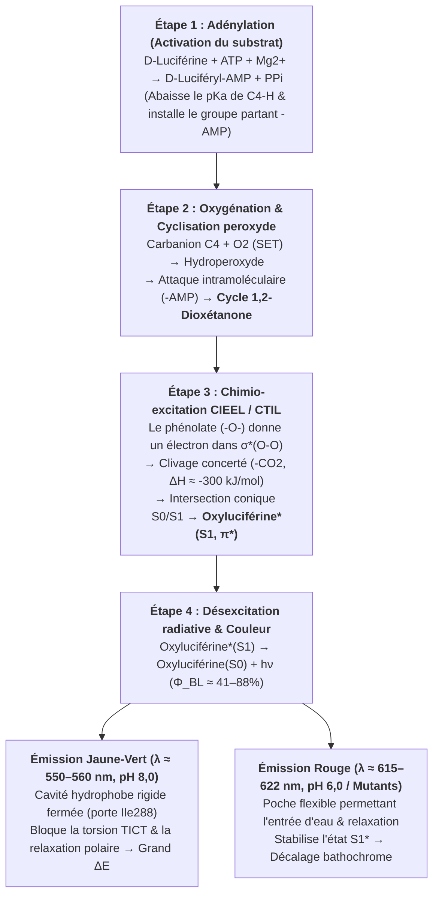

Par une douce soirée d'été, les lucioles (*Photinus pyralis*, *Luciola cruciata*) parsèment l'obscurité de lueurs émeraude. À $1\,000\,\text{m}$ de profondeur dans l'océan — au cœur des zones mésopélagique et bathypélagique où aucun photon solaire ne pénètre — plus de $75\%$ des espèces pélagiques, du calmar vampire (*Vampyroteuthis infernalis*) aux poissons-lanternes (*Myctophidae*), baudroies abyssales et méduses (*Aequorea victoria*), produisent d'intenses éclats bleus et verts.

Les sources lumineuses classiques telles qu'une flamme de bougie ($\sim 1\,700\,\text{K}$) ou le filament de tungstène d'une ampoule à incandescence ($\sim 2\,800\,\text{K}$) exigent une chaleur extrême pour rayonner dans le visible, gaspillant plus de $90\%$ de leur énergie sous forme d'infrarouges. Pourtant, une luciole posée dans la paume de la main reste parfaitement froide, à température ambiante ($T \approx 295\text{–}300\,\text{K}$, soit $22\text{–}27\,^\circ\text{C}$). Au-delà de $315\text{–}323\,\text{K}$ ($42\text{–}50\,^\circ\text{C}$), les protéines subissent une <strong>dénaturation thermique</strong> irréversible.

Comment le vivant contourne-t-il les lois du rayonnement thermique pour convertir directement l'énergie de liaison chimique en états électroniques excités singulets ($S_1^*$) à $300\,\text{K}$, produisant une <strong>« lumière froide » (Cold Light)</strong> avec un rendement quantique atteignant $41\%\text{ à }88\%$ ?

---

## Chapitre 1 : Rayonnement thermique (Incandescence) vs Luminescence

### 1.1 Le fossé énergétique entre un photon visible et l'agitation thermique ($k_B T$)

Dans le spectre visible ($\lambda = 400\text{–}700\,\text{nm}$), l'énergie d'un photon et l'énergie molaire correspondante valent :

$$E_{\text{photon}} = h\nu = \frac{hc}{\lambda} \approx \frac{1239,8\,\text{eV}\cdot\text{nm}}{\lambda(\text{nm})}$$

- Lumière jaune-vert de la luciole ($\lambda \approx 560\,\text{nm}$) : $E_{\text{photon}} \approx 2,21\,\text{eV}$, $E_{\text{mol}} = N_A h\nu \approx 213,6\,\text{kJ/mol}$.
- Lumière bleue abyssale ($\lambda \approx 470\,\text{nm}$) : $E_{\text{photon}} \approx 2,64\,\text{eV}$, $E_{\text{mol}} \approx 254,5\,\text{kJ/mol}$.

En revanche, l'énergie thermique moyenne $k_B T$ à température ambiante ($T = 300\,\text{K}$) n'est que de :

$$k_B T \big|_{T=300\,\text{K}} \approx 0,02585\,\text{eV}, \qquad RT \big|_{T=300\,\text{K}} \approx 2,494\,\text{kJ/mol}$$

<strong>La création d'un seul photon visible requiert donc près de 100 fois le quantum d'énergie thermique moyen à température ambiante !</strong> À l'équilibre thermique à $300\,\text{K}$, le facteur de Boltzmann permettant de peupler un état excité à $\Delta E = 2,21\,\text{eV}$ vaut $\exp(-\Delta E / k_B T) = \exp(-85,5) \approx 7,4 \times 10^{-38}$ — soit strictement zéro.

### 1.2 Loi de Planck et loi du déplacement de Wien

La luminance énergétique spectrale $B_\lambda(\lambda, T)$ d'un corps noir obéit à la <strong>loi de Planck</strong>, sa longueur d'onde maximale à la <strong>loi de Wien</strong> et sa puissance totale à la <strong>loi de Stefan-Boltzmann</strong> :

$$B_\lambda(\lambda, T) = \frac{2hc^2}{\lambda^5} \frac{1}{\exp\left(\dfrac{hc}{\lambda k_B T}\right) - 1}, \qquad \lambda_{\max} \cdot T = 2,8978 \times 10^{-3}\,\text{m}\cdot\text{K}, \qquad J = \sigma T^4$$

À $T = 300\,\text{K}$, le pic d'émission se situe dans l'infrarouge moyen ($\lambda_{\max} \approx 9,66\,\mu\text{m}$). Même dans un filament de tungstène à $2\,800\,\text{K}$, le pic reste dans le proche infrarouge ($\lambda_{\max} \approx 1\,035\,\text{nm}$), dissipant $>90\%$ de l'électricité en chaleur. Seule la photosphère solaire ($T \approx 5\,778\,\text{K}$) atteint $\lambda_{\max} \approx 501\,\text{nm}$.

### 1.3 La luminescence (« lumière froide ») : excitation quantique sélective hors équilibre

Introduite en 1888 par Eilhardt Wiedemann, la <strong>luminescence</strong> désigne toute émission lumineuse non thermique où $2\text{ à }3\,\text{eV}$ sont injectés sélectivement dans une transition électronique ($\text{HOMO} \to \text{LUMO}$, $S_0 \to S_1^*$) sans échauffer les modes vibrationnels du milieu.

| Catégorie d'émission | Source d'excitation | Mécanisme physico-chimique | Exemples représentatifs | Température |
| :--- | :--- | :--- | :--- | :--- |
| <strong>Incandescence (Corps noir)</strong> | Agitation thermique ($k_B T$) | Excitation thermique globale de tous les modes | Soleil, flamme, ampoule à filament | $1\,500\text{–}6\,000\,\text{K}$ |
| <strong>Fluorescence (Photoluminescence)</strong> | Absorption d'un photon externe ($h\nu_{\text{ex}}$) | Désexcitation permise de spin $S_1 \to S_0$ ($\tau \sim 10^{-9}\,\text{s}$) | Protéine GFP (*Aequorea*), coraux, surligneurs | Ambiante ($\sim 300\,\text{K}$) |
| <strong>Phosphorescence</strong> | Absorption photonique + Croisement intersystème (ISC) | Transition interdite de spin $T_1 \to S_0$ ($\Delta S = 1, \tau \sim 10^{-3}\text{–}10^4\,\text{s}$) | Peintures phosphorescentes ($\text{SrAl}_2\text{O}_4:\text{Eu}^{2+}$) | Ambiante ($\sim 300\,\text{K}$) |
| <strong>Électroluminescence</strong> | Champ électrique / injection de porteurs | Recombinaison électron-trou dans un semi-conducteur | LED bleues/blanches ($\text{InGaN}$), écrans OLED | Ambiante |
| <strong>Chimiluminescence</strong> | Réarrangement de liaisons chimiques exothermique | Clivage d'un peroxyde peuplant directement $S_1^*$ | Luminol médico-légal, bâtons lumineux (oxalate) | Ambiante |
| <strong>Bioluminescence</strong> | <strong>Chimiluminescence catalysée par une enzyme</strong> | <strong>Oxydation de la luciférine par la luciférase via 1,2-dioxétanone</strong> | Lucioles, *Vargula*, dinoflagellés, *Vibrio*, champignons | <strong>Physiologique ($275\text{–}310\,\text{K}$)</strong> |

---

## Chapitre 2 : Bioluminescence vs Fluorescence (GFP) vs Phosphorescence et BRET

```mermaid
flowchart TD
    subgraph INC ["1. Incandescence (Rayonnement thermique du corps noir)"]
        T1["Chauffage extrême (T > 2 500 K)<br/>Agitation thermique non sélective de tous les modes"] --> T2["Spectre continu de Planck B_λ(T)<br/>(>90% perdu en chaleur IR ; létal pour les protéines)"]
    end

    subgraph FL ["2. Photoluminescence : Fluorescence (GFP) & Phosphorescence"]
        F1["Absorption d'un photon externe (hν_ex : UV / Bleu)<br/>État fondamental S0 → Singulet excité S1 (10^-15 s)"] --> F2["Relaxation vibrationnelle (10^-12 s)<br/>Décalage de Stokes (λ_em > λ_ex)"]
        F2 --> F3["Fluorescence permise S1 → S0 + hν_em (10^-9 s)<br/>*Totalement sombre sans lumière externe !*"]
        F2 -.->|"Croisement intersystème (ISC : ΔS = 1)"| F4["Phosphorescence interdite T1 → S0 + hν_ph<br/>(Rémanence de 10^-3 s à plusieurs heures)"]
    end

    subgraph BL ["3. Bioluminescence ('Lumière froide' à 300 K)"]
        B1["Luciférine + O2 (+ ATP ou Ca2+)<br/>Liée au site actif de la luciférase à 300 K"] --> B2["Cycle peroxyde à quatre chaînons tendu<br/>(Intermédiaire 1,2-dioxétanone)"]
        B2 --> B3["Clivage concerté CIEEL & Chimio-excitation (-CO2)<br/>Croisement direct des surfaces S0 → S1*"]
        B3 --> B4["Oxyluciférine*(S1) → Oxyluciférine(S0) + hν<br/>(Aucune lumière externe requise ; Φ_BL de 41 à 88%)"]
    end

    subgraph BRET_BOX ["4. Transfert d'énergie par résonance de bioluminescence (BRET chez Aequorea victoria)"]
        BR1["Aequorine (Coelentérazine + Ca2+)<br/>La chimio-excitation crée le donneur bleu S1* (470 nm)"] -->|"Couplage dipôle-dipôle de Förster (r < 5 nm)<br/>Transfert non radiatif E = 1/(1+(r/R0)^6)"| BR2["Excite le chromophore de la GFP (Ser65-Tyr66-Gly67)<br/>Émet un photon vert (λ = 509 nm)"]
    end
```

Il est essentiel de dissiper la confusion fréquente entre <strong>bioluminescence</strong> et <strong>biofluorescence (GFP)</strong> :

1. <strong>La fluorescence (ex. GFP)</strong> est un processus <strong>photophysique</strong> qui <strong>exige impérativement une lumière d'excitation externe ($h\nu_{\text{ex}}$, UV ou bleue)</strong>. Après absorption ($10^{-15}\,\text{s}$) et relaxation vibrationnelle ($10^{-12}\,\text{s}$), la molécule émet en quelques nanosecondes ($\tau \approx 10^{-9}\,\text{s}$) un photon de plus grande longueur d'onde (<strong>décalage de Stokes</strong>, $\lambda_{\text{em}} > \lambda_{\text{ex}}$). Dans l'obscurité totale sans lampe UV/bleue, un organisme purement fluorescent reste totalement invisible !
2. <strong>La phosphorescence</strong> implique un <strong>croisement intersystème (ISC)</strong> de l'état singulet $S_1$ ($\uparrow\downarrow, S=0$) vers l'état triplet $T_1$ ($\uparrow\uparrow, S=1$), suivi d'une émission lente $T_1 \to S_0$ interdite de spin ($\Delta S = 1$).
3. <strong>La bioluminescence</strong> est un processus <strong>photochimique (chimio-excitation)</strong> qui fonctionne dans <strong>l'obscurité absolue sans aucune source lumineuse externe</strong> : l'oxydation enzymatique de la <strong>luciférine</strong> par la <strong>luciférase</strong> propulse directement le produit dans l'état excité $\text{Oxyluciférine}^*(S_1)$.

### 2.2 Osamu Shimomura (Prix Nobel 2008) et le couplage BRET entre Aequorine et GFP

En étudiant la méduse *Aequorea victoria* (qui brille en <strong>vert à $509\,\text{nm}$</strong>), <strong>Osamu Shimomura</strong> découvrit en 1961 que la photoprotéine bioluminescente purifiée, l'<strong>Aequorine</strong> (liant la coelentérazine et activée par $\text{Ca}^{2+}$), émet en réalité une <strong>lumière bleue ($\lambda_{\max} = 470\,\text{nm}$)</strong> ! Dans l'ombrelle de la méduse, l'Aequorine transfère son énergie d'excitation de manière non radiative sur une distance $r \approx 2\text{–}5\,\text{nm}$ à la <strong>protéine fluorescente verte (GFP)</strong> par <strong>BRET (Bioluminescence Resonance Energy Transfer)</strong> selon la loi dipôle-dipôle de Förster :

$$E_{\text{BRET}} = \frac{1}{1 + \left(\dfrac{r}{R_0}\right)^6}, \qquad R_0^6 \propto \kappa^2 \, \Phi_D \, n^{-4} \int_0^\infty F_D(\lambda)\, \varepsilon_A(\lambda)\, \lambda^4 \, d\lambda$$

---

## Chapitre 3 : Chimie quantique de la réaction Luciférine–Luciférase de la luciole

Nommés en 1885 par le physiologiste français <strong>Raphaël Dubois</strong>, le substrat <strong>D-luciférine</strong> et l'enzyme <strong>luciférase ($61\,\text{kDa}$)</strong> de la luciole (*Photinus pyralis*, *Luciola*) opèrent en quatre étapes :

1. <strong>Étape 1 : Adénylation (Activation du substrat) — Démystifier le rôle de l'ATP</strong>
   $$\text{D-Luciférine} + \text{ATP} \xrightarrow{\text{Luciférase, Mg}^{2+}} \text{E}\cdot\text{D-Luciféryl-AMP} + \text{PP}_i$$
   <strong>Correction thermodynamique essentielle</strong> : L'hydrolyse de l'ATP ($\Delta G^{\circ\prime} \approx -30,5\,\text{kJ/mol}$) ne fournit <strong>pas</strong> les $214\,\text{kJ/mol}$ d'un photon à $560\,\text{nm}$ ! L'ATP assure une <strong>activation cinétique</strong> : la conversion du groupe $-\text{COO}^-$ en ester acyl-adénylate ($-\text{CO-AMP}$) abaisse fortement le $pK_a$ du proton C4 (facilitant la formation d'un carbanion) et installe un excellent groupe partant ($-\text{AMP}$).
2. <strong>Étape 2 : Transfert monoélectronique (SET), oxygénation et cyclisation en 1,2-dioxétanone</strong>
   Le carbanion C4 réagit avec le dioxygène triplet ($^3\text{O}_2$) par SET pour former un hydroperoxyde qui expulse l'AMP par substitution nucléophile intramoléculaire, fermant un cycle peroxyde à quatre chaînons ultra-tendu : la <strong>1,2-dioxétanone ($\alpha$-peroxylactone)</strong>.
3. <strong>Étape 3 : Mécanisme CIEEL / CTIL et intersection conique $S_0/S_1$</strong>
   Le clivage de la 1,2-dioxétanone en <strong>oxyluciférine</strong> et $\text{CO}_2$ libère $\Delta H \approx -280\text{ à }-320\,\text{kJ/mol}$ grâce au relâchement de la tension de cycle ($\sim 110\,\text{kJ/mol}$), à la rupture de la liaison faible $\text{O}-\text{O}$ ($\sim 140\,\text{kJ/mol}$) et à la formation des deux doubles liaisons ultra-stables $\text{C}=\text{O}$ du $\text{CO}_2$.
   Selon les <strong>règles de symétrie orbitale de Woodward–Hoffmann</strong> et le mécanisme <strong>CIEEL (Chemically Initiated Electron Exchange Luminescence) / CTIL</strong>, le groupe phénolate déprotoné ($-\text{O}^-$) transfère un électron vers l'orbitale antiliante $\sigma^*(\text{O}-\text{O})$. La barrière de symétrie sur la surface fondamentale $S_0$ provoque une <strong>intersection conique (Conical Intersection)</strong> avec la surface excitée singulet $S_1$. Au départ du $\text{CO}_2$, le rétro-transfert électronique peuple directement la $\text{LUMO}(\pi^*)$, donnant naissance à l'<strong>oxyluciférine excitée $\text{Oxyluciférine}^*(S_1)$</strong> !
4. <strong>Étape 4 : Émission photonique, rendement quantique ($\Phi_{\text{BL}}$) et modulation de couleur</strong>
   $$\text{Oxyluciférine}^*(S_1) \longrightarrow \text{Oxyluciférine}(S_0) + h\nu \quad (\lambda_{\max} \approx 560\,\text{nm}), \qquad \Phi_{\text{BL}} = \Phi_{\text{chem}} \times \Phi_{\text{ex}} \times \Phi_{\text{fl}}$$
   Le rendement quantique atteint $\Phi_{\text{BL}} = 41,0 \pm 7,4\%$ à pH 8,5 (Ando et al., 2008, *Nature Photonics*), avec une efficacité de chimio-excitation $\Phi_{\text{ex}}$ de $60\text{–}90\%$.
   <strong>Modulation chromatique ($538\,\text{nm}$ vert à $622\,\text{nm}$ rouge)</strong> : Nakatsu et al. (2006, *Nature*) ont démontré par cristallographie aux rayons X que le résidu <strong>Ile288</strong> verrouille la cavité hydrophobe autour de l'oxyluciférine pour émettre dans le jaune-vert ($560\,\text{nm}$), tandis qu'un relâchement de la poche (à pH 6,0 ou chez des mutants) permet l'entrée d'eau et la relaxation dipolaire de $S_1^*$, décalant l'émission vers le rouge ($615\,\text{nm}$, <strong>effet bathochrome</strong>).

---

## Chapitre 4 : Évolution convergente (40 à 90+ origines) et écologie abyssale

Apparue indépendamment <strong>entre 40 et plus de 90 fois</strong> au cours de l'évolution (Haddock et al., 2010) à partir de systèmes antioxydants détoxifiant les espèces réactives de l'oxygène (ROS), la bioluminescence se décline en quatre grands systèmes non coléoptères :

1. <strong>Systèmes marins à coelentérazine et varguline (*Cypridina*)</strong> : Plus de $75\%$ des organismes mésopélagiques sont bioluminescents. La <strong>coelentérazine</strong>, partagée par plus de neuf embranchements (souvent acquise via la chaîne alimentaire), émet dans le bleu ($\lambda_{\max} = 450\text{–}490\,\text{nm}$), fenêtre de transparence maximale de l'eau de mer. Le crustacé ostracode *Vargula hilgendorfii* projette des nuages bleus ($462\,\text{nm}$) à base de <strong>varguline</strong>.
2. <strong>Dinoflagellés (*Noctiluca*) et canaux à protons dépendants du potentiel ($\text{H}_v1$)</strong> : La <strong>contrainte de cisaillement mécanique</strong> des vagues dépolarise la membrane vacuolaire et ouvre les canaux <strong>$\text{H}_v1$</strong>, abaissant le pH des <strong>scintillons</strong> de $8,0$ à $6,0$ en quelques millisecondes pour déclencher un flash bleu de $100\,\text{ms}$ ($475\,\text{nm}$) servant d'« alarme anti-intrusion » (*Burglar Alarm*).
3. <strong>Opéron bactérien `luxCDABEG` et détection du quorum (Quorum Sensing)</strong> : Les bactéries symbiotiques *Aliivibrio fischeri* (hébergées par le calmar *Euprymna scolopes*) oxydent $\text{FMNH}_2$ et un aldéhyde aliphatique ($\text{RCHO}$) à $490\,\text{nm}$ uniquement lorsque l'auto-inducteur <strong>AHL</strong> dépasse un seuil de densité cellulaire ($>10^{10}\,\text{cellules/mL}$).
4. <strong>Cycle fongique de l'acide caféique (*Mycena*, *Neonothopanus*)</strong> : Quatre enzymes (`HispS`, `H3H`, `Luz`, `CPH`) convertissent l'acide caféique en <strong>3-hydroxyhispidine</strong> qui émet à $520\text{–}530\,\text{nm}$ avant d'être recyclée (Kotlobay et al., 2018, *PNAS*).
5. <strong>Contre-illumination et projecteurs rouges furtifs (*Malacosteus niger*)</strong> : Les poissons-lanternes effacent leur ombre ventrale par contre-illumination bleue ($475\,\text{nm}$), tandis que le poisson-dragon *Malacosteus niger* émet dans le rouge lointain/proche infrarouge ($>700\,\text{nm}$) couplé à un photosensibilisateur dérivé de la chlorophylle pour chasser sans être vu.

---

## Chapitre 5 : Imagerie médicale (AkaBLI), hygiène ATP et plantes autoluminescentes

1. <strong>Imagerie par bioluminescence *in vivo* (BLI) et système proche infrarouge AkaBLI</strong> : Dépourvue de bruit d'autofluorescence, la BLI a été révolutionnée par Iwano & Miyawaki et al. (2018, *Science*, RIKEN) grâce au couple <strong>AkaLumine-HCl / AkaLuc</strong> émettant dans la fenêtre biologique proche infrarouge ($\lambda_{\max} = 677\,\text{nm}$), multipliant par $1\,000$ la sensibilité en profondeur et permettant de visualiser <strong>une seule cellule cancéreuse métastatique</strong> dans le poumon d'une souris vivante.
2. <strong>NanoLuc et luminomètres ATP</strong> : La luciférase miniature <strong>NanoLuc ($19\,\text{kDa}$)</strong> issue de la crevette abyssale *Oplophorus* est $150\times$ plus brillante que celle de la luciole ; les luminomètres ATP détectent en 10 secondes $10^{-15}\text{–}10^{-18}\,\text{mol}$ d'ATP microbien en milieu hospitalier ou spatial.
3. <strong>Plantes autoluminescentes (*Firefly Petunia*)</strong> : L'intégration des quatre gènes du cycle fongique de l'acide caféique dans le tabac et le pétunia (Mitiouchkina et al., 2020, *Nature Biotechnology*) permet aux plantes de briller d'une lumière verte autonome visible à l'œil nu tout au long de leur vie.
