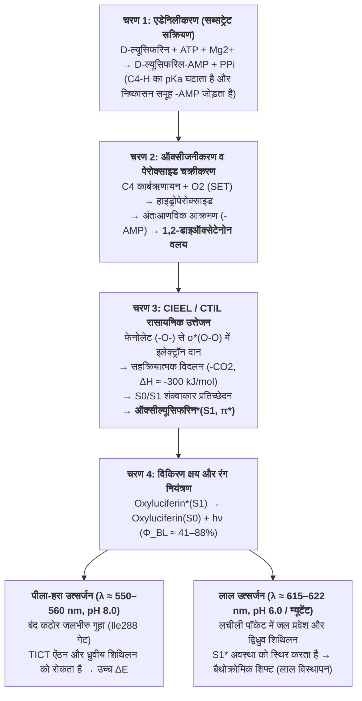

गर्मियों की शांत शाम में नदी के किनारे उड़ते हजारों जुगनू (*Photinus pyralis*, *Luciola cruciata*) अंधेरे में पन्ने की चिंगारियों जैसे दिखते हैं। वहीं समुद्र की सतह से $1,000\,\text{m}$ नीचे — मेसोपेلاجिक और बाथीपेلاجिक अंधकार क्षेत्रों में जहाँ सूर्य का एक भी फोटॉन नहीं पहुँच पाता — $75\%$ से अधिक समुद्री जीव, जैसे वैम्पायर स्क्विड (*Vampyroteuthis infernalis*), लैंटर्नफ़िश (*Myctophidae*), एंगलरफ़िश और क्रिस्टल जेलीफ़िश (*Aequorea victoria*), नीले और हरे प्रकाश की अद्भुत चमक पैदा करते हैं।

मोमबत्ती की लौ ($\sim 1,700\,\text{K}$) या तापदीप्त बल्ब के टंगस्टन फिलामेंट ($\sim 2,800\,\text{K}$) जैसे पारंपरिक प्रकाश स्रोतों को दृश्य प्रकाश उत्पन्न करने के लिए अत्यधिक तापमान की आवश्यकता होती है, जिसमें $90\%$ से अधिक ऊर्जा अवरक्त (Infrared) ऊष्मा के रूप में व्यर्थ हो जाती है। किंतु यदि आप किसी चमकते हुए जुगनू को अपनी हथेली पर रखें, तो उसका पेट बिल्कुल ठंडा — कमरे के तापमान ($T \approx 295\text{–}300\,\text{K}$ या $22\text{–}27\,^\circ\text{C}$) पर महसूस होता है। वास्तव में, जैविक प्रोटीन और एंजाइम $315\text{–}323\,\text{K}$ ($42\text{–}50\,^\circ\text{C}$) से ऊपर जाने पर अपरिवर्तनीय <strong>तापीय विकृतीकरण (Thermal Denaturation)</strong> का शिकार होकर नष्ट हो जाते हैं।

आखिर जीवन तापीय विकिरण के नियमों को दरकिनार कर कमरे के तापमान ($300\,\text{K}$) पर रासायनिक बंधन ऊर्जा को सीधे एकल अणु की <strong>इलेक्ट्रॉनिक रूप से उत्तेजित सिंगलेट अवस्था ($S_1^*$)</strong> में कैसे पंप करता है, और $41\%\text{–}88\%$ तक की क्वांटम दक्षता के साथ <strong>'ठंडी रोशनी' (Cold Light)</strong> कैसे उत्पन्न करता है?

---

## अध्याय 1: तापीय विकिरण (Incandescence) बनाम लुमिनेसेंस (Luminescence)

### 1.1 दृश्य फोटॉन ऊर्जा और कमरे के तापीय ऊर्जा ($k_B T$) के बीच की विशाल खाई

दृश्य स्पेक्ट्रम ($\lambda = 400\text{–}700\,\text{nm}$) में एकल फोटॉन की ऊर्जा $E_{\text{photon}}$ और प्रति मोल ऊर्जा $E_{\text{mol}}$ प्लैंक के सूत्र से दी जाती है:

$$E_{\text{photon}} = h\nu = \frac{hc}{\lambda} \approx \frac{1239.8\,\text{eV}\cdot\text{nm}}{\lambda(\text{nm})}$$

- जुगनू का पीला-हरा प्रकाश ($\lambda \approx 560\,\text{nm}$): $E_{\text{photon}} \approx 2.21\,\text{eV}$, $E_{\text{mol}} = N_A h\nu \approx 213.6\,\text{kJ/mol}$.
- गहरे समुद्र का नीला प्रकाश ($\lambda \approx 470\,\text{nm}$): $E_{\text{photon}} \approx 2.64\,\text{eV}$, $E_{\text{mol}} \approx 254.5\,\text{kJ/mol}$.

इसके विपरीत, कमरे के तापमान ($T = 300\,\text{K}$) पर अणुओं की औसत तापीय गतिज ऊर्जा $k_B T$ मात्र इतनी होती है:

$$k_B T \big|_{T=300\,\text{K}} \approx 0.02585\,\text{eV}, \qquad RT \big|_{T=300\,\text{K}} \approx 2.494\,\text{kJ/mol}$$

अर्थात् <strong>एक दृश्य फोटॉन उत्पन्न करने के लिए कमरे के तापमान की औसत तापीय ऊर्जा ($0.026\,\text{eV}$) से लगभग 100 गुना अधिक केंद्रित ऊर्जा की आवश्यकता होती है!</strong> $300\,\text{K}$ के तापीय संतुलन में केवल तापीय उतार-चढ़ाव से $\Delta E = 2.21\,\text{eV}$ की उत्तेजित अवस्था प्राप्त करने की बोल्ट्ज़मैन प्रायिकता $\exp(-\Delta E / k_B T) = \exp(-85.5) \approx 7.4 \times 10^{-38}$ है — जो भौतिक रूप से शून्य है।

### 1.2 प्लैंक का कृष्णिका विकिरण नियम और वीन का विस्थापन नियम

किसी कृष्णिका (Blackbody) की स्पेक्ट्रमी विकिरण तीव्रता $B_\lambda(\lambda, T)$ <strong>प्लैंक के नियम</strong> का, उसकी शिखर तरंगदैर्घ्य $\lambda_{\max}$ <strong>वीन के विस्थापन नियम (Wien's Displacement Law)</strong> का, और कुल उत्सर्जन <strong>स्टीफन-बोल्ट्ज़मैन नियम</strong> का पालन करता है:

$$B_\lambda(\lambda, T) = \frac{2hc^2}{\lambda^5} \frac{1}{\exp\left(\dfrac{hc}{\lambda k_B T}\right) - 1}, \qquad \lambda_{\max} \cdot T = 2.8978 \times 10^{-3}\,\text{m}\cdot\text{K}, \qquad J = \sigma T^4$$

$T = 300\,\text{K}$ पर उत्सर्जन शिखर मध्य-अवरक्त क्षेत्र ($\lambda_{\max} \approx 9.66\,\mu\text{m}$) में होता है। यहाँ तक कि $2,800\,\text{K}$ पर जलते टंगस्टन बल्ब का शिखर भी निकट-अवरक्त ($\lambda_{\max} \approx 1,035\,\text{nm}$) में रहता है, जिससे $>90\%$ विद्युत ऊर्जा ऊष्मा के रूप में नष्ट हो जाती है। केवल सूर्य की सतह ($T \approx 5,778\,\text{K}$) पर ही शिखर $\lambda_{\max} \approx 501\,\text{nm}$ पर दृश्य प्रकाश के केंद्र में पहुँचता है।

### 1.3 लुमिनेसेंस ('ठंडी रोशनी'): गैर-तापीय क्वांटम-चयनात्मक उत्तेजन

1888 में जर्मन भौतिक विज्ञानी एइल्हार्ड विडेमान (Eilhardt Wiedemann) द्वारा प्रतिपादित <strong>लुमिनेसेंस (Luminescence)</strong> वह प्रक्रिया है जिसमें माध्यम का तापमान बढ़ाए बिना $2\text{–}3\,\text{eV}$ ऊर्जा सीधे किसी अणु के इलेक्ट्रॉनिक संक्रमण ($\text{HOMO} \to \text{LUMO}$, $S_0 \to S_1^*$) में पंप की जाती है।

| उत्सर्जन श्रेणी | उत्तेजन ऊर्जा स्रोत | भौतिक-रासायनिक तंत्र | प्रमुख उदाहरण | तापमान |
| :--- | :--- | :--- | :--- | :--- |
| <strong>तापदीप्ति (Incandescence)</strong> | तापीय गति ($k_B T$) | सभी कंपन/स्थानांतरण मोड का अविवेकी तापीय उत्तेजन | सूर्य, मोमबत्ती की लौ, टंगस्टन बल्ब | $1,500\text{–}6,000\,\text{K}$ |
| <strong>प्रतिदीप्ति (Fluorescence)</strong> | बाहरी लघु-तरंग फोटॉन ($h\nu_{\text{ex}}$) का अवशोषण | स्पिन-अनुमत क्षय $S_1 \to S_0$ ($\tau \sim 10^{-9}\,\text{s}$) | GFP प्रोटीन (*Aequorea*), प्रवाल वर्णक, हाइलाइटर | कमरे का तापमान ($\sim 300\,\text{K}$) |
| <strong>स्फुरदीप्ति (Phosphorescence)</strong> | फोटॉन अवशोषण + अंतर-प्रणाली क्रॉसिंग (ISC) | स्पिन-निषिद्ध क्षय $T_1 \to S_0$ ($\Delta S = 1, \tau \sim 10^{-3}\text{–}10^4\,\text{s}$) | अंधेरे में चमकने वाले पेंट ($\text{SrAl}_2\text{O}_4:\text{Eu}^{2+}$) | कमरे का तापमान ($\sim 300\,\text{K}$) |
| <strong>इलेक्ट्रोलुमिनेसेंस</strong> | विद्युत क्षेत्र / आवेश वाहक इंजेक्शन | अर्धचालक में इलेक्ट्रॉन और होल का पुनर्संयोजन | नीले/सफेद LED ($\text{InGaN}$), OLED डिस्प्ले | कमरे का तापमान |
| <strong>केमिलुमिनेसेंस</strong> | ऊष्माक्षेपी रासायनिक बंधन पुनर्व्यवस्था | पेरोक्साइड विदलन द्वारा सीधे $S_1^*$ का निर्माण | फॉरेंसिक ल्यूमिनॉल, ग्लो स्टिक (ऑक्सालेट) | कमरे का तापमान |
| <strong>बायोलुमिनेसेंस (जीवदीप्ति)</strong> | <strong>एंजाइम-उत्प्रेरित केमिलुमिनेसेंस</strong> | <strong>1,2-डाइऑक्सेटेनोन के माध्यम से ल्यूसिफरेज द्वारा ल्यूसिफरिन का ऑक्सीकरण</strong> | जुगनू, *Vargula*, डाइनोफ्लैजेलेट, *Vibrio*, कवक | <strong>शारीरिक ($275\text{–}310\,\text{K}$)</strong> |

---

## अध्याय 2: बायोलुमिनेसेंस बनाम प्रतिदीप्ति (GFP) बनाम स्फुरदीप्ति और BRET तंत्र

```mermaid
flowchart TD
    subgraph INC ["1. तापदीप्ति (Incandescence / कृष्णिका विकिरण)"]
        T1["अत्यधिक तापन (T > 2,500 K)<br/>सभी कंपन एवं स्थानांतरण मोड का अविवेकी उत्तेजन"] --> T2["सतत प्लैंक स्पेक्ट्रम B_λ(T)<br/>(>90% अवरक्त ऊष्मा के रूप में नष्ट; प्रोटीन के लिए घातक)"]
    end

    subgraph FL ["2. फोटोलुमिनेसेंस: प्रतिदीप्ति (GFP) और स्फुरदीप्ति"]
        F1["बाहरी फोटॉन अवशोषण (hν_ex: UV / नीला)<br/>मूल अवस्था S0 → उत्तेजित सिंगलेट S1 (10^-15 s)"] --> F2["कंपन शिथिलन (10^-12 s)<br/>स्टोक्स शिफ्ट (λ_em > λ_ex)"]
        F2 --> F3["स्पिन-अनुमत प्रतिदीप्ति S1 → S0 + hν_em (10^-9 s)<br/>*बाहरी प्रकाश के बिना पूर्णतः अंधकारमय!*"]
        F2 -.->|"अंतर-प्रणाली क्रॉसिंग (ISC: ΔS = 1)"| F4["स्पिन-निषिद्ध स्फुरदीप्ति T1 → S0 + hν_ph<br/>(10^-3 s से घंटों तक चमक)"]
    end

    subgraph BL ["3. बायोलुमिनेसेंस (300 K पर 'ठंडी रोशनी')"]
        B1["ल्यूसिफरिन + O2 (+ ATP या Ca2+)<br/>300 K पर ल्यूसिफरेज के सक्रिय स्थल में बंधन"] --> B2["उच्च तनाव वाला चार-सदस्यीय पेरोक्साइड वलय<br/>(1,2-डाइऑक्सेटेनोन मध्यवर्ती)"]
        B2 --> B3["CIEEL सहक्रियात्मक विदलन और रासायनिक उत्तेजन (-CO2)<br/>सीधा S0 → S1* सतह क्रॉसिंग"]
        B3 --> B4["ऑक्सील्यूसिफरिन*(S1) → ऑक्सील्यूसिफरिन(S0) + hν<br/>(बाहरी प्रकाश अनावश्यक; Φ_BL 41–88% तक)"]
    end

    subgraph BRET_BOX ["4. बायोलुमिनेसेंस अनुनाद ऊर्जा स्थानांतरण (Aequorea victoria में BRET)"]
        BR1["एक्वोरिन Aequorin (सीलेन्टराज़िन + Ca2+)<br/>रासायनिक उत्तेजन से नीला S1* दाता (470 nm)"] -->|"फ़ोर्स्टर द्विध्रुव-द्विध्रुव युग्मन (r < 5 nm)<br/>गैर-विकिरण स्थानांतरण E = 1/(1+(r/R0)^6)"| BR2["GFP क्रोमोफोर (Ser65-Tyr66-Gly67) को उत्तेजित करता है<br/>हरा फोटॉन उत्सर्जित करता है (λ = 509 nm)"]
    end
```

<strong>बायोलुमिनेसेंस (जीवदीप्ति)</strong> और <strong>बायोफ्लोरेसेंस (जैसे GFP प्रतिदीप्ति)</strong> के बीच का अंतर समझना अत्यंत आवश्यक है:

1. <strong>प्रतिदीप्ति (Fluorescence, जैसे GFP)</strong> एक <strong>प्रकाश-भौतिक (Photophysical) प्रक्रिया</strong> है जिसके लिए <strong>बाहरी उत्तेजना प्रकाश ($h\nu_{\text{ex}}$, UV या नीला प्रकाश) अनिवार्य है</strong>। फोटॉन अवशोषण ($10^{-15}\,\text{s}$) और कंपन शिथिलन ($10^{-12}\,\text{s}$) के बाद अणु नैनोसेकंड ($\tau \approx 10^{-9}\,\text{s}$) में लंबी तरंगदैर्घ्य का फोटॉन उत्सर्जित करता है (<strong>स्टोक्स शिफ्ट / Stokes Shift</strong>, $\lambda_{\text{em}} > \lambda_{\text{ex}}$)। बाहरी प्रकाश के बिना पूर्ण अंधकार में GFP बिल्कुल नहीं चमक सकता!
2. <strong>स्फुरदीप्ति (Phosphorescence)</strong> में <strong>अंतर-प्रणाली क्रॉसिंग (ISC)</strong> द्वारा सिंगलेट अवस्था $S_1$ ($\uparrow\downarrow, S=0$) से ट्रिपलेट अवस्था $T_1$ ($\uparrow\uparrow, S=1$) में संक्रमण होता है, और स्पिन-निषिद्ध $T_1 \to S_0$ ($\Delta S = 1$) उत्सर्जन मिलीसेकंड से घंटों तक चलता है।
3. <strong>बायोलुमिनेसेंस (Bioluminescence)</strong> एक <strong>प्रकाश-रासायनिक प्रक्रिया (रासायनिक उत्तेजन / Chemiexcitation)</strong> है जिसे <strong>किसी बाहरी प्रकाश की आवश्यकता नहीं होती</strong>: पूर्ण अंधकार में <strong>ल्यूसिफरेज (Luciferase)</strong> एंजाइम द्वारा <strong>ल्यूसिफरिन (Luciferin)</strong> का ऑक्सीकरण सीधे उत्तेजित अवस्था $\text{Oxyluciferin}^*(S_1)$ का निर्माण करता है।

### 2.2 ओसामु शिमोमुरा (नोबेल पुरस्कार 2008) और एक्वोरिन व GFP के बीच BRET युग्मन

जेलीफ़िश *Aequorea victoria* (जो $509\,\text{nm}$ पर <strong>हरी रोशनी</strong> देती है) का अध्ययन करते समय <strong>ओसामु शिमोमुरा (Osamu Shimomura)</strong> ने पाया कि शुद्ध किया गया फोटोप्रोटीन <strong>एक्वोरिन (Aequorin)</strong> ($\text{Ca}^{2+}$ जुड़ने पर) परखनली में <strong>नीला प्रकाश ($\lambda_{\max} = 470\,\text{nm}$)</strong> उत्सर्जित करता है! जीवित जेलीफ़िश में एक्वोरिन अपनी उत्तेजना ऊर्जा को $r \approx 2\text{–}5\,\text{nm}$ की दूरी पर बिना फोटॉन उत्सर्जित किए <strong>BRET (Bioluminescence Resonance Energy Transfer)</strong> द्वारा सीधे <strong>ग्रीन फ्लोरेसेंट प्रोटीन (GFP)</strong> को स्थानांतरित कर देता है:

$$E_{\text{BRET}} = \frac{1}{1 + \left(\dfrac{r}{R_0}\right)^6}, \qquad R_0^6 \propto \kappa^2 \, \Phi_D \, n^{-4} \int_0^\infty F_D(\lambda)\, \varepsilon_A(\lambda)\, \lambda^4 \, d\lambda$$

---

## अध्याय 3: जुगनू की ल्यूसिफरिन–ल्यूसिफरेज अभिक्रिया का क्वांटम रसायन और CIEEL तंत्र

जुगनू (*Photinus pyralis*, *Luciola*) की फोटोसाइट कोशिकाओं के पेरोक्सीसोम में <strong>D-ल्यूसिफरिन</strong>, <strong>ल्यूसिफरेज एंजाइम ($61\,\text{kDa}$)</strong>, $\text{ATP}$, $\text{Mg}^{2+}$ और $\text{O}_2$ के साथ चार चरणों में अभिक्रिया होती है:

1. <strong>चरण 1: एडेनिलीकरण (सब्सट्रेट सक्रियण) — ATP ऊर्जा मिथक का खंडन</strong>
   $$\text{D-Luciferin} + \text{ATP} \xrightarrow{\text{Luciferase, Mg}^{2+}} \text{E}\cdot\text{D-Luciferyl-AMP} + \text{PP}_i$$
   <strong>महत्वपूर्ण ऊष्मागतिकीय सुधार</strong>: ATP के जल-अपघटन की मुक्त ऊर्जा ($\Delta G^{\circ\prime} \approx -30.5\,\text{kJ/mol}$) $560\,\text{nm}$ फोटॉन की ऊर्जा ($214\,\text{kJ/mol}$) प्रदान <strong>नहीं</strong> करती! ATP केवल <strong>रासायनिक सक्रियक (Kinetic Activator)</strong> है: यह $-\text{COO}^-$ समूह को इलेक्ट्रॉन-आकर्षक $-\text{CO-AMP}$ एस्टर में बदलकर C4 प्रोटॉन का $pK_a$ घटाता है (जिससे कार्बऋणायन आसानी से बनता है) और एक उत्कृष्ट निष्कासन समूह ($-\text{AMP}$) जोड़ता है।
2. <strong>चरण 2: एकल-इलेक्ट्रॉन स्थानांतरण (SET), ऑक्सीजनीकरण और 1,2-डाइऑक्सेटेनोन वलय निर्माण</strong>
   C4 कार्बऋणायन ट्रिपलेट ऑक्सीजन ($^3\text{O}_2$) के साथ SET द्वारा अभिक्रिया करके हाइड्रोपेरोक्साइड बनाता है, जो अंतःआणविक नाभिकरागी प्रतिस्थापन द्वारा $\text{AMP}$ को बाहर निकालकर अत्यधिक तनावग्रस्त चार-सदस्यीय पेरोक्साइड वलय <strong>1,2-डाइऑक्सेटेनोन (1,2-Dioxetanone)</strong> बनाता है।
3. <strong>चरण 3: CIEEL / CTIL तंत्र और $S_0/S_1$ शंक्वाकार प्रतिच्छेदन (Conical Intersection)</strong>
   1,2-डाइऑक्सेटेनोन के विखंडन से जब <strong>ऑक्सील्यूसिफरिन (Oxyluciferin)</strong> और अति-स्थिर $\text{CO}_2$ बनते हैं, तो वलय तनाव ($\sim 110\,\text{kJ/mol}$) की मुक्ति, कमजोर $\text{O}-\text{O}$ बंधन ($\sim 140\,\text{kJ/mol}$) के टूटने और $\text{CO}_2$ में दो मजबूत $\text{C}=\text{O}$ द्विबंध बनने से एक ही चरण में $\Delta H \approx -280\text{ से }-320\,\text{kJ/mol}$ ऊर्जा मुक्त होती है।
   <strong>वुडवर्ड-हॉफमैन कक्षक सममिति नियमों</strong> और <strong>CIEEL / CTIL तंत्र</strong> के अनुसार, फेनोलेट ऋणायन ($-\text{O}^-$) से इलेक्ट्रॉन प्रति-आबंधन कक्षक $\sigma^*(\text{O}-\text{O})$ में जाता है। मूल अवस्था $S_0$ पर सममिति अवरोध के कारण $S_0$ ऊर्जा सतह तेजी से ऊपर उठती है और उत्तेजित सिंगलेट सतह $S_1$ को <strong>शंक्वाकार प्रतिच्छेदन (Conical Intersection)</strong> पर काटती है। $\text{CO}_2$ निकलते समय पश्च-इलेक्ट्रॉन स्थानांतरण सीधे $\text{LUMO}(\pi^*)$ को भरता है, जिससे अणु सीधे <strong>उत्तेजित अवस्था $\text{Oxyluciferin}^*(S_1)$</strong> में जन्म लेता है!
4. <strong>चरण 4: फोटॉन उत्सर्जन, क्वांटम दक्षता ($\Phi_{\text{BL}}$) और रंग नियंत्रण</strong>
   $$\text{Oxyluciferin}^*(S_1) \longrightarrow \text{Oxyluciferin}(S_0) + h\nu \quad (\lambda_{\max} \approx 560\,\text{nm}), \qquad \Phi_{\text{BL}} = \Phi_{\text{chem}} \times \Phi_{\text{ex}} \times \Phi_{\text{fl}}$$
   इंटीग्रेटिंग स्फीयर मापन के अनुसार pH 8.5 पर जुगनू की क्वांटम दक्षता $\Phi_{\text{BL}} = 41.0 \pm 7.4\%$ है (जिसमें सिंगलेट उत्तेजन दक्षता $\Phi_{\text{ex}}$ $60\text{–}90\%$ तक होती है; Ando et al., 2008, *Nature Photonics*)।
   <strong>रंग नियंत्रण ($538\,\text{nm}$ हरे से $622\,\text{nm}$ लाल तक)</strong>: नाकात्सु आदि (Nakatsu et al., 2006, *Nature*) ने एक्स-रे क्रिस्टलोग्राफी से सिद्ध किया कि सक्रिय स्थल का <strong>Ile288</strong> अवशेष एक कठोर जलभीरु गेट की तरह ऑक्सील्यूसिफरिन को जकड़कर रखता है और TICT ऐंठन व जल प्रवेश को रोककर पीला-हरा प्रकाश ($560\,\text{nm}$) उत्सर्जित कराता है, जबकि अम्लीय pH (6.0) या म्यूटेंट में यह गुहा ढीली पड़ जाती है और द्विध्रुवीय शिथिलन के कारण लाल प्रकाश ($615\,\text{nm}$, <strong>बैथोक्रोमिक शिफ्ट</strong>) निकलता है।

---

## अध्याय 4: अभिसारी विकास (40–90+ स्वतंत्र उत्पत्तियाँ) और गहरे समुद्र की पारिस्थितिकी

बायोलुमिनेसेंस जीवन के इतिहास में <strong>कम से कम 40 से 90 से अधिक बार स्वतंत्र रूप से विकसित (Convergent Evolution)</strong> हुआ है (Haddock et al., 2010), जिसकी शुरुआत सक्रिय ऑक्सीजन प्रजातियों (ROS) को निष्क्रिय करने वाले एंटीऑक्सीडेंट वर्णकों से हुई:

1. <strong>समुद्री सीलेन्टराज़िन (Coelenterazine) और वर्गुलीन (*Cypridina*) प्रणाली</strong>: मेसोपेلاجिक जीवों में $75\%$ से अधिक जीव चमकते हैं। नौ से अधिक जंतु संघों में प्रयुक्त <strong>सीलेन्टराज़िन</strong> (अक्सर आहार श्रृंखला से प्राप्त) नीला प्रकाश ($\lambda_{\max} = 450\text{–}490\,\text{nm}$) उत्सर्जित करता है जो समुद्री जल की अधिकतम प्रकाशीय पारदर्शिता खिड़की से मेल खाता है। क्रस्टेशियन *Vargula hilgendorfii* <strong>वर्गुलीन</strong> की मदद से $462\,\text{nm}$ का चमकदार नीला बादल छोड़ता है।
2. <strong>डाइनोफ्लैजेलेट (*Noctiluca*) और वोल्टेज-गेटेड प्रोटॉन चैनल ($\text{H}_v1$)</strong>: लहरों के <strong>यांत्रिक अपरूपण प्रतिबल (Shear Stress)</strong> से रिक्तिका झिल्ली विध्रुवित होकर <strong>$\text{H}_v1$ प्रोटॉन चैनल</strong> खोलती है, जिससे <strong>सिंटिलॉन (Scintillons)</strong> का pH मिलीसेकंड में $8.0$ से $6.0$ पर गिर जाता है और $100\,\text{ms}$ की नीली चमक ($475\,\text{nm}$) निकलती है जो शिकारियों के विरुद्ध 'चोर अलार्म' (*Burglar Alarm*) का काम करती है।
3. <strong>जीवाणु `luxCDABEG` ओपेरॉन और कोरम सेंसिंग (Quorum Sensing)</strong>: स्क्विड (*Euprymna scolopes*) के प्रकाश अंग में सहजीवी जीवाणु *Aliivibrio fischeri* $\text{FMNH}_2$ और लंबी-श्रृंखला एल्डिहाइड ($\text{RCHO}$) का ऑक्सीकरण कर $490\,\text{nm}$ का प्रकाश तभी उत्पन्न करते हैं जब ऑटोइंड्यूसर <strong>AHL</strong> उच्च कोशिका घनत्व ($>10^{10}\,\text{cells/mL}$) की सीमा पार कर लेता है।
4. <strong>कवक का कैफिक अम्ल चक्र (*Mycena*, *Neonothopanus*)</strong>: चार एंजाइम (`HispS`, `H3H`, `Luz`, `CPH`) कैफिक अम्ल को <strong>3-हाइड्रॉक्सीहिस्पिडिन</strong> में बदलते हैं जो $520\text{–}530\,\text{nm}$ का हरा प्रकाश उत्सर्जित कर पुनः कैफिक अम्ल में चक्रित हो जाता है (Kotlobay et al., 2018, *PNAS*)।
5. <strong>काउंटरइलुमिनेशन छद्मवेश और लाल सर्चलाइट वाली ड्रैगनफ़िश (*Malacosteus niger*)</strong>: लैंटर्नफ़िश अपने पेट के नीचे से नीला प्रकाश ($475\,\text{nm}$) छोड़कर अपनी परछाईं मिटा देती हैं, जबकि गहरे समुद्र की ड्रैगनफ़िश *Malacosteus niger* $>700\,\text{nm}$ का सुदूर-लाल/निकट-अवरक्त प्रकाश और क्लोरोफिल-व्युत्पन्न रेटिना वर्णक इस्तेमाल कर लाल झींगों का अदृश्य रूप से शिकार करती है।

---

## अध्याय 5: मेडिकल इमेजिंग (AkaBLI), ATP स्वच्छता परीक्षण और स्वतः चमकने वाले पौधे

1. <strong>*इन विवो* बायोलुमिनेसेंस इमेजिंग (BLI) और निकट-अवरक्त AkaBLI प्रणाली</strong>: बाहरी उत्तेजना प्रकाश की आवश्यकता न होने से BLI में पृष्ठभूमि शोर शून्य होता है। RIKEN के इवानो और मियावाकी की टीम (Iwano et al., 2018, *Science*) ने कृत्रिम ल्यूसिफरिन <strong>AkaLumine-HCl</strong> और उत्परिवर्तित एंजाइम <strong>AkaLuc</strong> विकसित कर उत्सर्जन को जैविक अवरक्त खिड़की ($\lambda_{\max} = 677\,\text{nm}$) में पहुँचाया, जिससे गहरे ऊतकों में संवेदनशीलता 1,000 गुना बढ़ गई और जीवित चूहे के फेफड़े में <strong>एकल मेटास्टैटिक कैंसर कोशिका</strong> को ट्रैक करना संभव हुआ।
2. <strong>NanoLuc और ATP स्वच्छता ल्यूमिनोमीटर</strong>: गहरे समुद्र के झींगे *Oplophorus* से प्राप्त छोटा <strong>NanoLuc ($19\,\text{kDa}$)</strong> एंजाइम जुगनू से 150 गुना अधिक चमकता है; वहीं पोर्टेबल ATP ल्यूमिनोमीटर $I \propto [\text{ATP}]$ के सिद्धांत पर मात्र 10 सेकंड में $10^{-15}\text{–}10^{-18}\,\text{mol}$ सूक्ष्मजीवी ATP संदूषण की जाँच करते हैं।
3. <strong>स्वतः चमकने वाले पौधे (*Firefly Petunia*)</strong>: चूंकि कैफिक अम्ल सभी संवहनी पौधों में लिग्निन संश्लेषण का प्राकृतिक मध्यवर्ती है, सार्किस्यान और याम्पोल्स्की की टीम (Mitiouchkina et al., 2020, *Nature Biotechnology*) ने कवक के कैफिक अम्ल चक्र के चारों जीन तंबाकू और पिटूनिया में डालकर ऐसे पौधे बनाए जो बिना किसी बाहरी रसायन के जीवन भर नग्न आँखों से दिखने वाला हरा प्रकाश बिखेरते हैं।
