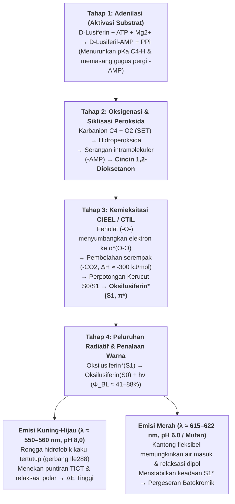

Di malam musim panas yang tenang, ribuan kunang-kunang (*Photinus pyralis*, *Luciola cruciata*) melayang di kegelapan bagaikan lentera zamrud. Sementara itu, pada kedalaman $1.000\,\text{m}$ di bawah permukaan laut — di zona mesopelagik dan batipelagik yang gelap gulita tanpa satu pun foton matahari — lebih dari $75\%$ organisme pelagik, mulai dari cumi-cumi vampir (*Vampyroteuthis infernalis*) dan ikan lentera (*Myctophidae*) hingga ikan sungut ganda (anglerfish) dan ubur-ubur kristal (*Aequorea victoria*), memancarkan kilatan cahaya biru dan hijau yang memukau.

Sumber cahaya tradisional seperti nyala lilin ($\sim 1.700\,\text{K}$) atau filamen tungsten bola lampu pijar ($\sim 2.800\,\text{K}$) membutuhkan suhu ekstrem untuk memancarkan cahaya tampak, dengan lebih dari $90\%$ energinya terbuang sebagai panas inframerah. Namun, jika Anda memegang kunang-kunang yang sedang bersinar di telapak tangan, perutnya terasa sejuk pada suhu kamar ($T \approx 295\text{–}300\,\text{K}$ atau $22\text{–}27\,^\circ\text{C}$). Faktanya, protein dan enzim biologis akan mengalami <strong>denaturasi termal</strong> ireversibel di atas suhu $315\text{–}323\,\text{K}$ ($42\text{–}50\,^\circ\text{C}$).

Bagaimana makhluk hidup melampaui hukum radiasi termal untuk mengubah energi ikatan kimia secara langsung menjadi keadaan tereksitasi elektronik singlet ($S_1^*$) pada suhu $300\,\text{K}$, menghasilkan <strong>"cahaya dingin" (Cold Light)</strong> dengan hasil kuantum mencapai $41\%\text{–}88\%$?

---

## Bab 1: Radiasi Termal (Inkandesensi) vs. Luminesensi

### 1.1 Jurang Energi Antara Foton Tampak dan Energi Termal Kamar ($k_B T$)

Dalam spektrum cahaya tampak ($\lambda = 400\text{–}700\,\text{nm}$), energi satu foton dan energi molarnya diberikan oleh persamaan Planck:

$$E_{\text{photon}} = h\nu = \frac{hc}{\lambda} \approx \frac{1239,8\,\text{eV}\cdot\text{nm}}{\lambda(\text{nm})}$$

- Cahaya kuning-hijau kunang-kunang ($\lambda \approx 560\,\text{nm}$): $E_{\text{photon}} \approx 2,21\,\text{eV}$, $E_{\text{mol}} = N_A h\nu \approx 213,6\,\text{kJ/mol}$.
- Cahaya biru organisme laut dalam ($\lambda \approx 470\,\text{nm}$): $E_{\text{photon}} \approx 2,64\,\text{eV}$, $E_{\text{mol}} \approx 254,5\,\text{kJ/mol}$.

Sebaliknya, energi termal rata-rata $k_B T$ pada suhu kamar ($T = 300\,\text{K}$) hanyalah:

$$k_B T \big|_{T=300\,\text{K}} \approx 0,02585\,\text{eV}, \qquad RT \big|_{T=300\,\text{K}} \approx 2,494\,\text{kJ/mol}$$

<strong>Menciptakan satu foton cahaya tampak membutuhkan energi hampir 100 kali lipat dari rata-rata kuantum energi termal pada suhu kamar!</strong> Pada kesetimbangan termal $300\,\text{K}$, faktor probabilitas Boltzmann untuk mengeksitasi keadaan $\Delta E = 2,21\,\text{eV}$ secara spontan adalah $\exp(-\Delta E / k_B T) = \exp(-85,5) \approx 7,4 \times 10^{-38}$ — secara fisik sama dengan nol.

### 1.2 Hukum Radiasi Planck dan Hukum Pergeseran Wien

Radiansi spektral benda hitam $B_\lambda(\lambda, T)$ mengikuti <strong>Hukum Planck</strong>, panjang gelombang puncaknya mengikuti <strong>Hukum Pergeseran Wien</strong>, dan daya pancar totalnya mengikuti <strong>Hukum Stefan-Boltzmann</strong>:

$$B_\lambda(\lambda, T) = \frac{2hc^2}{\lambda^5} \frac{1}{\exp\left(\dfrac{hc}{\lambda k_B T}\right) - 1}, \qquad \lambda_{\max} \cdot T = 2,8978 \times 10^{-3}\,\text{m}\cdot\text{K}, \qquad J = \sigma T^4$$

Pada $T = 300\,\text{K}$, puncak pancaran berada di inframerah tengah ($\lambda_{\max} \approx 9,66\,\mu\text{m}$). Bahkan pada filamen tungsten $2.800\,\text{K}$, puncaknya masih berada di inframerah dekat ($\lambda_{\max} \approx 1.035\,\text{nm}$), membuang $>90\%$ energi listrik sebagai panas. Hanya fotosfer Matahari ($T \approx 5.778\,\text{K}$) yang mencapai $\lambda_{\max} \approx 501\,\text{nm}$.

### 1.3 Luminesensi ("Cahaya Dingin"): Eksitasi Selektif Kuantum Non-Termal

Diperkenalkan pada tahun 1888 oleh Eilhardt Wiedemann, <strong>luminesensi</strong> adalah pancaran cahaya non-termal di mana energi $2\text{–}3\,\text{eV}$ disuntikkan secara selektif ke transisi elektronik ($\text{HOMO} \to \text{LUMO}$, $S_0 \to S_1^*$) tanpa memanaskan medium di sekitarnya.

| Kategori Emisi | Sumber Eksitasi | Mekanisme Fisika-Kimia | Contoh Representatif | Suhu Operasi |
| :--- | :--- | :--- | :--- | :--- |
| <strong>Inkandesensi (Benda Hitam)</strong> | Agitasi termal ($k_B T$) | Eksitasi termal acak pada seluruh mode getaran | Matahari, api lilin, lampu pijar tungsten | $1.500\text{–}6.000\,\text{K}$ |
| <strong>Fluoresensi (Fotoluminesensi)</strong> | Absorpsi foton eksternal ($h\nu_{\text{ex}}$) | Peluruhan spin-diizinkan $S_1 \to S_0$ ($\tau \sim 10^{-9}\,\text{s}$) | Protein GFP (*Aequorea*), pigmen karang, stabilo | Suhu kamar ($\sim 300\,\text{K}$) |
| <strong>Fosforesensi</strong> | Absorpsi foton + *Intersystem Crossing* (ISC) | Peluruhan spin-terlarang $T_1 \to S_0$ ($\Delta S = 1, \tau \sim 10^{-3}\text{–}10^4\,\text{s}$) | Cat *glow-in-the-dark* ($\text{SrAl}_2\text{O}_4:\text{Eu}^{2+}$) | Suhu kamar ($\sim 300\,\text{K}$) |
| <strong>Elektroluminesensi</strong> | Medan listrik / injeksi pembawa muatan | Rekombinasi radiatif elektron dan *hole* | LED biru/putih ($\text{InGaN}$), layar OLED | Suhu kamar |
| <strong>Kemiluminesensi</strong> | Penataan ulang ikatan kimia eksotermik | Pembelahan peroksida yang langsung mengisi $S_1^*$ | Luminol forensik, *glow stick* oksalat | Suhu kamar |
| <strong>Bioluminesensi</strong> | <strong>Kemiluminesensi terkatalisis enzim</strong> | <strong>Oksidasi lusiferin oleh lusiferase via 1,2-dioksetanon</strong> | Kunang-kunang, *Vargula*, dinoflagellata, *Vibrio*, jamur | <strong>Fisiologis ($275\text{–}310\,\text{K}$)</strong> |

---

## Bab 2: Bioluminesensi vs. Fluoresensi (GFP) vs. Fosforesensi dan Mekanisme BRET

```mermaid
flowchart TD
    subgraph INC ["1. Inkandesensi (Radiasi Termal Benda Hitam)"]
        T1["Pemanasan Ekstrem (T > 2.500 K)<br/>Agitasi termal acak pada seluruh derajat kebebasan"] --> T2["Spektrum Kontinu Planck B_λ(T)<br/>(>90% terbuang sebagai panas IR; mematikan bagi protein)"]
    end

    subgraph FL ["2. Fotoluminesensi: Fluoresensi (GFP) & Fosforesensi"]
        F1["Absorpsi Foton Eksternal (hν_ex: UV / Biru)<br/>Keadaan Dasar S0 → Singlet Tereksitasi S1 (10^-15 s)"] --> F2["Relaksasi Vibrasi (10^-12 s)<br/>Pergeseran Stokes (λ_em > λ_ex)"]
        F2 --> F3["Fluoresensi Spin-Diizinkan S1 → S0 + hν_em (10^-9 s)<br/>*Gelap total tanpa cahaya eksternal!*"]
        F2 -.->|"Intersystem Crossing (ISC: ΔS = 1)"| F4["Fosforesensi Spin-Terlarang T1 → S0 + hν_ph<br/>(Pendaran 10^-3 s hingga berjam-jam)"]
    end

    subgraph BL ["3. Bioluminesensi ('Cahaya Dingin' pada 300 K)"]
        B1["Lusiferin + O2 (+ ATP atau Ca2+)<br/>Terikat pada Sisi Aktif Lusiferase pada 300 K"] --> B2["Cincin Peroksida Empat Anggota Bertegangan Tinggi<br/>(Intermediat 1,2-Dioksetanon)"]
        B2 --> B3["Pembelahan Serempak CIEEL & Kemieksitasi (-CO2)<br/>Perpotongan Permukaan Langsung S0 → S1*"]
        B3 --> B4["Oksilusiferin*(S1) → Oksilusiferin(S0) + hν<br/>(Tanpa cahaya eksternal; Φ_BL mencapai 41–88%)"]
    end

    subgraph BRET_BOX ["4. Bioluminescence Resonance Energy Transfer (BRET pada Aequorea victoria)"]
        BR1["Aequorin (Coelenterazine + Ca2+)<br/>Kemieksitasi menciptakan Donor Biru S1* (470 nm)"] -->|"Kopling Dipol-Dipol Förster (r < 5 nm)<br/>Transfer Non-Radiatif E = 1/(1+(r/R0)^6)"| BR2["Mengeksitasi Kromofor GFP (Ser65-Tyr66-Gly67)<br/>Memancarkan Foton Hijau (λ = 509 nm)"]
    end
```

Sangat penting untuk membedakan antara <strong>bioluminesensi</strong> dan <strong>biofluoresensi (seperti GFP)</strong>:

1. <strong>Fluoresensi (mis. GFP)</strong> adalah proses <strong>fotofisika</strong> yang <strong>wajib membutuhkan cahaya eksitasi eksternal ($h\nu_{\text{ex}}$, UV atau biru)</strong>. Setelah menyerap foton ($10^{-15}\,\text{s}$) dan mengalami relaksasi vibrasi ($10^{-12}\,\text{s}$), molekul memancarkan foton dengan panjang gelombang lebih besar dalam skala nanodetik ($\tau \approx 10^{-9}\,\text{s}$, <strong>Pergeseran Stokes</strong> $\lambda_{\text{em}} > \lambda_{\text{ex}}$). Dalam kegelapan total tanpa lampu eksternal, organisme fluoresen sama sekali tidak dapat bersinar!
2. <strong>Fosforesensi</strong> melibatkan <strong>Intersystem Crossing (ISC)</strong> dari keadaan singlet $S_1$ ($\uparrow\downarrow, S=0$) ke keadaan triplet $T_1$ ($\uparrow\uparrow, S=1$), yang transisinya $T_1 \to S_0$ terlarang secara spin ($\Delta S = 1$), menghasilkan pendaran selama milidetik hingga berjam-jam.
3. <strong>Bioluminesensi</strong> adalah proses <strong>fotokimia (kemieksitasi)</strong> yang bekerja dalam <strong>kegelapan mutlak tanpa cahaya eksternal</strong>: oksidasi enzimatik <strong>lusiferin</strong> oleh <strong>lusiferase</strong> melintasi perpotongan permukaan energi potensial langsung menuju keadaan tereksitasi $\text{Oksilusiferin}^*(S_1)$.

### 2.2 Osamu Shimomura (Hadiah Nobel 2008) dan Kopling BRET Antara Aequorin dan GFP

Saat meneliti ubur-ubur *Aequorea victoria* (yang bersinar <strong>hijau pada $509\,\text{nm}$</strong>), <strong>Osamu Shimomura</strong> menemukan bahwa fotoprotein murni <strong>Aequorin</strong> (mengikat coelenterazine dan diaktifkan oleh $\text{Ca}^{2+}$) ternyata memancarkan <strong>cahaya biru ($\lambda_{\max} = 470\,\text{nm}$)</strong> di dalam tabung reaksi. Di organ cahaya ubur-ubur, Aequorin mentransfer energi eksitasinya secara non-radiatif pada jarak $r \approx 2\text{–}5\,\text{nm}$ ke <strong>Green Fluorescent Protein (GFP)</strong> melalui <strong>BRET (Bioluminescence Resonance Energy Transfer)</strong> via kopling dipol-dipol Förster:

$$E_{\text{BRET}} = \frac{1}{1 + \left(\dfrac{r}{R_0}\right)^6}, \qquad R_0^6 \propto \kappa^2 \, \Phi_D \, n^{-4} \int_0^\infty F_D(\lambda)\, \varepsilon_A(\lambda)\, \lambda^4 \, d\lambda$$

---

## Bab 3: Kimia Kuantum Reaksi Lusiferin–Lusiferase Kunang-Kunang

Reaksi di dalam peroksisom sel fotosit kunang-kunang (*Photinus pyralis*, *Luciola*) menggunakan <strong>D-lusiferin</strong>, enzim <strong>lusiferase ($61\,\text{kDa}$)</strong>, $\text{ATP}$, $\text{Mg}^{2+}$, dan $\text{O}_2$ dalam empat tahap:

1. <strong>Tahap 1: Adenilasi (Aktivasi Substrat) — Meluruskan Mitos Energi ATP</strong>
   $$\text{D-Lusiferin} + \text{ATP} \xrightarrow{\text{Lusiferase, Mg}^{2+}} \text{E}\cdot\text{D-Lusiferil-AMP} + \text{PP}_i$$
   <strong>Koreksi termodinamika penting</strong>: Hidrolisis ATP ($\Delta G^{\circ\prime} \approx -30,5\,\text{kJ/mol}$) <strong>bukanlah</strong> penyuplai energi foton $560\,\text{nm}$ ($214\,\text{kJ/mol}$)! ATP berfungsi sebagai <strong>aktivator kinetik</strong>: mengubah gugus $-\text{COO}^-$ menjadi ester asil-adenilat ($-\text{CO-AMP}$), menurunkan $pK_a$ proton C4 secara drastis agar mudah membentuk karbanion, serta menyediakan gugus pergi yang sangat baik ($-\text{AMP}$).
2. <strong>Tahap 2: Transfer Elektron Tunggal (SET), Oksigenasi, dan Siklisasi menjadi 1,2-Dioksetanon</strong>
   Karbanion C4 bereaksi dengan oksigen triplet ($^3\text{O}_2$) melalui SET membentuk hidroperoksida yang melepaskan $\text{AMP}$ lewat substitusi nukleofilik intramolekuler, menutup cincin peroksida empat anggota yang sangat tegang: <strong>1,2-dioksetanon ($\alpha$-peroksilakton)</strong>.
3. <strong>Tahap 3: Mekanisme CIEEL / CTIL dan Perpotongan Kerucut (Conical Intersection) $S_0/S_1$</strong>
   Dekomposisi 1,2-dioksetanon menjadi <strong>oksilusiferin</strong> dan $\text{CO}_2$ melepaskan $\Delta H \approx -280\text{ hingga }-320\,\text{kJ/mol}$ berkat pelepasan tegangan cincin ($\sim 110\,\text{kJ/mol}$), pemutusan ikatan lemah $\text{O}-\text{O}$ ($\sim 140\,\text{kJ/mol}$), dan pembentukan dua ikatan rangkap $\text{C}=\text{O}$ yang sangat stabil pada $\text{CO}_2$.
   Berdasarkan <strong>aturan simetri orbital Woodward–Hoffmann</strong> dan mekanisme <strong>CIEEL / CTIL</strong>, gugus fenolat terdeprotonasi ($-\text{O}^-$) mentransfer elektron ke orbital anti-ikatan $\sigma^*(\text{O}-\text{O})$. Karena pembelahan pada permukaan dasar $S_0$ terlarang secara simetri orbital, energi $S_0$ naik tajam dan memotong permukaan tereksitasi singlet $S_1$ pada <strong>perpotongan kerucut (Conical Intersection)</strong>. Saat $\text{CO}_2$ lepas, transfer elektron balik mengisi langsung orbital $\text{LUMO}(\pi^*)$, melahirkan molekul langsung dalam <strong>keadaan tereksitasi singlet $\text{Oksilusiferin}^*(S_1)$</strong>!
4. <strong>Tahap 4: Emisi Foton, Hasil Kuantum ($\Phi_{\text{BL}}$), dan Penalaan Warna</strong>
   $$\text{Oksilusiferin}^*(S_1) \longrightarrow \text{Oksilusiferin}(S_0) + h\nu \quad (\lambda_{\max} \approx 560\,\text{nm}), \qquad \Phi_{\text{BL}} = \Phi_{\text{chem}} \times \Phi_{\text{ex}} \times \Phi_{\text{fl}}$$
   Pengukuran bola integrasi absolut menetapkan $\Phi_{\text{BL}} = 41,0 \pm 7,4\%$ pada pH 8,5 (Ando et al., 2008, *Nature Photonics*).
   <strong>Penalaan warna ($538\,\text{nm}$ hijau hingga $622\,\text{nm}$ merah)</strong>: Nakatsu et al. (2006, *Nature*) membuktikan bahwa residu <strong>Ile288</strong> bertindak sebagai gerbang hidrofobik kaku yang mencegah rotasi TICT dan masuknya air sehingga memancarkan cahaya kuning-hijau ($560\,\text{nm}$), sedangkan pada pH asam (6,0) atau mutan, rongga melonggar dan menstabilkan keadaan $S_1^*$ sehingga emisi bergeser ke merah ($615\,\text{nm}$, <strong>pergeseran batokromik</strong>).

---

## Bab 4: Evolusi Konvergen (40–90+ Asal-Usul) dan Ekologi Laut Dalam

Bioluminesensi berevolusi secara independen <strong>antara 40 hingga lebih dari 90 kali</strong> (Haddock et al., 2010) dari sistem antioksidan pendetoksifikasi spesies oksigen reaktif (ROS):

1. <strong>Sistem Coelenterazine dan Vargulin (*Cypridina*) Laut</strong>: Lebih dari $75\%$ organisme mesopelagik bercahaya. <strong>Coelenterazine</strong> digunakan di lebih dari sembilan filum hewan (sering diperoleh melalui rantai makanan) dan memancarkan cahaya biru ($\lambda_{\max} = 450\text{–}490\,\text{nm}$) yang sesuai dengan jendela transmisi optik air laut. Krustasea *Vargula hilgendorfii* menyemburkan awan biru bercahaya ($462\,\text{nm}$) menggunakan <strong>vargulin</strong>.
2. <strong>Dinoflagellata (*Noctiluca*) dan Kanal Proton Berpintu Tegangan ($\text{H}_v1$)</strong>: <strong>Tegangan geser mekanis</strong> dari ombak mendepolarisasi membran vakuola dan membuka kanal <strong>$\text{H}_v1$</strong>, menurunkan pH di dalam <strong>scintillon</strong> dari $8,0$ ke $6,0$ dalam milidetik dan memicu kilatan biru $100\,\text{ms}$ ($475\,\text{nm}$) sebagai "alarm pencuri" (*Burglar Alarm*).
3. <strong>Operon Bakteri `luxCDABEG` dan *Quorum Sensing*</strong>: Bakteri simbion *Aliivibrio fischeri* (di dalam cumi-cumi *Euprymna scolopes*) mengoksidasi $\text{FMNH}_2$ dan aldehida rantai panjang ($\text{RCHO}$) pada $490\,\text{nm}$ hanya ketika autoinduser <strong>AHL</strong> melampaui ambang kepadatan sel tinggi ($>10^{10}\,\text{sel/mL}$).
4. <strong>Siklus Asam Kafeat Jamur (*Mycena*, *Neonothopanus*)</strong>: Empat enzim (`HispS`, `H3H`, `Luz`, `CPH`) mengubah asam kafeat menjadi <strong>3-hidroksihispidin</strong> yang memancarkan cahaya hijau ($520\text{–}530\,\text{nm}$) lalu didaur ulang kembali menjadi asam kafeat (Kotlobay et al., 2018, *PNAS*).
5. <strong>Kamuflase *Counterillumination* dan Lampu Sorot Merah (*Malacosteus niger*)</strong>: Ikan lentera menghapus bayangan ventralnya dengan cahaya biru ($475\,\text{nm}$), sedangkan ikan naga laut dalam *Malacosteus niger* memancarkan cahaya merah-jauh/inframerah-dekat ($>700\,\text{nm}$) bersama fotosensitizer turunan klorofil di retinanya untuk berburu mangsa merah secara tak kasatmata.

---

## Bab 5: Pencitraan Medis (AkaBLI), Higienitas ATP, dan Tanaman Bercahaya Mandiri

1. <strong>Pencitraan Bioluminesensi *In Vivo* (BLI) dan Sistem Inframerah-Dekat AkaBLI</strong>: Bebas dari derau autofluoresensi jaringan, BLI mencapai terobosan saat Iwano & Miyawaki et al. (2018, *Science*, RIKEN) merancang pasangan <strong>AkaLumine-HCl / AkaLuc</strong> ($\lambda_{\max} = 677\,\text{nm}$ di jendela biologis inframerah), meningkatkan sensitivitas jaringan dalam hingga 1.000 kali lipat dan memvisualisasikan <strong>satu sel kanker metastatik tunggal</strong> di paru-paru tikus hidup.
2. <strong>NanoLuc dan Luminometer Higienitas ATP</strong>: Lusiferase <strong>NanoLuc ($19\,\text{kDa}$)</strong> dari udang laut dalam *Oplophorus* bersinar $150\times$ lebih terang daripada kunang-kunang; luminometer ATP mendeteksi $10^{-15}\text{–}10^{-18}\,\text{mol}$ ATP mikroba dalam 10 detik untuk sterilisasi medis, pangan, dan wahana antariksa.
3. <strong>Tanaman Bercahaya Mandiri (*Firefly Petunia*)</strong>: Dengan menyisipkan empat gen siklus asam kafeat jamur (prekursor lignin universal pada tumbuhan berpembuluh) ke dalam tembakau dan petunia (Mitiouchkina et al., 2020, *Nature Biotechnology*), terciptalah tanaman yang memancarkan cahaya hijau mandiri yang tampak oleh mata telanjang sepanjang hidupnya tanpa tambahan bahan kimia eksternal.
