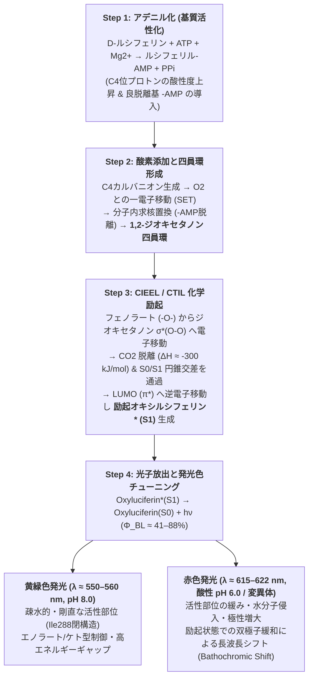

初夏の夕暮れ、清流のほとりを音もなく舞うゲンジボタル（*Luciola cruciata*）やヘイケボタル（*Luciola lateralis*）の淡い黄緑色の光。あるいは、太陽光が一切届かない水深 $1,000\,\text{m}$ の深海（漸深海帯・中深層）で、コウモリダコ（*Vampyroteuthis infernalis*）やハダカイワシ（*Myctophidae*）、チョウチンアンコウ、オワンクラゲ（*Aequorea victoria*）たちが暗黒の海中に描き出す幻想的な蒼い閃光。

私たちが日常的に手にする「火」や「白熱電球」といった古典的な光源は、物質を数千度という極限的な高温にまで加熱しなければ可視光を放つことができない。点灯中の白熱電球に素手で触れればたちまち重度の火傷を負うし、太陽の表面温度は約 $5,778\,\text{K}$、ろうそくの炎ですら約 $1,700\,\text{K}$ に達する。

ところが、光り輝くホタルをそっと手のひらに乗せても、そこには一切の熱さがない。ホタルの腹部の発光器（Photophore）は、周囲の気温と変わらない室温（約 $295\text{–}300\,\text{K}$、すなわち $22\text{–}27\,^\circ\text{C}$）のままである。そもそも生物の体を構成するタンパク質（酵素）は、わずか $42\text{–}50\,^\circ\text{C}$（$315\text{–}323\,\text{K}$）を超えただけで水素結合や疎水結合が破壊され、不可逆的な<strong>熱変性（Thermal Denaturation）</strong>を起こして死に至る。もし生物が熱放射によって光ろうとすれば、最初の1個の光子を放つ前に自らの細胞が蒸発・炭化してしまうだろう。

なぜ生物は、自らの身体を焼くことなく、室温のまま鮮やかな可視光を生み出すことができるのか？

この問いの答えは、熱力学および統計力学が支配する<strong>「黒体放射（熱放射：Incandescence）」</strong>と、量子化学および分子軌道法が支配する<strong>「化学発光・生物発光（Chemiluminescence / Bioluminescence）」</strong>という、物理学的にまったく異なる2つの光子生成メカニズムの対比の中に隠されている。生物発光とは、化学結合の組み換えによって生じる莫大な自由エネルギー（約 $250\text{–}300\,\text{kJ/mol}$）を、周囲の分子の熱運動（並進・振動モード）へと散逸させることなく、高歪みの中間体である<strong>1,2-ジオキセタノン（1,2-Dioxetanone）</strong>の開裂を通じて、たった1つの生成物分子の<strong>電子励起一重項状態（$S_1^*$）</strong>へと直接注入する「室温の量子化学ポンプ」なのである。

本稿では、黒体放射と「冷たい光（Cold Light）」の物理的差異から出発し、一般によく混同される「生物発光」と「蛍光（GFPなど）・燐光」の決定的な違いと<strong>生物発光共鳴エネルギー移動（BRET）</strong>、ホタルのルシフェリン＝ルシフェラーゼ反応の4段階触媒サイクルと<strong>CIEEL機構（化学開始電子交換発光）</strong>、最大 $41\%\text{–}88\%$ に達する驚異の量子収率と発光色チューニングの分子機構、生命進化の歴史で40〜90回以上も独立に獲得された深海・微生物・菌類の多様な発光システム、そしてがん転移を1細胞レベルで追跡する生体光イメージング（AkaBLI）や自発光植物に至るまで、その全貌を徹底的に解き明かす。

---

## 第1章：熱放射（Incandescence）とルミネセンス（Luminescence）の物理学

物質が光（電磁波）を放出するメカニズムは、大きく分けて<strong>熱放射（Thermal Radiation / Incandescence）</strong>と<strong>ルミネセンス（Luminescence：冷光）</strong>の2つに分類される。なぜ通常の光源は熱く、ホタルの光は冷たいのかを理解するために、まずは光子のエネルギーと熱統計力学のスケールを比較してみよう。

### 1.1 可視光線の光子エネルギーと室温の熱エネルギーの圧倒的な隔たり

人間の網膜（錐体・桿体細胞のロドプシン類）が感知できる可視光線の波長領域は、おおよそ $\lambda = 400\,\text{nm}$（紫）から $\lambda = 700\,\text{nm}$（赤）である。プランク定数を $h = 6.626 \times 10^{-34}\,\text{J}\cdot\text{s}$、光速を $c = 2.998 \times 10^8\,\text{m/s}$、アボガドロ定数を $N_A = 6.022 \times 10^{23}\,\text{mol}^{-1}$ とすると、波長 $\lambda$ の光子1個が持つエネルギー $E_{\text{photon}}$（および1モルあたりのエネルギー $E_{\text{mol}}$）は次式で与えられる。

$$E_{\text{photon}} = h\nu = \frac{hc}{\lambda} \approx \frac{1240\,\text{eV}\cdot\text{nm}}{\lambda(\text{nm})}$$

たとえば、ゲンジボタルが放つ黄緑色の光（$\lambda \approx 560\,\text{nm}$）では：

$$E_{\text{photon}}(560\,\text{nm}) \approx 2.21\,\text{eV} \approx 3.55 \times 10^{-19}\,\text{J}, \qquad E_{\text{mol}}(560\,\text{nm}) = N_A h\nu \approx 213.6\,\text{kJ/mol}$$

また、深海生物が好んで放つ青色の光（$\lambda \approx 470\,\text{nm}$）では：

$$E_{\text{photon}}(470\,\text{nm}) \approx 2.64\,\text{eV}, \qquad E_{\text{mol}}(470\,\text{nm}) \approx 254.5\,\text{kJ/mol}$$

一方で、室温 $T = 300\,\text{K}$（約 $27\,^\circ\text{C}$）における分子1個あたりの平均熱運動エネルギー $k_B T$（$k_B = 1.381 \times 10^{-23}\,\text{J/K}$ はボルツマン定数、気体定数 $R = N_A k_B = 8.314\,\text{J/(mol}\cdot\text{K)}$）を計算すると、驚くほど小さい値になる。

$$k_B T \big|_{T=300\,\text{K}} \approx 0.02585\,\text{eV}, \qquad RT \big|_{T=300\,\text{K}} \approx 2.494\,\text{kJ/mol}$$

ここに物理学上の巨大な壁がある。<strong>可視光の光子1個を生み出すには約 $2.2\text{–}2.6\,\text{eV}$（$214\text{–}255\,\text{kJ/mol}$）ものまとまったエネルギーが必要であるにもかかわらず、室温の熱浴が持つ平均熱エネルギーはその約100分の1（$0.026\,\text{eV}$、$2.5\,\text{kJ/mol}$）に過ぎない</strong>のである。

熱平衡状態にある系において、熱ゆらぎによってエネルギー差 $\Delta E = 2.21\,\text{eV}$ の電子励起状態が占有される確率は、ボルツマン因子 $\exp(-\Delta E / k_B T)$ に比例する。$T = 300\,\text{K}$ を代入すると：

$$\frac{N_{\text{excited}}}{N_{\text{ground}}} \sim \exp\left(-\frac{2.21\,\text{eV}}{0.02585\,\text{eV}}\right) = \exp(-85.5) \approx 7.4 \times 10^{-38}$$

すなわち、室温の熱運動だけで分子が偶然に可視光領域の励起状態へ跳び上がる確率は $10^{-37}$ オーダーであり、事実上ゼロである。これが、室温の物体（私たちの身体や机や石）が暗闇の中で可視光を放たない理由である。

### 1.2 プランクの黒体放射の法則とウィーンの変位則：なぜ白熱電球は $90\%$ 以上が熱損失なのか

もし熱エネルギー（分子や格子振動のランダムな運動）を頼りにして可視光を取り出そうとするならば、物体の絶対温度 $T$ を強引に数千ケルビンまで引き上げるほかない。これが<strong>熱放射（黒体放射：Blackbody Radiation）</strong>の原理である。

温度 $T$ の黒体が単位面積・単位立体角・単位波長あたりに放出する分光放射輝度 $B_\lambda(\lambda, T)$ は、1900年にマックス・プランクが導出した<strong>プランクの放射公式</strong>によって記述される。

$$B_\lambda(\lambda, T) = \frac{2hc^2}{\lambda^5} \frac{1}{\exp\left(\dfrac{hc}{\lambda k_B T}\right) - 1}$$

この式を波長 $\lambda$ で微分して極大値を求めると、放射スペクトルのピーク波長 $\lambda_{\max}$ と絶対温度 $T$ の間に成り立つ<strong>ウィーンの変位則（Wien's Displacement Law）</strong>が得られる。

$$\lambda_{\max} \cdot T = b \approx 2.8978 \times 10^{-3}\,\text{m}\cdot\text{K}$$

また、全波長にわたって積分した単位面積あたりの全放射エネルギー束（全放射発散度）$J$ は、<strong>シュテファン＝ボルツマンの法則（Stefan–Boltzmann Law）</strong>に従い、絶対温度の4乗に比例して増大する。

$$J = \int_0^\infty \pi B_\lambda(\lambda, T)\,d\lambda = \sigma T^4 \qquad \left(\sigma = \frac{2\pi^5 k_B^4}{15 c^2 h^3} \approx 5.670 \times 10^{-8}\,\text{W}\cdot\text{m}^{-2}\cdot\text{K}^{-4}\right)$$

具体的な温度で比較してみよう：
1. <strong>室温の生物（$T = 300\,\text{K}$）</strong>：ピーク波長は $\lambda_{\max} = \frac{2.8978 \times 10^{-3}}{300} \approx 9.66\,\mu\text{m}$（$9,660\,\text{nm}$）となり、<strong>中赤外線（熱赤外線）</strong>の領域にある。暗視カメラ（サーモグラフィ）で人間や動物が光って見えるのはこの赤外線放射を捉えているからだが、可視光（$400\text{–}700\,\text{nm}$）の成分は完全にゼロである。
2. <strong>白熱電球のタングステンフィラメント（$T \approx 2,800\,\text{K}$）</strong>：融点の高いタングステン（融点 $3,695\,\text{K}$）に電流を流して $2,800\,\text{K}$ までジュール加熱しても、ピーク波長は依然として $\lambda_{\max} \approx 1,035\,\text{nm}$ の<strong>近赤外線領域</strong>にとどまる。その結果、投入した電力の<strong>約 $90\text{–}95\%$ は目に見えない赤外線（熱）として空中に浪費</strong>され、可視光に変換されるエネルギー効率はわずか $2\text{–}5\%$（発光効率にして約 $12\text{–}18\,\text{lm/W}$）に過ぎない。
3. <strong>太陽表面（$T \approx 5,778\,\text{K}$）</strong>：ここまで温度を上げて初めて、$\lambda_{\max} \approx 501\,\text{nm}$（青緑色）となり、可視光領域のど真ん中に放射ピークが一致する。

つまり熱放射とは、系全体のすべての並進・回転・振動モードを無差別に励起し、連続的なプランク分布の「高エネルギー側の裾野」から可視光を絞り出すという、極めてエントロピー生成の大きい（非効率な）発光方式なのである。

### 1.3 ルミネセンス（冷光）：熱平衡をバイパスする量子選択的励起

これに対して、<strong>ルミネセンス（Luminescence）</strong>は、1888年にドイツの物理学者アイルハルト・ヴィーデマン（Eilhardt Wiedemann）が「熱による発光（Incandescence）ではないすべての発光現象」を指して提唱した概念であり、日本語では文字通り<strong>「冷光（Cold Light）」</strong>とも呼ばれる。

ルミネセンスの本質は、<strong>系全体の温度 $T$（熱浴の振動・並進エネルギー）を一切上昇させることなく、特定の分子の電子系（最高被占軌道 $\text{HOMO}$ から最低空軌道 $\text{LUMO}$ への遷移）だけに選択的に $2\text{–}3\,\text{eV}$ のエネルギーを注入し、熱平衡から大きく外れた「電子励起状態（Excited Electronic State）」を直接作り出すこと</strong>にある。励起された分子が基底状態（$S_0$）へと戻る際、その余剰エネルギーが周囲の熱振動に緩和する前に、光子 $h\nu$ として一挙に放出される。

電子系にどうやってエネルギーを注入するか（励起の駆動力）によって、ルミネセンスは以下の通り体系的に分類される。

| 発光の分類 | 英語名称 | エネルギー源（励起機構） | 代表例・自然現象・技術応用 | 動作温度 |
| :--- | :--- | :--- | :--- | :--- |
| <strong>熱放射（黒体放射）</strong> | Incandescence | 物質全体の熱運動（ジュール熱・燃焼熱） | 太陽、炎、白熱電球、溶岩 | $1,500\text{–}6,000\,\text{K}$ |
| <strong>フォトルミネセンス（蛍光）</strong> | Fluorescence | 外部からの短波長光子（$h\nu_{\text{ex}}$）の吸収（$S_1 \to S_0$） | オワンクラゲGFP、サンゴ、蛍光ペン | 室温（$\sim 300\,\text{K}$） |
| <strong>フォトルミネセンス（燐光）</strong> | Phosphorescence | 光吸収後の項間交差と三重項からの遷移（$T_1 \to S_0$） | 蓄光塗料（$\text{SrAl}_2\text{O}_4:\text{Eu}^{2+}$）、夜光時計 | 室温（$\sim 300\,\text{K}$） |
| <strong>エレクトロルミネセンス</strong> | Electroluminescence | 電界による電子と正孔（ホール）の再結合 | 青色・白色LED（$\text{GaN}$）、有機EL（OLED） | 室温 |
| <strong>メカノルミネセンス</strong> | Mechanoluminescence | 結晶の破断・摩擦・圧電歪みによる電荷分離 | 氷砂糖や石英を砕いたときの閃光（摩擦発光） | 室温 |
| <strong>化学発光</strong> | Chemiluminescence | 化学反応（主に過酸化物の酸化開裂）の自由エネルギー | ルミノール反応（鑑識）、ケミカルライト（サイリウム） | 室温 |
| <strong>生物発光</strong> | Bioluminescence | <strong>酵素（ルシフェラーゼ）が触媒する生体内の化学発光</strong> | ホタル、ウミホタル、夜光虫、発光バクテリア、光るキノコ | <strong>生体温度（$275\text{–}310\,\text{K}$）</strong> |

この表から明らかなように、<strong>生物発光（Bioluminescence）とは、生体内の酵素（主にルシフェラーゼまたは発光タンパク質）によって触媒される「超高効率な化学発光（Chemiluminescence）」</strong>にほかならない。

---

## 第2章：「生物発光」と「蛍光（GFP）・燐光」の決定的な違いとBRETの物理

科学ニュースや一般の解説において、最も頻繁に混同されるのが<strong>「生物発光（Bioluminescence）」</strong>と<strong>「生物蛍光（Biofluorescence：GFPなど）」</strong>である。「光るクラゲ」「光るサンゴ」「光るサソリ」といった言葉が一括りにされがちだが、光化学および熱力学の観点からは、両者はまったく異なる現象である。

### 2.1 ヤブロンスキー図（Jablonski Diagram）で見る蛍光・燐光・生物発光

分子の電子状態とエネルギー移動の経路を表す<strong>ヤブロンスキー図</strong>に基づいて、3つの現象を厳密に区別しよう。

1. <strong>蛍光（Fluorescence）——「外から光を当てないと光らない」光物理プロセス</strong>
   蛍光分子（フルオロフォア：Fluorophore、たとえば緑色蛍光タンパク質 <strong>GFP</strong> やフルオレセイン）は、それ自体では暗闇の中で光子を1個も生み出すことができない。
   - <strong>吸収（Absorption, $\sim 10^{-15}\,\text{s}$）</strong>：まず外部から高いエネルギー（短い波長）の励起光（紫外線や青色光、$h\nu_{\text{ex}}$）を照射し、基底一重項状態 $S_0$ の電子を励起一重項状態 $S_1$ の高振動準位（または $S_2$）へと光励起する必要がある。
   - <strong>内部転換と振動緩和（Internal Conversion & Vibrational Relaxation, $\sim 10^{-12}\,\text{s}$）</strong>：励起された分子は、ピコ秒のタイムスケールで周囲の溶媒やタンパク質骨格へ熱として振動エネルギーの一部を放出し、$S_1$ の最低振動準位（$v'=0$）へと落ち着く。
   - <strong>蛍光放出（Fluorescence Emission, $\tau \approx 10^{-9}\text{–}10^{-8}\,\text{s}$）</strong>：ナノ秒の寿命で $S_1(v'=0) \to S_0$ へとスピン許容遷移（$\Delta S = 0$）を起こし、光子 $h\nu_{\text{em}}$ を放出する。振動緩和で失われたエネルギーの分だけ、放出される光子は必ず吸収した励起光よりもエネルギーが低く（波長が長く）なる。これを<strong>ストークスシフト（Stokes Shift, $\lambda_{\text{em}} > \lambda_{\text{ex}}$）</strong>と呼ぶ。励起光を消した瞬間（ナノ秒以内）に発光は完全に停止する。

2. <strong>燐光（Phosphorescence）——「スピン禁制遷移による残光」</strong>
   光吸収によって生成した励起一重項状態 $S_1$（反平行スピン $\uparrow\downarrow$、全スピン量子数 $S=0$、スピン多重度 $2S+1=1$）から、スピン軌道相互作用（Spin-Orbit Coupling）を介して電子のスピンが反転し、エネルギーがわずかに低い<strong>励起三重項状態 $T_1$</strong>（平行スピン $\uparrow\uparrow$、$S=1$、スピン多重度 $3$）へと移る過程を<strong>項間交差（Intersystem Crossing: ISC）</strong>と呼ぶ。
   $T_1$ から基底状態 $S_0$ への放射遷移（$T_1 \to S_0 + h\nu_{\text{ph}}$）は、もう一度スピン反転（$\Delta S = 1$）を伴うため、量子力学の電気双極子選択則によって<strong>スピン禁制（Spin-Forbidden）</strong>となる。そのため遷移確率が極端に低く、発光寿命 $\tau$ はミリ秒（$10^{-3}\,\text{s}$）から数秒、蓄光材料では数時間にも及ぶ。

3. <strong>生物発光（Bioluminescence）——「完全な暗黒の中で化学エネルギーから光を生む」光化学プロセス</strong>
   生物発光には、<strong>外部からの励起光（紫外線や青色光）が一切不要</strong>である。太陽光が1光子たりとも届かない水深 $4,000\,\text{m}$ の深海底や、真夜中の洞窟の奥底であっても、生物発光生物は自らの力で光を放つ。
   なぜなら、基底状態 $S_0$ から励起一重項状態 $S_1^*$ へのポンプアップを、外部光子の吸収ではなく、<strong>基質「ルシフェリン（Luciferin）」の酵素的酸化反応という化学反応のポテンシャルエネルギー面の交差（Chemiexcitation：化学励起）</strong>によって行っているからである。

```mermaid
flowchart TD
    subgraph INC ["1. 熱放射 (Incandescence / 黒体放射)"]
        T1["高温加熱 (T > 2,500 K)<br/>分子振動・並進運動の無差別な熱励起"] --> T2["プランク分布に従う連続スペクトル放出<br/>(>90%が赤外線熱損失 / 生物には不可能)"]
    end

    subgraph FL ["2. 蛍光・燐光 (Fluorescence / GFP)"]
        F1["外部からの励起光吸収 (hν_ex: UV/青色光)<br/>基底状態 S0 → 励起状態 S1 (10^-15 s)"] --> F2["振動緩和 (10^-12 s) による熱散逸<br/>ストークスシフト (λ_em > λ_ex)"]
        F2 --> F3["S1 → S0 蛍光放出 (ナノ秒: 10^-9 s)<br/>※暗黒下では絶対に光らない"]
        F2 -.->|"項間交差 (ISC: ΔS=1)"| F4["励起三重項状態 T1 → S0 燐光放出<br/>(スピン禁制: ミリ秒〜数時間)"]
    end

    subgraph BL ["3. 生物発光 (Bioluminescence: 冷たい光)"]
        B1["ルシフェリン + O2 (+ ATP / Ca2+)<br/>ルシフェラーゼ酵素の活性部位に結合 (室温 300 K)"] --> B2["高エネルギー過酸化物中間体の形成<br/>(1,2-ジオキセタノン四員環)"]
        B2 --> B3["CIEEL機構による協奏的脱炭酸と化学励起<br/>S0 ポテンシャル面から S1* 励起状態へ直接遷移"]
        B3 --> B4["励起オキシルシフェリン* (S1) → 基底状態 (S0) + hν<br/>(外部光不要・熱損失極小・高量子収率)"]
    end

    subgraph BRET_BOX ["4. 生物発光共鳴エネルギー移動 (BRET: オワンクラゲ)"]
        BR1["イクオリン (セレンテラジン + Ca2+)<br/>化学励起により青色励起状態 S1* (470 nm相当) を生成"] -->|"双極子-双極子相互作用 (r < 5 nm)<br/>無放射エネルギー移動 E = 1/(1+(r/R0)^6)"| BR2["緑色蛍光タンパク質 (GFP) の発色団を励起<br/>緑色光子 (λ = 509 nm) を放出"]
    end
```

### 2.2 下村脩博士のノーベル賞発見：オワンクラゲにおける「イクオリン」と「GFP」のBRET連携

では、なぜ「生物発光」と「蛍光（GFP）」がこれほど混同されるようになったのだろうか？ その歴史的・生物学的な交差点は、2008年にノーベル化学賞を受賞した<strong>下村脩（Osamu Shimomura）</strong>博士によるオワンクラゲ（*Aequorea victoria*）の研究にある。

1961年、米国ワシントン州フライデーハーバー臨海実験所で約1万匹のオワンクラゲから発光物質を単離していた下村博士は、不思議な現象に直面した。生きているオワンクラゲの傘の縁（発光器）は鮮やかな<strong>緑色の光（$\lambda_{\max} = 509\,\text{nm}$）</strong>を放つ。ところが、クラゲから抽出し精製した発光タンパク質<strong>「イクオリン（Aequorin）」</strong>にカルシウムイオン（$\text{Ca}^{2+}$）を加えて試験管内で発光させると、緑色ではなく<strong>青色の光（$\lambda_{\max} = 470\,\text{nm}$）</strong>を放ったのである！

下村博士は、クラゲの発光器の中には、イクオリンとは別に「青色のエネルギーを受け取って緑色に光る第2のタンパク質」が共存していることを見抜き、これを微量に結晶化して単離した。これこそが、現代の生命科学に革命をもたらした<strong>緑色蛍光タンパク質（GFP: Green Fluorescent Protein）</strong>であった（Shimomura, Johnson, & Saiga, 1962）。

オワンクラゲの生体内では、以下の2段階の精巧な量子エネルギーリレーが行われている。

1. <strong>ステップ1（生物発光による化学励起：ドナー）</strong>：
   発光タンパク質である<strong>イクオリン（Aequorin）</strong>は、アポタンパク質（アポイクオリン）の内部に発光基質である<strong>セレンテラジン（Coelenterazine）</strong>と分子状酸素が過酸化物として共有結合した状態で待機している。ここに神経刺激によって3個の $\text{Ca}^{2+}$ イオンがEFハンドモチーフに結合すると、タンパク質の立体構造が変化し、セレンテラジンが自己触媒的にジオキセタノン中間体を経て酸化・脱炭酸され、<strong>励起状態のセレンテラミド（$\text{Coelenteramide}^*$）</strong>が生成する。単独であれば、ここから $\lambda = 470\,\text{nm}$ の青色光子が放出される。
2. <strong>ステップ2（BRETによる無放射エネルギー移動：アクセプター）</strong>：
   しかしオワンクラゲの発光細胞内では、イクオリンとGFPがヘテロ複合体を形成して極めて近い距離（分子間距離 $r \approx 2\text{–}5\,\text{nm}$）に配置されている。このとき、イクオリン内の励起セレンテラミド（エネルギー供与体：Donor）は、実際に青色光子を放出するのではなく、<strong>フェルスター共鳴エネルギー移動（FRET: Förster Resonance Energy Transfer）</strong>と全く同じ長距離の<strong>電気双極子―双極子相互作用（Dipole–Dipole Coupling）</strong>によって、その励起エネルギーを無放射的（Non-radiatively）に隣のGFPの発色団（Ser65–Tyr66–Gly67の3アミノ酸が自己触媒的に環化・酸化して形成された $p$-ヒドロキシベンジリデンイミダゾリノン構造：エネルギー受容体 Acceptor）へと直接受け渡す！
   このように、化学励起された生物発光ドナーから蛍光タンパク質アクセプターへと無放射的に励起エネルギーが移動する現象を<strong>BRET（Bioluminescence Resonance Energy Transfer：生物発光共鳴エネルギー移動）</strong>と呼ぶ。

フェルスター理論によれば、ドナー・アクセプター間距離を $r$ としたとき、エネルギー移動速度 $k_T$ および移動効率 $E_{\text{BRET}}$ は距離の<strong>6乗に反比例</strong>して減衰する。

$$k_T = \frac{1}{\tau_D} \left(\frac{R_0}{r}\right)^6, \qquad E_{\text{BRET}} = \frac{k_T}{k_T + \tau_D^{-1}} = \frac{1}{1 + \left(\dfrac{r}{R_0}\right)^6}$$

ここで $\tau_D$ はアクセプター不在時におけるドナーの励起寿命であり、$R_0$ は移動効率が $50\%$ になる<strong>フェルスター臨界距離（Förster Distance、通常 $4\text{–}6\,\text{nm}$）</strong>である。$R_0$ の6乗は次式で与えられる。

$$R_0^6 = \frac{9000 (\ln 10)\, \kappa^2 \, \Phi_D}{128 \pi^5 N_A n^4} \int_0^\infty F_D(\lambda)\, \varepsilon_A(\lambda)\, \lambda^4 \, d\lambda$$

ここで $\kappa^2$ はドナーとアクセプターの遷移双極子モーメントの相対配向因子（ランダム配向では $2/3$）、$\Phi_D$ はドナーの量子収率、$n$ は媒質の屈折率、そして積分項 $J(\lambda) = \int F_D(\lambda)\varepsilon_A(\lambda)\lambda^4 d\lambda$ は<strong>ドナー（イクオリンの青色発光スペクトル $F_D(\lambda)$、ピーク $470\,\text{nm}$）とアクセプター（GFPの吸収スペクトル $\varepsilon_A(\lambda)$、励起ピーク $475\,\text{nm}$）のスペクトル重なり積分（Spectral Overlap Integral）</strong>である。イクオリンの発光波長とGFPの吸収波長が完璧に重なっているため、ほぼ $100\%$ に近い効率でエネルギーがGFPへと移動し、最終的にGFPから $\lambda_{\max} = 509\,\text{nm}$ の緑色蛍光が放出されるのである。

---

## 第3章：ホタルのルシフェリン＝ルシフェラーゼ反応の量子化学とCIEEL機構

数ある生物発光システムの中で、最も深く研究され、かつ最も高い量子収率を誇るのが<strong>ホタル（甲虫目ホタル科：*Lampyridae*）のルシフェリン＝ルシフェラーゼ反応</strong>である。

1885年、フランスの生理学者ラファエル・デュボア（Raphaël Dubois）は、ヒカリコメツキ（*Pyrophorus*）やカモメガイ（*Pholas dactylus*）の発光器官から2種類の成分を抽出し、耐熱性の低分子基質を<strong>「ルシフェリン（Luciferin：ラテン語で『光を運ぶもの』の意）」</strong>、熱に弱い酵素タンパク質を<strong>「ルシフェラーゼ（Luciferase）」</strong>と命名した。その後、ジョンズ・ホプキンス大学のウィリアム・マッケルロイ（William D. McElroy）らが1947年にホタルの発光には<strong>ATP（アデノシン三リン酸）</strong>と $\text{Mg}^{2+}$ が不可欠であることを発見し、1957年にはホタルルシフェリンの化学構造（ベンゾチアゾール骨格を持つ複素環式カルボン酸）が決定された。

それでは、ホタルの腹部にある発光細胞（Photocyte）の中のペルオキシソーム内で、どのようにして化学結合エネルギーが光子へと変換されるのか、その4段階の触媒反応を分子レベルで追跡しよう。

### 3.1 ステップ1：アデニル化による基質の活性化（なぜATPが必要なのか？）

ホタルの基質である<strong>D-ルシフェリン（$\text{D-LH}_2$：(4S)-2-(6-hydroxy-1,3-benzothiazol-2-yl)-4,5-dihydrothiazole-4-carboxylic acid）</strong>は、まずルシフェラーゼ（北米産ホタル *Photinus pyralis* では550アミノ酸残基・分子量約 $61\,\text{kDa}$ の単量体酵素）の活性部位において、$\text{Mg}^{2+}$ の存在下で $\text{ATP}$ と反応する。

$$\text{D-LH}_2 + \text{ATP} \xrightarrow{\text{Luciferase, Mg}^{2+}} \text{E}\cdot\text{LH}_2\text{-AMP} + \text{PP}_i$$

この反応により、ピロリン酸（$\text{PP}_i$）が脱離し、ルシフェリンのカルボキシ基（$-\text{COO}^-$）にアデノシン一リン酸（$\text{AMP}$）が結合した混合酸無水物<strong>「ルシフェリルアデニル酸（D-Luciferyl-AMP, $\text{LH}_2\text{-AMP}$）」</strong>が形成される。

ここで、多くの入門書で誤解されている<strong>熱力学上の重要な誤謬</strong>を正しておこう。
「ホタルはATPの加水分解エネルギーを使って光っている」という説明をよく見かけるが、これは<strong>エネルギー収支としては誤り</strong>である！
第1章で計算した通り、波長 $560\,\text{nm}$ の光子1モルが持つエネルギーは $E_{\text{mol}} \approx 214\,\text{kJ/mol}$ である。一方、ATPの加水分解自由エネルギーは標準状態で $\Delta G^{\circ\prime} \approx -30.5\,\text{kJ/mol}$（細胞内環境でも約 $-50\,\text{kJ/mol}$）に過ぎず、光子1個を作るにはエネルギーがまったく足りない（わずか7分の1しかない）。

では、なぜホタルの反応にはATPが必須なのか？ その理由は<strong>速度論的・有機化学的な「基質活性化（Substrate Activation）」</strong>にある。
1. <strong>C4位プロトンの酸性度（$pK_a$）の劇的な上昇</strong>：D-ルシフェリンのチアゾリン環の4位炭素（C4）に結合した水素原子（C4-H）を引き抜いてカルバニオン（$\text{C}4^-$）を作るには、そのままでは隣に負電荷を持つ $-\text{COO}^-$ があるため静電反発が強く、脱プロトン化が極めて起こりにくい。しかし $-\text{COO}^-$ を電子求引性の強いアシルアデニル酸エステル（$-\text{CO-AMP}$）に変換すると、カルボニル基の誘起効果と共鳴安定化によってC4位プロトンの $pK_a$ が劇的に低下し、酵素活性部位の塩基性残基によって容易にプロトン（$\text{H}^+$）を引き抜けるようになる。
2. <strong>優れた脱離基（Good Leaving Group）の導入</strong>：次のステップで過酸化物イオン（$-\text{OO}^-$）がカルボニル炭素を求核攻撃して四員環を閉じる際、$-\text{OH}$ や $-\text{O}^-$ は極めて悪い脱離基だが、$-\text{AMP}$ は極めて優れた脱離基として速やかに脱離し、環化反応の活性化障壁を下げる。

つまりATPは、光子のエネルギー源ではなく、<strong>「分子状酸素（$\text{O}_2$）による酸化反応の引き金を引くための化学的プライマー（起爆剤）」</strong>として働いているのである（実際、セレンテラジンやウミホタルルシフェリンを使う海洋生物の多くは、最初から反応性の高いイミダゾピラジン骨格を持っているため、ATPを一切必要とせずに $\text{O}_2$ だけで光ることができる）。

### 3.2 ステップ2：酸素添加と高エネルギー四員環「1,2-ジオキセタノン」の形成

アデニル化された $\text{LH}_2\text{-AMP}$ のC4位からプロトンが引き抜かれると、求核性の高い<strong>カルバニオン中間体（$\text{E}\cdot\text{LH}^-\text{-AMP}$）</strong>が生成する。ここに分子状酸素（基底状態は三重項酸素 $^3\text{O}_2$）が反応する。

一重項のカルバニオンと三重項の $^3\text{O}_2$ の直接反応はスピン禁制であるため、まずカルバニオンから $^3\text{O}_2$ へ<strong>一電子移動（Single-Electron Transfer: SET）</strong>が起こり、ルシフェリルラジカルとスーパーオキシドアニオンラジカルの<strong>ラジカル対（$[\text{LH}^\bullet\text{-AMP} \cdots \text{O}_2^{\bullet-}]$）</strong>が生成し、スピン反転の後に速やかにラジカル再結合して<strong>ヒドロペルオキシドアニオン中間体（$-\text{C(OO}^-\text{)}-\text{CO-AMP}$）</strong>を形成すると考えられている（Branchini et al., 2015）。

続いて、この末端ペルオキシド酸素（$-\text{OO}^-$）が同一分子内のカルボニル炭素（$-\text{CO-AMP}$）を求核攻撃（分子内求核アシル置換反応）し、$\text{AMP}$ が脱離することで、炭素2個と酸素2個からなる極めて歪みの大きい<strong>四員環過酸化物「1,2-ジオキセタノン（1,2-Dioxetanone / $\alpha$-Peroxylactone）」</strong>が形成される！

$$\text{E}\cdot\text{LH}^-\text{-AMP} + \text{O}_2 \longrightarrow \text{E}\cdot\text{Luciferyl- hydroperoxide-AMP} \xrightarrow{-\text{AMP}} \text{E}\cdot\text{Dioxetanone Intermediate}$$

### 3.3 ステップ3：CIEEL機構（化学開始電子交換発光）と軌道対称性による電子励起

この<strong>1,2-ジオキセタノン中間体</strong>こそが、生物発光における最大の主役——すなわち「室温で可視光光子を生み出す化学爆弾」である。

1,2-ジオキセタノンが分解して<strong>オキシルシフェリン（Oxyluciferin）</strong>と<strong>二酸化炭素（$\text{CO}_2$）</strong>になるとき、なぜ約 $250\text{–}300\,\text{kJ/mol}$ もの化学エネルギーが一気に放出されるのか？
1. <strong>四員環の立体歪み（Ring Strain）の解放</strong>：$90^\circ$ に無理やり折り曲げられた四員環が開裂することで、約 $100\text{–}110\,\text{kJ/mol}$ の環歪みエネルギーが解放される。
2. <strong>脆弱な過酸化物結合（$\text{O}-\text{O}$）の開裂と、超安定な $\text{CO}_2$ の生成</strong>：結合解離エネルギーが極めて小さい過酸化物結合（$\text{O}-\text{O} \approx 140\text{–}150\,\text{kJ/mol}$）と $\text{C}-\text{C}$ 単結合が切れる一方で、化学界で最も安定な結合の1つである二酸化炭素（$\text{O}=\text{C}=\text{O}$、$\text{C}=\text{O}$ 二重結合エネルギーは約 $800\,\text{kJ/mol} \times 2$）が新たに形成される。さらに分子数が1個から2個に増えることで並進・回転エントロピー（$\Delta S > 0$）も増大する。

結果として、このたった1ステップの脱炭酸反応だけで $\Delta H \approx -280\text{ to }-320\,\text{kJ/mol}$（約 $2.9\text{–}3.3\,\text{eV}$）という莫大な発熱が生じる。これは波長 $560\,\text{nm}$ の光子エネルギー（$214\,\text{kJ/mol}$、$2.21\,\text{eV}$）を優に上回る！

しかし、ここで量子化学における最も深い問いが立ち現れる。
<strong>「なぜその $300\,\text{kJ/mol}$ のエネルギーは、通常の化学反応のように熱（振動エネルギー）として散逸せず、わざわざエネルギーの高い電子励起状態（$\text{Oxyluciferin}^*$ の $S_1$ 状態）へと向かうのか？」</strong>

その答えは、<strong>ウッドワード＝ホフマン則（Woodward–Hoffmann Orbital Symmetry Rules）</strong>による基底状態分解の対称性禁制と、ゲイリー・シュスター（Gary B. Schuster）やフランク・マッカプラ（Frank McCapra）らが提唱し、近年の多配置量子化学計算（CASSCF/CASPT2）によって精緻化された<strong>CIEEL機構（Chemically Initiated Electron Exchange Luminescence：化学開始電子交換発光）</strong>または<strong>分子内電荷移動誘起発光（CTIL: Charge-Transfer-Induced Luminescence）</strong>にある。

1. <strong>フェノール性ヒドロキシ基の脱プロトン化による電子供与能の起動</strong>：
   ルシフェリンのベンゾチアゾール環の6位にあるフェノール性 $-\text{OH}$ 基が脱プロトン化されて<strong>フェノラートアニオン（$-\text{O}^-$）</strong>になると、この芳香環部位は強力な<strong>電子供与体（Electron Donor）</strong>となる。
2. <strong>分子内電荷移動（ICT）と $\text{O}-\text{O}$ 結合の開裂</strong>：
   フェノラート部位の最高被占軌道（$\text{HOMO}, \pi$）から、高歪みのジオキセタノン四員環の過酸化物結合の反結合性軌道（$\sigma^*(\text{O}-\text{O})$）へと分子内電子移動が起こり、$\text{O}-\text{O}$ 結合が速やかに開裂してビラジカル／双性イオン性の中間状態が生じる。
3. <strong>基底状態（$S_0$）と励起状態（$S_1$）のポテンシャルエネルギー面（PES）の円錐交差（Conical Intersection）</strong>：
   もしジオキセタノン環が基底状態（$S_0$）のポテンシャルエネルギー面に沿って協奏的に2つのカルボニル化合物へと開裂しようとすると、2つの $\sigma$ 結合（$\text{O}-\text{O}$ と $\text{C}-\text{C}$）が同時に2つの $\pi$ 結合へと変換される過程で軌道対称性が保存されず、<strong>基底状態 $S_0$ のエネルギー曲線が急激にせり上がる</strong>。
   一方で、電荷移動を伴う一重項励起状態（$S_1$）のポテンシャルエネルギー面は、結合の伸長とともに急激に低下し、遷移状態付近で<strong>基底状態 $S_0$ 面と励起状態 $S_1$ 面が極めて接近・交差（擬交差 Avoided Crossing または円錐交差 Conical Intersection）</strong>する！
4. <strong>逆電子移動（Back-Electron Transfer）による $\text{LUMO}(\pi^*)$ への注入</strong>：
   $\text{C}-\text{C}$ 結合が切れて $\text{CO}_2$ が脱離する瞬間、移動していた電子が芳香環側へと戻る（逆電子移動）が、その際、エネルギー的に交差している<strong>最低空軌道（$\text{LUMO}, \pi^*$）</strong>へと電子が流れ込む。その結果、生成したオキシルシフェリンは基底状態（$S_0$）ではなく、<strong>最初から電子励起一重項状態 $\text{Oxyluciferin}^*(S_1, \pi\pi^*)$ として誕生する</strong>のである！

### 3.4 ステップ4：光子放出、驚異の量子収率（$\Phi_{\text{BL}}$）、そして発光色チューニングの謎

励起一重項状態 $\text{Oxyluciferin}^*(S_1)$ として生成した分子は、数ナノ秒以内に基底状態 $S_0$ へと放射遷移し、鮮やかな光子 $h\nu$ を放出する。

$$\text{Oxyluciferin}^*(S_1) \longrightarrow \text{Oxyluciferin}(S_0) + h\nu \quad (\lambda_{\max} \approx 560\,\text{nm})$$

生物発光の全体の効率を表す<strong>生物発光量子収率（Bioluminescence Quantum Yield, $\Phi_{\text{BL}}$）</strong>は、投入されたルシフェリン分子1個あたり何個の光子が放出されるかという比率であり、以下の3つの素過程の積として厳密に定義される。

$$\Phi_{\text{BL}} = \frac{\text{放出された総光子数}}{\text{反応したルシフェリン分子数}} = \Phi_{\text{chem}} \times \Phi_{\text{ex}} \times \Phi_{\text{fl}}$$

- $\Phi_{\text{chem}}$（化学反応収率）：ルシフェリンが副反応（暗反応による過酸化水素 $\text{H}_2\text{O}_2$ の脱離など）を起こさずに1,2-ジオキセタノン中間体を経由してオキシルシフェリンへと至る確率。
- $\Phi_{\text{ex}}$（または $\Phi_S$、化学励起効率 / Singlet Chemiexcitation Yield）：ジオキセタノンの開裂時に、基底状態 $S_0$ ではなく一重項励起状態 $S_1^*$ へと分岐する量子化学的確率。
- $\Phi_{\text{fl}}$（蛍光量子収率）：生成した $\text{Oxyluciferin}^*(S_1)$ が、無放射失活（熱緩和）せずに光子を放出する確率。

1960年、セリガーとマッケルロイ（Seliger & McElroy）はホタルの量子収率を $\Phi_{\text{BL}} = 88 \pm 25\%$ と報告し、長らく教科書で「約90%の効率」として引用されてきた。その後2008年、東京大学の安藤俊哉、秋山英文、京都大学の加藤博章、中津亨らの研究グループ（Ando et al., 2008, *Nature Photonics*）が、高精度な積分球を用いた絶対発光測定によって校正を行った結果、<strong>北米産ホタル（*Photinus pyralis*）の最大生物発光量子収率は pH 8.5 において $\Phi_{\text{BL}} = 41.0 \pm 7.4\%$</strong> であることが確定した。さらに、オキシルシフェリン自体の蛍光量子収率 $\Phi_{\text{fl}}$ から逆算すると、ジオキセタノンから励起状態 $S_1^*$ を生み出す<strong>化学励起効率 $\Phi_{\text{ex}}$ は実に $60\text{–}90\%$ に達する</strong>ことが判明している。人工の化学発光（ルミノール反応の量子収率はわずか $\Phi_{\text{CL}} \approx 1.2\%$）と比較すると、ルシフェラーゼ酵素がいかに無放射熱失活を完璧に抑え込んでいるかがわかる。

#### なぜ同じ「D-ルシフェリン」から緑・黄・赤の異なる色の光が出るのか？

ここでさらなる謎が生じる。ゲンジボタル（$\lambda_{\max} = 550\,\text{nm}$、緑色）、北米ホタル（$\lambda_{\max} = 560\,\text{nm}$、黄緑色）、ヒカリコメツキ（$538\text{–}590\,\text{nm}$）、そして南米の鉄道虫（Railroad worm, *Phrixothrix hirtus*：頭部が $\lambda_{\max} = 622\,\text{nm}$ の<strong>真紅の光</strong>、体側が $546\,\text{nm}$ の緑色の光を放つ）に至るまで、発光甲虫類はすべて<strong>化学的にまったく同一の「D-ルシフェリン」と「オキシルシフェリン」</strong>を使っている。さらに、ホタルのルシフェラーゼ溶液の pH をアルカリ性（pH 8.0）から酸性（pH 6.0）へと下げたり、温度を上げたり、重金属イオン（$\text{Zn}^{2+}, \text{Cd}^{2+}$）を加えたりすると、発光色が<strong>黄緑色（$560\,\text{nm}$）から赤色（$615\,\text{nm}$）へと劇的に変化する（深色移動：Bathochromic Shift）</strong>ことが1960年代から知られていた。

同じ分子なのに、なぜ酵素のわずかな違いや pH で光子エネルギー（$\Delta E = E_{\text{LUMO}} - E_{\text{HOMO}}$）が $0.25\,\text{eV}$ も変化するのか？
2006年、京都大学の中津亨・加藤博章らの研究グループは、ゲンジボタルのルシフェラーゼの反応中間体アナログ複合体のX線結晶構造を $1.3\,\text{\AA}$ の超高分解能で決定し（Nakatsu et al., 2006, *Nature*）、その後の一連の量子化学／分子動力学（QM/MM）研究とともに、以下の3つの物理化学的メカニズムを解明した。

1. <strong>オキシルシフェリンのケト―エノール互変異性（Keto–Enol Tautomerism）とプロトン化状態</strong>：
   オキシルシフェリンはチアゾロン環の5位カルボニル基と4位炭素の間で<strong>ケト型（Keto form）</strong>と<strong>エノール型（Enol / Enolate form）</strong>の互変異性をとりうる。気相および量子化学計算によれば、フェノラート―ケト型アニオン（$\text{ Keto-O}^-$）は本来赤色領域の発光ポテンシャルを持つが、周囲の静電環境に極めて敏感である。
2. <strong>活性部位ポケットの剛直性と「パッキング制御（Ile288ゲート機構）」</strong>：
   中津らの結晶構造解析により、ルシフェラーゼの活性部位にある<strong>イソロイシン288（Ile288）</strong>の側鎖が、励起状態生成時にオキシルシフェリン側へと約 $1.5\,\text{\AA}$ 動いてベンゾチアゾール環とチアゾロン環を強く挟み込み、<strong>疎水的で剛直な「密閉キャビティ」</strong>を作ることが明らかになった。この立体的な締め付けにより、励起状態のオキシルシフェリンが $\text{C}2-\text{C}2^\prime$ 単結合の周りでねじれ振動（TICT: Twisted Intramolecular Charge Transfer）を起こしてエネルギーを熱として失うことが防がれ、高エネルギーの<strong>黄緑色光子（$560\,\text{nm}$）</strong>が放出される。一方、Ile288をバリンやアラニンに置換した変異体や酸性pH条件下では、この疎水性パッキングが緩み、励起状態のコンフォメーション緩和と水分子の侵入によって $S_1$ 状態のエネルギーが低下し、<strong>赤色光子（$615\,\text{nm}$）</strong>が放出される。
3. <strong>活性部位の局所電場（Electrostatic Microenvironment）とソルバトクロミズム</strong>：
   オキシルシフェリンの $\pi \to \pi^*$ 遷移は強い分子内電荷移動性を伴うため、フェノラート酸素（$-\text{O}^-$）の近くに正電荷残基（Arg218やLys529など）や水素結合ネットワークがどの距離で配置されるかによって、基底状態 $S_0$ と励起状態 $S_1$ の相対的な静電安定化エネルギーが変化する（酵素内ソルバトクロミズム）。正電荷がフェノラートの負電荷を強く安定化すると HOMO が下がり、エネルギーギャップ $\Delta E$ が広がって短波長（緑色）へシフトし、逆に極性緩和が進むと長波長（赤色）へとシフトするのである。

---

## 第4章：進化が40〜90回以上も独立に発明した「生物発光」の多様性と深海生態系

生物発光について最も驚くべき生物学的事実は、それが生命の歴史において<strong>少なくとも40回から90回以上も独立に進化した（収斂進化：Convergent Evolution）</strong>という点である（Haddock, Moline, & Case, 2010; Davis et al., 2016）。

光合成（クロロフィル系）や視覚（オプシン＋レチナール系）は、進化的起源が極めて古く、共通の分子モジュールが生命界全体で保存されている。ところが生物発光では、バクテリア、渦鞭毛藻（夜光虫）、菌類（キノコ）、刺胞動物（クラゲ・サンゴ）、有櫛動物（クシクラゲ）、軟体動物（ホタルイカ・コウモリダコ）、環形動物（ゴカイ）、節足動物（ウミホタル・オキアミ・ホタル）、棘皮動物（クモヒトデ）、そして硬骨魚類・軟骨魚類に至るまで、<strong>ルシフェリンの化学構造もルシフェラーゼのアミノ酸配列も、分類群ごとにまったく異なる（相同性がない）</strong>のである！

### 4.1 なぜ生物発光はこれほど何度も独立に進化したのか？（抗酸化ストレス起源説）

なぜ「化学反応で光を作る」という一見複雑なシステムが、何十回もゼロから進化し得たのか？
その最も有力な進化的説明が、ジャン＝フランソワ・リース（Jean-François Rees, 1998）らが提唱した<strong>「活性酸素種（ROS）の解毒・抗酸化防御起源説（Oxygen Detoxification Hypothesis）」</strong>である。

カンブリア爆発以降、大気と海洋の酸素濃度が上昇するにつれ、好気呼吸を行う生物は常に<strong>スーパーオキシドアニオン（$\text{O}_2^{\bullet-}$）や過酸化水素、ヒドロペルオキシドラジカル</strong>といった猛毒の活性酸素種（ROS）による酸化ストレスにさらされるようになった。これらのROSを素早く捕捉して無害化するためには、電子供与性の高い芳香族・複素環式抗酸化物質（現在のルシフェリンの祖先分子）が不可欠であった。

第3章で見た通り、電子供与性の芳香環が $\text{O}_2^{\bullet-}$ や $\text{O}_2$ と反応して過酸化物（ジオキセタノン／ジオキセタン）を作り、脱炭酸によって開裂する反応は、それ自体が<strong>「強力な活性酸素消去反応」</strong>であり、しかも軌道対称性の法則によって必然的に励起状態（微弱な光子放出）を伴う！
さらにまた、ホタルのルシフェラーゼは、進化的にはどの生物も持っている<strong>長鎖脂肪酸アシルCoA合成酵素（Fatty Acyl-CoA Synthetase）</strong>の遺伝子重複から派生したものであることが判明している（実際に脂肪酸CoA合成酵素にD-ルシフェリンとATPを与えると、微弱ながら赤く光ることが実証されている：Oba et al., 2003）。
すなわち、最初は単なる「抗酸化物質によるROS解毒反応の副産物」や「既存の代謝酵素の副反応（酵素的プロミスキュイティ）」として生じていた微弱な発光が、生物が捕食者を避けて夜間や深海という暗黒環境へ進出した際、視覚を持つ他個体へのシグナルとして強烈な自然選択上の有利さを獲得し、高効率な発光器官へと進化したのである。

### 4.2 生命界を彩る4大生物発光システム

現在解明されている代表的な生物発光システムを、化学構造と反応機構の観点から整理しよう。

| 生物発光システム | 代表的な生物群 | ルシフェリン（基質）の化学骨格 | 補因子・必須成分 | 発光波長 $\lambda_{\max}$ | 特徴・生物学的メカニズム |
| :--- | :--- | :--- | :--- | :--- | :--- |
| <strong>1. ホタル・甲虫系</strong> | ゲンジボタル、ヒカリコメツキ、鉄道虫 | <strong>D-ルシフェリン</strong>（ベンゾチアゾリルチアゾリン） | $\text{ATP}, \text{Mg}^{2+}, \text{O}_2$ | $538\text{–}622\,\text{nm}$（緑〜黄緑〜赤） | アシルCoA合成酵素起源。$\Phi_{\text{BL}} \approx 41\text{–}88\%$。求愛シグナル・警告色。 |
| <strong>2. 海洋セレンテラジン系</strong> | オワンクラゲ、ホタルイカ、ハダカイワシ、コウモリダコ、カイアシ類 | <strong>セレンテラジン</strong>（イミダゾピラジン骨格：Phe+2Tyr由来） | $\text{O}_2$ のみ（イクオリン等は $+\text{Ca}^{2+}$） | $450\text{–}490\,\text{nm}$（青色） | <strong>海洋生物の最大勢力（9門以上）</strong>。食物連鎖を通じて捕食者へ供給される。 |
| <strong>3. ウミホタル系</strong> | ウミホタル（*Vargula hilgendorfii*）、キンメモドキ（魚類） | <strong>ウミホタルルシフェリン（ヴァルグリン）</strong>（イミダゾピラジン：Trp+Ile+Arg） | $\text{O}_2$ のみ | $460\text{–}465\,\text{nm}$（鮮やかな青） | 海水中に発光粘液を放出し捕食者を幻惑。魚類（キンメモドキ）は餌から摂取。 |
| <strong>4. 渦鞭毛藻（夜光虫）系</strong> | ヤコウチュウ（*Noctiluca*）、ピロキスティス（*Pyrocystis*） | <strong>渦鞭毛藻ルシフェリン</strong>（クロロフィル由来の開環テトラピロール） | $\text{O}_2, \text{H}^+$（酸性化トリガー） | $475\,\text{nm}$（青白い閃光） | 波や捕食者の水流剪断応力 $\to$ 電位依存性プロトンチャネル $\text{H}_v1$ 開口で発光。 |
| <strong>5. 発光バクテリア系</strong> | *Aliivibrio fischeri*, *Photobacterium*（共生発光魚・イカ） | <strong>還元型フラビン（$\text{FMNH}_2$）＋長鎖脂肪族アルデヒド（$\text{RCHO}$）</strong> | $\text{O}_2, \text{NADPH}, \text{ATP}$ | $490\,\text{nm}$（青緑色の連続光） | `luxCDABEG` オペロン。<strong>クオラムセンシング（AHL）</strong>で高密度時のみ発光。 |
| <strong>6. 発光キノコ（菌類）系</strong> | ヤコウタケ（*Mycena chlorophos*）、ツキヨタケ | <strong>3-ヒドロキシヒスピジン</strong>（コーヒー酸／フェニルプロパノイド由来） | $\text{O}_2, \text{NAD(P)H}$ | $520\text{–}530\,\text{nm}$（緑色の連続光） | <strong>コーヒー酸サイクル（4酵素系）</strong>。植物のリグニン代謝と直結し自発光植物へ応用。 |

それぞれのシステムの驚くべき巧妙さを掘り下げてみよう。

#### (1) 深海の覇者：セレンテラジン（Coelenterazine）と海洋の光学的窓

水深 $200\,\text{m}$ から $1,000\,\text{m}$ の中深層（Mesopelagic Zone / Twilight Zone）に生息する海洋生物（魚類、イカ・タコ、クラゲ、エビ、カイアシ類）の実に<strong>$75\%$ 以上の種が生物発光能力を持つ</strong>ことが調査によって明らかになっている（Martini & Haddock, 2017）。

そして、その海洋生物発光の圧倒的多数（実に9つ以上の動物門！）で共通して使われている基質が、イミダゾピラジン骨格を持つ<strong>「セレンテラジン（Coelenterazine）」</strong>である。セレンテラジンはフェニルアラニン1分子とチロシン2分子からなるトリペプチドが環化して生合成されるが、驚くべきことに、セレンテラジンを使って光る魚類やイカ類の多くは、自らセレンテラジンを合成する遺伝子を持っておらず、<strong>カイアシ類（Copepods）やエビ類などの餌を食べることで食物連鎖（Dietary Acquisition）を通じてセレンテラジンを体内に取り込み、自らのルシフェラーゼの基質として流用している</strong>のである！

また、ほぼすべての海洋生物の発光波長が <strong>$\lambda_{\max} = 450\text{–}490\,\text{nm}$（青色）</strong>に集中しているのには、明確な物理学的理由がある。水分子（$\text{H}_2\text{O}$）の $\text{O}-\text{H}$ 伸縮振動の倍音吸収により、海水は赤色光（$600\text{–}700\,\text{nm}$）や紫外線（$<380\,\text{nm}$）を数メートル〜数十メートルで急速に吸収・減衰させてしまうが、<strong>波長 $470\text{–}480\,\text{nm}$ の青色光に対しては海水の吸収係数が極小（透過率が最大）となる「光学的窓（Optical Window of Seawater）」</strong>が存在するからである。

#### (2) 渦鞭毛藻（夜光虫）の流体剪断応力センサーと電位依存性プロトンチャネル（$\text{H}_v1$）

夜の海岸で波が打ち寄せたり、船のオールで海面を掻き混ぜたりしたときに海面が青白く輝く現象は、<strong>渦鞭毛藻（Dinoflagellates：ヤコウチュウ *Noctiluca scintillans* や *Pyrocystis fusiformis* など）</strong>による生物発光である。なぜ彼らは「水面の揺れ（物理的な力）」を感じ取って瞬時に光るのだろうか？

渦鞭毛藻の細胞内には、液胞膜（Tonoplast）から突出した直径約 $0.5\,\mu\text{m}$ の球状オルガネラ<strong>「シンチロン（Scintillon：発光顆粒）」</strong>が多数存在する。シンチロンの内部には、クロロフィルに似た開環テトラピロール構造の<strong>渦鞭毛藻ルシフェリン</strong>、<strong>ルシフェラーゼ（LCF）</strong>、そして<strong>ルシフェリン結合タンパク質（LBP）</strong>が高濃度に詰め込まれている。
1. <strong>静止時（pH 8.0）</strong>：シンチロン内部が弱アルカリ性（pH 8.0）のとき、LBPがルシフェリンをしっかりと抱え込んで保護（自動酸化を防止）しており、かつルシフェラーゼ（LCF）も不活性な立体構造をとっているため、光らない。
2. <strong>流体剪断応力（Shear Stress）の検知</strong>：波や接近する捕食者（カイアシ類など）の遊泳によって細胞膜に機械的な剪断応力が加わると、膜の機械受容チャネル（Mechanosensitive Ion Channels）が開いて細胞内へ $\text{Ca}^{2+}$ が流入し、液胞膜に活動電位（脱分極）が発生する。
3. <strong>プロトンチャネル $\text{H}_v1$ による超高速酸性化</strong>：この脱分極によって、シンチロン膜上に存在する<strong>電位依存性プロトンチャネル（Voltage-gated Proton Channel: $\text{H}_v1$）</strong>が一斉に開口する！ すると、強酸性（pH 3.5〜4.5）の液胞内腔からシンチロン内部へとプロトン（$\text{H}^+$）が雪崩のように流入し、数ミリ秒以内にシンチロン内の pH が $8.0$ から $6.0$ へと急降下する。
4. <strong>$100\,\text{ms}$ の閃光放出と「防犯ベル仮説（Burglar Alarm Hypothesis）」</strong>：pH 6.0 になると、LBPの構造が変化してルシフェリンを手放し、同時にLCFのN末端制御ドメインが外れて活性部位が開放され、$\text{O}_2$ による酸化反応が起こって約 $100\,\text{ms}$ の強烈な青色閃光（$\lambda = 475\,\text{nm}$）が放たれる！
なぜ微小なプランクトンが光るのか？ それは、自分を食べようと近づいてきた一次捕食者（小型のエビやカイアシ類）の姿を閃光で照らし出し、さらに上位の二次捕食者（魚類）にその居場所を知らせて食べさせるという<strong>「防犯ベル（Burglar Alarm）」</strong>の生存戦略なのである。

#### (3) 発光バクテリアの `lux` オペロンとクオラムセンシング（Quorum Sensing）

ハワイアン・ボブテイル・スクイッド（ダンゴイカの一種 *Euprymna scolopes*）やチョウチンアンコウの提灯（誘引突起：Esca）、マツカサウオの発光器の中では、海洋発光バクテリアである <strong>*Aliivibrio fischeri*（旧称 *Vibrio fischeri*）</strong>や *Photobacterium* が共生して光を放っている。

バクテリアの発光は `luxCDABEG` オペロンにコードされた酵素群によって駆動される。ルシフェラーゼ（$\text{LuxAB}$ ヘテロ二量体）は、<strong>還元型フラビンモノヌクレオチド（$\text{FMNH}_2$）</strong>と<strong>長鎖脂肪族アルデヒド（$\text{RCHO}$、テトラデカナールなど）</strong>を分子状酸素（$\text{O}_2$）で同時酸化し、高エネルギーの<strong>4a-ペルオキシフラビン中間体</strong>およびペルオキシヘミアセタール中間体を経て、励起状態の<strong>4a-ヒドロキシフラビン（$\text{FMN-4a-OH}^*$）</strong>を生成し、$\lambda_{\max} = 490\,\text{nm}$ の青緑色光を連続的に放出する。酸化されて生じた脂肪酸（$\text{RCOOH}$）は、脂肪酸還元酵素複合体（$\text{LuxCDE}$）によって $\text{ATP}$ と $\text{NADPH}$ を消費して再びアルデヒド（$\text{RCHO}$）へとリサイクルされる。

$$\text{FMNH}_2 + \text{RCHO} + \text{O}_2 \xrightarrow{\text{LuxAB}} \text{FMN} + \text{RCOOH} + \text{H}_2\text{O} + h\nu_{490\,\text{nm}}$$

ここで極めて重要なのが、1970年にケネス・ニールソン（Kenneth Nealson）とウッドランド・ヘイスティングス（J. Woodland Hastings）が *A. fischeri* で発見した<strong>「クオラムセンシング（Quorum Sensing：定足数感知）」</strong>である。
バクテリアが広い海水中を1匹ずつ単独で漂っているとき（低菌体密度：$<10^7\,\text{cells/mL}$）、いくら光っても誰の目にも留まらず、ただ貴重な $\text{ATP}$ と $\text{NADPH}$ を浪費するだけである。そのため、単独のバクテリアは一切光らない。
ところが、バクテリアがダンゴイカの発光器の中に定着して増殖し、菌体密度が $10^{10}\text{–}10^{11}\,\text{cells/mL}$ に達すると、各菌が少しずつ分泌しているシグナル分子<strong>オートインデューサー（Autoinducer：アシルホモセリンラクトン AHL、$\text{LuxI}$ が合成）</strong>の環境濃度が閾値を超える。すると AHL が細胞内の転写活性化因子 $\text{LuxR}$ に結合し、`luxICDABEG` オペロンの転写を爆発的にオンにして、数億匹のバクテリアが一斉に光を放ち始めるのである！

#### (4) 深海の光学兵器：カウンターイルミネーションと「赤色スナイパー」オオクチホシエソ

深海の生態系において、生物発光は単なる飾りではなく、生きるか死ぬかの光学兵器である。

- <strong>カウンターイルミネーション（Counterillumination：逆照明迷彩）</strong>：
  水深 $200\text{–}800\,\text{m}$ の中深層では、真上からわずかな太陽光や月光（波長 $475\,\text{nm}$ の青い光）が降り注いでいる。そのため、下方の深海から見上げている捕食者にとって、上方を泳ぐ魚やイカの腹側は「青い背景光に対する真っ黒なシルエット（影）」としてくっきりと浮かび上がってしまう。
  これを消すため、ハダカイワシやムネエソ、ホタルイカ、ダンゴイカは、<strong>腹面（下側）に多数の発光器（Photophores）を並べ、背中の眼や光受容器で感知した上からの太陽光の強度・波長・角度分布に合わせて、腹側からまったく同じ明るさの青い光を下向きに照射する</strong>！ これにより、自分の影を完全に光学的にキャンセルして透明化する「ステルス迷彩（Counterillumination）」を実現しているのである。
- <strong>「不可視の赤色暗視スコープ」を持つ深海魚：オオクチホシエソ（*Malacosteus niger*）</strong>：
  前述の通り、深海には波長 $470\text{–}490\,\text{nm}$ の青色光しか届かず、ほぼすべての深海生物の網膜ロドプシンは青色光しか見えない（長波長の赤色光に対しては完全に盲目である）。だから深海のエビ類が真っ赤な体色をしているのは、青い光の下では黒く見えて姿を隠せるという保護色だからである。
  ところが、ワニトカゲギス目の深海魚<strong>オオクチホシエソ（*Malacosteus niger*）</strong>やホテイエソ（*Pachystomias*）は、眼の下の発光器から<strong>波長 $700\,\text{nm}$ を超える遠赤色光〜近赤外線（Far-Red Light）</strong>を照射する！ しかも彼らの網膜には、共生バクテリア由来の<strong>バクテリオクロロフィル誘導体（光増感色素）</strong>が組み込まれており、自ら照射した赤色光の反射を鮮明に見ることができる（Douglas et al., 1998, *Nature*）。つまりオオクチホシエソは、<strong>周囲の獲物や天敵には一切見えない「赤外線ナイトビジョンスナイパースコープ」で真っ赤な深海エビを一方的に照らし出し、気づかれることなく捕食する</strong>のである。

---

## 第5章：医療イメージング（AkaBLI）・衛生検査・自発光植物への最先端応用

自然界が数億年かけて磨き上げた「熱を出さずに化学エネルギーを光子に変える酵素システム」は、現在、医学・薬学・合成生物学の最前線で不可欠な基盤技術となっている。

### 5.1 生体生物発光イメージング（In Vivo BLI）と人工赤色システム「AkaBLI」の衝撃

生きたマウスや霊長類の体内で、「どこの臓器にがん細胞が転移したか」「どの神経回路がいつ活動したか」「投与した遺伝子治療ベクターがどこで発現しているか」を非侵襲的に観察したいとき、蛍光タンパク質（GFPなど）には致命的な弱点がある。
蛍光イメージングでは、外部から強い励起光を動物の身体に照射しなければならないが、その励起光は皮膚や血液で強く散乱・吸収されるうえ、生体内のコラーゲンやフラビン、ポルフィリンなどが励起光を吸って<strong>強い自家蛍光（Autofluorescence：背景ノイズ）</strong>を発してしまうため、深部組織の微弱なシグナルはノイズに埋もれてしまうのである。

これに対して、ルシフェラーゼ遺伝子を標的細胞に組み込む<strong>生物発光イメージング（BLI: Bioluminescence Imaging）</strong>は、外部励起光を一切必要としない。哺乳類の組織は自ら可視光を放たないため、<strong>背景ノイズ（バックグラウンド）が事実上ゼロ</strong>であり、信号対雑音比（S/N比）が蛍光法に比べて数桁も高いという圧倒的な利点を持つ。

しかし、従来のホタルルシフェリン＝ルシフェラーゼ系（発光波長 $560\text{–}600\,\text{nm}$）には1つだけ壁があった。哺乳類の血液中に大量に存在する<strong>ヘモグロビン（酸化・還元型ヘモグロビン）や皮膚のメラニンが、波長 $600\,\text{nm}$ 以下の光を強烈に吸収してしまう</strong>ため、脳の深部や肺などの臓器から出た光が体外へ届く前に減衰してしまうのである。生体組織の吸収と散乱がともに最小になるのは、波長 $650\,\text{nm}$ から $900\,\text{nm}$ の<strong>「生体の光学的窓（Near-Infrared Biological Window）」</strong>である。

2018年、理化学研究所の岩野智、宮脇敦史（Atsushi Miyawaki）らと電気通信大学の牧昌次郎らの共同研究チームは、この壁を完全に打破する<strong>「AkaBLI（AkaLumine / AkaLuc システム）」</strong>を開発し、*Science* 誌に発表した（Iwano et al., 2018）。
1. <strong>人工基質「AkaLumine-HCl」の分子設計</strong>：D-ルシフェリンのベンゾチアゾール環をキノリン環に置き換え、共役二重結合系（$\pi$ 共役鎖）を拡張した人工ルシフェリン<strong>AkaLumine-HCl</strong>を化学合成した。これは水溶性と血液脳関門（BBB）透過性が極めて高い。
2. <strong>指向性進化による人工酵素「AkaLuc」の創製</strong>：AkaLumineに最適にフィットするよう、ホタルルシフェラーゼに変異導入とスクリーニングを繰り返し、28箇所のアミノ酸置換を持つ変異体酵素<strong>AkaLuc</strong>を創り出した。
3. <strong>1,000倍の感度向上と「1細胞レベルの体内追跡」</strong>：AkaLumineとAkaLucの組み合わせは、生体の光学的窓のど真ん中である<strong>近赤外領域（$\lambda_{\max} = 677\,\text{nm}$）</strong>に極めて強い発光ピークを持ち、従来のD-ルシフェリン／ルシフェラーゼ系と比較して、生体深部からの検出感度を<strong>約100倍〜1,000倍</strong>に高めることに成功した！
その結果、生きたマウスの肺の毛細血管にトラップされた<strong>「たった1個の転移がん細胞」</strong>から放たれる光を体外からリアルタイムで撮影することに成功し、さらには自由に動き回るマウスやコモンマーモセット（霊長類）の脳深部における神経活動を頭蓋骨の上から非侵襲的にビデオレートで記録することさえ可能になったのである。

### 5.2 超高輝度ルシフェラーゼ「NanoLuc」とATP衛生ルミノメーター

さらに医療・創薬の現場では、以下の2つの技術が日常的に活躍している。

- <strong>深海エビ由来の超小型・超高輝度酵素「NanoLuc」</strong>：
  深海性のヒオドシエビ（*Oplophorus gracilirostris*）が外敵に向かって吐き出す青い発光雲のルシフェラーゼから、触媒コアサブユニットだけを抽出し、構造最適化によって開発されたのが<strong>NanoLuc（分子量わずか $19\,\text{kDa}$、ホタルの3分の1以下のサイズ）</strong>と人工セレンテラジン誘導体<strong>フリマジン（Furimazine）</strong>のペアである（Hall et al., 2012）。ATP不要で動作し、ホタルルシフェラーゼの<strong>約150倍という圧倒的な発光輝度</strong>と優れた熱安定性を誇り、新型コロナウイルスのハイスループット中和抗体検査や、細胞内のタンパク質間相互作用・薬剤結合をリアルタイム測定する<strong>NanoBRETアッセイ</strong>の業界標準となっている。
- <strong>ATPふき取り検査（ATP Bioluminescence Hygiene Monitoring）</strong>：
  ホタルのルシフェラーゼ反応において、D-ルシフェリンと酵素と酸素が十分量存在するとき、放出される光子数（発光強度 $I$）は<strong>反応液中の $\text{ATP}$ 濃度に6桁〜8桁のダイナミックレンジで厳密に比例する</strong>。
  $$\text{発光強度 } I = \frac{d(h\nu)}{dt} \propto [\text{ATP}] \quad (\text{検出限界：}\sim 10^{-15}\text{–}10^{-18}\,\text{mol [フェムト〜アトモル]})$$
  すべての生きた細胞（細菌、カビ、食品残渣、体液）は必ず細胞内に $\text{ATP}$ を含んでいる。そのため、病院の手術器具や内視鏡、食品工場の製造ラインを綿棒でふき取り、ルシフェリン＝ルシフェラーゼ試薬と混ぜて携帯型ルミノメーター（光電子増倍管または高感度フォトダイオード）に入れるだけで、培養に数日かかる細菌検査を待つことなく、<strong>わずか10秒で「目に見えない微生物汚染や有機物残渣」を光子数（RLU: Relative Light Units）として定量できる</strong>のである。この検査法はNASAの惑星探査機（マーズ・ローバーなど）のクリーンルームにおける地球微生物汚染検査（Planetary Protection）にも採用されている。

### 5.3 菌類のコーヒー酸サイクルを用いた「一生光り続ける自発光植物」の誕生

最後に、合成生物学が長年の夢であった「基質を外から与えなくても一生自ら光り続ける植物（Glowing Plants）」をどのように実現したかを見てみよう。

2010年代初頭、発光バクテリアの `lux` オペロンを葉緑体に導入して光る植物を作る試みが行われたが、植物細胞内にはバクテリアが必要とするアルデヒド基質やフラビン還元系が乏しく、暗室で目を凝らしてようやく見える程度の極めて微弱な光しか出せなかった。また、ホタルのルシフェラーゼ遺伝子を導入した植物では、高価なD-ルシフェリン水溶液を外から霧吹きや水やりで吸収させ続けなければ光ることができなかった。

このボトルネックを根本から解決したのが、2018年にロシア科学アカデミーおよびインペリアル・カレッジ・ロンドンのカレン・サルキシャン（Karen S. Sarkisyan）とイリヤ・ヤンポルスキー（Ilia V. Yampolsky）らが解明した<strong>「発光キノコ（菌類）のコーヒー酸生物発光サイクル（Caffeic Acid Cycle）」</strong>であった（Kotlobay et al., 2018, *PNAS*）。

ヤコウタケや *Neonothopanus nambi* などの発光キノコは、すべての陸上植物が細胞壁の<strong>リグニン（Lignin）やフラボノイドを合成する中心的な二次代謝中間体として大量に持っている「コーヒー酸（Caffeic Acid：3,4-ジヒドロキシケイ皮酸）」</strong>を出発物質として、わずか4つの酵素で閉じた発光サイクルを回していたのである！

1. <strong>HispS（ヒスピジン合成酵素）</strong>：コーヒー酸にマロニルCoAを縮合させ、<strong>ヒスピジン（Hispidin）</strong>を合成する。
2. <strong>H3H（ヒスピジン-3-ヒドロキシラーゼ）</strong>：$\text{NAD(P)H}$ と $\text{O}_2$ を用いてヒスピジンを水酸化し、菌類ルシフェリンである<strong>3-ヒドロキシヒスピジン（3-Hydroxyhispidin）</strong>を生成する。
3. <strong>Luz（菌類ルシフェラーゼ）</strong>：3-ヒドロキシヒスピジンを $\text{O}_2$ で酸化して高エネルギーのエンドペルオキシド／$\alpha$-ピロン中間体を形成し、脱炭酸を伴う化学励起によって<strong>波長 $520\text{–}530\,\text{nm}$ の緑色光子</strong>を放出し、酸化生成物であるカフェオイルピルビン酸（Caffeoylpyruvic acid）を生じる。
4. <strong>CPH（カフェオイルピルビン酸ヒドロラーゼ）</strong>：カフェオイルピルビン酸を加水分解してピルビン酸を切り離し、元の<strong>コーヒー酸へと再生（リサイクル）</strong>する！

2020年、サルキシャンとヤンポルスキーらのチームは、このキノコの4つの遺伝子（`HispS`, `H3H`, `Luz`, `CPH`）をタバコやペチュニアの核ゲノムに組み込んだ（Mitiouchkina et al., 2020, *Nature Biotechnology*）。植物はもともと光合成によってコーヒー酸を絶えず大量に生産しているため、外部から化学物質を一切与えることなく、発芽から開花・結実に至るまで<strong>肉眼でくっきりと見える鮮やかな緑色の光を24時間放ち続ける「自発光植物（Autonomous Bioluminescent Plants）」</strong>が誕生したのである（2024年には *Light Bio* 社から「ホタル・ペチュニア（Firefly Petunia）」として一般園芸向けに実用化された）。さらに興味深いことに、植物内でコーヒー酸の代謝フラックスが活発な「成長中の若い芽」や「開いたばかりの花弁」、あるいは植物ホルモン（エチレンやオーキシン）に応答している部位が特に強く輝くため、植物自身の生体エネルギー代謝をリアルタイムで映し出す生きたモニターともなっている。

---

## 結論：エントロピーの海に抗う「量子化学の芸術」

私たちが夜空の下で見つめるホタルのひとすじの光、あるいは深海の闇を切り裂く青い閃光は、単なるロマンチックな自然の造形にとどまるものではない。

それは、数千度の高温で物質のすべての自由度を無差別に揺さぶる「熱放射（黒体放射）」という鈍重な物理法則を回避し、酵素の活性部位というわずか数オングストロームの疎水性ナノ空間の中で、過酸化物四員環（1,2-ジオキセタノン）の軌道対称性と円錐交差を巧みに操り、化学結合のポテンシャルエネルギーを熱として1ミリケルビンも逃がすことなく電子の励起一重項状態（$S_1^*$）へと直接注ぎ込む、<strong>自然界が到達した究極の「室温量子化学エンジニアリング」</strong>である。

かつて太古の海で、猛毒の活性酸素から身を守るためのささやかな抗酸化反応として生まれた微かな光は、数億年の進化を経て深海のステルス迷彩や求愛の言語となり、そして今、人間の手によってがん細胞を1個単位で照らし出す医療の目や、街を優しく照らす自発光植物へと姿を変えようとしている。ホタルの「冷たい光」の中に宿る物理と化学の法則を知ることは、生命がいかに熱力学と量子力学の境界線を自在に使いこなしているかを知ることにほかならないのである。

---

## 参考文献・主要論文

1. Shimomura, O., Johnson, F. H., & Saiga, Y. (1962). Extraction, purification and properties of aequorin, a bioluminescent protein from the luminous hydromedusan, *Aequorea*. *Journal of Cellular and Comparative Physiology*, 59(3), 223–239.
2. Nakatsu, T., Ichiyama, S., Hiratake, J., Saldanha, A., Kobashi, N., Sakata, K., & Kato, H. (2006). Structural basis for the spectral difference in luciferase bioluminescence. *Nature*, 440(7082), 372–376.
3. Ando, Y., Niwa, K., Yamada, N., Enomoto, T., Irie, T., Kubota, H., Ohmiya, Y., & Akiyama, H. (2008). Firefly bioluminescence quantum yield and colour change by pH-sensitive green emission. *Nature Photonics*, 2(1), 44–47.
4. Haddock, S. H. D., Moline, M. A., & Case, J. F. (2010). Bioluminescence in the sea. *Annual Review of Marine Science*, 2, 443–493.
5. Kotlobay, A. A., Sarkisyan, K. S., Mokrushina, Y. A., et al., & Yampolsky, I. V. (2018). Genetically encodable bioluminescent system from fungi. *Proceedings of the National Academy of Sciences (PNAS)*, 115(50), 12728–12732.
6. Iwano, S., Sugiyama, M., Hama, H., Watakabe, A., Hasegawa, N., Kuchimaru, T., ... & Miyawaki, A. (2018). Single-cell bioluminescence imaging of deep tissue in freely moving animals. *Science*, 359(6378), 935–939.
7. Mitiouchkina, T., Mishin, A. S., Somermeyer, L. G., Markina, N. M., Chepurnyh, T. V., ... & Sarkisyan, K. S. (2020). Plants with self-sustained luminescence. *Nature Biotechnology*, 38(8), 944–946.
