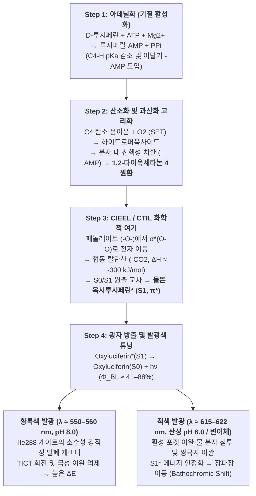

초여름 밤 개울가를 수놓는 반딧불이(*Luciola cruciata*, *Photinus pyralis*)의 연두색 불빛이나, 태양빛이 전혀 닿지 않는 수심 $1,000\,\text{m}$의 심해(중심해대 및 점심해대)에서 흡혈오징어(*Vampyroteuthis infernalis*), 샛비늘치(*Myctophidae*), 초롱아귀, 해파리(*Aequorea victoria*)가 뿜어내는 푸른 섬광은 자연계의 가장 경이로운 광학 현상이다.

인류가 사용해 온 고전적인 광원—촛불($\sim 1,700\,\text{K}$)이나 백열전구의 텅스텐 필라멘트($\sim 2,800\,\text{K}$)—은 물질을 수천 켈빈의 고온으로 가열해야만 가시광선을 방출할 수 있다. 켜진 백열전구를 맨손으로 만지면 투입 에너지의 $90\%$ 이상이 적외선 열로 방출되기 때문에 즉각 화상을 입는다. 그러나 빛나는 반딧불이를 손바닥 위에 올려놓아도 배 부분의 발광기(Photophore)는 주변 기온과 똑같은 실온($T \approx 295\text{–}300\,\text{K}$, 즉 $22\text{–}27\,^\circ\text{C}$)을 유지한다. 애초에 생명체의 단백질과 효소는 $315\text{–}323\,\text{K}$($42\text{–}50\,^\circ\text{C}$)만 넘어도 수소 결합과 소수성 코어가 파괴되는 비가역적 <strong>열변성(Thermal Denaturation)</strong>을 일으켜 사멸한다.

그렇다면 생명체는 어떻게 열복사의 법칙을 우회하여 실온에서 화학 결합 에너지를 단일 분자의 <strong>전자 들뜬 단일항 상태($S_1^*$)</strong>로 직접 주입하고, 최대 $41\%\text{–}88\%$에 달하는 경이로운 양자 수율로 <strong>'차가운 빛(Cold Light)'</strong>을 만들어내는 것일까?

---

## 제1장: 열복사(Incandescence)와 루미네선스(Luminescence)의 물리학

### 1.1 가시광선 광자 에너지와 실온 열에너지($k_B T$)의 압도적 격차

인간의 망막이 감지하는 가시광선 파장 영역은 $\lambda = 400\,\text{nm}$(보라색)에서 $700\,\text{nm}$(적색) 사이이다. 파장 $\lambda$인 광자 1개의 에너지 $E_{\text{photon}}$과 1몰당 광자 에너지 $E_{\text{mol}}$은 다음과 같다:

$$E_{\text{photon}} = h\nu = \frac{hc}{\lambda} \approx \frac{1239.8\,\text{eV}\cdot\text{nm}}{\lambda(\text{nm})}$$

- 반딧불이의 황록색 빛($\lambda \approx 560\,\text{nm}$): $E_{\text{photon}} \approx 2.21\,\text{eV}$, $E_{\text{mol}} = N_A h\nu \approx 213.6\,\text{kJ/mol}$.
- 심해 생물의 청색 빛($\lambda \approx 470\,\text{nm}$): $E_{\text{photon}} \approx 2.64\,\text{eV}$, $E_{\text{mol}} \approx 254.5\,\text{kJ/mol}$.

반면, 실온 $T = 300\,\text{K}$에서 분자 열운동의 평균 에너지 $k_B T$는 다음과 같이 극히 작다:

$$k_B T \big|_{T=300\,\text{K}} \approx 0.02585\,\text{eV}, \qquad RT \big|_{T=300\,\text{K}} \approx 2.494\,\text{kJ/mol}$$

즉, <strong>가시광선 광자 1개를 생성하려면 실온 평균 열에너지($0.026\,\text{eV}$)의 약 100배에 달하는 $2.2\text{–}2.6\,\text{eV}$의 집중된 에너지가 필요하다!</strong> 열평형 상태에서 $300\,\text{K}$의 열요동만으로 $\Delta E = 2.21\,\text{eV}$의 전자 들뜬 상태가 점유될 볼츠만 확률 인자는 $\exp(-\Delta E / k_B T) = \exp(-85.5) \approx 7.4 \times 10^{-38}$로 사실상 0이다.

### 1.2 플랑크 흑체복사 법칙과 빈의 변위 법칙

물체를 가열하여 빛을 내는 <strong>열복사(Incandescence)</strong>는 <strong>플랑크 법칙(Planck's Law)</strong>과 <strong>빈의 변위 법칙(Wien's Displacement Law)</strong>을 따른다:

$$B_\lambda(\lambda, T) = \frac{2hc^2}{\lambda^5} \frac{1}{\exp\left(\dfrac{hc}{\lambda k_B T}\right) - 1}, \qquad \lambda_{\max} \cdot T = 2.8978 \times 10^{-3}\,\text{m}\cdot\text{K}, \qquad J = \sigma T^4$$

1. <strong>실온의 생명체($T = 300\,\text{K}$)</strong>: 복사 피크 파장은 $\lambda_{\max} \approx 9.66\,\mu\text{m}$(중적외선)에 위치하며 가시광선 방출은 전혀 없다.
2. <strong>백열전구 텅스텐 필라멘트($T \approx 2,800\,\text{K}$)</strong>: 피크 파장이 $\lambda_{\max} \approx 1,035\,\text{nm}$(근적외선)에 머물러 <strong>투입 전력의 $90\%\text{–}95\%$가 보이지 않는 적외선 열로 낭비</strong>된다.
3. <strong>태양 표면($T \approx 5,778\,\text{K}$)</strong>: 비로소 $\lambda_{\max} \approx 501\,\text{nm}$로 가시광선 한가운데에 도달한다.

### 1.3 루미네선스(냉광): 열평형을 우회하는 양자 선택적 여기

1888년 물리학자 Eilhardt Wiedemann이 정의한 <strong>루미네선스(Luminescence, 냉광)</strong>는 거시적 온도 $T$를 높이지 않고 특정 분자의 전자 궤도($\text{HOMO} \to \text{LUMO}$)에만 선택적으로 $2\text{–}3\,\text{eV}$의 에너지를 주입하여 들뜬 상태($S_1^*$)를 직접 생성하는 비열적 발광 현상이다.

| 발광 분류 | 영문 명칭 | 에너지원 (여기 메커니즘) | 대표적 사례 및 생물 시스템 | 작동 온도 |
| :--- | :--- | :--- | :--- | :--- |
| <strong>열복사 (백열)</strong> | Incandescence | 물질 전체의 무작위 열운동 (줄열, 연소열) | 태양, 촛불, 백열전구 필라멘트 | $1,500\text{–}6,000\,\text{K}$ |
| <strong>형광 (광루미네선스)</strong> | Fluorescence | 외부 단파장 광자($h\nu_{\text{ex}}$) 흡수 후 스핀 허용 전이($S_1 \to S_0$) | 해파리 녹색형광단백질(GFP), 산호, 형광펜 | 실온 ($\sim 300\,\text{K}$) |
| <strong>인광 (광루미네선스)</strong> | Phosphorescence | 광흡수 후 계간교차(ISC)를 거친 스핀 금지 전이($T_1 \to S_0$) | 야광 도료($\text{SrAl}_2\text{O}_4:\text{Eu}^{2+}$), 야광 시계 | 실온 ($\sim 300\,\text{K}$) |
| <strong>전계발광</strong> | Electroluminescence | 전기장에 의한 전자와 정공의 재결합 | 질화갈륨($\text{GaN}$) 청색/백색 LED, OLED | 실온 |
| <strong>화학발광</strong> | Chemiluminescence | 발열 화학반응(과산화물 개열)에 의한 $S_1^*$ 화학적 여기 | 과학수사 루미놀(Luminol) 반응, 야광봉(사이알륨) | 실온 |
| <strong>생물발광</strong> | Bioluminescence | <strong>효소(루시페레이스)가 촉매하는 생체 내 화학발광</strong> | 반딧불이, 바다반딧불이, 야광충, 발광 박테리아, 발광 버섯 | <strong>생체 온도 ($275\text{–}310\,\text{K}$)</strong> |

---

## 제2장: 생물발광 vs. 형광(GFP) vs. 인광, 그리고 BRET 에너지 전달

```mermaid
flowchart TD
    subgraph INC ["1. 열복사 (Incandescence / 흑체복사)"]
        T1["고온 가열 (T > 2,500 K)<br/>분자 진동 및 병진 운동의 무차별 열여기"] --> T2["플랑크 분포 연속 스펙트럼 방출<br/>(>90% 적외선 열손실 / 단백질 변성)"]
    end

    subgraph FL ["2. 광루미네선스: 형광 (GFP) 및 인광"]
        F1["외부 여기 광자 흡수 (hν_ex: UV / 청색광)<br/>바닥상태 S0 → 들뜬 단일항 S1 (10^-15 s)"] --> F2["진동 이완 (10^-12 s)<br/>스토크스 이동 (λ_em > λ_ex)"]
        F2 --> F3["스핀 허용 형광 방출 S1 → S0 + hν_em (10^-9 s)<br/>*외부 광원 없이는 암흑 속에서 발광 불가*"]
        F2 -.->|"계간교차 (ISC: ΔS = 1)"| F4["스핀 금지 인광 방출 T1 → S0 + hν_ph<br/>(밀리초~수 시간 잔광)"]
    end

    subgraph BL ["3. 생물발광 (Bioluminescence: 300 K 냉광)"]
        B1["루시페린 + O2 (+ ATP 또는 Ca2+)<br/>루시페레이스 효소 활성 부위 결합 (300 K)"] --> B2["고변형 4원환 과산화물 중간체 형성<br/>(1,2-다이옥세타논 / 1,2-Dioxetanone)"]
        B2 --> B3["CIEEL 협동 개열 및 화학적 여기 (-CO2)<br/>S0 → S1* 원뿔 교차 (Conical Intersection)"]
        B3 --> B4["들뜬 옥시루시페린* (S1) → S0 + hν<br/>(외부 광원 불필요, 양자 수율 Φ_BL 41–88%)"]
    end

    subgraph BRET_BOX ["4. 생물발광 공명 에너지 전달 (BRET: 해파리 Aequorea victoria)"]
        BR1["에쿼린 Aequorin (코엘렌테라진 + Ca2+)<br/>화학적 여기로 청색 S1* 주개 생성 (470 nm)"] -->|"Förster 쌍극자-쌍극자 결합 (r < 5 nm)<br/>비방사 에너지 전달 E = 1/(1+(r/R0)^6)"| BR2["녹색형광단백질 (GFP) 발색단 여기<br/>녹색 광자 방출 (λ = 509 nm)"]
    end
```

대중 매체에서 흔히 혼동하는 <strong>생물발광(Bioluminescence)</strong>과 <strong>생물형광(Biofluorescence, 예: GFP)</strong>은 광물리학적으로 완전히 다르다:

1. <strong>형광(Fluorescence, 예: GFP)</strong>: <strong>반드시 외부에서 여기광($h\nu_{\text{ex}}$, 자외선이나 청색광)을 비춰주어야만 빛을 내는 광물리 과정</strong>이다. 바닥상태 $S_0$에서 $S_1$으로 광자를 흡수($10^{-15}\,\text{s}$)한 뒤 피코초($10^{-12}\,\text{s}$) 동안 진동 이완으로 일부 열을 잃고, 나노초($\tau \approx 10^{-9}\,\text{s}$) 수명으로 더 긴 파장의 빛($\lambda_{\text{em}} > \lambda_{\text{ex}}$, <strong>스토크스 이동 / Stokes Shift</strong>)을 방출한다. 외부 빛이 없는 암흑 속에서는 절대 스스로 빛나지 못한다.
2. <strong>인광(Phosphorescence)</strong>: 단일항 들뜬 상태 $S_1$($\uparrow\downarrow, S=0$)에서 스핀-궤도 결합에 의한 <strong>계간교차(Intersystem Crossing, ISC)</strong>를 통해 삼중항 상태 $T_1$($\uparrow\uparrow, S=1$)으로 넘어간 뒤, 스핀 금지 전이($\Delta S = 1$)인 $T_1 \to S_0$를 통해 밀리초에서 수 시간 동안 잔광을 방출한다.
3. <strong>생물발광(Bioluminescence)</strong>: <strong>외부 여기광이 전혀 필요 없는 광화학 과정(화학적 여기 / Chemiexcitation)</strong>이다. 완전한 암흑 속에서도 기질인 <strong>루시페린(Luciferin)</strong>이 효소 <strong>루시페레이스(Luciferase)</strong>에 의해 산화되면서 퍼텐셜 에너지면 교차를 통해 들뜬 생성물($\text{Oxyluciferin}^*$)을 직접 형성한다.

### 2.2 시모무라 오사무(2008 노벨 화학상)와 해파리의 BRET 메커니즘

2008년 노벨 화학상 수상자 <strong>시모무라 오사무(Osamu Shimomura)</strong> 박사는 해파리(*Aequorea victoria*) 연구에서 살아있는 해파리는 <strong>녹색 빛($\lambda_{\max} = 509\,\text{nm}$)</strong>을 내지만, 정제된 발광 단백질 <strong>에쿼린(Aequorin, 코엘렌테라진 포함)</strong>에 $\text{Ca}^{2+}$를 가하면 <strong>청색 빛($\lambda_{\max} = 470\,\text{nm}$)</strong>이 나온다는 사실을 발견했다. 해파리 발광기 내에서는 에쿼린과 <strong>녹색형광단백질(GFP, Ser65–Tyr66–Gly67 발색단)</strong>이 $r \approx 2\text{–}5\,\text{nm}$ 거리로 결합해 있으며, 에쿼린에서 화학적으로 여기된 $\text{Coelenteramide}^*$의 에너지가 <strong>생물발광 공명 에너지 전달(BRET, Förster 쌍극자-쌍극자 상호작용)</strong>을 통해 비방사적으로 GFP에 전달되어 $509\,\text{nm}$ 녹색 형광으로 방출된다:

$$E_{\text{BRET}} = \frac{1}{1 + \left(\dfrac{r}{R_0}\right)^6}, \qquad R_0^6 \propto \kappa^2 \, \Phi_D \, n^{-4} \int_0^\infty F_D(\lambda)\, \varepsilon_A(\lambda)\, \lambda^4 \, d\lambda$$

---

## 제3장: 반딧불이 루시페린-루시페레이스 반응의 양자화학과 CIEEL 메커니즘

반딧불이(*Photinus pyralis*, *Luciola*)의 발광 반응은 기질 <strong>D-루시페린(D-Luciferin)</strong>, 효소 <strong>루시페레이스($61\,\text{kDa}$)</strong>, <strong>$\text{ATP}$</strong>, $\text{Mg}^{2+}$, $\text{O}_2$에 의해 4단계로 진행된다:

1. <strong>단계 1: 아데닐화(기질 활성화) — ATP 에너지 오해 바로잡기</strong>
   $$\text{D-Luciferin} + \text{ATP} \xrightarrow{\text{Luciferase, Mg}^{2+}} \text{E}\cdot\text{D-Luciferyl-AMP} + \text{PP}_i$$
   <strong>핵심 열역학적 오해 교정</strong>: ATP 가수분해 자유 에너지($\Delta G^{\circ\prime} \approx -30.5\,\text{kJ/mol}$)는 $560\,\text{nm}$ 광자 에너지($214\,\text{kJ/mol}$)의 7분의 1에 불과하므로 광자의 에너지원이 아니다! ATP는 카복실기($-\text{COO}^-$)를 전자 끌개 그룹인 $-\text{CO-AMP}$로 전환하여 티아졸린 고리 C4 양성자의 $pK_a$를 낮추고 우수한 이탈기($-\text{AMP}$)를 도입하는 <strong>속도론적 활성화제(화학적 프라이머)</strong> 역할을 한다.
2. <strong>단계 2: 단일전자전달(SET) 산소화 및 고변형 4원환 '1,2-다이옥세타논' 형성</strong>
   탈양성자화된 C4 탄소 음이온이 삼중항 산소($^3\text{O}_2$)와 단일전자전달(SET)을 통해 반응하여 과산화수소 중간체를 만들고, 분자 내 친핵성 치환으로 $\text{AMP}$가 이탈하면서 극도로 뒤틀린 4원환 과산화물 <strong>1,2-다이옥세타논(1,2-Dioxetanone)</strong>이 형성된다.
3. <strong>단계 3: CIEEL / CTIL 화학적 여기와 궤도 대칭성 원뿔 교차</strong>
   1,2-다이옥세타논이 개열하여 <strong>옥시루시페린(Oxyluciferin)</strong>과 초안정 분자인 <strong>이산화탄소($\text{CO}_2$)</strong>로 분해될 때, 4원환 고리 변형 에너지($\sim 110\,\text{kJ/mol}$) 해방과 약한 $\text{O}-\text{O}$ 결합 파열 및 두 개의 강한 $\text{C}=\text{O}$ 이중결합 생성으로 인해 단번에 $\Delta H \approx -280\text{ to }-320\,\text{kJ/mol}$의 에너지가 방출된다.
   <strong>Woodward–Hoffmann 궤도 대칭성 규칙</strong>과 <strong>CIEEL(화학 개시 전자교환 발광) / CTIL(전하 이동 유도 발광)</strong> 메커니즘에 따르면, 벤조티아졸 고리의 탈양성자화된 페놀레이트 음이온($-\text{O}^-$)에서 다이옥세타논의 $\sigma^*(\text{O}-\text{O})$ 반결합 궤도로 분자 내 전자 이동이 일어난다. 결합이 늘어날 때 바닥상태 $S_0$ 퍼텐셜 에너지면은 대칭성 금지로 인해 급격히 상승하여 들뜬 단일항 $S_1$ 퍼텐셜면과 <strong>원뿔 교차(Conical Intersection)</strong>를 일으킨다. $\text{CO}_2$가 떨어져 나가는 순간 역전자 이동이 전자를 옥시루시페린의 $\text{LUMO}(\pi^*)$로 직접 주입하여, 분자는 바닥상태가 아닌 <strong>들뜬 단일항 상태 $\text{Oxyluciferin}^*(S_1)$</strong>로 탄생한다!
4. <strong>단계 4: 광자 방출, 양자 수율($\Phi_{\text{BL}}$) 및 발광색 튜닝</strong>
   $$\text{Oxyluciferin}^*(S_1) \longrightarrow \text{Oxyluciferin}(S_0) + h\nu \quad (\lambda_{\max} \approx 560\,\text{nm}), \qquad \Phi_{\text{BL}} = \Phi_{\text{chem}} \times \Phi_{\text{ex}} \times \Phi_{\text{fl}}$$
   정밀 적분구 절대 측정 결과 반딧불이 루시페레이스의 $\Phi_{\text{BL}}$은 pH 8.5에서 $41.0 \pm 7.4\%$이며, 화학적 여기 효율 $\Phi_{\text{ex}}$는 $60\text{–}90\%$에 달한다(Ando et al., 2008, *Nature Photonics*).
   <strong>발광색 튜닝($538\,\text{nm}$ 녹색 ~ $622\,\text{nm}$ 적색)</strong>: 동일한 D-루시페린을 쓰는데도 pH가 산성(pH 6.0)이 되거나 변이가 일어나면 발광색이 $560\,\text{nm}$ 황록색에서 $615\,\text{nm}$ 적색으로 이동한다(<strong>적색 이동 / Bathochromic Shift</strong>). Nakatsu 등(2006, *Nature*)은 효소 활성 부위의 <strong>Ile288 게이트 잔기</strong>가 들뜬 옥시루시페린을 단단히 조여 $\text{C}2-\text{C}2^\prime$ 회전 이완(TICT)과 물 분자 침투를 막아 고에너지 황록색 광자를 방출하게 하며, 이 패킹이 느슨해지면 극성 이완으로 인해 에너지가 낮아져 적색 광자가 방출됨을 규명했다.

---

## 제4장: 40~90회 이상 독립 진화한 생물발광의 다양성과 심해 생태계

생물발광은 생명의 역사에서 <strong>최소 40회에서 90회 이상 독립적으로 진화한 수렴 진화(Convergent Evolution)</strong>의 대표 사례다(Haddock et al., 2010). 이는 초기 호기성 생물이 <strong>활성산소종(ROS, $\text{O}_2^{\bullet-}$)을 해독하던 항산화 색소 반응</strong>에서 유래했다.

1. <strong>해양 코엘렌테라진(Coelenterazine) 및 바다반딧불이(Vargulin) 시스템</strong>: 수심 $200\text{–}1,000\,\text{m}$ 중층심해 생물의 $75\%$ 이상이 발광하며, 9개 이상의 동물문이 <strong>코엘렌테라진</strong>을 사용한다(어류와 오징어는 먹이사슬을 통해 섭취). 발광 파장 $\lambda_{\max} = 450\text{–}490\,\text{nm}$ 청색광은 해수의 광학 투과 창과 정확히 일치한다.
2. <strong>와편모조류(야광충 *Noctiluca*)의 전단 응력 센서와 전압 개폐 양성자 채널($\text{H}_v1$)</strong>: 파도나 포식자의 유체 <strong>전단 응력(Shear Stress)</strong>이 가해지면 액포막 탈분극으로 <strong>전압 개폐 양성자 채널($\text{H}_v1$)</strong>이 열려 발광 과립(Scintillon) 내부 pH가 $8.0 \to 6.0$으로 급락하고, 루시페린 결합 단백질(LBP)이 기질을 방출하여 $100\,\text{ms}$ 동안 $475\,\text{nm}$ 섬광을 터뜨린다(1차 포식자를 상위 포식자에게 노출시키는 <strong>'도난 경보기 가설 / Burglar Alarm'</strong>).
3. <strong>발광 박테리아 `luxCDABEG` 오페론과 쿼럼 센싱(Quorum Sensing)</strong>: 하와이안 밥테일 오징어(*Euprymna scolopes*)나 초롱아귀에 공생하는 *Aliivibrio fischeri*는 $\text{FMNH}_2$와 긴사슬 알데하이드($\text{RCHO}$)를 산화시켜 $490\,\text{nm}$ 빛을 내며, 신호 분자 <strong>자가유도물질(AHL, $\text{LuxI}/\text{LuxR}$ 시스템)</strong>을 통한 <strong>쿼럼 센싱</strong>으로 고밀도($>10^{10}\,\text{cells/mL}$)에서만 발광한다.
4. <strong>발광 버섯(*Mycena*, *Neonothopanus*)의 카페산(Caffeic Acid) 회로</strong>: 4가지 효소(`HispS`, `H3H`, `Luz`, `CPH`)를 이용해 식물·균류 공통 대사산물인 카페산을 <strong>3-하이드록시히스피딘</strong>으로 전환하여 $520\text{–}530\,\text{nm}$ 녹색 빛을 내고 다시 카페산으로 재활용한다(Kotlobay et al., 2018, *PNAS*).
5. <strong>심해 카운터일루미네이션(역조명 위장)과 적색 스나이퍼 심해어(*Malacosteus niger*)</strong>: 샛비늘치와 반딧불오징어는 복부 발광기로 하강하는 햇빛과 동일한 청색광을 아래로 비춰 그림자를 지우는 스텔스 위장을 수행하며, 심해어 *Malacosteus niger*는 $>700\,\text{nm}$ 원적외선/적색 발광기와 클로로필 유도체 망막 색소를 결합해 먹잇감에게 보이지 않는 <strong>적외선 야간투시경</strong>을 사용한다.

---

## 제5장: 의료 생체 이미징(AkaBLI), 위생 검사 및 자가 발광 식물 응용

1. <strong>생체 생물발광 이미징(In Vivo BLI)과 근적외선 AkaBLI 시스템</strong>: 외부 여기광이 필요 없어 자가형광 노이즈가 0에 가까운 BLI의 장점을 극대화하기 위해, 이화학연구소(RIKEN) 미야와키 아츠시 팀(Iwano et al., 2018, *Science*)은 합성 기질 <strong>AkaLumine-HCl</strong>과 변이 효소 <strong>AkaLuc</strong>을 결합해 생체 투과 창인 <strong>근적외선 영역($\lambda_{\max} = 677\,\text{nm}$)</strong>에서 기존 대비 1,000배 높은 감도를 달성, 살아있는 마우스 폐 속의 <strong>단일 전이 암세포</strong> 추적과 영장류 뇌 신경 활동 비침습 기록에 성공했다.
2. <strong>초고휘도 NanoLuc 및 ATP 위생 루미노미터</strong>: 심해 새우 유래의 소형 $19\,\text{kDa}$ <strong>NanoLuc</strong>(기질 Furimazine)은 반딧불이보다 150배 밝아 신약 개발 및 NanoBRET 분석에 쓰이며, 반딧불이 효소의 $I \propto [\text{ATP}]$ 선형성을 이용한 휴대용 ATP 측정기는 수술 기구 및 식품 공장의 미생물 오염($10^{-15}\text{–}10^{-18}\,\text{mol}$ ATP)을 10초 만에 정량한다.
3. <strong>자가 발광 식물(Glowing Plants)</strong>: 모든 관다발식물이 리그닌 합성을 위해 다량의 카페산을 생성한다는 점에 착안하여, 균류의 카페산 발광 회로 4개 유전자를 담배와 페튜니아(*Firefly Petunia*)에 도입함으로써 외부 기질 공급 없이 평생 스스로 녹색 빛을 내는 자가 발광 식물이 탄생했다(Mitiouchkina et al., 2020, *Nature Biotechnology*).
