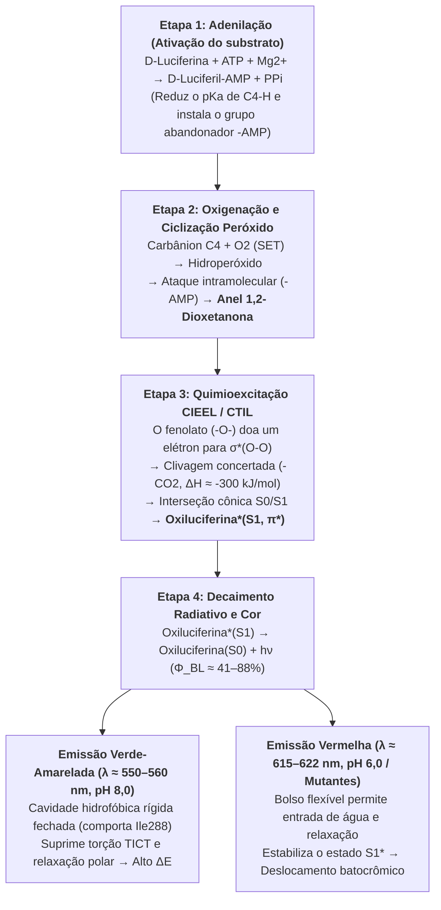

Em uma noite quente de verão, milhares de vaga-lumes (*Photinus pyralis*, *Luciola cruciata*) flutuam na escuridão como brasas de esmeralda. A $1.000\,\text{m}$ abaixo da superfície do oceano — nas zonas mesopelágica e batipelágica onde nenhum fóton solar penetra — mais de $75\%$ dos organismos pelágicos, desde a lula-vampiro (*Vampyroteuthis infernalis*) e os peixes-lanterna (*Myctophidae*) até os tamboris abissais e a água-viva-cristal (*Aequorea victoria*), iluminam o abismo com clarões azuis e verdes.

As fontes de luz tradicionais, como a chama de uma vela ($\sim 1.700\,\text{K}$) ou o filamento de tungstênio de uma lâmpada incandescente ($\sim 2.800\,\text{K}$), exigem temperaturas extremas para emitir luz visível, desperdiçando mais de $90\%$ de sua energia como calor infravermelho. No entanto, se você segurar um vaga-lume na palma da mão, seu abdômen estará completamente frio, à temperatura ambiente ($T \approx 295\text{–}300\,\text{K}$, ou $22\text{–}27\,^\circ\text{C}$). De fato, proteínas e enzimas sofrem <strong>desnaturação térmica</strong> irreversível acima de $315\text{–}323\,\text{K}$ ($42\text{–}50\,^\circ\text{C}$).

Como a vida contorna as leis da radiação térmica para converter a energia de ligação química diretamente em estados eletrônicos excitados singleto ($S_1^*$) a $300\,\text{K}$, emitindo <strong>«luz fria» (Cold Light)</strong> com um rendimento quântico de até $41\%\text{–}88\%$?

---

## Capítulo 1: Radiação Térmica (Incandescência) vs. Luminescência

### 1.1 O abismo energético entre um fóton visível e a energia térmica ($k_B T$)

No espectro visível ($\lambda = 400\text{–}700\,\text{nm}$), a energia de um único fóton e seu equivalente molar são dados por:

$$E_{\text{photon}} = h\nu = \frac{hc}{\lambda} \approx \frac{1239,8\,\text{eV}\cdot\text{nm}}{\lambda(\text{nm})}$$

- Luz verde-amarelada do vaga-lume ($\lambda \approx 560\,\text{nm}$): $E_{\text{photon}} \approx 2,21\,\text{eV}$, $E_{\text{mol}} = N_A h\nu \approx 213,6\,\text{kJ/mol}$.
- Luz azul abissal ($\lambda \approx 470\,\text{nm}$): $E_{\text{photon}} \approx 2,64\,\text{eV}$, $E_{\text{mol}} \approx 254,5\,\text{kJ/mol}$.

Em contraste, a energia térmica média $k_B T$ à temperatura ambiente ($T = 300\,\text{K}$) é apenas:

$$k_B T \big|_{T=300\,\text{K}} \approx 0,02585\,\text{eV}, \qquad RT \big|_{T=300\,\text{K}} \approx 2,494\,\text{kJ/mol}$$

<strong>Gerar um único fóton visível requer quase 100 vezes o quantum de energia térmica média à temperatura ambiente!</strong> Em equilíbrio térmico a $300\,\text{K}$, a probabilidade de Boltzmann de povoar espontaneamente um estado excitado a $\Delta E = 2,21\,\text{eV}$ é $\exp(-\Delta E / k_B T) = \exp(-85,5) \approx 7,4 \times 10^{-38}$ — fisicamente zero.

### 1.2 Lei de Planck e Lei do Deslocamento de Wien

A radiância espectral $B_\lambda(\lambda, T)$ de um corpo negro segue a <strong>lei de Planck</strong>, seu pico de emissão a <strong>lei de Wien</strong> e sua emitância total a <strong>lei de Stefan-Boltzmann</strong>:

$$B_\lambda(\lambda, T) = \frac{2hc^2}{\lambda^5} \frac{1}{\exp\left(\dfrac{hc}{\lambda k_B T}\right) - 1}, \qquad \lambda_{\max} \cdot T = 2,8978 \times 10^{-3}\,\text{m}\cdot\text{K}, \qquad J = \sigma T^4$$

A $T = 300\,\text{K}$, o pico situa-se no infravermelho médio ($\lambda_{\max} \approx 9,66\,\mu\text{m}$). Mesmo em um filamento de tungstênio a $2.800\,\text{K}$, o pico permanece no infravermelho próximo ($\lambda_{\max} \approx 1.035\,\text{nm}$), dissipando $>90\%$ da energia elétrica como calor. Apenas a fotosfera solar ($T \approx 5.778\,\text{K}$) atinge $\lambda_{\max} \approx 501\,\text{nm}$.

### 1.3 Luminescência («Luz Fria»): excitação quântica seletiva fora do equilíbrio

Cunhado em 1888 por Eilhardt Wiedemann, o termo <strong>luminescência</strong> descreve toda emissão de luz não térmica na qual $2\text{–}3\,\text{eV}$ são injetados seletivamente em uma transição eletrônica ($\text{HOMO} \to \text{LUMO}$, $S_0 \to S_1^*$) mantendo o meio a $300\,\text{K}$.

| Categoria de Emissão | Fonte de Excitação | Mecanismo Físico-Químico | Exemplos Representativos | Temperatura |
| :--- | :--- | :--- | :--- | :--- |
| <strong>Incandescência (Corpo negro)</strong> | Agitação térmica ($k_B T$) | População térmica indiscriminada de todos os modos | Sol, chama de vela, lâmpada de filamento | $1.500\text{–}6.000\,\text{K}$ |
| <strong>Fluorescência (Fotoluminescência)</strong> | Absorção de fóton externo ($h\nu_{\text{ex}}$) | Decaimento permitido por spin $S_1 \to S_0$ ($\tau \sim 10^{-9}\,\text{s}$) | GFP (*Aequorea*), pigmentos de coral, marca-textos | Ambiente ($\sim 300\,\text{K}$) |
| <strong>Fosforescência</strong> | Absorção fotônica + Cruzamento intersistema (ISC) | Transição proibida por spin $T_1 \to S_0$ ($\Delta S = 1, \tau \sim 10^{-3}\text{–}10^4\,\text{s}$) | Tintas luminescentes ($\text{SrAl}_2\text{O}_4:\text{Eu}^{2+}$) | Ambiente ($\sim 300\,\text{K}$) |
| <strong>Eletroluminescência</strong> | Campo elétrico / injeção de portadores | Recombinação radiativa elétron-lacuna | LEDs azuis/brancos ($\text{InGaN}$), telas OLED | Ambiente |
| <strong>Quimioluminescência</strong> | Rearranjo químico exotérmico | Clivagem de peróxido que povoa diretamente $S_1^*$ | Luminol forense, bastões luminosos (oxalato) | Ambiente |
| <strong>Bioluminescência</strong> | <strong>Quimioluminescência catalisada por enzimas</strong> | <strong>Oxidação da luciferina pela luciferase via 1,2-dioxetanona</strong> | Vaga-lumes, *Vargula*, dinoflagelados, *Vibrio*, fungos | <strong>Fisiológica ($275\text{–}310\,\text{K}$)</strong> |

---

## Capítulo 2: Bioluminescência vs. Fluorescência (GFP) vs. Fosforescência e BRET

```mermaid
flowchart TD
    subgraph INC ["1. Incandescência (Radiação térmica de corpo negro)"]
        T1["Aquecimento extremo (T > 2.500 K)<br/>Agitação térmica indiscriminada de todos os modos"] --> T2["Espectro contínuo de Planck B_λ(T)<br/>(>90% perdido como calor IR; letal para proteínas)"]
    end

    subgraph FL ["2. Fotoluminescência: Fluorescência (GFP) e Fosforescência"]
        F1["Absorção de fóton externo (hν_ex: UV / Azul)<br/>Estado fundamental S0 → Singleto excitado S1 (10^-15 s)"] --> F2["Relaxação vibracional (10^-12 s)<br/>Deslocamento de Stokes (λ_em > λ_ex)"]
        F2 --> F3["Fluorescência permitida S1 → S0 + hν_em (10^-9 s)<br/>*Totalmente escuro sem luz externa!*"]
        F2 -.->|"Cruzamento intersistema (ISC: ΔS = 1)"| F4["Fosforescência proibida T1 → S0 + hν_ph<br/>(Persistência de 10^-3 s a horas)"]
    end

    subgraph BL ["3. Bioluminescência ('Luz fria' a 300 K)"]
        B1["Luciferina + O2 (+ ATP ou Ca2+)<br/>Ligada ao sítio ativo da luciferase a 300 K"] --> B2["Anel peróxido de quatro membros tensionado<br/>(Intermediário 1,2-dioxetanona)"]
        B2 --> B3["Clivagem concertada CIEEL e Quimioexcitação (-CO2)<br/>Cruzamento direto de superfícies S0 → S1*"]
        B3 --> B4["Oxiluciferina*(S1) → Oxiluciferina(S0) + hν<br/>(Zero luz externa necessária; Φ_BL de 41 a 88%)"]
    end

    subgraph BRET_BOX ["4. Transferência de Energia por Ressonância de Bioluminescência (BRET em Aequorea victoria)"]
        BR1["Aequorina (Coelenterazina + Ca2+)<br/>A quimioexcitação cria o doador azul S1* (470 nm)"] -->|"Acoplamento dipolo-dipolo de Förster (r < 5 nm)<br/>Transferência não radiativa E = 1/(1+(r/R0)^6)"| BR2["Excita o cromóforo da GFP (Ser65-Tyr66-Gly67)<br/>Emite fóton verde (λ = 509 nm)"]
    end
```

É fundamental distinguir entre <strong>bioluminescência</strong> e <strong>biofluorescência (como a GFP)</strong>:

1. <strong>A fluorescência (ex. GFP)</strong> é um processo <strong>fotofísico</strong> que <strong>exige obrigatoriamente luz de excitação externa ($h\nu_{\text{ex}}$, UV ou azul)</strong>. Após absorver o fóton ($10^{-15}\,\text{s}$) e perder parte da energia por relaxação vibracional ($10^{-12}\,\text{s}$), emite em nanossegundos ($\tau \approx 10^{-9}\,\text{s}$) um fóton de maior comprimento de onda (<strong>deslocamento de Stokes</strong>, $\lambda_{\text{em}} > \lambda_{\text{ex}}$). Na escuridão total sem lâmpada externa, um organismo fluorescente não brilha!
2. <strong>A fosforescência</strong> envolve um <strong>cruzamento intersistema (ISC)</strong> do estado singleto $S_1$ ($\uparrow\downarrow, S=0$) para o estado tripleto $T_1$ ($\uparrow\uparrow, S=1$), cuja emissão $T_1 \to S_0$ é proibida por spin ($\Delta S = 1$), prolongando o brilho de milissegundos a horas.
3. <strong>A bioluminescência</strong> é um processo <strong>fotoquímico (quimioexcitação)</strong> que opera na <strong>escuridão absoluta sem luz externa</strong>: a oxidação catalítica da <strong>luciferina</strong> pela <strong>luciferase</strong> cruza diretamente para a superfície excitada $\text{Oxiluciferina}^*(S_1)$.

### 2.2 Osamu Shimomura (Prêmio Nobel 2008) e o acoplamento BRET entre Aequorina e GFP

Ao investigar a água-viva *Aequorea victoria* (que brilha em <strong>verde a $509\,\text{nm}$</strong>), <strong>Osamu Shimomura</strong> descobriu que a fotoproteína purificada <strong>Aequorina</strong> (com coelenterazina e ativada por $\text{Ca}^{2+}$) emite <strong>luz azul ($\lambda_{\max} = 470\,\text{nm}$)</strong> em tubo de ensaio. No órgão luminoso da água-viva, a Aequorina transfere sua energia de excitação de forma não radiativa a uma distância $r \approx 2\text{–}5\,\text{nm}$ para a <strong>proteína verde fluorescente (GFP)</strong> via <strong>BRET (Bioluminescence Resonance Energy Transfer)</strong> por acoplamento dipolo-dipolo de Förster:

$$E_{\text{BRET}} = \frac{1}{1 + \left(\dfrac{r}{R_0}\right)^6}, \qquad R_0^6 \propto \kappa^2 \, \Phi_D \, n^{-4} \int_0^\infty F_D(\lambda)\, \varepsilon_A(\lambda)\, \lambda^4 \, d\lambda$$

---

## Capítulo 3: Química Quântica da Reação Luciferina–Luciferase do Vaga-lume

A reação nos peroxissomos das células fotocíticas de *Photinus pyralis* ou *Luciola* emprega <strong>D-luciferina</strong>, a enzima <strong>luciferase ($61\,\text{kDa}$)</strong>, $\text{ATP}$, $\text{Mg}^{2+}$ e $\text{O}_2$ em quatro etapas:

1. <strong>Etapa 1: Adenilação (Ativação do substrato) — Desmistificando o papel do ATP</strong>
   $$\text{D-Luciferina} + \text{ATP} \xrightarrow{\text{Luciferase, Mg}^{2+}} \text{E}\cdot\text{D-Luciferil-AMP} + \text{PP}_i$$
   <strong>Esclarecimento termodinâmico essencial</strong>: A hidrólise do ATP ($\Delta G^{\circ\prime} \approx -30,5\,\text{kJ/mol}$) <strong>não</strong> fornece os $214\,\text{kJ/mol}$ de um fóton de $560\,\text{nm}$. O ATP atua como <strong>ativador cinético</strong>: converte o grupo $-\text{COO}^-$ no éster acil-adenilato ($-\text{CO-AMP}$), reduzindo drasticamente o $pK_a$ do próton C4 para formar um carbânion e instalando um excelente grupo abandonador ($-\text{AMP}$).
2. <strong>Etapa 2: Transferência Monoeletrônica (SET), Oxigenação e Ciclização a 1,2-Dioxetanona</strong>
   O carbânion C4 reage com o oxigênio tripleto ($^3\text{O}_2$) via SET formando um hidroperóxido que expulsa $\text{AMP}$ por substituição nucleofílica intramolecular, fechando um anel peróxido de quatro membros altamente tensionado: a <strong>1,2-dioxetanona ($\alpha$-peroxilactona)</strong>.
3. <strong>Etapa 3: Mecanismo CIEEL / CTIL e Interseção Cônica $S_0/S_1$</strong>
   A decomposição da 1,2-dioxetanona em <strong>oxiluciferina</strong> e $\text{CO}_2$ libera $\Delta H \approx -280\text{ a }-320\,\text{kJ/mol}$ ao aliviar a tensão do anel ($\sim 110\,\text{kJ/mol}$), romper a fraca ligação $\text{O}-\text{O}$ ($\sim 140\,\text{kJ/mol}$) e formar as duas ligações duplas ultraestáveis $\text{C}=\text{O}$ do $\text{CO}_2$.
   Segundo as <strong>regras de simetria orbital de Woodward–Hoffmann</strong> e o mecanismo <strong>CIEEL / CTIL</strong>, o fenolato desprotonado ($-\text{O}^-$) transfere densidade eletrônica para o orbital antiligante $\sigma^*(\text{O}-\text{O})$. Como a clivagem concertada no estado fundamental $S_0$ é proibida por simetria orbital, a superfície $S_0$ sobe abruptamente e cruza a superfície excitada singleto $S_1$ em uma <strong>interseção cônica (Conical Intersection)</strong>. Com a saída do $\text{CO}_2$, a retrodoação eletrônica povoa diretamente o $\text{LUMO}(\pi^*)$, gerando <strong>$\text{Oxiluciferina}^*(S_1)$</strong> a $300\,\text{K}$.
4. <strong>Etapa 4: Emissão de Fótons, Rendimento Quântico ($\Phi_{\text{BL}}$) e Sintonia de Cor</strong>
   $$\text{Oxiluciferina}^*(S_1) \longrightarrow \text{Oxiluciferina}(S_0) + h\nu \quad (\lambda_{\max} \approx 560\,\text{nm}), \qquad \Phi_{\text{BL}} = \Phi_{\text{chem}} \times \Phi_{\text{ex}} \times \Phi_{\text{fl}}$$
   Medições absolutas com esfera integradora determinaram $\Phi_{\text{BL}} = 41,0 \pm 7,4\%$ em pH 8,5 (Ando et al., 2008, *Nature Photonics*).
   <strong>Sintonia de cor ($538\,\text{nm}$ verde a $622\,\text{nm}$ vermelho)</strong>: Todos os besouros bioluminescentes (incluindo a larva-trenzinho sul-americana *Phrixothrix*, com lanternas vermelhas na cabeça a $622\,\text{nm}$ e verdes nas laterais a $546\,\text{nm}$) usam a mesma D-luciferina! Nakatsu et al. (2006, *Nature*) demonstraram que o resíduo <strong>Ile288</strong> atua como uma comporta hidrofóbica rígida que impede a torção TICT e a entrada de água para emitir luz verde-amarelada ($560\,\text{nm}$), enquanto em pH ácido (6,0) ou em mutantes a cavidade relaxa, estabilizando o estado $S_1^*$ e deslocando a emissão para o vermelho ($615\,\text{nm}$, <strong>deslocamento batocrômico</strong>).

---

## Capítulo 4: Evolução Convergente (40–90+ Origens) e Ecologia do Mar Profundo

A bioluminescência evoluiu de forma independente <strong>entre 40 e mais de 90 vezes</strong> (Haddock et al., 2010) a partir de pigmentos antioxidantes detoxificadores de espécies reativas de oxigênio (ROS):

1. <strong>Sistemas marinhos de coelenterazina e vargulina (*Cypridina*)</strong>: Mais de $75\%$ dos organismos mesopelágicos brilham. A <strong>coelenterazina</strong> é empregada em mais de nove filos animais (frequentemente adquirida na dieta) e emite luz azul ($\lambda_{\max} = 450\text{–}490\,\text{nm}$), coincidindo com a janela de máxima transmissão óptica da água do mar. O ostracode *Vargula hilgendorfii* expele nuvens luminosas azuis ($462\,\text{nm}$) usando <strong>vargulina</strong>.
2. <strong>Dinoflagelados (*Noctiluca*) e canais de prótons dependentes de voltagem ($\text{H}_v1$)</strong>: A <strong>tensão de cisalhamento hidrodinâmica</strong> das ondas despolariza a membrana vacuolar e abre os canais <strong>$\text{H}_v1$</strong>, reduzindo o pH dos <strong>scintillons</strong> de $8,0$ para $6,0$ em milissegundos e disparando um flash azul de $100\,\text{ms}$ ($475\,\text{nm}$) como «alarme contra ladrões» (*Burglar Alarm*).
3. <strong>Operon bacteriano `luxCDABEG` e percepção de quórum (Quorum Sensing)</strong>: As bactérias simbióticas *Aliivibrio fischeri* (na lula *Euprymna scolopes*) oxidam $\text{FMNH}_2$ e um aldeído de cadeia longa ($\text{RCHO}$) a $490\,\text{nm}$ apenas quando o autoindutor <strong>AHL</strong> supera um limiar de alta densidade celular ($>10^{10}\,\text{células/mL}$).
4. <strong>Ciclo fúngico do ácido cafeico (*Mycena*, *Neonothopanus*)</strong>: Quatro enzimas (`HispS`, `H3H`, `Luz`, `CPH`) convertem o ácido cafeico em <strong>3-hidroxihispidina</strong>, que emite luz verde ($520\text{–}530\,\text{nm}$) e é reciclada de volta a ácido cafeico (Kotlobay et al., 2018, *PNAS*).
5. <strong>Contrailuminação e holofotes vermelhos furtivos (*Malacosteus niger*)</strong>: Os peixes-lanterna apagam sua silhueta ventral mediante contrailuminação azul ($475\,\text{nm}$), enquanto o peixe-dragão *Malacosteus niger* emite luz vermelho-distante/infravermelho próximo ($>700\,\text{nm}$) acoplada a um fotossensibilizador derivado de clorofila para caçar presas vermelhas sem ser detectado.

---

## Capítulo 5: Imagem Médica (AkaBLI), Higiene por ATP e Plantas Autoluminescentes

1. <strong>Imagem por Bioluminescência *in vivo* (BLI) e o Sistema Infravermelho Próximo AkaBLI</strong>: Sem ruído de autofluorescência, a BLI alcançou um marco quando Iwano & Miyawaki et al. (2018, *Science*, RIKEN) desenharam o par <strong>AkaLumine-HCl / AkaLuc</strong> ($\lambda_{\max} = 677\,\text{nm}$ na janela biológica infravermelha), aumentando em 1.000 vezes a sensibilidade profunda e permitindo visualizar <strong>uma única célula cancerosa metastática</strong> nos pulmões de um camundongo vivo.
2. <strong>NanoLuc e Luminômetros de Higiene por ATP</strong>: A luciferase <strong>NanoLuc ($19\,\text{kDa}$)</strong> do camarão abissal *Oplophorus* brilha $150\times$ mais que a de vaga-lume; os luminômetros de ATP quantificam $10^{-15}\text{–}10^{-18}\,\text{mol}$ de ATP microbiano em 10 segundos para controle cirúrgico, alimentar e espacial.
3. <strong>Plantas Autoluminescentes (*Firefly Petunia*)</strong>: Ao transferir os quatro genes do ciclo fúngico do ácido cafeico (precursor universal da lignina vegetal) para o tabaco e a petúnia (Mitiouchkina et al., 2020, *Nature Biotechnology*), criaram-se plantas que brilham com luz verde visível a olho nu durante toda a sua vida sem substratos externos.
