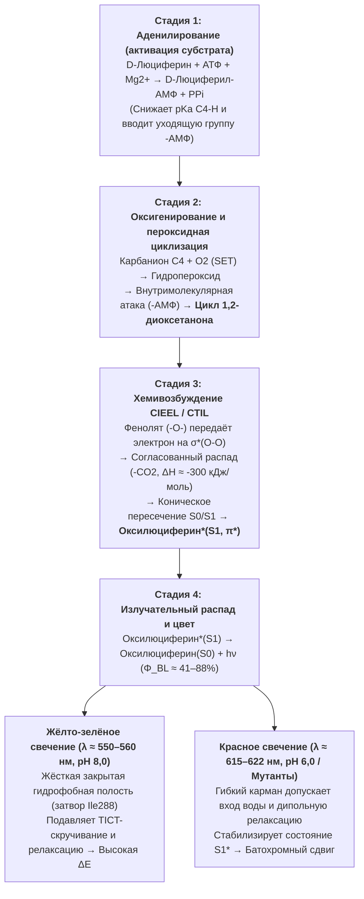

Тёплым летним вечером тысячи светлячков (*Photinus pyralis*, *Luciola cruciata*) парят в темноте, словно изумрудные искры. А на глубине $1\,000\,\text{м}$ в океане — в мезопелагической и батипелагической зонах, куда не проникает ни один солнечный фотон — более $75\%$ пелагических видов, от адского вампира (*Vampyroteuthis infernalis*) и рыб-миктофид (*Myctophidae*) до глубоководных удильщиков и медузы *Aequorea victoria*, озаряют бездну вспышками синего и зелёного света.

Традиционные источники света — пламя свечи ($\sim 1\,700\,\text{K}$) или вольфрамовая нить лампы накаливания ($\sim 2\,800\,\text{K}$) — требуют экстремального нагрева для испускания видимого света, теряя более $90\%$ энергии в виде инфракрасного тепла. Однако светлячок на ладони остаётся совершенно холодным, сохраняя температуру окружающей среды ($T \approx 295\text{–}300\,\text{K}$, или $22\text{–}27\,^\circ\text{C}$). Белки и ферменты живых клеток претерпевают необратимую <strong>тепловую денатурацию</strong> уже при $315\text{–}323\,\text{K}$ ($42\text{–}50\,^\circ\text{C}$).

Как живая природа обходит законы теплового излучения, направляя энергию химических связей непосредственно в электронно-возбуждённое синглетное состояние ($S_1^*$) при $300\,\text{K}$ и создавая <strong>«холодный свет» (Cold Light)</strong> с квантовым выходом до $41\%\text{–}88\%$?

---

## Глава 1: Тепловое излучение (накаливание) и люминесценция

### 1.1 Энергетическая пропасть между видимым фотоном и тепловой энергией ($k_B T$)

В видимом диапазоне ($\lambda = 400\text{–}700\,\text{нм}$) энергия одного фотона и молярная энергия определяются формулой Планка:

$$E_{\text{photon}} = h\nu = \frac{hc}{\lambda} \approx \frac{1239,8\,\text{эВ}\cdot\text{нм}}{\lambda(\text{нм})}$$

- Жёлто-зелёный свет светлячка ($\lambda \approx 560\,\text{нм}$): $E_{\text{photon}} \approx 2,21\,\text{эВ}$, $E_{\text{mol}} = N_A h\nu \approx 213,6\,\text{кДж/моль}$.
- Синий свет глубоководных организмов ($\lambda \approx 470\,\text{нм}$): $E_{\text{photon}} \approx 2,64\,\text{эВ}$, $E_{\text{mol}} \approx 254,5\,\text{кДж/моль}$.

В то же время средняя тепловая энергия $k_B T$ при комнатной температуре ($T = 300\,\text{K}$) составляет всего:

$$k_B T \big|_{T=300\,\text{K}} \approx 0,02585\,\text{эВ}, \qquad RT \big|_{T=300\,\text{K}} \approx 2,494\,\text{кДж/моль}$$

<strong>Рождение одного видимого фотона требует энергии, почти в 100 раз превышающей средний квант теплового движения при комнатной температуре!</strong> В тепловом равновесии при $300\,\text{K}$ больцмановская вероятность спонтанного возбуждения уровня $\Delta E = 2,21\,\text{эВ}$ равна $\exp(-\Delta E / k_B T) = \exp(-85,5) \approx 7,4 \times 10^{-38}$ — физически абсолютный нуль.

### 1.2 Закон Планка и закон смещения Вина

Спектральная плотность излучения абсолютно чёрного тела $B_\lambda(\lambda, T)$ подчиняется <strong>закону Планка</strong>, длина волны максимума — <strong>закону смещения Вина</strong>, а полная мощность — <strong>закону Стефана — Больцмана</strong>:

$$B_\lambda(\lambda, T) = \frac{2hc^2}{\lambda^5} \frac{1}{\exp\left(\dfrac{hc}{\lambda k_B T}\right) - 1}, \qquad \lambda_{\max} \cdot T = 2,8978 \times 10^{-3}\,\text{м}\cdot\text{K}, \qquad J = \sigma T^4$$

При $T = 300\,\text{K}$ пик излучения лежит в среднем ИК-диапазоне ($\lambda_{\max} \approx 9,66\,\text{мкм}$). Даже у вольфрамовой нити при $2\,800\,\text{K}$ пик остаётся в ближнем ИК-диапазоне ($\lambda_{\max} \approx 1\,035\,\text{нм}$), из-за чего $>90\%$ электроэнергии теряется в виде тепла. Лишь фотосфера Солнца ($T \approx 5\,778\,\text{K}$) достигает $\lambda_{\max} \approx 501\,\text{нм}$.

### 1.3 Люминесценция («холодный свет»): квантово-селективное нетепловое возбуждение

Термин <strong>люминесценция</strong>, введённый в 1888 году Эйльхардтом Видеманом, описывает нетепловое свечение, при котором $2\text{–}3\,\text{эВ}$ избирательно передаются на электронный переход ($\text{ВЗМО} \to \text{НСМО}$, $S_0 \to S_1^*$) без нагрева среды.

| Тип свечения | Источник возбуждения | Физико-химический механизм | Примеры | Температура |
| :--- | :--- | :--- | :--- | :--- |
| <strong>Накаливание (тепловое)</strong> | Тепловое движение ($k_B T$) | Неселективное тепловое заселение всех мод | Солнце, пламя свечи, лампа накаливания | $1\,500\text{–}6\,000\,\text{K}$ |
| <strong>Флуоресценция</strong> | Поглощение внешнего фотона ($h\nu_{\text{ex}}$) | Разрешённый по спину переход $S_1 \to S_0$ ($\tau \sim 10^{-9}\,\text{с}$) | Белок GFP (*Aequorea*), кораллы, маркеры | Комнатная ($\sim 300\,\text{K}$) |
| <strong>Фосфоресценция</strong> | Поглощение фотона + интеркомбинационная конверсия (ISC) | Запрещённый по спину переход $T_1 \to S_0$ ($\Delta S = 1, \tau \sim 10^{-3}\text{–}10^4\,\text{с}$) | Люминофоры ($\text{SrAl}_2\text{O}_4:\text{Eu}^{2+}$) | Комнатная ($\sim 300\,\text{K}$) |
| <strong>Электролюминесценция</strong> | Электрическое поле / инжекция носителей | Рекомбинация электронов и дырок в полупроводнике | Синие/белые светодиоды ($\text{InGaN}$), OLED | Комнатная |
| <strong>Хемилюминесценция</strong> | Экзотермическая химическая реакция | Распад пероксида, заселяющий непосредственно $S_1^*$ | Криминалистический люминол, ХИС (оксалаты) | Комнатная |
| <strong>Биолюминесценция</strong> | <strong>Ферментативная хемилюминесценция</strong> | <strong>Окисление люциферина люциферазой через 1,2-диоксетанон</strong> | Светлячки, *Vargula*, динофлагелляты, *Vibrio*, грибы | <strong>Физиологическая ($275\text{–}310\,\text{K}$)</strong> |

---

## Глава 2: Биолюминесценция против флуоресценции (GFP), фосфоресценции и механизм BRET

```mermaid
flowchart TD
    subgraph INC ["1. Накаливание (Тепловое излучение чёрного тела)"]
        T1["Экстремальный нагрев (T > 2 500 K)<br/>Неселективное тепловое возбуждение всех мод"] --> T2["Непрерывный спектр Планка B_λ(T)<br/>(>90% потерь в ИК-тепло; гибельно для белков)"]
    end

    subgraph FL ["2. Фотолюминесценция: Флуоресценция (GFP) и Фосфоресценция"]
        F1["Поглощение внешнего фотона (hν_ex: УФ / Синий)<br/>Основное состояние S0 → Синглет S1 (10^-15 с)"] --> F2["Колебательная релаксация (10^-12 с)<br/>Стоксов сдвиг (λ_em > λ_ex)"]
        F2 --> F3["Разрешённая флуоресценция S1 → S0 + hν_em (10^-9 с)<br/>*Полная темнота без внешнего света!*"]
        F2 -.->|"Интеркомбинационная конверсия (ISC: ΔS = 1)"| F4["Запрещённая фосфоресценция T1 → S0 + hν_ph<br/>(Послесвечение от 10^-3 с до часов)"]
    end

    subgraph BL ["3. Биолюминесценция ('Холодный свет' при 300 K)"]
        B1["Люциферин + O2 (+ АТФ или Ca2+)<br/>В активном центре люциферазы при 300 K"] --> B2["Напряжённый четырёхчленный пероксидный цикл<br/>(Интермедиат 1,2-диоксетанон)"]
        B2 --> B3["Согласованный распад CIEEL и хемивозбуждение (-CO2)<br/>Прямое пересечение поверхностей S0 → S1*"]
        B3 --> B4["Оксилюциферин*(S1) → Оксилюциферин(S0) + hν<br/>(Внешний свет не нужен; Φ_BL от 41 до 88%)"]
    end

    subgraph BRET_BOX ["4. Биолюминесцентный резонансный перенос энергии (BRET у Aequorea victoria)"]
        BR1["Экворин (Целентеразин + Ca2+)<br/>Хемивозбуждение создаёт синий донор S1* (470 нм)"] -->|"Диполь-дипольная связь Фёрстера (r < 5 нм)<br/>Безызлучательный перенос E = 1/(1+(r/R0)^6)"| BR2["Возбуждает хромофор GFP (Ser65-Tyr66-Gly67)<br/>Испускает зелёный фотон (λ = 509 нм)"]
    end
```

Важно чётко разграничивать <strong>биолюминесценцию</strong> и <strong>биофлуоресценцию (например, GFP)</strong>:

1. <strong>Флуоресценция (GFP)</strong> — это <strong>фотофизический процесс</strong>, который <strong>требует внешнего возбуждающего света ($h\nu_{\text{ex}}$, УФ или синего)</strong>. После поглощения фотона ($10^{-15}\,\text{с}$) и колебательной релаксации ($10^{-12}\,\text{с}$) молекула за наносекунды ($\tau \approx 10^{-9}\,\text{с}$) испускает фотон с большей длиной волны (<strong>стоксов сдвиг</strong>, $\lambda_{\text{em}} > \lambda_{\text{ex}}$). В полной темноте без внешнего источника света GFP абсолютно не светится!
2. <strong>Фосфоресценция</strong> включает <strong>интеркомбинационную конверсию (ISC)</strong> из синглетного состояния $S_1$ ($\uparrow\downarrow, S=0$) в триплетное состояние $T_1$ ($\uparrow\uparrow, S=1$), переход из которого $T_1 \to S_0$ запрещён по спину ($\Delta S = 1$), что даёт послесвечение от миллисекунд до часов.
3. <strong>Биолюминесценция</strong> — это <strong>фотохимический процесс (хемивозбуждение)</strong>, работающий в <strong>абсолютной темноте без внешнего света</strong>: ферментативное окисление <strong>люциферина</strong> <strong>люциферазой</strong> напрямую переводит продукт на возбуждённую поверхность $\text{Оксилюциферин}^*(S_1)$.

### 2.2 Осаму Симомура (Нобелевская премия 2008 г.) и BRET между экворином и GFP

Исследуя медузу *Aequorea victoria* (которая светится <strong>зелёным при $509\,\text{нм}$</strong>), <strong>Осаму Симомура</strong> обнаружил, что очищенный фотобелок <strong>экворин (Aequorin)</strong> (связывающий целентеразин и активируемый ионами $\text{Ca}^{2+}$) в пробирке испускает <strong>синий свет ($\lambda_{\max} = 470\,\text{нм}$)</strong>. В фотоцитах медузы экворин безызлучательно передаёт энергию возбуждения на расстояние $r \approx 2\text{–}5\,\text{нм}$ <strong>зелёному флуоресцентному белку (GFP)</strong> по механизму <strong>BRET (Bioluminescence Resonance Energy Transfer)</strong> за счёт диполь-дипольного взаимодействия Фёрстера:

$$E_{\text{BRET}} = \frac{1}{1 + \left(\dfrac{r}{R_0}\right)^6}, \qquad R_0^6 \propto \kappa^2 \, \Phi_D \, n^{-4} \int_0^\infty F_D(\lambda)\, \varepsilon_A(\lambda)\, \lambda^4 \, d\lambda$$

---

## Глава 3: Квантовая химия реакции люциферин–люциферазы светлячка

Каталитический цикл в пероксисомах фотоцитов светлячка (*Photinus pyralis*, *Luciola*) с участием <strong>D-люциферина</strong>, фермента <strong>люциферазы ($61\,\text{кДа}$)</strong>, $\text{АТФ}$, $\text{Mg}^{2+}$ и $\text{O}_2$ включает четыре стадии:

1. <strong>Стадия 1: Аденилирование (активация субстрата) — разоблачение мифа об энергии АТФ</strong>
   $$\text{D-Люциферин} + \text{АТФ} \xrightarrow{\text{Люцифераза, Mg}^{2+}} \text{E}\cdot\text{D-Люциферил-АМФ} + \text{PP}_i$$
   <strong>Важное термодинамическое уточнение</strong>: Гидролиз АТФ ($\Delta G^{\circ\prime} \approx -30,5\,\text{кДж/моль}$) <strong>не</strong> является источником энергии фотона $560\,\text{нм}$ ($214\,\text{кДж/моль}$)! АТФ выполняет роль <strong>кинетического активатора</strong>: превращение группы $-\text{COO}^-$ в электроноакцепторный ациладенилат ($-\text{CO-AMP}$) резко снижает $pK_a$ протона у атома C4 (облегчая образование карбаниона) и создаёт отличную уходящую группу ($-\text{AMP}$).
2. <strong>Стадия 2: Одноэлектронный перенос (SET), оксигенирование и циклизация в 1,2-диоксетанон</strong>
   Карбанион C4 реагирует с триплетным кислородом ($^3\text{O}_2$) путём SET с образованием гидропероксида, который внутримолекулярно вытесняет $\text{АМФ}$, замыкая предельно напряжённый четырёхчленный пероксидный цикл — <strong>1,2-диоксетанон ($\alpha$-пероксилактон)</strong>.
3. <strong>Стадия 3: Механизм CIEEL / CTIL и коническое пересечение $S_0/S_1$</strong>
   Распад 1,2-диоксетанона на <strong>оксилюциферин</strong> и $\text{CO}_2$ высвобождает $\Delta H \approx -280\text{…}-320\,\text{кДж/моль}$ за счёт снятия напряжения четырёхчленного цикла ($\sim 110\,\text{кДж/моль}$), разрыва слабой связи $\text{O}-\text{O}$ ($\sim 140\,\text{кДж/моль}$) и образования двух сверхпрочных связей $\text{C}=\text{O}$ в молекуле $\text{CO}_2$.
   Согласно <strong>правилам сохранения орбитальной симметрии Вудворда — Хоффмана</strong> и механизму <strong>CIEEL / CTIL</strong>, депротонированный фенолят-анион ($-\text{O}^-$) переносит электрон на разрывающую орбиталь $\sigma^*(\text{O}-\text{O})$. Из-за орбитального запрета на основном состоянии $S_0$ потенциальная поверхность $S_0$ круто возрастает и пересекает возбуждённую синглетную поверхность $S_1$ в точке <strong>конического пересечения (Conical Intersection)</strong>. При отщеплении $\text{CO}_2$ обратный перенос электрона заселяет непосредственно $\text{НСМО}(\pi^*)$, рождая молекулу прямо в <strong>возбуждённом состоянии $\text{Оксилюциферин}^*(S_1)$</strong>!
4. <strong>Стадия 4: Испускание фотона, квантовый выход ($\Phi_{\text{BL}}$) и настройка цвета</strong>
   $$\text{Оксилюциферин}^*(S_1) \longrightarrow \text{Оксилюциферин}(S_0) + h\nu \quad (\lambda_{\max} \approx 560\,\text{нм}), \qquad \Phi_{\text{BL}} = \Phi_{\text{chem}} \times \Phi_{\text{ex}} \times \Phi_{\text{fl}}$$
   Абсолютные измерения с интегрирующей сферой установили $\Phi_{\text{BL}} = 41,0 \pm 7,4\%$ при pH 8,5 (Ando et al., 2008, *Nature Photonics*).
   <strong>Настройка цвета ($538\,\text{нм}$ зелёный — $622\,\text{нм}$ красный)</strong>: Nakatsu et al. (2006, *Nature*) с помощью рентгеноструктурного анализа ($1,3\,\text{\AA}$) доказали, что остаток <strong>Ile288</strong> действует как жёсткий гидрофобный затвор, блокирующий торсионную релаксацию (TICT) и доступ воды для испускания жёлто-зелёного света ($560\,\text{нм}$), тогда как при кислом pH (6,0) или мутациях полость разжимается, стабилизируя состояние $S_1^*$ и смещая свечение в красную область ($615\,\text{нм}$, <strong>батохромный сдвиг</strong>).

---

## Глава 4: Конвергентная эволюция (40–90+ линий) и экология глубин

Биолюминесценция возникала независимо <strong>от 40 до более чем 90 раз</strong> в ходе эволюции (Haddock et al., 2010) из антиоксидантных систем детоксикации активных форм кислорода (АФК / ROS):

1. <strong>Морские системы целентеразина и варгулина (*Cypridina*)</strong>: Более $75\%$ мезопелагических организмов светятся. <strong>Целентеразин</strong> используется более чем в девяти типах животных (часто поступая по пищевой цепи) и излучает синий свет ($\lambda_{\max} = 450\text{–}490\,\text{нм}$), точно попадающий в окно оптической прозрачности морской воды. Рачок *Vargula hilgendorfii* выбрасывает синие светящиеся облака ($462\,\text{нм}$) на основе <strong>варгулина</strong>.
2. <strong>Динофлагелляты (*Noctiluca*) и потенциал-зависимые протонные каналы ($\text{H}_v1$)</strong>: Гидродинамическое <strong>механическое напряжение сдвига</strong> от волн деполяризует вакуолярную мембрану и открывает каналы <strong>$\text{H}_v1$</strong>, обрушивая pH внутри <strong>сцинтиллонов</strong> с $8,0$ до $6,0$ за миллисекунды и вызывая $100\,\text{мс}$ синюю вспышку ($475\,\text{нм}$) по принципу «охранной сигнализации» (*Burglar Alarm*).
3. <strong>Бактериальный оперон `luxCDABEG` и чувство кворума (Quorum Sensing)</strong>: Симбиотические бактерии *Aliivibrio fischeri* (в световом органе кальмара *Euprymna scolopes*) окисляют $\text{FMNH}_2$ и длинноцепочечный альдегид ($\text{RCHO}$) при $490\,\text{нм}$ только тогда, когда концентрация аутоиндуктора <strong>AHL</strong> превышает порог при высокой плотности клеток ($>10^{10}\,\text{клеток/мл}$).
4. <strong>Грибной цикл кофейной кислоты (*Mycena*, *Neonothopanus*)</strong>: Четыре фермента (`HispS`, `H3H`, `Luz`, `CPH`) превращают кофейную кислоту в <strong>3-гидроксигиспидин</strong>, излучающий зелёный свет ($520\text{–}530\,\text{нм}$) с последующей регенерацией кофейной кислоты (Kotlobay et al., 2018, *PNAS*).
5. <strong>Контриллюминация и инфракрасные «снайперы» глубин (*Malacosteus niger*)</strong>: Рыбы-миктофиды скрывают свой силуэт от хищников снизу с помощью вентральной контриллюминации ($475\,\text{нм}$), а глубоководная рыба *Malacosteus niger* испускает дальний красный/ближний ИК-свет ($>700\,\text{нм}$) в паре с хлорофилловым фотосенсибилизатором сетчатки, освещая красных креветок невидимым для них «прибором ночного видения».

---

## Глава 5: Медицинская визуализация (AkaBLI), АТФ-гигиена и самосветящиеся растения

1. <strong>Биолюминесцентная визуализация *in vivo* (BLI) и ближне-ИК система AkaBLI</strong>: Не имея фона автофлуоресценции, технология BLI совершила прорыв, когда Ивано и Мияваки с соавт. (2018, *Science*, RIKEN) создали пару <strong>AkaLumine-HCl / AkaLuc</strong> ($\lambda_{\max} = 677\,\text{нм}$ в окне прозрачности биотканей), повысив чувствительность в глубоких тканях в $1\,000$ раз и визуализировав <strong>одну-единственную метастатическую раковую клетку</strong> в лёгких живой мыши.
2. <strong>NanoLuc и АТФ-люминометры</strong>: Миниатюрная люцифераза <strong>NanoLuc ($19\,\text{кДа}$)</strong> глубоководной креветки *Oplophorus* светится в $150$ раз ярче люциферазы светлячка; портативные АТФ-люминометры за 10 секунд обнаруживают $10^{-15}\text{–}10^{-18}\,\text{моль}$ микробного АТФ в медицине, пищевой промышленности и космонавтике.
3. <strong>Самосветящиеся растения (*Firefly Petunia*)</strong>: Перенос четырёх генов грибного цикла кофейной кислоты (универсального предшественника лигнина сосудистых растений) в табак и петунию (Mitiouchkina et al., 2020, *Nature Biotechnology*) позволил создать растения, непрерывно светящиеся видимым невооружённым глазом зелёным светом на протяжении всей жизни без внешних реагентов.
