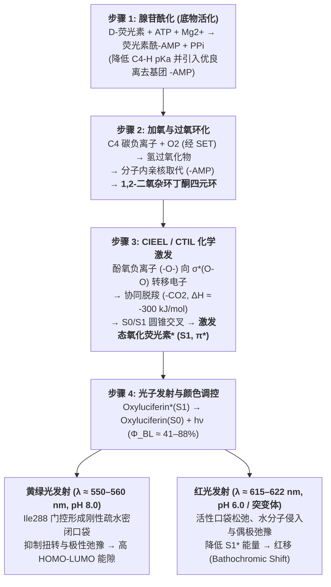

夏夜溪流畔静静飞舞的萤火虫（*Luciola cruciata*、*Photinus pyralis*），或是阳光完全无法穿透的 $1,000\,\text{m}$ 深海（中层带与半深海带）中，幽灵蛸（*Vampyroteuthis infernalis*）、灯笼鱼（*Myctophidae*）、𩽾𩾌鱼与维多利亚多管发光水母（*Aequorea victoria*）在无尽黑暗中绽放的幽蓝光芒，构成了自然界最迷人的光学奇迹。

人类历史上熟悉的传统光源——无论是火焰（约 $1,700\,\text{K}$）还是白炽灯钨丝（约 $2,800\,\text{K}$）——都必须将物质加热至数千开尔文的高温才能发出可见光。如果用手触摸点亮的白炽灯泡，瞬间就会造成严重烫伤，因为其超过 $90\%$ 的电能都以红外热辐射的形式耗散了。然而，如果你将一只发光的萤火虫轻轻捧在手心，它的腹部却完全是凉爽的，处于与环境一致的室温（$T \approx 295\text{–}300\,\text{K}$，即 $22\text{–}27\,^\circ\text{C}$）。事实上，生物体内的蛋白质和酶一旦超过 $315\text{–}323\,\text{K}$（$42\text{–}50\,^\circ\text{C}$），氢键与疏水核心就会发生不可逆的<strong>热变性（Thermal Denaturation）</strong>而导致细胞死亡。

生命究竟是如何绕过热力学黑体辐射定律，在室温下将化学键自由能直接注入单个分子的<strong>激发单重态（$S_1^*$）</strong>，从而实现高达 $41\%\text{–}88\%$ 量子产率的“冷光（Cold Light）”发射的？本文将从统计物理、量子化学与演化生物学的角度全面揭示生物发光的奥秘。

---

## 第一章：热辐射（白炽光）与冷光（Luminescence）的物理学对比

### 1.1 可见光子能量与室温热运动能量（$k_B T$）的巨大鸿沟

人眼可感知的可见光波长范围为 $\lambda = 400\,\text{nm}$（紫）至 $700\,\text{nm}$（红）。根据普朗克关系式，单个光子的能量 $E_{\text{photon}}$ 及每摩尔光子能量 $E_{\text{mol}}$ 为：

$$E_{\text{photon}} = h\nu = \frac{hc}{\lambda} \approx \frac{1239.8\,\text{eV}\cdot\text{nm}}{\lambda(\text{nm})}$$

以萤火虫发出的黄绿光（$\lambda \approx 560\,\text{nm}$）和深海生物发出的蓝光（$\lambda \approx 470\,\text{nm}$）为例：
- 黄绿光（$560\,\text{nm}$）：$E_{\text{photon}} \approx 2.21\,\text{eV}$，$E_{\text{mol}} = N_A h\nu \approx 213.6\,\text{kJ/mol}$。
- 深海蓝光（$470\,\text{nm}$）：$E_{\text{photon}} \approx 2.64\,\text{eV}$，$E_{\text{mol}} \approx 254.5\,\text{kJ/mol}$。

相比之下，在室温 $T = 300\,\text{K}$ 下，分子平动与振动的平均热能 $k_B T$（$k_B = 1.381 \times 10^{-23}\,\text{J/K}$）仅为：

$$k_B T \big|_{T=300\,\text{K}} \approx 0.02585\,\text{eV}, \qquad RT \big|_{T=300\,\text{K}} \approx 2.494\,\text{kJ/mol}$$

这意味着<strong>产生一个可见光子所需的能量（$\sim 2.2\text{–}2.6\,\text{eV}$）是室温平均热能（$0.026\,\text{eV}$）的近 100 倍！</strong>在热平衡体系中，依靠热涨落激发 $2.21\,\text{eV}$ 电子跃迁的玻尔兹曼概率因子为 $\exp(-\Delta E / k_B T) = \exp(-85.5) \approx 7.4 \times 10^{-38}$，在物理上完全为零。

### 1.2 普朗克黑体辐射定律与维恩位移定律

若依靠加热物体（<strong>热辐射 / Incandescence</strong>）发光，黑体在绝对温度 $T$ 下的光谱辐射亮度 $B_\lambda(\lambda, T)$ 服从<strong>普朗克黑体辐射定律（Planck's Law）</strong>，其峰值波长 $\lambda_{\max}$ 服从<strong>维恩位移定律（Wien's Displacement Law）</strong>，总辐射出射度 $J$ 服从<strong>斯特藩-玻尔兹曼定律</strong>：

$$B_\lambda(\lambda, T) = \frac{2hc^2}{\lambda^5} \frac{1}{\exp\left(\dfrac{hc}{\lambda k_B T}\right) - 1}, \qquad \lambda_{\max} \cdot T = 2.8978 \times 10^{-3}\,\text{m}\cdot\text{K}, \qquad J = \sigma T^4$$

1. <strong>室温生物体（$T = 300\,\text{K}$）</strong>：辐射峰值位于 $\lambda_{\max} \approx 9.66\,\mu\text{m}$（中红外线），可见光波段辐射为零。
2. <strong>白炽灯钨丝（$T \approx 2,800\,\text{K}$）</strong>：峰值波长位于 $\lambda_{\max} \approx 1,035\,\text{nm}$（近红外线），<strong>超过 $90\%\text{–}95\%$ 的电能作为红外热量被浪费</strong>，发光效率仅约 $15\,\text{lm/W}$。
3. <strong>太阳表面（$T \approx 5,778\,\text{K}$）</strong>：峰值波长 $\lambda_{\max} \approx 501\,\text{nm}$，刚好位于可见光中心。

### 1.3 冷光（Luminescence）：绕过热平衡的量子选择性激发

1888年德国物理学家 Eilhardt Wiedemann 提出了<strong>“冷光 / 发光（Luminescence）”</strong>的概念。其核心在于：<strong>不提高整个体系的宏观温度 $T$，而是通过外部光子、电场或化学反应，将 $2\text{–}3\,\text{eV}$ 的能量精准注入特定分子的电子自由度（从最高占据轨道 $\text{HOMO}$ 跃迁至最低未占轨道 $\text{LUMO}$），直接产生非热平衡的激发单重态 $S_1^*$</strong>。

| 发光类型 | 英文名称 | 能量来源（激发机制） | 代表性实例与生物系统 | 工作温度 |
| :--- | :--- | :--- | :--- | :--- |
| <strong>热辐射（白炽光）</strong> | Incandescence | 宏观物质整体的无规热运动（焦耳热、燃烧） | 太阳、火焰、白炽灯钨丝 | $1,500\text{–}6,000\,\text{K}$ |
| <strong>荧光（光致发光）</strong> | Fluorescence | 吸收外部短波长光子（$h\nu_{\text{ex}}$），自旋允许跃迁 $S_1 \to S_0$ | 水母绿色荧光蛋白（GFP）、珊瑚色素、荧光染料 | 室温（$\sim 300\,\text{K}$） |
| <strong>磷光（光致发光）</strong> | Phosphorescence | 光吸收后经系间窜越（ISC）发生自旋禁阻跃迁 $T_1 \to S_0$ | 蓄光材料（$\text{SrAl}_2\text{O}_4:\text{Eu}^{2+}$）、夜光表盘 | 室温（$\sim 300\,\text{K}$） |
| <strong>电致发光</strong> | Electroluminescence | 电场驱动电子与空穴复合 | 氮化镓（$\text{GaN}$）LED、有机发光二极管（OLED） | 室温 |
| <strong>化学发光</strong> | Chemiluminescence | 放热化学反应（过氧化物裂解）直接布居电子激发态 $S_1^*$ | 刑侦鲁米诺（Luminol）反应、草酸酯荧光棒 | 室温 |
| <strong>生物发光</strong> | Bioluminescence | <strong>由荧光素酶（Luciferase）催化的生物体内化学发光</strong> | 萤火虫、海萤、夜光藻、发光细菌、发光真菌 | <strong>生理温度（$275\text{–}310\,\text{K}$）</strong> |

---

## 第二章：生物发光 vs. 荧光（GFP）vs. 磷光，以及 BRET 共振能量转移

大众媒体常将“生物发光（Bioluminescence）”与“生物荧光（Biofluorescence，如 GFP）”混为一谈，但二者在光物理学上截然不同：

```mermaid
flowchart TD
    subgraph INC ["1. 热辐射 (Incandescence / 黑体辐射)"]
        T1["高温加热 (T > 2,500 K)<br/>分子振动与平动自由度的无差别热激发"] --> T2["遵循普朗克分布的连续光谱<br/>(>90%为红外热损耗，使蛋白质变性)"]
    end

    subgraph FL ["2. 光致发光：荧光 (GFP) 与磷光"]
        F1["吸收外部激发光子 (hν_ex: UV / 蓝光)<br/>基态 S0 → 激发单重态 S1 (10^-15 s)"] --> F2["振动弛豫 (10^-12 s)<br/>斯托克斯位移 (λ_em > λ_ex)"]
        F2 --> F3["自旋允许荧光发射 S1 → S0 + hν_em (10^-9 s)<br/>*无外部光源时完全黑暗*"]
        F2 -.->|"系间窜越 (ISC: ΔS = 1)"| F4["自旋禁阻磷光发射 T1 → S0 + hν_ph<br/>(毫秒至数小时余辉)"]
    end

    subgraph BL ["3. 生物发光 (Bioluminescence: 300 K 冷光)"]
        B1["荧光素 + O2 (+ ATP 或 Ca2+)<br/>结合于荧光素酶活性口袋 (300 K)"] --> B2["高张力四元环过氧化物中间体<br/>(1,2-二氧杂环丁酮 / 1,2-Dioxetanone)"]
        B2 --> B3["CIEEL 协同裂解与化学激发 (-CO2)<br/>S0 → S1* 势能面圆锥交叉跃迁"]
        B3 --> B4["激发态氧化荧光素* (S1) → S0 + hν<br/>(无需外源光，量子产率 Φ_BL 达 41–88%)"]
    end

    subgraph BRET_BOX ["4. 生物发光共振能量转移 (BRET: 维多利亚多管发光水母)"]
        BR1["水母发光蛋白 Aequorin (腔肠素 + Ca2+)<br/>化学激发产生蓝色 S1* 供体 (470 nm)"] -->|"Förster 偶极-偶极耦合 (r < 5 nm)<br/>非辐射能量转移 E = 1/(1+(r/R0)^6)"| BR2["激发绿色荧光蛋白 (GFP) 发色团<br/>发射绿光光子 (λ = 509 nm)"]
    end
```

1. <strong>荧光（Fluorescence，如 GFP）</strong>：属于<strong>光物理过程</strong>，<strong>必须先吸收外部激发光（$h\nu_{\text{ex}}$，如紫外光或蓝光）</strong>。分子从基态 $S_0$ 跃迁至 $S_1$ 高振动能级（$10^{-15}\,\text{s}$），经皮秒级振动弛豫（$10^{-12}\,\text{s}$）损失部分能量后，以纳秒级寿命（$\tau \approx 10^{-9}\,\text{s}$）从 $S_1 \to S_0$ 发射波长更长的光子（<strong>斯托克斯位移 / Stokes Shift，$\lambda_{\text{em}} > \lambda_{\text{ex}}$</strong>）。在完全黑暗且无外源激发光的环境中，纯荧光生物绝对不会发光。
2. <strong>磷光（Phosphorescence）</strong>：单重激发态 $S_1$（$\uparrow\downarrow, S=0$）通过自旋-轨道耦合发生<strong>系间窜越（Intersystem Crossing, ISC）</strong>进入三重激发态 $T_1$（$\uparrow\uparrow, S=1$）。由于 $T_1 \to S_0$ 需要自旋翻转（$\Delta S = 1$），属于量子力学自旋禁阻跃迁，发光寿命长达毫秒至数小时。
3. <strong>生物发光（Bioluminescence）</strong>：属于<strong>光化学过程（化学激发 / Chemiexcitation）</strong>，<strong>完全不需要外部激发光</strong>。在绝对黑暗的深海或夜晚，底物<strong>荧光素（Luciferin）</strong>在<strong>荧光素酶（Luciferase）</strong>或发光蛋白催化下被氧气氧化，通过势能面交叉直接生成处于电子激发态的产物（$\text{Oxyluciferin}^*$）并释放光子。

### 2.2 下村脩（2008年诺贝尔化学奖）与水母中的 BRET 机制

2008年诺贝尔化学奖得主<strong>下村脩（Osamu Shimomura）</strong>在研究维多利亚多管发光水母（*Aequorea victoria*）时发现：活体水母伞缘发出的是<strong>绿光（$\lambda_{\max} = 509\,\text{nm}$）</strong>，但纯化出的钙激活发光蛋白<strong>水母发光蛋白（Aequorin，含腔肠素 Coelenterazine）</strong>在体外加入 $\text{Ca}^{2+}$ 后发出的却是<strong>蓝光（$\lambda_{\max} = 470\,\text{nm}$）</strong>！

原来，水母发光器官中同时存在着<strong>绿色荧光蛋白（GFP，其发色团由 Ser65–Tyr66–Gly67 自动环化氧化形成）</strong>。当 $\text{Ca}^{2+}$ 结合 Aequorin 触发腔肠素氧化生成激发态腔肠素酰胺（$\text{Coelenteramide}^*$）时，由于 Aequorin 与 GFP 形成紧密复合物（间距 $r \approx 2\text{–}5\,\text{nm}$），激发能通过<strong>生物发光共振能量转移（BRET，即 Förster 偶极-偶极非辐射耦合）</strong>直接传递给 GFP，再由 GFP 发射 $509\,\text{nm}$ 绿光：

$$E_{\text{BRET}} = \frac{1}{1 + \left(\dfrac{r}{R_0}\right)^6}, \qquad R_0^6 \propto \kappa^2 \, \Phi_D \, n^{-4} \int_0^\infty F_D(\lambda)\, \varepsilon_A(\lambda)\, \lambda^4 \, d\lambda$$

---

## 第三章：萤火虫荧光素-荧光素酶反应的量子化学与 CIEEL 机制

萤火虫（鞘翅目萤科 *Lampyridae*）发光体系由热稳定的底物<strong>D-荧光素（D-Luciferin，苯并噻唑基噻唑啉羧酸）</strong>、分子量约 $61\,\text{kDa}$ 的<strong>荧光素酶（Luciferase）</strong>、<strong>$\text{ATP}$</strong>、$\text{Mg}^{2+}$ 和 $\text{O}_2$ 共同完成，分为四个核心步骤：

1. <strong>步骤 1：腺苷酰化（底物活化，澄清 ATP 的热力学误区）</strong>
   $$\text{D-Luciferin} + \text{ATP} \xrightarrow{\text{Luciferase, Mg}^{2+}} \text{E}\cdot\text{D-Luciferyl-AMP} + \text{PP}_i$$
   <strong>重要误区澄清</strong>：ATP 水解自由能（$\Delta G^{\circ\prime} \approx -30.5\,\text{kJ/mol}$）绝不足以提供 $560\,\text{nm}$ 光子所需的 $214\,\text{kJ/mol}$ 能量！ATP 的真正作用是<strong>动力学活化</strong>：将羧基（$-\text{COO}^-$）转化为强吸电子的酰基腺苷酸（$-\text{CO-AMP}$），一方面大幅降低噻唑啉环 C4 位质子的 $pK_a$ 使其易于脱质子形成碳负离子，另一方面提供极佳的离去基团（$-\text{AMP}$）。光子能量的真正来源是后续 $\text{O}_2$ 氧化裂解反应！
2. <strong>步骤 2：单电子转移（SET）加氧与环化生成 1,2-二氧杂环丁酮</strong>
   C4 碳负离子通过单电子转移（SET）与三重态氧气（$^3\text{O}_2$）反应生成过氧自由基对并复合为氢过氧化物中间体，随后发生分子内亲核取代脱去 $\text{AMP}$，关环形成极度张紧的四元环过氧化物——<strong>1,2-二氧杂环丁酮（1,2-Dioxetanone / $\alpha$-Peroxylactone）</strong>。
3. <strong>步骤 3：CIEEL / CTIL 化学激发机制与轨道对称性交叉</strong>
   四元环 1,2-二氧杂环丁酮同时具有约 $110\,\text{kJ/mol}$ 的环张力、脆弱的 $\text{O}-\text{O}$ 过氧键（$\sim 140\,\text{kJ/mol}$），以及裂解生成超稳定 $\text{CO}_2$（两个 $\text{C}=\text{O}$ 双键 $\sim 1600\,\text{kJ/mol}$）的巨大热力学驱动力，协同脱羧释放 $\Delta H \approx -280\text{ 至 }-320\,\text{kJ/mol}$ 的能量。
   根据 <strong>Woodward–Hoffmann 轨道对称性守恒原理</strong>与 <strong>CIEEL（化学引发电子交换发光）/ CTIL（电荷转移诱导发光）</strong>机制：苯并噻唑环 6' 位酚羟基脱质子形成强给电子的<strong>酚氧负离子（$-\text{O}^-$）</strong>，向四元环的 $\sigma^*(\text{O}-\text{O})$ 反键轨道发生分子内电子转移；随着 $\text{O}-\text{O}$ 与 $\text{C}-\text{C}$ 键伸长，基态 $S_0$ 协同裂解因轨道对称性禁阻而能量急剧上升，与激发单重态 $S_1$ 势能面发生<strong>圆锥交叉（Conical Intersection）</strong>。当 $\text{CO}_2$ 脱离时，反向电子转移将电子直接注入氧化荧光素的最低未占轨道 $\text{LUMO}(\pi^*)$，使产物直接诞生于<strong>电子激发单重态 $\text{Oxyluciferin}^*(S_1)$</strong>！
4. <strong>步骤 4：辐射跃迁、高量子产率与活性口袋颜色调控</strong>
   $$\text{Oxyluciferin}^*(S_1) \longrightarrow \text{Oxyluciferin}(S_0) + h\nu \quad (\lambda_{\max} \approx 560\,\text{nm})$$
   总生物发光量子产率定义为三项乘积：
   $$\Phi_{\text{BL}} = \Phi_{\text{chem}} \times \Phi_{\text{ex}} \times \Phi_{\text{fl}}$$
   经典测量值达 $88\%$（Seliger & McElroy, 1960），而现代积分球绝对测量确定北美萤火虫在 pH 8.5 下为 $\Phi_{\text{BL}} = 41.0 \pm 7.4\%$（其中单重态化学激发效率 $\Phi_{\text{ex}}$ 高达 $60\text{–}90\%$；Ando et al., 2008, *Nature Photonics*）。
   <strong>颜色调控机制（$538\,\text{nm}$ 绿光至 $622\,\text{nm}$ 红光）</strong>：所有发光甲虫（包括头部发 $622\,\text{nm}$ 红光、体侧发 $546\,\text{nm}$ 绿光的南美铁路虫 *Phrixothrix*）均使用完全相同的 D-荧光素底物；且萤火虫荧光素酶在酸性（pH 6.0）或高温下会从 $560\,\text{nm}$ 黄绿光红移至 $615\,\text{nm}$ 红光（<strong>深色位移 / Bathochromic Shift</strong>）。Nakatsu 等人（2006, *Nature*）通过高分辨率 X 射线晶体结构证明，活性口袋中的 <strong>Ile288 残基门控机制</strong>决定了空腔刚性与疏水密封度：碱性条件下 Ile288 紧密夹持氧化荧光素，抑制 $\text{C}2-\text{C}2^\prime$ 扭转弛豫（TICT）与水分子极性弛豫，维持高能隙并发射黄绿光；而在酸性或突变条件下空腔松弛，激发态偶极弛豫导致能量降低，从而发射红光。

---

## 第四章：独立演化 40–90 余次的生物发光多样性与深海光学战争

生物发光是生命史上最壮观的<strong>趋同演化（Convergent Evolution）</strong>范例，在细菌、甲藻、真菌、刺胞动物、栉水母、软体动物、节肢动物、棘皮动物及鱼类中<strong>独立起源了至少 40 至 90 次以上</strong>（Haddock et al., 2010）。其演化根源在于<strong>“活性氧（ROS）解毒假说”</strong>：早期好氧生物进化出富电子芳香族抗氧化剂以清除超氧阴离子（$\text{O}_2^{\bullet-}$），该反应天然经由二氧杂环丁酮裂解产生微弱光子，随后在黑暗的深海或夜间生境中被自然选择塑造为视觉信号系统。

1. <strong>海洋咪唑并吡嗪系统（腔肠素 Coelenterazine 与海萤荧光素 Vargulin）</strong>：
   在中层带深海（$200\text{–}1,000\,\text{m}$），超过 $75\%$ 的生物具有生物发光能力。其中<strong>腔肠素（Coelenterazine）</strong>被 9 个以上动物门广泛使用，许多鱼类和乌贼通过捕食甲壳类从食物链中获取腔肠素。其发射波长集中在 $\lambda_{\max} = 450\text{–}490\,\text{nm}$ 蓝光，精准匹配<strong>海水光学透射窗口</strong>。<strong>海萤（*Vargula hilgendorfii*）</strong>则利用色氨酸、异亮氨酸和精氨酸合成的 Vargulin 向海水中喷射 $462\,\text{nm}$ 蓝色发光云以迷惑捕食者。
2. <strong>甲藻（夜光藻 *Noctiluca*）的剪切力传感与电压门控质子通道（$\text{H}_v1$）</strong>：
   海浪拍岸时的“蓝眼泪”源于甲藻细胞内的<strong>闪烁体（Scintillons）</strong>。当波浪或捕食者游动产生流体<strong>机械剪切应力（Shear Stress）</strong>时，液泡膜去极化激活<strong>电压门控质子通道（$\text{H}_v1$）</strong>，$\text{H}^+$ 瞬间涌入使闪烁体 pH 从 $8.0$ 降至 $6.0$，促使荧光素结合蛋白（LBP）释放四吡咯荧光素并激活甲藻荧光素酶（LCF），在 $100\,\text{ms}$ 内发出 $475\,\text{nm}$ 蓝色闪光，充当吸引高级捕食者来消灭植食者的<strong>“防盗警报（Burglar Alarm）”</strong>。
3. <strong>发光细菌 `luxCDABEG` 操纵子与群体感应（Quorum Sensing）</strong>：
   共生于夏威夷短尾乌贼（*Euprymna scolopes*）或深海𩽾𩾌鱼诱饵中的费氏弧菌（*Aliivibrio fischeri*），利用 $\text{LuxAB}$ 酶同时氧化还原型黄素单核苷酸（$\text{FMNH}_2$）与长链脂肪醛（$\text{RCHO}$）发射 $490\,\text{nm}$ 蓝绿光。细菌通过<strong>群体感应（自诱导物 AHL，由 $\text{LuxI}/\text{LuxR}$ 调控）</strong>感知细胞密度：仅当发光器官内菌体密度超过 $10^{10}\,\text{cells/mL}$ 时才开启发光，避免自由漂浮时浪费代谢能量。
4. <strong>发光真菌（*Mycena*、*Neonothopanus*）的咖啡酸循环</strong>：
   Kotlobay 与 Yampolsky 等人（2018, *PNAS*）揭示发光蘑菇通过 4 个酶（`HispS`、`H3H`、`Luz`、`CPH`）构成的闭合循环，将植物与真菌共有的苯丙素代谢物<strong>咖啡酸（Caffeic Acid）</strong>转化为 <strong>3-羟基刚毛素（3-Hydroxyhispidin）</strong>并氧化发射 $520\text{–}530\,\text{nm}$ 绿光。
5. <strong>深海反照明伪装（Counterillumination）与红光狙击鱼（*Malacosteus niger*）</strong>：
   中层带灯笼鱼和萤火乌贼在腹侧排列发光器，发射与下行阳光波长和强度完全一致的蓝光以消除自身剪影；而深海巨口鱼 *Malacosteus niger* 则演化出能发射 $>700\,\text{nm}$ 远红光/近红外光的眼下发光器，配合视网膜中的叶绿素衍生物感光剂，打造出其它深海生物完全看不见的<strong>“红外夜视狙击镜”</strong>。

---

## 第五章：医学活体成像（AkaBLI）、ATP 卫生检测与自发光植物应用

1. <strong>活体生物发光成像（In Vivo BLI）与近红外 AkaBLI 系统</strong>：
   与需要外部激发光且受组织自发荧光干扰的 GFP 成像不同，BLI 具有<strong>近乎为零的背景噪声</strong>。针对血红蛋白对 $<600\,\text{nm}$ 光的强烈吸收，日本理化学研究所宫胁敦史（Atsushi Miyawaki）团队（Iwano et al., 2018, *Science*）开发了共轭扩展人工荧光素 <strong>AkaLumine-HCl</strong> 与定向进化酶 <strong>AkaLuc</strong>（<strong>AkaBLI 系统</strong>），将发射峰推入<strong>近红外生物光学窗口（$\lambda_{\max} = 677\,\text{nm}$）</strong>，穿透灵敏度提升 100 至 1,000 倍，首次在活体小鼠肺部实现了<strong>单个转移癌细胞</strong>的无创追踪以及自由活动灵长类动物深部脑区神经元活动的实时成像。
2. <strong>超亮微型酶 NanoLuc 与飞摩尔级 ATP 卫生检测</strong>：
   源自深海刺虾（*Oplophorus*）的 $19\,\text{kDa}$ <strong>NanoLuc</strong> 酶（配体 Furimazine）亮度比萤火虫高 150 倍，广泛用于药物筛选与 NanoBRET 蛋白互作分析；而基于萤火虫发光强度 $I \propto [\text{ATP}]$ 的便携式 ATP 荧光检测仪，可在 10 秒内检测低至 $10^{-15}\text{–}10^{-18}\,\text{mol}$ 的微生物污染，守护手术器械、食品安全与航天器洁净室。
3. <strong>自维持发光植物（Self-Sustained Glowing Plants）</strong>：
   由于真菌发光底物<strong>咖啡酸</strong>正是所有维管植物合成木质素的核心中间体，Sarkisyan 与 Yampolsky 团队（Mitiouchkina et al., 2020, *Nature Biotechnology*）将真菌咖啡酸循环的 4 个基因转入烟草与矮牵牛（*Firefly Petunia*），创造出无需添加任何外源化学底物、全生命周期肉眼可见持续发出柔和绿光的<strong>自发光植物</strong>。
