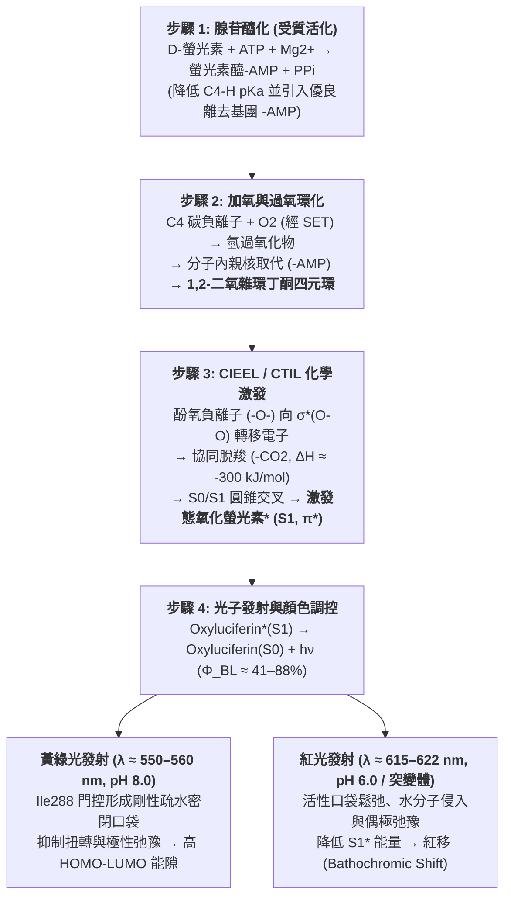

夏夜溪流畔靜靜飛舞的螢火蟲（*Luciola cruciata*、*Photinus pyralis*），或是陽光完全無法穿透的 $1,000\,\text{m}$ 深海（中層帶與半深海帶）中，幽靈蛸（*Vampyroteuthis infernalis*）、燈籠魚（*Myctophidae*）、𩽾𩾌魚與維多利亞多管發光水母（*Aequorea victoria*）在無盡黑暗中綻放的幽藍光芒，構成了自然界最迷人的光學奇蹟。

人類歷史上熟悉的傳統光源——無論是火焰（約 $1,700\,\text{K}$）還是白熾燈鎢絲（約 $2,800\,\text{K}$）——都必須將物質加熱至數千開爾文的高溫才能發出可見光。如果用手觸摸點亮的白熾燈泡，瞬間就會造成嚴重燙傷，因為其超過 $90\%$ 的電能都以紅外熱輻射的形式耗散了。然而，如果你將一隻發光的螢火蟲輕輕捧在手心，牠的腹部卻完全是涼爽的，處於與環境一致的室溫（$T \approx 295\text{–}300\,\text{K}$，即 $22\text{–}27\,^\circ\text{C}$）。事實上，生物體內的蛋白質和酵素一旦超過 $315\text{–}323\,\text{K}$（$42\text{–}50\,^\circ\text{C}$），氫鍵與疏水核心就會發生不可逆的<strong>熱變性（Thermal Denaturation）</strong>而導致細胞死亡。

生命究竟是如何繞過熱力學黑體輻射定律，在室溫下將化學鍵自由能直接注入單個分子的<strong>激發單重態（$S_1^*$）</strong>，從而實現高達 $41\%\text{–}88\%$ 量子產率的「冷光（Cold Light）」發射的？本文將從統計物理、量子化學與演化生物學的角度全面揭示生物發光的奧秘。

---

## 第一章：熱輻射（白熾光）與冷光（Luminescence）的物理學對比

### 1.1 可見光子能量與室溫熱運動能量（$k_B T$）的巨大鴻溝

人眼可感知的可見光波長範圍為 $\lambda = 400\,\text{nm}$（紫）至 $700\,\text{nm}$（紅）。根據普朗克關係式，單個光子的能量 $E_{\text{photon}}$ 及每莫耳光子能量 $E_{\text{mol}}$ 為：

$$E_{\text{photon}} = h\nu = \frac{hc}{\lambda} \approx \frac{1239.8\,\text{eV}\cdot\text{nm}}{\lambda(\text{nm})}$$

以螢火蟲發出的黃綠光（$\lambda \approx 560\,\text{nm}$）和深海生物發出的藍光（$\lambda \approx 470\,\text{nm}$）為例：
- 黃綠光（$560\,\text{nm}$）：$E_{\text{photon}} \approx 2.21\,\text{eV}$，$E_{\text{mol}} = N_A h\nu \approx 213.6\,\text{kJ/mol}$。
- 深海藍光（$470\,\text{nm}$）：$E_{\text{photon}} \approx 2.64\,\text{eV}$，$E_{\text{mol}} \approx 254.5\,\text{kJ/mol}$。

相比之下，在室溫 $T = 300\,\text{K}$ 下，分子平動與振動的平均熱能 $k_B T$（$k_B = 1.381 \times 10^{-23}\,\text{J/K}$）僅為：

$$k_B T \big|_{T=300\,\text{K}} \approx 0.02585\,\text{eV}, \qquad RT \big|_{T=300\,\text{K}} \approx 2.494\,\text{kJ/mol}$$

這意味著<strong>產生一個可見光子所需的能量（$\sim 2.2\text{–}2.6\,\text{eV}$）是室溫平均熱能（$0.026\,\text{eV}$）的近 100 倍！</strong>在熱平衡體系中，依靠熱漲落激發 $2.21\,\text{eV}$ 電子躍遷的波茲曼機率因子為 $\exp(-\Delta E / k_B T) = \exp(-85.5) \approx 7.4 \times 10^{-38}$，在物理上完全為零。

### 1.2 普朗克黑體輻射定律與維恩位移定律

若依靠加熱物體（<strong>熱輻射 / Incandescence</strong>）發光，黑體在絕對溫度 $T$ 下的光譜輻射亮度 $B_\lambda(\lambda, T)$ 服從<strong>普朗克黑體輻射定律（Planck's Law）</strong>，其峰值波長 $\lambda_{\max}$ 服從<strong>維恩位移定律（Wien's Displacement Law）</strong>，總輻射出射度 $J$ 服從<strong>史特藩-波茲曼定律</strong>：

$$B_\lambda(\lambda, T) = \frac{2hc^2}{\lambda^5} \frac{1}{\exp\left(\dfrac{hc}{\lambda k_B T}\right) - 1}, \qquad \lambda_{\max} \cdot T = 2.8978 \times 10^{-3}\,\text{m}\cdot\text{K}, \qquad J = \sigma T^4$$

1. <strong>室溫生物體（$T = 300\,\text{K}$）</strong>：輻射峰值位於 $\lambda_{\max} \approx 9.66\,\mu\text{m}$（中紅外線），可見光波段輻射為零。
2. <strong>白熾燈鎢絲（$T \approx 2,800\,\text{K}$）</strong>：峰值波長位於 $\lambda_{\max} \approx 1,035\,\text{nm}$（近紅外線），<strong>超過 $90\%\text{–}95\%$ 的電能作為紅外熱量被浪費</strong>，發光效率僅約 $15\,\text{lm/W}$。
3. <strong>太陽表面（$T \approx 5,778\,\text{K}$）</strong>：峰值波長 $\lambda_{\max} \approx 501\,\text{nm}$，剛好位於可見光中心。

### 1.3 冷光（Luminescence）：繞過熱平衡的量子選擇性激發

1888年德國物理學家 Eilhardt Wiedemann 提出了<strong>「冷光 / 發光（Luminescence）」</strong>的概念。其核心在於：<strong>不提高整個體系的巨觀溫度 $T$，而是透過外部光子、電場或化學反應，將 $2\text{–}3\,\text{eV}$ 的能量精準注入特定分子的電子自由度（從最高佔據軌域 $\text{HOMO}$ 躍遷至最低未佔軌域 $\text{LUMO}$），直接產生非熱平衡的激發單重態 $S_1^*$</strong>。

| 發光類型 | 英文名稱 | 能量來源（激發機制） | 代表性實例與生物系統 | 工作溫度 |
| :--- | :--- | :--- | :--- | :--- |
| <strong>熱輻射（白熾光）</strong> | Incandescence | 巨觀物質整體的無規熱運動（焦耳熱、燃燒） | 太陽、火焰、白熾燈鎢絲 | $1,500\text{–}6,000\,\text{K}$ |
| <strong>螢光（光致發光）</strong> | Fluorescence | 吸收外部短波長光子（$h\nu_{\text{ex}}$），自旋允許躍遷 $S_1 \to S_0$ | 水母綠色螢光蛋白（GFP）、珊瑚色素、螢光染料 | 室溫（$\sim 300\,\text{K}$） |
| <strong>磷光（光致發光）</strong> | Phosphorescence | 光吸收後經系間跨越（ISC）發生自旋禁阻躍遷 $T_1 \to S_0$ | 蓄光材料（$\text{SrAl}_2\text{O}_4:\text{Eu}^{2+}$）、夜光錶盤 | 室溫（$\sim 300\,\text{K}$） |
| <strong>電致發光</strong> | Electroluminescence | 電場驅動電子與電洞複合 | 氮化鎵（$\text{GaN}$）LED、有機發光二極體（OLED） | 室溫 |
| <strong>化學發光</strong> | Chemiluminescence | 放熱化學反應（過氧化物裂解）直接布居電子激發態 $S_1^*$ | 刑偵魯米諾（Luminol）反應、草酸酯螢光棒 | 室溫 |
| <strong>生物發光</strong> | Bioluminescence | <strong>由螢光素酶（Luciferase）催化的生物體內化學發光</strong> | 螢火蟲、海螢、夜光藻、發光細菌、發光真菌 | <strong>生理溫度（$275\text{–}310\,\text{K}$）</strong> |

---

## 第二章：生物發光 vs. 螢光（GFP）vs. 磷光，以及 BRET 共振能量轉移

大眾媒體常將「生物發光（Bioluminescence）」與「生物螢光（Biofluorescence，如 GFP）」混為一談，但二者在光物理學上截然不同：

```mermaid
flowchart TD
    subgraph INC ["1. 熱輻射 (Incandescence / 黑體輻射)"]
        T1["高溫加熱 (T > 2,500 K)<br/>分子振動與平動自由度的無差別熱激發"] --> T2["遵循普朗克分佈的連續光譜<br/>(>90%為紅外熱損耗，使蛋白質變性)"]
    end

    subgraph FL ["2. 光致發光：螢光 (GFP) 與磷光"]
        F1["吸收外部激發光子 (hν_ex: UV / 藍光)<br/>基態 S0 → 激發單重態 S1 (10^-15 s)"] --> F2["振動弛豫 (10^-12 s)<br/>斯托克斯位移 (λ_em > λ_ex)"]
        F2 --> F3["自旋允許螢光發射 S1 → S0 + hν_em (10^-9 s)<br/>*無外部光源時完全黑暗*"]
        F2 -.->|"系間跨越 (ISC: ΔS = 1)"| F4["自旋禁阻磷光發射 T1 → S0 + hν_ph<br/>(毫秒至數小時餘暉)"]
    end

    subgraph BL ["3. 生物發光 (Bioluminescence: 300 K 冷光)"]
        B1["螢光素 + O2 (+ ATP 或 Ca2+)<br/>結合於螢光素酶活性口袋 (300 K)"] --> B2["高張力四元環過氧化物中間體<br/>(1,2-二氧雜環丁酮 / 1,2-Dioxetanone)"]
        B2 --> B3["CIEEL 協同裂解與化學激發 (-CO2)<br/>S0 → S1* 位能面圓錐交叉躍遷"]
        B3 --> B4["激發態氧化螢光素* (S1) → S0 + hν<br/>(無需外源光，量子產率 Φ_BL 達 41–88%)"]
    end

    subgraph BRET_BOX ["4. 生物發光共振能量轉移 (BRET: 維多利亞多管發光水母)"]
        BR1["水母發光蛋白 Aequorin (腔腸素 + Ca2+)<br/>化學激發產生藍色 S1* 供體 (470 nm)"] -->|"Förster 偶極-偶極耦合 (r < 5 nm)<br/>非輻射能量轉移 E = 1/(1+(r/R0)^6)"| BR2["激發綠色螢光蛋白 (GFP) 發色團<br/>發射綠光光子 (λ = 509 nm)"]
    end
```

1. <strong>螢光（Fluorescence，如 GFP）</strong>：屬於<strong>光物理過程</strong>，<strong>必須先吸收外部激發光（$h\nu_{\text{ex}}$，如紫外光或藍光）</strong>。分子從基態 $S_0$ 躍遷至 $S_1$ 高振動能階（$10^{-15}\,\text{s}$），經皮秒級振動弛豫（$10^{-12}\,\text{s}$）損失部分能量後，以奈秒級壽命（$\tau \approx 10^{-9}\,\text{s}$）從 $S_1 \to S_0$ 發射波長更長的光子（<strong>斯托克斯位移 / Stokes Shift，$\lambda_{\text{em}} > \lambda_{\text{ex}}$</strong>）。在完全黑暗且無外源激發光的環境中，純螢光生物絕對不會發光。
2. <strong>磷光（Phosphorescence）</strong>：單重激發態 $S_1$（$\uparrow\downarrow, S=0$）透過自旋-軌域耦合發生<strong>系間跨越（Intersystem Crossing, ISC）</strong>進入三重激發態 $T_1$（$\uparrow\uparrow, S=1$）。由於 $T_1 \to S_0$ 需要自旋翻轉（$\Delta S = 1$），屬於量子力學自旋禁阻躍遷，發光壽命長達毫秒至數小時。
3. <strong>生物發光（Bioluminescence）</strong>：屬於<strong>光化學過程（化學激發 / Chemiexcitation）</strong>，<strong>完全不需要外部激發光</strong>。在絕對黑暗的深海或夜晚，受質<strong>螢光素（Luciferin）</strong>在<strong>螢光素酶（Luciferase）</strong>或發光蛋白催化下被氧氣氧化，透過位能面交叉直接生成處於電子激發態的產物（$\text{Oxyluciferin}^*$）並釋放光子。

### 2.2 下村脩（2008年諾貝爾化學獎）與水母中的 BRET 機制

2008年諾貝爾化學獎得主<strong>下村脩（Osamu Shimomura）</strong>在研究維多利亞多管發光水母（*Aequorea victoria*）時發現：活體水母傘緣發出的是<strong>綠光（$\lambda_{\max} = 509\,\text{nm}$）</strong>，但純化出的鈣激活發光蛋白<strong>水母發光蛋白（Aequorin，含腔腸素 Coelenterazine）</strong>在體外加入 $\text{Ca}^{2+}$ 後發出的卻是<strong>藍光（$\lambda_{\max} = 470\,\text{nm}$）</strong>！

原來，水母發光器官中同時存在著<strong>綠色螢光蛋白（GFP，其發色團由 Ser65–Tyr66–Gly67 自動環化氧化形成）</strong>。當 $\text{Ca}^{2+}$ 結合 Aequorin 觸發腔腸素氧化生成激發態腔腸素醯胺（$\text{Coelenteramide}^*$）時，由於 Aequorin 與 GFP 形成緊密複合物（間距 $r \approx 2\text{–}5\,\text{nm}$），激發能透過<strong>生物發光共振能量轉移（BRET，即 Förster 偶極-偶極非輻射耦合）</strong>直接傳遞給 GFP，再由 GFP 發射 $509\,\text{nm}$ 綠光：

$$E_{\text{BRET}} = \frac{1}{1 + \left(\dfrac{r}{R_0}\right)^6}, \qquad R_0^6 \propto \kappa^2 \, \Phi_D \, n^{-4} \int_0^\infty F_D(\lambda)\, \varepsilon_A(\lambda)\, \lambda^4 \, d\lambda$$

---

## 第三章：螢火蟲螢光素-螢光素酶反應的量子化學與 CIEEL 機制

螢火蟲（鞘翅目螢科 *Lampyridae*）發光體系由熱穩定的受質<strong>D-螢光素（D-Luciferin，苯並噻唑基噻唑啉羧酸）</strong>、分子量約 $61\,\text{kDa}$ 的<strong>螢光素酶（Luciferase）</strong>、<strong>$\text{ATP}$</strong>、$\text{Mg}^{2+}$ 和 $\text{O}_2$ 共同完成，分為四個核心步驟：

1. <strong>步驟 1：腺苷醯化（受質活化，澄清 ATP 的熱力學誤區）</strong>
   $$\text{D-Luciferin} + \text{ATP} \xrightarrow{\text{Luciferase, Mg}^{2+}} \text{E}\cdot\text{D-Luciferyl-AMP} + \text{PP}_i$$
   <strong>重要誤區澄清</strong>：ATP 水解自由能（$\Delta G^{\circ\prime} \approx -30.5\,\text{kJ/mol}$）絕不足以提供 $560\,\text{nm}$ 光子所需的 $214\,\text{kJ/mol}$ 能量！ATP 的真正作用是<strong>動力學活化</strong>：將羧基（$-\text{COO}^-$）轉化為強吸電子的醯基腺苷酸（$-\text{CO-AMP}$），一方面大幅降低噻唑啉環 C4 位質子的 $pK_a$ 使其易於脫質子形成碳負離子，另一方面提供極佳的離去基團（$-\text{AMP}$）。光子能量的真正來源是後續 $\text{O}_2$ 氧化裂解反應！
2. <strong>步驟 2：單電子轉移（SET）加氧與環化生成 1,2-二氧雜環丁酮</strong>
   C4 碳負離子透過單電子轉移（SET）與三重態氧氣（$^3\text{O}_2$）反應生成過氧自由基對並複合為氫過氧化物中間體，隨後發生分子內親核取代脫去 $\text{AMP}$，關環形成極度張緊的四元環過氧化物——<strong>1,2-二氧雜環丁酮（1,2-Dioxetanone / $\alpha$-Peroxylactone）</strong>。
3. <strong>步驟 3：CIEEL / CTIL 化學激發機制與軌域對稱性交叉</strong>
   四元環 1,2-二氧雜環丁酮同時具有約 $110\,\text{kJ/mol}$ 的環張力、脆弱的 $\text{O}-\text{O}$ 過氧鍵（$\sim 140\,\text{kJ/mol}$），以及裂解生成超穩定 $\text{CO}_2$（兩個 $\text{C}=\text{O}$ 雙鍵 $\sim 1600\,\text{kJ/mol}$）的巨大熱力學驅動力，協同脫羧釋放 $\Delta H \approx -280\text{ 至 }-320\,\text{kJ/mol}$ 的能量。
   根據 <strong>Woodward–Hoffmann 軌域對稱性守恆原理</strong>與 <strong>CIEEL（化學引發電子交換發光）/ CTIL（電荷轉移誘導發光）</strong>機制：苯並噻唑環 6' 位酚羥基脫質子形成強給電子的<strong>酚氧負離子（$-\text{O}^-$）</strong>，向四元環的 $\sigma^*(\text{O}-\text{O})$ 反鍵軌域發生分子內電子轉移；隨著 $\text{O}-\text{O}$ 與 $\text{C}-\text{C}$ 鍵伸長，基態 $S_0$ 協同裂解因軌域對稱性禁阻而能量急劇上升，與激發單重態 $S_1$ 位能面發生<strong>圓錐交叉（Conical Intersection）</strong>。當 $\text{CO}_2$ 脫離時，反向電子轉移將電子直接注入氧化螢光素的最低未佔軌域 $\text{LUMO}(\pi^*)$，使產物直接誕生於<strong>電子激發單重態 $\text{Oxyluciferin}^*(S_1)$</strong>！
4. <strong>步驟 4：輻射躍遷、高量子產率與活性口袋顏色調控</strong>
   $$\text{Oxyluciferin}^*(S_1) \longrightarrow \text{Oxyluciferin}(S_0) + h\nu \quad (\lambda_{\max} \approx 560\,\text{nm})$$
   總生物發光量子產率定義為三項乘積：
   $$\Phi_{\text{BL}} = \Phi_{\text{chem}} \times \Phi_{\text{ex}} \times \Phi_{\text{fl}}$$
   經典測量值達 $88\%$（Seliger & McElroy, 1960），而現代積分球絕對測量確定北美螢火蟲在 pH 8.5 下為 $\Phi_{\text{BL}} = 41.0 \pm 7.4\%$（其中單重態化學激發效率 $\Phi_{\text{ex}}$ 高達 $60\text{–}90\%$；Ando et al., 2008, *Nature Photonics*）。
   <strong>顏色調控機制（$538\,\text{nm}$ 綠光至 $622\,\text{nm}$ 紅光）</strong>：所有發光甲蟲（包括頭部發 $622\,\text{nm}$ 紅光、體側發 $546\,\text{nm}$ 綠光的南美鐵路蟲 *Phrixothrix*）均使用完全相同的 D-螢光素受質；且螢火蟲螢光素酶在酸性（pH 6.0）或高溫下會從 $560\,\text{nm}$ 黃綠光紅移至 $615\,\text{nm}$ 紅光（<strong>深色位移 / Bathochromic Shift</strong>）。Nakatsu 等人（2006, *Nature*）透過高解析度 X 射線晶體結構證明，活性口袋中的 <strong>Ile288 殘基門控機制</strong>決定了空腔剛性與疏水密封度：鹼性條件下 Ile288 緊密夾持氧化螢光素，抑制 $\text{C}2-\text{C}2^\prime$ 扭轉弛豫（TICT）與水分子極性弛豫，維持高能隙並發射黃綠光；而在酸性或突變條件下空腔鬆弛，激發態偶極弛豫導致能量降低，從而發射紅光。

---

## 第四章：獨立演化 40–90 餘次的生物發光多樣性與深海光學戰爭

生物發光是生命史上最壯觀的<strong>趨同演化（Convergent Evolution）</strong>範例，在細菌、甲藻、真菌、刺胞動物、櫛水母、軟體動物、節肢動物、棘皮動物及魚類中<strong>獨立起源了至少 40 至 90 次以上</strong>（Haddock et al., 2010）。其演化根源在於<strong>「活性氧（ROS）解毒假說」</strong>：早期好氧生物演化出富電子芳香族抗氧化劑以清除超氧陰離子（$\text{O}_2^{\bullet-}$），該反應天然經由二氧雜環丁酮裂解產生微弱光子，隨後在黑暗的深海或夜間生境中被自然選擇塑造為視覺信號系統。

1. <strong>海洋咪唑並吡嗪系統（腔腸素 Coelenterazine 與海螢螢光素 Vargulin）</strong>：
   在中層帶深海（$200\text{–}1,000\,\text{m}$），超過 $75\%$ 的生物具有生物發光能力。其中<strong>腔腸素（Coelenterazine）</strong>被 9 個以上動物門廣泛使用，許多魚類和烏賊透過捕食甲殼類從食物鏈中獲取腔腸素。其發射波長集中在 $\lambda_{\max} = 450\text{–}490\,\text{nm}$ 藍光，精準匹配<strong>海水光學透射窗口</strong>。<strong>海螢（*Vargula hilgendorfii*）</strong>則利用色胺酸、異白胺酸和精胺酸合成的 Vargulin 向海水中噴射 $462\,\text{nm}$ 藍色發光雲以迷惑捕食者。
2. <strong>甲藻（夜光藻 *Noctiluca*）的剪切力感測與電壓門控質子通道（$\text{H}_v1$）</strong>：
   海浪拍岸時的「藍眼淚」源於甲藻細胞內的<strong>閃爍體（Scintillons）</strong>。當波浪或捕食者游動產生流體<strong>機械剪切應力（Shear Stress）</strong>時，液泡膜去極化激活<strong>電壓門控質子通道（$\text{H}_v1$）</strong>，$\text{H}^+$ 瞬間湧入使閃爍體 pH 從 $8.0$ 降至 $6.0$，促使螢光素結合蛋白（LBP）釋放四吡咯螢光素並激活甲藻螢光素酶（LCF），在 $100\,\text{ms}$ 內發出 $475\,\text{nm}$ 藍色閃光，充當吸引高級捕食者來消滅植食者的<strong>「防盜警報（Burglar Alarm）」</strong>。
3. <strong>發光細菌 `luxCDABEG` 操縱子與群體感應（Quorum Sensing）</strong>：
   共生於夏威夷短尾烏賊（*Euprymna scolopes*）或深海𩽾𩾌魚誘餌中的費氏弧菌（*Aliivibrio fischeri*），利用 $\text{LuxAB}$ 酵素同時氧化還原型黃素單核苷酸（$\text{FMNH}_2$）與長鏈脂肪醛（$\text{RCHO}$）發射 $490\,\text{nm}$ 藍綠光。細菌透過<strong>群體感應（自誘導物 AHL，由 $\text{LuxI}/\text{LuxR}$ 調控）</strong>感知細胞密度：僅當發光器官內菌體密度超過 $10^{10}\,\text{cells/mL}$ 時才開啟發光，避免自由漂浮時浪費代謝能量。
4. <strong>發光真菌（*Mycena*、*Neonothopanus*）的咖啡酸循環</strong>：
   Kotlobay 與 Yampolsky 等人（2018, *PNAS*）揭示發光蘑菇透過 4 個酵素（`HispS`、`H3H`、`Luz`、`CPH`）構成的閉合循環，將植物與真菌共有的苯丙素代謝物<strong>咖啡酸（Caffeic Acid）</strong>轉化為 <strong>3-羥基剛毛素（3-Hydroxyhispidin）</strong>並氧化發射 $520\text{–}530\,\text{nm}$ 綠光。
5. <strong>深海反照明偽裝（Counterillumination）與紅光狙擊魚（*Malacosteus niger*）</strong>：
   中層帶燈籠魚和螢火烏賊在腹側排列發光器，發射與下行陽光波長和強度完全一致的藍光以消除自身剪影；而深海巨口魚 *Malacosteus niger* 則演化出能發射 $>700\,\text{nm}$ 遠紅光/近紅外光的眼下發光器，配合視網膜中的葉綠素衍生物感光劑，打造出其它深海生物完全看不見的<strong>「紅外夜視狙擊鏡」</strong>。

---

## 第五章：醫學活體成像（AkaBLI）、ATP 衛生檢測與自發光植物應用

1. <strong>活體生物發光成像（In Vivo BLI）與近紅外 AkaBLI 系統</strong>：
   與需要外部激發光且受組織自發螢光干擾的 GFP 成像不同，BLI 具有<strong>近乎為零的背景雜訊</strong>。針對血紅蛋白對 $<600\,\text{nm}$ 光的強烈吸收，日本理化學研究所宮脇敦史（Atsushi Miyawaki）團隊（Iwano et al., 2018, *Science*）開發了共軛擴展人工螢光素 <strong>AkaLumine-HCl</strong> 與定向演化酵素 <strong>AkaLuc</strong>（<strong>AkaBLI 系統</strong>），將發射峰推入<strong>近紅外生物光學窗口（$\lambda_{\max} = 677\,\text{nm}$）</strong>，穿透靈敏度提升 100 至 1,000 倍，首次在活體小鼠肺部實現了<strong>單個轉移癌細胞</strong>的無創追蹤以及自由活動靈長類動物深部腦區神經元活動的即時成像。
2. <strong>超亮微型酵素 NanoLuc 與飛莫耳級 ATP 衛生檢測</strong>：
   源自深海刺蝦（*Oplophorus*）的 $19\,\text{kDa}$ <strong>NanoLuc</strong> 酵素（配體 Furimazine）亮度比螢火蟲高 150 倍，廣泛用於藥物篩選與 NanoBRET 蛋白互作分析；而基於螢火蟲發光強度 $I \propto [\text{ATP}]$ 的便攜式 ATP 螢光檢測儀，可在 10 秒內檢測低至 $10^{-15}\text{–}10^{-18}\,\text{mol}$ 的微生物污染，守護手術器械、食品安全與太空船潔淨室。
3. <strong>自維持發光植物（Self-Sustained Glowing Plants）</strong>：
   由於真菌發光受質<strong>咖啡酸</strong>正是所有維管植物合成木質素的核心中間體，Sarkisyan 與 Yampolsky 團隊（Mitiouchkina et al., 2020, *Nature Biotechnology*）將真菌咖啡酸循環的 4 個基因轉入菸草與矮牽牛（*Firefly Petunia*），創造出無需添加任何外源化學受質、全生命週期肉眼可見持續發出柔和綠光的<strong>自發光植物</strong>。
