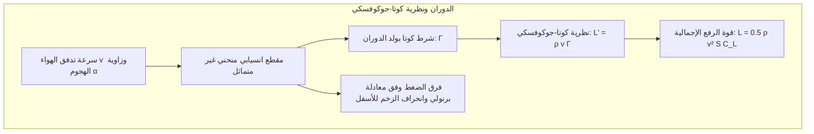
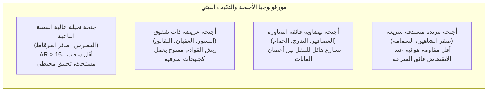
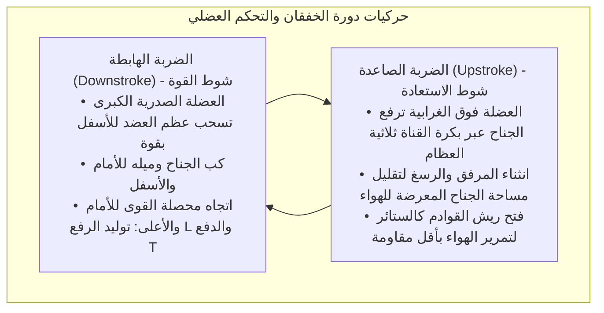
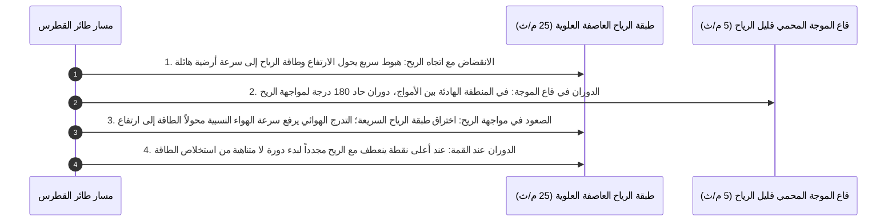
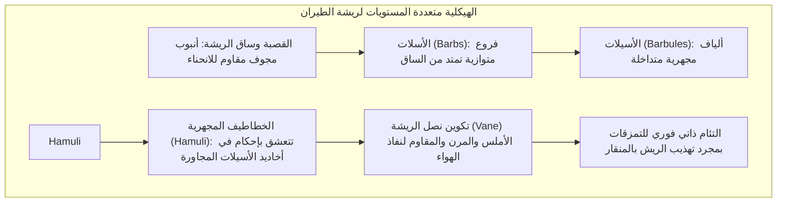
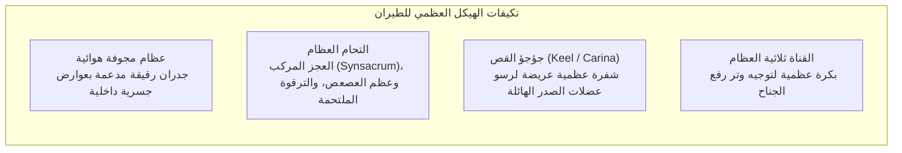
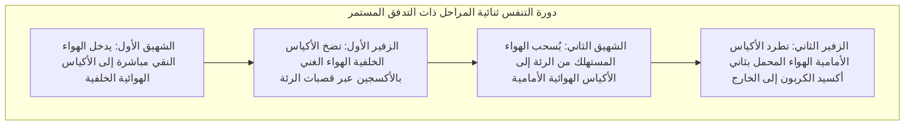
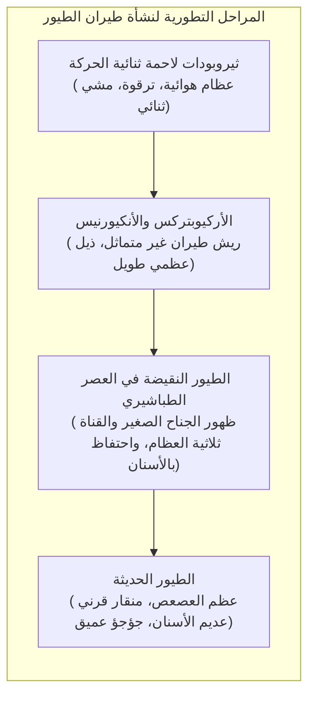

سواء كان ذلك العقاب الذهبي وهو يحلق برشاقة في تيارات الهواء الصاعدة الدافئة، أو صقر الشاهين وهو ينقض بسرعة تتجاوز 380 كم/ساعة ليصطاد فريسته، أو طائر القطرس الجوال الذي يجوب عواصف المحيط الجنوبي لسنوات دون أن يخفق بجناحيه مرة واحدة، فإن الطيور تمثل أعظم روائع الطيران في العالم الطبيعي.

في حين أن تاريخ الطيران البشري الآلي لم يتجاوز قرناً واحداً من الزمان، فإن الطيور — وهي السلالة الحية الوحيدة المتبقية من الديناصورات الثيروبودية — بدأت ملحمة غزو السماء منذ العصر الجوراسي المتأخر قبل أكثر من 150 مليون عام. ولقد طورت مرونة فائقة وقدرة تكيف ميكانيكية هوائية وكفاءة في استهلاك الطاقة تعجز أحدث المقاتلات الحربية والطائرات المسيرة عن مضاهاتها.

إن طيران الطيور ليس مجرد "رفرفة عشوائية بالأجنحة"، بل هو <strong>منظومة متكاملة من الإعجاز الهندسي البيولوجي: هياكل عظمية مجوفة معززة بدعامات شعرية داخلية، وعضلات طيران تعمل بنظام بكرة تشريحية مقلوبة، وريش ذو خطاطيف نانوية يلتئم ذاتياً، وجهاز تنفسي ذو أكياس هوائية يوفر تدفقاً أحادي الاتجاه مستمراً للأكسجين، فضلاً عن السيطرة البارعة على دوامات الحافة الأمامية غير المستقرة (LEV)</strong>. يستعرض هذا المقال بعمق الديناميكا الهوائية والتشريح العضلي الهيكلي والفسيولوجيا التنفسية ومسار التطور لطيران الطيور.

---

### 1. الديناميكا الهوائية لشكل الجناح: الرفع والسحب المستحث والنسبة الباعية

لكي يوازن الطائر وزن جسمه $W = mg$ في الهواء، يجب أن يولد جناحه <strong>قوة رفع (Lift: $L$)</strong> كافية مع التغلب على مقاومة الهواء الكلية (السحب).

يشكل المقطع العرضي لجناح الطائر شكلاً انسيابياً منحنياً غير متماثل (Cambered Airfoil)، يتميز بسطح علوي محدب وسطح سفلي مسطح أو مقعر قليلاً.

#### نظرية الدوران ومعادلة الرفع
وفقاً لـ<strong>نظرية كوتا-جوكوفسكي (Kutta-Joukowski Theorem)</strong> في ميكانيكا الموائع، فإن قوة الرفع لكل وحدة من طول الجناح $L'$ تتناسب طردياً مع كثافة الهواء $\rho$ وسرعة التدفق $v$ ومقدار دوران الدوامة المقيدة $\Gamma$:

$$L' = \rho v \Gamma, \quad L = \frac{1}{2} \rho v^2 S C_L$$

حيث تمثل $S$ مساحة سطح الجناح، و $C_L$ معامل الرفع الذي يتحدد بمقدار انحناء الجناح وزاوية الهجوم $\alpha$.

#### دوامات طرف الجناح وضريبة السحب المستحث
تفرض فيزياء الرفع ضريبة حتمية هي <strong>السحب المستحث (Induced Drag: $D_i$)</strong>. يلتف الهواء عالي الضغط أسفل الجناح حول طرفه متجهاً نحو منطقة الضغط المنخفض أعلاه، مكوناً دوامتين قويتين عند طرفي الجناحين (Wingtip Vortices). تحفز هاتان الدوامتان تدفقاً هوائياً هابطاً (Downwash: $w$) يميل بمتجه الرفع نحو الخلف:

$$D_i = \frac{1}{2} \rho v^2 S C_{Di} = \frac{1}{2} \rho v^2 S \left(\frac{C_L^2}{\pi AR e}\right)$$

حيث $AR = b^2 / S$ هي <strong>النسبة الباعية (Aspect Ratio)</strong> للجناح و $e$ معامل كفاءة أوزوالد. تثبت المعادلة رياضياً أن <strong>السحب المستحث يتناسب عكسياً تماماً مع النسبة الباعية $AR$</strong>.

1. <strong>أجنحة النسبة الباعية الفائقة (القطرس)</strong>: تبلغ النسبة $AR = 15 \dots 18$، مما يقلل دوامات الأطراف إلى الحد الأدنى محققاً نسبة رفع إلى سحب تتجاوز 20 للتحليق الشراعي اللانهائي؛
2. <strong>الأجنحة المشقوقة (العقبان والنسور)</strong>: ينفصل ريش القوادم عند أطراف الأجنحة عمودياً مشكلاً شقوقاً (Slots). يعمل كل ريش كجنيح مصغر مستقل يشتت الدوامة الكبيرة إلى دوامات متناهية الصغر سريعة التبدد؛
3. <strong>الجناح الصغير (Alula)</strong>: يرتكز على الإبهام ويتكون من 3 إلى 5 ريشات، ويعمل تماماً كشرائح الحافة الأمامية (Leading-Edge Slats) في الطائرات النفاثة. يؤدي نشره عند الهبوط البطيء بزوايا هجوم عالية إلى حقن تيار هوائي نشط فوق السطح العلوي، مما يؤخر الانهيار الحركي (Stall) بمقدار 10 إلى 15 درجة.

---

### 2. ميكانيكا الموائع غير المستقرة لخفقان الأجنحة ودوامات الحافة الأمامية

تفصل الطائرات بين توليد الرفع (الأجنحة الثابتة) والدفع (المحركات). أما الطيور فيجب أن <strong>تولد الرفع وقوة الدفع الأمامية في آن واحد</strong> بواسطة زوج الأجنحة المرن ذاته.

#### دوامة الحافة الأمامية (Leading-Edge Vortex: LEV)
في الطيور الصغيرة والطنّانة العاملة عند أرقام رينولدز منخفضة، تفشل الديناميكا الهوائية المستقرة في تفسير قوى الرفع الهائلة. أثبتت الدراسات بتقنية قياس سرعة الجسيمات بالصور (PIV) أن الطيور تستغل <strong>آليات غير مستقرة تتمثل في دوامات الحافة الأمامية (LEV)</strong>.

عند خفقان الجناح بحركة متسارعة وزوايا هجوم حرجة، ينفصل تدفق الهواء عند الحافة الأمامية ويلتف حول نفسه مكوناً دوامة مركزية ذات ضغط منخفض تلتصق بإحكام بالسطح العلوي للجناح. يرفع هذا الامتصاص معامل الرفع اللحظي $C_L$ إلى ضعفي أو ثلاثة أضعاف الحدود التقليدية قبل أن تنتهي الضربة الهابطة بأمان دون حدوث انهيار تدفق مدمر.

#### آلية التصفيق والانفراج لـ "فايس-فوغ" (Clap and Fling)
عند الإقلاع العمودي المفاجئ، تطرق طيور الحمام والبط جناحيها معاً فوق ظهرها (Clap)، ثم تفصل حوافهما الأمامية بسرعة فائقة (Fling). يولد اندفاع الهواء السريع إلى الفراغ دوراناً دوامياً هائلاً وفورياً يمنح الطائر قوة رفع عمودية تفجيرية من وضع السكون التام.

---

### 3. التحليق الديناميكي: استخلاص طاقة الرياح لدى طائر القطرس

يستطيع طائر القطرس الجوال، بوزن يصل إلى 12 كجم وباع جناحين يبلغ 3.5 متر، عبور آلاف الأميال فوق المحيط الجنوبي دون استهلاك طاقة عضلية بفضل <strong>التحليق الديناميكي (Dynamic Soaring)</strong>.

مصدر طاقته ليس التيارات الحرارية الصاعدة، بل <strong>التدرج الرأسي لسرعة الرياح الأفقية (قص الرياح: $dU/dz$)</strong> الناجم عن احتكاك الهواء بأمواج البحر.

تؤكد معادلة توازن الطاقة الحركية أن:

$$\frac{dE}{dt} = -D v_a - m g w_z - m v_{ax} \frac{dU}{dz} \dot{z}$$

بالمحافظة على الحد $-v_{ax} \dot{z}$ موجباً دائماً، تعوض الطاقة المستمدة من قص الرياح مقاومة احتكاك الهواء تماماً ($D v_a$). علاوة على ذلك، يمتلك القطرس <strong>وتراً قاطعاً في مفصل الكتف (Shoulder-lock tendon)</strong> يثبت الجناحين مفرودين ميكانيكياً دون الحاجة إلى بذل أي جهد عضلي مستمر.

---

### 4. البنية الدقيقة والنانوية للريش: المتانة والالتئام الذاتي

يمثل الريش أحد أخف وأقوى وأكثر المواد الحيوية المركبة مرونة ومقاومة للإجهاد الميكانيكي في الطبيعة.

#### آلية السحاب الميكانيكية للخطاطيف
تحتوي ريشة الطيران على مئات الآلاف من الأسيلات وملايين الخطاطيف المجهرية (Hamuli). وعند تعرض الجناح لاضطرابات هوائية عنيفة، تنزلق الخطاطيف بمرونة دون انكسار الكيراتين. وحين يمرر الطائر ريشه في منقاره (Preening)، تتعشق الخطاطيف مجدداً في مساراتها كشريط الفيلكرو.

#### الطيران الصامت للبوم
طورت البوم ثلاث خصائص لتقليل الضوضاء الهوائية:
1. <strong>أسنان مشطية على الحافة الأمامية</strong>: تفتت الدوامات الهوائية الكبيرة إلى دوامات صامتة بالغة الصغر؛
2. <strong>هدب ناعمة على الحافة الخلفية</strong>: تمنع صدور صفير انطلاق الهواء الحاد؛
3. <strong>طبقة مخملية على سطح الريش</strong>: تمتص أي صوت احتكاك بين الريش أثناء الحركة.

---

### 5. الجهاز العظمي والعضلي: قمة خفة الوزن الهيكلية

تمت هندسة الهيكل العظمي وعضلات الطيور بالغة الدقة لتوفير صلابة هيكلية قصوى بأقل كتلة ممكنة.

#### القناة ثلاثية العظام ونظام البكرة التشريحية المقلوبة
لتثبيت مركز الثقل في أسفل الجذع، تتمركز عضلات خفق ورفع الجناح في الجزء البطني من الصدر:
- <strong>العضلة الصدرية الكبرى</strong>: تشكل 15 إلى 25% من وزن الطائر وتجذب عظم العضد للأسفل بقوة جبارة؛
- <strong>العضلة فوق الغرابية</strong>: تقع تحت العضلة الصدرية وترفع الجناح للأعلى. يمر وترها عبر فتحة عظمية — <strong>القناة ثلاثية العظام</strong> (التي تلتقي عندها عظام الغرابي واللوح والترقوة) — تعمل كبكرة ميكانيكية، عاكسة اتجاه الشد لرفع الجناح للأعلى من خلال انقباض العضلة الصدرية السفلية.

---

### 6. الجهاز التنفسي ذو الأكياس الهوائية: محرك الأكسجين فوق قمم إيفرست

يتطلب الطيران أعلى معدل استقلاب هوائي بين جميع الفقاريات. يفقد الإنسان الوعي عند ارتفاع 8000 م بسبب نقص الأكسجين، بينما تعبر أوزة الخطوط الرأسية سلسلة جبال الهيمالايا على ارتفاع يقارب 9000 م بخفقان نشط لأجنحتها بفضل <strong>الجهاز التنفسي ذي الأكياس الهوائية والتدفق أحادي الاتجاه المستمر</strong>.

#### التبادل الغازي بالتيار المتقاطع (Cross-current Exchange)
تتميز رئة الطيور بأنها صلبة وثابتة الحجم (Parabronchi)، بينما تعمل الأكياس الهوائية كمنفاخ مستمر:
1. <strong>تدفق أحادي مستمر</strong>: في عمليتي الشهيق والزفير على السواء، يتدفق الهواء المؤكسج في اتجاه ثابت واحد دون فراغات ميتة؛
2. <strong>شعيرات التيارات المتقاطعة</strong>: تعبر الأوعية الدموية مجرى الهواء بزوايا قائمة، مما يرفع ضغط الأكسجين الجزئي في الدم الشرياني ليفوق نظيره في هواء الزفير، متفوقاً بمراحل على رئة الثدييات.

---

### 7. التطور: من الديناصورات الثيروبودية إلى الطيور المعاصرة

أثبت علم الأحافير الحديث بشكل قاطع أن <strong>الطيور هي ديناصورات ثيروبودية حية مكسوة بالريش</strong>.

#### فرضية الركض المدعوم بالأجنحة على المنحدرات (WAIR)
في الجدل التاريخي بين فرضية النزول من الأشجار (Arboreal) والصعود من الأرض (Cursorial)، قدم كينيث دايال <strong>فرضية الجري على المنحدرات بمساعدة الأجنحة (WAIR)</strong>: تستخدم صغار الطيور أجنحتها الأولية ليس للإقلاع، بل لتثبيت أجسامها هوائياً على جذوع الأشجار والمنحدرات الشديدة لزيادة تماسك أقدامها عند الهرب من الضواري، مما منح أسلاف الطيور ميزة بقاء هائلة قبل اكتمال القدرة على الطيران الحر.

---

### 8. هندسة الطيران المستوحاة من الطبيعة: دروس الطيور لمستقبل التكنولوجيا

يقدم التطور الطبيعي عبر 150 مليون عام إلهاماً حيوياً لهندسة الطيران والفضاء الحديثة:
1. <strong>الأجنحة متغيرة الشكل (Morphing Wings)</strong>: الاستغناء عن الجنيحات الميكانيكية واستبدالها بمواد مرنة تحاكي مفاصل جناح الطائر للقضاء على سحب الانفصال الهوائي؛
2. <strong>جنيحات أطراف الأجنحة (Winglets)</strong>: محاكاة لريش أطراف أجنحة العقبان المشقوقة، مما يوفر مليارات الدولارات وملايين الأطنان من الوقود عالمياً؛
3. <strong>الطائرات المسيرة ذات الأجنحة الخفاقة (Flapping MAVs)</strong>: استغلال دوامات الحافة الأمامية لتطوير طائرات استطلاع دقيقة قادرة على المناورة في الأماكن المغلقة ومقاومة الرياح الشديدة.

يظل طيران الطيور أحد أروع إنجازات التطور الحيوي ومصدراً ملهماً لا ينضب لمستقبل ارتياد الإنسان لآفاق السماء والفضاء.
