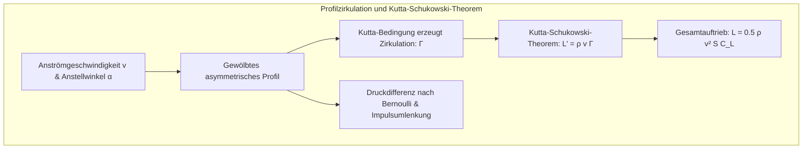
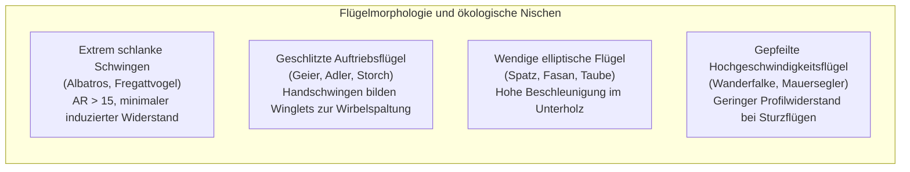
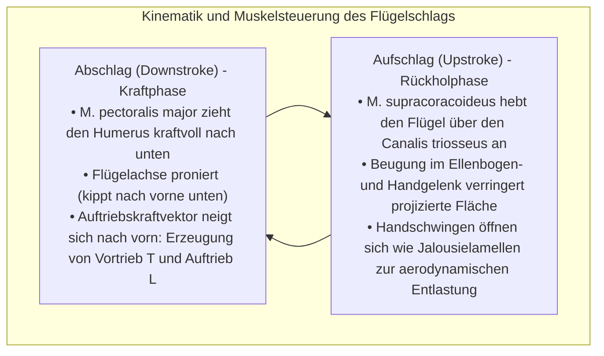
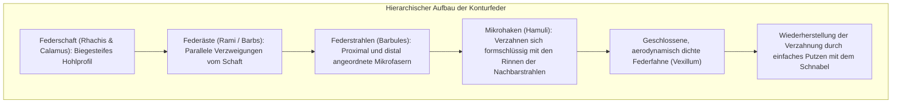
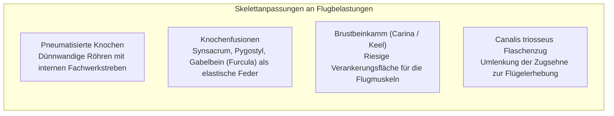
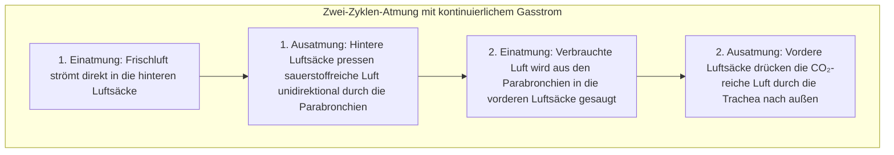
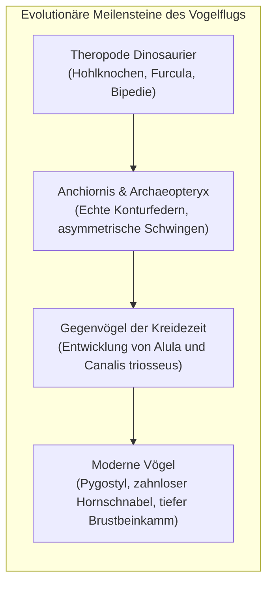

Ob der im thermischen Aufwind kreisende Steinadler, der mit über 380 km/h im Sturzflug herabstoßende Wanderfalke oder der Wanderalbatros, der die stürmischen Weiten des Südpolarmeers jahrelang ohne einen einzigen Flügelschlag durchmisst: Vögel haben in der Evolutionsgeschichte das vollendetste Meisterwerk des Fluges geschaffen.

Während die bemannte Luftfahrt des Menschen kaum mehr als ein Jahrhundert alt ist, traten die Vögel – als die einzigen überlebenden Abkömmlinge der theropoden Dinosaurier – ihre Herrschaft über den Luftraum bereits im späten Jura vor über 150 Millionen Jahren an. Sie entwickelten eine aerodynamische Anpassungsfähigkeit, Manövrierfähigkeit und Energieeffizienz, die selbst modernste Kampfflugzeuge und Drohnen weit in den Schatten stellt.

Der Vogelflug ist keineswegs ein primitives „Auf- und Abschlagen der Schwingen“. Er ist vielmehr ein <strong>hochgradig synchronisiertes biophysikalisches Gesamtkunstwerk: pneumatisierte Hohlknochen mit internen Fachwerkstreben, ein über ein Dreiknochenloch umgelenktes Hebel- und Flaschenzugmuskelsystem, selbstreparierende mikro- und nanostrukturierte Federn mit Hakenverankerung, ein doppelter kontinuierlicher Luftsackkreislauf für unidirektionalen Gasaustausch sowie die meisterhafte Manipulation instationärer Vorderkantenwirbel (Leading-Edge Vortices)</strong>. In dieser umfassenden Abhandlung untersuchen wir die Aerodynamik, muskuloskelettale Anatomie, Atmungsphysiologie und evolutionäre Herkunft des Vogelfluges im Detail.

---

### 1. Aerodynamik des Flügelprofils: Auftrieb, induzierter Widerstand und Streckung

Um in der Atmosphäre das eigene Körpergewicht $W = mg$ auszugleichen, muss der Vogelflügel einen kontinuierlichen <strong>Auftrieb (Lift: $L$)</strong> erzeugen und zugleich den aerodynamischen Gesamtwiderstand überwinden.

Der Flügelquerschnitt eines Vogels bildet ein natürliches asymmetrisch gewölbtes Profil (Cambered Airfoil) mit konvex gekrümmter Oberseite und flacher bis leicht konkav geformter Unterseite.



#### Zirkulationstheorie und Auftriebsgleichung
Nach dem <strong>Kutta-Schukowski-Theorem (Kutta-Joukowski Theorem)</strong> der Strömungsmechanik ist der Auftrieb pro Spannweiteneinheit $L'$ direkt proportional zur Dichte des Fluids $\rho$, der Anströmgeschwindigkeit $v$ und der gebundenen Wirbelzirkulation $\Gamma$:

$$L' = \rho v \Gamma, \quad L = \frac{1}{2} \rho v^2 S C_L$$

Hierbei repräsentiert $S$ die Flügelfläche und $C_L$ den Auftriebsbeiwert, der maßgeblich von der Profilwölbung und dem geometrischen Anstellwinkel $\alpha$ abhängt.

#### Randwirbel und der Preis des induzierten Widerstands
Jede Auftriebserzeugung erzwingt physikalisch das Entstehen eines <strong>induzierten Widerstands (Induced Drag: $D_i$)</strong>. Da an der Flügelunterseite ein Überdruck und an der Flügeloberseite ein Unterdruck herrscht, strömt Luft an den Flügelspitzen seitlich um den Rand herum. Dies führt zu zwei kraftvollen, rotierenden Randwirbeln (Wingtip Vortices), die hinter dem Flügel ein starkes Abwindfeld (Downwash: $w$) induzieren. Der effektive Auftriebsvektor neigt sich nach hinten und erzeugt eine Widerstandskomponente parallel zur Flugrichtung:

$$D_i = \frac{1}{2} \rho v^2 S C_{Di} = \frac{1}{2} \rho v^2 S \left(\frac{C_L^2}{\pi AR e}\right)$$

In dieser Formulierung ist $AR = b^2 / S$ die <strong>Streckung (Aspect Ratio)</strong> des Flügels und $e$ der Oswald-Wirkungsgrad. Die Gleichung beweist mathematisch: <strong>Der induzierte Widerstand verhält sich strikt umgekehrt proportional zur Streckung $AR$</strong>.



1. <strong>Flügel mit extremer Streckung (Albatros)</strong>: Bei Werten von $AR = 15 \dots 18$ werden die Randwirbel auf ein Minimum reduziert, was Gleitzahlen von über 20 ermöglicht;
2. <strong>Geschlitzte Schwingen (Adler, Geier)</strong>: Die äußeren Handschwingen spreizen sich fächerförmig auf. Jede Feder fungiert als eigenständiges Mikro-Winglet und zerlegt den großen energiereichen Randwirbel in viele kleine, sich rasch dissipierende Einzelwirbel;
3. <strong>Der Daumenfittich (Alula) als Strömungsretter</strong>: Die am reduzierten Daumen sitzende Alula entspricht exakt dem Vorflügel (Leading-Edge Slat) moderner Verkehrsflugzeuge. Bei steilem Landeanflug leitet sie energiereiche Luftströmung auf die Flügeloberseite, verhindert den Strömungsabriss und verschiebt den kritischen Stall-Winkel um über 10 Grad.

---

### 2. Instationäre Strömungsmechanik des Schlagflugs und Vorderkantenwirbel

Flugzeuge trennen Auftriebserzeugung (starre Tragfläche) und Vortrieb (Triebwerk). Vögel hingegen müssen mit denselben elastischen Tragflächenstrukturen <strong>simultan Auftrieb und Vortrieb erzeugen</strong>.



#### Der Vorderkantenwirbel (Leading-Edge Vortex: LEV)
Klassische stationäre Aerodynamik versagt vollständig bei der Erklärung der extremen Auftriebskräfte von Kolibris und Singvögeln. Modernste Particle-Image-Velocimetry-Untersuchungen (PIV) offenbarten, dass Vögel gezielt <strong>instationäre Phänomene in Form stabiler Vorderkantenwirbel (LEV)</strong> nutzen.

Wird der Flügel mit überkritisch hohem Anstellwinkel rasch nach unten beschleunigt, reißt die Strömung an der Vorderkante kontrolliert ab und rollt sich zu einem Unterdruck-Wirbelkern auf, der fest auf der Flügeloberseite haftet. Dieser Saugeffekt vervielfacht den maximalen Auftriebsbeiwert $C_L$ auf das Zwei- bis Dreifache des stationären Limits, bevor der Abschlag endet und der Wirbel ohne schädlichen Strömungsabriss abgeworfen wird.

#### Weis-Fogh-Mechanismus (Clap and Fling)
Beim steilen Durchstarten aus dem Stand klatschen Tauben ihre Flügel auf dem Rücken zusammen (Clap) und reißen die Vorderkanten blitzartig auseinander (Fling). Der einströmende Luftstrom erzeugt sofort maximale Zirkulation an beiden Flügeln, noch bevor eine Vorwärtsbewegung einsetzt – ein katapultartiger Auftriebsschub aus dem Stand.

---

### 3. Dynamischer Segelflug: Die Energieernte des Albatros

Der Wanderalbatros mit einer Spannweite von 3,5 Metern kann Ozeane monatelang überqueren, ohne aktiv mit den Flügeln zu schlagen. Dies gelingt durch <strong>dynamischen Segelflug (Dynamic Soaring)</strong> in der vertikalen Windscherung über den Meereswellen.

Durch die Reibung an der Meeresoberfläche entsteht ein Geschwindigkeitsgradient des Windes: In den Wellentälern weht der Wind schwach ($U \approx 5\,\text{m/s}$), in 15 bis 20 Metern Höhe dagegen mit voller Sturmstärke ($U \ge 25\,\text{m/s}$).

```mermaid
sequenceDiagram
    autonumber
    participant A as Flugbahn des Albatros
    participant U as Obere Starkwindschicht (25 m/s)
    participant L as Untere Schwachwindschicht im Wellental (5 m/s)
    A->>U: 1. Rückenwind-Sturzflug: Aus großer Höhe mit Rückenwind herabstoßen, kinetische Energie über Grund maximieren
    A->>L: 2. Kurve im Wellental: Im windstillen Bereich scharfe 180°-Wende genau gegen den Wind fliegen
    A->>U: 3. Gegenwind-Aufstieg: Steil in die Starkwindschicht hineinstoßen; die hohe Windscherung lässt die Eigengeschwindigkeit (Airspeed) explodieren
    A->>U: 4. Gipfelwende: Am höchsten Punkt erneut in den Rückenwind eindrehen – Beginn des nächsten Zyklus
```

Die Energiegleichung lautet:

$$\frac{dE}{dt} = -D v_a - m g w_z - m v_{ax} \frac{dU}{dz} \dot{z}$$

Durch die Synchronisation von vertikaler Steigrate $\dot{z}$ und Relativgeschwindigkeit $v_{ax}$ bleibt der Energietransfer aus dem Scherwind permanent positiv und übertrifft die Reibungsverluste ($D v_a$). Zudem besitzt der Albatros eine <strong>Sehnensperre im Schultergelenk (Shoulder-lock tendon)</strong>, die den Flügel skelettal verriegelt, sodass keinerlei Muskelkraft zum Offenhalten der Schwingen nötig ist.

---

### 4. Mikro- und Nanostruktur der Federn: Leichtbau und Selbstreparatur

Vogelfedern stellen eines der außergewöhnlichsten Faserverbundmaterialien der Natur dar: federleicht, hochelastisch und mechanisch selbstreparierend.



#### Reißverschluss-Mechanismus der Hamuli
Auf einer einzigen Handschwinge sitzen Millionen mikroskopischer Häkchen (Hamuli). Reißen Windböen die Fahne auf, gleiten die Haken elastisch aus den Führungsrinnen, ohne dass die Hornsubstanz bricht. Zieht der Vogel die Feder durch den Schnabel (Preening), schnappen die Häkchen wieder wie bei einem Klettverschluss in die Nuten ein.

#### Akustische Tarnung der Eulen
Zur lautlosen Jagd besitzen Eulen drei spezialisierte Anpassungen:
1. <strong>Kammartige Zähnelung an der Vorderkante</strong>: Zerlegt großskalige Wirbel in unhörbare Mikroturbulenzen;
2. <strong>Weiche Fransen an der Hinterkante</strong>: Verhindern das abrupte Druckabreißen und den Zischton an der Abrisskante;
3. <strong>Samtartiger Flaum auf der Flügeloberfläche</strong>: Dämpft jegliches Reibungsgeräusch der Federn untereinander.

---

### 5. Das Skelett- und Muskelsystem: Meisterwerk des biologischen Leichtbaus

Die Anatomie des Vogels ist kompromisslos auf minimale Masse bei maximaler Torsionssteifigkeit optimiert.



#### Das Flaschenzugprinzip des Canalis triosseus
Um den Schwerpunkt aerodynamisch ideal im Rumpfzentrum zu halten, liegen sowohl der flügelsenkende als auch der flügelhebende Muskel an der Unterseite des Brustkorbs:
- <strong>M. pectoralis major</strong>: Macht bis zu 25 % des Körpergewichts aus und zieht den Oberarmknochen kraftvoll nach unten;
- <strong>M. supracoracoideus</strong>: Liegt unter dem Pectoralis. Seine Sehne zieht durch eine Knochenöffnung – den <strong>Canalis triosseus</strong> (gebildet aus Rabenschnabelbein, Schulterblatt und Schlüsselbein) – über das Gelenk hinweg und setzt an der Oberseite des Humerus an. Wie ein Flaschenzug lenkt dieser Kanal die Zugrichtung um 180 Grad um und hebt den Flügel von unten her an.

---

### 6. Das unidirektionale Luftsacksystem: Physiologischer Hochleistungsmotor

Flug erfordert den höchsten aeroben Stoffwechsel aller Wirbeltiere. Während Säugetiere in 8.000 m Höhe an Sauerstoffmangel sterben, überqueren Streifengänse den Himalaya in 9.000 m Höhe im aktiven Schlagflug. Dies ermöglicht das Vogel-Atmungssystem.



#### Kreuzstrom-Austauscher (Cross-Current System)
Die starre Vogel-Lunge (Parabronchien) dehnt sich nicht aus. Die Luftsäcke dienen als kontinuierlich arbeitende Blasebälge:
1. <strong>Unidirektionaler Fluss</strong>: Frischluft strömt sowohl beim Ein- als auch beim Ausatmen stets in derselben Richtung durch die Lungenkapillaren;
2. <strong>Kreuzstromprinzip</strong>: Das Blut fließt im rechten Winkel zum Luftstrom. Dadurch kann das arterielle Blut eine höhere Sauerstoffsättigung erreichen als die ausgeatmete Luft – ein physikalischer Wirkungsgrad, der Säugetierlungen um ein Vielfaches übertrifft.

---

### 7. Evolution: Vom theropoden Dinosaurier zum modernen Vogel

Paläontologische Funde der letzten Jahrzehnte belegen zweifelsfrei: <strong>Vögel sind lebende theropode Dinosaurier</strong>.



#### Die WAIR-Hypothese (Wing-Assisted Incline Running)
Jahrzehntelang stritt die Fachwelt über die Entstehung des Fluges: Baum-Abwärts-Theorie (Arboreal) oder Boden-Aufwärts-Theorie (Cursorial)?
Die von Kenneth Dial formulierte <strong>WAIR-Hypothese</strong> lieferte den entscheidenden Schlüssel: Jungvögel nutzen ihre noch flugunfähigen Flügel beim Erklimmen steiler Hänge nicht zum Abheben, sondern pressen ihren Körper durch Schlagen der Flügel fest an den Untergrund (aerodynamischer Anpressdruck). Dies bot bereits Vorläufern von Schwingen enorme Überlebensvorteile bei der Flucht vor Raubtieren.

---

### 8. Bionische Luftfahrt: Lehren für die Luft- und Raumfahrt der Zukunft

Die Natur hat über 150 Millionen Jahre aerodynamische Perfektion erprobt. Moderne Ingenieure nutzen diese Prinzipien heute:
1. <strong>Morphing Wings</strong>: Flexible Tragflächenstrukturen nach dem Vorbild der elastischen Vogelschwinge ersetzen starre Landeklappen und verringern Strömungswiderstand und Radarsignatur drastisch;
2. <strong>Winglet-Technologie</strong>: Nach Vorbild der gespreizten Handschwingen von Greifvögeln sparen Flügelspitzenaufsätze weltweit Millionen Tonnen Treibstoff;
3. <strong>Schlagflügeldrohnen (Flapping MAVs)</strong>: Durch die Ausnutzung von Vorderkantenwirbeln ermöglichen vogel- und insekteninspirierte Mikrodrohnen unerreichte Manövrierbarkeit auf engstem Raum.

Der Vogelflug bleibt das strahlendste Zeugnis evolutionärer Ingenieurskunst und eine unerschöpfliche Quelle für die Technologien von morgen.
