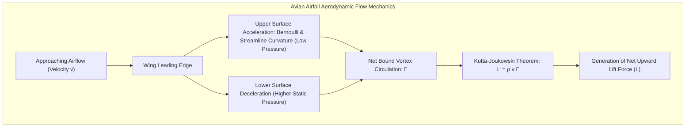
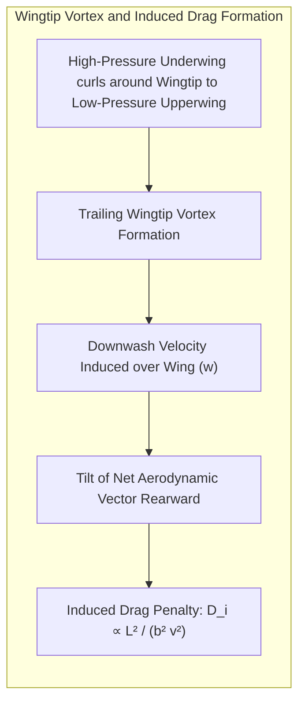
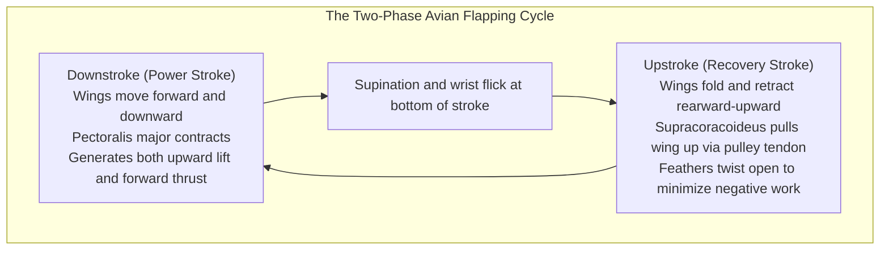
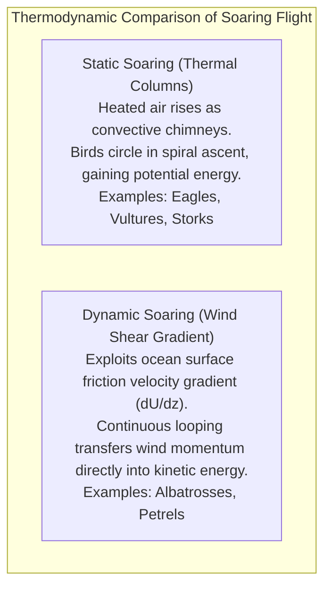
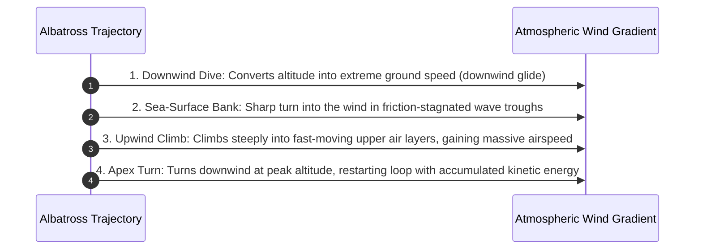
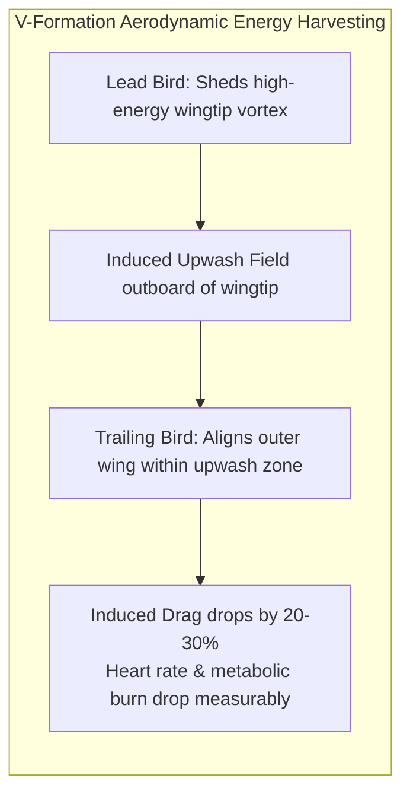
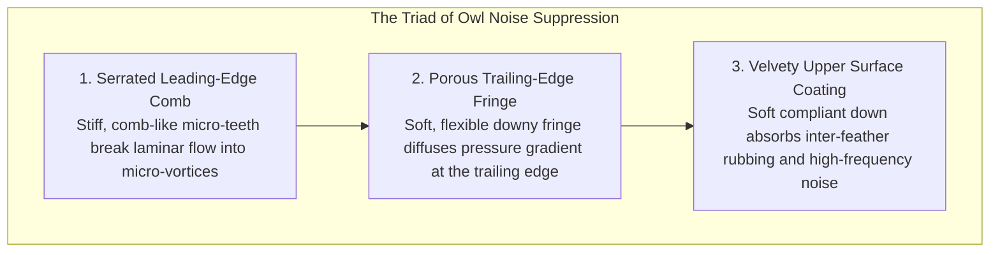
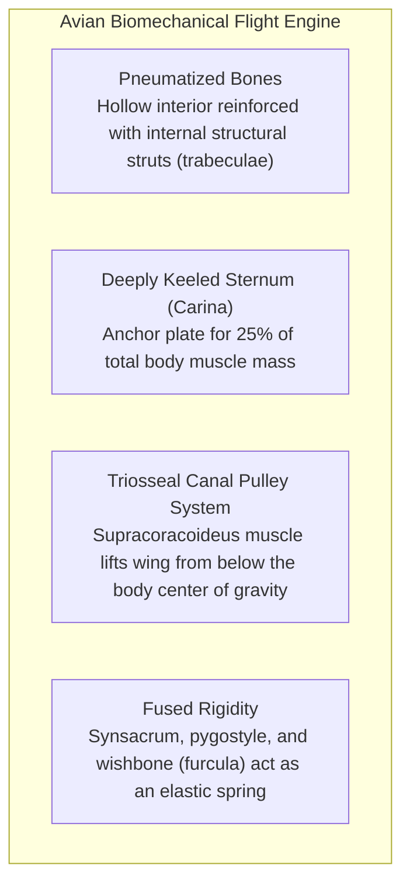
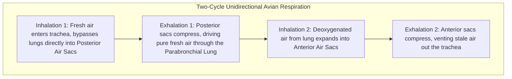
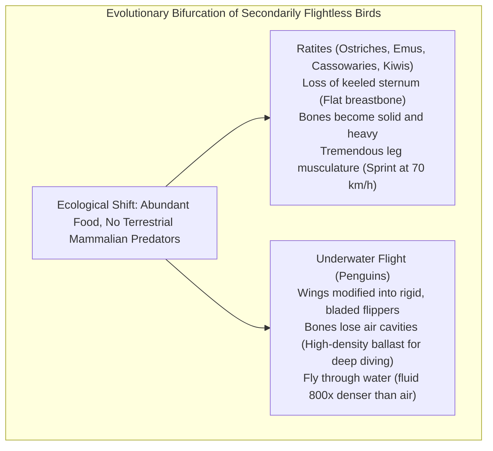

From the effortless thermal soaring of the red-tailed hawk and the breathtaking $380\,\mathrm{km/h}$ hypersonic dive of the peregrine falcon, to the wandering albatross circumnavigating the southern oceans without a single wingbeat, and the hummingbird hovering motionless before a flower, avian flight represents one of the most sublime achievements in the history of terrestrial evolution.

Humanity achieved powered heavier-than-air flight only a little over a century ago, in 1903, through the Wright brothers. Yet birds—the direct surviving lineage of theropod dinosaurs—have continuously refined their aerial mastery for over 150 million years, dating back to the late Jurassic *Archaeopteryx*. In doing so, nature engineered an integrated biological flight system possessing flexibility, gust tolerance, and energetic efficiency that modern aeronautics still struggles to replicate.

When we observe a common pigeon or crow ascending into the breeze, it is easy to assume that flight is merely a matter of "flapping wings". But beneath those feathers lies <strong>a marvel of biological physics: ultra-light hollow bones reinforced with internal architectural trusses, flight muscles occupying nearly a quarter of body mass arranged around ingenious bone pulleys, self-healing feathers locked by millions of microscopic hooklets, a unidirectional continuous-flow air sac respiratory system that puts mammalian lungs to shame, and unsteady aerodynamic control mechanisms that manipulate leading-edge vortices to delay stall far beyond fixed-wing limits</strong>.

How do birds defeat gravity, grasp the invisible fluid of the atmosphere, and convert metabolic energy into aerodynamic thrust? This comprehensive physical, biological, and engineering treatise explores the entire spectrum of avian flight.

---

### 1. The Physics of the Avian Wing: Lift, Drag, and Airfoil Mechanics

The primary aerodynamic prerequisite for sustained flight is the generation of a net upward force—<strong>Lift ($L$)</strong>—sufficient to balance the bird’s gravitational weight ($W = mg$):

$$L = W = mg$$

Like the wing of an aircraft, the cross-section of a bird’s wing forms a streamlined <strong>airfoil (cambered aerofoil)</strong> characterized by a convex upper surface, a flatter or concave lower surface, and a rounded leading edge tapering to a sharp trailing edge.

#### Circulation and the Kutta-Joukowski Theorem
As airflow passes over an asymmetric, cambered wing, the <strong>Kutta Condition</strong> dictates that the flow leaves the sharp trailing edge smoothly without wrapping around the back. This boundary condition induces a net rotational circulation—a <strong>bound vortex ($\Gamma$)</strong>—around the airfoil.

According to the <strong>Kutta-Joukowski Theorem</strong>, the lift per unit span ($L'$) generated by an airfoil translating at velocity $v$ through an air mass of density $\rho$ is directly proportional to circulation $\Gamma$:

$$L' = \rho v \Gamma$$

Integrating across the entire wing area $S$, the total aerodynamic lift is given by the standard aeronautical relation:

$$L = \frac{1}{2} \rho v^2 S C_L$$

where $C_L$ is the dimensionless lift coefficient, which increases linearly with the <strong>Angle of Attack ($\alpha$)</strong> up to the stall angle. When a bird glides slowly, it pitches its wings upward to increase $C_L$. When diving at high speeds, it tucks its wings inward, dramatically reducing surface area $S$ and dynamic profile drag.

#### The Penalty of Lift: Induced Drag and Aspect Ratio
In physical fluid dynamics, the creation of lift incurs an inevitable aerodynamic penalty: <strong>Induced Drag ($D_i$)</strong>.

Because the lower wing surface experiences higher static pressure than the upper surface, high-pressure air curls around the wingtips toward the low-pressure upper surface. This three-dimensional crossflow rolls up into intense, swirling <strong>Wingtip Vortices</strong>.

The wingtip vortices deflect the local airstream downward, creating an induced vertical velocity component known as <strong>downwash ($w$)</strong>. This downwash tilts the net aerodynamic force vector rearward by an angle $\epsilon = w / v$. The rearward-pointing component of this tilted lift force is induced drag:

$$D_i = \frac{1}{2} \rho v^2 S \frac{C_L^2}{\pi AR e}$$

where $b$ is wingspan, $AR = b^2 / S$ is the <strong>Aspect Ratio</strong>, and $e$ is the Oswald efficiency factor ($\sim 0.7 - 0.9$).

This equation proves that <strong>a longer, narrower wing (high aspect ratio) drastically minimizes induced drag</strong>, while a short, broad wing suffers heavy vortex drag.

#### Morphological Wing Adaptations
Over evolutionary epochs, avian wing morphology diverged into specialized aerodynamic archetypes tailored to ecological niches:

| Wing Archetype | Aspect Ratio ($AR$) | Representative Taxa | Aerodynamic Function & Ecological Role |
| :--- | :--- | :--- | :--- |
| <strong>High-Aspect-Ratio Gliding Wing</strong> | Very High ($15 - 20$) | Albatrosses, Shearwaters, Petrels | Minimal induced drag. Optimized for sustained, unpowered dynamic soaring over windy oceanic expanses. |
| <strong>Broad High-Lift Slotted Wing</strong> | Moderate ($6 - 8$) | Eagles, Vultures, Storks, Hawks | Deep camber and slotted primary feathers ("finger slots"). Enables tight thermal circling at low airspeeds with high load-carrying capacity. |
| <strong>High-Speed Pointed Wing</strong> | High-Moderate ($8 - 11$) | Falcons, Swifts, Swallows | Swept-back, pointed tips. Reduces parasite drag; optimized for high-speed chasing and steep stooping dives. |
| <strong>Elliptical Maneuvering Wing</strong> | Low ($3 - 5$) | Sparrows, Crows, Pheasants | Rapid acceleration and tight agility in cluttered forest canopies; high induced drag compensated by powerful bursts of flapping. |

#### Slotted Primary Feathers and Modern Winglets
Large soaring birds such as eagles and condors exhibit deeply separated, slotted primary feathers at their wingtips. Each individual feather feather acts as an independent miniature airfoil with its own camber. By spreading these feathers vertically and horizontally, the bird fragments a single massive, energy-sapping wingtip vortex into multiple smaller, weaker vortices that dissipate rapidly. This biological innovation was the direct inspiration for the <strong>winglets</strong> installed on the wingtips of modern commercial airliners (such as the Boeing 737 and Airbus A350), which reduce aircraft fuel burn by $4\%$ to $6\%$.

#### The Alula: Nature’s Leading-Edge Slat
On the first digit (anatomically equivalent to the human thumb) rests a small tuft of 3 to 5 stiff feathers called the <strong>Alula (bastard wing)</strong>.
During steep landing approaches or tight low-speed turns, the wing’s angle of attack exceeds $15^\circ$, threatening catastrophic aerodynamic stall as airflow detaches from the upper wing surface.

To avert stall, the bird extends the alula forward and upward, opening a narrow slot between the alula and the main wing leading edge. High-pressure air from the underwing rushes through this venturi-like gap, accelerates, and re-energizes the sluggish boundary layer on the upper surface. This suppresses flow separation and delays stall to angles exceeding $25^\circ$—operating identically to the mechanical <strong>leading-edge slats</strong> deployed by commercial jets on approach.

#### Wing Loading and Stall Velocity
The flight envelope of any bird is bounded by its <strong>Wing Loading ($W/S = mg/S$)</strong>. Solving the lift equation for the minimum speed required to maintain level flight yields the <strong>Stall Velocity ($v_{\text{stall}}$)</strong>:

$$v_{\text{stall}} = \sqrt{\frac{2}{\rho C_{L,\max}} \left( \frac{W}{S} \right)}$$

- Birds with low wing loading ($20 - 40\,\mathrm{N/m^2}$), such as owls and harriers, can cruise at leisurely bicycle speeds ($15\,\mathrm{km/h}$) without stalling, allowing silent scanning of prey.
- Heavy birds with high wing loading ($100 - 200\,\mathrm{N/m^2}$), such as swans, loons, and albatrosses, possess high stall speeds ($> 50\,\mathrm{km/h}$) and must run across water for dozens of meters to get airborne.

---

### 2. Flapping Kinematics: The Non-Steady Aerodynamics of Flight

Unlike human-engineered aircraft, which separate lift generation (stationary wings) from thrust generation (rotary engines or turbofans), birds generate <strong>both lift and thrust simultaneously using the exact same lifting surfaces</strong>.

Flapping is not a crude up-and-down oscillation. It is an intricate, non-linear three-dimensional figure-eight stroke cycle governed by coupled movements of the shoulder, elbow, and wrist joints.

#### The Downstroke: Generating Forward Propulsion
During the downstroke (power stroke), the massive pectoralis major muscle pulls the humerus downward and forward.
The wing experiences a resultant velocity vector ($v_{\text{rel}}$) that combines forward flight speed ($v_{\text{forward}}$) with downward flapping velocity ($v_{\text{down}}$). By pronating (twisting the leading edge downward), the bird reorients its chord line so that the aerodynamic lift vector points <strong>upward and forward</strong>.
The vertical component supports body weight; the forward component drives the bird forward against aerodynamic profile drag.

#### The Upstroke: Minimizing Negative Aerodynamic Work
Pulling the wing back up without adjustments would produce downward aerodynamic force and massive drag. Birds mitigate this through active shape-shifting:
1. <strong>Wing Retraction (Medium and Small Birds)</strong>: The bird flexes its wrist and elbow, drawing the wing close to the torso. This cuts the projected surface area in half and brings the wing mass closer to the body, drastically reducing aerodynamic drag and rotational inertia.
2. <strong>Feather Slotting and Automatic Valving</strong>: The asymmetric barb geometry of flight feathers causes them to lock together tightly under upward pressure (downstroke), forming an airtight sail. On the upstroke, downward pressure twists the feathers individual degrees on their quill axes like venetian blinds, allowing air to pass harmlessly through.

#### Leading-Edge Vortices (LEV) and Dynamic Stall Delay
For decades, classical steady-state aerodynamics predicted that hummingbirds, swifts, and hovering passerines should be physically incapable of staying aloft. High-speed digital particle image velocimetry (PIV) revealed that birds exploit <strong>unsteady leading-edge vortices (LEVs)</strong>.

When a wing is impulsively swept at high angles of attack, the boundary layer separates at the sharp leading edge, rolling into a coherent, spinning vortex sheet that remains attached to the upper surface throughout the stroke. The core of this LEV exhibits an intense low-pressure suction peak, producing transient lift coefficients ($C_L \sim 2.5 - 3.5$) that are more than double the static stall limits of conventional aircraft. Hummingbirds invert their wings on the upstroke to generate identical LEVs in both directions, sustaining a continuous hovering lift.

---

### 3. Soaring Dynamics: Harnessing Atmospheric Energy

Flapping requires intense metabolic expenditure. To traverse thousands of miles, large birds have mastered <strong>Soaring</strong>—extracting kinetic and potential energy from atmospheric airflows without flapping.

#### Thermal (Static) Soaring
Solar radiation warms the ground unevenly, spawning vertical columns of buoyant, rising warm air known as <strong>thermals</strong>. Large raptors spot these invisible chimneys, extend their slotted wings, and enter a coordinated banked turn.

Level flight within a thermal requires the thermal’s vertical updraft velocity ($w_{\text{thermal}}$) to exceed the bird’s minimum sink rate ($v_{\text{sink}}$):

$$w_{\text{thermal}} > v_{\text{sink}}$$

When this condition is met, the bird rides the elevator of air up to the cloud base (often $1,000$ to $3,000\,\mathrm{meters}$). Upon reaching the thermal ceiling, the bird glides downward along a shallow glide slope toward the next thermal, converting potential energy into ground track distance over hundreds of miles with zero metabolic muscle work.

#### Dynamic Soaring: The Albatross Perpetual Energy Loop
Over the Southern Ocean, thermal updrafts are virtually nonexistent. Yet the wandering albatross (*Diomedea exulans*) roams the roaring forties for years on end without flapping. This miracle is powered by <strong>Dynamic Soaring</strong>, which exploits the vertical wind shear gradient ($dU/dz$) formed by friction between strong winds and rough ocean waves.

1. <strong>Downwind Dive</strong>: From an altitude of $15 - 20\,\mathrm{meters}$, the albatross dives downwind, converting potential energy and wind momentum into high ground speed.
2. <strong>Surface Turn</strong>: A few feet above the water—where ocean friction slows wind speed nearly to zero—the bird executes a high-G banked turn directly into the wind.
3. <strong>Upwind Climb</strong>: The albatross punches upward through the boundary layer. As it ascends into progressively faster headwinds, the sudden change in relative airflow dramatically boosts its <strong>indicated airspeed</strong>, generating a burst of lift that catapults the bird to its apex altitude without flapping.
4. <strong>Apex Turn</strong>: At the top of the climb, the bird banks downwind, re-entering the cycle. Through this continuous four-phase loop, the albatross extracts physical momentum directly from the shear layer of Earth's atmosphere.

---

### 4. Aerodynamics of V-Formation Flight: Wake Surfing

Migratory waterfowl (geese, cranes, swans) famously organize into disciplined V-formations (*echelon formations*). Far from a social coincidence, this is an exercise in applied vortex wake management.

Because an aircraft or bird sheds trailing wingtip vortices, the air directly behind the wings is pushed down (downwash), while the air outboard and behind the wingtips is driven upward in a swirling <strong>Upwash field</strong>.

By positioning its wingtip within the upwash generated by the bird ahead, each trailing bird receives free vertical lift from the ambient airflow. Biometric telemetry reveals that trailing geese in a V-formation exhibit <strong>heart rates and metabolic oxygen consumption rates $20\%$ to $30\%$ lower</strong> than when flying solo. Because the lead bird receives no upwash assistance, flock members rotate positions systematically, sharing the burden of leadership across continental journeys.

---

### 5. Peregrine Falcon Stoop: Hypersonic Bio-Engineering at Mach 0.3

The fastest creature on Earth is the <strong>Peregrine Falcon (*Falco peregrinus*)</strong>, capable of diving ("stooping") at terminal velocities exceeding <strong>$380\,\mathrm{km/h}$ ($105\,\mathrm{m/s}$, Mach $0.31$)</strong>.

Achieving Mach 0.3 in living tissue requires extraordinary morphological adaptations:
1. <strong>Nasal Baffles (Tubercles)</strong>: At $380\,\mathrm{km/h}$, atmospheric ram pressure would rupture delicate avian air sacs and lungs. Inside the peregrine’s nostrils sit small, conical bony pegs. These baffles create shock-like micro-vortices that decelerate and divert incoming ram air, allowing normal respiration during terminal dives (the exact principle used in the shock cones of supersonic jet engine inlets).
2. <strong>Nictitating Membrane</strong>: A transparent "third eyelid" sweeps across the cornea, lubricating and shielding the eye from aerodynamic shearing forces while maintaining razor-sharp binocular focus.
3. <strong>Rigid Teardrop Silhouette</strong>: The falcon tucks its wings tight against its torso, assuming a rigid diamond-teardrop shape that minimizes frontal area and boundary-layer separation.
4. <strong>Impact Physics</strong>: Striking a flying pigeon at $380\,\mathrm{km/h}$ delivers thousands of joules of kinetic energy ($E_k = \frac{1}{2}mv^2$). The falcon's clenched talons act as high-velocity bludgeons, severing the prey's spinal cord instantaneously on impact.

---

### 6. Owl Silent Flight: Fluid Dynamics of Acoustic Suppression

Most birds produce flapping noise due to turbulence generated as air rolls off the trailing edge of their wings. Owls (*Strigiformes*), however, glide and strike in total acoustic silence, completely undetectable to the sensitive ears of rodents.

This stealth is achieved through a three-stage acoustic suppression suite:

- <strong>Leading-Edge Comb</strong>: Stiff, comb-like serrations on the leading edge of the outermost flight feathers break incoming air into micro-turbulent filaments, suppressing massive boundary layer detachment.
- <strong>Trailing-Edge Fringe</strong>: Instead of a sharp, rigid trailing edge that abruptly sheds vortices (the dominant source of aerodynamic flutter noise), the owl's wing terminates in a soft, feathery brush. This blends upper and lower airstreams smoothly, eliminating acoustic vortex shedding.
- <strong>Velvety Down</strong>: A plush coating of micro-hairs on the upper wing surface absorbs high-frequency noise caused by feathers rubbing against one another during articulation.

This biological acoustic dampening has been reverse-engineered by engineers to silence high-speed Shinkansen train pantographs and design ultra-quiet wind turbine blades.

---

### 7. Morphing Wings and Sensor-Integrated Flight Control

Human aircraft rely on rigid metallic or composite flaps and ailerons actuated by hydraulic pistons along discrete hinges. A bird’s wing possesses no hinges; it is a <strong>continuous, actively morphed bio-aeroelastic lifting body</strong>.

A flying bird continuously alters its wing camber, sweep angle, dihedral, and twist along its entire span. Distributed throughout the skin at the base of every flight feather are thousands of <strong>Herbst Corpuscles</strong>—ultrasensitive mechanoreceptors that detect microscopic pressure fluctuations, skin shear, and turbulent boundary-layer separation in fractions of a millisecond.
Signals from these receptors feed through autonomic spinal reflex loops, causing subcutaneous feather muscles (*erector and depressor muscles*) to twitch, micro-adjusting individual feather orientations to suppress gust turbulence before it can perturb the vehicle's trajectory.

---

### 8. Skeletal and Muscular Biomechanics: Extreme Lightness and Pulley Power

To overcome gravity, birds evolved skeletal architectures combining extreme lightness with unmatched structural rigidity.

#### Pneumatized Bones and Fused Skeletons
Avian bones are <strong>pneumatized (hollow)</strong>, filled with extensions of the respiratory air sac system rather than heavy marrow. The thin cortical bone walls are reinforced internally by diagonal trusses (trabeculae), mimicking the weight-optimized design of modern civil crane booms.
To eliminate the weight of muscular stabilizing systems, large swathes of the avian skeleton are permanently fused:
- The thoracic vertebrae, lumbar spine, and pelvis fuse into a rigid unibody chassis: the <strong>Synsacrum</strong>.
- The clavicles fuse into the <strong>Furcula (Wishbone)</strong>, which flexes elastically during downstrokes, storing elastic strain energy that rebounds to assist the upstroke.

#### The Triosseal Canal: Nature's Overhead Pulley
Flight requires massive muscular power. The primary downstroke engine is the <strong>Pectoralis Major</strong>, which accounts for up to $20\%$ of total body mass.
To elevate the wing, an equally powerful muscle is required: the <strong>Supracoracoideus</strong>. In any human machine, an elevator muscle would be mounted on top of the back. But mounting heavy muscle tissue on the dorsal surface would raise the bird's center of gravity, causing severe roll instability.

Nature’s solution is a masterstroke of biomechanical routing:
- The supracoracoideus is mounted <strong>on the ventral keel right beneath the pectoralis</strong>, keeping the heavy center of mass low like the keel of a sailboat.
- Its tendon extends upward through the <strong>Triosseal Canal</strong>—a smooth circular opening formed at the junction of the scapula, coracoid, and clavicle.
- The tendon wraps over this bone rim like <strong>a cable through a pulley wheel</strong>, running over the top of the shoulder to attach to the dorsal surface of the humerus.
- When the ventral supracoracoideus contracts downward, the pulley action pulls the humerus <strong>upward</strong>, achieving overhead wing elevation from a belly-mounted muscle engine!

#### Micro-Nanostructure of Feathers: Self-Healing Velcro
Avian flight feathers are composed of beta-keratin, forming a fractal hierarchic structure:
- A central shaft (<strong>Rachis</strong>) supports hundreds of lateral branches (<strong>Barbs</strong>).
- Each barb branches into thousands of microscopic <strong>Barbules</strong>.
- Barbules on one side possess tiny hooked microscopic claws (<strong>Hooklets or Barbicels</strong>) that latch securely onto the smooth flanges of opposing barbules.

This forms an impermeable, flexible aerodynamic surface. If severe aerodynamic forces rupture the vane, the hooklets merely unzip without tearing. When the bird preens its feathers with its bill, the micro-hooklets effortlessly re-engage, <strong>completely restoring flawless aerodynamic continuity</strong>.

---

### 9. The Unidirectional Respiratory Air Sac Engine

Flight demands an oxygen consumption rate up to 20 times higher than resting metabolism. If birds breathed using the blind-ended, tidal lungs of mammals—where fresh incoming air mixes with stagnant residual air in dead-end alveoli—they would suffocate under sustained flapping.

Birds developed the <strong>Avian Air Sac System</strong>: a continuous, non-mixing, unidirectional respiratory loop.

The avian lung itself is a rigid, stationary honeycomb of microscopic tubes called <strong>Parabronchi</strong>. Connected to the lung are 7 to 9 thin-walled, compliant <strong>Air Sacs</strong> distributed throughout the body cavity and hollow bones:
- <strong>Continuous Unidirectional Flow</strong>: It takes <strong>two complete cycles of inhalation and exhalation</strong> for a single parcel of air to traverse the system. Crucially, air flows through the gas-exchanging parabronchi in <strong>the exact same direction during both inhalation and exhalation</strong>. There is zero dead volume.
- <strong>Cross-Current Exchange</strong>: Pulmonary blood capillary networks flow perpendicular to the direction of airflow across the parabronchi. This counter-current-like gradient maintains an uninterrupted oxygen concentration differential, extracting nearly $100\%$ of available oxygen from inspired air.

This unmatched respiratory efficiency enables the <strong>Bar-Headed Goose (*Anser indicus*)</strong> to flap over the summit of Mount Everest ($8,848\,\mathrm{meters}$) in sub-zero air where oxygen density is less than a third of sea level, without acclimatization or supplemental oxygen.

---

### 10. Quantum Navigation and Avian Migration

How do bar-tailed godwits fly non-stop for 11,000 kilometers across the open Pacific Ocean from Alaska to New Zealand without a single landmark?

Biophysicists have confirmed that birds integrate multi-modal global positioning systems:
1. <strong>Solar and Celestial Compasses</strong>: Tracking solar azimuth corrected by internal circadian biological clocks, and memorizing constellations rotating around Polaris.
2. <strong>Infrasound Mapping</strong>: Hearing low-frequency pressure waves ($< 20\,\mathrm{Hz}$) generated by ocean wave breaks and distant mountain ranges.
3. <strong>Quantum Magnetoreception</strong>: The bird’s eye contains a specialized light-sensitive protein called <strong>Cryptochrome (Cry4)</strong> in its retinal photoreceptor cells.
   When blue light strikes Cry4, it triggers an intramolecular electron transfer that creates a <strong>Radical Pair</strong> with entangled electron spins. The spin dynamics of this quantum radical pair are exquisitely sensitive to the inclination angle of Earth’s geomagnetic field ($50\,\mu\mathrm{T}$). Birds do not just "feel" north; they literally <strong>see Earth's magnetic lines of force projected as bright or dark modulations across their visual field</strong>, navigating planetary highways with quantum precision.

---

### 11. The Evolutionary Surrender of Flight: Ratites and Penguins

Flight grants unmatched survival freedom, but it imposes severe metabolic and skeletal taxation. When ecological pressures remove the threat of terrestrial predators or relocate abundant food underwater, birds repeatedly discard flight.

Penguins did not abandon flight; they <strong>transferred flight from the air into the ocean</strong>. Because water is 800 times denser than air, a penguin's flipper functions as a high-density hydrofoil. Its pectoralis and supracoracoideus muscles remain massive, powering identical flapping strokes beneath the waves, while its hollow bones filled in with dense calcium ballast to counteract buoyancy.

---

### 12. Summary: The Living Masterpiece of Physical Law

From the micro-hooklets of a contour feather to the megawatt-equivalent kinetic loops of dynamic soaring, avian flight is the supreme union of life and physics:

- <strong>Aerodynamics</strong>: Harnesses circulation, camber, and aspect ratios to defeat gravity while suppressing induced drag.
- <strong>Unsteady Vortex Dynamics</strong>: Delays stall through leading-edge vortices and automated alula slots.
- <strong>Biomechanics</strong>: Integrates hollow trabecular bones with ventral pulley flight muscles and self-healing bio-surfaces.
- <strong>Thermodynamics</strong>: Employs unidirectional dual-cycle air sacs to sustain continuous peak metabolic combustion.
- <strong>Quantum Mechanics</strong>: Exploits entangled radical pairs in retinal cryptochromes to navigate planetary magnetic contours.

Every bird soaring across the horizon is a living testament to the absolute elegance of nature’s engineering—an aerial system evolved to perfection across millions of years, continuously inspiring humanity’s own quest to master the skies.
