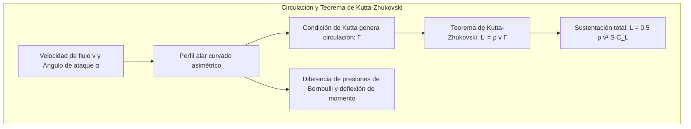
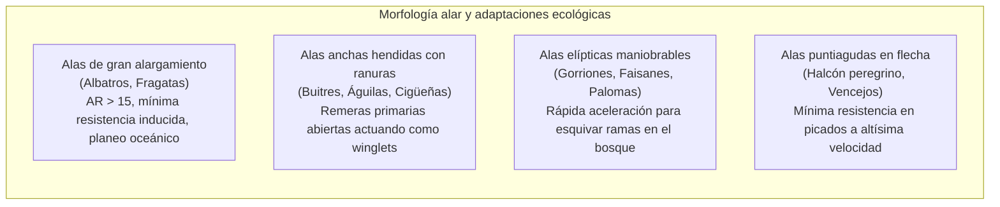
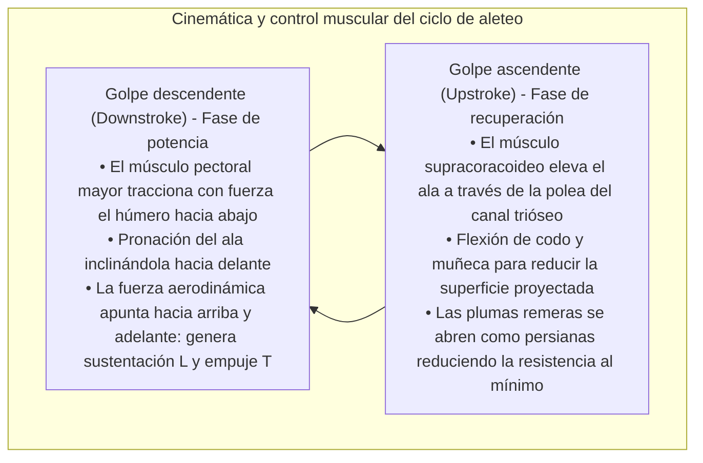
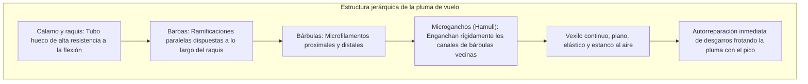
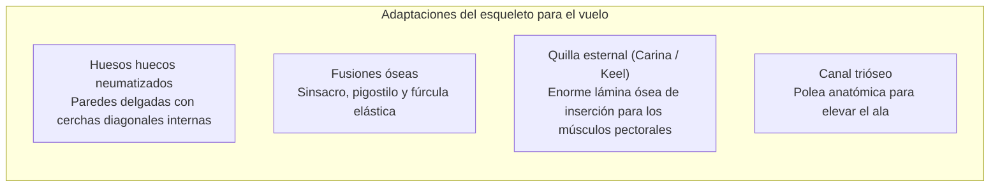
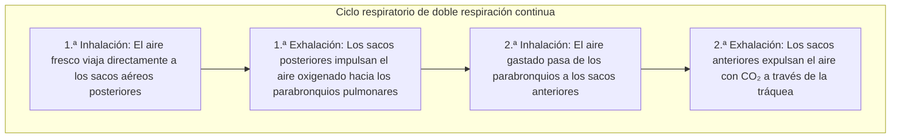
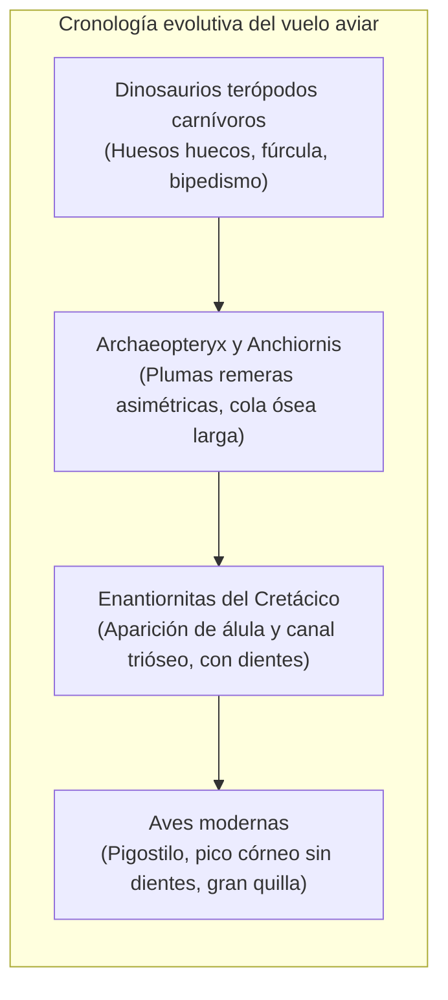

Ya sea el águila real ascendiendo en majestuosas espirales sobre corrientes térmicas, el halcón peregrino cayendo en picado a más de 380 km/h para impactar a su presa, o el albatros errante recorriendo las tempestades del océano Antártico durante años sin mover una sola vez las alas, las aves representan el mayor prodigio aéreo de la naturaleza.

Mientras que la aviación humana a motor cuenta con poco más de un siglo de historia, las aves —únicas supervivientes de los dinosaurios terópodos— comenzaron la conquista del espacio aéreo hace más de 150 millones de años en el Jurásico superior. Han perfeccionado una maniobrabilidad, adaptabilidad aeroelástica y eficiencia energética que ningún avión de combate o dron moderno es capaz de igualar.

El vuelo aviar no es un simple «aleteo de alas». Se trata de <strong>una obra maestra de ingeniería biológica integrada: huesos huecos neumatizados reforzados con cerchas internas, un sistema muscular que funciona como una polea anatómica invertida, plumas con microganchos autorreparables, un aparato respiratorio de sacos aéreos con flujo unidireccional continuo y el control de vórtices no estacionarios de borde de ataque (LEV)</strong>. Este artículo examina minuciosamente la aerodinámica, la anatomía musculoesquelética, la fisiología respiratoria y la historia evolutiva del vuelo de las aves.

---

### 1. Aerodinámica del perfil alar: Sustentación, resistencia inducida y alargamiento

Para contrarrestar la fuerza de gravedad $W = mg$, el ala de un ave debe generar suficiente <strong>sustentación (Lift: $L$)</strong> y vencer la resistencia aerodinámica que frena su avance.

La sección transversal de un ala de ave es un perfil aerodinámico curvado asimétrico (Cambered Airfoil), con un extradós convexo redondeado y un intradós plano o ligeramente cóncavo.



#### Teoría de circulación y ecuación de sustentación
Según el <strong>teorema de Kutta-Zhukovski</strong>, la fuerza de sustentación por unidad de envergadura $L'$ en un fluido es directamente proporcional a la densidad del aire $\rho$, a la velocidad de la corriente $v$ y a la circulación del vórtice ligado $\Gamma$:

$$L' = \rho v \Gamma, \quad L = \frac{1}{2} \rho v^2 S C_L$$

donde $S$ es la superficie alar y $C_L$ el coeficiente de sustentación, condicionado por la curvatura del perfil y el ángulo de ataque $\alpha$.

#### Vórtices de punta de ala y resistencia inducida
El precio ineludible de la sustentación es la <strong>resistencia inducida (Induced Drag: $D_i$)</strong>. El aire de alta presión bajo el intradós escapa por los extremos alares hacia la zona de baja presión del extradós, generando dos vórtices marginales intensos (Wingtip Vortices). Estos inducen una corriente descendente (Downwash: $w$) que desvía el vector de sustentación hacia atrás:

$$D_i = \frac{1}{2} \rho v^2 S C_{Di} = \frac{1}{2} \rho v^2 S \left(\frac{C_L^2}{\pi AR e}\right)$$

En esta expresión, $AR = b^2 / S$ es el <strong>alargamiento alar (Aspect Ratio)</strong> y $e$ es el factor de eficiencia de Oswald. Esto demuestra rigurosamente que <strong>la resistencia inducida es inversamente proporcional al alargamiento $AR$</strong>.



1. <strong>Alas de altísimo alargamiento (Albatros)</strong>: Con valores de $AR = 15 \dots 18$, mitigan al máximo los vórtices marginales, logrando una eficiencia aerodinámica (L/D) superior a 20 para planear sin motor a través de los océanos;
2. <strong>Alas hendidas (Águilas, Buitres)</strong>: Las plumas remeras primarias se separan vertical y lateralmente formando ranuras (Slots). Cada pluma actúa como un micro-winglet independiente que dispersa el gran vórtice en torbellinos menores de rápida disipación;
3. <strong>La álula (Dedo pulgar) como dispositivo hipersustentador</strong>: Formada por 3 a 5 plumas sobre el pulgar, funciona idénticamente a los slats de borde de ataque de los aviones comerciales. Al desplegarse en aterrizajes a baja velocidad, inyecta aire de alta energía sobre el extradós, retrasando la pérdida (Stall) entre 10° y 15°.

---

### 2. Mecánica de fluidos no estacionaria del aleteo y vórtices de borde de ataque

Los aviones separan sustentación (alas fijas) y empuje (motores). Las aves deben <strong>producir sustentación y empuje propulsor simultáneamente</strong> con el mismo par de alas flexibles y deformables.



#### Vórtice de borde de ataque (Leading-Edge Vortex: LEV)
En colibríes y pequeñas aves paseriformes, la aerodinámica estacionaria no logra explicar las colosales fuerzas generadas. Los estudios de velocimetría por imágenes de partículas (PIV) han confirmado que utilizan activamente <strong>mecanismos no estacionarios mediante vórtices de borde de ataque (LEV)</strong>.

Al acelerar el ala hacia abajo con un elevado ángulo de ataque, el flujo se desprende en el borde frontal y se enrolla formando un núcleo arremolinado de baja presión anclado sobre el extradós. La intensa succión producida dispara el coeficiente de sustentación instantáneo $C_L$ a más del doble del límite estático convencional, completando el ciclo antes de que se produzca una pérdida catastrófica.

#### El mecanismo de aplauso y despegue de Weis-Fogh (Clap and Fling)
En despegues verticales repentinos, aves como palomas y patos juntan sus alas sobre la espalda haciéndolas chocar (Clap) y luego abren primero los bordes de ataque (Fling). El aire aspirado bruscamente hacia el hueco genera de inmediato una potente circulación vortical, confiriendo un empuje vertical instantáneo desde velocidad cero.

---

### 3. Planeo dinámico: La extracción energética del albatros

El albatros errante, con una masa de hasta 12 kg y una envergadura de 3,5 metros, cruza los océanos meridionales durante meses sin gastar energía muscular metabólica gracias al <strong>planeo dinámico (Dynamic Soaring)</strong>.

Su fuente de propulsión no son térmicas ascendentes, sino el <strong>gradiente vertical de viento horizontal (Wind Shear: $dU/dz$)</strong> generado por la fricción del aire con la superficie marina.

```mermaid
sequenceDiagram
    autonumber
    participant A as Trayectoria del albatros
    participant U as Capa de viento fuerte superior (25 m/s)
    participant L as Seno de la ola con viento suave (5 m/s)
    A->>U: 1. Picado a favor del viento: Descenso veloz convirtiendo altura y viento en enorme velocidad con respecto al fondo
    A->>L: 2. Viraje entre olas: En la zona de calma protegida por las olas, giro de 180° contra el viento
    A->>U: 3. Trepada contra el viento: Penetración en la capa rápida; el gradiente hace saltar la velocidad relativa (Airspeed) y ganar altura
    A->>U: 4. Viraje en la cima: En la cumbre gira de nuevo a favor del viento para reiniciar el ciclo perpétuo
```

El balance energético demuestra que:

$$\frac{dE}{dt} = -D v_a - m g w_z - m v_{ax} \frac{dU}{dz} \dot{z}$$

Al mantener el término $-v_{ax} \dot{z}$ positivo, la energía absorbida del viento compensa holgadamente el rozamiento del aire ($D v_a$). Además, el albatros posee un <strong>tendón de bloqueo en el hombro (Shoulder-lock tendon)</strong> que inmoviliza mecánicamente el ala abierta sin requerir trabajo muscular activo.

---

### 4. Micro y nanoestructura de las plumas: Resistencia y autorreparación

Las plumas son uno de los materiales compuestos de origen biológico más ligeros, elásticos y tenaces del planeta.



#### Mecanismo de cremallera de los hamuli
Una remera de vuelo posee cientos de miles de bárbulas y millones de microganchos (Hamuli). Frente a turbulencias violentas, los ganchos se deslizan sin romper la queratina. Cuando el ave se acicala con el pico (Preening), los ganchos vuelven a insertarse perfectamente en sus surcos contiguos, comportándose como un velcro microscópico.

#### El vuelo silencioso de los búhos
Los estrígidos han desarrollado tres adaptaciones acústicas singulares:
1. <strong>Dientes de peine en el borde de ataque</strong>: Descomponen los grandes torbellinos de aire en microvórtices silenciosos;
2. <strong>Flecos suaves en el borde de salida</strong>: Suavizan la expulsión del aire evitando el silbido aerodinámico;
3. <strong>Plumón aterciopelado en la superficie</strong>: Absorbe cualquier sonido de fricción entre plumas.

---

### 5. Sistema esquelético y muscular: La máxima ligereza estructural

La anatomía ósea y muscular aviar representa una obra cumbre del diseño mecánico optimizado para minimizar masa y maximizar rigidez.



#### La polea anatómica del canal trióseo
Para situar el centro de gravedad en la posición óptima del abdomen ventral, los músculos propulsores se ubican abajo en el pecho:
- <strong>Pectoral mayor</strong>: Representa entre el 15% y el 25% de la masa del ave y empuja con potencia el húmero hacia abajo;
- <strong>Músculo supracoracoideo</strong>: Se aloja en el fondo del pecho, pero su tendón cruza un orificio óseo —el <strong>canal trióseo</strong> (encrucijada entre coracoides, escápula y clavícula)— que actúa como polea mecánica, invirtiendo la dirección de tracción para elevar el ala hacia arriba desde el pecho.

---

### 6. Sistema respiratorio de sacos aéreos: Motor fisiológico de alta cota

El vuelo requiere la mayor tasa metabólica aeróbica de todos los vertebrados. Mientras un montañero fallece por hipoxia a 8.000 m de altitud sin oxígeno embotellado, el ánsar indio cruza la cordillera del Himalaya a casi 9.000 m aleteando activamente. Esto es posible gracias a su <strong>sistema respiratorio de flujo unidireccional permanente</strong>.



#### Intercambio a contracorriente cruzada (Cross-current)
Los pulmones de las aves son rígidos y no se comprimen ni expanden (Parabronquios); los sacos aéreos actúan como fuelles:
1. <strong>Flujo unidireccional continuo</strong>: Tanto al inhalar como al exhalar, el flujo de aire oxigenado recorre los pulmones siempre en el mismo sentido, sin espacios muertos de gas residual;
2. <strong>Capilares cruzados</strong>: La sangre capilar cruza en ángulo recto la corriente de aire, haciendo que la presión parcial de oxígeno arterial supere incluso a la del gas exhalado, superando ampliamente la eficiencia pulmonar de los mamíferos.

---

### 7. Evolución: De dinosaurios terópodos a las aves modernas

La paleontología moderna ha demostrado que <strong>las aves son dinosaurios terópodos vivientes con plumas</strong>.



#### La hipótesis WAIR (Wing-Assisted Incline Running)
Frente al dilema histórico entre el origen arborícola («desde los árboles hacia abajo») y el corredor («desde el suelo hacia arriba»), Kenneth Dial propuso la <strong>carrera inclinada asistida por alas (WAIR)</strong>: los volantones usan sus alas rudimentarias para pegarse aerodinámicamente a pendientes casi verticales y escalar huyendo de depredadores. Esto confirió un beneficio evolutivo primordial mucho antes de que pudieran sostener un vuelo horizontal completo.

---

### 8. Aeronáutica biomimética: Lecciones biológicas para el futuro

Más de 150 millones de años de evolución natural inspiran las tecnologías del futuro:
1. <strong>Alas morfológicas deformables (Morphing Wings)</strong>: Sustitución de alerones mecánicos rígidos por estructuras continuas con memoria de forma que eliminan la resistencia por discontinuidad;
2. <strong>Winglets en puntas de ala</strong>: Dispositivos inspirados en las plumas primarias abiertas de las águilas que ahorran millones de toneladas de queroseno cada año en aerolíneas comerciales;
3. <strong>Microdrones de aleteo (Flapping MAVs)</strong>: Aprovechan los vórtices de borde de ataque para crear robots espía en miniatura con capacidad de vuelo en interiores o ráfagas extremas.

El vuelo de las aves sigue siendo una de las cumbres de la biomecánica terrestre y una fuente perenne de inspiración tecnológica para la conquista de los cielos y el cosmos.
