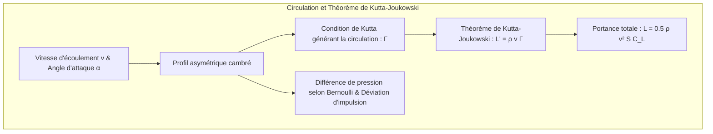
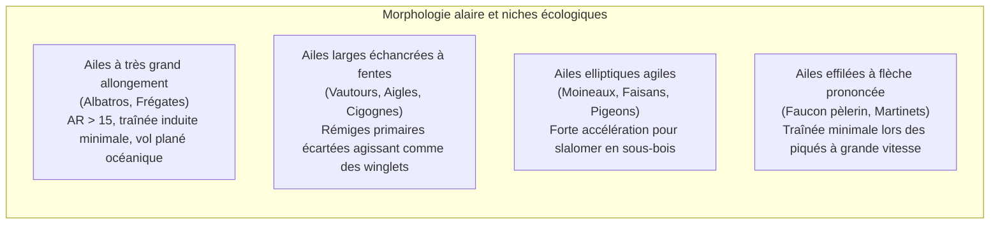
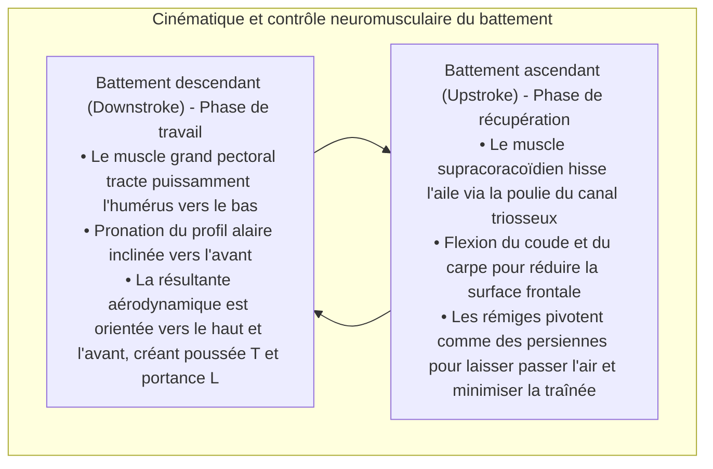
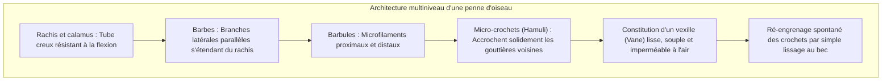
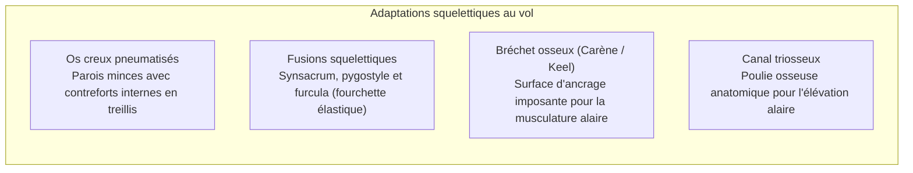
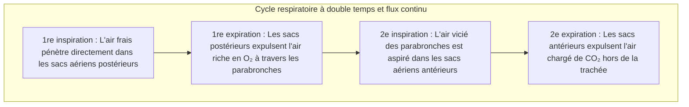
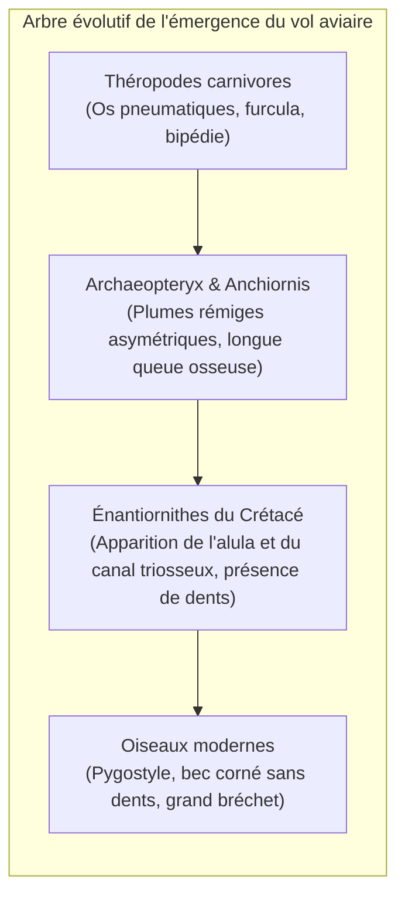

Qu'il s'agisse de l'aigle royal décrivant de majestueuses spirales dans les colonnes thermiques ascendantes, du faucon pèlerin plongeant en piqué à plus de 380 km/h pour frapper sa proie, ou de l'albatros hurleur sillonnant les tempêtes rugissantes de l'océan Austral pendant des années sans donner un seul coup d'aile, les oiseaux ont façonné le plus fabuleux chef-d'œuvre aérien du règne vivant.

Alors que l'aviation humaine motorisée n'a guère plus d'un siècle d'existence, les oiseaux – uniques descendants vivants des dinosaures théropodes – ont entamé la conquête de l'atmosphère dès le Jurassique supérieur, il y a plus de 150 millions d'années. Ils ont acquis une maniabilité, une adaptabilité aéroélastique et un rendement énergétique qu'aucun avion de chasse de pointe ni aucun drone moderne ne parvient à égaler.

Le vol aviaire ne se résume nullement à un simple battement d'ailes. C'est une <strong>véritable merveille d'ingénierie biologique intégrée : un squelette creux pneumatisé renforcé de structures en treillis, un système musculaire fonctionnant comme un palan inversé à poulie osseuse, des plumes à micro-crochets auto-réparatrices, un système respiratoire à sacs aériens assurant un flux gazeux unidirectionnel continu, et la maîtrise subtile des tourbillons instationnaires de bord d'attaque (LEV)</strong>. Cet article propose une analyse approfondie des lois aérodynamiques, des adaptations anatomiques, de la physiologie respiratoire et des origines évolutives du vol des oiseaux.

---

### 1. Aérodynamique du profil alaire : Portance, traînée induite et allongement

Pour se maintenir en équilibre dans les airs contre son propre poids $W = mg$, l'oiseau doit développer une <strong>portance (Lift : $L$)</strong> suffisante tout en minimisant la traînée aérodynamique globale.

La section transversale d'une aile d'oiseau présente un profil cambré asymétrique (Cambered Airfoil), doté d'un extrados convexe régulier et d'un intrados plat à légèrement concave.



#### Circulation et équation de portance
En vertu du <strong>théorème de Kutta-Joukowski</strong> en dynamique des fluides visqueux, la portance générée par unité d'envergure $L'$ est directement proportionnelle à la masse volumique de l'air $\rho$, à la vitesse relative $v$ et à la circulation du tourbillon lié $\Gamma$ :

$$L' = \rho v \Gamma, \quad L = \frac{1}{2} \rho v^2 S C_L$$

où $S$ désigne la surface alaire et $C_L$ le coefficient de portance, régi par la cambrure du profil et l'angle d'incidence $\alpha$.

#### Tourbillons marginaux et traînée induite
La génération de portance impose inévitablement une pénalité physique : la <strong>traînée induite (Induced Drag : $D_i$)</strong>. La surpression sous l'intrados et la dépression sur l'extrados créent un contournement d'air aux extrémités alaires, donnant naissance à deux vortex marginaux rotatifs (Wingtip Vortices). Ceux-ci induisent un puissant flux d'air descendant (Downwash : $w$), qui incline le vecteur de portance vers l'arrière :

$$D_i = \frac{1}{2} \rho v^2 S C_{Di} = \frac{1}{2} \rho v^2 S \left(\frac{C_L^2}{\pi AR e}\right)$$

Dans cette formule, $AR = b^2 / S$ représente l'<strong>allongement (Aspect Ratio)</strong> de l'aile et $e$ le facteur d'efficacité d'Oswald. Cette loi fondamentale prouve que <strong>la traînée induite est strictement inversement proportionnelle à l'allongement $AR$</strong>.



1. <strong>Ailes à grand allongement (Albatros)</strong> : Avec un rapport $AR$ atteignant 15 à 18, l'effet des tourbillons marginaux est quasiment neutralisé, offrant une finesse aérodynamique (L/D) supérieure à 20 pour un vol plané sans moteur à l'échelle planétaire ;
2. <strong>Ailes à rémiges échancrées (Aigles, Vautours)</strong> : Malgré un allongement modéré, les rémiges primaires s'écartent comme des doigts. Chaque plume se comporte comme un micro-winglet indépendant, fractionnant le gros vortex terminal en multiples tourbillons d'intensité réduite ;
3. <strong>L'alula (Faux-pouce) anti-décrochage</strong> : Les 3 à 5 plumes érectiles de l'alula constituent l'homologue parfait des becs de bord d'attaque (Leading-Edge Slats) des avions de ligne. Déployée lors des atterrissages à fort angle d'attaque, l'alula réinjecte de l'air à haute énergie sur l'extrados, retardant le décollement de la couche limite et reculant l'angle de décrochage critique de 10° à 15°.

---

### 2. Dynamique des fluides instationnaire du vol battu et tourbillons de bord d'attaque

Les aéronefs dissocient sustentation (ailes fixes) et propulsion (réacteur ou hélice). L'oiseau, en revanche, doit <strong>engendrer simultanément la portance et la poussée motrice</strong> au moyen de la même paire de voilures flexibles.



#### Le tourbillon de bord d'attaque (Leading-Edge Vortex : LEV)
Pour les petits oiseaux et les colibris opérant à bas nombre de Reynolds, les théories quasi-stationnaires classiques s'avèrent incapables d'expliquer les forces de sustentation mesurées. Les études vélocimétriques par imagerie de particules (PIV) ont démontré qu'ils exploitent de façon prédominante des <strong>phénomènes instationnaires : les tourbillons de bord d'attaque (LEV)</strong>.

Lors d'un abaissement rapide de l'aile à très grand angle d'attaque, le fluide se sépare au bord d'attaque et s'enroule en un cœur tourbillonnaire à très basse pression solidement fixé à l'extrados. Cette aspiration surpuissante catapulte le coefficient de portance instantané $C_L$ à des valeurs 2 à 3 fois supérieures à la limite de décrochage statique, avant que le tourbillon ne se dissipe sans causer de décrochage destructeur.

#### Le mécanisme de « Clap and Fling » (Weis-Fogh)
Lors d'un décollage d'urgence depuis le sol, des oiseaux tels que les pigeons et les canards battent des ailes au-dessus de leur dos jusqu'à les faire s'entrechoquer (Clap), puis séparent précipitamment les bords d'attaque (Fling). L'aspiration d'air dans l'espace intermédiaire engendre instantanément une circulation tourbillonnaire de grande intensité, délivrant une poussée verticale phénoménale à vitesse d'avancement nulle.

---

### 3. Vol à voile dynamique : L'albatros et le gradient de vent océanique

L'albatros hurleur, pesant jusqu'à 12 kg avec 3,5 mètres d'envergure, peut accomplir des périples circumterrestres sans dépenser la moindre goutte d'énergie musculaire métabolique grâce au <strong>vol à voile dynamique (Dynamic Soaring)</strong>.

Le moteur de ce vol n'est pas thermique, mais réside dans le <strong>gradient vertical de vent horizontal (Wind Shear : $dU/dz$)</strong> engendré par la rugosité de la surface marine.

```mermaid
sequenceDiagram
    autonumber
    participant A as Trajectoire de l'albatros
    participant U as Couche de vent fort en altitude (25 m/s)
    participant L as Creux de vague abrité à vent faible (5 m/s)
    A->>U: 1. Plongeon vent arrière : Descente rapide convertissant l'énergie potentielle et l'impulsion du vent en vitesse sol extrême
    A->>L: 2. Virage au ras des vagues : Dans la zone protégée par les crêtes, virage serré à 180° face au vent
    A->>U: 3. Ascension face au vent : Pénétration dans la couche de vent rapide ; le différentiel de vitesse fait bondir la vitesse air (Airspeed) et regagner de l'altitude
    A->>U: 4. Basculement au sommet : Au zénith, virage vent arrière pour amorcer un nouveau cycle énergétique perpétuel
```

L'équation du bilan énergétique confirme que :

$$\frac{dE}{dt} = -D v_a - m g w_z - m v_{ax} \frac{dU}{dz} \dot{z}$$

En maintenant la composante $-v_{ax} \dot{z}$ constamment positive, l'albatros compense intégralement la traînée de frottement de l'air ($D v_a$). De plus, son épaule est pourvue d'un <strong>mécanisme de verrouillage tendineux (Shoulder-lock tendon)</strong> qui bloque passivement l'aile en position déployée, éliminant tout effort musculaire de maintien.

---

### 4. Micro et nanostructure des plumes : Résistance et auto-cicatrisation

Les plumes représentent l'un des biomatériaux composites fibreux les plus légers et les plus résistants de la biosphère.



#### Le mécanisme à fermeture éclair des hamuli
Une rémige primaire abrite des centaines de milliers de barbules et des millions de micro-crochets (Hamuli). Sous une turbulence brutale, les crochets peuvent se décrocher sans déformation plastique ni rupture de la kératine. Lorsque l'oiseau toilette son plumage avec son bec (Preening), les micro-crochets se réengagent automatiquement dans les cannelures adjacentes à la manière d'un ruban Velcro.

#### Le vol silencieux de la chouette
Chassant dans l'obscurité, les strigidés ont développé trois dispositifs aéroacoustiques majeurs :
1. <strong>Dents de peigne au bord d'attaque</strong> : Émiettent les tourbillons cohérents en micro-tourbillons inaudibles ;
2. <strong>Franges souples au bord de fuite</strong> : Atténuent la rupture de pression et le sifflement à l'éjection de l'air ;
3. <strong>Duvet soyeux sur l'extrados</strong> : Absorbe les bruits de frottement inter-pennaires.

---

### 5. Anatomie squelettique et musculaire : Allègement structurel extrême

L'anatomie aviaire est entièrement vouée à la réduction pondérale maximale tout en assurant une rigidité à toute épreuve.



#### Le canal triosseux et la poulie d'élévation de l'aile
Pour stabiliser le centre de gravité au plus bas de l'abdomen, tous les gros muscles moteurs sont regroupés sur le thorax ventral :
- <strong>Le grand pectoral</strong> : Représente 15 à 25 % du poids corporel et abaisse vigoureusement l'humérus ;
- <strong>Le muscle supracoracoïdien</strong> : Logé sous le pectoral, il assure l'élévation de l'aile. Son tendon traverse une cavité osseuse – le <strong>canal triosseux</strong> (formé par la jonction de la scapula, du coracoïde et de la clavicule) – qui agit comme une véritable poulie mécanique de renvoi, convertissant une traction vers le bas en une force d'élévation vers le haut.

---

### 6. Le système respiratoire à sacs aériens : Moteur physiologique de haute altitude

Le vol est le mode de locomotion animale le plus exigeant en oxygène. Alors qu'un être humain perd connaissance à 8 000 m d'altitude sans réserve d'oxygène, l'oie à tête barrée traverse la chaîne de l'Himalaya à près de 9 000 m en plein vol battu. Cela résulte de son <strong>système respiratoire à sacs aériens et flux continu unidirectionnel</strong>.



#### Échangeur gazeux à contre-courant croisé (Cross-current)
Les poumons aviaires sont rigides et indéformables (Parabronches), les sacs aériens faisant office de soufflets :
1. <strong>Flux unidirectionnel permanent</strong> : Que l'oiseau inspire ou expire, le flux d'air oxygéné traverse toujours les poumons dans le même sens, sans zone morte alvéolaire ;
2. <strong>Échange à courant croisé</strong> : Le réseau de capillaires sanguins croise les flux d'air à angle droit, permettant à la pression partielle artérielle en oxygène de surpasser celle de l'air rejeté, surpassant de très loin les performances des poumons des mammifères.

---

### 7. Évolution : Des dinosaures théropodes aux oiseaux modernes

La paléontologie contemporaine a définitivement établi que <strong>les oiseaux sont des dinosaures théropodes vivants</strong>.



#### La théorie WAIR (Wing-Assisted Incline Running)
Entre la théorie arboricole (« de l'arbre vers le bas ») et la théorie coureuse (« du sol vers le haut »), la découverte du <strong>WAIR</strong> par Kenneth Dial a levé le paradoxe : les jeunes oiseaux utilisent leurs ailes primitives non pas pour s'élever, mais pour plaquer leur corps contre des pentes verticales afin d'augmenter l'adhérence de leurs serres. Cette utilisation a procuré un avantage sélectif immédiat bien avant l'avènement du vol battu complet.

---

### 8. Aéronautique biomimétique : Les leçons du vivant pour le futur

Plus de 150 millions d'années d'optimisation naturelle inspirent directement les ingénieurs d'aujourd'hui :
1. <strong>Ailes à géométrie variable (Morphing Wings)</strong> : Utilisation d'alliages à mémoire de forme pour faire varier en continu la cambrure alaire sans ailerons articulés ;
2. <strong>Winglets d'extrémités d'ailes</strong> : Répliques des rémiges fendues des aigles, équipant désormais la quasi-totalité des avions de ligne pour économiser des millions de tonnes de kérosène ;
3. <strong>Micro-drones à ailes battantes (Flapping MAVs)</strong> : Exploitation des tourbillons de bord d'attaque pour créer des micro-engins capables de voler dans des espaces confinés ou face à de violentes rafales.

Le vol des oiseaux reste l'une des réalisations les plus remarquables de la biosphère et continue de guider l'humanité vers les cieux du futur.
