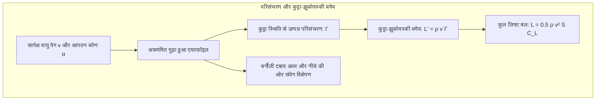
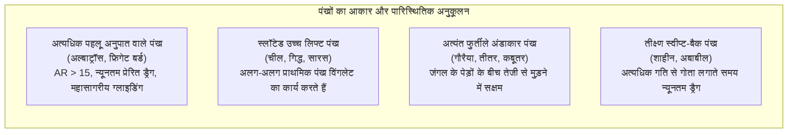
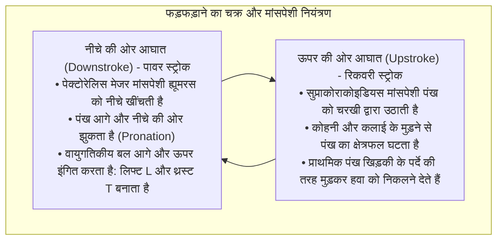
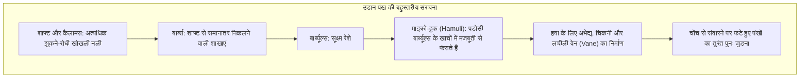
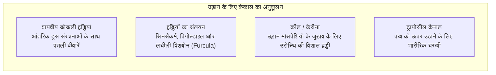
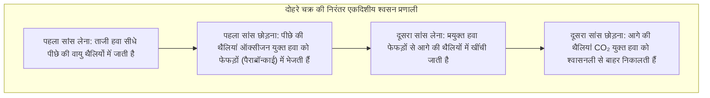
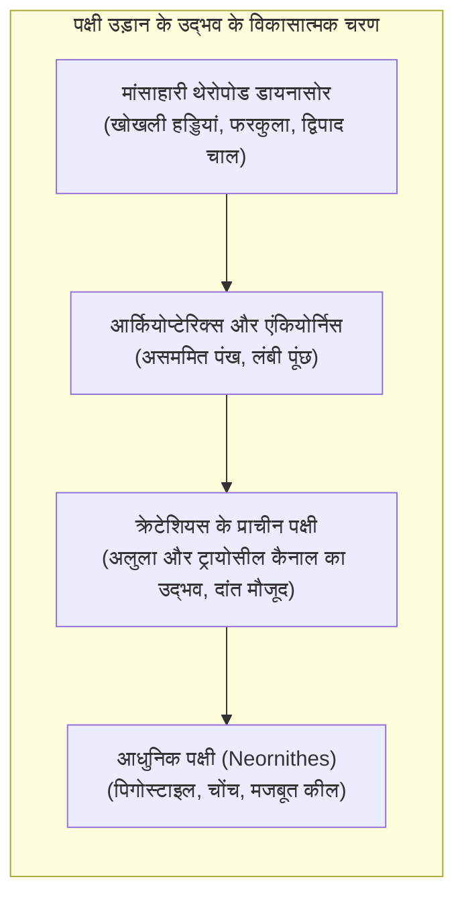

चाहे वह गर्म हवा के थपेड़ों पर शान से चक्कर काटता सुनहरा बाज़ (Golden Eagle) हो, 380 किमी/घंटा से अधिक की रफ्तार से शिकार पर झपट्टा मारने वाला शाहीन (Peregrine Falcon) हो, या दक्षिणी महासागर के तूफानों में बिना एक बार भी पंख फड़फड़ाए वर्षों तक तैरता भटकता अल्बाट्रॉस (Albatross) हो, पक्षी प्रकृति के सबसे अद्भुत और परिपूर्ण वैमानिक चमत्कार हैं।

मानव निर्मित विमानन का इतिहास केवल एक सदी पुराना है, जबकि थेरोपोड डायनासोर (Theropod Dinosaurs) के एकमात्र जीवित वंशज पक्षियों ने 15 करोड़ वर्ष पूर्व जुरासिक काल में ही आकाश पर विजय प्राप्त कर ली थी। उन्होंने गतिशीलता, वायुगतिकीय अनुकूलन और ऊर्जा दक्षता के ऐसे आयाम गढ़े हैं जिनकी बराबरी आधुनिक लड़ाकू विमान या ड्रोन भी नहीं कर सकते।

पक्षियों की उड़ान केवल पंखों को हिलाना नहीं है। यह <strong>जैविक इंजीनियरिंग का एक पूर्ण सामंजस्य है: आंतरिक रूप से सुदृढ़ खोखली हड्डियां, चरखी तंत्र पर आधारित शक्तिशाली मांसपेशियां, सूक्ष्म हुकों से स्वतः जुड़ने वाले पंख, निरंतर एकदिशीय वायु परिसंचरण वाली वायु थैलियां, और अग्रणी भंवर (Leading-Edge Vortex: LEV) का सटीक नियंत्रण</strong>। यह लेख पक्षी उड़ान के वायुगतिकीय, शारीरिक, श्वसन और विकासात्मक आयामों का गहन विश्लेषण करता है।

---

### 1. एयरफ़ॉइल वायुगतिकी: लिफ्ट, प्रेरित ड्रैग और पहलू अनुपात (Aspect Ratio)

हवा में अपने भार $W = mg$ को संतुलित करने के लिए पक्षी के पंखों को पर्याप्त <strong>उत्थापक बल (Lift: $L$)</strong> उत्पन्न करना होता है और वायुगतिकीय खिंचाव (Drag) को पार करना होता है।

पक्षी के पंख का अनुप्रस्थ काट एक आदर्श असममित मुड़ा हुआ एयरफ़ॉइल (Cambered Airfoil) होता है, जिसका ऊपरी हिस्सा उत्तल और निचला हिस्सा समतल या हल्का अवतल होता है।



#### परिसंचरण सिद्धांत और लिफ्ट समीकरण
द्रव यांत्रिकी के <strong>कुट्टा-झुकोवस्की प्रमेय (Kutta-Joukowski Theorem)</strong> के अनुसार, पंख की प्रति इकाई लंबाई पर उत्पन्न लिफ्ट $L'$, वायु के घनत्व $\rho$, उड़ान वेग $v$ और परिसंचरण $\Gamma$ के सीधे आनुपातिक होती है:

$$L' = \rho v \Gamma, \quad L = \frac{1}{2} \rho v^2 S C_L$$

यहाँ $S$ पंख का क्षेत्रफल है और $C_L$ लिफ्ट गुणांक है जो वक्रता और आपतन कोण $\alpha$ पर निर्भर करता है।

#### विंगटिप भंवर और प्रेरित ड्रैग (Induced Drag) का मूल्य
लिफ्ट उत्पन्न करने की अनिवार्य भौतिक कीमत <strong>प्रेरित ड्रैग (Induced Drag: $D_i$)</strong> है। पंख के नीचे का उच्च दबाव छोरों से ऊपर की ओर मुड़कर कम दबाव वाले क्षेत्र में जाता है, जिससे दो शक्तिशाली विंगटिप भंवर बनते हैं। ये भंवर हवा को नीचे की ओर धकेलते हैं (Downwash: $w$), जिससे लिफ्ट वेक्टर पीछे की ओर झुक जाता है:

$$D_i = \frac{1}{2} \rho v^2 S C_{Di} = \frac{1}{2} \rho v^2 S \left(\frac{C_L^2}{\pi AR e}\right)$$

जहाँ $AR = b^2 / S$ पंख का <strong>पहलू अनुपात (Aspect Ratio)</strong> है और $e$ ओसवाल्ड दक्षता कारक है। यह सिद्ध करता है कि <strong>प्रेरित ड्रैग सीधे तौर पर पहलू अनुपात $AR$ के व्युत्क्रमानुपाती होता है</strong>।



1. <strong>अति-उच्च पहलू अनुपात वाले पंख (अल्बाट्रॉस)</strong>: $AR = 15 \dots 18$ के साथ विंगटिप भंवर नगण्य हो जाते हैं, जिससे बिना पंख फड़फड़ाए 20 से अधिक का लिफ्ट-टू-ड्रैग अनुपात मिलता है;
2. <strong>स्लॉटेड पंख (चील, गिद्ध)</strong>: पंखों के छोर पर प्राथमिक पंख उंगलियों की तरह खुल जाते हैं। प्रत्येक पंख एक स्वतंत्र माइक्रो-विंगलेट की तरह काम करता है, जो बड़े भंवर को छोटे-छोटे भंवरों में तोड़कर ड्रैग कम करता है;
3. <strong>अलुला (Alula / अंगूठा पंख)</strong>: पहले अंगूठे पर स्थित 3-5 पंखों का यह समूह आधुनिक विमानों के स्लैट्स (Leading-Edge Slats) की तरह काम करता है। धीमी गति से उतरते समय अलुला को खोलने पर पंख की ऊपरी सतह पर हवा का प्रवाह बना रहता है और स्टॉल कोण 10° से 15° तक बढ़ जाता है।

---

### 2. फड़फड़ाने की गैर-स्थिर द्रव यांत्रिकी और अग्रणी भंवर (LEV)

विमान लिफ्ट (स्थिर पंख) और थ्रस्ट (इंजन) को अलग रखते हैं। पक्षी को एक ही लचीले पंखों के जोड़े से <strong>एक साथ लिफ्ट और आगे बढ़ने का थ्रस्ट</strong> उत्पन्न करना होता है।



#### अग्रणी भंवर (Leading-Edge Vortex: LEV)
कम रेनॉल्ड्स संख्या वाले हमिंगबर्ड और छोटे पक्षियों में पारंपरिक स्थिर वायुगतिकी अत्यधिक लिफ्ट की व्याख्या नहीं कर पाती। पार्टिकल इमेज वेलोसिमेट्री (PIV) अध्ययनों से सिद्ध हुआ है कि वे <strong>अग्रणी भंवर (LEV)</strong> का उपयोग करते हैं।

जब पंख उच्च कोण पर तेजी से नीचे की ओर बढ़ता है, तो हवा सामने के किनारे से अलग होकर एक कम दबाव वाला भंवर बनाती है जो पंख के ऊपर स्थिर रहता है। यह सक्शन प्रभाव लिफ्ट गुणांक $C_L$ को पारंपरिक सीमा से 2 से 3 गुना बढ़ा देता है, और पंख का स्ट्रोक भंवर के बिखरने से पहले ही पूरा हो जाता है।

#### वाइस-फॉग क्लैप-एंड-फ्लिंग तंत्र
जमीन से अचानक सीधी उड़ान भरते समय कबूतर अपनी पीठ के ऊपर दोनों पंखों को आपस में टकराते हैं (Clap) और फिर किनारों को तेजी से खोलते हैं (Fling)। खाली स्थान में हवा का तेजी से खिंचाव शून्य गति पर भी तुरंत शक्तिशाली भंवर उत्पन्न करता है, जिससे तत्काल विशाल लिफ्ट मिलती है।

---

### 3. डायनामिक सोअरिंग: अल्बाट्रॉस का ऊर्जा दोहन चमत्कार

3.5 मीटर पंखों वाला भटकता अल्बाट्रॉस बिना एक बार भी पंख हिलाए महीनों तक दक्षिणी महासागर में उड़ता रह सकता है। इसका रहस्य <strong>डायनामिक सोअरिंग (Dynamic Soaring)</strong> है।

इसकी ऊर्जा का स्रोत गर्म हवा नहीं, बल्कि समुद्री लहरों के घर्षण से उत्पन्न <strong>ऊंचाई के साथ हवा की गति में बदलाव (विंड शियर: $dU/dz$)</strong> है।

```mermaid
sequenceDiagram
    autonumber
    participant A as अल्बाट्रॉस का प्रक्षेपवक्र
    participant U as ऊपरी तेज हवा की परत (25 m/s)
    participant L as लहरों के बीच शांत परत (5 m/s)
    A->>U: 1. हवा के साथ गोता: तेजी से नीचे उतरते हुए हवा के वेग को विशाल ग्राउंड-स्पीड में बदलना
    A->>L: 2. लहर के गर्त में मोड़: लहरों की ओट में सुरक्षित स्थान पर हवा के सामने 180° का तीव्र मोड़
    A->>U: 3. हवा के विपरीत चढ़ाई: तेज हवा की परत में प्रवेश; विंड शियर से एयरस्पीड में भारी उछाल और ऊंचाई की प्राप्ति
    A->>U: 4. शीर्ष पर घुमाव: उच्चतम बिंदु पर पुनः हवा के साथ मुड़ना और अनंत ऊर्जा चक्र जारी रखना
```

यांत्रिक ऊर्जा संतुलन स्पष्ट करता है कि:

$$\frac{dE}{dt} = -D v_a - m g w_z - m v_{ax} \frac{dU}{dz} \dot{z}$$

$-v_{ax} \dot{z}$ को सकारात्मक बनाए रखकर हवा से अवशोषित ऊर्जा ड्रैग के नुकसान ($D v_a$) की पूरी भरपाई कर देती है। इसके अलावा, अल्बाट्रॉस के कंधे में एक <strong>विशेष टेंडन लॉक (Shoulder-lock tendon)</strong> होता है, जो बिना किसी मांसपेशी ऊर्जा के पंखों को खुला लॉक कर देता है।

---

### 4. पंखों की नैनो-संरचना: लचीलापन और स्वतः-मरम्मत

पंख प्रकृति में सबसे हल्के, सबसे मजबूत और थकान-रोधी रेशेदार मिश्रित बायो-मटेरियल्स में से एक हैं।



#### हुकों का वेल्क्रो ज़िपर तंत्र
एक उड़ान पंख में लाखों सूक्ष्म हुक (Hamuli) होते हैं। तेज हवा के झोंकों में ये हुक टूटने के बजाय फिसल जाते हैं। जब पक्षी अपनी चोंच से पंख संवारता है (Preening), तो ये हुक वेल्क्रो की तरह पुनः खांचों में लॉक हो जाते हैं।

#### उल्लू की मूक उड़ान
उल्लू ने शिकार पर चुपके से झपटने के लिए तीन ध्वनिरोधी विशेषताएं विकसित की हैं:
1. <strong>सामने के किनारे पर कंघी जैसी दांतेदार बनावट</strong>: बड़े भंवरों को सूक्ष्म नीरव भंवरों में तोड़ना;
2. <strong>पीछे के किनारे पर कोमल झालर</strong>: हवा के निकास पर सीटी जैसी आवाज को समाप्त करना;
3. <strong>सतह पर मखमली रोएं</strong>: पंखों के आपस में रगड़ने की आवाज को पूरी तरह सोख लेना।

---

### 5. कंकाल और मांसपेशी प्रणाली: जैविक भार न्यूनीकरण का शिखर

पक्षी का कंकाल न्यूनतम वजन में अधिकतम मजबूती के लिए पूरी तरह अनुकूलित है।



#### ट्रायोसील कैनाल और पुली तंत्र
शरीर के गुरुत्वाकर्षण केंद्र को नीचे रखने के लिए सभी मुख्य मांसपेशियां छाती के नीचे स्थित होती हैं:
- <strong>पेक्टोरेलिस मेजर</strong>: शरीर के वजन का 15-25% हिस्सा होती है और पंख को नीचे खींचती है;
- <strong>सुप्राकोराकोइडियस</strong>: पंख को ऊपर उठाती है। इसका टेंडन <strong>ट्रायोसील कैनाल</strong> (कोराकोइड, स्कैपुला और क्लैविकल का जोड़) से होकर गुजरता है, जो एक पुली की तरह काम करके नीचे की मांसपेशी के खिंचाव को ऊपर उठाने वाले बल में बदल देता है।

---

### 6. वायु थैली श्वसन प्रणाली: 9000 मीटर की ऊंचाई पर ऑक्सीजन इंजन

उड़ान कशेरुकियों में सबसे अधिक ऑक्सीजन खपत वाली गतिविधि है। मनुष्य 8,000 मीटर पर बिना ऑक्सीजन के बेहोश हो जाता है, जबकि बार-हेडेड गूज़ (पट्टीदार हंस) हिमालय की 9,000 मीटर ऊंची चोटियों के ऊपर सक्रिय रूप से उड़ते हैं। यह <strong>अविराम एकदिशीय वायु थैली श्वसन प्रणाली</strong> के कारण संभव है।



#### क्रॉस-करंट गैस विनिमय
पक्षियों के फेफड़े स्थिर और कठोर नलिकाएं (Parabronchi) होते हैं; थैलियां धौंकनी का काम करती हैं:
1. <strong>निरंतर एकदिशीय प्रवाह</strong>: सांस अंदर लेते समय और छोड़ते समय, दोनों समय फेफड़ों में ऑक्सीजन युक्त हवा एक ही दिशा में बहती है;
2. <strong>क्रॉस-करंट रक्त वाहिकाएं</strong>: केशिकाएं वायु प्रवाह को समकोण पर काटती हैं, जिससे धमनी रक्त का ऑक्सीजन दबाव छोड़ी गई हवा से भी अधिक हो जाता है, जो स्तनधारियों के फेफड़ों से कहीं अधिक कुशल है।

---

### 7. क्रमिक विकास: थेरोपोड डायनासोर से आधुनिक पक्षियों तक

आधुनिक जीवाश्म विज्ञान ने अकाट्य रूप से सिद्ध किया है कि <strong>पक्षी पंखों वाले जीवित थेरोपोड डायनासोर हैं</strong>।



#### विंग-असिस्टेड इनक्लाइन रनिंग (WAIR)
पेड़ों से नीचे कूदने (Arboreal) या जमीन से दौड़कर उड़ने (Cursorial) के विवाद में केनेथ डायल ने <strong>WAIR परिकल्पना</strong> दी: उड़ने में असमर्थ चूजे खड़ी चट्टानों या पेड़ों पर चढ़ते समय पंखों से उड़ते नहीं हैं, बल्कि पंखों को फड़फड़ाकर अपने शरीर को सतह से सटाए रखते हैं जिससे पैरों की पकड़ मजबूत होती है। इसने उड़ने में सक्षम होने से बहुत पहले ही पंखों के विकास को भारी लाभ प्रदान किया।

---

### 8. बायोमिमेटिक्स: भविष्य की वैमानिकी के लिए पक्षियों की देन

प्रकृति के 15 करोड़ वर्षों के परीक्षण आज के एयरोस्पेस इंजीनियरिंग को प्रेरित कर रहे हैं:
1. <strong>मॉर्फिंग विंग्स (Morphing Wings)</strong>: कठोर फ्लैप्स के बजाय लचीले पंख जो पक्षियों की तरह आकार बदलते हैं;
2. <strong>विंगलेट्स (Winglets)</strong>: चील के प्राथमिक पंखों की नकल, जो हर साल दुनिया भर के विमानों का अरबों डॉलर का ईंधन बचाती है;
3. <strong>माइक्रो फ्लैपिंग ड्रोन (Flapping MAVs)</strong>: सीमित जगहों में उड़ने वाले सूक्ष्म टोही ड्रोन के लिए अग्रणी भंवर (LEV) का उपयोग।

पक्षियों की उड़ान प्राकृतिक चयन की सबसे भव्य गाथा है और मानव के अंतरिक्ष और आकाश को जीतने के सपनों के लिए शाश्वत प्रेरणा है।
