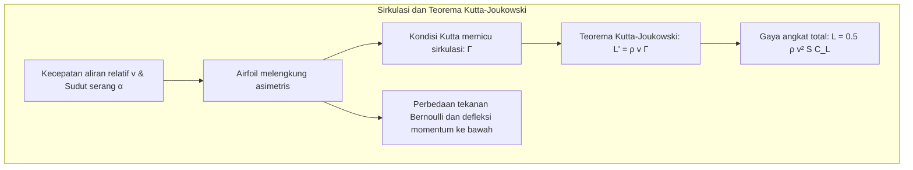
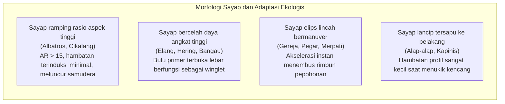
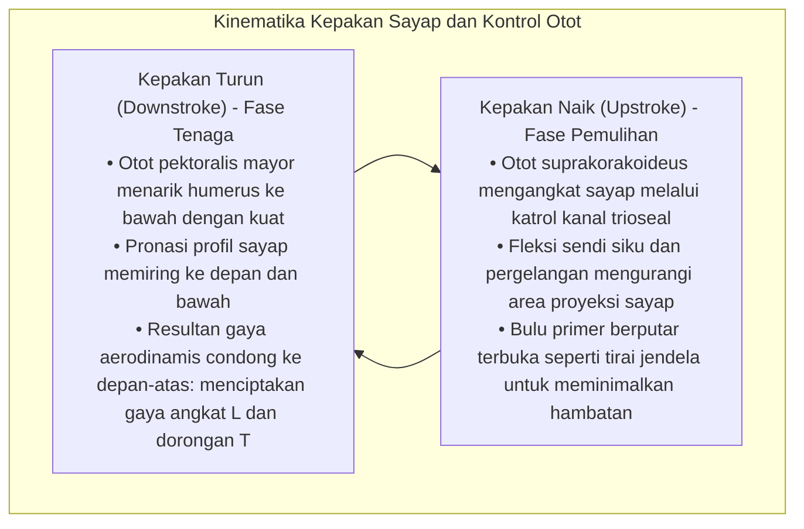
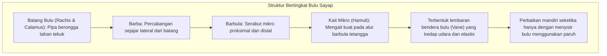
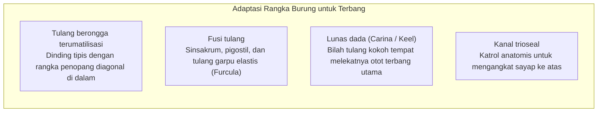
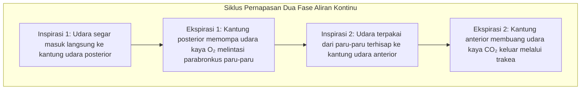
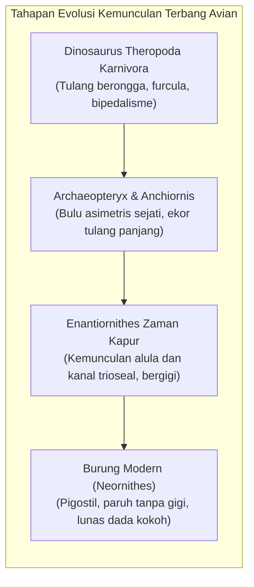

Baik elang emas yang berputar megah di kolom udara hangat termal, alap-alap kawah (falcon) yang menukik dengan kecepatan melampaui 380 km/jam untuk menyambar mangsa, atau albatros pengelana yang menjelajahi badai Samudra Selatan selama bertahun-tahun tanpa sekali pun mengepakkan sayap, burung adalah mahakarya penerbangan alami terhebat di planet Bumi.

Sementara sejarah penerbangan manusia bermotor baru berusia sekitar satu abad, burung — satu-satunya keturunan dinosaurus theropoda yang masih hidup — telah memulai penaklukan angkasa sejak periode Jura akhir lebih dari 150 juta tahun yang lalu. Mereka mengembangkan kelincahan luar biasa, adaptabilitas aeroelastik, dan efisiensi energi yang belum mampu ditandingi oleh jet tempur tercanggih sekalipun.

Terbangnya burung bukanlah sekadar gerakan "mengepakkan sayap". Ini adalah <strong>mahakarya teknik biologis terintegrasi: tulang berongga terumatilisasi dengan struktur rangka penopang internal, sistem otot berkerekan tulang terbalik, bulu dengan kait mikro yang mampu memperbaiki diri secara mandiri, sistem pernapasan kantung udara dengan aliran satu arah kontinu, serta pengendalian vorteks tepi depan (Leading-Edge Vortex: LEV)</strong>. Artikel ini mengupas tuntas aerodinamika, anatomi muskuloskeletal, fisiologi pernapasan, dan sejarah evolusi penerbangan burung.

---

### 1. Aerodinamika Airfoil Sayap: Gaya Angkat, Hambatan Terinduksi, dan Rasio Aspek

Untuk menahan berat tubuhnya sendiri $W = mg$, sayap burung harus menghasilkan <strong>gaya angkat (Lift: $L$)</strong> yang cukup sembari meminimalkan hambatan aerodinamis (drag).

Penampang melintang sayap burung membentuk airfoil melengkung asimetris alami (Cambered Airfoil) dengan permukaan atas cembung mulus dan permukaan bawah datar hingga sedikit cekung.



#### Teori Sirkulasi dan Persamaan Gaya Angkat
Berdasarkan <strong>teorema Kutta-Joukowski</strong> dalam dinamika fluida, gaya angkat per satuan rentang sayap $L'$ berbanding lurus dengan massa jenis udara $\rho$, kecepatan relatif $v$, dan sirkulasi vorteks terikat $\Gamma$:

$$L' = \rho v \Gamma, \quad L = \frac{1}{2} \rho v^2 S C_L$$

dengan $S$ menyatakan luas proyeksi sayap dan $C_L$ koefisien gaya angkat yang dipengaruhi kelengkungan profil serta sudut serang $\alpha$.

#### Vorteks Ujung Sayap dan Kerugian Hambatan Terinduksi (Induced Drag)
Konsekuensi fisik dari pembentukan gaya angkat adalah munculnya <strong>hambatan terinduksi (Induced Drag: $D_i$)</strong>. Udara bertekanan tinggi di bawah sayap bergulung melintasi ujung sayap menuju area bertekanan rendah di atas sayap, membentuk sepasang vorteks ujung sayap yang kuat (Wingtip Vortices). Vorteks ini memicu aliran udara ke bawah (Downwash: $w$) yang memiringkan vektor gaya angkat ke belakang:

$$D_i = \frac{1}{2} \rho v^2 S C_{Di} = \frac{1}{2} \rho v^2 S \left(\frac{C_L^2}{\pi AR e}\right)$$

di mana $AR = b^2 / S$ adalah <strong>rasio aspek sayap (Aspect Ratio)</strong> dan $e$ faktor efisiensi Oswald. Persamaan ini membuktikan secara matematis bahwa <strong>hambatan terinduksi berbanding terbalik secara ketat dengan rasio aspek $AR$</strong>.



1. <strong>Sayap Rasio Aspek Tinggi (Albatros)</strong>: Dengan rasio $AR = 15 \dots 18$, pengaruh vorteks ujung sayap sangat ditekan, menghasilkan rasio gaya angkat terhadap hambatan (L/D) melampaui 20 untuk meluncur tanpa mesin di atas samudera;
2. <strong>Sayap Celah Primer (Elang, Burung Bangkai)</strong>: Pada rasio aspek sedang, bulu primer ujung sayap merenggang membentuk celah (Slots). Setiap bulu berfungsi sebagai winglet mikro mandiri yang memecah vorteks tunggal besar menjadi pusaran-pusaran kecil yang lekas menghilang;
3. <strong>Alula (Sayap Jempol)</strong>: Terdiri dari 3–5 bulu kecil di atas ibu jari, bertindak persis seperti bilah tepi depan (Leading-Edge Slats) pesawat komersial. Ketika mekar saat mendarat pada sudut serang tinggi, alula menyuntikkan aliran udara berenergi tinggi ke permukaan atas sayap, menunda separasi aliran dan mencegah stall hingga 10°–15°.

---

### 2. Mekanika Fluida Tak Tunak pada Kepakan Sayap dan Vorteks Tepi Depan

Pesawat memisahkan gaya angkat (sayap tetap) dan daya dorong (mesin). Burung, di sisi lain, harus <strong>menghasilkan gaya angkat dan gaya dorong secara simultan</strong> dengan sepasang sayap fleksibel yang sama.



#### Vorteks Tepi Depan (Leading-Edge Vortex: LEV)
Pada burung kecil dan kolibri yang beroperasi pada bilangan Reynolds rendah, teori aerodinamika tunak konvensional gagal menjelaskan besarnya gaya angkat yang dihasilkan. Penelitian menggunakan Particle Image Velocimetry (PIV) membuktikan bahwa mereka memanfaatkan <strong>mekanisme tak tunak berupa Vorteks Tepi Depan (LEV)</strong>.

Saat sayap berakselerasi turun dengan sudut serang sangat tinggi, aliran udara terlepas di tepi depan dan menggulung membentuk pusaran inti bertekanan rendah yang menempel kuat di permukaan atas sayap. Isapan kuat ini melipatgandakan koefisien gaya angkat $C_L$ hingga 2–3 kali batas stall statis konvensional sebelum kepakan selesai dan vorteks dilepaskan secara aman.

#### Mekanisme Tepuk-Buka Weis-Fogh (Clap and Fling)
Saat lepas landas vertikal mendadak dari tanah, burung merpati dan bebek menepukkan kedua sayap di atas punggung (Clap), lalu membuka tepi depan sayap secara tiba-tiba (Fling). Udara yang tersedot masuk ke celah seketika menciptakan sirkulasi vorteks berkekuatan tinggi sebelum sayap bergerak maju, menghasilkan lonjakan gaya angkat vertikal instan dari kecepatan nol.

---

### 3. Meluncur Dinamis: Pemanfaatan Energi Angin oleh Albatros

Albatros pengelana berbobot hingga 12 kg dengan rentang sayap 3,5 meter mampu mengarungi Samudra Selatan selama berbulan-bulan tanpa menghabiskan energi metabolik berkat <strong>meluncur dinamis (Dynamic Soaring)</strong>.

Sumber energinya bukan kolom udara hangat yang naik, melainkan <strong>gradien vertikal kecepatan angin horizontal (Wind Shear: $dU/dz$)</strong> akibat gesekan udara dengan permukaan ombak laut.

```mermaid
sequenceDiagram
    autonumber
    participant A as Lintasan Burung Albatros
    participant U as Lapisan Angin Kencang Atas (25 m/s)
    participant L as Lembah Ombak Angin Tenang (5 m/s)
    A->>U: 1. Menukik Mengikuti Angin: Meluncur turun cepat mengubah ketinggian dan dorongan angin menjadi kecepatan tanah tinggi
    A->>L: 2. Memutar di Lembah Ombak: Di zona terlindung ombak yang tenang, berbelok tajam 180° menghadap arah angin
    A->>U: 3. Menanjak Menentang Angin: Melesat naik menembus lapisan angin kencang; gradien angin melipatgandakan kecepatan relatif udara (Airspeed) dan mengembalikan ketinggian
    A->>U: 4. Balik Arah di Puncak: Di titik tertinggi berputar kembali searah angin untuk memulai siklus energi tanpa henti
```

Persamaan energi mekanik menegaskan bahwa:

$$\frac{dE}{dt} = -D v_a - m g w_z - m v_{ax} \frac{dU}{dz} \dot{z}$$

Dengan menjaga $-v_{ax} \dot{z}$ tetap positif, energi yang diserap dari geseran angin mengimbangi sepenuhnya hambatan gesek udara ($D v_a$). Selain itu, bahu albatros memiliki <strong>tendon pengunci pasif (Shoulder-lock tendon)</strong> yang mengunci sayap tetap terbentang tanpa perlu kontraksi otot berkelanjutan.

---

### 4. Mikrostruktur Bulu: Ketangguhan dan Mekanisme Perbaikan Mandiri

Bulu merupakan salah satu material komposit biologis berbasis serat paling ringan, elastis, dan tahan lelah di alam semesta.



#### Mekanisme Ritsleting Kait Hamuli
Satu helai bulu primer memiliki ratusan ribu barbula dan jutaan kait mikroskopis (Hamuli). Saat menghadapi hembusan turbulensi kencang, kait-kait ini bergeser tanpa mematahkan keratin. Ketika burung merapikan bulu dengan paruhnya (Preening), kait mikro secara otomatis terpasang kembali ke alur pasangannya persis seperti pita perekat Velcro.

#### Terbang Senyap Burung Hantu
Burung hantu mengembangkan tiga adaptasi akustik peredam suara:
1. <strong>Gerigi sisir di tepi depan</strong>: Memecah vorteks turbulen besar menjadi pusaran mikro tak bersuara;
2. <strong>Rumbai halus di tepi belakang</strong>: Menghilangkan desisan tajam saat udara meninggalkan sayap;
3. <strong>Bulu beludru di permukaan atas</strong>: Menyerap gesekan antarbulu secara total.

---

### 5. Sistem Rangka dan Otot: Rekayasa Bobot Ringan Ekstrem

Kerangka dan otot burung dioptimalkan untuk meminimalkan massa tubuh tanpa mengorbankan ketahanan struktural.



#### Kanal Trioseal dan Katrol Terbalik
Untuk menjaga pusat massa tetap rendah, otot pengangkat maupun penurun sayap terpusat di dada bawah:
- <strong>Pektoralis mayor</strong>: Mencapai 15–25% bobot tubuh, menarik humerus ke bawah dengan sangat bertenaga;
- <strong>Suprakorakoideus</strong>: Terletak di bawah pektoralis, bertugas mengangkat sayap. Tendonnya melewati lubang tulang — <strong>kanal trioseal</strong> (pertemuan korakoid, skapula, dan klavikula) — yang bekerja layaknya kerekan katrol, membalikkan arah tarikan otot dada bawah menjadi gaya angkat sayap ke atas.

---

### 6. Sistem Kantung Udara: Mesin Oksigen di Ketinggian Ekstrem

Terbang adalah aktivitas metabolik aerobik paling intensif di kalangan vertebrata. Manusia akan pingsan karena hipoksia di ketinggian 8.000 m tanpa tabung oksigen, sedangkan angsa berkepala garis (Bar-headed Goose) mampu melintasi pegunungan Himalaya pada ketinggian hampir 9.000 m dengan kepakan sayap aktif. Ini dimungkinkan berkat <strong>sistem pernapasan kantung udara aliran satu arah kontinu</strong>.



#### Pertukaran Gas Arus Silang (Cross-current)
Paru-paru burung tidak mengembang atau mengempis (Parabronkus kaku), dengan kantung udara berfungsi sebagai peniup:
1. <strong>Aliran satu arah kontinu</strong>: Baik saat menghirup maupun mengembuskan napas, udara kaya oksigen selalu mengalir melalui paru-paru ke arah yang sama tanpa ruang mati sisa udara;
2. <strong>Pembuluh darah arus silang</strong>: Kapiler darah memotong aliran udara secara tegak lurus, membuat tekanan parsial oksigen darah arteri melampaui udara yang diembuskan, jauh melampaui efisiensi paru-paru mamalia.

---

### 7. Evolusi: Dari Dinosaurus Theropoda Menuju Burung Modern

Paleontologi modern telah membuktikan secara meyakinkan bahwa <strong>burung adalah dinosaurus theropoda berbulu yang masih bertahan hidup</strong>.



#### Hipotesis WAIR (Wing-Assisted Incline Running)
Dalam debat panjang antara teori pohon-ke-bawah (Arboreal) dan tanah-ke-atas (Cursorial), Kenneth Dial mencetuskan <strong>WAIR</strong>: anak burung menggunakan sayap bukan untuk terbang melayang, melainkan untuk menekan tubuh secara aerodinamis ke lereng curam atau batang pohon saat berlari menghindari pemangsa. Mekanisme ini memberikan keuntungan adaptif nyata sebelum burung mampu terbang penuh di udara.

---

### 8. Biomimetika Penerbangan: Pelajaran Alami untuk Teknologi Masa Depan

Evolusi selama 150 juta tahun menginspirasi rekayasa kedirgantaraan masa depan:
1. <strong>Sayap Morfing (Morphing Wings)</strong>: Menggantikan sirip kaku dengan material lentur adaptif yang meniru kelenturan sayap burung;
2. <strong>Winglet Ujung Sayap</strong>: Meniru bulu primer elang yang terbuka, menghemat jutaan ton bahan bakar penerbangan dunia setiap tahun;
3. <strong>Drone Kepak Mikro (Flapping MAV)</strong>: Memanfaatkan vorteks tepi depan untuk menciptakan robot terbang mikro yang stabil di ruang sempit dan angin kencang.

Terbangnya burung adalah bukti kemegahan biologi evolusi dan sumber inspirasi abadi bagi manusia untuk terus menjelajah angkasa dan antariksa.
