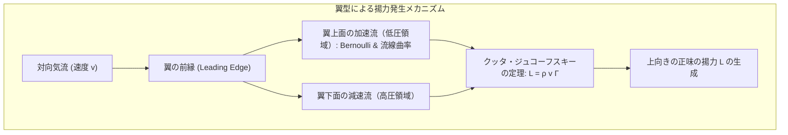
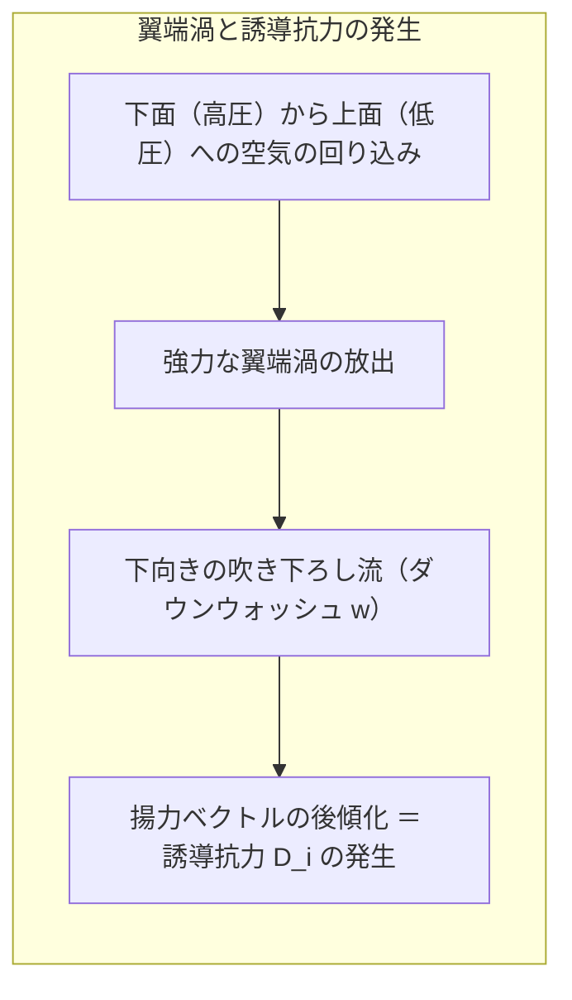
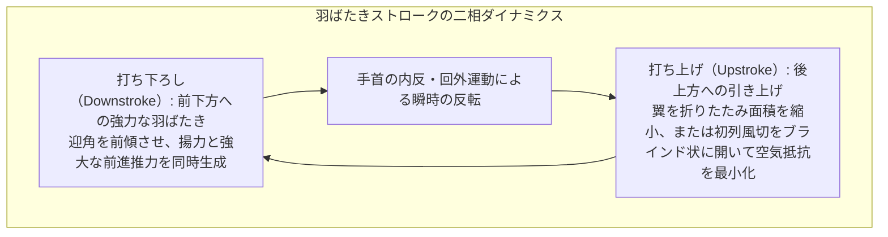
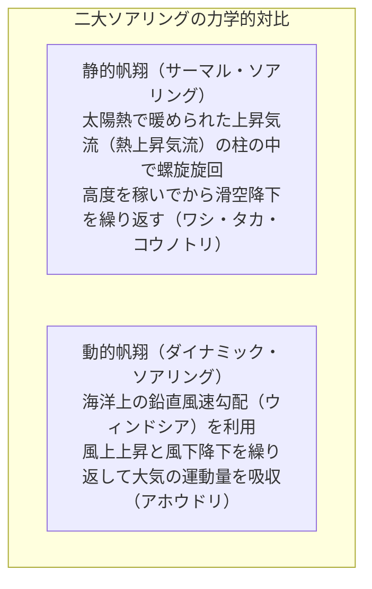
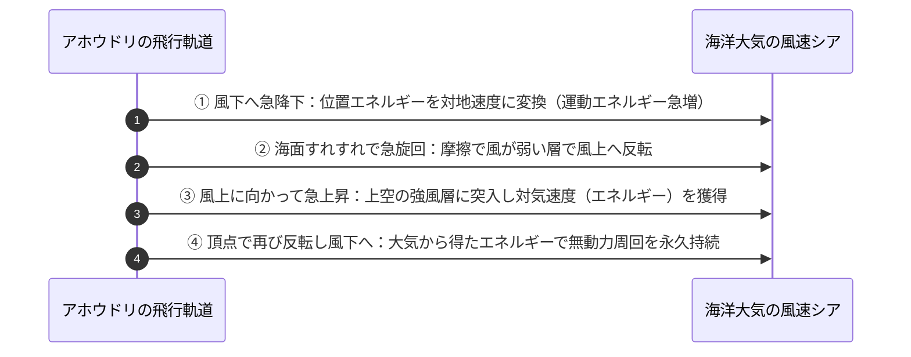
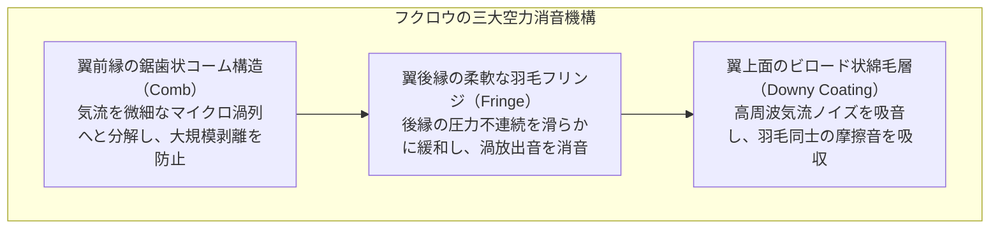
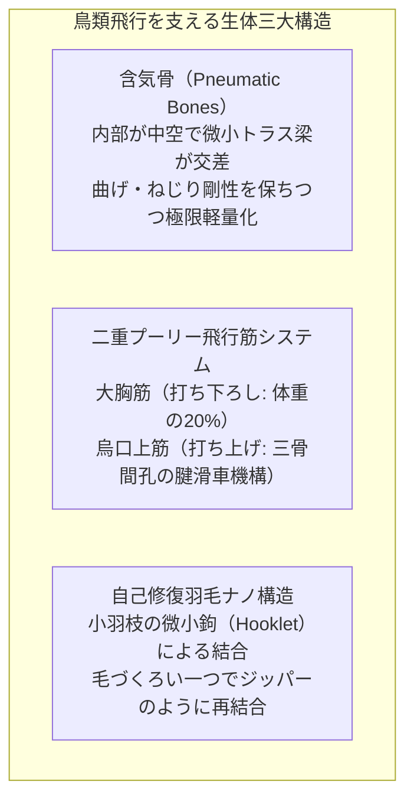
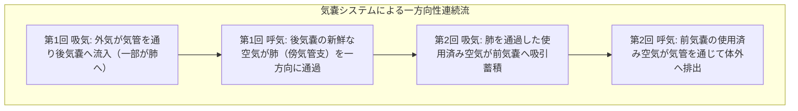
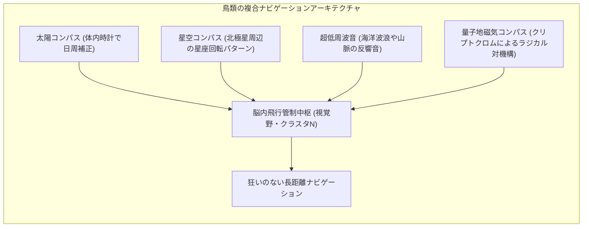
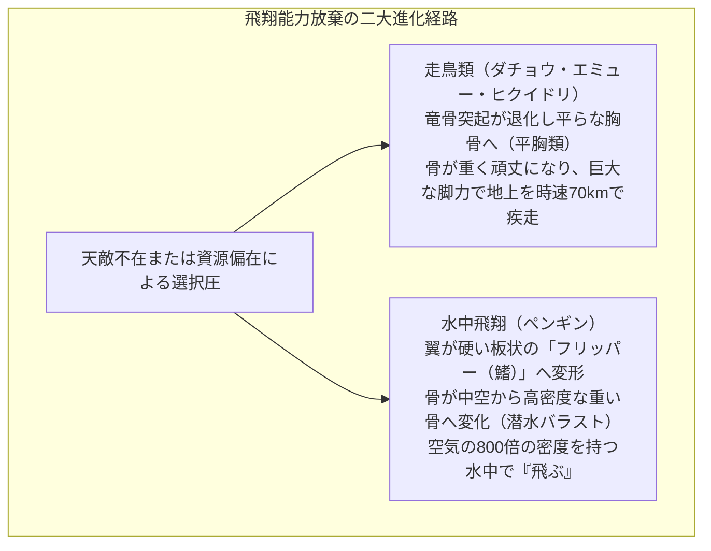

大空を滑るように旋回するトビ、時速380キロメートルを超える猛烈な急降下で獲物を捕らえるハヤブサ、羽ばたくことなく絶海の強風を利用して地球を何周も旅するアホウドリ、そして空中で静止（ホバリング）しながら花蜜を吸うハチドリ。

人類が動力飛行機を発明したのはわずか100余年前の1903年（ライト兄弟）にすぎない。しかし鳥類は、今から1億5000万年前のジュラ紀後期（始祖鳥の時代）から連綿と空へと適応し、現代のいかなる最新鋭戦闘機やドローンすら足元に及ばない、驚異的な柔軟性・効率性・機動性を備えた生体飛行システムを完成させた。

日常の中でスズメやカラスの飛翔を見るとき、私たちは「翼があるから飛べる」と単純に片付けがちである。しかし物理学と生物学の視点から見つめ直すとき、そこには<strong>「極限まで削ぎ落とされた超軽量中空トラス骨格」「体重の数割を占める強大な筋肉と滑車状の腱配置」「ナノメートル精度の面ファスナー構造を持つ羽毛」「吸気と呼気の双方向で酸素を取り込み続ける一方向気嚢呼吸システム」、そして「非定常剥離渦を意図的に操る高度な非定常空気力学」</strong>が完璧に統合された、生命工学の究極の奇跡が存在する。

鳥類はどのようにして重力に打ち勝ち、空気という不可視の流体を掴んで前進するのか。翼の流体力学から骨格・呼吸の生体力学、渡りのナビゲーション、そして飛翔能力をあえて捨て去った鳥たちの進化まで、鳥類飛行の全貌を徹底的に掘り下げていく。

---

### 1. 翼と空気力学の物理：揚力と抗力の発生メカニズム

鳥が空中に留まるための第一の条件は、自重（重力 $W = mg$）と釣り合う上向きの<strong>「揚力（Lift: $L$）」</strong>を生み出すことである。

航空機の固定翼と同様に、鳥の翼の断面は上側が滑らかに盛り上がり、下側が平らまたはわずかに凹んだ<strong>「翼型（Airfoil / キャンバー構造）」</strong>をしている。

#### クッタ・ジュコーフスキーの定理と循環 $\Gamma$
翼が前進速度 $v$ で空気中を移動するとき、流体力学における<strong>クッタの条件（Kutta Condition）</strong>により、翼の後縁（Trailing Edge）から滑らかに気流が剥離することなく流出する。このとき、翼の周囲には仮想的な空気の渦回転、すなわち<strong>「循環（Circulation: $\Gamma$）」</strong>が誘起される。

流体の密度を $\rho$、飛行速度を $v$ とすると、翼の単位スパンあたりに発生する揚力 $L'$ は、<strong>クッタ・ジュコーフスキーの定理</strong>によって厳密に表される：

$$L' = \rho v \Gamma$$

循環 $\Gamma$ は翼の迎角（Angle of Attack: $\alpha$）とキャンバー（反り）によって増大する。翼全体の揚力 $L$ は、無次元の揚力係数 $C_L$、動圧 $q = \frac{1}{2}\rho v^2$、および翼面積 $S$ を用いて記述される：

$$L = \frac{1}{2} \rho v^2 S C_L$$

鳥が水平巡航飛行を行うためには、$L = mg$（揚力＝体重）が成立しなければならない。低速で飛ぶときは迎角 $\alpha$ を大きくして $C_L$ を稼ぎ、高速で急降下するときは翼をすぼめて面積 $S$ と $C_L$ を最小化して空気抵抗を減らす。

#### 誘導抗力とアスペクト比の力学
しかし、揚力を発生させると同時に、物理法則は必然的に代償を要求する。それが<strong>「誘導抗力（Induced Drag: $D_i$）」</strong>である。

翼の下面は高圧、上面は低圧であるため、翼の先端（翼端）において、高圧側から低圧側へと空気が回り込もうとする。この漏れ出し流れによって、翼端の後方には猛烈な<strong>「翼端渦（Wingtip Vortex）」</strong>が形成される。

翼端渦は翼全体に下向きの流れ（ダウンウォッシュ: $w$）を誘起し、見かけの揚力ベクトルを後方へと傾かせる。この後方成分こそが誘導抗力である：

$$D_i = \frac{L^2}{\frac{1}{2} \rho v^2 \pi b^2 e} = \frac{1}{2} \rho v^2 S \frac{C_L^2}{\pi AR e}$$

ここで $b$ は翼幅（スパン）、$AR = b^2 / S$ は<strong>アスペクト比（縦横比）</strong>、$e$ はオズワルド効率係数である。
この式は、<strong>「アスペクト比 $AR$ が大きい（細長く伸びた）翼ほど、翼端渦の影響が相対的に小さくなり、誘導抗力が激減する」</strong>という決定的法則を示している。

鳥類の翼の形状は、この空気力学の制約のもとで劇的に分化・適応した：

| 翼のタイプ | アスペクト比 | 代表的な鳥類 | 空気力学的特徴と生態的利点 |
| :--- | :--- | :--- | :--- |
| <strong>高アスペクト比翼（長大翼）</strong> | 極めて高い（15〜20） | アホウドリ、ミズナギドリ | 誘導抗力が極小。強風の海洋上空を羽ばたかずに無限に滑空する動的帆翔に特化。 |
| <strong>高揚力スロット翼（広幅翼）</strong> | 中程度（6〜8） | ワシ、タカ、コウノトリ | 翼端の初列風切羽が指のように分離（フィンガー構造）。個々の小羽がミニチュア小翼として機能し、翼端渦を分散・弱化させて低速上昇気流旋回を可能にする。 |
| <strong>高速尖頭翼（後退翼）</strong> | 高〜中（8〜11） | ハヤブサ、アマツバメ | 翼端が尖り、有害抗力と誘導抗力のバランスが最適。高速追尾や急降下に特化。 |
| <strong>短小楕円翼（低アスペクト比翼）</strong>| 低い（3〜5） | キジ、スズメ、カラス | 森林や藪の中を俊敏に旋回・急発進するための機動性特化型。瞬間的加速力に優れる。 |

#### 小翼羽（アルラ: Alula）と前縁スラット
鳥の親指に相当する部位には、数本の小さな羽からなる<strong>「小翼羽（アルラ）」</strong>が存在する。
着陸直前や低速旋回時、迎角を大きくすると翼上面で気流が剥離して「失速（Stall）」を起こし、揚力を失って墜落する危険が生じる。

このとき鳥は親指を前方に突き出し、小翼羽と主翼の間に狭い隙間（スロット）を形成する。高圧の下面気流がこのスロットを通過して加速され、翼上面の境界層に高エネルギーを吹き込むことで、気流の剥離を劇的に遅らせる。これは現代の旅客機が主翼前縁に装備する<strong>前縁スラット（Leading Edge Slat）</strong>と完全に同一の流体力学原理である。

#### 翼面荷重（Wing Loading）と失速速度の物理学
飛行特性を決定づけるもう一つの根源的な航空力学的指標が<strong>「翼面荷重（$W/S = mg/S$）」</strong>である。
最小失速速度 $v_{\text{stall}}$ は、定常水平飛行における揚力方程式 $mg = \frac{1}{2}\rho v^2 S C_{L,\max}$ を速度について解くことで導かれる：

$$v_{\text{stall}} = \sqrt{\frac{2 mg}{\rho S C_{L,\max}}} = \sqrt{\frac{2}{\rho C_{L,\max}} \left(\frac{W}{S}\right)}$$

この物理関係式は、<strong>「翼面荷重 $W/S$ が小さい鳥ほど、極めて低い飛行速度でも失速せずに浮き続けられる」</strong>ことを示している。
フクロウやチュウヒのように翼面積が広く体重が軽い鳥は、翼面荷重が $20\sim 30\,\mathrm{N/m^2}$ と極めて小さく、自転車ほどの微速で静かに獲物を探索できる。一方、アホウドリや白鳥、潜水性海鳥（ウミスズメなど）は翼面荷重が $100\sim 200\,\mathrm{N/m^2}$ に達するため、離陸時には水面や向かい風の中を何十メートルも助走して猛烈に加速しなければ失速速度を突破できない。

---

### 2. 羽ばたき飛行（Flapping Flight）の非定常空気力学

固定翼機と鳥類の最大の違いは、鳥類が翼を羽ばたかせることで<strong>「揚力」と「推進力（推力: Thrust）」を同時に、かつ同一の翼面で発生させている</strong>点にある。

羽ばたきは単なる上下動ではない。翼の付け根（肩関節）、肘、手首が連動し、翼の断面形状や迎角、キャンバーを1ストロークの中で三次元的かつミリ秒単位でダイナミックに変化させる高度なキネマティクス（運動学）である。

#### 打ち下ろし（Downstroke）：主推進力の生成
打ち下ろし時、翼は大胸筋の収縮によって「前下方」に向かって振り下ろされる。
翼面の前進速度 $v_{\text{forward}}$ と下向き速度 $v_{\text{down}}$ の合成により、翼が受ける相対風は斜め前方下部から吹き付ける。鳥は翼の前縁をわずかに下向きにピッチング（前傾）させることで、発生する空気力ベクトルを「斜め前方上向き」へと傾ける。
このベクトルの鉛直上向き成分が<strong>揚力</strong>となり、水平前方成分が機体を加速させる<strong>推力</strong>となる。

#### 打ち上げ（Upstroke）：負の仕事の最小化
打ち上げ時に翼をそのまま引き上げると、逆向きの下向き揚力とブレーキ抗力が発生してしまう。鳥はこの「負の仕事」を回避するために二つの見事なメカニズムを使い分ける：

1. <strong>翼の折りたたみ（小型〜中型鳥類）</strong>：手首と肘を曲げて翼幅を縮小し、受風面積を半分以下にして素早く引き上げる。
2. <strong>フェザリングとスリット開口</strong>：羽毛の重なりが外向きに設計されており、打ち下ろし時は羽毛同士が密着して空気を逃さないが、打ち上げ時には初列風切羽がブラインドの羽根のように回転してスリットを開き、空気を後方に素通りさせる。

#### 非定常渦力学：前縁渦（LEV）の驚異
近年の高速度カメラと粒子画像流速測定法（PIV）による研究は、鳥類（特にハチドリや小型渡り鳥）が従来の準定常航空力学の限界（静的失速限界 $C_{L,\max} \approx 1.5$）をはるかに超える揚力を生み出していることを明らかにした。

翼を急激に振り下ろす際、翼の前縁剥離点に安定した渦——<strong>前縁渦（Leading-Edge Vortex: LEV）</strong>が形成される。この渦の中心は極めて強い負圧（低圧核）を持つため、翼上面を強烈に吸引し、失速することなく定常流の2倍から3倍に達する一時的な超高揚力を発生させる（<strong>動的失速遅延現象</strong>）。ハチドリは毎秒数十回、翼を反転させながら前縁渦を連続生成することで、空中に静止するホバリング飛行を可能にしている。

---

### 3. 滑空と帆翔（Soaring）：大気エネルギーを捕まえる科学

羽ばたきは極めて代謝エネルギーを消費する重労働である。長距離を移動する大型鳥類は、大気中に存在する空気の運動エネルギーを巧みに利用して、羽ばたくことなく浮力を維持する<strong>「帆翔（ソアリング）」</strong>の達人である。

#### 静的帆翔（サーマル・ソアリング）
地表が太陽光で不均一に加熱されると、局所的に強い上昇気流の煙突（サーマル）が発生する。ワシやタカ、コウノトリなどの大型鳥類は、このサーマルを見つけ出すと翼を広げて円を描きながら旋回（ソアリング）する。

気流の上昇速度 $w_{\text{air}}$ が、鳥自身の滑空降下沈下速度 $v_{\text{sink}}$ を上回っている限り（$w_{\text{air}} > v_{\text{sink}}$）、鳥は羽ばたくことなく高度をぐんぐん上昇させることができる。サーマルの頂点（雲底付近）に達すると、鳥は次のサーマルを目指して緩やかな滑空（Glide）に移り、位置エネルギーを水平距離へと変換しながら何千キロメートルも旅をする。

#### 動的帆翔（ダイナミック・ソアリング）：アホウドリの物理パラドックス
洋上にはサーマルが存在しない。しかしアホウドリ（Wandering Albatross）は、羽ばたくことなく何万キロメートルもの暴風圏（南緯40〜50度の狂う50度）を飛び続ける。これを可能にするのが<strong>「動的帆翔（Dynamic Soaring）」</strong>である。

海面近くの風速は、海水面との摩擦によってゼロに近くなり、高度が上がるにつれて風速が急激に増大する。この<strong>鉛直風速勾配（ウィンドシア: $dU/dz$）</strong>の存在が物理的鍵である。

アホウドリは風下に向かって急降下し、位置エネルギーを対地速度に変換する。海面直前の弱風層で風上へ向けて急旋回し、一気に強風の上空へと機首を上げて駆け上がる。鳥が上空の高速気流に突入すると、対気速度（Airspeed）が劇的に跳ね上がる。エネルギー保存則を超えているように見えるが、アホウドリは<strong>大気の風速勾配から物理的な運動量を直接吸収し、自らの力学的エネルギーへと変換している</strong>のである。

#### 旋回の力学と荷重倍率
サーマルの中で旋回したり急激に向きを変える際、鳥は体を傾ける<strong>「バンク（傾斜角 $\theta$）」</strong>を行う。
揚力 $L$ は斜め内側に傾き、その水平成分が求心力となり、鉛直成分が重力と釣り合う：

$$L \cos\theta = mg, \quad L \sin\theta = m \frac{v^2}{R}$$

この連立方程式から、旋回半径 $R$ と荷重倍率（Gフォース: $n$）が導かれる：

$$R = \frac{v^2}{g \tan\theta}, \quad n = \frac{L}{mg} = \frac{1}{\cos\theta}$$

バンク角 $\theta = 60^\circ$ で旋回するとき、$n = 1/\cos(60^\circ) = 2$ となり、鳥は自重の2倍の荷重を受け止める。小型のタカやツバメは急激な旋回で $5\sim 8\,\mathrm{G}$ に達する過負荷を受けるが、強靭な骨格と胸筋がこの遠心力に耐え抜く。

---

### 4. 雁行（V字編隊）飛行の航空力学：編隊エネルギー節約

渡り鳥（カモ、ガン、ツルなど）が長距離を飛行する際、整然とした「V字編隊（雁行）」を組む光景は有名である。これは単なる集団行動の心理ではなく、厳密な空気力学的相互作用に基づいている。

前述の通り、先行する鳥の翼端からは強力な翼端渦が後方へ放出される。この渦の内側には下向きの吹き下ろし（ダウンウォッシュ）が発生するが、<strong>渦の外側には上向きの上昇気流（アップウォッシュ: Upwash）</strong>が誘起される。

後続の鳥は、先行鳥の翼端後方のアップウォッシュ領域に自らの翼の外側を重ね合わせるように位置取りを行う。これにより、後続の鳥は自前で生み出すべき揚力の一部を先行鳥の渦エネルギーによって無償で賄うことができ、<strong>編隊全体で消費エネルギーを $20\% \sim 30\%$ も削減</strong>できる。群れの先頭を飛ぶ鳥は最も負担が大きいため、鳥たちは飛行中に定期的に先頭を交代し合いながら、数千キロメートルの渡りを完遂する。

---

### 5. ハヤブサの急降下：マッハ0.3の極限ダイブ力学

地球上で最も速く移動する動物はチーターではない。空のハンター、<strong>ハヤブサ（Peregrine Falcon）</strong>である。

ハヤブサは高空から獲物の鳥を見つけると、翼を完全に胴体に密着させて涙滴型（ティアドロップ型）の姿勢をとり、重力加速度に従って垂直に急降下する。その最高速度は<strong>時速 $380\,\mathrm{km}$（秒速 $105\,\mathrm{m}$、マッハ $0.3$ 超）</strong>に達する。

この極超音速に近い超高速ダイブを成立させるために、ハヤブサは驚異的な解剖学的適応を進化させた：
1. <strong>外鼻孔の突起（コーン構造）</strong>：時速380kmで突入すると、正面からの風圧で肺が破裂してしまう。ハヤブサの鼻の穴の中央には微小な円錐形の骨の小突起が存在し、流入する超高速気流に衝撃波のような圧力障壁を作って空気速度を減速させ、猛スピード降下中でも正常な呼吸を可能にする（ジェットエンジンのインレットコーンと同じ設計思想）。
2. <strong>瞬膜（第三の瞼）</strong>：風圧で眼球が乾燥・損傷するのを防ぎながら、クリアな視界を保つ透明な保護膜。
3. <strong>強靭な嘴と鉤爪</strong>：運動エネルギー $E_k = \frac{1}{2}mv^2$ に基づき、時速380kmで放たれる爪の一撃は、獲物の首を一瞬で跳ね飛ばす破壊力を発揮する。

---

### 6. フクロウの無音飛行（Silent Flight）：乱流微細化と消音の流体力学

鳥類の飛行音は通常、翼の後縁から放出される空気の乱流渦が原因で発生する。しかし、夜行性の猛禽類である<strong>フクロウ（Owl）</strong>は、獲物であるネズミに気づかれることなく、人間の耳にも全く聞こえない「完全な無音」で滑空・接近する。

フクロウの無音飛行は、三位一体の流体力学的ノイズ抑制機構によって達成されている：

1. <strong>前縁の櫛状突起（Serrated Leading Edge）</strong>：初列風切羽の前縁には、硬い微小な櫛状の突起が並んでいる。これが気流をあらかじめ微小なマイクロ渦へと強制的に乱流遷移させ、翼上面での大規模な気流剥離とそれに伴う低周波音の発生を抑え込む。
2. <strong>後縁のフリンジ構造（Fringed Trailing Edge）</strong>：翼の後縁はスパッと切れた直線ではなく、柔らかく細長い羽毛が房状（フリンジ）に並んでいる。これにより、上面と下面の気流が合流する際の急激な圧力勾配が滑らかに混合され、航空力学騒音の最大の発生源である後縁剥離渦（Trailing-Edge Vortex）の崩壊音を極限まで低減する。
3. <strong>ビロード状の吸音綿毛（Velvety Downy Surface）</strong>：風切羽の表面は微細な綿毛で覆われており、羽ばたき時に羽毛同士が擦れ合う高周波摩擦音を吸収するとともに、翼面を流れる微小な圧力変動を吸音する。

このフクロウの消音構造は、新幹線のパンタグラフの風切り音低減装置や風力発電用風車の翼後縁設計など、最先端の生体模倣技術（バイオミメティクス）として産業界に広く応用されている。

---

### 7. 生体モーフィング翼（Morphing Wings）と感覚フィードバック

航空機は補助翼（エルロン）や昇降舵（エレベーター）といった板状の動翼をヒンジで機械的に傾けることで姿勢を制御する。しかし、鳥の翼には蝶番のような境目は存在しない。

鳥類は飛行中、翼の上反角（Dihedral）、後退角（Sweep）、ねじり下げ（Twist）、翼面積、キャンバーを、流体のように滑らかに連続変形させる<strong>「生体モーフィング（Morphing）」</strong>を行っている。

羽毛の根元の皮膚には、無数の微小な平滑筋と<strong>「ヘルプスト小体（Herbst Corpuscles: 振動・圧力受容感覚器）」</strong>が高密度に配置されている。ヘルプスト小体は翼表面のわずかな気流の乱れや圧力変動をマイクロ秒単位で検知し、中枢神経系を介して反射的に皮膚筋や羽ばたき筋を微調整する。鳥は翼全体を「巨大な触覚センサー」として機能させ、乱気流の中でも機体を揺らすことなく完璧な水平飛行を維持できるのである。

---

### 8. 生体構造の極限軽量化：骨格・筋肉・羽毛のバイオメカニクス

空を飛ぶためには、機体重量の極限までの削ぎ落としと、強力なエンジン（筋肉）の搭載という、相反する要求を両立させなければならない。鳥類の解剖学的構造は、この工学的ジレンマに対する驚異的な回答の宝庫である。

#### 含気骨（Pneumatic Bones）と強固な体幹
鳥の骨は単に軽いだけではない。内部の骨髄が退化し、<strong>空気が満ちた中空構造</strong>になっている。さらに、航空機の主翼リブや建築のトラス構造のように、中空の内部を斜めの支柱（小梁: Trabeculae）が縦横に補強しており、自重を極小化しながら飛行時の猛烈な曲げ・ねじり応力に耐え抜く。

また、飛行時の強大な空気力で胴体が歪まないよう、脊椎骨の多くが互いに癒合して硬固な籠（鳥口骨、鎖骨、胸骨、癒合仙骨）を形成している。左右の鎖骨が合体した「叉骨（Wishbone）」は、羽ばたきのたびにバネのように弾性変形し、エネルギーを蓄積・回生するサスペンションとして機能する。

#### 二重プーリー筋肉システム：三骨間孔の奇跡
鳥の飛行筋は、体重の実に <strong>$20\% \sim 25\%$</strong> を占める。
特筆すべきは、巨大な<strong>「竜骨突起（Keel）」</strong>を持つ胸骨に、打ち下ろしを担当する主筋（大胸筋）と、打ち上げを担当する主筋（烏口上筋）の<strong>双方が胸の下側に集中配置されている</strong>点である。

重い筋肉を背中側ではなく腹側の最下部に集中させることは、飛行体の重心を下げ、ロール安定性を飛躍的に高める航空工学的最適解である。

しかし、胸にある烏口上筋が、どうやって背中側にある翼を引き上げるのか？
鳥類は、肩甲骨・烏口骨・鎖骨の接合部に<strong>「三骨間孔（Triosseal Canal）」</strong>という骨のトンネルを備えている。烏口上筋の腱はこのトンネルを通り、<strong>滑車（Pulley）のように方向を180度反転させて</strong>翼の上側（上腕骨の背面）へと結合している。筋肉が収縮すると、ワイヤーが滑車を引くように翼が軽々と上方に引き上げられるのである。

#### 羽毛のマイクロ・ナノ構造：自己修復する生体翼面
鳥の翼面を形成する風切羽は、ケラチンタンパク質からなる驚異の複合材料である。

1本の羽は中央の「羽軸（Rachis）」から無数の「羽枝（Barb）」が左右に伸び、さらに羽枝から微小な「小羽枝（Barbule）」が分岐している。小羽枝の先端には微小な鉤（Hooklet / Barbicel）が無数に並んでおり、隣り合う小羽枝同士を<strong>ナノスケールの「面ファスナー（ベルクロ）」のように強固に噛み合わせている</strong>。

風圧を受けても隙間から空気が漏れず、外力で羽毛が裂けても、鳥が嘴（くちばし）で毛づくろい（Preening）をすると、鉤同士が再びジッパーのようにパチパチと噛み合って<strong>完全に元の平滑な翼面へと自己修復する</strong>。

---

### 9. 奇跡の高効率呼吸器官：気嚢（Air Sacs）と一方向性連続気流

飛行は莫大な酸素消費（安静時の10〜20倍）を要求する。もし鳥類が人間と同じ肺（吸気と呼気が同じ管を行き来する盲端肺）を持っていたら、激しい羽ばたきによる酸素欠乏で瞬時に失神してしまうだろう。

鳥類は、地球上のあらゆる脊椎動物の中で最も先進的かつ効率的な呼吸器——<strong>「気嚢システム（Air Sac System）」</strong>を進化させた。

#### 死腔のない一方向フローと向流熱交換
鳥類の肺（傍気管支）自体は伸縮しない硬固なガス交換器であり、その前後に「前気嚢」と「後気嚢」というジャバラ状のエアバッグが配置されている。

1回の呼吸サイクルは、2回の吸気と2回の呼気（計2サイクル）によって完結する：
- <strong>吸気時</strong>：外気は後気嚢へと直接吸い込まれ、同時に前回の空気が肺から前気嚢へと引き出される。
- <strong>呼気時</strong>：後気嚢が収縮して新鮮な空気を肺へ送り込み、前気嚢の使用済み空気が体外へと押し出される。

この結果、<strong>肺胞の中を流れる空気は、息を吸っているときも吐いているときも、常に一定方向に連続して流れ続ける</strong>。
さらに、血液の流れる方向と気流の流れる方向が直交・対向する<strong>「向流交換（Cross-current Exchange）」</strong>機構により、空気中の酸素を限界まで血液中へ移送できる。

この圧倒的な呼吸効率のおかげで、<strong>インドガン（Bar-headed Goose）</strong>は酸素濃度が地表の3分の1以下、気温マイナス40度のエベレスト山脈（標高8,848m）上空を、酸素マスクなしで羽ばたきながら越境飛行できるのである。

---

### 10. 地球を横断する航法力学：渡り（Migration）の量子生物学

数千キロメートルから1万キロメートルを超える渡りを行う鳥類は、濃霧や夜間、目印のない大洋のど真ん中で、いかにして正確な針路を保つのか。

現代のバイオフィジクスは、鳥類が複数の多重バックアップ航法システムを統合していることを突き止めた：

#### 量子もつれとクリプトクロム地磁気センサ
鳥類の網膜細胞には、青色光受容タンパク質<strong>「クリプトクロム（Cryptochrome: Cry4）」</strong>が存在する。
青色光子（フォトン）がクリプトクロムに吸収されると、内部で電子移動が起こり、2つの不対電子を持つ<strong>「ラジカル対（Radical Pair）」</strong>が形成される。

このラジカル対の電子スピン状態（一重項と三重項の量子力学的重ね合わせ状態）は、地球磁場（わずか $50\,\mu\mathrm{T}$ という極微弱な磁場）の傾斜角によって量子力学的に干渉を受ける。鳥類は地磁気の向きを「視覚的な明暗パターン」として知覚していると推測されており、<strong>目に見える磁場コンパス</strong>を頼りに大陸間を正確に横断している。

---

### 11. 飛翔の放棄：走鳥類とペンギンの進化的選択

飛行能力は絶大な生存上の利点をもたらすが、同時に莫大な骨格的・代謝的制約を強いる。捕食者がいない島嶼環境や、食料が海中に偏在する環境では、鳥類は躊躇なく飛行能力を脱ぎ捨て、新たな形態へと進化（二次的飛翔喪失）した。

ペンギンの泳ぎを観察すると、魚のように尾びれを振るのではなく、フリッパー（翼）を空中と全く同じ上下ストロークで羽ばたかせていることがわかる。密度の高い水中で羽ばたくため、ペンギンの胸筋は飛ぶ鳥以上に強大であり、浮力に打ち勝つために骨は中空ではなく中身の詰まった高密度骨へと進化している。彼らは飛行を捨てたのではなく、<strong>「空気中から水中へと飛行環境をシフトさせた」</strong>のである。

---

### 12. まとめ：生命と力学の究極の調和

鳥類の飛翔は、単なる生物の運動にとどまらない。それは自然界の物理法則に対する、生命の最も精緻で美しい回答である：

- <strong>翼の幾何学</strong>：クッタ・ジュコーフスキーの定理とアスペクト比の法則を突き詰め、誘導抗力を打ち消す；
- <strong>非定常渦制御</strong>：前縁渦を利用して、航空工学の失速限界を鮮やかに超越する；
- <strong>材料力学の勝利</strong>：中空トラス骨格、三骨間孔滑車筋、自己修復型羽毛ナノファスナーの完璧な統合；
- <strong>熱力学的極致</strong>：気嚢の一方向気流による完全連続呼吸が、エベレスト越えを可能にする出力を供給する；
- <strong>量子ナビゲーション</strong>：地球磁場の量子干渉を視覚化し、無着陸で地球を半周する。

鳥が空を羽ばたく一瞬一瞬の中に、人類が数百年かけて数式化してきた物理学と流体力学の真理が、すでに何億年も前から完璧な調和を保って息づいているのである。
