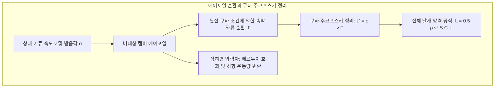
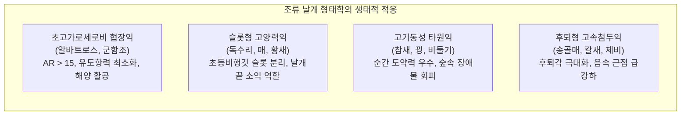
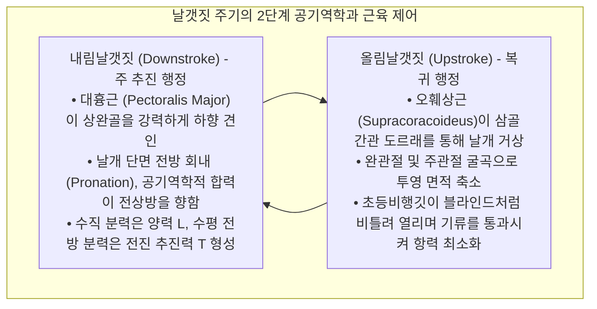
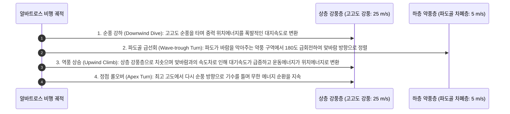
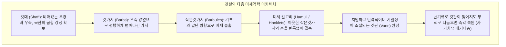
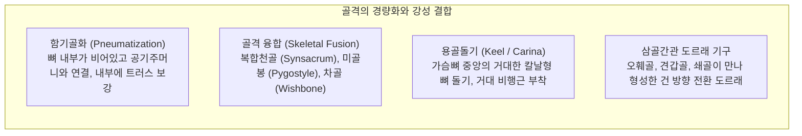
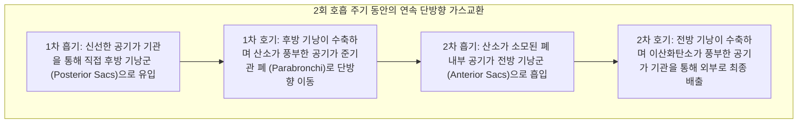
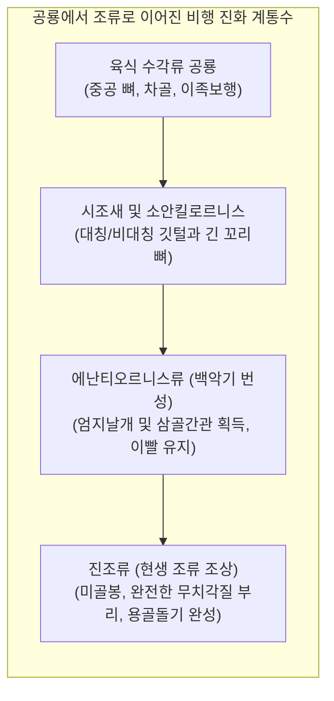

상승 온난기류를 타고 우아하게 선회하는 검독수리, 시속 380km가 넘는 가공할 속도로 수직 강하하여 사냥감을 타격하는 송골매, 그리고 거친 남극해의 폭풍 속에서 몇 년 동안 단 한 번의 날갯짓도 없이 활공을 이어가는 알바트로스에 이르기까지, 조류는 지구 생명사에서 가장 경이로운 공중의 지배자입니다.

인류가 동력 비행기를 발명한 것은 겨우 100여 년 남짓이지만, 수각류 공룡(Theropod Dinosaurs)의 유일한 현생 후손인 조류는 지금으로부터 약 1억 5천만 년 전 쥐라기 후기부터 중력을 거스르는 진화의 대장정을 시작했습니다. 이들은 현대의 그 어떤 첨단 초음속 전투기나 무인 드론도 모방하기 힘든 극한의 기동성, 형상 적응성 및 에너지 효율을 달성했습니다.

새의 비행은 단순히 "날개를 퍼덕이는 행위"가 결코 아닙니다. 그것은 <strong>내부 트러스 구조로 경량화된 중공 골격, 도르래 메커니즘으로 작동하는 고효율 비행 근육계, 나노 단위의 미세 갈고리로 결합하여 스스로 복원되는 깃털 시스템, 단방향 연속 기류를 생성하는 이중 순환 기낭 호흡계, 그리고 비정상 유체역학적 앞전 와류(LEV)를 정밀 제어하는 생체공학의 총체적 걸작</strong>입니다. 본 글에서는 공기역학, 근골격 해부학, 호흡 생리학, 공룡으로부터의 진화사라는 네 가지 핵심 기둥을 통해 조류 비행의 모든 메커니즘을 심층 분석합니다.

---

### 1. 에어포일 공기역학: 양력, 유도항력 및 가로세로비(Aspect Ratio)의 물리학

조류가 공중에서 자신의 체중 $W = mg$을 지탱하기 위한 제1물리 법칙은 날개에서 충분한 <strong>양력(Lift: $L$)</strong>을 생성하고 공기역학적 항력을 극복하는 것입니다.

조류의 날개 단면은 자연이 빚어낸 이상적인 비대칭 캠버 에어포일(Cambered Airfoil)로, 위쪽 표면은 부드러운 볼록 곡면을 이루고 아래쪽 표면은 평평하거나 오목한 형상을 가집니다.

#### 순환 이론과 양력 방정식
유체역학의 <strong>쿠타-주코프스키 정리(Kutta-Joukowski Theorem)</strong>에 따르면, 점성 유체 속을 이동하는 날개 단면의 단위 날개폭당 양력 $L'$은 유체 밀도 $\rho$, 비행 속도 $v$, 그리고 에어포일 주위에 형성된 속박 와류의 순환(Circulation: $\Gamma$)에 정비례합니다:

$$L' = \rho v \Gamma, \quad L = \frac{1}{2} \rho v^2 S C_L$$

여기서 $S$는 날개 투영 면적이며, $C_L$은 받음각(Angle of attack: $\alpha$)과 캠버에 의해 결정되는 양력계수입니다.

#### 날개끝 와류와 유도항력(Induced Drag)의 대가
양력 생성에는 필연적인 물리적 대가인 <strong>유도항력(Induced Drag: $D_i$)</strong>이 따릅니다. 날개 아래쪽의 고압 공기가 날개끝을 돌아 위쪽 저압 구역으로 말려 올라가면서 거대한 날개끝 와류(Wingtip Vortices)가 형성됩니다. 이 와류는 날개 후방에 강력한 하향세류(Downwash: $w$)를 유도하여 유효 상대풍 방향을 뒤로 기울이고, 비행 반대 방향으로 항력 벡터 성분을 유발합니다:

$$D_i = \frac{1}{2} \rho v^2 S C_{Di} = \frac{1}{2} \rho v^2 S \left(\frac{C_L^2}{\pi AR e}\right)$$

여기서 $AR = b^2 / S$는 날개의 <strong>가로세로비(Aspect Ratio)</strong>이고, $e$는 오스왈드 효율 계수입니다. 이 수식은 <strong>유도항력이 가로세로비 $AR$에 정확히 반비례</strong>함을 수학적으로 입증합니다.

1. <strong>초고가로세로비 날개 (알바트로스)</strong>: $AR$이 15~18에 달하여 날개끝 와류의 영향을 극한으로 억제하며, 양항비(L/D)가 20을 초과하여 엔진 없는 대양 횡단 활공에 최적화되었습니다.
2. <strong>슬롯형 분리 날개 (독수리, 콘도르)</strong>: 낮은 가로세로비에서도 날개끝 초등비행깃이 손가락처럼 벌어져 위로 젖혀지는 '슬롯(Slots)'을 형성합니다. 각각의 깃털이 독립된 미세 날개 역할을 수행하여 단일 거대 와류를 여러 개의 약한 분산 와류로 쪼개어 유도항력을 대폭 저감합니다.
3. <strong>엄지날개(Alula)의 실속 지연 장치</strong>: 조류의 첫 번째 발가락(엄지)에 위치한 3~5장의 엄지날개는 현대 여객기의 전연 슬랫(Leading-Edge Slat)과 완벽히 동일한 원리로 작동합니다. 큰 받음각 상태에서 이 날개를 펼치면 날개 상면에 고에너지 공기층을 불어넣어 기류 박리를 방지하고 실속 각도를 10°~15° 늦춥니다.

---

### 2. 날갯짓 비행의 비정상 유체역학과 앞전 와류(LEV)

고정익 항공기는 엔진이 전진 추진력을 만들고 고정된 날개가 양력을 생성하지만, 조류는 유연하게 변형되는 단 한 쌍의 날개로 <strong>양력과 추진력을 동시에 생성</strong>해야 합니다.

#### 앞전 와류(Leading-Edge Vortex: LEV)와 동적 실속 지연
벌새나 소형 명금류와 같이 낮은 레이놀즈수($Re$) 영역에서 비행하는 생물들은 기존의 준정상(Quasi-steady) 공기역학 이론으로 예측할 수 없는 초고양력을 발휘합니다. 입자영상유속계(PIV) 연구 결과, 이들은 <strong>비정상 유체역학 현상인 앞전 와류(LEV)</strong>를 적극적으로 이용함이 밝혀졌습니다.

날개가 큰 받음각으로 급격히 가속하며 하강할 때, 앞전에서 기류가 박리되면서 고속으로 회전하는 저압 와류 핵이 날개 상면에 안정적으로 흡착됩니다. 이 앞전 와류의 강력한 흡인력은 정상 상태 최대 양력계수를 2~3배 이상으로 폭발적으로 증가시킵니다. 와류가 파괴되어 흩어지기 전에 이미 날개 행정이 완료되므로 실속을 완벽히 회피합니다.

#### 바이스-포그 '박수-벌림' 메커니즘 (Clap and Fling)
비둘기나 오리가 놀라 수직으로 급상승할 때 날개를 등 뒤로 높이 들어올려 서로 맞부딪친 뒤(Clap) 앞전부터 빠르게 벌리는(Fling) 동작을 취합니다. 이 순간 날개 사이의 틈새로 공기가 급격히 빨려 들어가며 두 날개가 전진 운동을 시작하기도 전에 이미 날개 주위에 극도로 강한 순환 와류가 순식간에 유도되어, 제로 속도 상태에서도 폭발적인 수직 양력을 얻게 됩니다.

---

### 3. 동적 활공(Dynamic Soaring): 알바트로스의 에너지 순환 기적

날개폭 3m가 넘는 나그네알바트로스는 사나운 남극해의 폭풍 속에서 근육 에너지를 전혀 쓰지 않고 수천 킬로미터를 논스톱으로 비행합니다. 이를 가능케 하는 물리학적 원리가 바로 <strong>동적 활공(Dynamic Soaring)</strong>입니다.

동적 활공의 에너지원은 열상승기류가 아니라 해수면과의 마찰로 형성된 <strong>고도에 따른 수평 풍속의 급격한 수직 풍속 차이(Wind Shear: $dU/dz$)</strong>입니다.

에너지 역학 방정식으로 분석하면, 풍속 시어 내에서 알바트로스의 단위 질량당 역학적 에너지 변화율은 다음과 같습니다:

$$\frac{dE}{dt} = -D v_a - m g w_z - m v_{ax} \frac{dU}{dz} \dot{z}$$

알바트로스는 정교한 궤도 조종을 통해 세 번째 항인 풍속 전단 에너지 흡수율을 항상 양수로 유지함으로써, 공기점성에 의한 마찰 손실($D v_a$)을 100% 보상받습니다. 게다가 알바트로스의 어깨 관절에는 <strong>건 고정 장치(Shoulder-lock tendon)</strong>가 발달해 있어, 날개를 완전히 펼친 상태에서 근육을 수축하지 않고도 뼈와 힘줄로 날개를 물리적으로 잠가둘 수 있습니다.

---

### 4. 깃털의 나노 스케일 미세구조와 자가치유 결합 메커니즘

깃털은 현존하는 생체 재료 중 가장 가벼우면서도 최고의 비강도(Specific Strength)와 탄성을 자랑하는 단백질 복합 신소재입니다.

#### 지퍼식 미세 갈고리의 나노 체결
전형적인 비행깃 한 장에는 수십만 개의 깃가지와 수백만 개의 미세 갈고리(Hamuli)가 존재합니다. 말단 작은깃가지 끝의 미세한 갈고리는 인접한 기부 작은깃가지의 테두리를 마치 벨크로(찍찍이) 테이프처럼 꽉 물고 있습니다. 비행 중 강한 돌풍으로 인해 깃판이 찢어지더라도 부러지지 않고 갈고리가 미끄러지며 충격을 흡수하며, 새가 홰에 앉아 부리로 깃털을 가볍게 빗어넘기기만 하면(Preening) 갈고리가 홈에 다시 체결되어 본래의 기밀 상태로 완벽히 복원됩니다.

#### 올빼미의 스텔스 저소음 비행 기구
밤의 지배자인 올빼미는 먹잇감이 눈치채지 못하도록 3중 음향 소음 저감 구조를 진화시켰습니다:
1. <strong>앞전 톱니형 빗살(Leading-edge Serrations)</strong>: 날개 앞전의 미세 빗살이 대형 와류를 쪼개어 미세 난류로 분산;
2. <strong>뒷전 연질 프린지(Trailing-edge Fringe)</strong>: 뒷전의 부드러운 털 구조가 기류 이탈 시 발생하는 와류 소음을 흡수;
3. <strong>표면 벨벳 미세모(Velvet Surface)</strong>: 날개 표면을 덮은 벨벳 모가 날개 마찰음을 완벽히 차음합니다.

---

### 5. 골격과 근육계의 극한 경량화 생체공학

새의 해부학적 구조는 비행 하중에 견디면서도 무게를 0.1g 단위로 줄이기 위한 최적 설계의 극치입니다.

#### 중공 트러스 골격
조류의 장골 내부는 대부분 골수로 가득 차 있는 포유류와 달리 텅 비어 있으며 기낭과 직접 연결되어 있습니다. 그러나 단면 2차 모멘트($I$)가 매우 크고 관 내부에는 엔지니어링 교량의 트러스와 같은 골질 지주가 대각선으로 얽혀 있어 굽힘과 비틀림 하중에 대해 경이적인 구조적 안정성을 유지합니다.

#### 삼골간관(Triosseal Canal)과 역도르래 시스템
새의 무게 중심을 낮추고 공기역학적 안정성을 유지하기 위해 무거운 비행 근육은 등쪽이 아닌 몸통 아래쪽(가슴)에 집중 배치되었습니다.
- <strong>대흉근(Pectoralis Major)</strong>: 전체 체중의 15~25%를 차지하며 상완골을 직접 아래로 당겨 강력한 추진 하향 행정을 담당합니다.
- <strong>오훼상근(Supracoracoideus)</strong>: 날개를 들어올리는 근육이지만 가슴 깊은 곳에 위치합니다. 이 근육의 건(힘줄)은 오훼골, 견갑골, 쇄골이 만나는 <strong>삼골간관</strong>이라는 뼈 구멍을 통과하여 상완골 위쪽에 부착됨으로써, 천장에 매단 도르래처럼 가슴 아래쪽 근육의 인장력을 날개를 번쩍 들어올리는 상향력으로 완벽히 역전시킵니다.

---

### 6. 이중 단방향 순환 기낭 호흡계: 에베레스트를 넘는 산소 기관

비행은 척추동물이 수행하는 가장 산소 소비량이 많은 고강도 대사 활동입니다. 사람은 해발 8,000m의 데스존에서 산소통 없이 뇌사 상태에 빠지지만, 줄기러기(Bar-headed Goose)는 9,000m 높이의 히말라야 산맥을 제 날개로 펄럭이며 가뿐히 넘어갑니다. 이는 조류 고유의 <strong>전 단방향 기낭 순환 호흡계</strong>가 있기에 가능합니다.

#### 교차류(Cross-Current) 가스 교환
포유류의 폐가 팽창과 수축을 반복하며 흡기와 호기가 동일한 통로를 오가는 비효율적인 막다른 골목 구조인 반면, 조류의 폐는 부피가 변하지 않는 단단한 준기관(Parabronchi) 모세관 다발로 구성되어 있습니다:
1. <strong>연속 단방향 흐름</strong>: 숨을 들이쉴 때나 내쉴 때나 폐 내부에는 항상 같은 방향으로 고농도 산소 기류가 끊김 없이 흐릅니다.
2. <strong>교차류 혈류 교환</strong>: 미세 혈관 속 혈액의 흐름이 공기 흐름과 직각을 이루며 엇갈리는 교차류 방식으로 접촉하기 때문에, 동맥혈 산소분압이 배출되는 폐포 가스 분압보다 더 높아질 수 있어 극도로 희박한 산소 조건에서도 100%에 가까운 가스 교환 효율을 달성합니다.

---

### 7. 수각류 공룡에서 현생 조류로의 비행 진화사

조류의 기원은 고생물학에서 가장 매혹적인 드라마입니다. 오늘날 계통분류학은 <strong>현대 조류가 살아남은 깃털 달린 수각류 공룡 그 자체</strong>임을 명백히 증명합니다.

#### 날개 보조 경사 달리기 가설 (WAIR)
비행의 기원에 관해 나무 위에서 뛰어내리며 활공했다는 수목 기원설(Arboreal)과 땅에서 뛰며 도약했다는 주행 기원설(Cursorial)이 100년 넘게 대립해 왔습니다. 2000년대 초 케네스 다이얼(Kenneth Dial) 교수는 <strong>날개 보조 경사 달리기(Wing-Assisted Incline Running: WAIR)</strong> 가설을 제시하며 결정적 단서를 제공했습니다.

아직 날지 못하는 어린 새들이 가파른 경사면이나 나무 기둥을 뛰어오를 때, 날개를 퍼덕여 체중을 지탱하는 것이 아니라 날개의 공기역학적 반작용력으로 몸을 경사면에 강력하게 밀착시켜 발의 마찰력을 극대화한다는 사실이 밝혀졌습니다. 이는 깃털과 날개의 펄럭임이 공중 비행 능력을 완전히 획득하기 이전 단계에서도 생존에 지대한 선택적 이점을 제공했음을 완벽하게 설명합니다.

---

### 8. 생체모방 항공공학: 조류가 현대 항공우주 기술에 던지는 미래

수억 년의 자연선택이 다듬어낸 조류의 공기역학적 기작은 현대 첨단 항공우주 산업의 지형을 바꾸고 있습니다:
1. <strong>모핑 윙(Morphing Wings)</strong>: 유압 장치로 금속 플랩을 꺾는 대신 형상기억합금과 유연 복합재료를 사용하여 새의 관절처럼 날개 전체 곡률을 부드럽게 변형시켜 항력을 최소화;
2. <strong>익단 소익(Winglets)의 진화</strong>: 맹금류의 갈라진 깃털 끝을 모방한 윙팁 장치가 전 세계 민항기에 표준 탑재되어 연간 수백만 톤의 항공유 절감;
3. <strong>초소형 플래핑 드론(Flapping MAV)</strong>: 벌새와 제비의 앞전 와류 제어 원리를 이식하여 거센 강풍이나 협소한 건물 내부에서도 안정적으로 호버링하는 차세대 초소형 정찰기 개발.

골격과 근육, 깃털로 빚어낸 조류의 비행 역학은 생명 진화의 가장 위대한 승리이자, 미래 인류가 우주와 하늘을 개척하는 데 영원히 마르지 않는 영감의 원천입니다.
