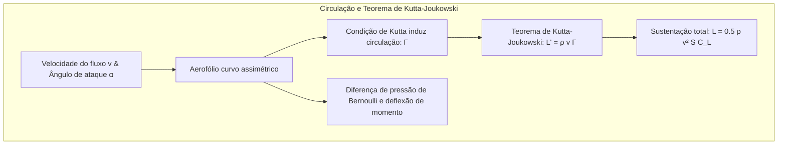
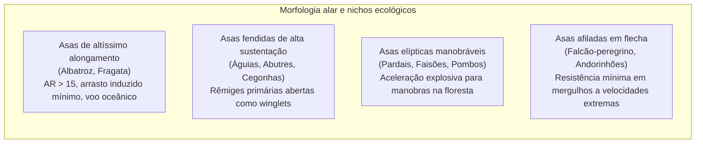
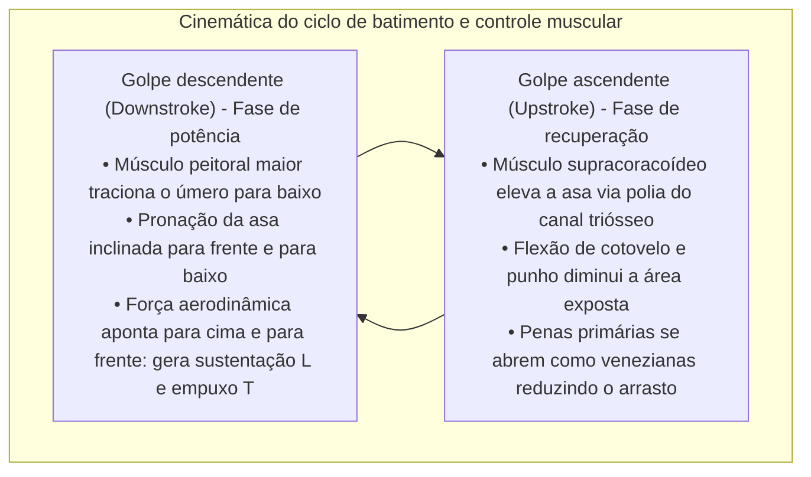
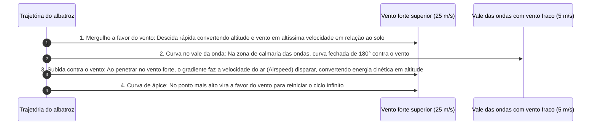
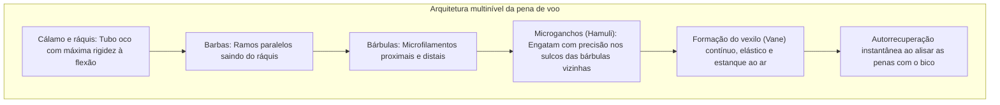
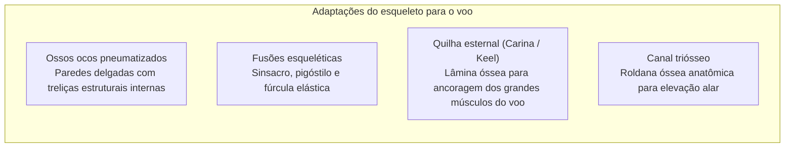
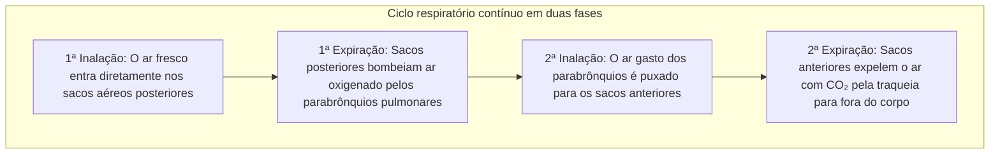
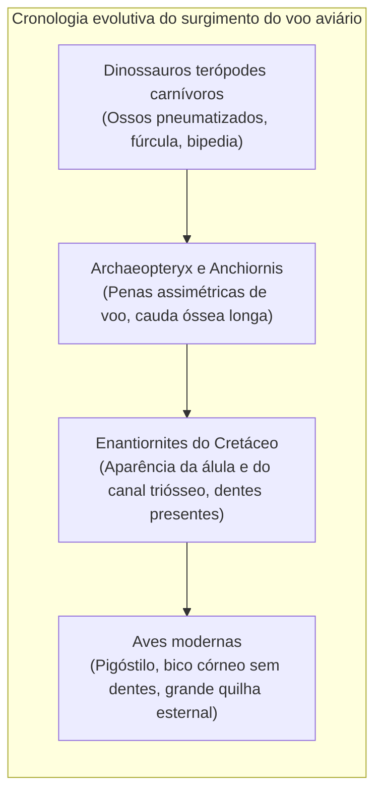

Seja a águia-real descrevendo círculos perfeitos em correntes térmicas ascendentes, o falcão-peregrino mergulhando a mais de 380 km/h para interceptar sua presa, ou o albatroz-errante cruzando as tempestades do Oceano Austral por anos sem bater as asas, as aves representam a obra-prima definitiva do voo biológico.

Enquanto a aviação humana motorizada mal ultrapassa um século de existência, as aves — os únicos descendentes vivos dos dinossauros terópodes — iniciaram a conquista dos ares há mais de 150 milhões de anos no período Jurássico. Elas desenvolveram agilidade, autorregulação aerodinâmica e eficiência energética que nenhum caça de ponta ou drone moderno consegue reproduzir.

O voo aviário não é um simples ato de bater asas. É um <strong>complexo sistema integrado de engenharia biológica: ossos ocos pneumatizados reforçados com treliças internas, musculatura peitoral atuando como uma roldana óssea invertida, penas com microganchos autorreparáveis, sacos aéreos de fluxo unidirecional contínuo e o controle de vórtices de bordo de ataque (LEV)</strong>. Este artigo detalha a aerodinâmica, anatomia musculoesquelética, respiração e evolução do voo das aves.

---

### 1. Aerodinâmica do aerofólio: Sustentação, arrasto induzido e alongamento alar

Para vencer o peso do próprio corpo $W = mg$, a asa da ave deve produzir <strong>sustentação (Lift: $L$)</strong> contínua e superar o arrasto aerodinâmico.

O corte transversal da asa da ave forma um perfil assimétrico curvado (Cambered Airfoil), com superfície superior curva e convexa e inferior plana a ligeiramente côncava.

#### Teorema da circulação e equação de sustentação
Pelo <strong>teorema de Kutta-Joukowski</strong>, a força de sustentação gerada por unidade de envergadura $L'$ é proporcional à massa específica do ar $\rho$, à velocidade relativa $v$ e à circulação do vórtice aprisionado $\Gamma$:

$$L' = \rho v \Gamma, \quad L = \frac{1}{2} \rho v^2 S C_L$$

onde $S$ é a área de referência alar e $C_L$ o coeficiente de sustentação, função da curvatura e do ângulo de ataque $\alpha$.

#### Vórtices de ponta de asa e o custo do arrasto induzido
A geração de sustentação cria inevitavelmente o <strong>arrasto induzido (Induced Drag: $D_i$)</strong>. A alta pressão do intradorso contorna a ponta da asa em direção à baixa pressão do extradorso, formando intensos vórtices de ponta de asa (Wingtip Vortices) que produzem deflexão descendente do ar (Downwash: $w$):

$$D_i = \frac{1}{2} \rho v^2 S C_{Di} = \frac{1}{2} \rho v^2 S \left(\frac{C_L^2}{\pi AR e}\right)$$

onde $AR = b^2 / S$ representa o <strong>alongamento alar (Aspect Ratio)</strong> e $e$ o fator de eficiência de Oswald. A equação comprova que <strong>o arrasto induzido é estritamente inversamente proporcional ao alongamento $AR$</strong>.

1. <strong>Asas de alto alongamento (Albatroz)</strong>: Com valores de $AR = 15 \dots 18$, reduzem os vórtices marginais ao mínimo, atingindo razão de planeio superior a 20;
2. <strong>Asas com pontas fendidas (Águias, Abutres)</strong>: As rêmiges primárias abrem-se formando fendas (Slots). Cada pena age como um winglet independente que dispersa o vórtice principal em múltiplos vórtices menores de rápida dissipação;
3. <strong>A álula (Falso polegar)</strong>: Composta por 3 a 5 penas sobre o primeiro dígito, funciona como os slats de bordo de ataque de aviões comerciais. Quando aberta em pousos em baixa velocidade, direciona ar energético sobre o extradorso, retardando o estol (Stall) em 10° a 15°.

---

### 2. Mecânica dos fluidos não permanente do bater de asas e vórtices de bordo de ataque

Aeronaves convencionais separam sustentação e propulsão. As aves, no entanto, utilizam as mesmas asas flexíveis para <strong>gerar sustentação e impulso propulsor simultaneamente</strong>.

#### Vórtices de bordo de ataque (Leading-Edge Vortex: LEV)
Em pequenos pássaros e beija-flores voando em baixos números de Reynolds, as teorias aerodinâmicas estacionárias são incapazes de prever as forças sustentadoras geradas. Estudos com velocimetria por imagem de partículas (PIV) revelaram que eles dependem de <strong>fenômenos não permanentes: os vórtices de bordo de ataque (LEV)</strong>.

Quando a asa acelera rapidamente para baixo em ângulos de ataque elevados, o ar descola no bordo de ataque e se enrola em um núcleo de vórtice de baixa pressão fixado ao extradorso. A sucção resultante multiplica o coeficiente de sustentação $C_L$ em até 2 a 3 vezes o limite de estol convencional, finalizando o movimento antes que ocorra a perda catastrófica de sustentação.

#### Mecanismo de aplauso e abertura de Weis-Fogh (Clap and Fling)
Pombos e patos, ao decolarem verticalmente do chão, unem as asas acima do dorso batendo-as (Clap) e em seguida afastam rapidamente os bordos de ataque (Fling). O ar sugado para o espaço vazio gera circulação vortical imediata, gerando empuxo vertical instantâneo mesmo com velocidade inicial nula.

---

### 3. Planagem dinâmica: A extração de energia pelo albatroz

O albatroz-errante, com até 12 kg e 3,5 metros de envergadura, cruza o Oceano Antártico por meses sem gastar energia muscular metabólica graças à <strong>planagem dinâmica (Dynamic Soaring)</strong>.

Sua fonte de energia não são correntes térmicas, mas o <strong>gradiente vertical de velocidade do vento (Wind Shear: $dU/dz$)</strong> criado pelo atrito do ar com as ondas marinhas.

A taxa de variação de energia mecânica comprova que:

$$\frac{dE}{dt} = -D v_a - m g w_z - m v_{ax} \frac{dU}{dz} \dot{z}$$

Mantendo $-v_{ax} \dot{z}$ positivo, o ganho de energia do vento compensa integralmente o atrito do ar ($D v_a$). Além disso, o ombro do albatroz possui um <strong>tendão de travamento passivo (Shoulder-lock tendon)</strong> que trava as asas estendidas sem consumir energia muscular contínua.

---

### 4. Micro e nanoestrutura das penas: Resistência e autorrecuperação

As penas representam um dos materiais compósitos biológicos fibrosos mais leves, resistentes e elásticos da natureza.

#### Mecanismo de zíper dos hamuli
Uma rêmige de voo contém centenas de milhares de bárbulas e milhões de ganchinhos microscópicos (Hamuli). Diante de turbulências violentas, os ganchos escorregam sem romper a queratina. Quando a ave se alisa com o bico (Preening), os ganchos engatam novamente em suas ranhuras como um fecho de velcro.

#### O voo silencioso das corujas
Corujas desenvolveram três estruturas acústicas singulares:
1. <strong>Serrilhado de pente no bordo de ataque</strong>: Fraciona grandes vórtices em microturbulências silenciosas;
2. <strong>Franjas suaves no bordo de fuga</strong>: Elimina o assobio agudo de ejeção de ar;
3. <strong>Superfície aveludada</strong>: Amortece o ruído de atrito mútuo entre as penas.

---

### 5. Sistema esquelético e muscular: O ápice da leveza estrutural

O esqueleto e os músculos das aves foram minuciosamente selecionados para conferir resistência incomparável com o mínimo peso possível.

#### O canal triósseo e o sistema de polia anatômica
Para posicionar o centro de massa na parte inferior do corpo, todos os músculos primários do voo estão fixados no tórax:
- <strong>Peitoral maior</strong>: Corresponde a 15-25% do peso corporal e abaixa com força o úmero;
- <strong>Supracoracoideo</strong>: Localizado abaixo do peitoral, eleva a asa através de um orifício ósseo — o <strong>canal triósseo</strong> (encontro da escápula, coracoide e clavícula) — que funciona como uma polia mecânica, revertendo a força de tração para erguer a asa a partir do peito.

---

### 6. Sistema respiratório com sacos aéreos: Motor de alta altitude

O voo requer o maior consumo de oxigênio do reino animal. Enquanto seres humanos perdem a consciência a 8.000 m sem oxigênio suplementar, o ganso-de-cabeça-listrada sobrevoa o Himalaia a quase 9.000 m batendo as asas ativamente. Isso é possível graças ao <strong>sistema respiratório com sacos aéreos e fluxo contínuo unidirecional</strong>.

#### Troca gasosa em corrente cruzada (Cross-current)
Os pulmões das aves não se expandem nem se contraem (Parabrônquios); os sacos aéreos atuam como foles contínuos:
1. <strong>Fluxo unidirecional ininterrupto</strong>: Tanto na inspiração quanto na expiração, o ar oxigenado percorre os pulmões na mesma direção sem espaços mortos;
2. <strong>Capilares em corrente cruzada</strong>: O sangue capilar cruza perpendicularmente as correntes de ar, permitindo que a pressão de oxigênio no sangue supere a do ar exalado, superando amplamente os pulmões dos mamíferos.

---

### 7. Evolução: De dinossauros terópodes às aves modernas

A paleontologia moderna comprovou indiscutivelmente que <strong>as aves são dinossauros terópodes vivos com penas</strong>.

#### A hipótese WAIR (Wing-Assisted Incline Running)
Dilema histórico entre origem arborícola e corredora, a teoria da <strong>corrida inclinada assistida por asas (WAIR)</strong> formulada por Kenneth Dial forneceu a resposta: aves jovens usam as asas não para planar, mas para empurrar o corpo aerodinamicamente contra encostas verticais, aumentando a tração das patas para fugir de predadores. Essa mecânica já fornecia enorme vantagem adaptativa antes do voo completo.

---

### 8. Aeronáutica biomimética: Lições da biologia para o futuro

Mais de 150 milhões de anos de testes evolutivos inspiram a engenharia de ponta:
1. <strong>Asas com deformação contínua (Morphing Wings)</strong>: Substituição de superfícies rígidas por estruturas com memória de forma contínuas inspiradas nas asas das aves;
2. <strong>Winglets em pontas de asa</strong>: Cópias das rêmiges abertas das águias que poupam milhões de toneladas de combustível na aviação mundial;
3. <strong>Microveículos de asas batentes (Flapping MAVs)</strong>: Uso dos vórtices de bordo de ataque para drones compactos capazes de operar em ambientes confinados ou ventos severos.

O voo das aves é um dos maiores triunfos da evolução biológica e continuará iluminando o caminho da exploração dos céus e do espaço.
