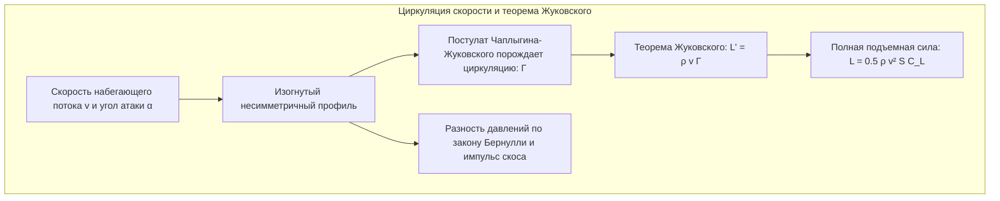
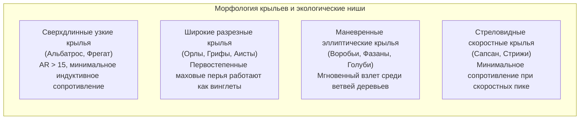
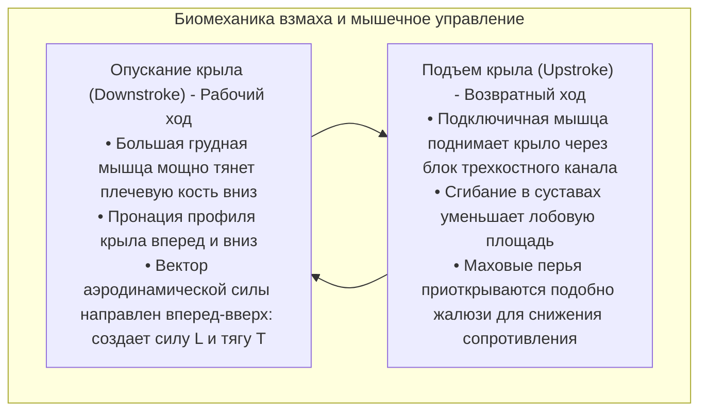
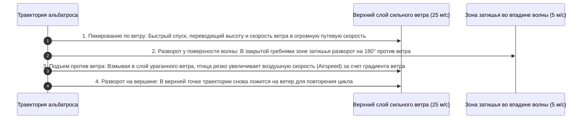
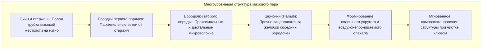
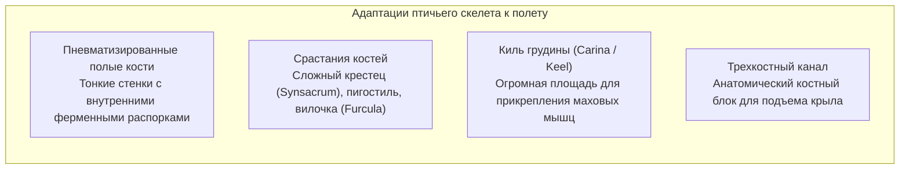
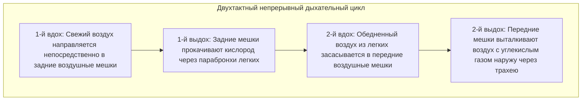
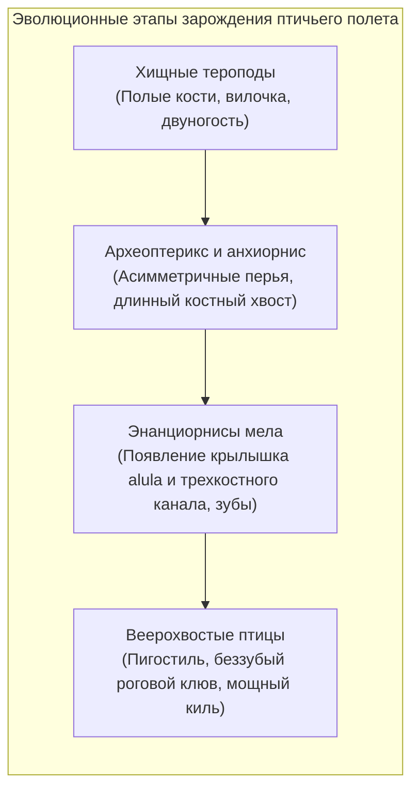

Парит ли беркут в восходящих термических потоках, пикирует ли сапсан на скорости свыше 380 км/ч, чтобы поразить добычу, или странствующий альбатрос годами бороздит штормовые просторы Южного океана, не сделав ни единого взмаха крыльями — птицы представляют собой совершенный шедевр природного полета.

В то время как пилотируемой авиации человека едва исполнилось столетие, птицы — единственные ныне живущие потомки тероподных динозавров — начали завоевание воздушного океана еще в юрском периоде более 150 миллионов лет назад. Они достигли маневренности, адаптивности и энергетической эффективности, превосходящих самые совершенные истребители и беспилотники.

Полет птиц — это вовсе не примитивные «взмахи крыльями». Это <strong>гармоничный ансамбль биологической инженерии: пневматизированный трубчатый скелет с внутренними ферменными распорками, уникальная мускульная система с костным блоком трехкостного канала, самовосстанавливающиеся перья с микрокрючками, дыхательная система с воздушными мешками и непрерывным однонаправленным током воздуха, а также виртуозное управление нестационарными вихрями передней кромки (LEV)</strong>. В этом руководстве подробно рассмотрены аэродинамика, анатомия, дыхательная физиология и эволюционные корни птичьего полета.

---

### 1. Аэродинамика крыла: Подъемная сила, индуктивное сопротивление и удлинение

Чтобы удерживать в воздухе силу тяжести $W = mg$, крыло птицы должно создавать достаточную <strong>подъемную силу (Lift: $L$)</strong> и преодолевать аэродинамическое сопротивление.

Поперечное сечение птичьего крыла представляет собой изогнутый несимметричный аэродинамический профиль (Cambered Airfoil) с гладкой выпуклой верхней поверхностью и плоской или вогнутой нижней.

#### Теория циркуляции и формула подъемной силы
Согласно <strong>теореме Жуковского</strong> в механике сплошных сред, погонная подъемная сила $L'$ прямо пропорциональна плотности воздуха $\rho$, скорости набегающего потока $v$ и циркуляции присоединенного вихря $\Gamma$:

$$L' = \rho v \Gamma, \quad L = \frac{1}{2} \rho v^2 S C_L$$

где $S$ — площадь крыла, а $C_L$ — коэффициент подъемной силы, зависящий от кривизны профиля и геометрического угла атаки $\alpha$.

#### Концевые вихри и индуктивное сопротивление
Плата за подъемную силу — <strong>индуктивное сопротивление (Induced Drag: $D_i$)</strong>. Зона повышенного давления снизу перетекает через законцовку крыла в зону разрежения сверху, порождая мощные концевые вихри (Wingtip Vortices). Они индуцируют скос потока вниз (Downwash: $w$), отклоняющий вектор подъемной силы назад:

$$D_i = \frac{1}{2} \rho v^2 S C_{Di} = \frac{1}{2} \rho v^2 S \left(\frac{C_L^2}{\pi AR e}\right)$$

где $AR = b^2 / S$ — <strong>удлинение крыла (Aspect Ratio)</strong>, а $e$ — коэффициент Освальда. Уравнение математически доказывает, что <strong>индуктивное сопротивление обратно пропорционально удлинению крыла $AR$</strong>.

1. <strong>Крылья сверхвысокого удлинения (Альбатрос)</strong>: При $AR = 15 \dots 18$ концевые вихри практически нейтрализуются, обеспечивая аэродинамическое качество свыше 20 для беспосадочного парения над океаном;
2. <strong>Разрезные крылья хищников (Орлы, Грифы)</strong>: Первостепенные маховые перья веерообразно расправляются, образуя щели. Каждое перо служит независимым микро-винглетом, дробящим мощный концевой вихрь на систему быстро угасающих микровихрей;
3. <strong>Придаточное крылышко (Alula)</strong>: 3-5 перьев на первом пальце работают точно как предкрылок (Leading-Edge Slat) современных пассажирских самолетов. При заходе на посадку с большими углами атаки крылышко направляет высокоэнергетичный поток на верхнюю поверхность крыла, предотвращая срыв потока и отодвигая сваливание на 10°-15°.

---

### 2. Нестационарная гидродинамика машущего полета и вихри передней кромки

Самолет разделяет создание подъемной силы (неподвижное крыло) и тяги (двигатель). Птица же должна <strong>создавать и подъемную силу, и тягу одновременно</strong> одной парой деформируемых крыльев.

#### Вихрь передней кромки (Leading-Edge Vortex: LEV)
В полете колибри и мелких певчих птиц при низких числах Рейнольдса квазистационарные аэродинамические теории не могут объяснить величину генерируемой подъемной силы. Эксперименты с лазерной анемометрией частиц (PIV) доказали, что птицы используют <strong>нестационарный аэродинамический механизм — вихри передней кромки (LEV)</strong>.

При резком ускоренном опускании крыла с большим углом атаки поток срывается с передней кромки и сворачивается в компактный низконапорный вихрь, удерживаемый над верхней поверхностью. Этот вихрь удваивает мгновенный коэффициент подъемной силы $C_L$, не вызывая классического срыва потока, так как полувзмах завершается до разрушения вихревой структуры.

#### Механизм «хлопка и раскрытия» Вейс-Фога (Clap and Fling)
При резком вертикальном старте с земли голуби смыкают крылья за спиной (хлопок — Clap), после чего резко распахивают их передние кромки (Fling). Воздух, устремляющийся в раскрывающийся зазор, мгновенно генерирует мощную циркуляцию вокруг крыльев еще до начала их поступательного движения, сообщая птице гигантский стартовый импульс.

---

### 3. Динамическое парение: Извлечение энергии ветра альбатросом

Странствующий альбатрос размахом крыльев до 3,5 метров преодолевает тысячи километров над Южным океаном без единого взмаха крыльев благодаря <strong>динамическому парению (Dynamic Soaring)</strong>.

Его двигателем служат не восходящие теплые потоки, а <strong>вертикальный сдвиг горизонтального ветра (Wind Shear: $dU/dz$)</strong>, возникающий из-за трения воздуха о поверхность волн.

Уравнение изменения механической энергии показывает, что:

$$\frac{dE}{dt} = -D v_a - m g w_z - m v_{ax} \frac{dU}{dz} \dot{z}$$

При правильной траектории слагаемое $-v_{ax} \dot{z}$ остается строго положительным, полностью компенсируя потери на сопротивление трения воздуха ($D v_a$). Кроме того, плечевой сустав альбатроса имеет <strong>специальное сухожильное замковое устройство (Shoulder-lock tendon)</strong>, которое механически фиксирует крыло в расправленном положении без непрерывных мышечных энергозатрат.

---

### 4. Микроструктура перьев: Прочность и самовосстановление

Перья птиц представляют собой композиционный биоматериал с непревзойденной удельной прочностью и эластичностью.

#### Застежка-молния на микрокрючках
Маховое перо содержит сотни тысяч бородочек и миллионы микроскопических крючочков (Hamuli). При критических перегрузках крючочки соскальзывают без разрыва кератина. Когда птица расправляет перья клювом, микрокрючочки автоматически вновь встают в пазы, как элементы застежки-липучки.

#### Бесшумный полет сов
Совы выработали три акустических механизма снижения аэродинамического шума:
1. <strong>Гребневидные зубцы на передней кромке</strong>: Расщепляют крупные турбулентные вихри на микровихри;
2. <strong>Мягкая бахрома на задней кромке</strong>: Сглаживает пульсации давления при сходе потока;
3. <strong>Бархатистый пух на поверхности крыла</strong>: Поглощает звуки трения перьев друг о друга.

---

### 5. Скелет и мышцы: Предел биологического облегчения конструкций

Анатомия скелета птицы оптимизирована для достижения предельной прочности при минимальном весе.

#### Трехкостный канал и анатомический блок
Для сохранения устойчивости центр тяжести смещен вниз:
- <strong>Большая грудная мышца</strong>: Занимает до 25% массы тела и мощно тянет плечо вниз;
- <strong>Подключичная мышца</strong>: Расположена под грудной мышцей, но поднимает крыло. Ее сухожилие проходит через <strong>трехкостный канал</strong> (образованный вороньей костью, лопаткой и ключицей), огибает его как шкив и крепится к верхней части плечевой кости, преобразуя нижнюю мышечную тягу в подъем крыла вверх.

---

### 6. Воздушные мешки и дыхание: Кислородный двигатель на высоте 9000 метров

Полет — самый энергозатратный локомоторный процесс. Человек теряет сознание от гипоксии на высоте 8 000 м, а горные гуси преодолевают Гималаи на высоте около 9 000 м в активном машущем полете. Это возможно благодаря <strong>двухцикловой дыхательной системе с воздушными мешками и непрерывным однонаправленным током воздуха</strong>.

#### Перекрестный газообмен (Cross-current System)
Легкие птиц имеют фиксированный объем (Парабронхи), а мешки служат мехами:
1. <strong>Однонаправленный поток</strong>: И при вдохе, и при выдохе богатый кислородом воздух непрерывно движется через легкие в одном направлении;
2. <strong>Перекрестный ток крови</strong>: Капилляры пересекают воздушные капилляры под прямым углом, благодаря чему парциальное давление кислорода в артериальной крови превышает его давление в выдыхаемом газе, в разы превосходя альвеолы млекопитающих.

---

### 7. Эволюция: От тероподных динозавров к современным птицам

Современная палеонтология доказала: <strong>птицы являются выжившими оперившимися динозаврами-тероподами</strong>.

#### Гипотеза WAIR (Wing-Assisted Incline Running)
В споре между древесной («сверху вниз») и беговой («снизу вверх») теориями профессор Кеннет Дайл предложил <strong>гипотезу бега по наклонным плоскостям с помощью крыльев (WAIR)</strong>: нелетающие птенцы взмахами крыльев прижимают тело к крутым склонам и стволам деревьев, увеличивая сцепление лап при бегстве от хищников. Это давало адаптивное преимущество оперяющимся предкам задолго до развития настоящего полета.

---

### 8. Биомиметика в авиации: Уроки птиц для техники будущего

Миллионы лет естественного отбора направляют современную аэрокосмическую мысль:
1. <strong>Морфинг-крылья (Morphing Wings)</strong>: Замена жестких механических закрылков гибкими материалами с памятью формы;
2. <strong>Законцовки крыльев (Винглены)</strong>: Прямая копия расщепленных маховых перьев орлов, экономящая миллионы тонн топлива ежегодно;
3. <strong>Машущие микро-БПЛА (Flapping MAVs)</strong>: Воспроизведение вихрей передней кромки для создания сверхманевренных разведывательных дронов.

Полет птиц остается ярчайшим свидетельством силы эволюции и неисчерпаемым источником открытий для авиационной науки.
