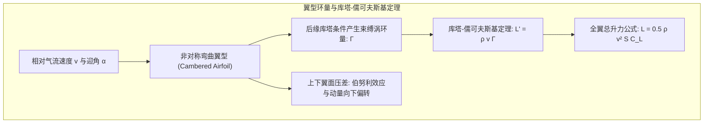
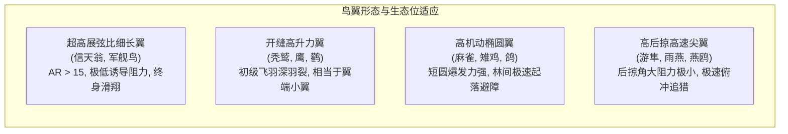
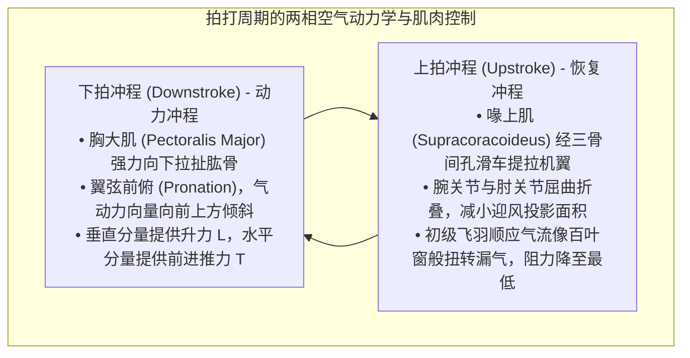
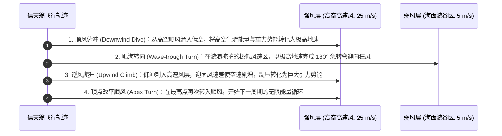
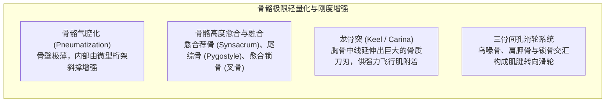
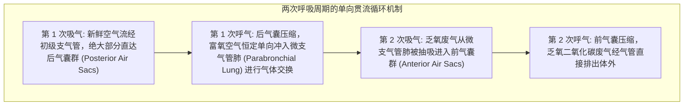
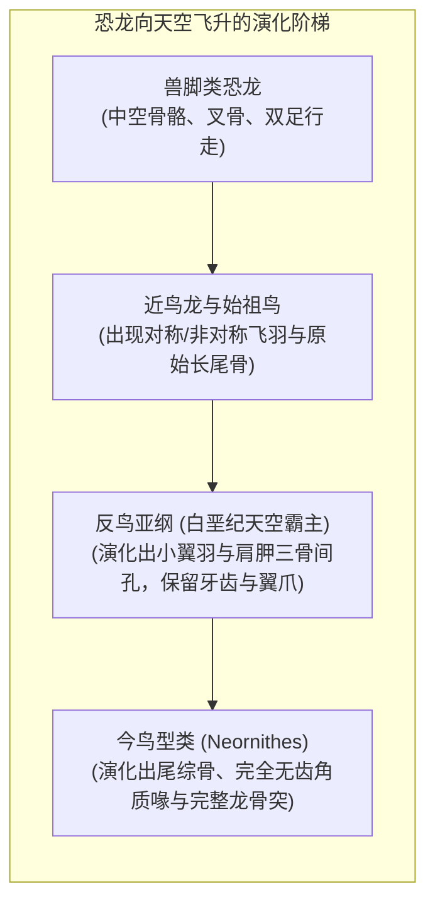

无论是盘旋于上升热气流之上的苍鹰、以超过 380 公里时速俯冲猎杀的游隼，还是在咆哮南大洋狂风中数年不挥动一次翅膀的信天翁，鸟类在漫长的生命演化史中谱写了自然界最宏伟的空中传奇。

人类发明动力飞行器仅有一百多年历史，而鸟类——作为兽脚类恐龙（Theropod Dinosaurs）的唯一现存后裔——在距今 1.5 亿年前的侏罗纪便开始了对重力的史诗级征服。它们演化出了现代最先进战斗机与无人机都无法企及的极高敏捷度、气动自适应性与卓越能量效率。

鸟类的飞翔绝非简单的“挥动双翼”，而是一整套<strong>高度协同的宏观与微观生命工程奇迹：极致轻量化且充满桁架结构的中空骨骼、倒置滑轮般的强韧飞行肌群、具有纳米级自修复能力的羽毛微观互锁系统、高效双向单向流动的气囊呼吸系统，以及操纵非定常前缘涡（LEV）的极限流体动力学</strong>。本文将从空气动力学、生物力学解剖学、生理呼吸机制与恐龙演化历程四大维度，彻底解析鸟类飞行的终极奥秘。

---

### 1. 翼型与空气动力学：升力、诱导阻力与展弦比优化

鸟类在空中维持悬浮与巡航的第一物理准则是产生与自身重力 $W = mg$ 相平衡的<strong>升力（Lift: $L$）</strong>，同时克服前进方向上的空气阻力。

鸟翼在剖面上是天工造化般的非对称弯曲翼型（Cambered Airfoil），具有平滑隆起的上表面与平凹的下表面。

#### 环量理论与升力方程
根据流体力学中的<strong>库塔-儒可夫斯基定理（Kutta-Joukowski Theorem）</strong>，翼型在粘性流体中运动时，后缘的光滑离流条件（库塔条件）诱发了绕翼型的束缚涡环量 $\Gamma$。翼型所受的单位翼展升力 $L'$ 与空气密度 $\rho$、来流速度 $v$ 及环量 $\Gamma$ 成正比：

$$L' = \rho v \Gamma, \quad L = \frac{1}{2} \rho v^2 S C_L$$

式中 $S$ 为机翼参考面积，$C_L$ 为升力系数（受翼型弯度与攻角 $\alpha$ 共同决定）。

#### 翼端涡与诱导阻力惩罚
伴随升力产生而来的必然物理代价是<strong>诱导阻力（Induced Drag: $D_i$）</strong>。由于翼下表面处于高压区，翼上表面处于低压区，在翼尖处高压气流必然绕过翼边缘向上卷吸，形成两道旋转强烈的翼端涡流（Wingtip Vortices）。翼尖涡在整个机翼后方诱导产生强烈的下洗流（Downwash: $w$），使得有效相对来流方向后倾，产生平行于飞行方向的阻力分量：

$$D_i = \frac{1}{2} \rho v^2 S C_{Di} = \frac{1}{2} \rho v^2 S \left(\frac{C_L^2}{\pi AR e}\right)$$

式中 $AR = b^2 / S$ 为<strong>展弦比（Aspect Ratio）</strong>，$e$ 为奥斯瓦尔德机翼效率因子。公式表明：<strong>诱导阻力与展弦比 $AR$ 成严格反比</strong>。

1. <strong>超高展弦比翼（信天翁）</strong>：展弦比高达 15~18，翼尖涡影响被稀释至极小，升阻比高达 20 以上，专为跨洋长途无动力滑翔而生；
2. <strong>羽裂缝开缝翼（鹰、雕、秃鹫）</strong>：在较低展弦比下，翼端初级飞羽相互分离并向上翘起形成“羽裂（Slots）”。每个羽裂飞羽独立充当微型小翼，将一个巨大的集中翼尖涡打散为若干相互抵消的微细涡流，大幅减少诱导阻力；
3. <strong>小翼羽（Alula）的防失速机制</strong>：鸟类拇指上着生的 3~5 枚小翼羽，是现代飞机机翼前缘缝翼（Leading-Edge Slat）的天然原型。当鸟类以大迎角低速起降时，展开小翼羽能够引流高能气流附着于翼上表面，延缓气流分离，将失速迎角推迟 10°~15°。

---

### 2. 拍打飞行的非定常流体力学与前缘涡

固定翼飞机依靠固定机翼提供升力、依靠喷气发动机或螺旋桨提供推力；而鸟类则必须在同一对柔性变形翼面上<strong>同时生成升力和推进力</strong>。

#### 前缘涡（LEV）与动态失速延迟
在低雷诺数与微小型鸟类（如蜂鸟、小型鸣禽）的飞行中，传统的定常准稳态空气动力学理论完全无法解释其惊人的升力水平。生物流体力学家通过粒子图像测速技术（PIV）发现，鸟类在剧烈拍打时主要依赖<strong>非定常流动机制——前缘涡（Leading-Edge Vortex: LEV）</strong>。

当鸟翼以极大迎角急剧加速拍打时，气流在翼前缘发生分离并卷起一个高速旋转的低压涡流核，紧密贴附于翼面上表面。该前缘涡产生极大的吸力，使得瞬时最大升力系数 $C_L$ 飙升至常规静止失速极限的 2~3 倍以上。在涡流破裂脱落前，鸟翼已完成了下拍动作，从而完美规避了动态失速带来的灾难性升力丧失。

#### 魏斯-福格“拍合-分离”机制（Clap and Fling）
在极低速起飞与悬停时，部分鸟类（如鸽子、野鸭在受惊起飞瞬间）会在背部将两翼高高竖起并相互拍合（Clap），随后机翼前缘率先剥离张开（Fling）。这一瞬间在翼间空隙诱发强烈的吸入气流，使得两翼在尚未发生相对平移之前就立即建立了极高强度的束缚涡环量，实现零起步速度下的超常规爆发升力。

---

### 3. 动力翱翔（Dynamic Soaring）：信天翁在大洋风切变中的能量守恒奇迹

漂泊信天翁体重可达 10 公斤以上，却能在狂暴的南大洋风暴中连续飞行数千公里而不消耗任何体内代谢肌能。其背后的物理机制被称为<strong>动力翱翔（Dynamic Soaring）</strong>。

动力翱翔的能量源泉并非上升气流，而是海洋表面因粘性摩擦形成的<strong>水平风速随高度激增的垂直风切变层（Wind Shear Layer: $dU/dz$）</strong>。

从力学能量方程分析，信天翁在风切变层中单位质量的能量变化率为：

$$\frac{dE}{dt} = -D v_a - m g w_z - m v_{ax} \frac{dU}{dz} \dot{z}$$

式中第三项即为风切变做功项。信天翁通过精妙的轨道规划，使得 $-v_{ax} \dot{z}$ 在爬升与俯冲过程中持续保持正值，从大气风能中汲取的机械能完全补偿了空气粘性摩擦阻力的损耗（$D v_a$），实现了宏观意义上的<strong>无动力永动巡航</strong>。此外，信天翁肩部还演化出一种特殊的肌腱锁定机构（Shoulder-lock tendon），可以将张开的翅膀机械式锁定于水平位置，无需飞行肌持续做功耗能。

---

### 4. 羽毛的微纳米结构与自修复互锁系统

羽毛是鸟类特有的表皮衍生物，是自然界重量最轻却比强度最高、耐疲劳性最好的纤维复合材料之一。

#### 微型羽钩的拉链式自愈机制
一枚典型的飞羽包含数十万条小羽支和数百万个微米级微型羽钩（Hamuli）。远端小羽支末端长有倒钩，与相邻近端小羽支边缘的卷边形成类似尼龙搭扣（Velcro）的微观互锁。当鸟类遭遇高空湍流突风造成羽片撕裂时，这种互锁结构会产生渐进式滑移耗散能量，避免羽轴发生灾难性脆性折断；鸟类在停歇时仅需用鸟喙轻轻梳理（Preening），羽钩与卷边便能在微观力学作用下重新咬合复原。

#### 猫头鹰消音飞行的声学仿生
捕食夜行动物的猫头鹰演化出了极其震撼的无声飞行羽毛微结构：
1. <strong>前缘锯齿梳（Leading-edge Serrations）</strong>：第 10 枚初级飞羽前缘具有类似梳状的小锯齿，可将进入机翼的大尺度湍流涡旋剪切细碎为无数微涡流；
2. <strong>后缘柔软流苏（Trailing-edge Fringe）</strong>：飞羽后缘由柔软毛状纤维交织成流苏，消除了气流脱离机翼后缘时产生的强烈宽带气动噪声；
3. <strong>表面天鹅绒绒毛（Velvet Surface）</strong>：羽片表面覆盖着一层吸音微绒毛，使气流摩擦声被彻底吸收。

---

### 5. 骨骼与肌肉的极致轻量化工程解剖

鸟类的骨骼与肌肉解剖结构，完全是为抵抗飞行载荷与追求极致轻量化而专门设计的仿生力学杰作。

#### 中空桁架骨骼
鸟类的长骨内部几乎完全中空，充满空气（与呼吸气囊直接相连），但其抗弯与抗扭强度却丝毫不逊于哺乳动物的实心骨骼。这是因为中空管状截面的惯性矩（Moment of Inertia: $I = \frac{\pi}{4}(R_o^4 - R_i^4)$）远大于同等质量的实心轴，且管壁内部交错分布着受力线排布的骨质微型桁架（Trusses），完美抵御局部屈曲失稳。

#### 三骨间孔与倒置滑轮系统
鸟类最重要的两副飞行肌分别是<strong>胸大肌（Pectoralis Major）</strong>与<strong>喙上肌（Supracoracoideus）</strong>。为了降低身体飞行时的转动惯量并维持空气动力学纵向稳定性，沉重的飞行肌群全部集中在身体腹侧腹心位置，而不是安装在背部：
- <strong>胸大肌</strong>：占鸟类总体重 15%~25%，向下牵引肱骨，完成强力下拍动力冲程；
- <strong>喙上肌</strong>：位于胸大肌深层，负责上提机翼。其肌腱穿过乌喙骨、肩胛骨与锁骨形成的<strong>三骨间孔（Triosseal Canal）</strong>，巧妙利用骨孔边缘充当机械转向滑轮，将来自腹侧肌肉的向下拉力逆转为向上提拉机翼的强劲升力。

---

### 6. 双重单向流气囊呼吸系统：征服万米高原的生理引擎

飞行是动物界代谢速率最高、耗氧量最大的运动方式。人类在高空 8000 米处会因缺氧迅速丧失知觉，而斑头雁（Bar-headed Goose）每年却能直接飞越海拔近 9000 米的喜马拉雅山脉。这一神迹归功于鸟类独特的<strong>全单向流双重气囊呼吸系统</strong>。

#### 逆流-交叉流气体交换（Cross-current Exchange）
鸟类的肺部本身是体积恒定、不随呼吸伸缩扩张的刚性微支气管管道系统（Parabronchi）。气囊并不参与气体交换，而是充当风箱（Bellows）提供动力：
1. <strong>连续单向流动</strong>：无论鸟类处于吸气还是呼气阶段，微支气管肺内部的富氧气流始终保持同一方向持续高速流动，不存在哺乳动物肺泡内的无效死腔混合气体；
2. <strong>交叉流毛细血管换气</strong>：微支气管内部的血流方向与气流方向呈网状垂直交叉（Cross-current），动脉血氧分压甚至能够超过呼出废气中的氧分压，气体交换效率为人类肺泡的数倍之多。

---

### 7. 从兽脚类恐龙到现代鸟类的飞翔演化之路

鸟类的起源是古生物学界最具传奇色彩的发现之一。现代系统发育学与化石证据已确凿证明：<strong>鸟类就是带羽毛的兽脚类恐龙（Avian Dinosaurs）</strong>。

#### 地面奔跑（Cursorial）还是树栖滑翔（Arboreal）？
关于飞行起源的经典假说曾长期分为两派：
- <strong>树栖滑翔说（Trees-down）</strong>：祖先爬上树木，通过跳跃、滑翔逐步演化为动力拍打；
- <strong>奔跑起飞说（Ground-up）</strong>：双足奔跑恐龙为扑食昆虫或越障跳跃，挥动前肢演化出飞行。

现代生物力学家肯尼斯·戴尔（Kenneth Dial）提出的<strong>翼辅助倾斜奔跑假说（Wing-Assisted Incline Running: WAIR）</strong>为这一世纪争论提供了全新突破口：幼鸟在攀爬陡峭悬崖或树干树皮时，并不依靠羽毛产生纯空气动力升力，而是通过高频拍打翅膀将自身身体紧紧“按压”在倾斜表面上，借助反作用力增强足底抓地摩擦力。这一行为模式解释了羽毛与翅膀拍打力学在尚未具备完全空战飞行能力之前所具有的巨大选择优势。

---

### 8. 仿生航空航天：鸟类给予未来飞行器的前沿启示

亿万年自然选择精雕细琢的飞行机制，正在深刻重塑人类现代航空航天工程：
1. <strong>自适应变后掠翼与变形机翼（Morphing Wings）</strong>：放弃传统的刚性液压副翼，通过柔性智能材料模拟鸟翼肘腕关节的平滑微小形变，消除副翼偏转引起的边界层气流分离与雷达反射面积；
2. <strong>前缘凸起（Leading-Edge Tubercles）与开缝羽尖小翼</strong>：商业客机翼梢小翼（Sharklets）正是对鹰类翼端羽裂缝的直接工程复现，每年为全球航空业节省数百万吨燃油；
3. <strong>仿生微型扑翼飞行器（Flapping MAV）</strong>：深入利用微尺度雷诺数下的前缘涡（LEV）机制，制造能够在狭小管道、废墟或风暴中稳定悬停穿梭的微型无人侦察机。

鸟类用骨骼、羽毛与肌肉写就的飞行力学史诗，不仅是生物演化史上最璀璨的丰碑，更继续为人类叩开星空之门提供着源源不竭的物理灵感。
