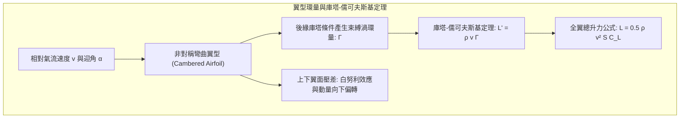
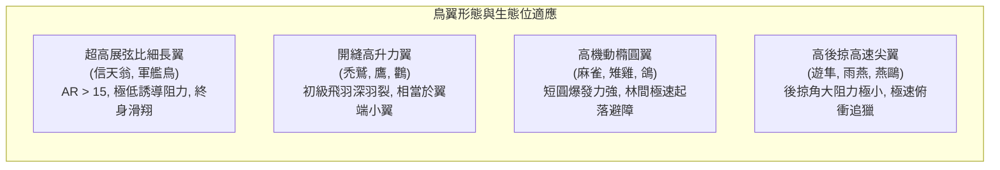
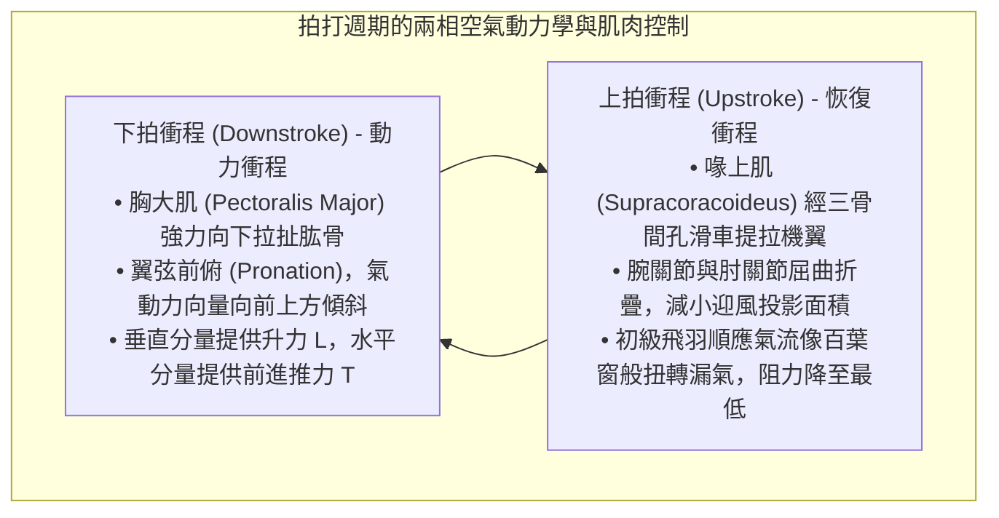
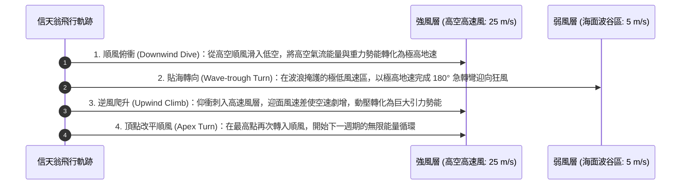
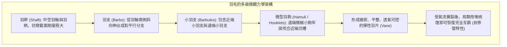
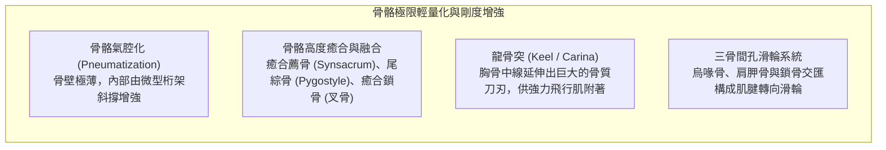
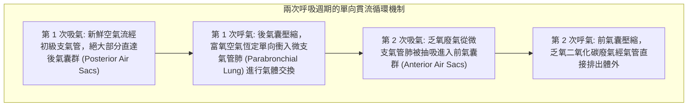
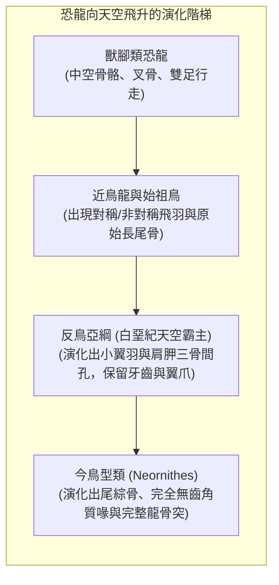

無論是盤旋於上升熱氣流之上的蒼鷹、以超過 380 公里時速俯衝獵殺的遊隼，還是在咆哮南大洋狂風中數年不揮動一次翅膀的信天翁，鳥類在漫長的生命演化史中譜寫了自然界最宏偉的空中傳奇。

人類發明動力飛行器僅有一百多年歷史，而鳥類——作為獸腳類恐龍（Theropod Dinosaurs）的唯一現存後裔——在距今 1.5 億年前的侏儸紀便開始了對重力的史詩級征服。牠們演化出了現代最先進戰鬥機與無人機都無法企及的極高敏捷度、氣動自適應性與卓越能量效率。

鳥類的飛翔絕非簡單的「揮動雙翼」，而是一整套<strong>高度協同的宏觀與微觀生命工程奇蹟：極致輕量化且充滿桁架結構的中空骨骼、倒置滑輪般的強韌飛行肌群、具有奈米級自修復能力的羽毛微觀互鎖系統、高效雙向單向流動的氣囊呼吸系統，以及操縱非定常前緣渦（LEV）的極限流體動力學</strong>。本文將從空氣動力學、生物力學解剖學、生理呼吸機制與恐龍演化歷程四大維度，徹底解析鳥類飛行的終極奧祕。

---

### 1. 翼型與空氣動力學：升力、誘導阻力與展弦比優化

鳥類在空中維持懸浮與巡航的第一物理準則是產生與自身重力 $W = mg$ 相平衡的<strong>升力（Lift: $L$）</strong>，同時克服前進方向上的空氣阻力。

鳥翼在剖面上是天工造化般的非對稱彎曲翼型（Cambered Airfoil），具有平滑隆起的上表面與平凹的下表面。

#### 環量理論與升力方程
根據流體力學中的<strong>庫塔-儒可夫斯基定理（Kutta-Joukowski Theorem）</strong>，翼型在粘性流體中運動時，後緣的光滑離流條件（庫塔條件）誘發了繞翼型的束縛渦環量 $\Gamma$。翼型所受的單位翼展升力 $L'$ 與空氣密度 $\rho$、來流速度 $v$ 及環量 $\Gamma$ 成正比：

$$L' = \rho v \Gamma, \quad L = \frac{1}{2} \rho v^2 S C_L$$

式中 $S$ 為機翼參考面積，$C_L$ 為升力係數（受翼型彎度與攻角 $\alpha$ 共同決定）。

#### 翼端渦與誘導阻力懲罰
伴隨升力產生而來的必然物理代價是<strong>誘導阻力（Induced Drag: $D_i$）</strong>。由於翼下表面處於高壓區，翼上表面處於低壓區，在翼尖處高壓氣流必然繞過翼邊緣向上卷吸，形成兩道旋轉強烈的翼端渦流（Wingtip Vortices）。翼尖渦在整個機翼後方誘導產生強烈的下洗流（Downwash: $w$），使得有效相對來流方向後傾，產生平行於飛行方向的阻力分量：

$$D_i = \frac{1}{2} \rho v^2 S C_{Di} = \frac{1}{2} \rho v^2 S \left(\frac{C_L^2}{\pi AR e}\right)$$

式中 $AR = b^2 / S$ 為<strong>展弦比（Aspect Ratio）</strong>，$e$ 為奧斯瓦爾德機翼效率因子。公式表明：<strong>誘導阻力與展弦比 $AR$ 成嚴格反比</strong>。

1. <strong>超高展弦比翼（信天翁）</strong>：展弦比高達 15~18，翼尖渦影響被稀釋至極小，升阻比高達 20 以上，專為跨洋長途無動力滑翔而生；
2. <strong>羽裂縫開縫翼（鷹、鵰、禿鷲）</strong>：在較低展弦比下，翼端初級飛羽相互分離並向上翹起形成「羽裂（Slots）」。每個羽裂飛羽獨立充當微型小翼，將一個巨大的集中翼尖渦打散為若干相互抵消的微細渦流，大幅減少誘導阻力；
3. <strong>小翼羽（Alula）的防失速機制</strong>：鳥類拇指上著生的 3~5 枚小翼羽，是現代飛機機翼前緣縫翼（Leading-Edge Slat）的天然原型。當鳥類以大迎角低速起降時，展開小翼羽能夠引流高能氣流附著於翼上表面，延緩氣流分離，將失速迎角推遲 10°~15°。

---

### 2. 拍打飛行的非定常流體力學與前緣渦

固定翼飛機依靠固定機翼提供升力、依靠噴氣發動機或螺旋槳提供推力；而鳥類則必須在同一對柔性變形翼面上<strong>同時生成升力和推進力</strong>。

#### 前緣渦（LEV）與動態失速延遲
在低雷諾數與微小型鳥類（如蜂鳥、小型鳴禽）的飛行中，傳統的定常準穩態空氣動力學理論完全無法解釋其驚人的升力水平。生物流體力學家通過粒子圖像測速技術（PIV）發現，鳥類在劇烈拍打時主要依賴<strong>非定常流動機制——前緣渦（Leading-Edge Vortex: LEV）</strong>。

當鳥翼以極大迎角急劇加速拍打時，氣流在翼前緣發生分離並卷起一個高速旋轉的低壓渦流核，緊密貼附於翼面上表面。該前緣渦產生極大的吸力，使得瞬時最大升力係數 $C_L$ 飆升至常規靜止失速極限的 2~3 倍以上。在渦流破裂脫落前，鳥翼已完成了下拍動作，從而完美規避了動態失速帶來的災難性升力喪失。

#### 魏斯-福格「拍合-分離」機制（Clap and Fling）
在極低速起飛與懸停時，部分鳥類（如鴿子、野鴨在受驚起飛瞬間）會在背部將兩翼高高豎起並相互拍合（Clap），隨後機翼前緣率先剝離張開（Fling）。這一瞬間在翼間空隙誘發強烈的吸入氣流，使得兩翼在尚未發生相對平移之前就立即建立了極高強度的束縛渦環量，實現零起步速度下的超常規爆發升力。

---

### 3. 動力翱翔（Dynamic Soaring）：信天翁在大洋風切變中的能量守恆奇蹟

漂泊信天翁體重可達 10 公斤以上，卻能在狂暴的南大洋風暴中連續飛行數千公里而不消耗任何體內代謝肌能。其背後的物理機制被稱為<strong>動力翱翔（Dynamic Soaring）</strong>。

動力翱翔的能量源泉並非上升氣流，而是海洋表面因粘性摩擦形成的<strong>水平風速隨高度激增的垂直風切變層（Wind Shear Layer: $dU/dz$）</strong>。

從力學能量方程分析，信天翁在風切變層中單位質量的能量變化率為：

$$\frac{dE}{dt} = -D v_a - m g w_z - m v_{ax} \frac{dU}{dz} \dot{z}$$

式中第三項即為風切變做功項。信天翁通過精妙的軌道規劃，使得 $-v_{ax} \dot{z}$ 在爬升與俯衝過程中持續保持正值，從大氣風能中汲取的機械能完全補償了空氣粘性摩擦阻力的損耗（$D v_a$），實現了宏觀意義上的<strong>無動力永動巡航</strong>。此外，信天翁肩部還演化出一種特殊的肌腱鎖定機構（Shoulder-lock tendon），可以將張開的翅膀機械式鎖定於水平位置，無需飛行肌持續做功耗能。

---

### 4. 羽毛的微奈米結構與自修復互鎖系統

羽毛是鳥類特有的表皮衍生物，是自然界重量最輕卻比強度最高、耐疲勞性最好的纖維複合材料之一。

#### 微型羽鉤的拉鍊式自癒機制
一枚典型的飛羽包含數十萬條小羽支和數百萬個微米級微型羽鉤（Hamuli）。遠端小羽支末端長有倒鉤，與相鄰近端小羽支邊緣的捲邊形成類似魔鬼氈（Velcro）的微觀互鎖。當鳥類遭遇高空湍流突風造成羽片撕裂時，這種互鎖結構會產生漸進式滑移耗散能量，避免羽軸發生災難性脆性折斷；鳥類在停歇時僅需用鳥喙輕輕梳理（Preening），羽鉤與捲邊便能在微觀力學作用下重新咬合復原。

#### 貓頭鷹消音飛行的聲學仿生
捕食夜行動物的貓頭鷹演化出了極其震撼的無聲飛行羽毛微結構：
1. <strong>前緣鋸齒梳（Leading-edge Serrations）</strong>：第 10 枚初級飛羽前緣具有類似梳狀的小鋸齒，可將進入機翼的大尺度湍流渦旋剪切細碎為無數微渦流；
2. <strong>後緣柔軟流蘇（Trailing-edge Fringe）</strong>：飛羽後緣由柔軟毛狀纖維交織成流蘇，消除了氣流脫離機翼後緣時產生的強烈寬帶氣動噪聲；
3. <strong>表面天鵝絨絨毛（Velvet Surface）</strong>：羽片表面覆蓋著一層吸音微絨毛，使氣流摩擦聲被徹底吸收。

---

### 5. 骨骼與肌肉的極致輕量化工程解剖

鳥類的骨骼與肌肉解剖結構，完全是為抵抗飛行載荷與追求極致輕量化而專門設計的仿生力學傑作。

#### 中空桁架骨骼
鳥類長骨內部幾乎完全中空，充滿空氣（與呼吸氣囊直接相連），但其抗彎與抗扭強度卻絲毫不遜於哺乳動物的實心骨骼。這是因為中空管狀截面的慣性矩（Moment of Inertia: $I = \frac{\pi}{4}(R_o^4 - R_i^4)$）遠大於同等質量的實心軸，且管壁內部交錯分佈著受力線排布的骨質微型桁架（Trusses），完美抵禦局部屈曲失穩。

#### 三骨間孔與倒置滑輪系統
鳥類最重要的兩副飛行肌分別是<strong>胸大肌（Pectoralis Major）</strong>與<strong>喙上肌（Supracoracoideus）</strong>。為了降低身體飛行時的轉動慣量並維持空氣動力學縱向穩定性，沉重的飛行肌群全部集中在身體腹側腹心位置，而不是安裝在背部：
- <strong>胸大肌</strong>：占鳥類總體重 15%~25%，向下牽引肱骨，完成強力下拍動力衝程；
- <strong>喙上肌</strong>：位於胸大肌深層，負責上提機翼。其肌腱穿過烏喙骨、肩胛骨與鎖骨形成的<strong>三骨間孔（Triosseal Canal）</strong>，巧妙利用骨孔邊緣充當機械轉向滑輪，將來自腹側肌肉的向下拉力逆轉為向上提拉機翼的強勁升力。

---

### 6. 雙重單向流氣囊呼吸系統：征服萬米高原的生理引擎

飛行是動物界代謝速率最高、耗氧量最大的運動方式。人類在高空 8000 米處會因缺氧迅速喪失知覺，而斑頭雁（Bar-headed Goose）每年卻能直接飛越海拔近 9000 米的喜馬拉雅山脈。這一神蹟歸功於鳥類獨特的<strong>全單向流雙重氣囊呼吸系統</strong>。

#### 逆流-交叉流氣體交換（Cross-current Exchange）
鳥類的肺部本身是體積恆定、不隨呼吸伸縮擴張的剛性微支氣管管道系統（Parabronchi）。氣囊並不參與氣體交換，而是充當風箱（Bellows）提供動力：
1. <strong>連續單向流動</strong>：無論鳥類處於吸氣還是呼氣階段，微支氣管肺內部的富氧氣流始終保持同一方向持續高速流動，不存在哺乳動物肺泡內的無效死腔混合氣體；
2. <strong>交叉流毛細血管換氣</strong>：微支氣管內部的血流方向與氣流方向呈網狀垂直交叉（Cross-current），動脈血氧分壓甚至能夠超過呼出廢氣中的氧分壓，氣體交換效率為人類肺泡的數倍之多。

---

### 7. 從獸腳類恐龍到現代鳥類的飛翔演化之路

鳥類的起源是古生物學界最具傳奇色彩的發現之一。現代系統發育學與化石證據已確鑿證明：<strong>鳥類就是帶羽毛的獸腳類恐龍（Avian Dinosaurs）</strong>。

#### 地面奔跑（Cursorial）還是樹棲滑翔（Arboreal）？
關於飛行起源的經典假說曾長期分為兩派：
- <strong>樹棲滑翔說（Trees-down）</strong>：祖先爬上樹木，通過跳躍、滑翔逐步演化為動力拍打；
- <strong>奔跑起飛說（Ground-up）</strong>：雙足奔跑恐龍為撲食昆蟲或越障跳躍，揮動前肢演化出飛行。

現代生物力學家肯尼斯·戴爾（Kenneth Dial）提出的<strong>翼輔助傾斜奔跑假說（Wing-Assisted Incline Running: WAIR）</strong>為這一世紀爭論提供了全新突破口：幼鳥在攀爬陡峭懸崖或樹幹樹皮時，並不依靠羽毛產生純空氣動力升力，而是通過高頻拍打翅膀將自身身體緊緊「按壓」在傾斜表面上，借助反作用力增強足底抓地摩擦力。這一行為模式解釋了羽毛與翅膀拍打力學在尚未具備完全空戰飛行能力之前所具有的巨大選擇優勢。

---

### 8. 仿生航空航太：鳥類給予未來飛行器的前沿啟示

億萬年自然選擇精雕細琢的飛行機制，正在深刻重塑人類現代航空航太工程：
1. <strong>自適應變後掠翼與變形機翼（Morphing Wings）</strong>：放棄傳統的剛性液壓副翼，通過柔性智能材料模擬鳥翼肘腕關節的平滑微小形變，消除副翼偏轉引起的邊界層氣流分離與雷達反射面積；
2. <strong>前緣凸起（Leading-Edge Tubercles）與開縫羽尖小翼</strong>：商業客機翼梢小翼（Sharklets）正是對鷹類翼端羽裂縫的直接工程復現，每年為全球航空業節省數百萬噸燃油；
3. <strong>仿生微型撲翼飛行器（Flapping MAV）</strong>：深入利用微尺度雷諾數下的前緣渦（LEV）機制，製造能夠在狹小管道、廢墟或風暴中穩定懸停穿梭的微型無人偵察機。

鳥類用骨骼、羽毛與肌肉寫就的飛行力學史詩，不僅是生物演化史上最璀璨的豐碑，更繼續為人類叩開星空之門提供著源源不絕的物理靈感。
