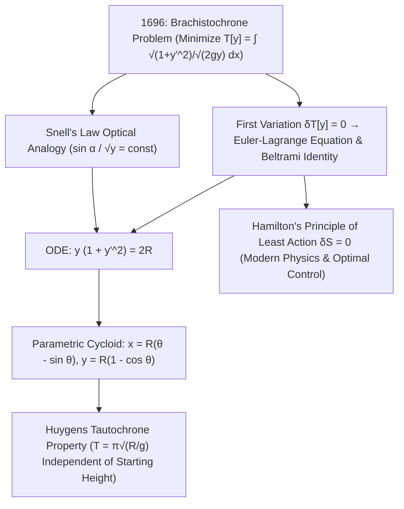

## 1. مقدمة تاريخية وحدس فيزيائي: لماذا يتفوق المنحنى على الخط المستقيم؟

تخيل نقطتين ثابتتين $A(0,0)$ و$B(x_1, y_1)$ على ارتفاعين مختلفين في مستوى رأسي. ما هو الشكل الهندسي الذي يجب أن يتخذه مسار أملس عديم الاحتكاك يصل بين $A$ و$B$ لكي تصل خرزة فولاذية تُترك من السكون عند $A$ تحت تأثير الجاذبية المنتظمة $g$ إلى النقطة $B$ في <strong>أقصر زمن ممكن</strong>؟ يجيب حدسنا الهندسي فوراً: «خط مستقيم، لأن الخط المستقيم هو أقصر مسافة بين نقطتين!». غير أن التجربة الفيزيائية والبرهان الرياضي يثبتان العكس تماماً: فعلى مسار منحني ينحدر بشدة في البداية، تفوز الخرزة بفارق كبير — بل إذا كانت النقطة $B$ بعيدة أفقياً بما يكفي، فإن المنحنى الأسرع <strong>يهبط إلى عمق أخفض من مستوى $B$ ثم يصعد مجدداً ليصل إلى خط النهاية</strong>!

تُعرف هذه المسألة الكلاسيكية باسم <strong>مسألة منحنى الزمن الأقصر أو البراكيستوكرون (Brachistochrone)</strong> (من اليونانية *brakhistos* «الأقصر» و*khronos* «الزمن»). لماذا لا يكون الطريق الأقصر هو الأسرع؟ لأن السرعة الابتدائية عند $A$ تساوي صفراً ($v_0 = 0$). فعلى مستوى مائل مستقيم ذي ميل لطيف، يكون التسارع المماسي $a = g\sin\alpha$ صغيراً، فتقضي الكرة وقتاً طويلاً جداً في البداية وهي تزحف ببطء شديد. أما المسار الذي يهبط رأسياً عند نقطة الانطلاق فإنه يحوّل طاقة الوضع التثاقلية $mgy$ فوراً إلى سرعة عالية $v = \sqrt{2gy}$. وفي عام 1638 أثبت غاليليو في كتابه *علمان جديدان* أن قوس الدائرة أسرع من وترها المستقيم، لكنه ظن خطأً أن الدائرة هي المنحنى الأسرع مطلقاً. وفي يونيو 1696 وجّه <strong>يوهان برنولي</strong> هذا التحدي إلى علماء الرياضيات في أوروبا؛ وفي مساء 29 يناير 1697، بعد عودته من عمله في دار السك الملكية بلندن، حلّ <strong>إسحاق نيوتن</strong> المسألة في بضع ساعات قبل نومه ونشر الحل دون توقيع، مما دفع برنولي إلى القول الشهير: <em>«Tanquam ex ungue leonem (من مخلب الأسد أعرف الأسد)!»</em>.

---

## 2. داليّ زمن الهبوط والمماثلة البصرية ليوهان برنولي (قانون سنيل)

بوضع نقطة الأصل عند $A(0,0)$ مع محور $x$ أفقي <strong>ومحور $y$ يتجه رأسياً إلى الأسفل</strong>، يعطي حفظ الطاقة الميكانيكية $\frac{1}{2}mv^2 = mgy$ السرعة $v(y) = \sqrt{2gy}$. ومع عنصر طول القوس $ds = \sqrt{1 + (y'(x))^2}\,dx$، يصبح الزمن الكلي للهبوط $T[y]$ <strong>دالّياً (Functional)</strong> يأخذ منحنى كاملاً $y(x)$ كمدخل ويعطي عدداً حقيقياً:

$$
T[y] = \int_{A}^{B} \frac{ds}{v(y)} = \frac{1}{\sqrt{2g}} \int_{0}^{x_1} \sqrt{\frac{1 + (y'(x))^2}{y(x)}}\,dx, \qquad \frac{\sin\alpha(y)}{\sqrt{2gy}} = \text{const}
$$

---

## 3. ولادة حساب التغيرات: معادلة أويلر-لاغرانج، متطابقة بلترامي، والمنحنى الدويري

ابتكر يوهان برنولي عام 1696 حلاً فيزيائياًبقرياً باستخدام <strong>مبدأ فيرما للزمن الأقصر</strong>: فالجسيم الذي يتحرك بسرعة $v(y) = \sqrt{2gy}$ يسلك نفس المسار الذي يسلكه شعاع ضوئي يخترق وسطاً طبقياً يتغير معامل انكساره مع العمق وفق $n(y) = c/v(y) \propto y^{-1/2}$! ووفق <strong>قانون سنيل للانكسار</strong>، تحقق الزاوية $\alpha$ مع المحور الرأسي العلاقة $\frac{\sin\alpha}{\sqrt{2gy}} = \text{const}$. وبالتعويض عن $\sin\alpha = \frac{dx}{ds} = \frac{1}{\sqrt{1+(y')^2}}$ نحصل فوراً على المعادلة التفاضلية $y(1 + (y')^2) = 2R$.

ولإيجاد النهايات الصغرى للدالّيات العامة $J[y] = \int L(x,y,y')\,dx$ بطريقة منهجية، أسس ليونهارد أويلر (1744) وجوزيف لويس لاغرانج (1755) <strong>حساب التغيرات (Calculus of Variations)</strong>. وبمساواة التغير الأول بالصفر $\delta J[y;\eta] = 0$ لأي اضطراب $\eta(x)$ ينعدم عند الطرفين، يؤدي التكامل بالتجزئة إلى <strong>معادلة أويلر-لاغرانج</strong>. وبما أن $L(y,y') = \sqrt{\frac{1+(y')^2}{y}}$ لا يعتمد صراحةً على $x$، فإن <strong>متطابقة بلترامي (Beltrami Identity)</strong> $L - y'\frac{\partial L}{\partial y'} = C$ تعطي مباشرة $y(1 + (y')^2) = 2R$. ويثبت التعويض الوسيطي $y = 2R\sin^2(\theta/2) = R(1 - \cos\theta)$ أن منحنى الزمن الأقصر الوحيد هو <strong>المنحنى الدويري (Cycloid)</strong>:

$$
\frac{\partial L}{\partial y} - \frac{d}{dx}\!\left(\frac{\partial L}{\partial y'}\right) = 0 \implies L - y'\frac{\partial L}{\partial y'} = C \implies y\Big(1 + (y')^2\Big) = 2R
$$

---

## 4. المقارنة العددية، منحنى تساوي الزمن لهويغنز، وإرث مبدأ الفعل الأدنى

بين النقطتين $A(0,0)$ و$B(\pi, 2)$، على الرغم من أن طول قوس المنحنى الدويري ($S = 4.000\,\text{m}$) أطول بنسبة $7.4\%$ من الخط المستقيم ($3.724\,\text{m}$)، فإن الخرزة تصل <strong>أسرع بنسبة $18.5\%$</strong>! والأروع من ذلك أن كريستيان هويغنز كان قد أثبت عام 1659 أن هذا المنحنى الدويري نفسه هو أيضاً <strong>منحنى تساوي الزمن (Tautochrone / Isochrone)</strong>: فمهما كان الارتفاع الابتدائي الذي تُترك منه الخرزة على المنحنى الدويري، فإن زمن وصولها إلى القاع يظل ثابتاً دائماً ويساوي $T = \pi\sqrt{R/g}$! ومن رحم حساب التغيرات وُلد <strong>مبدأ الفعل الأدنى لهاملتون ($\delta S = 0$)</strong>، ومبرهنة نويثر، ومعادلات الجيوديسيا في النسبية العامة لأينشتاين، وتكامل المسار لفاينمان، ونظرية التحكم الأمثل الحديثة.

| المنحنى المرشح | المعادلة $y(x)$ | الميل الابتدائي $y'(0)$ | طول القوس $S$ ($A(0,0)\to B(\pi,2)$) | الزمن المعياري ($\sqrt{g}=1$) | الفارق الزمني مقارنة بالدويري |
| :--- | :--- | :--- | :--- | :--- | :--- |
| <strong>1. الخط المستقيم (الأقصر مسافة)</strong> | $y = \frac{2}{\pi}x$ | $0.6366$ ($32.5^\circ$) | <strong>$3.724\,\text{m}$ (الأقصر)</strong> | $3.7242$ | <strong>أبطأ بنسبة $+18.5\%$</strong> |
| <strong>2. القطع المكافئ</strong> | $y = 2\sqrt{x/\pi}$ | $\infty$ (رأسي) | $3.960\,\text{m}$ | $3.2185$ | أبطأ بنسبة $+2.4\%$ |
| <strong>3. قوس الدائرة (تخمين غاليليو)</strong> | دائرة مماسة للمحور $y$ | $\infty$ (رأسي) | $4.062\,\text{m}$ | $3.1829$ | أبطأ بنسبة $+1.3\%$ |
| <strong>4. المنحنى الدويري (البراكيستوكرون)</strong> | $x=\theta-\sin\theta,\; y=1-\cos\theta$ | $\infty$ (رأسي) | $4.000\,\text{m}$ | <strong>$\pi \approx 3.1416$ (الأدنى مطلقاً)</strong> | <strong>الحد الأمثل النظري ($0.0\%$)</strong> |

$$
\boxed{\; x(\theta) = R(\theta - \sin\theta), \qquad y(\theta) = R(1 - \cos\theta), \qquad T_{\text{tautochrone}}(\theta_0) = \pi\sqrt{\frac{R}{g}} \;}
$$

