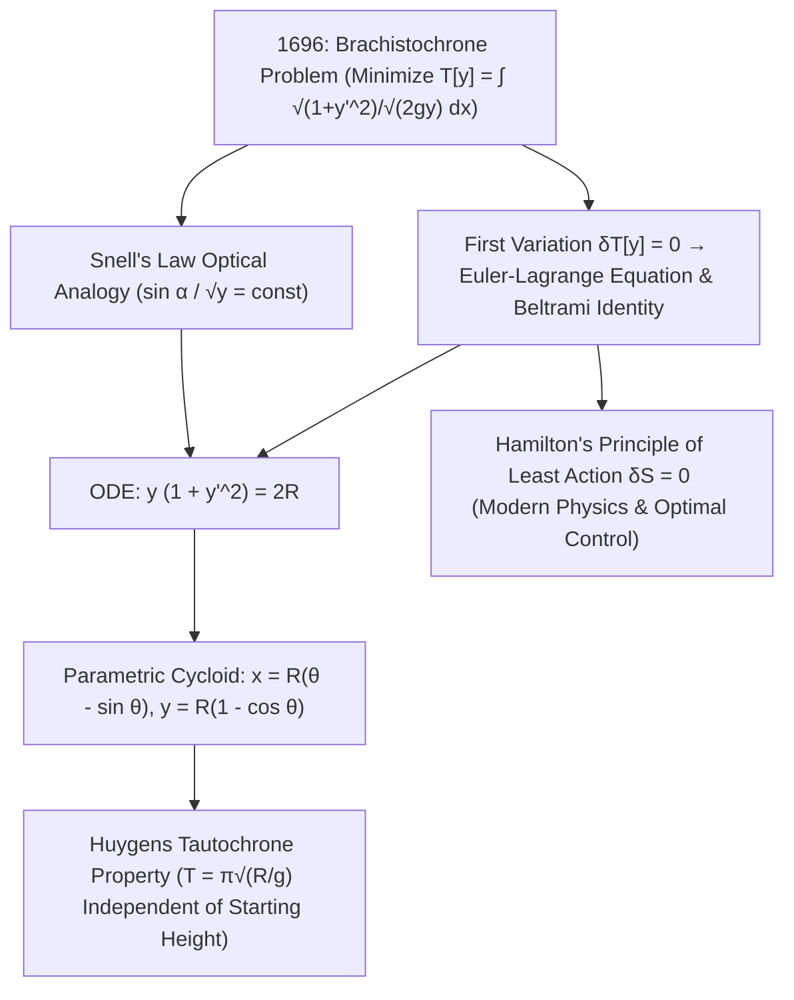

## 1. Historisches Vorspiel und physikalische Intuition: Warum schlägt die Kurve die Gerade?

Stellen wir uns zwei Punkte $A(0,0)$ und $B(x_1, y_1)$ auf unterschiedlicher Höhe in einer vertikalen Ebene vor. Welche Form muss eine reibungsfreie Schiene zwischen $A$ und $B$ haben, damit eine in $A$ aus der Ruhe losgelassene Kugel unter dem Einfluss der Schwerkraft $g$ in der <strong>kürzestmöglichen Zeit</strong> das Ziel $B$ erreicht? Unsere geometrische Intuition antwortet sofort: „Eine Gerade, denn die Gerade ist die kürzeste Verbindung zwischen zwei Punkten!“ Doch Physik und Mathematik beweisen das Gegenteil: Auf einer steil abfallenden Kurve gewinnt die Kugel mit großem Vorsprung – und liegt $B$ horizontal weit genug entfernt, taucht die schnellste Kurve sogar <strong>unter das Niveau von $B$ hinab, um am Ende wieder nach oben ins Ziel zu rollen</strong>!

Dieses Problem heißt das <strong>Brachistochronen-Problem</strong> (von griechisch *brakhistos* „kürzester“ und *khronos* „Zeit“). Warum ist der kürzeste Weg nicht der schnellste? Weil die Anfangsgeschwindigkeit bei $A$ gleich null ist ($v_0 = 0$). Auf einer flachen schiefen Ebene ist die Tangentialbeschleunigung $a = g\sin\alpha$ klein, sodass die Kugel zu Beginn quälend viel Zeit bei minimaler Geschwindigkeit verliert. Stürzt die Bahn hingegen am Start vertikal nach unten, wandelt sie potentielle Energie $mgy$ sofort in hohe Geschwindigkeit $v = \sqrt{2gy}$ um. Galileo Galilei erkannte 1638 in seinen *Discorsi*, dass ein Kreisbogen schneller ist als die gerade Sehne, hielt jedoch fälschlich den Kreis für das absolute Optimum. Im Juni 1696 stellte <strong>Johann Bernoulli</strong> das Problem als öffentliche Herausforderung an die Mathematiker Europas; am Abend des 29. Januar 1697 löste <strong>Isaac Newton</strong> nach einem langen Arbeitstag in der Royal Mint die Aufgabe binnen weniger Stunden vor dem Schlafengehen und veröffentlichte sie anonym – woraufhin Bernoulli ausrief: <em>„Tanquam ex ungue leonem (Am Klauenabdruck erkenne ich den Löwen)!“</em>

---

## 2. Das Zeit-Funktional und Johann Bernoullis optischer Geniestreich (Snellius-Gesetz)

Mit dem Ursprung in $A(0,0)$, horizontaler $x$-Achse und <strong>vertikal nach unten gerichteter $y$-Achse</strong> liefert der Energieerhaltungssatz $\frac{1}{2}mv^2 = mgy$ die allein von der Tiefe abhängige Geschwindigkeit $v(y) = \sqrt{2gy}$. Mit dem Bogenelement $ds = \sqrt{1 + (y'(x))^2}\,dx$ wird die gesamte Laufzeit $T[y]$ zu einem <strong>Funktional</strong> (einer Funktion, die einer ganzen Kurve $y(x)$ eine reelle Zahl zuordnet):

$$
T[y] = \int_{A}^{B} \frac{ds}{v(y)} = \frac{1}{\sqrt{2g}} \int_{0}^{x_1} \sqrt{\frac{1 + (y'(x))^2}{y(x)}}\,dx, \qquad \frac{\sin\alpha(y)}{\sqrt{2gy}} = \text{const}
$$

---

## 3. Die Geburt der Variationsrechnung: Euler-Lagrange-Gleichung, Beltrami-Identität und Zykloide

Johann Bernoulli fand 1696 eine brillante physikalische Abkürzung über das <strong>Fermatsche Prinzip der kürzesten Zeit</strong>: Eine Kugel mit der Geschwindigkeit $v(y) = \sqrt{2gy}$ folgt exakt derselben Bahn wie ein Lichtstrahl in einem optischen Medium mit tiefenabhängigem Brechungsindex $n(y) = c/v(y) \propto y^{-1/2}$! Nach dem <strong>Snelliusschen Brechungsgesetz</strong> gilt für den Winkel $\alpha$ zur Vertikalen $\frac{\sin\alpha}{\sqrt{2gy}} = \text{const}$. Mit $\sin\alpha = \frac{dx}{ds} = \frac{1}{\sqrt{1+(y')^2}}$ folgt sofort die Differentialgleichung $y(1 + (y')^2) = 2R$.

Um allgemeine Funktionale $J[y] = \int L(x,y,y')\,dx$ systematisch zu minimieren, entwickelten Leonhard Euler (1744) und Joseph-Louis Lagrange (1755) die <strong>Variationsrechnung</strong>. Setzt man die erste Variation $\delta J[y;\eta] = \left.\frac{d}{d\varepsilon}J[y+\varepsilon\eta]\right|_{\varepsilon=0} = 0$ für beliebige Testfunktionen $\eta(x)$ mit $\eta(0)=\eta(x_1)=0$, liefert partielle Integration die <strong>Euler-Lagrange-Gleichung</strong>. Da $L(y,y') = \sqrt{\frac{1+(y')^2}{y}}$ nicht explizit von $x$ abhängt, reduziert die <strong>Beltrami-Identität</strong> $L - y'\frac{\partial L}{\partial y'} = C$ das Problem direkt auf $y(1 + (y')^2) = 2R$. Die Substitution $y = 2R\sin^2(\theta/2) = R(1 - \cos\theta)$ liefert als eindeutige Lösung die <strong>Zykloide (Rollkurve)</strong>:

$$
\frac{\partial L}{\partial y} - \frac{d}{dx}\!\left(\frac{\partial L}{\partial y'}\right) = 0 \implies L - y'\frac{\partial L}{\partial y'} = C \implies y\Big(1 + (y')^2\Big) = 2R
$$

---

## 4. Numerischer Vergleich, Huygens’ Tautochrone und das Prinzip der kleinsten Wirkung

Für den Weg von $A(0,0)$ nach $B(\pi, 2)$ ist die Zykloide ($S = 4{,}000\,\text{m}$) zwar um $7{,}4\%$ länger als die Gerade ($3{,}724\,\text{m}$), erreicht das Ziel aber um <strong>$18{,}5\%$ schneller</strong>! Überdies bewies Christiaan Huygens bereits 1659, dass genau dieselbe Zykloide auch die <strong>Tautochrone (Isochrone)</strong> ist: Egal aus welcher Starthöhe $y_0$ eine Kugel auf einer Zykloidenbahn losgelassen wird, sie benötigt bis zum tiefsten Punkt immer exakt dieselbe Zeit $T = \pi\sqrt{R/g}$! Aus der Variationsrechnung der Brachistochrone erwuchsen das <strong>Hamiltonsche Prinzip der kleinsten Wirkung ($\delta S = 0$)</strong>, das Noether-Theorem, Einsteins Geodätengleichung der Allgemeinen Relativitätstheorie, Feynmans Pfadintegral der Quantenmechanik und die moderne optimale Steuerungstheorie.

| Kandidatenkurve | Gleichung $y(x)$ | Startsteigung $y'(0)$ | Bogenlänge $S$ ($A(0,0)\to B(\pi,2)$) | Normierte Laufzeit ($\sqrt{g}=1$) | Zeitverlust gegenüber Zykloide |
| :--- | :--- | :--- | :--- | :--- | :--- |
| <strong>1. Gerade (Kürzeste Strecke)</strong> | $y = \frac{2}{\pi}x$ | $0{,}6366$ ($32{,}5^\circ$) | <strong>$3{,}724\,\text{m}$ (Minimum)</strong> | $3{,}7242$ | <strong>$+18{,}5\%$ langsamer</strong> |
| <strong>2. Parabel</strong> | $y = 2\sqrt{x/\pi}$ | $\infty$ (vertikal) | $3{,}960\,\text{m}$ | $3{,}2185$ | $+2{,}4\%$ langsamer |
| <strong>3. Kreisbogen (Galileis Tipp)</strong> | Kreis tangential zur $y$-Achse | $\infty$ (vertikal) | $4{,}062\,\text{m}$ | $3{,}1829$ | $+1{,}3\%$ langsamer |
| <strong>4. Zykloide (Brachistochrone)</strong> | $x=\theta-\sin\theta,\; y=1-\cos\theta$ | $\infty$ (vertikal) | $4{,}000\,\text{m}$ | <strong>$\pi \approx 3{,}1416$ (Absolutes Minimum)</strong> | <strong>Theoretisches Optimum ($0{,}0\%$)</strong> |

$$
\boxed{\; x(\theta) = R(\theta - \sin\theta), \qquad y(\theta) = R(1 - \cos\theta), \qquad T_{\text{tautochrone}}(\theta_0) = \pi\sqrt{\frac{R}{g}} \;}
$$

