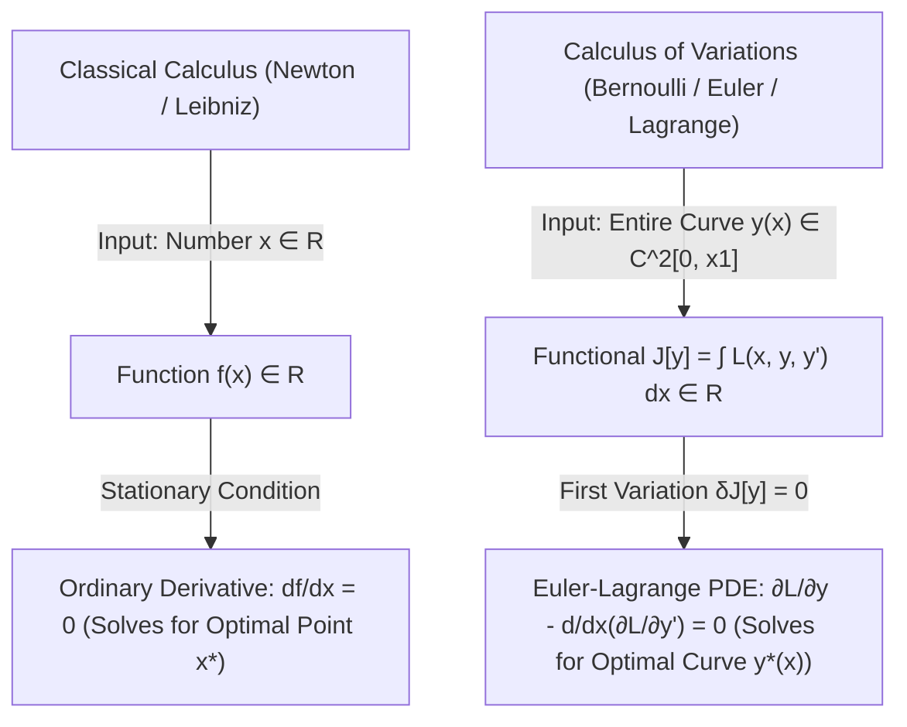
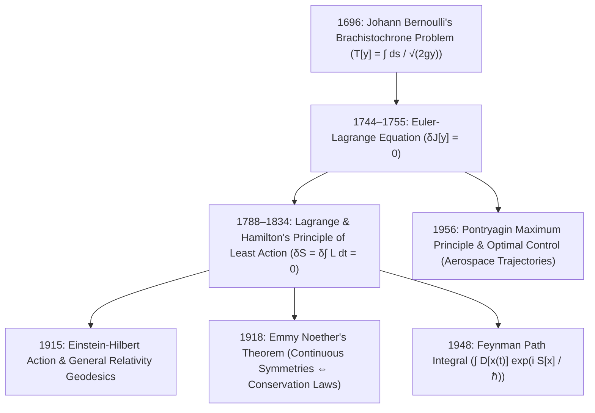

Imagine two points $A$ and $B$ fixed in a vertical plane at different heights, where $B$ is lower than $A$ but not directly beneath it. If you release a frictionless steel bead from rest at $A$ under uniform gravity $g$, what shape should the wire track connecting $A$ to $B$ take so that the bead reaches $B$ in the <strong>shortest possible time</strong>?

Our geometric intuition immediately whispers: <em>"A straight line! After all, the straight line is the shortest distance between two points."</em>

Yet if you build a museum track with a straight inclined ramp alongside a steeply dipping curved track, the bead on the curved track wins by a wide margin—even though it travels a significantly longer distance! In fact, if point $B$ is far enough horizontally from $A$, the fastest possible curve actually <strong>dips below the height of $B$</strong> and climbs back up at the end to reach the finish line faster than any monotonically descending path.

This deceptively simple question—the <strong>Brachistochrone Problem</strong> (from the Greek *brakhistos*, "shortest," and *khronos*, "time")—was posed as a public challenge to the mathematicians of Europe by <strong>Johann Bernoulli</strong> in June 1696. Solving it required a fundamental leap beyond the ordinary differential calculus of Isaac Newton and Gottfried Wilhelm Leibniz: instead of finding a single number $x^*$ that minimizes a function $f(x)$, mathematicians had to find an entire <em>unknown function</em> $y(x)$ out of an infinite-dimensional space of curves that minimizes an integral <strong>functional</strong> $T[y]$.

That leap gave birth to the <strong>Calculus of Variations</strong>—the mathematical engine behind the Euler-Lagrange equations, Hamilton's Principle of Least Action, Noether's Theorem, Einstein's General Relativity geodesics, Feynman's Path Integral formulation of quantum mechanics, and modern Optimal Control Theory. In this article, we trace the dramatic history and derive every equation of the Brachistochrone and Tautochrone from first principles.

---

## 1. Historical Prelude: From Galileo's Error to Newton's "Lion's Claw"

### 1.1 Galileo's 1638 Analysis of Chords of a Circle

The earliest mathematical investigation of fastest descent appears in <strong>Galileo Galilei's</strong> final masterpiece, *Discorsi e Dimostrazioni Matematiche intorno a due nuove scienze* (*Two New Sciences*, 1638). Galileo proved geometrically that a bead sliding down a sequence of inscribed polygonal chords of a vertical circle reaches the bottom point in less time than a bead sliding directly down the single straight chord connecting the endpoints.

Why? Because at the start of the motion, the bead's speed is zero ($v_0 = 0$). On a gentle straight ramp of small slope angle $\alpha$, the tangential acceleration $a = g \sin\alpha$ is tiny, so the bead spends a painfully long time creeping through the initial part of the track at near-zero speed. By contrast, a path that plunges steeply downward right at the beginning rapidly converts gravitational potential energy $mgy$ into high kinetic speed $v = \sqrt{2gy}$, allowing it to traverse the longer horizontal distance at high velocity.

Extrapolating from inscribed polygons to the limit of infinitely many sides, Galileo concluded that the <strong>arc of a circle</strong> was the curve of fastest descent. His physical intuition about initial steepness was spot-on, and a circular arc indeed beats a straight line—but Galileo's conjecture that the circle is the <em>absolute</em> fastest curve was wrong.

### 1.2 Johann Bernoulli's June 1696 Challenge and the Five Solutions

In the June 1696 issue of Gottfried Wilhelm Leibniz's journal *Acta Eruditorum*, the 28-year-old Swiss mathematician <strong>Johann Bernoulli</strong> issued a famous challenge to the "sharpest mathematicians in the entire world":

> *"Given two points $A$ and $B$ in a vertical plane, to assign to a mobile particle $M$ the path $AMB$ along which, descending by its own weight and starting from $A$, it arrives at $B$ in the shortest time."*

Johann Bernoulli secretly aimed the challenge at two rivals: his older brother <strong>Jakob Bernoulli</strong> (with whom he was locked in a bitter public feud) and <strong>Isaac Newton</strong> (whom Leibniz's continental followers suspected of having lost his mathematical edge since becoming Warden of the Royal Mint in London).

When the original six-month deadline expired, only Leibniz had solved it, and at Leibniz's suggestion Johann extended the deadline to Easter 1697 and mailed a copy directly to Newton in London. According to the famous memoir of Newton's niece, Catherine Barton Conduitt:
- Newton returned home from the Royal Mint at <strong>4:00 PM on January 29, 1697</strong>, exhausted after a full day of administrative work overseeing the Great Recoinage of England.
- He found Bernoulli's challenge waiting in his mail, sat down after dinner, and <strong>solved the entire Brachistochrone problem before going to bed at 4:00 AM</strong>—inventing variational calculus on the spot!
- The next morning, Newton sent his solution to the Royal Society for publication <strong>anonymously</strong> in the *Philosophical Transactions*.

When Johann Bernoulli opened the English journal and read the anonymous two-page masterpiece, he immediately recognized the unmistakable genius of its author, uttering the immortal Latin phrase:

> <strong>*"Tanquam ex ungue leonem"</strong>* (*"I recognize the lion by his claw."*)

By Easter 1697, exactly <strong>five solutions</strong> had been collected:
1. <strong>Johann Bernoulli</strong> (using an ingenious optical analogy via Fermat's Principle and Snell's Law).
2. <strong>Jakob Bernoulli</strong> (using a rigorous infinitesimal variation of curve elements—the direct ancestor of the general Calculus of Variations).
3. <strong>Gottfried Wilhelm Leibniz</strong> (differential integration).
4. <strong>Guillaume de l'Hôpital</strong> (assisted by Johann Bernoulli).
5. <strong>Isaac Newton</strong> (anonymous geometric-variational synthesis).

All five proved that the unique curve of fastest descent is an inverted <strong>Cycloid</strong>—the curve traced by a point on the rim of a circular wheel rolling without slipping along a horizontal ceiling!

---

## 2. Formulating the Functional: Functions vs. Functionals

Let us set up a Cartesian coordinate system with the origin $(0, 0)$ at the starting point $A$, where the horizontal axis $x$ points toward the target $B(x_1, y_1)$ and the <strong>vertical axis $y$ points strictly DOWNWARD</strong> in the direction of gravity $\mathbf{g}$.

When a particle of mass $m$ starts from rest at $A(0, 0)$ and slides without friction to depth $y(x)$ along a smooth curve $y = y(x)$, conservation of mechanical energy ($K + U = 0$) dictates:

$$
\frac{1}{2} m v^2 - m g y = 0 \implies v(y) = \frac{ds}{dt} = \sqrt{2 g y}
$$

Notice a remarkable property of conservative gravity: the speed $v(y) = \sqrt{2gy}$ at any point depends <strong>only on the vertical depth $y$</strong>, completely independent of the path taken to reach that depth!

Meanwhile, by the Pythagorean theorem, an infinitesimal arc length $ds$ along the curve $y(x)$ is:

$$
ds = \sqrt{dx^2 + dy^2} = \sqrt{1 + \left(\frac{dy}{dx}\right)^2}\,dx = \sqrt{1 + (y'(x))^2}\,dx
$$

The infinitesimal time $dt$ required to traverse $ds$ at speed $v(y)$ is $dt = \frac{ds}{v(y)}$. Integrating from $x = 0$ to $x = x_1$ yields the <strong>Total Descent Time Functional $T[y]$</strong>:

$$
T[y] = \int_{A}^{B} \frac{ds}{v(y)} = \frac{1}{\sqrt{2g}} \int_{0}^{x_1} \sqrt{\frac{1 + (y'(x))^2}{y(x)}}\,dx
$$

subject to the fixed boundary conditions:

$$
y(0) = 0, \qquad y(x_1) = y_1 > 0
$$

Look closely at the mathematical structure of $T[y]$:
- In ordinary calculus, a <strong>function</strong> $f: \mathbb{R}^n \to \mathbb{R}$ maps a finite-dimensional vector $\mathbf{x}$ to a real number, and we find extrema by setting the gradient $\nabla f(\mathbf{x}) = \mathbf{0}$.
- Here, $T: C^2([0, x_1]) \to \mathbb{R}$ is a <strong>functional</strong> (a "function of a function"): its input is an entire continuous curve $y(x)$ belonging to an infinite-dimensional function space, and its output is a single real number (the descent time in seconds).
- Look at the tug-of-war inside the integrand $\sqrt{\frac{1 + (y')^2}{y}}$: to make the denominator $\sqrt{y(x)}$ large early on, we want $y(x)$ to grow rapidly near $x = 0$; yet making $y(x)$ grow too steeply inflates the numerator $\sqrt{1 + (y'(x))^2}$ (arc length)! The optimal curve must strike the exact mathematical balance between <strong>gaining speed early (large $y$)</strong> and <strong>not wasting path length (moderate $y'$)</strong>.

---

## 3. Johann Bernoulli's Masterstroke: Fermat's Principle and the Optical Analogy

Before we derive the general Euler-Lagrange equation, let us admire Johann Bernoulli's breathtaking 1696 shortcut, which solved an infinite-dimensional mechanics problem without a single variational derivative by mapping gravity onto <strong>optics</strong>!

In 1662, <strong>Pierre de Fermat</strong> had established <strong>Fermat's Principle of Least Time</strong>: *A ray of light traveling between two points $A$ and $B$ in an inhomogeneous optical medium always follows the path that minimizes total travel time $T = \int \frac{ds}{v(x,y)}$.*

When a light ray crosses the horizontal interface between Layer 1 (where light travels at phase speed $v_1$) and Layer 2 (where light travels at speed $v_2$), Fermat's Principle immediately yields <strong>Snell's Law of Refraction</strong>:

$$
\frac{\sin\alpha_1}{v_1} = \frac{\sin\alpha_2}{v_2} = \text{constant}
$$

where $\alpha$ is the angle between the ray's tangent vector and the vertical normal axis $y$.

Johann Bernoulli realized that a bead sliding under gravity with speed $v(y) = \sqrt{2gy}$ is <strong>mathematically identical to a light ray propagating through a horizontally stratified atmosphere whose optical refractive index $n(y) = c / v(y) \propto y^{-1/2}$ decreases continuously with depth $y$</strong>!

Therefore, along the optimal Brachistochrone curve, Snell's Law must hold at every depth $y$:

$$
\frac{\sin\alpha(y)}{v(y)} = \frac{\sin\alpha(y)}{\sqrt{2 g y}} = \text{constant}
$$

Since $\alpha$ is the angle between the curve's tangent and the vertical $y$-axis, basic trigonometry gives $\tan\alpha = \frac{dx}{dy} = \frac{1}{y'(x)}$, so:

$$
\sin\alpha = \frac{\tan\alpha}{\sqrt{1 + \tan^2\alpha}} = \frac{1 / y'}{\sqrt{1 + (1/y')^2}} = \frac{1}{\sqrt{1 + (y'(x))^2}}
$$

Substituting $\sin\alpha$ into Snell's law and squaring both sides yields the fundamental differential equation of the Brachistochrone:

$$
y(x) \Big( 1 + \big(y'(x)\big)^2 \Big) = 2 R = \text{constant}
$$

where $2R > 0$ is a positive constant with dimensions of length! In just four lines of physical insight, Johann Bernoulli reduced an infinite-dimensional variational problem to a first-order ordinary differential equation.

---

## 4. Rigorous Derivation: The Euler-Lagrange Equation and Beltrami Identity

### 4.1 First Variation $\delta J[y] = 0$ and the Fundamental Lemma

How do we solve general functional optimization problems when no clever optical trick is available? In 1744, <strong>Leonhard Euler</strong> (and in 1755 the 19-year-old <strong>Joseph-Louis Lagrange</strong>) developed the systematic method of <strong>First Variations</strong>.

Consider a general functional of the form:

$$
J[y] = \int_{x_0}^{x_1} L\big(x, y(x), y'(x)\big)\,dx, \qquad y(x_0) = y_0, \quad y(x_1) = y_1
$$

Suppose $y(x)$ is the true minimizing curve. Let $\eta(x) \in C^2([x_0, x_1])$ be an arbitrary smooth perturbation ("test function") that vanishes at both fixed endpoints:

$$
\eta(x_0) = 0, \qquad \eta(x_1) = 0
$$

We construct a one-parameter family of neighboring deformed curves $Y(x; \varepsilon) = y(x) + \varepsilon \eta(x)$ for a small real parameter $\varepsilon \in \mathbb{R}$. Since every curve $Y(x; \varepsilon)$ satisfies the boundary conditions and $J[Y(\cdot; \varepsilon)]$ attains its minimum at $\varepsilon = 0$, the ordinary derivative with respect to $\varepsilon$ must vanish at $\varepsilon = 0$:

$$
\delta J[y; \eta] \equiv \left. \frac{d}{d\varepsilon} J[y + \varepsilon \eta] \right|_{\varepsilon=0} = \int_{x_0}^{x_1} \left( \frac{\partial L}{\partial y} \eta(x) + \frac{\partial L}{\partial y'} \eta'(x) \right) dx = 0
$$

To factor out the arbitrary function $\eta(x)$, we integrate the second term $\frac{\partial L}{\partial y'}\eta'(x)$ <strong>by parts</strong>:

$$
\int_{x_0}^{x_1} \frac{\partial L}{\partial y'} \eta'(x)\,dx = \underbrace{\left[ \frac{\partial L}{\partial y'} \eta(x) \right]_{x_0}^{x_1}}_{=\, 0 \text{ since } \eta(x_0)=\eta(x_1)=0} - \int_{x_0}^{x_1} \frac{d}{dx}\!\left(\frac{\partial L}{\partial y'}\right) \eta(x)\,dx
$$

Substituting this back into $\delta J = 0$ gives:

$$
\int_{x_0}^{x_1} \left[ \frac{\partial L}{\partial y} - \frac{d}{dx}\!\left(\frac{\partial L}{\partial y'}\right) \right] \eta(x)\,dx = 0 \qquad \forall \eta(x) \text{ with } \eta(x_0) = \eta(x_1) = 0
$$

By the <strong>Fundamental Lemma of the Calculus of Variations (Du Bois-Reymond Lemma)</strong>, if a continuous function multiplied by *every* smooth vanishing test function $\eta(x)$ integrates to zero, the bracketed expression itself must vanish identically at every point $x \in [x_0, x_1]$. We have proved the <strong>Euler-Lagrange Equation</strong>:

$$
\frac{\partial L}{\partial y} - \frac{d}{dx}\!\left(\frac{\partial L}{\partial y'}\right) = 0
$$

### 4.2 The Beltrami Identity and Parametric Cycloid Solution

When the integrand $L(y, y')$ does not depend explicitly on the independent variable $x$ ($\frac{\partial L}{\partial x} = 0$, as in our Brachistochrone integrand $L(y, y') = \sqrt{\frac{1 + (y')^2}{y}}$), the total derivative of $L$ with respect to $x$ satisfies:

$$
\frac{dL}{dx} = \frac{\partial L}{\partial y}y' + \frac{\partial L}{\partial y'}y'' = \left[\frac{d}{dx}\!\left(\frac{\partial L}{\partial y'}\right)\right] y' + \frac{\partial L}{\partial y'}y'' = \frac{d}{dx}\!\left( y' \frac{\partial L}{\partial y'} \right)
$$

Integrating once immediately yields Eugenio Beltrami's 1868 shortcut—the <strong>Beltrami Identity</strong> (physically equivalent to conservation of the Hamiltonian / energy via Noether's Theorem):

$$
L - y' \frac{\partial L}{\partial y'} = C = \text{constant}
$$

Let us plug our Brachistochrone Lagrangian $L(y, y') = \sqrt{\frac{1 + (y')^2}{y}}$ into the Beltrami Identity:

$$
\frac{\partial L}{\partial y'} = \frac{y'}{\sqrt{y\big(1 + (y')^2\big)}}
$$

$$
L - y'\frac{\partial L}{\partial y'} = \frac{1 + (y')^2}{\sqrt{y\big(1 + (y')^2\big)}} - \frac{(y')^2}{\sqrt{y\big(1 + (y')^2\big)}} = \frac{1}{\sqrt{y\big(1 + (y')^2\big)}} = C
$$

Squaring and inverting with $C = 1/\sqrt{2R}$ recovers the exact ODE we found via Snell's Law:

$$
y \Big( 1 + \big(y'\big)^2 \Big) = 2R \implies \frac{dy}{dx} = \sqrt{\frac{2R - y}{y}} \implies dx = \sqrt{\frac{y}{2R - y}}\,dy
$$

To integrate this cleanly, introduce the trigonometric substitution:

$$
y(\theta) = 2R \sin^2\!\left(\frac{\theta}{2}\right) = R(1 - \cos\theta), \qquad dy = R \sin\theta\,d\theta
$$

Then $\sqrt{\frac{y}{2R - y}} = \sqrt{\frac{2R\sin^2(\theta/2)}{2R\cos^2(\theta/2)}} = \tan\!\left(\frac{\theta}{2}\right)$, and substituting into $dx$ gives:

$$
dx = \tan\!\left(\frac{\theta}{2}\right) \cdot R \sin\theta\,d\theta = R \frac{\sin(\theta/2)}{\cos(\theta/2)} \cdot 2\sin\!\left(\frac{\theta}{2}\right)\cos\!\left(\frac{\theta}{2}\right) d\theta = 2R \sin^2\!\left(\frac{\theta}{2}\right) d\theta = R(1 - \cos\theta)\,d\theta
$$

Integrating from the origin $(x=0, y=0 \iff \theta=0)$ yields the celebrated <strong>Parametric Equations of the Cycloid</strong>:

$$
\boxed{\; x(\theta) = R(\theta - \sin\theta), \qquad y(\theta) = R(1 - \cos\theta) \;}
$$

where $R > 0$ is the radius of the rolling circle that generates the cycloid, and $\theta \in [0, \theta_1]$ is the angle through which the generating wheel has rolled!

---

## 5. Quantitative Showdown: Straight Line vs. Parabola vs. Circle vs. Cycloid

How much faster is the Cycloid in actual numbers? Suppose our starting point is $A(0, 0)$ and our target point is $B(x_1, y_1) = (\pi\,\text{m}, 2\,\text{m})$ under standard gravity $g = 9.80665\,\text{m/s}^2$ (chosen so that the cycloid with wheel radius $R = 1\,\text{m}$ reaches its exact bottom cusp $\theta_1 = \pi$ right at $B(\pi, 2)$).

Let us compute the exact descent time $T = \frac{1}{\sqrt{2g}}\int_0^{\pi} \sqrt{\frac{1+(y')^2}{y}}\,dx$ across four classic candidate paths connecting $A(0,0)$ to $B(\pi, 2)$:

| Candidate Curve | Mathematical Equation $y(x)$ | Initial Slope $y'(0)$ | Total Arc Length $S$ ($\text{m}$) | Exact Descent Time $T$ (Normalized $\sqrt{g}=1$) | Real Time at $g=9.81\,\text{m/s}^2$ |
| :--- | :--- | :--- | :--- | :--- | :--- |
| <strong>1. Straight Line (Shortest Distance)</strong> | $y(x) = \frac{2}{\pi}x \approx 0.6366x$ | $0.6366$ ($32.5^\circ$) | $S_{\min} = \sqrt{\pi^2 + 4} = \mathbf{3.724\,\text{m}}$ | $T_{\text{line}} = \sqrt{\pi^2 + 4} \approx 3.7242$ | $1.189\,\text{s}$ ($+18.5\%$ slower!) |
| <strong>2. Convex Parabola</strong> | $y(x) = 2\sqrt{x/\pi}$ | $\infty$ ($90^\circ$ vertical) | $S \approx 3.960\,\text{m}$ | $T_{\text{parab}} \approx 3.2185$ | $1.028\,\text{s}$ ($+2.4\%$ slower) |
| <strong>3. Circular Arc (Galileo's Guess)</strong> | Circle tangent to $y$-axis at $(0,0)$ | $\infty$ ($90^\circ$ vertical) | $S \approx 4.062\,\text{m}$ | $T_{\text{circle}} \approx 3.1829$ | $1.016\,\text{s}$ ($+1.3\%$ slower) |
| <strong>4. Cycloid (Brachistochrone)</strong> | $x = \theta-\sin\theta,\; y = 1-\cos\theta$ | $\infty$ ($90^\circ$ vertical) | $S = 4R = \mathbf{4.000\,\text{m}}$ | $T_{\text{cycloid}} = \mathbf{\pi \approx 3.1416}$ | <strong>$1.003\,\text{s}$ (Absolute Minimum!)</strong> |

Look at those numbers:
- Even though the Cycloid path ($4.000\,\text{m}$) is <strong>$7.4\%$ longer</strong> than the straight line ($3.724\,\text{m}$), the bead on the Cycloid arrives <strong>$18.5\%$ faster</strong>!
- Even more remarkably, what happens if the horizontal distance $x_1$ is *greater* than $\frac{\pi}{2} y_1$ (for instance, $x_1 = 5\,\text{m}$ and $y_1 = 1\,\text{m}$)? Then the unique cycloid connecting $A(0,0)$ to $B(x_1, y_1)$ has $\theta_1 > \pi$: <strong>the track plunges down to a minimum depth $y_{\max} = 2R > y_1$ BELOW the target point $B$, and then climbs back uphill to reach $B$</strong>—and it still beats every path that never dips below $y_1$!

---

## 6. Huygens's Miracle: The Cycloid Is Also the Tautochrone (Isochrone) Curve!

In 1659 (published in *Horologium Oscillatorium*, 1673), twenty-three years before Bernoulli's challenge, the Dutch physicist <strong>Christiaan Huygens</strong> asked a seemingly unrelated question while trying to build an accurate marine pendulum clock to solve the Longitude Problem at sea:

> *A normal circular pendulum is NOT strictly isochronous: its period increases at larger swing amplitudes ($T(\theta_0) = 2\pi\sqrt{L/g}\big(1 + \frac{1}{16}\theta_0^2 + \dots\big)$). What curve has the property that a frictionless bead released from rest at <strong>ANY</strong> starting height $y_0$ along the curve always reaches the bottom in the <strong>EXACT SAME TIME $T$</strong>?*

Such a curve is called a <strong>Tautochrone</strong> (or <strong>Isochrone</strong>, "equal time"). Let us prove that our Cycloid $x(\theta) = R(\theta - \sin\theta),\; y(\theta) = R(1 - \cos\theta)$ is *also* the Tautochrone!

Along the cycloid, the arc-length element $ds$ from $\theta$ to the bottom $\theta = \pi$ is:

$$
ds = \sqrt{(dx)^2 + (dy)^2} = R \sqrt{(1 - \cos\theta)^2 + \sin^2\theta}\,d\theta = R \sqrt{2(1 - \cos\theta)}\,d\theta = 2R \sin\!\left(\frac{\theta}{2}\right) d\theta
$$

Suppose we release the bead not from the top cusp $\theta = 0$, but from an arbitrary intermediate angle $\theta_0 \in [0, \pi)$ at depth $y_0 = R(1 - \cos\theta_0) = 2R\sin^2(\theta_0/2)$. By conservation of energy from starting depth $y_0$ to depth $y(\theta)$, its speed is $v(\theta) = \sqrt{2g\big(y(\theta) - y_0\big)}$, so the time to reach the bottom ($\theta = \pi$, where $\cos(\theta/2) = 0$) is:

$$
T(\theta_0) = \int_{\theta_0}^{\pi} \frac{2R \sin(\theta/2)\,d\theta}{\sqrt{2g \cdot 2R \big[\sin^2(\theta/2) - \sin^2(\theta_0/2)\big]}} = \sqrt{\frac{R}{g}} \int_{\theta_0}^{\pi} \frac{\sin(\theta/2)\,d\theta}{\sqrt{\cos^2(\theta_0/2) - \cos^2(\theta/2)}}
$$

Now make the simple substitution $u = \frac{\cos(\theta/2)}{\cos(\theta_0/2)}$, so that $du = -\frac{\sin(\theta/2)}{2\cos(\theta_0/2)}\,d\theta$. Notice how $\cos(\theta_0/2)$ in the numerator and denominator <strong>cancels out completely</strong>:

$$
T(\theta_0) = 2\sqrt{\frac{R}{g}} \int_{0}^{1} \frac{du}{\sqrt{1 - u^2}} = 2\sqrt{\frac{R}{g}} \Big[ \arcsin(u) \Big]_{0}^{1} = \mathbf{\pi \sqrt{\frac{R}{g}}} \qquad (\text{Independent of }\theta_0\text{!})
$$

Whether you release a bead $1\,\text{millimeter}$ from the bottom of a cycloid bowl or from the very top rim, both beads reach the bottom at the exact same millisecond! As Johann Bernoulli wrote in awe in 1697: *"Nature always acts in the simplest way: one and the same cycloid curve serves both for the shortest descent (Brachistochrone) and for equal-time oscillations (Tautochrone)."*

---

## 7. Summary: How One Curve Transformed All of Theoretical Physics

Let us synthesize what the Brachistochrone taught humanity:
1. <strong>Why Shortest Distance $\ne$ Shortest Time</strong>: Because initial velocity is zero, minimizing $\int ds/v(y)$ requires sacrificing shortest geometric path length in order to dive steeply at the start and harvest high velocity $\sqrt{2gy}$ early.
2. <strong>Optical-Mechanical Duality</strong>: Via Fermat's Principle and Snell's Law ($\sin\alpha / \sqrt{y} = \text{const}$), a particle falling in gravity moves like a light ray refracting through a medium of index $n(y) \propto y^{-1/2}$—a duality that directly inspired William Rowan Hamilton's optical-mechanical theory and Erwin Schrödinger's 1926 wave equation of quantum mechanics!
3. <strong>The Birth of Variational Calculus</strong>: Generalizing $df/dx = 0$ to $\delta J[y] = 0$ via the Euler-Lagrange equation shifted physics from Newtonian force vectors ($\mathbf{F} = m\mathbf{a}$) to global action functionals ($S[q] = \int (T - V)\,dt$), uniting classical mechanics, electromagnetism, relativity, quantum field theory, and modern optimal control under a single variational architecture.
