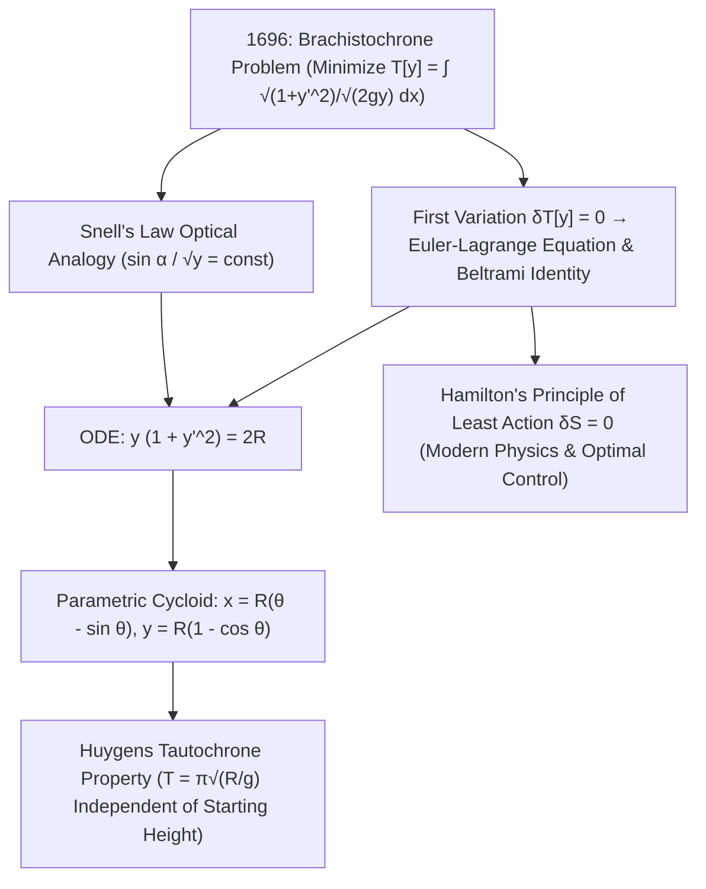

## 1. Preludio histórico e intuición física: ¿por qué la curva vence a la línea recta?

Imaginemos dos puntos $A(0,0)$ y $B(x_1, y_1)$ situados a distinta altura en un plano vertical. ¿Qué forma debe tener un riel sin fricción que conecte $A$ con $B$ para que una cuenta liberada desde el reposo en $A$ bajo la gravedad uniforme $g$ llegue a $B$ en el <strong>menor tiempo posible</strong>? Nuestra intuición geométrica responde de inmediato: «¡Una línea recta, pues la recta es la distancia más corta entre dos puntos!». Sin embargo, la física y las matemáticas demuestran todo lo contrario: sobre una curva que cae abruptamente al principio, la esfera gana por amplio margen —e incluso, si $B$ está suficientemente lejos en horizontal, la curva más rápida <strong>desciende por debajo de la altura de $B$ antes de volver a subir hasta la meta</strong>!

Este problema clásico se conoce como el <strong>problema de la braquistócrona</strong> (del griego *brakhistos*, «el más corto», y *khronos*, «tiempo»). ¿Por qué el camino más corto no es el más rápido? Porque la velocidad inicial en $A$ es cero ($v_0 = 0$). En una rampa recta de pendiente suave, la aceleración tangencial $a = g\sin\alpha$ es pequeña y la partícula pierde muchísimo tiempo al inicio moviéndose con lentitud. En cambio, una trayectoria que se desploma verticalmente desde el arranque convierte de inmediato la energía potencial gravitatoria $mgy$ en una elevada velocidad $v = \sqrt{2gy}$. En 1638, Galileo demostró en sus *Dos nuevas ciencias* que un arco de círculo supera a su cuerda recta, aunque creyó erróneamente que el círculo era la curva óptima absoluta. En junio de 1696, <strong>Johann Bernoulli</strong> lanzó el reto a los matemáticos de Europa; la tarde del 29 de enero de 1697, al volver de la Real Casa de la Moneda en Londres, <strong>Isaac Newton</strong> resolvió el problema en pocas horas antes de dormir y lo publicó de forma anónima, provocando la célebre exclamación de Bernoulli: <em>«Tanquam ex ungue leonem (¡Por su garra reconozco al león!)»</em>.

---

## 2. El funcional del tiempo de descenso y la analogía óptica de Johann Bernoulli (ley de Snell)

Tomando el origen en $A(0,0)$ con el eje $x$ horizontal y <strong>el eje $y$ apuntando verticalmente hacia abajo</strong>, la conservación de la energía mecánica $\frac{1}{2}mv^2 = mgy$ determina la rapidez $v(y) = \sqrt{2gy}$. Con el elemento de arco $ds = \sqrt{1 + (y'(x))^2}\,dx$, el tiempo total de descenso $T[y]$ se expresa como un <strong>funcional</strong> (una función cuyo argumento es toda una curva $y(x)$):

$$
T[y] = \int_{A}^{B} \frac{ds}{v(y)} = \frac{1}{\sqrt{2g}} \int_{0}^{x_1} \sqrt{\frac{1 + (y'(x))^2}{y(x)}}\,dx, \qquad \frac{\sin\alpha(y)}{\sqrt{2gy}} = \text{const}
$$

---

## 3. El nacimiento del cálculo de variaciones: ecuación de Euler-Lagrange, identidad de Beltrami y cicloide

Johann Bernoulli halló en 1696 un atajo brillante mediante el <strong>principio de Fermat del tiempo mínimo</strong>: una partícula que se mueve con velocidad $v(y) = \sqrt{2gy}$ sigue exactamente la misma trayectoria que un rayo de luz atravesando un medio estratificado con índice de refracción $n(y) = c/v(y) \propto y^{-1/2}$. Por la <strong>ley de refracción de Snell</strong>, el ángulo $\alpha$ respecto a la vertical cumple $\frac{\sin\alpha}{\sqrt{2gy}} = \text{const}$. Sustituyendo $\sin\alpha = \frac{dx}{ds} = \frac{1}{\sqrt{1+(y')^2}}$, se obtiene de inmediato la ecuación diferencial $y(1 + (y')^2) = 2R$.

Para minimizar sistemáticamente funcionales generales $J[y] = \int L(x,y,y')\,dx$, Leonhard Euler (1744) y Joseph-Louis Lagrange (1755) fundaron el <strong>cálculo de variaciones</strong>. Al anular la primera variación $\delta J[y;\eta] = 0$ para toda perturbación $\eta(x)$ nula en los extremos, la integración por partes conduce a la <strong>ecuación de Euler-Lagrange</strong>. Como $L(y,y') = \sqrt{\frac{1+(y')^2}{y}}$ no depende explícitamente de $x$, la <strong>identidad de Beltrami</strong> $L - y'\frac{\partial L}{\partial y'} = C$ recupera directamente $y(1 + (y')^2) = 2R$. El cambio paramétrico $y = 2R\sin^2(\theta/2) = R(1 - \cos\theta)$ demuestra que la única curva braquistócrona es una <strong>cicloide</strong>:

$$
\frac{\partial L}{\partial y} - \frac{d}{dx}\!\left(\frac{\partial L}{\partial y'}\right) = 0 \implies L - y'\frac{\partial L}{\partial y'} = C \implies y\Big(1 + (y')^2\Big) = 2R
$$

---

## 4. Comparación numérica, la tautócrona de Huygens y el legado del principio de mínima acción

Entre $A(0,0)$ y $B(\pi, 2)$, aunque la cicloide ($S = 4.000\,\text{m}$) es un $7.4\%$ más larga que la línea recta ($3.724\,\text{m}$), la esfera llega un <strong>$18.5\%$ más rápido</strong>! Además, Christiaan Huygens había demostrado ya en 1659 que esa misma cicloide es también la <strong>curva tautócrona (isócrona)</strong>: sin importar desde qué altura inicial se suelte una esfera sobre una cicloide, el tiempo que tarda en llegar al fondo es siempre exactamente $T = \pi\sqrt{R/g}$. Del cálculo de variaciones nacido con la braquistócrona surgieron el <strong>principio de mínima acción de Hamilton ($\delta S = 0$)</strong>, el teorema de Noether, las geodésicas de la relatividad general de Einstein, la integral de caminos de Feynman y la teoría moderna del control óptimo.

| Curva candidata | Ecuación $y(x)$ | Pendiente inicial $y'(0)$ | Longitud de arco $S$ ($A(0,0)\to B(\pi,2)$) | Tiempo normalizado ($\sqrt{g}=1$) | Diferencia frente a la cicloide |
| :--- | :--- | :--- | :--- | :--- | :--- |
| <strong>1. Línea recta (Más corta)</strong> | $y = \frac{2}{\pi}x$ | $0.6366$ ($32.5^\circ$) | <strong>$3.724\,\text{m}$ (Mínima)</strong> | $3.7242$ | <strong>$+18.5\%$ más lento</strong> |
| <strong>2. Parábola</strong> | $y = 2\sqrt{x/\pi}$ | $\infty$ (vertical) | $3.960\,\text{m}$ | $3.2185$ | $+2.4\%$ más lento |
| <strong>3. Arco circular (Galileo)</strong> | Círculo tangente al eje $y$ | $\infty$ (vertical) | $4.062\,\text{m}$ | $3.1829$ | $+1.3\%$ más lento |
| <strong>4. Cicloide (Braquistócrona)</strong> | $x=\theta-\sin\theta,\; y=1-\cos\theta$ | $\infty$ (vertical) | $4.000\,\text{m}$ | <strong>$\pi \approx 3.1416$ (Mínimo absoluto)</strong> | <strong>Óptimo teórico ($0.0\%$)</strong> |

$$
\boxed{\; x(\theta) = R(\theta - \sin\theta), \qquad y(\theta) = R(1 - \cos\theta), \qquad T_{\text{tautochrone}}(\theta_0) = \pi\sqrt{\frac{R}{g}} \;}
$$

