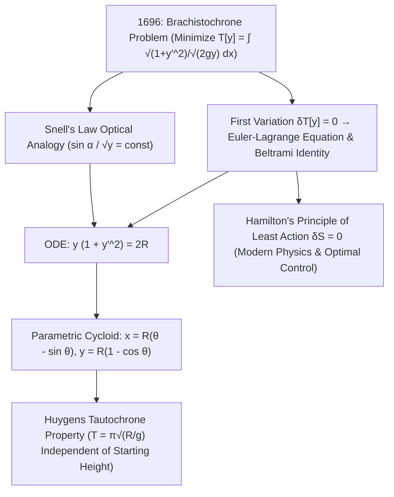

## 1. Prélude historique et intuition physique : pourquoi la courbe bat-elle la ligne droite ?

Imaginons deux points $A(0,0)$ et $B(x_1, y_1)$ fixés à des hauteurs différentes dans un plan vertical. Quelle forme doit épouser un rail sans frottement reliant $A$ à $B$ pour qu'une bille lâchée sans vitesse initiale en $A$ sous l'action de la pesanteur $g$ atteigne $B$ dans le <strong>temps le plus court possible</strong> ? Notre intuition géométrique répond spontanément : « Une ligne droite, puisque la droite est le plus court chemin entre deux points ! » Or l'expérience et les mathématiques démontrent tout l'inverse : sur une courbe plongeante, la bille l'emporte largement — et si $B$ est suffisamment éloigné horizontalement, la courbe la plus rapide <strong>plonge même plus bas que l'altitude de $B$ avant de remonter vers l'arrivée</strong> !

Ce problème célèbre est celui de la <strong>courbe brachistochrone</strong> (du grec *brakhistos*, « le plus court », et *khronos*, « temps »). Pourquoi le chemin le plus court n'est-il pas le plus rapide ? Parce que la vitesse initiale en $A$ est nulle ($v_0 = 0$). Sur un plan incliné rectiligne de faible pente, l'accélération tangentielle $a = g\sin\alpha$ est modeste et la bille perd un temps considérable au départ à très basse vitesse. En revanche, une trajectoire qui plonge verticalement dès l'origine convertit immédiatement l'énergie potentielle $mgy$ en une grande vitesse $v = \sqrt{2gy}$. En 1638, Galilée avait prouvé dans ses *Discorsi* qu'un arc de cercle est plus rapide que sa corde, croyant à tort que le cercle était l'optimum absolu. En juin 1696, <strong>Jean Bernoulli</strong> lança ce défi aux mathématiciens d'Europe ; le soir du 29 janvier 1697, rentrant de la Monnaie royale de Londres, <strong>Isaac Newton</strong> résolut le problème en quelques heures avant de se coucher et publia sa solution anonymement, arrachant à Bernoulli le célèbre : <em>« Tanquam ex ungue leonem (On reconnaît le lion à sa griffe) ! »</em>

---

## 2. La fonctionnelle du temps de descente et l'analogie optique de Jean Bernoulli (loi de Snell)

En plaçant l'origine en $A(0,0)$ avec l'axe $x$ horizontal et <strong>l'axe $y$ dirigé verticalement vers le bas</strong>, la conservation de l'énergie mécanique $\frac{1}{2}mv^2 = mgy$ donne la vitesse $v(y) = \sqrt{2gy}$. Avec l'élément d'arc $ds = \sqrt{1 + (y'(x))^2}\,dx$, le temps total de descente $T[y]$ s'écrit comme une <strong>fonctionnelle</strong> (une fonction prenant pour argument toute une courbe $y(x)$) :

$$
T[y] = \int_{A}^{B} \frac{ds}{v(y)} = \frac{1}{\sqrt{2g}} \int_{0}^{x_1} \sqrt{\frac{1 + (y'(x))^2}{y(x)}}\,dx, \qquad \frac{\sin\alpha(y)}{\sqrt{2gy}} = \text{const}
$$

---

## 3. Naissance du calcul des variations : équation d'Euler-Lagrange, identité de Beltrami et cycloïde

Jean Bernoulli découvrit en 1696 un raccourci éblouissant grâce au <strong>principe de Fermat du moindre temps</strong> : une bille évoluant à la vitesse $v(y) = \sqrt{2gy}$ suit exactement la même trajectoire qu'un rayon lumineux traversant un milieu stratifié d'indice de réfraction $n(y) = c/v(y) \propto y^{-1/2}$ ! D'après la <strong>loi de la réfraction de Snell-Descartes</strong>, l'angle $\alpha$ avec la verticale vérifie $\frac{\sin\alpha}{\sqrt{2gy}} = \text{const}$. En substituant $\sin\alpha = \frac{dx}{ds} = \frac{1}{\sqrt{1+(y')^2}}$, on obtient immédiatement l'équation différentielle $y(1 + (y')^2) = 2R$.

Pour minimiser systématiquement une fonctionnelle générale $J[y] = \int L(x,y,y')\,dx$, Leonhard Euler (1744) et Joseph-Louis Lagrange (1755) fondèrent le <strong>calcul des variations</strong>. En annulant la première variation $\delta J[y;\eta] = 0$ pour toute perturbation $\eta(x)$ nulle aux bornes, une intégration par parties conduit à l'<strong>équation d'Euler-Lagrange</strong>. Comme $L(y,y') = \sqrt{\frac{1+(y')^2}{y}}$ ne dépend pas explicitement de $x$, l'<strong>identité de Beltrami</strong> $L - y'\frac{\partial L}{\partial y'} = C$ redonne directement $y(1 + (y')^2) = 2R$. Le changement de variable paramétrique $y = 2R\sin^2(\theta/2) = R(1 - \cos\theta)$ démontre que l'unique courbe brachistochrone est une <strong>cycloïde</strong> :

$$
\frac{\partial L}{\partial y} - \frac{d}{dx}\!\left(\frac{\partial L}{\partial y'}\right) = 0 \implies L - y'\frac{\partial L}{\partial y'} = C \implies y\Big(1 + (y')^2\Big) = 2R
$$

---

## 4. Comparaison numérique, tautochrone de Huygens et héritage du principe de moindre action

Entre $A(0,0)$ et $B(\pi, 2)$, bien que la cycloïde ($S = 4{,}000\,\text{m}$) soit $7{,}4\%$ plus longue que la ligne droite ($3{,}724\,\text{m}$), la bille y arrive <strong>$18{,}5\%$ plus vite</strong> ! De plus, Christiaan Huygens avait démontré dès 1659 que cette même cycloïde est aussi la <strong>courbe tautochrone (isochrone)</strong> : quel que soit le point de départ sur la cycloïde, le temps mis pour atteindre le point le plus bas vaut toujours exactement $T = \pi\sqrt{R/g}$, indépendamment de l'amplitude initiale ! Du calcul des variations né avec la brachistochrone découlent le <strong>principe de moindre action de Hamilton ($\delta S = 0$)</strong>, le théorème de Noether, les géodésiques de la relativité générale d'Einstein, l'intégrale de chemin de Feynman et la théorie moderne du contrôle optimal.

| Courbe candidate | Équation $y(x)$ | Pente initiale $y'(0)$ | Longueur d'arc $S$ ($A(0,0)\to B(\pi,2)$) | Temps normalisé ($\sqrt{g}=1$) | Écart par rapport à la cycloïde |
| :--- | :--- | :--- | :--- | :--- | :--- |
| <strong>1. Ligne droite (Plus courte)</strong> | $y = \frac{2}{\pi}x$ | $0{,}6366$ ($32{,}5^\circ$) | <strong>$3{,}724\,\text{m}$ (Minimum)</strong> | $3{,}7242$ | <strong>$+18{,}5\%$ plus lent</strong> |
| <strong>2. Parabole</strong> | $y = 2\sqrt{x/\pi}$ | $\infty$ (verticale) | $3{,}960\,\text{m}$ | $3{,}2185$ | $+2{,}4\%$ plus lent |
| <strong>3. Arc de cercle (Galilée)</strong> | Cercle tangent à l'axe $y$ | $\infty$ (verticale) | $4{,}062\,\text{m}$ | $3{,}1829$ | $+1{,}3\%$ plus lent |
| <strong>4. Cycloïde (Brachistochrone)</strong> | $x=\theta-\sin\theta,\; y=1-\cos\theta$ | $\infty$ (verticale) | $4{,}000\,\text{m}$ | <strong>$\pi \approx 3{,}1416$ (Minimum absolu)</strong> | <strong>Optimum théorique ($0{,}0\%$)</strong> |

$$
\boxed{\; x(\theta) = R(\theta - \sin\theta), \qquad y(\theta) = R(1 - \cos\theta), \qquad T_{\text{tautochrone}}(\theta_0) = \pi\sqrt{\frac{R}{g}} \;}
$$

