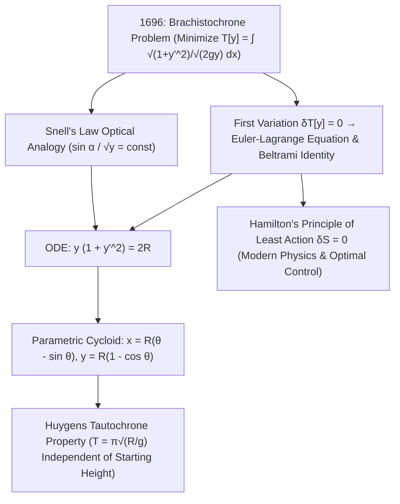

## 1. ऐतिहासिक पृष्ठभूमि और भौतिक अंतर्ज्ञान: वक्र पथ सीधी रेखा को क्यों हरा देता है?

कल्पना कीजिए कि एक ऊर्ध्वाधर तल (vertical plane) में अलग-अलग ऊँचाइयों पर दो बिंदु $A(0,0)$ और $B(x_1, y_1)$ स्थिर हैं। यदि एक घर्षण-रहित स्टील के मनके (bead) को एकसमान गुरुत्वाकर्षण $g$ के अंतर्गत बिंदु $A$ से विरामावस्था से छोड़ा जाए, तो $A$ और $B$ को जोड़ने वाले तार की आकृति कैसी होनी चाहिए ताकि मनका <strong>न्यूनतम संभव समय (Shortest Time)</strong> में $B$ तक पहुँचे? हमारा ज्यामितीय अंतर्ज्ञान तुरंत कहता है: «एक सीधी रेखा, क्योंकि दो बिंदुओं के बीच की न्यूनतम दूरी सीधी रेखा होती है!» किंतु भौतिकी और गणित इसके ठीक विपरीत सिद्ध करते हैं: प्रारंभ में तीव्रता से नीचे गिरने वाले एक विशिष्ट वक्र पथ पर मनका बड़े अंतर से जीत जाता है — यहाँ तक कि यदि $B$ क्षैतिज रूप से पर्याप्त दूर हो, तो सबसे तेज़ वक्र <strong>बिंदु $B$ की ऊँचाई से भी नीचे तक गोता लगाता है और अंत में वापस ऊपर चढ़कर लक्ष्य तक पहुँचता है</strong>!

इस प्रसिद्ध समस्या को <strong>ब्रैकिस्टोक्रोन समस्या (Brachistochrone Problem — ग्रीक शब्द *brakhistos* 'सबसे छोटा' और *khronos* 'समय')</strong> कहा जाता है। सबसे छोटा रास्ता सबसे तेज़ क्यों नहीं होता? क्योंकि प्रारंभिक बिंदु $A$ पर मनके का वेग शून्य ($v_0 = 0$) होता है। कम ढलान वाली सीधी रेखा पर स्पर्शरेखीय त्वरण $a = g\sin\alpha$ छोटा होता है, जिससे मनका शुरुआती हिस्से में अत्यंत धीमी गति से रेंगते हुए बहुत समय गँवा देता है। इसके विपरीत, जो पथ शुरू में लगभग ऊर्ध्वाधर रूप से नीचे गिरता है, वह तुरंत गुरुत्वीय स्थितिज ऊर्जा $mgy$ को उच्च वेग $v = \sqrt{2gy}$ में बदल देता है। 1638 में गैलीलियो ने अपनी पुस्तक *Two New Sciences* में सिद्ध किया था कि वृत्त की चाप सीधी जीवा से तेज़ होती है, यद्यपि उन्होंने गलती से वृत्त को ही परम सबसे तेज़ वक्र मान लिया था। जून 1696 में <strong>योहान बरनौली (Johann Bernoulli)</strong> ने यूरोप के गणितज्ञों को यह खुली चुनौती दी; 29 जनवरी 1697 की शाम को लंदन की रॉयल मिंट से लौटने के बाद <strong>आइज़ैक न्यूटन (Isaac Newton)</strong> ने सोने से पहले कुछ ही घंटों में इसे हल कर गुमनाम रूप से प्रकाशित किया, जिसे देखकर बरनौली ने कहा था: <em>«Tanquam ex ungue leonem (पंजों के निशान से ही मैं शेर को पहचान लेता हूँ)!»</em>

---

## 2. अवतरण समय फलनक (Functional) और योहान बरनौली का फ़र्मा प्रकाशिक सादृश्य (स्नेल का नियम)

बिंदु $A(0,0)$ को मूलबिंदु मानकर, क्षैतिज $x$-अक्ष और <strong>ऊर्ध्वाधर नीचे की ओर निर्देशित $y$-अक्ष</strong> लेने पर यांत्रिक ऊर्जा संरक्षण $\frac{1}{2}mv^2 = mgy$ से गहराई $y(x)$ पर चाल $v(y) = \sqrt{2gy}$ प्राप्त होती है। चाप की लंबाई के अवयव $ds = \sqrt{1 + (y'(x))^2}\,dx$ के साथ कुल अवतरण समय $T[y]$ एक <strong>फलनक (Functional)</strong> बन जाता है (ऐसा फलन जिसका इनपुट संपूर्ण वक्र $y(x)$ होता है):

$$
T[y] = \int_{A}^{B} \frac{ds}{v(y)} = \frac{1}{\sqrt{2g}} \int_{0}^{x_1} \sqrt{\frac{1 + (y'(x))^2}{y(x)}}\,dx, \qquad \frac{\sin\alpha(y)}{\sqrt{2gy}} = \text{const}
$$

---

## 3. विचरण कलन (Calculus of Variations) का जन्म: ऑयलर-लग्रांज समीकरण, बेल्ट्रामी सर्वसमिका और साइक्लॉइड

योहान बरनौली ने 1696 में <strong>फ़र्मा के न्यूनतम समय सिद्धांत (Fermat's Principle)</strong> के माध्यम से एक अद्भुत भौतिक समाधान खोजा: चाल $v(y) = \sqrt{2gy}$ से गतिमान कण ठीक उसी पथ का अनुसरण करता है जिस पर अपवर्तनांक $n(y) = c/v(y) \propto y^{-1/2}$ वाले स्तरित माध्यम में प्रकाश की किरण चलती है! <strong>स्नेल के अपवर्तन नियम (Snell's Law)</strong> के अनुसार ऊर्ध्वाधर से कोण $\alpha$ के लिए $\frac{\sin\alpha}{\sqrt{2gy}} = \text{const}$ होता है। $\sin\alpha = \frac{dx}{ds} = \frac{1}{\sqrt{1+(y')^2}}$ रखने पर तुरंत अवकल समीकरण $y(1 + (y')^2) = 2R$ प्राप्त होता है।

सामान्य फलनकों $J[y] = \int L(x,y,y')\,dx$ का व्यवस्थित न्यूनतम मान निकालने के लिए लियोनहार्ड ऑयलर (1744) और जोसेफ-लुई लग्रांज (1755) ने <strong>विचरण कलन (Calculus of Variations)</strong> की स्थापना की। दोनों सिरों पर शून्य रहने वाले किसी भी विक्षोभ $\eta(x)$ के लिए प्रथम विचरण $\delta J[y;\eta] = 0$ रखने और खंडशः समाकलन करने पर <strong>ऑयलर-लग्रांज समीकरण</strong> प्राप्त होता है। चूँकि $L(y,y') = \sqrt{\frac{1+(y')^2}{y}}$ में $x$ प्रत्यक्ष रूप से नहीं है, इसलिए <strong>बेल्ट्रामी सर्वसमिका (Beltrami Identity)</strong> $L - y'\frac{\partial L}{\partial y'} = C$ सीधे $y(1 + (y')^2) = 2R$ देती है। प्राचलिक प्रतिस्थापन $y = 2R\sin^2(\theta/2) = R(1 - \cos\theta)$ से सिद्ध होता है कि अद्वितीय ब्रैकिस्टोक्रोन वक्र एक <strong>साइक्लॉइड (Cycloid / चक्रज)</strong> है:

$$
\frac{\partial L}{\partial y} - \frac{d}{dx}\!\left(\frac{\partial L}{\partial y'}\right) = 0 \implies L - y'\frac{\partial L}{\partial y'} = C \implies y\Big(1 + (y')^2\Big) = 2R
$$

---

## 4. संख्यात्मक तुलना, हाइगेंस का टौटोक्रोन (Tautochrone) और न्यूनतम क्रिया सिद्धांत की विरासत

बिंदु $A(0,0)$ और $B(\pi, 2)$ के बीच यद्यपि साइक्लॉइड पथ ($S = 4.000\,\text{m}$) सीधी रेखा ($3.724\,\text{m}$) से $7.4\%$ लंबा है, फिर भी मनका साइक्लॉइड पर <strong>$18.5\%$ अधिक तेज़ी से</strong> पहुँचता है! इसके अतिरिक्त, क्रिश्चियन हाइगेंस ने 1659 में ही सिद्ध कर दिया था कि यही साइक्लॉइड <strong>टौटोक्रोन (समकालिक वक्र / Isochrone)</strong> भी है: साइक्लॉइड पर किसी भी प्रारंभिक ऊँचाई से मनका छोड़ने पर सबसे निचले बिंदु तक पहुँचने में लगने वाला समय सदैव $T = \pi\sqrt{R/g}$ होता है! ब्रैकिस्टोक्रोन से जन्मे विचरण कलन से ही <strong>हैमिल्टन का न्यूनतम क्रिया सिद्धांत ($\delta S = 0$)</strong>, नोएदर प्रमेय, आइंस्टीन के सामान्य सापेक्षता के जियोडेसिक समीकरण, फाइनमैन पथ समाकलन और आधुनिक इष्टतम नियंत्रण सिद्धांत (Optimal Control Theory) विकसित हुए।

| उम्मीदवार वक्र पथ | समीकरण $y(x)$ | प्रारंभिक ढलान $y'(0)$ | चाप की लंबाई $S$ ($A(0,0)\to B(\pi,2)$) | मानकीकृत समय ($\sqrt{g}=1$) | साइक्लॉइड की तुलना में समय अंतर |
| :--- | :--- | :--- | :--- | :--- | :--- |
| <strong>1. सीधी रेखा (न्यूनतम दूरी)</strong> | $y = \frac{2}{\pi}x$ | $0.6366$ ($32.5^\circ$) | <strong>$3.724\,\text{m}$ (न्यूनतम)</strong> | $3.7242$ | <strong>$+18.5\%$ अधिक धीमा</strong> |
| <strong>2. परवलय (Parabola)</strong> | $y = 2\sqrt{x/\pi}$ | $\infty$ (ऊर्ध्वाधर) | $3.960\,\text{m}$ | $3.2185$ | $+2.4\%$ अधिक धीमा |
| <strong>3. वृत्तीय चाप (गैलीलियो)</strong> | $y$-अक्ष को स्पर्श करता वृत्त | $\infty$ (ऊर्ध्वाधर) | $4.062\,\text{m}$ | $3.1829$ | $+1.3\%$ अधिक धीमा |
| <strong>4. साइक्लॉइड (ब्रैकिस्टोक्रोन)</strong> | $x=\theta-\sin\theta,\; y=1-\cos\theta$ | $\infty$ (ऊर्ध्वाधर) | $4.000\,\text{m}$ | <strong>$\pi \approx 3.1416$ (परम न्यूनतम)</strong> | <strong>सैद्धांतिक इष्टतम ($0.0\%$)</strong> |

$$
\boxed{\; x(\theta) = R(\theta - \sin\theta), \qquad y(\theta) = R(1 - \cos\theta), \qquad T_{\text{tautochrone}}(\theta_0) = \pi\sqrt{\frac{R}{g}} \;}
$$

