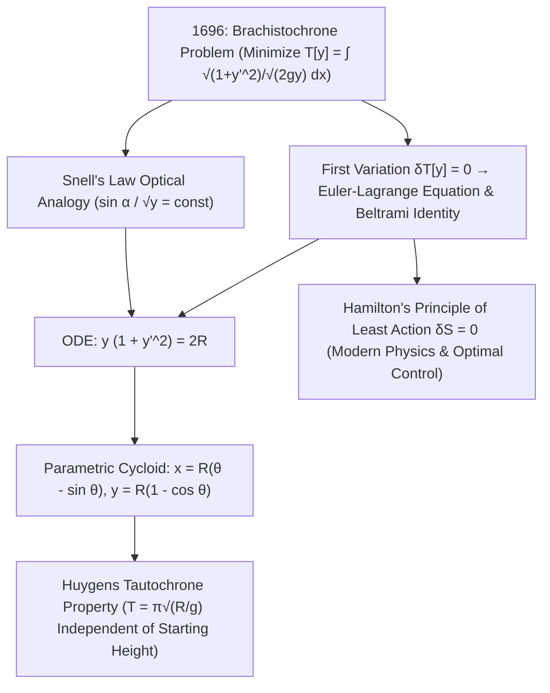

## 1. Prolog Sejarah dan Intuisi Fisika: Mengapa Kurva Mengalahkan Garis Lurus?

Bayangkan dua titik $A(0,0)$ dan $B(x_1, y_1)$ yang dipasang pada ketinggian berbeda di bidang vertikal. Bentuk lintasan tanpa gesekan seperti apakah yang harus menghubungkan $A$ ke $B$ agar sebutir manik baja yang dilepaskan dari keadaan diam di $A$ di bawah gravitasi seragam $g$ mencapai $B$ dalam <strong>waktu sesingkat mungkin</strong>? Intuisi geometris kita spontan menjawab: «Garis lurus, karena garis lurus adalah jarak terpendek antara dua titik!». Namun eksperimen fisika dan pembuktian matematika menunjukkan sebaliknya: pada kurva yangukik tajam di awal, manik-manik menang telak — bahkan jika $B$ cukup jauh secara horizontal, kurva tercepat <strong>menukik lebih rendah daripada ketinggian $B$ sebelum mendaki kembali ke garis finis</strong>!

Masalah klasik ini dikenal sebagai <strong>masalah Brakistokron (Brachistochrone)</strong> (dari bahasa Yunani *brakhistos* «terpendek» dan *khronos* «waktu»). Mengapa lintasan terpendek bukanlah yang tercepat? Karena kecepatan awal di $A$ adalah nol ($v_0 = 0$). Pada bidang miring lurus yang landai, percepatan tangensial $a = g\sin\alpha$ kecil sehingga partikel membuang banyak waktu di awal dengan kecepatan sangat rendah. Sebaliknya, lintasan yang terjun vertikal sejak titik awal langsung mengubah energi potensial gravitasi $mgy$ menjadi kelajuan tinggi $v = \sqrt{2gy}$. Pada tahun 1638, Galileo membuktikan dalam *Two New Sciences* bahwa busur lingkaran lebih cepat daripada tali busur lurusnya, meski ia keliru mengira lingkaran adalah kurva tercepat mutlak. Pada Juni 1696, <strong>Johann Bernoulli</strong> menantang para matematikawan Eropa; pada malam 29 Januari 1697 sepulang dari Royal Mint di London, <strong>Isaac Newton</strong> memecahkan masalah tersebut hanya dalam beberapa jam sebelum tidur dan menerbitkannya secara anonim, membuat Bernoulli berseru: <em>«Tanquam ex ungue leonem (Dari cakarnya aku mengenali sang singa!)»</em>.

---

## 2. Fungsional Waktu Turun dan Analogi Optik Johann Bernoulli (Hukum Snellius)

Dengan menempatkan titik asal di $A(0,0)$, sumbu $x$ horizontal, dan <strong>sumbu $y$ mengarah vertikal ke bawah</strong>, kekekalan energi mekanik $\frac{1}{2}mv^2 = mgy$ memberikan kelajuan $v(y) = \sqrt{2gy}$. Dengan elemen panjang busur $ds = \sqrt{1 + (y'(x))^2}\,dx$, waktu turun total $T[y]$ menjadi sebuah <strong>fungsional</strong> (fungsi yang menerima argumen berupa keseluruhan kurva $y(x)$):

$$
T[y] = \int_{A}^{B} \frac{ds}{v(y)} = \frac{1}{\sqrt{2g}} \int_{0}^{x_1} \sqrt{\frac{1 + (y'(x))^2}{y(x)}}\,dx, \qquad \frac{\sin\alpha(y)}{\sqrt{2gy}} = \text{const}
$$

---

## 3. Lahirnya Kalkulus Variasi: Persamaan Euler-Lagrange, Identitas Beltrami, dan Sikloid

Johann Bernoulli pada tahun 1696 menemukan jalan pintas brilian melalui <strong>prinsip waktu minimum Fermat</strong>: partikel yang bergerak dengan kelajuan $v(y) = \sqrt{2gy}$ menempuh lintasan yang persis sama dengan berkas cahaya yang merambat melalui medium berlapis dengan indeks bias $n(y) = c/v(y) \propto y^{-1/2}$! Berdasarkan <strong>hukum pembiasan Snellius</strong>, sudut $\alpha$ terhadap sumbu vertikal memenuhi $\frac{\sin\alpha}{\sqrt{2gy}} = \text{const}$. Substitusi $\sin\alpha = \frac{dx}{ds} = \frac{1}{\sqrt{1+(y')^2}}$ langsung menghasilkan persamaan diferensial $y(1 + (y')^2) = 2R$.

Untuk meminimalkan fungsional umum $J[y] = \int L(x,y,y')\,dx$ secara sistematis, Leonhard Euler (1744) dan Joseph-Louis Lagrange (1755) mendirikan <strong>kalkulus variasi (Calculus of Variations)</strong>. Dengan menetapkan variasi pertama $\delta J[y;\eta] = 0$ untuk setiap perturbasi $\eta(x)$ yang bernilai nol di kedua ujung, integrasi parsial menghasilkan <strong>persamaan Euler-Lagrange</strong>. Karena $L(y,y') = \sqrt{\frac{1+(y')^2}{y}}$ tidak bergantung secara eksplisit pada $x$, <strong>identitas Beltrami</strong> $L - y'\frac{\partial L}{\partial y'} = C$ langsung mengembalikan $y(1 + (y')^2) = 2R$. Substitusi parametrik $y = 2R\sin^2(\theta/2) = R(1 - \cos\theta)$ membuktikan bahwa satu-satunya kurva brakistokron adalah <strong>sikloid (Cycloid)</strong>:

$$
\frac{\partial L}{\partial y} - \frac{d}{dx}\!\left(\frac{\partial L}{\partial y'}\right) = 0 \implies L - y'\frac{\partial L}{\partial y'} = C \implies y\Big(1 + (y')^2\Big) = 2R
$$

---

## 4. Perbandingan Numerik, Tautokron Huygens, dan Warisan Prinsip Aksi Terkecil

Antara $A(0,0)$ dan $B(\pi, 2)$, meskipun lintasan sikloid ($S = 4,000\,\text{m}$) $7,4\%$ lebih panjang daripada garis lurus ($3,724\,\text{m}$), manik-manik tiba <strong>$18,5\%$ lebih cepat</strong>! Lebih menakjubkan lagi, Christiaan Huygens telah membuktikan sejak 1659 bahwa sikloid yang sama juga merupakan <strong>kurva tautokron (isokron)</strong>: dari ketinggian awal mana pun manik-manik dilepaskan pada lintasan sikloid, waktu tempuh menuju titik terendah selalu konstan sebesar $T = \pi\sqrt{R/g}$! Dari kalkulus variasi yang lahir lewat brakistokron tumbuhlah <strong>prinsip aksi terkecil Hamilton ($\delta S = 0$)</strong>, teorema Noether, persamaan geodesik relativitas umum Einstein, integral lintasan Feynman, serta teori kontrol optimal modern.

| Kurva Kandidat | Persamaan $y(x)$ | Kemiringan Awal $y'(0)$ | Panjang Busur $S$ ($A(0,0)\to B(\pi,2)$) | Waktu Ternormalisasi ($\sqrt{g}=1$) | Selisih Waktu terhadap Sikloid |
| :--- | :--- | :--- | :--- | :--- | :--- |
| <strong>1. Garis Lurus (Jarak Terpendek)</strong> | $y = \frac{2}{\pi}x$ | $0,6366$ ($32,5^\circ$) | <strong>$3,724\,\text{m}$ (Minimum)</strong> | $3,7242$ | <strong>$+18,5\%$ lebih lambat</strong> |
| <strong>2. Parabola</strong> | $y = 2\sqrt{x/\pi}$ | $\infty$ (vertikal) | $3,960\,\text{m}$ | $3,2185$ | $+2,4\%$ lebih lambat |
| <strong>3. Busur Lingkaran (Galileo)</strong> | Lingkaran menyinggung sumbu $y$ | $\infty$ (vertikal) | $4,062\,\text{m}$ | $3,1829$ | $+1,3\%$ lebih lambat |
| <strong>4. Sikloid (Brakistokron)</strong> | $x=\theta-\sin\theta,\; y=1-\cos\theta$ | $\infty$ (vertikal) | $4,000\,\text{m}$ | <strong>$\pi \approx 3,1416$ (Minimum Mutlak)</strong> | <strong>Optimum Teoretis ($0,0\%$)</strong> |

$$
\boxed{\; x(\theta) = R(\theta - \sin\theta), \qquad y(\theta) = R(1 - \cos\theta), \qquad T_{\text{tautochrone}}(\theta_0) = \pi\sqrt{\frac{R}{g}} \;}
$$

