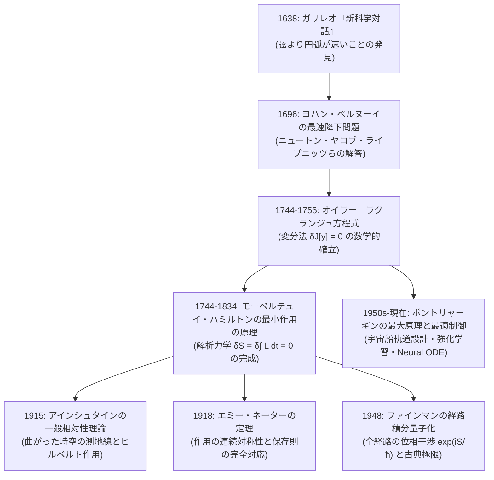

## 1. ガリレオの直感と誤算 —— 「最短距離＝最速」という常識の崩壊

ユークリッド幾何学において、空間内の2点 $A$ と $B$ を結ぶ「最短の道筋」が直線（線分）であることは、紀元前から変わらぬ自明の真理である。日常生活の感覚においても、目的地へ最も早く到達したければ、回り道をせずに一直線に向かうのが最善であるように思われる。もし移動する物体の速さ $v$ が空間内のどこでも一定であるならば、移動時間 $T = \text{距離} / v$ は距離に正比例するため、「最短距離の経路」と「最短時間の経路」は完全に一致する。

しかし、私たちが暮らすこの宇宙には<strong>重力（Gravity）</strong>が存在する。高さの異なる2点 $A$（高い位置）と $B$（低い位置）の間に滑らかなレールを敷き、摩擦のない状態で小さな金属球（質点）を点 $A$ から静かに転がすとき、球を点 $B$ まで<strong>最も短い時間</strong>で到達させるレールの形状はどのような曲線になるだろうか？

この問いに対して、直感的に「2点を結ぶ直線（斜面の滑り台）」と答えてしまうと、物理学の巧妙な罠に陥ることになる。なぜなら、重力場の中で落下する物体の速さ $v$ は一定ではなく、<strong>落下した垂直距離（深さ）$y$ に応じて加速し続ける</strong>からである。力学的エネルギー保存則が教える通り、初速度ゼロで出発した質量 $m$ の質点が鉛直方向に距離 $y$ だけ降下したとき、失われた位置エネルギー $mgy$ は運動エネルギー $\frac{1}{2}mv^2$ へと変換され、その瞬間の速さは

$$v(y) = \sqrt{2gy}$$

となる（ここで $g$ は重力加速度）。この式が意味する物理的現実はきわめて重大である。出発点 $A$ の近く（$y$ が小さい領域）では、質点の速さ $v$ は極めて遅い。もし点 $A$ から点 $B$ へ直線状のレールを敷いた場合、質点は緩やかな傾斜をゆっくりと下り始めるため、十分な速度を得るまでに長い時間を費やしてしまう。

これに対し、出発直後に<strong>急激に下方へ落ち込むように湾曲したレール</strong>を敷いたとしよう。確かに、直線に比べてレール全体の長さ（移動距離 $s$）は長くなり、遠回りになる。しかし、序盤に急降下することで質点は一気に大きな深さ $y$ へと達し、極めて早い段階で大きな速度 $v = \sqrt{2gy}$ を獲得することができる。序盤で獲得したこの圧倒的な高速状態のまま残りの水平距離を駆け抜ければ、経路長が伸びたことによるペナルティを補って余りあるほどの時間短縮が可能になるのではないか——。

### 1638年『新科学対話』におけるガリレオの考察

この「空間的な最短（Shortest Distance）」と「時間的な最短（Least Time）」の乖離に歴史上初めて科学的なメスを入れたのは、近代物理学の父<strong>ガリレオ・ガリレイ（Galileo Galilei, 1564–1642）</strong>であった。1638年にオランダのライデンで出版されたガリレオの主著『<strong>新科学対話</strong>（*Discorsi e dimostrazioni matematiche intorno a due nuove scienze*）』の第3日（局所運動に関する議論）において、彼は鉛直面内の円周上の点から円の最下点へ向かう降下時間を幾何学的に分析している。

ガリレオはまず、円の最下点 $B$ と、同じ円周上の斜め上方の点 $A$ を結ぶ<strong>弦（直線 $AB$）</strong>に沿った降下時間を計算した。続いて、途中に円周上の別の点 $C$ を経由する<strong>2本の折れ線（$A \to C \to B$）</strong>に沿った降下時間を求めた。すると驚くべきことに、より距離が長いはずの折れ線経路 $A \to C \to B$ の方が、直線経路 $A \to B$ よりも確実に短い時間で最下点 $B$ に到達することを、当時のユークリッド幾何学と等加速度運動の比例関係のみを駆使して厳密に証明したのである。さらに折れ線の角数を増やし、円に内接する正多角形の辺を細かくしていく極限を考えることで、ガリレオは次の記念碑的な命題（定理22・命題36の系）に到達した。

> [!IMPORTANT]
> <strong>ガリレオの発見と「美しき誤算」（1638年）</strong>
> ガリレオは『新科学対話』において、「四分円周上の任意の点から最下点へ至る降下時間は、それらを結ぶ直線（弦）に沿うよりも、<strong>円弧（Circular Arc）</strong>に沿う方が短い」ことを正しく証明した。しかし彼はその直後、「ゆえに、2点間を結ぶあらゆる曲線の中で、<strong>円弧こそが最も速く降下する曲線である</strong>」と結論づけてしまった。

古代ギリシャのアリストテレスやプトレマイオス以来、西洋の自然哲学には「円こそが最も完全で調和に満ちた幾何学的図形である」という根強い美学的信仰があった。天体の軌道が楕円であることをケプラーが発見した後もなお、ガリレオ自身、円の完全性に深く魅了されていたのである。円弧が直線よりも速いことを見抜いた彼の物理的直感は紛れもなく天才的であったが、「円弧がすべての曲線の中で真の最速であるか」を判定するための数学的道具——すなわち無限小の微積分学と、曲線の形状そのものを変数として扱う<strong>変分法（Calculus of Variations）</strong>——は、1638年の時点ではまだ人類の手に届いていなかった。ガリレオの「美しき誤算」が正され、真の最速降下曲線が姿を現すまでには、ニュートンとライプニッツによる微積分学の創始を経て、さらに約60年の歳月を待たねばならなかった。

---

## 2. 1696年6月、ヨハン・ベルヌーイの挑戦状と「獅子の爪」

17世紀後半、アイザック・ニュートン（Isaac Newton）とゴットフリート・ヴィルヘルム・ライプニッツ（Gottfried Wilhelm Leibniz）によって独立に創始された<strong>微分積分学（Calculus）</strong>は、ヨーロッパの数学界に革命的な変革をもたらしていた。とりわけ大陸側では、ライプニッツが導入した華麗な記号法（$dx, dy, \int$）をスイスのバーゼル出身の兄弟数学者——兄の<strong>ヤコブ・ベルヌーイ（Jakob Bernoulli, 1655–1705）</strong>と弟の<strong>ヨハン・ベルヌーイ（Johann Bernoulli, 1667–1748）</strong>——が熱狂的に吸収し、競い合うように新しい解析学のフロンティアを切り拓いていた。

1696年6月、ライプニッツがライプツィヒで創刊した学術誌『<strong>アクタ・エルディトルム</strong>（*Acta Eruditorum*：学識者紀要）』の誌上に、当時フローニンゲン大学の教授であった29歳のヨハン・ベルヌーイが「*Problema Novum ad cujus Solutionem Mathematici Invitantur*（数学者たちに解答を募る新問題）」と題する一編の短い記事を発表した。その中で提示された公開挑戦状こそが、数学史に燦然と輝く<strong>最速降下問題（Brachistochrone Problem）</strong>である。

> <strong>ヨハン・ベルヌーイの公開問題（1696年6月）</strong>
> 「鉛直面内に与えられた2点 $A$ と $B$（ただし同じ鉛直線上にはない）があるとき、自身の重さ（重力）のみによって動かされる動点が、点 $A$ から出発して最も短い時間で他方の点 $B$ へと到達するような曲線 $AMB$ を決定せよ。」

ヨハン・ベルヌーイはこの曲線を、ギリシャ語の「<strong>ブラキストス</strong>（$\beta\rho\alpha\chi\iota\sigma\tau\circ\varsigma$：最短の）」と「<strong>クロノス</strong>（$\chi\rho\circ\nu\circ\varsigma$：時間）」を合成して<strong>ブラキストクローン（Brachistochrone：最速降下曲線）</strong>と名付けた。彼は挑発的な文体で、「ガリレオが信じたような円弧ではないが、幾何学者たちにとって極めて馴染み深いある曲線が答えになる」と予告し、この問題を解くことができれば「偉大な数学者たちの仲間入りを果たす栄誉を得るだろう」とヨーロッパ中の数学者を煽ったのである。

### 知のバトルロイヤルとニュートンの徹夜解答

ヨハンがこの挑戦状を出した背景には、2つの明確な意図があった。第1は、当時互いに激しく反目し合っていた実兄ヤコブ・ベルヌーイの鼻を明かし、自身の数学的優位性を誇示すること。第2は、微分積分学の優先権（プライオリティ）を巡って大陸のライプニッツ派と対立を深めていたイギリスの巨匠アイザック・ニュートンに対し、「ライプニッツ流の微積分法でなければ到底解けないであろうこの難問が、果たしてニュートンに解けるか」を試すことであった。

当初、ヨハンは解答期限を1696年末（半年間）に設定していたが、すぐに解答を寄せたのはライプニッツただ一人であった。ライプニッツは問題を解いた上で、「この問題はあまりに美しく重要であるため、フランスやイタリア、イギリスの数学者たちにも十分な時間を与えるべきだ」と助言し、期限は翌1697年の復活祭（イースター）まで延長された。さらにヨハンは、当時すでにケンブリッジ大学のルーカス教授職を退き、ロンドンの王立造幣局（Royal Mint）の監事（のちに長官）として通貨改鋳の激務に追われていた54歳のニュートン宛てに、わざわざ問題文の印刷物を直接郵送して挑発したのである。

ニュートンの姪キャサリン・コンデュイット（Catherine Conduitt）が書き残した有名な証言によれば、1697年1月29日の午後4時頃、造幣局での過酷な一日を終えて疲労困憊の状態で自宅に戻ったニュートンは、ベルヌーイから届いた挑戦状を目にした。還暦に近づき、何年も最先端の数学研究から遠ざかっていたにもかかわらず、ニュートンはその夜のうちに机に向かい、最速降下問題と、同時に出題されていたもう1つの幾何学問題の両方を、<strong>翌朝4時までに（わずか12時間足らずの一晩で）完全に解き明かしてしまった</strong>のである。

ニュートンはその解答を、自身の名前を伏せた<strong>匿名</strong>の論文として王立協会の機関誌『フィロソフィカル・トランザクションズ（*Philosophical Transactions*）』に掲載させ、ヨハン・ベルヌーイのもとへ送付した。1697年5月、最終的に集まった解答は全部で<strong>5つ</strong>であった。

| 解答者 | 国・拠点 | アプローチの特徴と歴史的意義 |
| :--- | :--- | :--- |
| <strong>ヨハン・ベルヌーイ</strong> (Johann Bernoulli) | スイス / オランダ | <strong>光学的アナロジー（最速・エレガント）</strong>：フェルマーの最短時間原理とスネルの屈折法則を連続的な層状媒質に適用し、微分方程式を一瞬で導出。 |
| <strong>ヤコブ・ベルヌーイ</strong> (Jakob Bernoulli) | スイス（バーゼル） | <strong>微小変分法（最も厳密・一般的）</strong>：曲線上の微小部分の変分を解析的に比較し、局所的な極小性が大域的な極小性を生む原理を定式化。オイラー＝ラグランジュ方程式の直接の祖先。 |
| <strong>G. W. ライプニッツ</strong> (Gottfried Wilhelm Leibniz) | ドイツ（ハノーファー） | <strong>微分幾何学的アプローチ</strong>：自身の微積分記号を駆使して曲線要素の差分方程式を立て、サイクロイドを特定。 |
| <strong>ド・ロピタル侯爵</strong> (Guillaume de l'Hôpital) | フランス（パリ） | <strong>無限小解析</strong>：ヨハンの弟子であり世界初の微積分教科書『無限小解析』の著者。師の助言を受けつつ無限小幾何学で解答。 |
| <strong>アイザック・ニュートン</strong> (Isaac Newton) | イギリス（ロンドン） | <strong>流率法と幾何学の融合</strong>：一晩で書き上げた匿名解答。無駄のない簡潔な記述でサイクロイドの作図法と証明を提示。 |

ロンドンから届いた匿名の解答を一読したヨハン・ベルヌーイは、その圧倒的な洞察力と気品あふれる筆致に驚愕し、すぐさま差出人の正体を見抜いてこう叫んだと伝えられている。

> <strong>« Tanquam ex ungue leonem. »</strong>
> （<strong>「爪を見て獅子を知るがごとし。」</strong> —— たった一つの爪痕を見ただけで、それが百獣の王ライオンのものであると分かる。）

そして5人の解答者が導き出した真の最速降下曲線は、ガリレオが信じた「円弧」ではなかった。それは、平坦な直線の上を1つの円が滑らずに転がるとき、その円周上の1点が描く軌跡——<strong>サイクロイド（Cycloid：擺線・トロコイドの一種）</strong>の上下を反転させた曲線だったのである。

---

## 3. 「関数の関数」を最適化する —— 微分積分学から変分法へのパラダイムシフト

なぜ最速降下問題は、ニュートンやライプニッツが創始したばかりの通常の微分法（Differential Calculus）だけでは素朴に解けず、数学史における全く新しい分野——<strong>変分法（Calculus of Variations）</strong>——の誕生を促すことになったのだろうか？ その本質を理解するために、高校や大学初年級で学ぶ「関数の最大・最小問題」と、最速降下問題のような「経路の最適化問題」の数学的構造を比較してみよう。

### 有限次元の極値問題 vs 無限次元の極値問題

通常の微積分学における最適化問題では、私たちが探している未知数は「1つの数値 $x \in \mathbb{R}$」あるいは「有限個の数値の組 $\boldsymbol{x} = (x_1, x_2, \dots, x_n) \in \mathbb{R}^n$」である。例えば、「周の長さが一定である長方形の中で面積 $f(x)$ を最大にする辺の長さ $x$ を求めよ」という問題であれば、目的関数 $f : \mathbb{R} \to \mathbb{R}$ を $x$ で微分し、導関数がゼロになる停留条件

$$\frac{df(x)}{dx} = 0$$

という代数方程式を解けばよい。入力は「点（数値）」であり、出力も「数値」である。

ところが、最速降下問題の構造はこれとは次元が根本的に異なる。私たちが求めたい未知数は、単一の数値 $x$ ではなく、始点 $A$ から終点 $B$ へと至る<strong>曲線全体の形状、すなわち関数 $y(x)$ そのもの</strong>である。関数 $y(x)$ を1つ選ぶごとに（例えば直線の関数を選ぶか、放物線の関数を選ぶか、円弧の関数を選ぶかによって）、質点が滑り降りるのに要する総降下時間 $T$ という1つの実数値が定まる。

このように、<strong>「関数 $y(x)$ を入力として受け取り、1つの実数値（スカラー）を出力として返す対応関係（関数の関数）」</strong>のことを、数学では<strong>汎関数（Functional）</strong>と呼び、通常の関数 $f(x)$ と区別するために角括弧を用いて $J[y]$ や $T[y]$ と表記する。関数 $y(x)$ は、区間 $[x_0, x_1]$ 上の連続微分可能な関数全体がなす<strong>無限次元ベクトル空間（関数空間）</strong>の1つの元（要素）である。つまり変分法とは、有限次元空間 $\mathbb{R}^n$ 上の微分法を、<strong>無限次元の関数空間上の微分法へと拡張する壮大なパラダイムシフト</strong>なのである。

| 比較項目 | 通常の微分法（有限次元最適化） | 変分法（無限次元最適化） |
| :--- | :--- | :--- |
| <strong>探すべき未知の対象</strong> | 実数値（点） $x \in \mathbb{R}$ またはベクトル $\boldsymbol{x} \in \mathbb{R}^n$ | 関数（曲線全体） $y(x) \in C^2([x_0, x_1])$ |
| <strong>空間の次元</strong> | 有限次元（$1$次元〜$n$次元） | <strong>無限次元</strong>（連続無限個の自由度を持つ関数空間） |
| <strong>目的となる写像</strong> | 関数（Function） $f : \mathbb{R}^n \to \mathbb{R}$ | <strong>汎関数（Functional）</strong> $J : C^2([x_0, x_1]) \to \mathbb{R}$ |
| <strong>微小変化の与え方</strong> | 点の微小変位 $x \to x + \varepsilon$ | 関数全体の微小摂動（変分） $y(x) \to y(x) + \varepsilon\eta(x)$ |
| <strong>極値（停留）の必要条件</strong> | 導関数がゼロ： $\dfrac{df}{dx} = 0$ （または $\nabla f = \boldsymbol{0}$） | 第一変分がゼロ： $\delta J[y] = 0 \implies$ <strong>オイラー＝ラグランジュ微分方程式</strong> |

### 降下時間汎関数 $T[y]$ の厳密な定式化

では、最速降下問題における汎関数 $T[y]$ を数式として厳密に書き下してみよう。計算の見通しを最も良くするため、座標系を次のように設定する。

* 出発点 $A$ を原点 $(0, 0)$ にとる。
* 水平方向（右向き）を $x$ 軸の正の向きとする。
* <strong>鉛直下向き（重力が働く向き）を $y$ 軸の正の向き</strong>とする。
* 終点 $B$ の座標を $(x_1, y_1)$ （ただし $x_1 > 0, y_1 > 0$）とする。

質点は時刻 $t = 0$ に原点 $A(0, 0)$ から初速度 $v(0) = 0$ で静かに滑り出し、滑らかな曲線 $y = y(x)$ に沿って摩擦や空気抵抗を受けることなく終点 $B(x_1, y_1)$ へと降下する。曲線上の任意の点 $(x, y(x))$ に質点があるとき、原点からの落差は $y$ であるから、力学的エネルギー保存則より

$$\frac{1}{2}m v^2 - mgy = 0 \implies v(y) = \frac{ds}{dt} = \sqrt{2gy(x)}$$

が成り立つ。ここで $ds$ は曲線に沿った微小弧長（Arc length element）である。ピタゴラスの定理（三平方の定理）を微小直角三角形 $(dx, dy)$ に適用すれば、微小弧長 $ds$ は導関数 $y'(x) = \frac{dy}{dx}$ を用いて次のように表される。

$$ds = \sqrt{(dx)^2 + (dy)^2} = \sqrt{1 + \left(\frac{dy}{dx}\right)^2}\,dx = \sqrt{1 + (y'(x))^2}\,dx$$

質点がこの微小距離 $ds$ を通過するのに要する微小時間 $dt$ は $dt = \frac{ds}{v}$ であるから、両端 $x = 0$ から $x = x_1$ まで積分することで、曲線 $y(x)$ に沿った<strong>総降下時間汎関数 $T[y]$</strong> が得られる。

$$T[y] = \int_{t_A}^{t_B} dt = \int_A^B \frac{ds}{v(y)} = \int_0^{x_1} \frac{\sqrt{1 + (y'(x))^2}}{\sqrt{2gy(x)}}\,dx = \frac{1}{\sqrt{2g}} \int_0^{x_1} \sqrt{\frac{1 + (y'(x))^2}{y(x)}}\,dx$$

境界条件 $y(0) = 0,\; y(x_1) = y_1$ を満たすすべての滑らかな関数 $y(x)$ の中から、この定積分 $T[y]$ の値を最小にする関数 $y(x)$ を見つけ出すこと——これこそが、最速降下問題の数学的定式化である。被積分関数の中に未知関数 $y(x)$ だけでなくその導関数 $y'(x)$ が非線形な平方根の形で絡み合っているため、通常の微積分学の公式だけでは手も足も出ないように見える。

---

## 4. ヨハン・ベルヌーイの閃き —— フェルマーの原理と光の屈折による光学的解法

この難解な汎関数最小化問題に対し、出題者であるヨハン・ベルヌーイ自身が用意していた解法は、数学史・物理学史を通じて最もエレガントな「<strong>異分野間のアナロジー（類推）</strong>」の一つとして今日まで語り継がれている。彼は力学の問題であるはずの質点の落下を、<strong>幾何光学における「光の屈折」の問題</strong>へと丸ごと翻訳してしまったのである。

### フェルマーの最短時間原理とスネルの屈折法則

ヨハン・ベルヌーイが着目したのは、フランスの数学者<strong>ピエール・ド・フェルマー（Pierre de Fermat, 1607–1665）</strong>が1662年に提唱した光学の基本原理——<strong>フェルマーの最短時間原理（Fermat's Principle of Least Time）</strong>であった。フェルマーは、「光が空間内の点 $A$ から点 $B$ へと進むとき、光は移動にかかる<strong>時間が最短（停留）となる経路</strong>を自動的に選び取る」と主張し、そこから光の屈折法則を導き出した。

光が、光速 $v_1$ の媒質1（例えば空気）から、光速 $v_2$ の媒質2（例えば水やガラス）へと水平な境界面を横切って進む状況を考えよう。境界面に対する鉛直な法線（$y$ 軸）と光の進行方向がなす角をそれぞれ入射角 $\theta_1$、屈折角 $\theta_2$ とすると、2点間の移動時間を最小化する条件から、有名な<strong>スネルの屈折法則（Snell's Law of Refraction）</strong>が導かれる。

$$\frac{\sin\theta_1}{v_1} = \frac{\sin\theta_2}{v_2}$$

もし媒質が2層だけでなく、水平な薄い層が何重にも積み重なった多層媒質（各層の光速が $v_1, v_2, v_3, \dots, v_k$）であったとしても、各境界面でスネルの法則が連鎖的に成り立つため、

$$\frac{\sin\theta_1}{v_1} = \frac{\sin\theta_2}{v_2} = \frac{\sin\theta_3}{v_3} = \cdots = \frac{\sin\theta_k}{v_k} = \text{const.}$$

が常に保たれる。さらに層の厚さを無限に薄くする極限をとれば、深さ $y$ に応じて光速 $v(y)$（すなわち屈折率 $n(y) = c / v(y)$）が連続的に変化する不均質媒質の中では、光線は滑らかな曲線を描いて曲がり続け、その軌道上のあらゆる点において

$$\frac{\sin\theta(y)}{v(y)} = C_0 \quad (\text{一定})$$

という関係式を満たすことになる（ここで $\theta(y)$ は光線の接線と鉛直軸である $y$ 軸がなす角）。

### 重力場を「光学媒質」と見なす思考実験

ヨハン・ベルヌーイの天才的な閃きはここにあった。
「フェルマーの原理に従って『最短時間』で進む光線の軌道」と、「重力の下で『最短時間』で滑り降りる質点の軌道（ブラキストクローン）」は、数学的に<strong>全く同じ汎関数 $\int \frac{ds}{v}$ を最小化する問題</strong>ではないか！

したがって、重力場を<strong>「深さ $y$ に降りるにつれて、光速が $v(y) = \sqrt{2gy}$ という法則に従って連続的に速くなっていく仮想的な光学媒質」</strong>と見なせば、最速降下曲線に沿って転がる質点は、まさにその媒質中を進む光線と寸分違わぬ軌跡を描くはずである。スネルの法則 $\frac{\sin\theta}{v(y)} = C_0$ に $v(y) = \sqrt{2gy}$ を代入すれば、微分積分学の複雑な変分計算を一切行うことなく、最速降下曲線が満たすべき幾何学的条件が直ちに得られる。

$$\frac{\sin\theta}{\sqrt{2gy}} = C_0 \iff \frac{\sin\theta}{\sqrt{y}} = \text{const.}$$

ここで、曲線の微小要素 $(dx, dy)$ と弧長 $ds = \sqrt{dx^2 + dy^2}$ の幾何学的関係を確認しよう。角 $\theta$ は曲線の接線と<strong>鉛直軸（$y$ 軸）</strong>がなす角であるから、直角三角形の辺の比より

$$\sin\theta = \frac{dx}{ds} = \frac{dx}{\sqrt{dx^2 + dy^2}} = \frac{1}{\sqrt{1 + \left(\dfrac{dy}{dx}\right)^2}} = \frac{1}{\sqrt{1 + (y')^2}}$$

となる。これを上のスネルの法則の式に代入し、定数を整理して $\frac{1}{2g C_0^2} = 2R$（$R > 0$ は正の定数）と置けば、両辺を2乗することで直ちに次の1階常微分方程式が導かれる。

$$\frac{1}{y\left(1 + (y')^2\right)} = \frac{1}{2R} \iff y\left[1 + \left(\frac{dy}{dx}\right)^2\right] = 2R$$

当時の数学者たちにとって、この微分方程式 $y(1 + (y')^2) = 2R$ が半径 $R$ の円によって生成される<strong>サイクロイド（擺線）</strong>の微分方程式であることは周知の事実であった。ヨハン・ベルヌーイは、光学の法則を力学へ移植するという魔法のような一手によって、無限次元の変分問題をわずか数行の初等的な代数操作へと帰着させてしまったのである。

> [!TIP]
> <strong>光学＝力学アナロジーの歴史的伏線</strong>
> ヨハン・ベルヌーイが1696年に発見したこの「光の経路（フェルマーの原理）と質点の軌道（最速降下問題）の数学的同型性」は、単なる偶然のトリックではなかった。約130年後の1830年代、アイルランドの数学者<strong>ウィリアム・ローワン・ハミルトン（William Rowan Hamilton）</strong>はこの双対性を極限まで一般化し、幾何光学のアイコナール方程式と古典力学のハミルトン＝ヤコビ方程式を統一する「ハミルトン力学」を打ち立てた。そしてさらに100年後の1920年代、ルイ・ド・ブロイとエルヴィン・シュレーディンガーが「古典力学が幾何光学に対応するならば、光の波動光学に対応する『物質の波動力学』が存在するはずだ」と推論したことで、現代物理学の根幹である<strong>量子力学（シュレーディンガー方程式）</strong>が誕生することになる。すべての出発点は、このベルヌーイの光学的解法にあったのである。

---

## 5. オイラー＝ラグランジュ方程式とベルトラミの恒等式による厳密な解析解の導出

ヨハン・ベルヌーイの光学的解法は圧倒的に鮮やかであったが、「あらゆる変分問題に常に都合のよい光学的アナロジーが見つかるとは限らない」という限界もあった。いかなる汎関数 $J[y]$ が与えられても機械的かつ厳密に最適関数 $y(x)$ を導き出せる普遍的なアルゴリズムを構築するためには、兄ヤコブ・ベルヌーイが試みた「関数そのものを微小に変化させて極値をとる」という正攻法の解析学を発展させる必要があった。

ヤコブ・ベルヌーイの弟子であった<strong>レオンハルト・オイラー（Leonhard Euler, 1707–1783）</strong>は1744年の著書『極大または極小の性質を持つ曲線を見出す方法』においてこの手法を体系化し、続いて1755年、当時わずか19歳であったイタリア（トリノ）の若き天才<strong>ジョゼフ＝ルイ・ラグランジュ（Joseph-Louis Lagrange, 1736–1813）</strong>がオイラーへ宛てた手紙の中で、幾何学的な折れ線近似を一切使わない純粋に解析的な記号法（変分記号 $\delta$）を導入した。こうして完成したのが、変分法の黄金律である<strong>オイラー＝ラグランジュ方程式（Euler-Lagrange Equation）</strong>である。

ここでは、オイラー＝ラグランジュ方程式を第一原理から厳密に導出し、さらにその積分形である<strong>ベルトラミの恒等式（Beltrami Identity）</strong>を用いて、最速降下曲線がサイクロイドになることをステップ・バイ・ステップで完全に証明しよう。

### ステップ1：第一変分 $\delta J = 0$ とオイラー＝ラグランジュ方程式の導出

一般的な変分問題として、両端の境界条件 $y(x_0) = y_0,\; y(x_1) = y_1$ を満たす2回連続微分可能な関数 $y(x)$ に対し、次の汎関数 $J[y]$ を最小化（または停留化）する問題を考える。

$$J[y] = \int_{x_0}^{x_1} L(x, y(x), y'(x))\,dx$$

ここで被積分関数 $L(x, y, y')$ は<strong>ラグランジアン（Lagrangian）</strong>と呼ばれる滑らかな3変数関数である。

いま、真の最適関数（極値関数）が $y(x)$ であると仮定しよう。この最適曲線 $y(x)$ の周りで関数をわずかに揺らすために、両端でゼロになる任意の滑らかな関数（テスト関数・摂動関数）$\eta(x)$ を用意する。すなわち、

$$\eta(x_0) = 0, \quad \eta(x_1) = 0$$

である。この $\eta(x)$ に微小な実数パラメータ $\varepsilon \in \mathbb{R}$ を掛けて元の関数に加えた「変形された曲線族（比較関数）」

$$\tilde{y}(x; \varepsilon) = y(x) + \varepsilon\eta(x)$$

を考える。$\eta(x)$ が両端で $0$ であるため、いかなる $\varepsilon$ に対しても $\tilde{y}(x_0; \varepsilon) = y_0,\; \tilde{y}(x_1; \varepsilon) = y_1$ となり、変形された曲線はすべて同じ始点と終点を通る。

この変形された関数 $\tilde{y}(x; \varepsilon)$ を汎関数 $J$ に代入すると、関数 $y(x)$ と $\eta(x)$ を固定したもとで、$J[\tilde{y}]$ は実数パラメータ $\varepsilon$ のみの通常の1変数関数 $\Phi(\varepsilon)$ となる。

$$\Phi(\varepsilon) \equiv J[y + \varepsilon\eta] = \int_{x_0}^{x_1} L\left(x,\, y(x) + \varepsilon\eta(x),\, y'(x) + \varepsilon\eta'(x)\right) dx$$

もし $y(x)$ が真の最適曲線であるならば、関数 $\Phi(\varepsilon)$ は $\varepsilon = 0$ において極値（最小値）をとらなければならない。したがって、通常の1変数微積分学の定理により、$\varepsilon = 0$ における $\Phi(\varepsilon)$ の微分係数（これを汎関数の<strong>第一変分 $\delta J$</strong> またはガトー微分と呼ぶ）はゼロにならなければならない。

$$\left.\frac{d\Phi(\varepsilon)}{d\varepsilon}\right|_{\varepsilon=0} = 0$$

積分記号の下での微分（ライプニッツの積分則）と多変数関数の連鎖律（Chain Rule）を適用して $\Phi'(\varepsilon)$ を計算し、$\varepsilon = 0$ を代入すると次式を得る。

$$\left.\frac{d\Phi}{d\varepsilon}\right|_{\varepsilon=0} = \int_{x_0}^{x_1} \left( \frac{\partial L}{\partial y}\eta(x) + \frac{\partial L}{\partial y'}\eta'(x) \right) dx = 0$$

このままでは被積分関数の中に $\eta(x)$ とその導関数 $\eta'(x)$ の両方が含まれていて扱いにくい。そこで、第2項の $\frac{\partial L}{\partial y'}\eta'(x)$ に対して<strong>部分積分（Integration by Parts）</strong>を実行し、微分を $\eta'(x)$ から $\frac{\partial L}{\partial y'}$ の側へと移し替える。

$$\int_{x_0}^{x_1} \frac{\partial L}{\partial y'}\eta'(x)\,dx = \left[ \frac{\partial L}{\partial y'}\eta(x) \right]_{x_0}^{x_1} - \int_{x_0}^{x_1} \frac{d}{dx}\left(\frac{\partial L}{\partial y'}\right) \eta(x)\,dx$$

ここで右辺第1項の境界項に注目すると、摂動関数 $\eta(x)$ は両端で $\eta(x_0) = 0,\; \eta(x_1) = 0$ を満たすように選ばれていたため、<strong>境界項は綺麗に消滅してゼロになる</strong>！ これをもとの第一変分の式に戻して $\eta(x)$ でくくると、次の美しい積分関係式が得られる。

$$\int_{x_0}^{x_1} \left[ \frac{\partial L}{\partial y} - \frac{d}{dx}\left(\frac{\partial L}{\partial y'}\right) \right] \eta(x)\,dx = 0$$

この等式は、両端でゼロになる<strong>任意の</strong>滑らかな関数 $\eta(x)$ に対して常に成り立たなければならない。もし角括弧 $[\cdots]$ の中身が区間内のどこか1点でもゼロでなければ、その点の近傍でのみ正の値を持つようなコブ型の関数 $\eta(x)$ を選ぶことで積分値を正にできてしまい、矛盾が生じる（これを<strong>変分法の基本補題 / デュ・ボア＝レーモンの補題</strong>と呼ぶ）。ゆえに、区間 $(x_0, x_1)$ のすべての点において角括弧の中身自体が恒等的にゼロでなければならない。

$$\frac{\partial L}{\partial y} - \frac{d}{dx}\left(\frac{\partial L}{\partial y'}\right) = 0$$

これが、変分法および解析力学の頂点に君臨する<strong>オイラー＝ラグランジュ方程式</strong>である。

### ステップ2：ベルトラミの恒等式（第1積分）の導出

オイラー＝ラグランジュ方程式は一般に $y(x)$ に関する2階非線形常微分方程式となるが、最速降下問題の被積分関数

$$L(y, y') = \sqrt{\frac{1 + (y')^2}{y}}$$

のように、ラグランジアン $L$ が独立変数 $x$ を陽に含まない（すなわち $\frac{\partial L}{\partial x} = 0$ である）特別な場合には、方程式を直接1階積分して劇的に簡単化することができる。1868年にイタリアの数学者エウジェニオ・ベルトラミ（Eugenio Beltrami）が整理したこの公式は<strong>ベルトラミの恒等式（Beltrami Identity）</strong>と呼ばれる。

証明は極めて簡潔である。$L(x, y(x), y'(x))$ を $x$ で全微分すると、連鎖律より

$$\frac{dL}{dx} = \frac{\partial L}{\partial x} + \frac{\partial L}{\partial y}y' + \frac{\partial L}{\partial y'}y''$$

となる。一方、積の微分法則により、$y'\frac{\partial L}{\partial y'}$ を $x$ で微分すると

$$\frac{d}{dx}\left( y'\frac{\partial L}{\partial y'} \right) = y''\frac{\partial L}{\partial y'} + y'\frac{d}{dx}\left(\frac{\partial L}{\partial y'}\right)$$

である。上の全微分の式から下の式を辺々引き算すると、$y''\frac{\partial L}{\partial y'}$ の項が相殺して消え、

$$\frac{d}{dx}\left( L - y'\frac{\partial L}{\partial y'} \right) = \frac{\partial L}{\partial x} + y'\left[ \frac{\partial L}{\partial y} - \frac{d}{dx}\left(\frac{\partial L}{\partial y'}\right) \right]$$

という恒等式が得られる。いま、曲線 $y(x)$ はオイラー＝ラグランジュ方程式を満たすので右辺第2項の角括弧は $0$ であり、さらに $L$ が $x$ を陽に含まない（$\frac{\partial L}{\partial x} = 0$）ならば右辺全体が $0$ となる。したがって、括弧の中身は $x$ によらない定数 $C$ となる！

$$L - y'\frac{\partial L}{\partial y'} = C \quad (\text{一定})$$

（物理学の言葉で言えば、独立変数 $x$ を「時間 $t$」と見なしたとき、ラグランジアンが時間に陽に依存しない系においてハミルトニアン $H = \dot{q}\frac{\partial L}{\partial \dot{q}} - L$ が保存する「<strong>エネルギー保存則（ネーターの定理の特別ケース）</strong>」に他ならない。）

### ステップ3：サイクロイドの媒介変数表示の完全導出

それでは、最速降下問題の被積分関数 $L(y, y') = y^{-1/2}\sqrt{1 + (y')^2}$ をベルトラミの恒等式に代入しよう。まず $L$ を $y'$ で偏微分すると、

$$\frac{\partial L}{\partial y'} = \frac{1}{\sqrt{y}} \cdot \frac{y'}{\sqrt{1 + (y')^2}} = \frac{y'}{\sqrt{y\left(1 + (y')^2\right)}}$$

である。これをベルトラミの恒等式 $L - y'\frac{\partial L}{\partial y'} = C$ に代入して通分すると、分子の $(y')^2$ が見事に相殺する。

$$\sqrt{\frac{1 + (y')^2}{y}} - \frac{(y')^2}{\sqrt{y\left(1 + (y')^2\right)}} = \frac{\left(1 + (y')^2\right) - (y')^2}{\sqrt{y\left(1 + (y')^2\right)}} = \frac{1}{\sqrt{y\left(1 + (y')^2\right)}} = C$$

両辺を2乗して逆数をとり、積分定数を $\frac{1}{C^2} = 2R$（$R > 0$ は定数）と置き直せば、第4章でヨハン・ベルヌーイがスネルの法則から導いたのと全く同じ微分方程式に到達する。

$$y\left(1 + (y')^2\right) = 2R \implies \frac{dy}{dx} = \sqrt{\frac{2R - y}{y}}$$

この変数分離形1階常微分方程式を $x$ について解くために、$dy$ と $dx$ を分離する。

$$dx = \sqrt{\frac{y}{2R - y}}\,dy$$

根号を外して積分を実行するため、新しい媒介変数（パラメータ）$\theta$ を導入し、三角関数の半角公式を用いて次のように変数変換を行う。

$$y(\theta) = R(1 - \cos\theta) = 2R\sin^2\left(\frac{\theta}{2}\right)$$

両辺を微分すると、

$$dy = R\sin\theta\,d\theta = 2R\sin\left(\frac{\theta}{2}\right)\cos\left(\frac{\theta}{2}\right) d\theta$$

であり、また $2R - y = R(1 + \cos\theta) = 2R\cos^2\left(\frac{\theta}{2}\right)$ であるから、根号の部分は

$$\sqrt{\frac{y}{2R - y}} = \sqrt{\frac{2R\sin^2(\theta/2)}{2R\cos^2(\theta/2)}} = \tan\left(\frac{\theta}{2}\right) = \frac{\sin(\theta/2)}{\cos(\theta/2)}$$

と簡単化される。これらを $dx$ の式に代入すると、分母の $\cos(\theta/2)$ が約分されて消える。

$$dx = \frac{\sin(\theta/2)}{\cos(\theta/2)} \cdot 2R\sin\left(\frac{\theta}{2}\right)\cos\left(\frac{\theta}{2}\right) d\theta = 2R\sin^2\left(\frac{\theta}{2}\right) d\theta = R(1 - \cos\theta)\,d\theta$$

出発点 $A$ が原点 $(x, y) = (0, 0)$ に対応する初期条件 $\theta = 0$ のもとで両辺を積分すれば、

$$x(\theta) = \int_0^\theta R(1 - \cos\phi)\,d\phi = R(\theta - \sin\theta)$$

が得られる。以上により、最速降下問題の唯一の大域的最適解として、<strong>サイクロイド（Cycloid）の媒介変数方程式</strong>が完全に導出された。

$$\begin{cases} x(\theta) = R(\theta - \sin\theta) \\ y(\theta) = R(1 - \cos\theta) \end{cases} \quad (0 \le \theta \le \theta_1)$$

幾何学的には、これは水平な天井（直線 $y = 0$）の下側に半径 $R$ の円を当てがい、その円を滑ることなく右方向へ回転角 $\theta$ だけ転がしたときに、最初に原点 $A(0, 0)$ に接していた円周上の定点が描く軌跡（逆さサイクロイド）である。

---

## 6. 直線・放物線・円弧・サイクロイドの定量比較 —— 終点より「深く潜る」逆説

サイクロイドが理論上の最速降下曲線であることは証明されたが、実際に他の馴染み深い曲線——<strong>直線（斜面）</strong>、<strong>放物線</strong>、そしてガリレオが最速だと信じた<strong>円弧</strong>——と比較して、どれほど降下時間に差がつくのだろうか？ 具体的な境界条件を設定し、4つの曲線の降下時間を定量的に計算して比較してみよう。

### ベンチマーク問題の数値設定と各曲線の降下時間

基準となるベンチマークとして、半径 $R$ の生成円によるサイクロイドがちょうど<strong>最下点（$\theta_1 = \pi$）</strong>において終点 $B$ に到達するケースを考える。このとき、始点 $A$ と終点 $B$ の座標は

$$A = (0, 0), \quad B = (x_1, y_1) = (\pi R,\, 2R)$$

であり、水平距離と垂直落差の比は $x_1 / y_1 = \pi / 2 \approx 1.5708$ となる。時間を無次元化して比較するため、すべての降下時間を基準時間スケール $\sqrt{R/g}$ の倍数として算出しよう。

#### 1. サイクロイド（Cycloid）：$x = R(\theta - \sin\theta),\; y = R(1 - \cos\theta)$
微小弧長 $ds$ と速さ $v(y)$ をパラメータ $\theta$ で表すと、

$$ds = \sqrt{(dx)^2 + (dy)^2} = R\sqrt{(1-\cos\theta)^2 + \sin^2\theta}\,d\theta = R\sqrt{2(1-\cos\theta)}\,d\theta = 2R\sin\left(\frac{\theta}{2}\right) d\theta$$

$$v(\theta) = \sqrt{2gy(\theta)} = \sqrt{2g \cdot 2R\sin^2\left(\frac{\theta}{2}\right)} = 2\sqrt{gR}\sin\left(\frac{\theta}{2}\right)$$

となる。驚くべきことに、分母と分子の $\sin(\theta/2)$ が完全に約分されて定数となり、降下時間 $T_{\text{cycloid}}$ は次のように極めて美しい閉じた式で求まる。

$$T_{\text{cycloid}} = \int_0^\pi \frac{ds}{v(\theta)} = \int_0^\pi \frac{2R\sin(\theta/2)}{2\sqrt{gR}\sin(\theta/2)}\,d\theta = \int_0^\pi \sqrt{\frac{R}{g}}\,d\theta = \pi\sqrt{\frac{R}{g}} \approx \mathbf{3.1416}\sqrt{\frac{R}{g}}$$

#### 2. 直線（Straight Line）：$y(x) = \frac{2}{\pi}x$
始点 $(0,0)$ と終点 $(\pi R, 2R)$ を一直線に結ぶ斜面の傾きは $y'(x) = \frac{2}{\pi}$ である。これを汎関数 $T[y]$ に代入して積分すると、

$$T_{\text{line}} = \int_0^{\pi R} \frac{\sqrt{1 + (2/\pi)^2}}{\sqrt{2g \cdot \frac{2}{\pi}x}}\,dx = \frac{\sqrt{\pi^2 + 4}}{2\sqrt{\pi g}} \int_0^{\pi R} x^{-1/2}\,dx = \frac{\sqrt{\pi^2 + 4}}{2\sqrt{\pi g}} \cdot 2\sqrt{\pi R} = \sqrt{\pi^2 + 4}\sqrt{\frac{R}{g}} \approx \mathbf{3.7242}\sqrt{\frac{R}{g}}$$

となる。最短距離であるはずの直線は、サイクロイドに比べて $(3.7242 - 3.1416) / 3.1416 \approx \mathbf{+18.54\%}$ も余計に時間がかかる（逆に言えば、サイクロイドは直線より約 $15.6\%$ 時間を短縮する）。

#### 3. 放物線（Parabola）：$y(x) = 2R\left[ 1 - \left(1 - \frac{x}{\pi R}\right)^2 \right]$
終点 $B(\pi R, 2R)$ を頂点（水平接線 $y'(\pi R) = 0$）とし、原点 $A(0,0)$ を通る2次放物線を考える。無次元変数 $u = 1 - \frac{x}{\pi R} \in [0, 1]$ を導入すると $y = 2R(1 - u^2),\; dy = -4Ru\,du$ となり、降下時間は数値積分により

$$T_{\text{parabola}} = \frac{1}{\sqrt{2g}} \int_0^1 \sqrt{\frac{\pi^2 + 16u^2}{2(1 - u^2)}}\,du \cdot \sqrt{R} \approx \mathbf{3.2647}\sqrt{\frac{R}{g}}$$

となる。直線よりは大幅に速くなるものの、サイクロイドには約 $+3.92\%$ 及ばない。

#### 4. ガリレオの円弧（Circular Arc）
終点 $B(\pi R, 2R)$ において水平な接線を持ち（円の中心が $(x_c, y_c) = (\pi R, 2R - r)$）、かつ原点 $A(0,0)$ を通る円弧を考える。三平方の定理 $\pi^2 R^2 + (2R - r)^2 = r^2$ より、この円の半径は $r = \frac{\pi^2 + 4}{4}R \approx 3.4674 R$ と定まる。この円弧に沿った降下時間を楕円積分（数値積分）によって評価すると、

$$T_{\text{circle}} \approx \mathbf{3.1963}\sqrt{\frac{R}{g}}$$

が得られる。ガリレオが洞察した通り、円弧は直線（$3.7242$）よりもはるかに速く、放物線（$3.2647$）をも凌駕している。しかし、真の王者であるサイクロイド（$3.1416$）と比較すると、なお約 $+1.74\%$ 遅いのである。出発点 $A(0,0)$ における接線の傾きを比較すると、円弧の初期傾斜が有限（$y'(0) = \frac{2\pi}{\pi^2 - 4} \approx 1.070$）であるのに対し、<strong>サイクロイドの初期傾斜は $y'(0) = +\infty$（出発点において接線が完全に鉛直下向き）</strong>となっており、最初の瞬間に重力加速度 $g$ を100%無駄なく加速に利用できる構造になっていることが分かる。

| 曲線モデル | 数学的方程式（始点 $(0,0) \to$ 終点 $(\pi R, 2R)$） | 経路の全長 $L / R$ | 無次元降下時間 $T / \sqrt{R/g}$ | サイクロイドとの時間差 | 出発点 $(0,0)$ での接線角度 |
| :--- | :--- | :--- | :--- | :--- | :--- |
| <strong>1. サイクロイド (最速)</strong> | $x = R(\theta - \sin\theta),\; y = R(1 - \cos\theta)$ | <strong>$4.0000 R$</strong> | <strong>$3.1416$ ($\pi$)</strong> | <strong>基準 ($0.00\%$)</strong> | <strong>$90^\circ$（完全な鉛直降下）</strong> |
| <strong>2. 円弧 (ガリレオ案)</strong> | $(x - \pi R)^2 + (y + r - 2R)^2 = r^2\;(r = \frac{\pi^2+4}{4}R)$ | $3.8615 R$ | $3.1963$ | $+1.74\%$ 遅い | 約 $46.9^\circ$ |
| <strong>3. 2次放物線</strong> | $y = 2R\left[1 - (1 - x/\pi R)^2\right]$ | $3.8290 R$ | $3.2647$ | $+3.92\%$ 遅い | 約 $51.8^\circ$ |
| <strong>4. 直線 (最短距離)</strong> | $y = \dfrac{2}{\pi}x$ | <strong>$3.7242 R$ (最短)</strong> | $3.7242$ ($\sqrt{\pi^2+4}$) | <strong>$+18.54\%$ 遅い</strong> | 約 $32.5^\circ$（一定） |

上の比較表から、物理学における極めて興味深いパラドックスが浮かび上がる。4つの曲線の中で、<strong>空間的な道のり（全長 $L$）が最も長いのはサイクロイド（$4.0000 R$）であり、最も短いのが直線（$3.7242 R$）であるにもかかわらず、到着時間は道のりが最も長いサイクロイドが圧倒的に最短</strong>なのである。

### 終点よりも「深く潜ってから登り返す」バスタブ軌道の逆説

サイクロイドの反直観的な性質はこれだけにとどまらない。上のベンチマークでは、水平距離 $x_1$ と垂直落差 $y_1$ の比がちょうど $x_1 / y_1 = \pi / 2 \approx 1.5708$ であったため、サイクロイドは最下点 $\theta_1 = \pi$ でちょうど終点 $B$ に滑り込んだ。

では、もし終点 $B(x_1, y_1)$ があまり低くなく、<strong>水平方向にずっと遠く離れた位置（すなわち $x_1 / y_1 > \pi / 2$）</strong>にあった場合はどうなるだろうか？ 例えば、落差 $y_1 = 1\text{ m}$ に対して水平距離が $x_1 = 5\text{ m}$ あるような場合である。

通常の直感では、「終点の高さ $y_1$ まで素早く降りてから、その高さを保ったまま水平にゴールへ向かえばよいのではないか」と思いたくなる。しかし、変分法が導き出す厳密解（原点と終点 $B$ を結ぶただ一つのサイクロイド弧、$\pi < \theta_1 < 2\pi$）は、私たちの常識を鮮やかに裏切る。

* <strong>$x_1 / y_1 < \pi / 2$（水平距離が近く、落差が大きい場合）</strong>：
  終点に対応するパラメータは $0 < \theta_1 < \pi$ となり、サイクロイドは最下点に達する前の<strong>単調な下り坂</strong>の途中で終点 $B$ に到達する。
* <strong>$x_1 / y_1 = \pi / 2$（臨界比の場合）</strong>：
  $\theta_1 = \pi$ となり、サイクロイドはちょうど<strong>最下点（水平接線）</strong>で終点 $B$ に到達する。
* <strong>$x_1 / y_1 > \pi / 2$（水平距離が遠く、落差が小さい場合）</strong>：
  終点に対応するパラメータは $\pi < \theta_1 < 2\pi$ となる。このとき、サイクロイドは途中の $\theta = \pi$ において<strong>終点 $B$ の深さ $y_1$ よりもさらに深い谷底 $y_{\max} = 2R > y_1$ まで一旦潜り込み、そこから終点 $B$ に向かって再び坂を登り返す（バスタブ型の軌道を描く）</strong>のである！

なぜわざわざゴールよりも低い位置まで落ちて、最後に重力に逆らって坂を登り直す方が速いのだろうか？ 理由は明快である。落差 $y_1$ が小さく水平距離 $x_1$ が長い場合、深さ $y_1$ の範囲内だけで加速しても、最高速度は高々 $\sqrt{2gy_1}$ にしかならず、その遅い速度で長い水平距離 $x_1$ を移動する羽目になる。それよりも、一度ゴールより深い谷底 $y_{\max} = 2R$ まで思い切ってダイブしてより大きな速度 $v_{\max} = \sqrt{4gR}$ を獲得し、その猛スピードで水平距離を一気に稼いでから、最後に運動エネルギーを位置エネルギーに戻しつつゴール $B$ へと駆け上がる方が、トータルの移動時間を劇的に短縮できるのである。

---

## 7. ホイヘンスの等時曲線（Tautochrone）との奇跡の一致 —— アーベルの積分方程式

ヨハン・ベルヌーイが最速降下問題の答えがサイクロイドであることを発見したとき、彼自身が深い感動と畏敬の念に打たれた理由がもう一つあった。それは、サイクロイドという曲線が、その37年前の1659年にオランダの偉大な物理学者・数学者<strong>クリスティアーン・ホイヘンス（Christiaan Huygens, 1629–1695）</strong>によって、全く別の物理問題の解——<strong>等時曲線（Tautochrone / Isochrone Curve）</strong>——としてすでに発見されていたからである。

### 振り子時計の等時性の破れとホイヘンスのサイクロイド振り子

17世紀の大航海時代において、大洋を航海する船の「経度（Longitude）」を正確に測定するためには、揺れる船上でも1日に数秒の狂いも生じない高精度な時計（クロノメーター）の開発が国家的な急務であった。ガリレオは若き日にピサ大聖堂のシャンデリアが揺れるのを見て「振り子の等時性（振り子の周期は振幅によらず一定である）」を発見したと伝えられているが、実は<strong>円軌道を描く通常の単振り子の周期が一定であるというのは、振れ角 $\theta_0$ が極めて小さいとき（$\sin\theta \approx \theta$ が成り立つ微小振動近似）に限られた近似法則にすぎない</strong>。

実際、長さ $L$ の単振り子を初期角度 $\theta_0$ から離したときの厳密な周期 $T(\theta_0)$ は、第1種完全楕円積分 $K(k)$ を用いて

$$T(\theta_0) = 4\sqrt{\frac{L}{g}} \int_0^{\pi/2} \frac{d\phi}{\sqrt{1 - \sin^2(\theta_0/2)\sin^2\phi}} = 2\pi\sqrt{\frac{L}{g}}\left( 1 + \frac{1}{4}\sin^2\frac{\theta_0}{2} + \frac{9}{64}\sin^4\frac{\theta_0}{2} + \cdots \right)$$

と表され、振幅 $\theta_0$ が大きくなるほど周期は長くなってしまう（時計が遅れる）。

1659年、ホイヘンスは1673年の名著『<strong>振子時計論</strong>（*Horologium Oscillatorium*）』に結実する研究の中で、「どのような高さ（振幅）から質点を静かに離しても、最下点に到達するまでの時間 $T$ が<strong>完全に同一（振幅に一切依存しない定数）</strong>となるような真の等時曲線は何か？」という問題を提起し、それが見事に<strong>サイクロイド</strong>であることを突き止めた（さらにホイヘンスは、サイクロイドの縮閉線＝エボリュートが再び合同なサイクロイドになることを証明し、振り子の糸の両側にサイクロイド型の金属板ガイドを置くことで、おもり自体にサイクロイド軌道を描かせる機構を発明した）。

### なぜサイクロイドは厳密な等時性を持つのか？（弧長による単振動の証明）

サイクロイドが等時曲線になる理由は、曲線に沿った<strong>弧長パラメータ $s$</strong> を導入することで驚くほど明快に証明できる。

先ほどのサイクロイド $x(\theta) = R(\theta - \sin\theta),\; y(\theta) = R(1 - \cos\theta)$ において、最下点 $M(\pi R, 2R)$（$\theta = \pi$ に対応）を基準点とし、曲線上の任意の点 $P(\theta)$ から最下点 $M$ までの<strong>曲線に沿った道のり（弧長）$s$</strong> を計算しよう。微小弧長は $ds = 2R\sin(\theta/2)\,d\theta$ であったから、$\theta$ から $\pi$ まで積分すると

$$s(\theta) = \int_\theta^\pi 2R\sin\left(\frac{\phi}{2}\right) d\phi = \left[ -4R\cos\left(\frac{\phi}{2}\right) \right]_\theta^\pi = 4R\cos\left(\frac{\theta}{2}\right)$$

となる。一方、最下点 $y_{\max} = 2R$ から測った点 $P(\theta)$ の<strong>鉛直方向の高さ $h$</strong> は、半角の公式より

$$h(\theta) \equiv 2R - y(\theta) = 2R - R(1 - \cos\theta) = R(1 + \cos\theta) = 2R\cos^2\left(\frac{\theta}{2}\right)$$

である。この $s(\theta)$ と $h(\theta)$ の2つの式を見比べて $\cos(\theta/2) = \frac{s}{4R}$ を代入すると、パラメータ $\theta$ が消去され、サイクロイドの本質を射抜く次の代数関係式（<strong>サイクロイドの自然方程式</strong>）が得られる！

$$h(s) = 2R\left(\frac{s}{4R}\right)^2 = \frac{s^2}{8R}$$

すなわち、サイクロイドとは<strong>「最下点からの高さ $h$ が、曲線に沿った弧長 $s$ のちょうど2乗に比例する曲線」</strong>なのである！ 質点の位置エネルギーは $V(s) = mgh(s) = \frac{mg}{8R}s^2$ となり、弧長 $s$ の厳密な2次関数（調和ポテンシャル）になる。したがって、曲線の接線方向に働く重力の復元力 $F_s$ は

$$F_s = -\frac{dV(s)}{ds} = -mg\frac{dh}{ds} = -\left(\frac{mg}{4R}\right) s$$

となり、ニュートンの運動方程式 $m\frac{d^2 s}{dt^2} = F_s$ を立てると、

$$\frac{d^2 s}{dt^2} + \frac{g}{4R}s = 0$$

という、<strong>微小振動近似を一切含まない厳密な単振動（Simple Harmonic Motion）の微分方程式</strong>が成立する！ その角振動数は $\omega = \sqrt{\frac{g}{4R}} = \frac{1}{2}\sqrt{\frac{g}{R}}$ で一定であるから、初期位置 $s_0$（どの高さから手を離したか）に一切関係なく、最下点 $s = 0$ に到達するまでの時間（4分の1周期）は常に

$$T_{\text{tautochrone}} = \frac{1}{4} \cdot \frac{2\pi}{\omega} = \frac{\pi}{2\omega} = \pi\sqrt{\frac{R}{g}}$$

となり、第6章で求めた最速降下時間と寸分違わず一致する。

> [!NOTE]
> <strong>アーベルの積分方程式（1823年）による一意性の証明</strong>
> 後にノルウェーの天才数学者<strong>ニールス・ヘンリク・アーベル（Niels Henrik Abel, 1802–1829）</strong>は1823年、「任意の高さ $h_0$ から最下点までの降下時間 $T(h_0)$ が与えられた関数になるような曲線の弧長関数 $s(h)$ を決定せよ」という逆問題を定式化した。エネルギー保存則より導かれる積分方程式
> $$T(h_0) = \frac{1}{\sqrt{2g}} \int_0^{h_0} \frac{ds/dh}{\sqrt{h_0 - h}}\,dh$$
> は数学史上初の「<strong>アーベルの積分方程式</strong>（および分数階微積分学の起源）」として知られる。アーベルはこの積分変換の逆変換公式を導き出し、$T(h_0) = T_0$（定数）のときに解が $s(h) = \frac{2\sqrt{2g}T_0}{\pi}\sqrt{h} \iff h \propto s^2$（すなわちサイクロイド）以外に存在しないことを厳密に証明した。

「2点間を最も速く結ぶ曲線（ブラキストクローン）」と「どこから転がしても同じ時間で底に着く曲線（トートクローン）」という、一見すると全く無関係な2つの物理的要請が、ただ1つの幾何学的曲線「サイクロイド」において奇跡的に融合する。ヨハン・ベルヌーイはこの自然界の深遠な調和に感嘆し、「自然は常に最も単純な手段で、最も多様な働きを成し遂げる」と記している。

---

## 8. 変分法が開いた現代科学の地平 —— 最小作用の原理から相対論・量子力学・最適制御へ

1696年の最速降下問題という1つの挑戦状から産声を上げた変分法（Calculus of Variations）は、その後の300年間で数学の一分野という枠を大きく超え、<strong>現代物理学、幾何学、そして制御工学や人工知能の根幹を貫く「宇宙の共通言語」</strong>へと発展を遂げた。その壮大な系譜を4つの決定的なマイルストーンから俯瞰しよう。

### 1. 解析力学と「最小作用の原理（Principle of Least Action）」

最速降下問題では、重力場の中を動く質点が「移動時間 $\int dt$ を最小にする経路」を選んだ。18世紀中葉、フランスのピエール＝ルイ・モーペルテュイ（Maupertuis）やオイラー、ラグランジュ、そして19世紀のハミルトンらは、「光が最短時間の経路を選び、滑る質点も特定の積分を最小化するならば、<strong>自然界におけるあらゆる物体の運動法則そのものが、ある1つの汎関数（作用：Action）を停留させる変分問題として記述できるのではないか？</strong>」と考えた。

これが物理学における最高峰の指導原理——<strong>ハミルトンの原理（最小作用の原理 / 停留作用の原理）</strong>である。力学系の運動エネルギーを $T(\dot{q})$、位置エネルギー（ポテンシャル）を $V(q)$ とし、その差として定義される<strong>ラグランジアン $L(q, \dot{q}, t) \equiv T - V$</strong> を時刻 $t_1$ から $t_2$ まで積分した量を<strong>作用汎関数（Action Functional）$S[q]$</strong> と呼ぶ。

$$S[q] = \int_{t_1}^{t_2} L(q(t), \dot{q}(t), t)\,dt = \int_{t_1}^{t_2} \left( T - V \right) dt$$

自然界の系が時刻 $t_1$ の状態 $q(t_1)$ から時刻 $t_2$ の状態 $q(t_2)$ へと時間発展するとき、実際に実現する物理的軌道 $q(t)$ は、作用の第一変分をゼロにする経路

$$\delta S[q] = 0 \iff \frac{\partial L}{\partial q_i} - \frac{d}{dt}\left(\frac{\partial L}{\partial \dot{q}_i}\right) = 0$$

である。直交座標系で $L = \frac{1}{2}m\dot{\boldsymbol{r}}^2 - V(\boldsymbol{r})$ をこのオイラー＝ラグランジュ方程式に代入すれば、ニュートンの運動方程式 $m\ddot{\boldsymbol{r}} = -\nabla V = \boldsymbol{F}$ が直ちに再現される。しかも変分原理で書かれた方程式は、極座標や曲面上の一般化座標 $q_i$ へとどのような座標変換を行っても方程式の形が一切変わらない（<strong>共変性・座標不変性</strong>）という絶大な威力を備えていた。

### 2. ネーターの定理（1918年）と現代素粒子物理学

1918年、ドイツの数学者<strong>エミー・ネーター（Emmy Noether, 1882–1935）</strong>は、変分法を用いて理論物理学の歴史上最も美しい定理である<strong>ネーターの定理（Noether's Theorem）</strong>を証明した。

> <strong>ネーターの定理</strong>
> 「作用汎関数 $S = \int L\,dt$ が、ある連続的な座標変換（対称性変換）に対して不変（$\delta S = 0$）であるならば、その対称性に1対1に対応する物理的な<strong>保存量（Conservation Law）</strong>が必ず存在する。」

* 作用が<strong>時間の並進</strong>（$t \to t + \epsilon$）に対して不変（$\frac{\partial L}{\partial t} = 0$：ベルトラミの恒等式と同じ条件！） $\implies$ <strong>エネルギー保存則</strong>
* 作用が<strong>空間の並進</strong>（$\boldsymbol{r} \to \boldsymbol{r} + \boldsymbol{\epsilon}$）に対して不変 $\implies$ <strong>運動量保存則</strong>
* 作用が<strong>空間の回転</strong>に対して不変 $\implies$ <strong>角運動量保存則</strong>
* 電磁場と物質場の作用が<strong>U(1)ゲージ変換</strong>に対して不変 $\implies$ <strong>電荷保存則</strong>

今日、素粒子物理学の「標準模型（Standard Model）」や超弦理論において新しい物理法則を探究するとは、もはや個別の力の式を当て推量することではなく、「どのような対称性を持つラグランジアン密度 $\mathcal{L}(\phi, \partial_\mu\phi)$ を書き下せばよいか」という変分問題の設計そのものとなっている。

### 3. アインシュタインの一般相対性理論とリーマン幾何学の測地線

冒頭で「ユークリッド空間では直線が最短距離である」と述べたが、曲がった曲面や曲がった4次元時空（リーマン多様体・擬リーマン多様体）においては、2点間の長さを停留させる曲線は<strong>測地線（Geodesic）</strong>と呼ばれる。1915年にアルベルト・アインシュタイン（Albert Einstein）が完成させた<strong>一般相対性理論（General Theory of Relativity）</strong>では、重力とは「力」ではなく「質量やエネルギーによる4次元時空の計量テンソル $g_{\mu\nu}(x)$ の歪み」として記述される。

重力場の中を運動する惑星や光子は、曲がった時空の中で<strong>固有時汎関数 $\tau = \int \sqrt{-g_{\mu\nu}\frac{dx^\mu}{d\lambda}\frac{dx^\nu}{d\lambda}}\,d\lambda$ を停留させる変分問題（測地線方程式）</strong>に従って運動しているにすぎない。さらに、時空そのものがどのように曲がるかを決定するアインシュタインの重力場方程式 $G_{\mu\nu} = \frac{8\pi G}{c^4}T_{\mu\nu}$ もまた、数学者ダフィット・ヒルベルトが同時期に発見した<strong>アインシュタイン＝ヒルベルト作用</strong>

$$S_{\text{EH}}[g_{\mu\nu}] = \frac{c^4}{16\pi G} \int R\sqrt{-g}\,d^4x$$

（$R$ は時空のリッチ・スカラー曲率）を計量テンソル $g_{\mu\nu}$ で変分する（$\delta S_{\text{EH}} = 0$）ことによって一意に導出されるのである。

### 4. ファインマンの経路積分 ——「なぜ自然は最小作用の道を知るのか？」への究極の回答

ニュートン力学が「その瞬間の位置と速度、そして働く力から次の瞬間の運動が決まる」という<strong>局所的・因果的な世界観</strong>であるのに対し、最小作用の原理やフェルマーの原理は「粒子や光があらかじめゴール地点を知っていて、そこへ至る無数の経路の中から作用や時間が最小になる経路を選んで出発する」かのような<strong>大域的・目的論的な世界観</strong>に見える。一体なぜ、意志を持たないはずの電子や光子は、出発する瞬間に「どの経路が最小作用（最短時間）になるか」を知ることができるのだろうか？

この250年にわたる哲学的な謎に最終的な決着をつけたのが、1948年に<strong>リチャード・ファインマン（Richard Feynman, 1918–1988）</strong>が提唱した量子力学の<strong>経路積分法（Path Integral Formulation）</strong>であった。

ファインマンは、ポール・ディラックの着想を発展させ、驚くべき事実を明らかにした。ミクロな量子力学の世界では、始点 $A$ から終点 $B$ へ向かう粒子は、実は<strong>1つの軌道だけを選んで進んでいるのではない</strong>。粒子は、直線であろうが、サイクロイドであろうが、宇宙の果てまで寄り道するジグザグの軌道であろうが、<strong>始点と終点を結ぶありとあらゆる可能な経路 $q(t)$ のすべてを「同時に（重ね合わせとして）」通過している</strong>のである！

そして、それぞれの経路 $q(t)$ には、プランク定数 $\hbar = \frac{h}{2\pi}$ で規格化された作用汎関数 $S[q]$ に応じた複素数の位相因子（波の振幅）

$$\psi[q] \propto \exp\left( \frac{i}{\hbar} S[q] \right)$$

が割り当てられ、終点 $B$ においてすべての経路からの波が足し合わされる（汎関数積分）：

$$K(B, A) = \int \mathcal{D}q(t)\, \exp\left( \frac{i}{\hbar} S[q(t)] \right)$$

マクロな古典力学の世界では、作用 $S$ の値に比べてディラック定数 $\hbar \approx 1.054 \times 10^{-34}\text{ J}\cdot\text{s}$ が極端に小さい（$\hbar \to 0$ の極限）。すると、最適軌道から外れた一般的な経路 $q(t)$ の周りでは、経路をほんの少しずらしただけで作用 $S[q]$ が変化し、$\frac{S}{\hbar}$ が何兆回も激しく回転するため、隣り合う経路の波の山と谷が<strong>相殺的干渉（Destructive Interference）を起こしてすべて打ち消し合い、消滅してしまう</strong>。

ところが、ただ1箇所だけ波が打ち消し合わない特別な領域が存在する。それが、経路をわずかに変分させても作用 $S[q]$ の値が変化しない場所——すなわち<strong>第一変分がゼロとなる停留作用の経路 $\delta S[q] = 0$</strong> の近傍である！ この最適経路の周りだけは、隣り合う無数の経路の位相 $\exp(iS/\hbar)$ がピタリと揃い、<strong>強め合う干渉（Constructive Interference）</strong>を起こして巨大な確率振幅として生き残る（停留位相近似）。

光や質点が「未来のゴールを計算して最短時間・最小作用の経路を選んでいる」ように見えたのは、実は量子力学の波があらゆる経路を同時に探索し、<strong>変分がゼロ（$\delta S = 0$）でない経路がすべて波の干渉によって自滅した結果、サイクロイドや古典軌道だけが私たちの目に浮かび上がっていた</strong>からだったのである。

### 5. ポントリャーギンの最大原理と現代の最適制御・機械学習

さらに20世紀後半に入ると、変分法は物理学の枠を超えて工学と応用数学の中核へと進化した。1950年代、ソビエト連邦の数学者<strong>レフ・ポントリャーギン（Lev Pontryagin）</strong>とアメリカの<strong>リチャード・ベルマン（Richard Bellman）</strong>は、ロケットの推力上限や舵角の制限のように「制御入力に不等式制約がある変分問題」を解くために、オイラー＝ラグランジュ方程式を拡張した<strong>ポントリャーギンの最大原理（Pontryagin's Maximum Principle）</strong>および<strong>動的計画法（ハミルトン＝ヤコビ＝ベルマン方程式）</strong>を確立した。

宇宙開発において、ロケットが地球の重力圏を脱出して月や火星へ最小の燃料・最短の時間で到達する遷移軌道や、スペースシャトル・宇宙船が大気圏再突入時に空力加熱を最小化しながら減速する軌道設計は、まさに「空気抵抗と推力制約を伴う現代版の最速降下問題（Zermeloの航行問題やGoddardのロケット問題）」そのものである。また近年では、深層学習における<strong>Neural ODE（ニューラル常微分方程式）</strong>の学習アルゴリズム（随伴状態法：Adjoint State Method）や、強化学習・ロボット工学における連続時間軌道最適化に至るまで、オイラーとラグランジュが築いた変分法の数学的骨格がそのまま駆動し続けている。

---

## 9. 結びに代えて —— 一粒の金属球が転がる軌道の中に宿る宇宙の真理

1638年にガリレオ・ガリレイが斜面の実験から抱いた素朴な疑問と、1696年にヨハン・ベルヌーイがヨーロッパの知性たちに叩きつけた1通の挑戦状。「重力の下で2点間を最も速く滑り降りる曲線は何か」というたった1つの問いは、ニュートンに徹夜の計算をさせ、スネルの屈折法則を通じて光と物質の深遠な絆を暴き出し、無限次元の関数空間を自在に操る<strong>変分法</strong>という人類史上最強の数学的武器を生み出した。

最短距離である直線が最速ではなく、最初に思い切って鉛直下向きに飛び込み、時にはゴールよりも深い谷底まで潜ってから駆け上がる<strong>サイクロイド（擺線）</strong>こそが最速であり、しかもその同じ曲線が振幅によらず常に一定の時間で底へ到達する<strong>等時曲線</strong>でもあるという事実。それは、私たちの素朴な日常的直感が自然界の真の最適解からいかに隔たっているかを教えてくれると同時に、微分方程式と変分原理によって記述される数理の世界がいかに完璧な調和と美しさに満ちているかを雄弁に物語っている。
