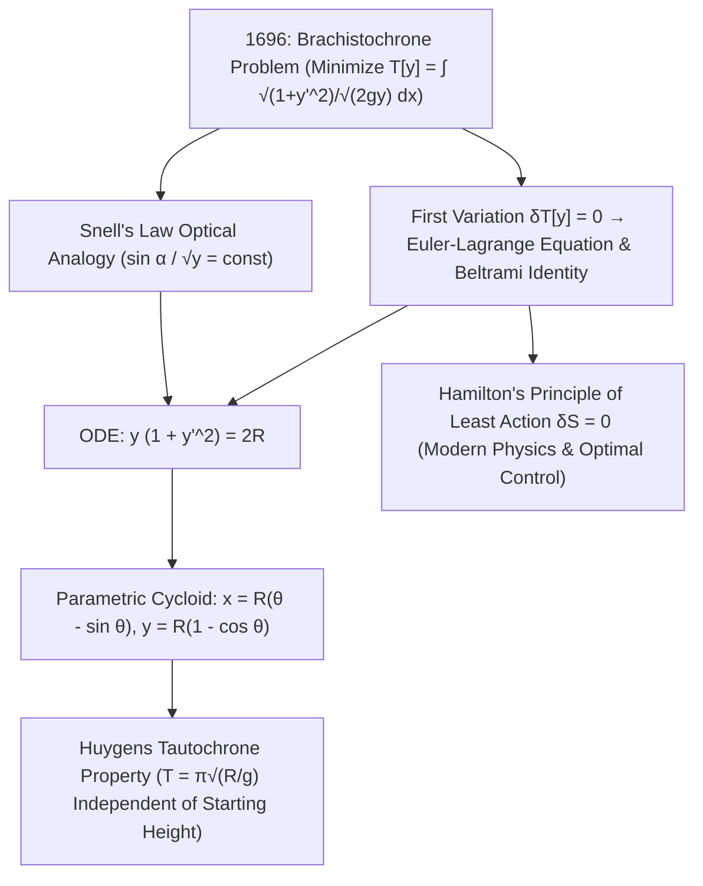

## 1. 역사적 서막과 물리적 직관: 왜 가장 짧은 직선이 가장 빠른 길이 아닌가?

수직 평면 위에 높이가 서로 다른 두 점 $A(0,0)$와 $B(x_1, y_1)$가 고정되어 있다고 상상해 봅시다. 마찰이 없는 구슬을 점 $A$에서 정지 상태로 놓아 균일한 중력 $g$ 아래에서 미끄러져 내려가게 할 때, 두 점을 잇는 궤도를 어떤 모양으로 만들어야 구슬이 <strong>가장 짧은 시간(Shortest Time)</strong> 안에 점 $B$에 도달할까요? 우리의 기하학적 직관은 흔히 "두 점 사이의 최단 거리는 직선이므로 당연히 직선 빗면이 가장 빠를 것"이라고 말합니다. 그러나 실험과 수학적 증명은 정반대의 결과를 보여줍니다. 아래로 오목하게 휘어진 특정 곡선 궤도를 따라 내려가는 구슬이 직선 궤도보다 훨씬 먼저 도착하며, 수평 거리가 충분히 멀 때는 심지어 <strong>목표점 $B$보다 더 낮은 위치까지 내려갔다가 다시 위로 올라가는 곡선</strong>이 가장 빠릅니다!

이 문제를 <strong>최속강하곡선 문제(Brachistochrone Problem, 그리스어 brakhistos '가장 짧은' + khronos '시간')</strong>라고 부릅니다. 왜 최단 거리가 최단 시간이 아닐까요? 출발점 $A$에서 구슬의 초기 속도는 $0$($v_0 = 0$)이기 때문입니다. 완만한 직선 빗면에서는 접선 가속도 $a = g\sin\alpha$가 작아 초반 구간을 극도로 느린 속도로 기어가느라 막대한 시간을 허비합니다. 반면 출발 직후 수직에 가깝게 급격히 낙하하는 궤도는 초기에 중력 퍼텐셜 에너지 $mgy$를 빠르게 운동 에너지 속력 $v = \sqrt{2gy}$로 전환하여, 더 길어진 수평 거리를 높은 속력으로 돌파합니다. 1638년 갈릴레오 갈릴레이는 『두 새로운 과학에 관한 대화』에서 원호가 직선 현보다 빠르다는 사실을 처음 증명했으나 원호가 절대 최속 곡선이라고 오인했습니다. 1696년 6월 스위스의 <strong>요한 베르누이(Johann Bernoulli)</strong>가 유럽 수학계에 이 문제를 공개 도전장으로 던졌고, 1697년 1월 29일 저녁 조폐국 업무를 마치고 귀가한 <strong>아이작 뉴턴(Isaac Newton)</strong>은 저녁 식사 후 잠자리에 들기 전 단 몇 시간 만에 이를 완벽히 풀어 익명으로 발표했습니다. 요한 베르누이는 그 풀이를 보고 <em>"Ex ungue leonem(발톱만 보고도 사자임을 알 수 있다)!"</em>라고 감탄했습니다.

---

## 2. 범함수(Functional)의 정립과 요한 베르누이의 페르마 광학 굴절 해법

출발점 $A(0,0)$를 원점으로 잡고 $x$축을 수평 방향, <strong>$y$축을 중력 방향인 수직 아래쪽</strong>으로 설정합시다. 역학적 에너지 보존 법칙 $\frac{1}{2}mv^2 = mgy$에 의해 깊이 $y(x)$에서의 속력은 오직 수직 깊이만으로 결정됩니다: $v(y) = \sqrt{2gy}$. 미소 호의 길이는 $ds = \sqrt{1 + (y'(x))^2}\,dx$이므로, 총 강하 시간 $T[y]$는 미지의 함수 곡선 $y(x)$ 전체를 입력으로 받아 실수를 출력하는 <strong>범함수(Functional)</strong>가 됩니다:

$$
T[y] = \int_{A}^{B} \frac{ds}{v(y)} = \frac{1}{\sqrt{2g}} \int_{0}^{x_1} \sqrt{\frac{1 + (y'(x))^2}{y(x)}}\,dx, \qquad \frac{\sin\alpha(y)}{\sqrt{2gy}} = \text{const}
$$

---

## 3. 변분법의 탄생: 오일러-라그랑주 방정식과 벨트라미 항등식을 통한 사이클로이드 유도

요한 베르누이는 1696년 <strong>페르마의 최소 시간 원리(Fermat's Principle)</strong>를 이용한 천재적인 물리적 해법을 제시했습니다. 속력장 $v(y) = \sqrt{2gy}$에서 최단 시간 경로를 찾는 구슬의 운동은 굴절률이 깊이에 따라 $n(y) = c/v(y) \propto y^{-1/2}$로 연속 변화하는 매질 속을 진행하는 빛의 경로와 수학적으로 완전히 동치입니다! <strong>스넬의 굴절 법칙(Snell's Law)</strong>에 따라 궤도 접선과 수직축이 이루는 각 $\alpha$에 대해 $\frac{\sin\alpha}{\sqrt{2gy}} = \text{const}$가 성립하며, $\sin\alpha = \frac{dx}{ds} = \frac{1}{\sqrt{1+(y')^2}}$를 대입하면 즉시 1계 미분방정식 $y(1 + (y')^2) = 2R$을 얻습니다.

광학적 유추에 의존하지 않고 일반적인 무한차원 범함수의 극값을 구하기 위해 오일러(1744)와 라그랑주(1755)는 <strong>변분법(Calculus of Variations)</strong>을 창시했습니다. 양 끝점이 고정된 임의의 미소 변형 $Y(x;\varepsilon) = y(x) + \varepsilon\eta(x)$($\eta(0)=\eta(x_1)=0$)에 대해 제1변분 $\delta J = 0$을 계산하고 부분적분을 적용하면 <strong>오일러-라그랑주 방정식(Euler-Lagrange Equation)</strong>이 도출됩니다. 특히 피적분함수 $L(y, y') = \sqrt{\frac{1+(y')^2}{y}}$가 독립변수 $x$를 명시적으로 포함하지 않으므로($\partial L/\partial x = 0$), <strong>벨트라미 항등식(Beltrami Identity)</strong> $L - y'\frac{\partial L}{\partial y'} = C$를 적용하면 단번에 $y(1 + (y')^2) = 2R$이 유도됩니다. 여기에 매개변수 치환 $y = 2R\sin^2(\theta/2) = R(1 - \cos\theta)$를 대입하여 적분하면, 최속강하곡선이 반지름 $R$인 굴렁쇠가 수평 천장 아래를 미끄러지지 않고 구를 때 원주 위의 한 점이 그리는 <strong>사이클로이드(Cycloid)</strong>임이 엄밀하게 증명됩니다:

$$
\frac{\partial L}{\partial y} - \frac{d}{dx}\!\left(\frac{\partial L}{\partial y'}\right) = 0 \implies L - y'\frac{\partial L}{\partial y'} = C \implies y\Big(1 + (y')^2\Big) = 2R
$$

---

## 4. 수치 비교, 호이겐스의 등시강하곡선(Tautochrone) 기적과 최소 작용 원리의 유산

출발점 $A(0,0)$에서 목표점 $B(\pi, 2)$까지 내려갈 때, 직선 궤도는 이동 거리($3.724\,\text{m}$)가 가장 짧지만 사이클로이드 궤도($4.000\,\text{m}$)보다 시간이 $18.5\%$나 더 오래 걸립니다! 더 놀라운 점은 이 사이클로이드가 크리스티안 호이겐스(Christiaan Huygens)가 1659년 진자시계의 오차를 없애기 위해 발견한 <strong>등시강하곡선(Tautochrone / Isochrone)</strong>과 정확히 일치한다는 사실입니다. 사이클로이드 트랙 위 어느 높이 $y_0$에서 구슬을 놓더라도 바닥에 도달하는 시간은 초기 진폭과 무관하게 항상 $T = \pi\sqrt{R/g}$로 일정합니다! 최속강하곡선 문제에서 탄생한 변분법은 이후 고전역학의 <strong>해밀턴 최소 작용 원리($\delta S = \delta\int L\,dt = 0$)</strong>, 뇌터 정리, 아인슈타인의 일반상대성이론 측지선 방정식, 파인만 경로적분 양자역학, 그리고 현대 항공우주 최적제어 이론의 모태가 되었습니다.

| 후보 궤도 곡선 | 수학 방정식 $y(x)$ | 초기 기울기 $y'(0)$ | 총 이동 호 길이 $S$ ($A(0,0)\to B(\pi,2)$) | 정규화 강하 시간 ($\sqrt{g}=1$) | 최속강하곡선 대비 시간 차이 |
| :--- | :--- | :--- | :--- | :--- | :--- |
| <strong>1. 직선 궤도 (최단 거리)</strong> | $y = \frac{2}{\pi}x$ | $0.6366$ ($32.5^\circ$) | <strong>$3.724\,\text{m}$ (최단)</strong> | $3.7242$ | <strong>$+18.5\%$ 더 느림</strong> |
| <strong>2. 포물선 궤도</strong> | $y = 2\sqrt{x/\pi}$ | $\infty$ (수직 낙하) | $3.960\,\text{m}$ | $3.2185$ | $+2.4\%$ 더 느림 |
| <strong>3. 원호 궤도 (갈릴레오 추측)</strong> | 원점에서 $y$축에 접하는 원 | $\infty$ (수직 낙하) | $4.062\,\text{m}$ | $3.1829$ | $+1.3\%$ 더 느림 |
| <strong>4. 사이클로이드 (최속강하곡선)</strong> | $x=\theta-\sin\theta,\; y=1-\cos\theta$ | $\infty$ (수직 낙하) | $4.000\,\text{m}$ | <strong>$\pi \approx 3.1416$ (절대 최소)</strong> | <strong>이론적 최속 기준 ($0.0\%$)</strong> |

$$
\boxed{\; x(\theta) = R(\theta - \sin\theta), \qquad y(\theta) = R(1 - \cos\theta), \qquad T_{\text{tautochrone}}(\theta_0) = \pi\sqrt{\frac{R}{g}} \;}
$$

