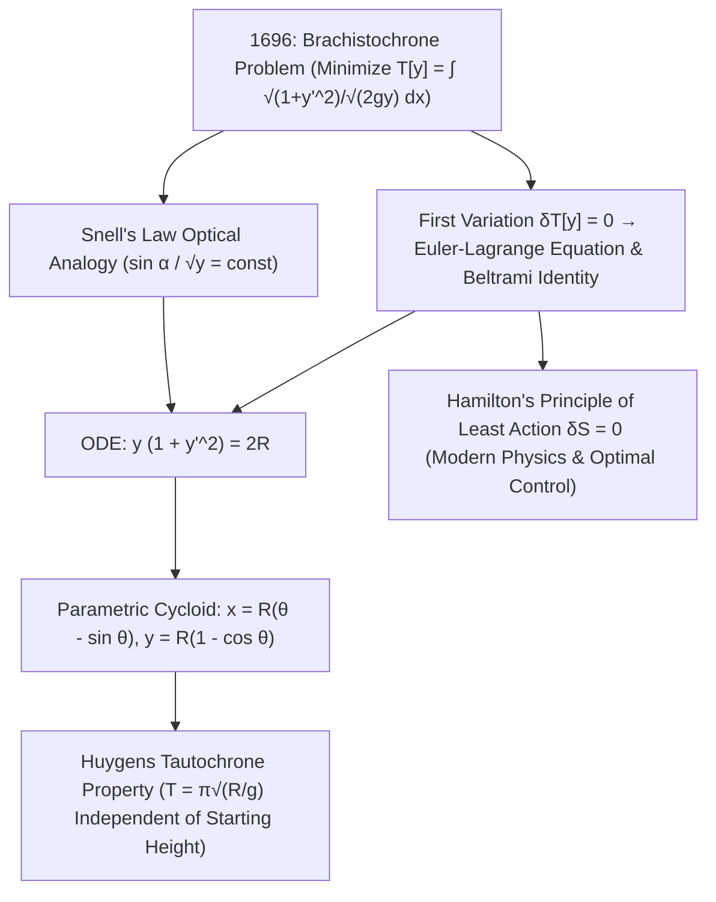

## 1. Prelúdio histórico e intuição física: por que a curva vence a linha reta?

Imagine dois pontos $A(0,0)$ e $B(x_1, y_1)$ fixados em diferentes alturas em um plano vertical. Que formato deve ter um trilho sem atrito conectando $A$ a $B$ para que uma esfera liberada do repouso em $A$ sob a gravidade uniforme $g$ chegue a $B$ no <strong>menor tempo possível</strong>? Nossa intuição geométrica responde imediatamente: «Uma linha reta, pois a reta é a menor distância entre dois pontos!». Contudo, a física e a matemática provam o oposto: sobre uma curva que mergulha acentuadamente no início, a esfera vence com folga — e se $B$ estiver suficientemente distante na horizontal, a curva mais rápida <strong>mergulha abaixo da altura de $B$ antes de subir novamente até a chegada</strong>!

Esse problema clássico é o <strong>problema da braquistócrona</strong> (do grego *brakhistos*, «o mais curto», e *khronos*, «tempo»). Por que o caminho mais curto não é o mais rápido? Porque a velocidade inicial em $A$ é zero ($v_0 = 0$). Em uma rampa reta de inclinação suave, a aceleração tangencial $a = g\sin\alpha$ é pequena e a partícula perde muito tempo no início movendo-se lentamente. Já uma trajetória que mergulha verticalmente na largada converte imediatamente a energia potencial gravitacional $mgy$ em alta velocidade $v = \sqrt{2gy}$. Em 1638, Galileu provou em seus *Discursos sobre duas novas ciências* que um arco de círculo supera sua corda reta, embora tenha acreditado erroneamente que o círculo era a curva ótima absoluta. Em junho de 1696, <strong>Johann Bernoulli</strong> lançou o desafio aos matemáticos da Europa; na noite de 29 de janeiro de 1697, ao retornar da Casa da Moeda Real em Londres, <strong>Isaac Newton</strong> resolveu o problema em poucas horas antes de dormir e publicou a solução anonimamente, levando Bernoulli a exclamar: <em>«Tanquam ex ungue leonem (Pela garra reconheço o leão!)»</em>.

---

## 2. O funcional do tempo de descida e a analogia óptica de Johann Bernoulli (lei de Snell)

Posicionando a origem em $A(0,0)$ com o eixo $x$ horizontal e <strong>o eixo $y$ apontando verticalmente para baixo</strong>, a conservação da energia mecânica $\frac{1}{2}mv^2 = mgy$ fornece a velocidade $v(y) = \sqrt{2gy}$. Com o elemento de arco $ds = \sqrt{1 + (y'(x))^2}\,dx$, o tempo total de descida $T[y]$ torna-se um <strong>funcional</strong> (uma função cujo argumento é toda uma curva $y(x)$):

$$
T[y] = \int_{A}^{B} \frac{ds}{v(y)} = \frac{1}{\sqrt{2g}} \int_{0}^{x_1} \sqrt{\frac{1 + (y'(x))^2}{y(x)}}\,dx, \qquad \frac{\sin\alpha(y)}{\sqrt{2gy}} = \text{const}
$$

---

## 3. O nascimento do cálculo das variações: equação de Euler-Lagrange, identidade de Beltrami e cicloide

Johann Bernoulli encontrou em 1696 um atalho brilhante usando o <strong>princípio de Fermat do tempo mínimo</strong>: uma partícula movendo-se com velocidade $v(y) = \sqrt{2gy}$ segue exatamente a mesma trajetória que um raio de luz atravessando um meio estratificado com índice de refração $n(y) = c/v(y) \propto y^{-1/2}$! Pela <strong>lei da refração de Snell</strong>, o ângulo $\alpha$ em relação à vertical satisfaz $\frac{\sin\alpha}{\sqrt{2gy}} = \text{const}$. Substituindo $\sin\alpha = \frac{dx}{ds} = \frac{1}{\sqrt{1+(y')^2}}$, obtém-se imediatamente a equação diferencial $y(1 + (y')^2) = 2R$.

Para minimizar sistematicamente funcionais gerais $J[y] = \int L(x,y,y')\,dx$, Leonhard Euler (1744) e Joseph-Louis Lagrange (1755) fundaram o <strong>cálculo das variações</strong>. Anulando a primeira variação $\delta J[y;\eta] = 0$ para qualquer perturbação $\eta(x)$ nula nos extremos, a integração por partes conduz à <strong>equação de Euler-Lagrange</strong>. Como $L(y,y') = \sqrt{\frac{1+(y')^2}{y}}$ não depende explicitamente de $x$, a <strong>identidade de Beltrami</strong> $L - y'\frac{\partial L}{\partial y'} = C$ recupera diretamente $y(1 + (y')^2) = 2R$. A substituição paramétrica $y = 2R\sin^2(\theta/2) = R(1 - \cos\theta)$ demonstra que a única curva braquistócrona é uma <strong>cicloide</strong>:

$$
\frac{\partial L}{\partial y} - \frac{d}{dx}\!\left(\frac{\partial L}{\partial y'}\right) = 0 \implies L - y'\frac{\partial L}{\partial y'} = C \implies y\Big(1 + (y')^2\Big) = 2R
$$

---

## 4. Comparação numérica, a tautócrona de Huygens e o legado do princípio da mínima ação

Entre $A(0,0)$ e $B(\pi, 2)$, embora a cicloide ($S = 4,000\,\text{m}$) seja $7,4\%$ mais longa que a linha reta ($3,724\,\text{m}$), a esfera chega <strong>$18,5\%$ mais rápido</strong>! Além disso, Christiaan Huygens já havia provado em 1659 que essa mesma cicloide é também a <strong>curva tautócrona (isócrona)</strong>: independentemente da altura inicial em que uma esfera seja solta sobre uma cicloide, o tempo até o ponto mais baixo é sempre exatamente $T = \pi\sqrt{R/g}$. Do cálculo das variações nascido com a braquistócrona surgiram o <strong>princípio da mínima ação de Hamilton ($\delta S = 0$)</strong>, o teorema de Noether, as geodésicas da relatividade geral de Einstein, a integral de trajetória de Feynman e a teoria moderna do controle ótimo.

| Curva candidata | Equação $y(x)$ | Inclinação inicial $y'(0)$ | Comprimento de arco $S$ ($A(0,0)\to B(\pi,2)$) | Tempo normalizado ($\sqrt{g}=1$) | Diferença em relação à cicloide |
| :--- | :--- | :--- | :--- | :--- | :--- |
| <strong>1. Linha reta (Mais curta)</strong> | $y = \frac{2}{\pi}x$ | $0,6366$ ($32,5^\circ$) | <strong>$3,724\,\text{m}$ (Mínimo)</strong> | $3,7242$ | <strong>$+18,5\%$ mais lento</strong> |
| <strong>2. Parábola</strong> | $y = 2\sqrt{x/\pi}$ | $\infty$ (vertical) | $3,960\,\text{m}$ | $3,2185$ | $+2,4\%$ mais lento |
| <strong>3. Arco circular (Galileu)</strong> | Círculo tangente ao eixo $y$ | $\infty$ (vertical) | $4,062\,\text{m}$ | $3,1829$ | $+1,3\%$ mais lento |
| <strong>4. Cicloide (Braquistócrona)</strong> | $x=\theta-\sin\theta,\; y=1-\cos\theta$ | $\infty$ (vertical) | $4,000\,\text{m}$ | <strong>$\pi \approx 3,1416$ (Mínimo absoluto)</strong> | <strong>Ótimo teórico ($0,0\%$)</strong> |

$$
\boxed{\; x(\theta) = R(\theta - \sin\theta), \qquad y(\theta) = R(1 - \cos\theta), \qquad T_{\text{tautochrone}}(\theta_0) = \pi\sqrt{\frac{R}{g}} \;}
$$

