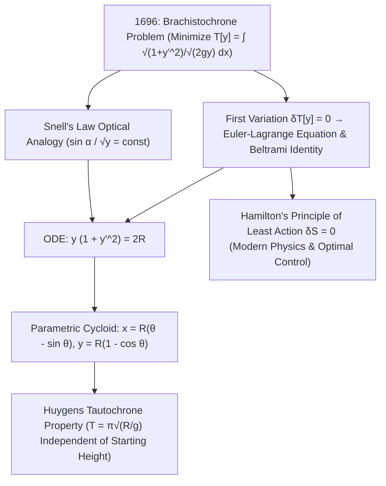

## 1. Исторический пролог и физическая интуиция: почему кривая быстрее прямой?

Представьте две точки $A(0,0)$ и $B(x_1, y_1)$, закрепленные на разной высоте в вертикальной плоскости. Какую форму должен иметь гладкий желоб без трения между $A$ и $B$, чтобы стальная бусинка, отпущенная без начальной скорости из точки $A$ в однородном поле тяжести $g$, достигла точки $B$ за <strong>кратчайшее возможное время</strong>? Геометрическая интуиция подсказывает: «По прямой, ведь прямая — кратчайшее расстояние между двумя точками!». Однако физика и математика доказывают обратное: по круто ныряющей кривой бусинка приходит к финишу намного раньше, а если точка $B$ достаточно удалена по горизонтали, самая быстрая кривая даже <strong>опускается ниже уровня точки $B$, чтобы затем подняться к финишу</strong>!

Эта классическая задача называется <strong>задачей о брахистохроне</strong> (от греч. *brakhistos* — «кратчайший» и *khronos* — «время»). Почему кратчайший путь не самый быстрый? Потому что в начальной точке $A$ скорость равна нулю ($v_0 = 0$). На пологой прямой наклонной плоскости касательное ускорение $a = g\sin\alpha$ невелико, и бусинка тратит огромное время на начальном участке, двигаясь с ничтожной скоростью. Напротив, траектория, отвесно падающая вниз на старте, мгновенно переводит потенциальную энергию $mgy$ в высокую скорость $v = \sqrt{2gy}$. В 1638 году Галилей в *«Беседах и математических доказательствах»* показал, что дуга окружности быстрее прямой хорды, но ошибочно счел окружность абсолютным оптимумом. В июне 1696 года <strong>Иоганн Бернулли</strong> бросил вызов математикам Европы; вечером 29 января 1697 года, вернувшись со службы на Королевском монетном дворе в Лондоне, <strong>Исаак Ньютон</strong> решил задачу за несколько часов перед сном и опубликовал решение анонимно, заставив Бернулли воскликнуть: <em>«Tanquam ex ungue leonem (По когтю узнаю льва)!»</em>.

---

## 2. Функционал времени спуска и оптическая аналогия Иоганна Бернулли (закон Снеллиуса)

Поместив начало координат в точку $A(0,0)$ с горизонтальной осью $x$ и <strong>направленной вертикально вниз осью $y$</strong>, из закона сохранения механической энергии $\frac{1}{2}mv^2 = mgy$ находим скорость $v(y) = \sqrt{2gy}$. С учетом элемента дуги $ds = \sqrt{1 + (y'(x))^2}\,dx$ полное время спуска $T[y]$ представляет собой <strong>функционал</strong> (отображение, ставящее в соответствие целой кривой $y(x)$ вещественное число):

$$
T[y] = \int_{A}^{B} \frac{ds}{v(y)} = \frac{1}{\sqrt{2g}} \int_{0}^{x_1} \sqrt{\frac{1 + (y'(x))^2}{y(x)}}\,dx, \qquad \frac{\sin\alpha(y)}{\sqrt{2gy}} = \text{const}
$$

---

## 3. Рождение вариационного исчисления: уравнение Эйлера — Лагранжа, тождество Бельтрами и циклоида

Иоганн Бернулли в 1696 году нашел гениальное физическое решение с помощью <strong>принципа минимального времени Ферма</strong>: частица, движущаяся со скоростью $v(y) = \sqrt{2gy}$, следует по той же траектории, что и луч света в слоистой оптической среде с показателем преломления $n(y) = c/v(y) \propto y^{-1/2}$! Согласно <strong>закону преломления Снеллиуса</strong>, угол $\alpha$ с вертикалью удовлетворяет условию $\frac{\sin\alpha}{\sqrt{2gy}} = \text{const}$. Подстановка $\sin\alpha = \frac{dx}{ds} = \frac{1}{\sqrt{1+(y')^2}}$ сразу дает дифференциальное уравнение $y(1 + (y')^2) = 2R$.

Для систематической минимизации общих функционалов $J[y] = \int L(x,y,y')\,dx$ Леонард Эйлер (1744) и Жозеф Луи Лагранж (1755) создали <strong>вариационное исчисление</strong>. Приравнивание к нулю первой вариации $\delta J[y;\eta] = 0$ для произвольной вариации $\eta(x)$ с закрепленными концами после интегрирования по частям приводит к <strong>уравнению Эйлера — Лагранжа</strong>. Поскольку $L(y,y') = \sqrt{\frac{1+(y')^2}{y}}$ не зависит явно от $x$, <strong>тождество Бельтрами</strong> $L - y'\frac{\partial L}{\partial y'} = C$ сразу дает $y(1 + (y')^2) = 2R$. Параметрическая подстановка $y = 2R\sin^2(\theta/2) = R(1 - \cos\theta)$ доказывает, что единственной брахистохроной является <strong>циклоида</strong>:

$$
\frac{\partial L}{\partial y} - \frac{d}{dx}\!\left(\frac{\partial L}{\partial y'}\right) = 0 \implies L - y'\frac{\partial L}{\partial y'} = C \implies y\Big(1 + (y')^2\Big) = 2R
$$

---

## 4. Численное сравнение, таутохрона Гюйгенса и наследие принципа наименьшего действия

Между точками $A(0,0)$ и $B(\pi, 2)$ дуга циклоиды ($S = 4{,}000\,\text{м}$) на $7{,}4\%$ длиннее отрезка прямой ($3{,}724\,\text{м}$), однако бусинка проходит циклоиду на <strong>$18{,}5\%$ быстрее</strong>! Более того, еще в 1659 году Христиан Гюйгенс доказал, что эта же самая циклоида является и <strong>таутохроной (изохроной)</strong>: с какой бы начальной высоты на циклоиде ни отпустили бусинку, время спуска до нижней точки всегда строго одинаково и равно $T = \pi\sqrt{R/g}$! Из вариационного исчисления брахистохроны выросли <strong>принцип наименьшего действия Гамильтона ($\delta S = 0$)</strong>, теорема Нётер, уравнения геодезических общей теории относительности Эйнштейна, континуальный интеграл Фейнмана и современная теория оптимального управления.

| Кривая-кандидат | Уравнение $y(x)$ | Начальный наклон $y'(0)$ | Длина дуги $S$ ($A(0,0)\to B(\pi,2)$) | Нормированное время ($\sqrt{g}=1$) | Проигрыш циклоиде по времени |
| :--- | :--- | :--- | :--- | :--- | :--- |
| <strong>1. Прямая (Кратчайшее расстояние)</strong> | $y = \frac{2}{\pi}x$ | $0{,}6366$ ($32{,}5^\circ$) | <strong>$3{,}724\,\text{м}$ (Минимум)</strong> | $3{,}7242$ | <strong>Медленнее на $+18{,}5\%$</strong> |
| <strong>2. Парабола</strong> | $y = 2\sqrt{x/\pi}$ | $\infty$ (вертикально) | $3{,}960\,\text{м}$ | $3{,}2185$ | Медленнее на $+2{,}4\%$ |
| <strong>3. Дуга окружности (Галилей)</strong> | Окружность, касательная к оси $y$ | $\infty$ (вертикально) | $4{,}062\,\text{м}$ | $3{,}1829$ | Медленнее на $+1{,}3\%$ |
| <strong>4. Циклоида (Брахистохрона)</strong> | $x=\theta-\sin\theta,\; y=1-\cos\theta$ | $\infty$ (вертикально) | $4{,}000\,\text{м}$ | <strong>$\pi \approx 3{,}1416$ (Абсолютный минимум)</strong> | <strong>Теоретический оптимум ($0{,}0\%$)</strong> |

$$
\boxed{\; x(\theta) = R(\theta - \sin\theta), \qquad y(\theta) = R(1 - \cos\theta), \qquad T_{\text{tautochrone}}(\theta_0) = \pi\sqrt{\frac{R}{g}} \;}
$$

