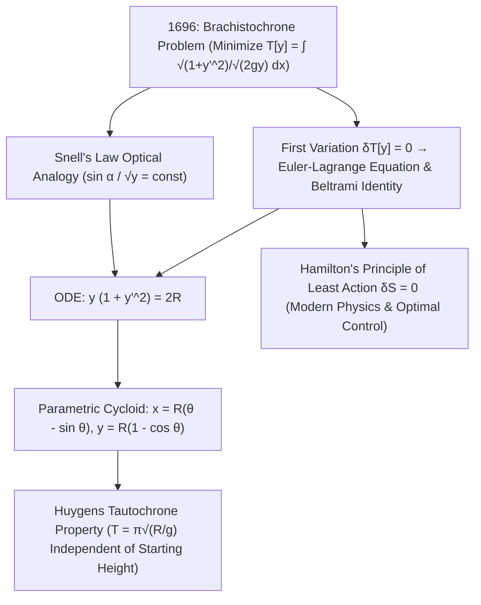

## 1. 历史序幕与物理直觉：为什么最短的直线反而不是最快的路径？

设想在竖直平面内有两个高度不同且不在同一铅垂线上的固定点 $A(0,0)$ 与 $B(x_1, y_1)$。如果让一颗光滑无摩擦的钢珠在均匀重力场 $g$ 下从点 $A$ 由静止释放，连接 $A$ 与 $B$ 的轨道应当弯成什么形状，才能使钢珠以<strong>最短的时间（Shortest Time）</strong>到达终点 $B$？我们的几何直觉往往会脱口而出：“当然是直线！因为两点之间线段最短。”然而物理实验与数学证明却给出了截然相反的答案：沿特定凹形曲线滑落的小球总是大幅领先于直线轨道，甚至当水平距离较远时，最快曲线会<strong>先向下潜入比终点 $B$ 更低的深度，最后再向上爬升到达 $B$</strong>！

这一问题被称为<strong>最速降线问题（Brachistochrone Problem，源自希腊语 brakhistos“最短”与 khronos“时间”）</strong>。为什么最短距离不等于最短时间？因为小球在起点 $A$ 的初速度为零（$v_0 = 0$）。在倾角平缓的直线斜面上，切向加速度 $a = g\sin\alpha$ 很小，小球在初始阶段以极慢的速度耗费了大量时间；相反，如果轨道在起点处近乎垂直地陡峭下潜，就能在最初一瞬间将重力势能 $mgy$ 迅速转化为极高的动能速度 $v = \sqrt{2gy}$，从而以高速度飞越后续的水平路程。1638年伽利略在《关于两门新科学的对话》中最早注意到圆弧比直线弦更快，但他误以为圆弧就是最速曲线。1696年6月，瑞士数学家<strong>约翰·伯努利（Johann Bernoulli）</strong>在《教师学报》上向全欧洲数学家发出公开挑战；1697年1月29日傍晚，刚从伦敦皇家造币厂下班归来的<strong>艾萨克·牛顿（Isaac Newton）</strong>在晚餐后仅用几个小时就在睡前彻底解出了这一难题并匿名发表，约翰·伯努利读到后惊叹道：<em>“Ex ungue leonem（凭爪印即可认出雄狮）！”</em>

---

## 2. 泛函（Functional）的建立与约翰·伯努利的费马光学折射妙解

取起点 $A(0,0)$ 为坐标原点，$x$ 轴水平向右，<strong>$y$ 轴竖直向下（顺着重力方向）</strong>。由机械能守恒定律 $\frac{1}{2}mv^2 = mgy$，小球在深度 $y(x)$ 处的速率仅由高度决定：$v(y) = \sqrt{2gy}$。微弧长元素为 $ds = \sqrt{1 + (y'(x))^2}\,dx$，因此总下滑时间 $T[y]$ 是一个以整条未知函数曲线 $y(x)$ 为自变量的<strong>泛函（Functional）</strong>：

$$
T[y] = \int_{A}^{B} \frac{ds}{v(y)} = \frac{1}{\sqrt{2g}} \int_{0}^{x_1} \sqrt{\frac{1 + (y'(x))^2}{y(x)}}\,dx, \qquad \frac{\sin\alpha(y)}{\sqrt{2gy}} = \text{const}
$$

---

## 3. 变分法的诞生：欧拉-拉格朗日方程与贝尔特拉米恒等式推导摆线解

约翰·伯努利在1696年给出了一个惊艳绝伦的物理学巧解：他利用<strong>费马最短时间原理（Fermat's Principle）</strong>指出，小球在速度场 $v(y) = \sqrt{2gy}$ 中寻找最短时间路径，在数学上完全等价于一束光线在折射率随深度连续变化的介质 $n(y) = c/v(y) \propto y^{-1/2}$ 中传播！根据光学的<strong>斯涅尔折射定律（Snell's Law）</strong>，光线切线与竖直轴夹角 $\alpha$ 的正弦值与波速之比处处恒定：$\frac{\sin\alpha}{\sqrt{2gy}} = \text{const}$。利用几何关系 $\sin\alpha = \frac{dx}{ds} = \frac{1}{\sqrt{1+(y')^2}}$，立刻得到最速降线的一阶微分方程 $y(1 + (y')^2) = 2R$。

为了不依赖光学类比而一般性地求解无穷维泛函极值，欧拉（1744）与拉格朗日（1755）创立了<strong>变分法（Calculus of Variations）</strong>。对极值曲线施加固定端点的任意微小扰动 $Y(x;\varepsilon) = y(x) + \varepsilon\eta(x)$（其中 $\eta(0)=\eta(x_1)=0$），令一阶变分 $\delta J = \left.\frac{d}{d\varepsilon}J[y+\varepsilon\eta]\right|_{\varepsilon=0} = 0$，经分部积分与变分法基本引理即可导出<strong>欧拉-拉格朗日方程（Euler-Lagrange Equation）</strong>。由于最速降线的被积函数 $L(y, y') = \sqrt{\frac{1+(y')^2}{y}}$ 不显含自变量 $x$（$\partial L/\partial x = 0$），可直接应用<strong>贝尔特拉米恒等式（Beltrami Identity）</strong> $L - y'\frac{\partial L}{\partial y'} = C$，化简后同样得到 $\frac{1}{\sqrt{y(1+(y')^2)}} = \frac{1}{\sqrt{2R}}$。引入参数代换 $y = 2R\sin^2(\theta/2) = R(1 - \cos\theta)$ 积分，便严格证明最速降线正是半径为 $R$ 的滚轮在水平天花板下滚动时轮缘一点所描绘的<strong>摆线（Cycloid / 旋轮线）</strong>：

$$
\frac{\partial L}{\partial y} - \frac{d}{dx}\!\left(\frac{\partial L}{\partial y'}\right) = 0 \implies L - y'\frac{\partial L}{\partial y'} = C \implies y\Big(1 + (y')^2\Big) = 2R
$$

---

## 4. 数值对比、惠更斯等时降线（Tautochrone）奇迹与最小作用量原理的遗产

以起点 $A(0,0)$ 到终点 $B(\pi, 2)$ 为例，直线轨道虽然路程最短（$3.724\,\text{m}$），但下滑耗时比路程更长（$4.000\,\text{m}$）的摆线轨道慢了整整 $18.5\%$！更神奇的是，这条摆线同时也是克里斯蒂安·惠更斯（Christiaan Huygens）在1659年发现的<strong>等时降线（Tautochrone / Isochrone）</strong>：无论将小球从摆线碗壁上的哪一个初始高度 $y_0$ 静止释放，小球滑到最低点所需的时间恒为 $T = \pi\sqrt{R/g}$，与初始振幅完全无关！从最速降线诞生的变分法，随后孕育了分析力学的<strong>莫佩尔蒂-哈密顿最小作用量原理（$\delta S = \delta\int L\,dt = 0$）</strong>、诺特定理、爱因斯坦广义相对论测地线方程、费曼路径积分量子力学以及现代航天航空的最优控制理论。

| 候选轨道曲线 | 数学方程 $y(x)$ | 起点斜率 $y'(0)$ | 弧长 $S$ ($A(0,0)\to B(\pi,2)$) | 归一化下滑时间 ($\sqrt{g}=1$) | 相对最速降线的速度差距 |
| :--- | :--- | :--- | :--- | :--- | :--- |
| <strong>1. 倾斜直线（最短距离）</strong> | $y = \frac{2}{\pi}x$ | $0.6366$ ($32.5^\circ$) | <strong>$3.724\,\text{m}$（最短）</strong> | $3.7242$ | <strong>慢 $+18.5\%$</strong> |
| <strong>2. 抛物线轨道</strong> | $y = 2\sqrt{x/\pi}$ | $\infty$（竖直切线） | $3.960\,\text{m}$ | $3.2185$ | 慢 $+2.4\%$ |
| <strong>3. 圆弧轨道（伽利略猜想）</strong> | 过原点与 $y$ 轴相切之圆 | $\infty$（竖直切线） | $4.062\,\text{m}$ | $3.1829$ | 慢 $+1.3\%$ |
| <strong>4. 摆线（最速降线）</strong> | $x=\theta-\sin\theta,\; y=1-\cos\theta$ | $\infty$（竖直切线） | $4.000\,\text{m}$ | <strong>$\pi \approx 3.1416$（绝对最小）</strong> | <strong>理论极限最快基准 ($0.0\%$)</strong> |

$$
\boxed{\; x(\theta) = R(\theta - \sin\theta), \qquad y(\theta) = R(1 - \cos\theta), \qquad T_{\text{tautochrone}}(\theta_0) = \pi\sqrt{\frac{R}{g}} \;}
$$

