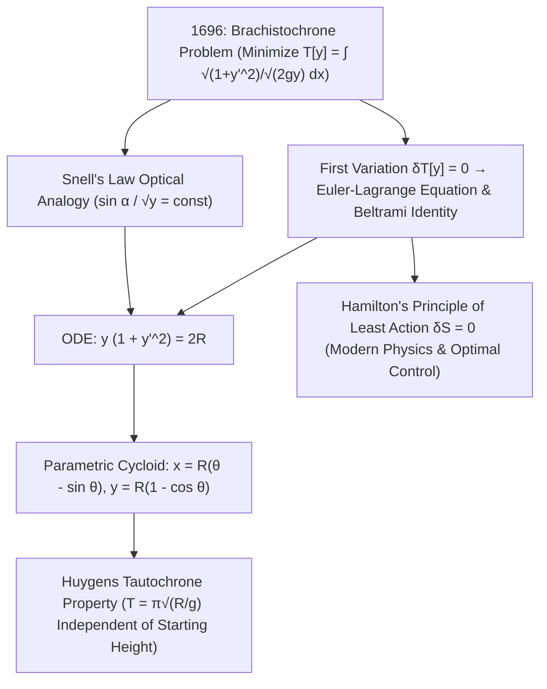

## 1. 歷史序幕與物理直覺：為什麼最短的直線反而不是最快的路徑？

設想在鉛直平面內有兩個高度不同且不在同一鉛垂線上的固定點 $A(0,0)$ 與 $B(x_1, y_1)$。如果讓一顆光滑無摩擦的鋼珠在均勻重力場 $g$ 下從點 $A$ 由靜止釋放，連接 $A$ 與 $B$ 的軌道應當彎成什麼形狀，才能使鋼珠以<strong>最短的時間（Shortest Time）</strong>到達終點 $B$？我們的幾何直覺往往會脫口而出：「當然是直線！因為兩點之間線段最短。」然而物理實驗與數學證明卻給出了截然相反的答案：沿特定凹形曲線滑落的小球總是大幅領先於直線軌道，甚至當水平距離較遠時，最快曲線會<strong>先向下潛入比終點 $B$ 更低的深度，最後再向上爬升到達 $B$</strong>！

這一問題被稱為<strong>最速降線問題（Brachistochrone Problem，源自希臘語 brakhistos「最短」與 khronos「時間」）</strong>。為什麼最短距離不等於最短時間？因為小球在起點 $A$ 的初速度為零（$v_0 = 0$）。在傾角平緩的直線斜面上，切向加速度 $a = g\sin\alpha$ 很小，小球在初始階段以極慢的速度耗費了大量時間；相反，如果軌道在起點處近乎垂直地陡峭下潛，就能在最初一瞬間將重力位能 $mgy$ 迅速轉化為極高的動能速度 $v = \sqrt{2gy}$，從而以高速度飛越後續的水平路程。1638年伽利略在《關於兩門新科學的對話》中最早注意到圓弧比直線弦更快，但他誤以為圓弧就是最速曲線。1696年6月，瑞士數學家<strong>約翰·白努利（Johann Bernoulli）</strong>在《教師學報》上向全歐洲數學家發出公開挑戰；1697年1月29日傍晚，剛從倫敦皇家造幣廠下班歸來的<strong>艾薩克·牛頓（Isaac Newton）</strong>在晚餐後僅用幾個小時就在睡前徹底解出了這一難題並匿名發表，約翰·白努利讀到後驚嘆道：<em>「Ex ungue leonem（憑爪印即可認出雄獅）！」</em>

---

## 2. 泛函（Functional）的建立與約翰·白努利的費馬光學折射妙解

取起點 $A(0,0)$ 為座標原點，$x$ 軸水平向右，<strong>$y$ 軸鉛直向下（順著重力方向）</strong>。由力學能守恆定律 $\frac{1}{2}mv^2 = mgy$，小球在深度 $y(x)$ 處的速率僅由高度決定：$v(y) = \sqrt{2gy}$。微弧長元素為 $ds = \sqrt{1 + (y'(x))^2}\,dx$，因此總下滑時間 $T[y]$ 是一個以整條未知函數曲線 $y(x)$ 為自變數的<strong>泛函（Functional）</strong>：

$$
T[y] = \int_{A}^{B} \frac{ds}{v(y)} = \frac{1}{\sqrt{2g}} \int_{0}^{x_1} \sqrt{\frac{1 + (y'(x))^2}{y(x)}}\,dx, \qquad \frac{\sin\alpha(y)}{\sqrt{2gy}} = \text{const}
$$

---

## 3. 變分法的誕生：歐拉-拉格朗日方程與貝爾特拉米恆等式推導擺線解

約翰·白努利在1696年給出了一個驚豔絕倫的物理學巧解：他利用<strong>費馬最短時間原理（Fermat's Principle）</strong>指出，小球在速度場 $v(y) = \sqrt{2gy}$ 中尋找最短時間路徑，在數學上完全等價於一束光線在折射率隨深度連續變化的介質 $n(y) = c/v(y) \propto y^{-1/2}$ 中傳播！根據光學的<strong>司乃耳折射定律（Snell's Law）</strong>，光線切線與鉛直軸夾角 $\alpha$ 的正弦值與波速之比處處恆定：$\frac{\sin\alpha}{\sqrt{2gy}} = \text{const}$。利用幾何關係 $\sin\alpha = \frac{dx}{ds} = \frac{1}{\sqrt{1+(y')^2}}$，立刻得到最速降線的一階微分方程 $y(1 + (y')^2) = 2R$。

為了不依賴光學類比而一般性地求解無窮維泛函極值，歐拉（1744）與拉格朗日（1755）創立了<strong>變分法（Calculus of Variations）</strong>。對極值曲線施加固定端點的任意微小擾動 $Y(x;\varepsilon) = y(x) + \varepsilon\eta(x)$（其中 $\eta(0)=\eta(x_1)=0$），令一階變分 $\delta J = \left.\frac{d}{d\varepsilon}J[y+\varepsilon\eta]\right|_{\varepsilon=0} = 0$，經分部積分與變分法基本引理即可導出<strong>歐拉-拉格朗日方程（Euler-Lagrange Equation）</strong>。由於最速降線的被積函數 $L(y, y') = \sqrt{\frac{1+(y')^2}{y}}$ 不顯含自變數 $x$（$\partial L/\partial x = 0$），可直接應用<strong>貝爾特拉米恆等式（Beltrami Identity）</strong> $L - y'\frac{\partial L}{\partial y'} = C$，化簡後同樣得到 $\frac{1}{\sqrt{y(1+(y')^2)}} = \frac{1}{\sqrt{2R}}$。引入參數代換 $y = 2R\sin^2(\theta/2) = R(1 - \cos\theta)$ 積分，便嚴格證明最速降線正是半徑為 $R$ 的滾輪在水平天花板下滾動時輪緣一點所描繪的<strong>擺線（Cycloid / 旋輪線）</strong>：

$$
\frac{\partial L}{\partial y} - \frac{d}{dx}\!\left(\frac{\partial L}{\partial y'}\right) = 0 \implies L - y'\frac{\partial L}{\partial y'} = C \implies y\Big(1 + (y')^2\Big) = 2R
$$

---

## 4. 數值對比、惠更斯等時降線（Tautochrone）奇蹟與最小作用量原理的遺產

以起點 $A(0,0)$ 到終點 $B(\pi, 2)$ 為例，直線軌道雖然路程最短（$3.724\,\text{m}$），但下滑耗時比路程更長（$4.000\,\text{m}$）的擺線軌道慢了整整 $18.5\%$！更神奇的是，這條擺線同時也是克里斯蒂安·惠更斯（Christiaan Huygens）在1659年發現的<strong>等時降線（Tautochrone / Isochrone）</strong>：無論將小球從擺線碗壁上的哪一個初始高度 $y_0$ 靜止釋放，小球滑到最低點所需的時間恆為 $T = \pi\sqrt{R/g}$，與初始振幅完全無關！從最速降線誕生的變分法，隨後孕育了分析力學的<strong>莫佩爾蒂-哈密頓最小作用量原理（$\delta S = \delta\int L\,dt = 0$）</strong>、諾特定理、愛因斯坦廣義相對論測地線方程、費曼路徑積分量子力學以及現代航太的最優控制理論。

| 候選軌道曲線 | 數學方程 $y(x)$ | 起點斜率 $y'(0)$ | 弧長 $S$ ($A(0,0)\to B(\pi,2)$) | 歸一化下滑時間 ($\sqrt{g}=1$) | 相對最速降線的速度差距 |
| :--- | :--- | :--- | :--- | :--- | :--- |
| <strong>1. 傾斜直線（最短距離）</strong> | $y = \frac{2}{\pi}x$ | $0.6366$ ($32.5^\circ$) | <strong>$3.724\,\text{m}$（最短）</strong> | $3.7242$ | <strong>慢 $+18.5\%$</strong> |
| <strong>2. 拋物線軌道</strong> | $y = 2\sqrt{x/\pi}$ | $\infty$（鉛直切線） | $3.960\,\text{m}$ | $3.2185$ | 慢 $+2.4\%$ |
| <strong>3. 圓弧軌道（伽利略猜想）</strong> | 過原點與 $y$ 軸相切之圓 | $\infty$（鉛直切線） | $4.062\,\text{m}$ | $3.1829$ | 慢 $+1.3\%$ |
| <strong>4. 擺線（最速降線）</strong> | $x=\theta-\sin\theta,\; y=1-\cos\theta$ | $\infty$（鉛直切線） | $4.000\,\text{m}$ | <strong>$\pi \approx 3.1416$（絕對最小）</strong> | <strong>理論極限最快基準 ($0.0\%$)</strong> |

$$
\boxed{\; x(\theta) = R(\theta - \sin\theta), \qquad y(\theta) = R(1 - \cos\theta), \qquad T_{\text{tautochrone}}(\theta_0) = \pi\sqrt{\frac{R}{g}} \;}
$$

