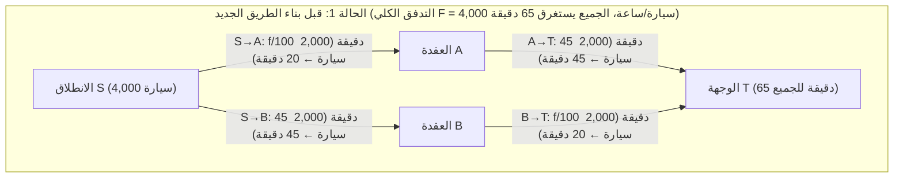
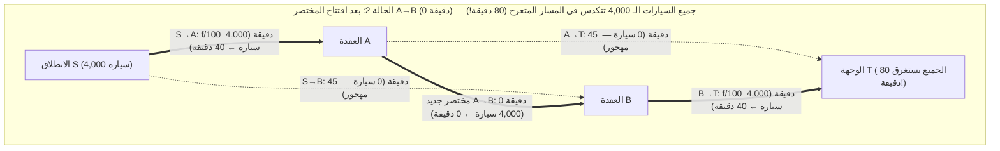

تخيل أن هيئة النقل في مدينة كبرى أنفقت مليارات الدولارات لبناء جسر سريع جديد بزمن عبور صفري لتخفيف الاختناقات المرورية الصباحية. يوحي الحدس البديهي بأن إضافة طريق جديد لا يمكن إلا أن تحسن الوضع؛ فالسعة الإجمالية لشبكة الطرق قد زادت، ولم يُغلق أي طريق قديم، ومن لا يرغب في استخدام الجسر الجديد يمكنه ببساطة الاستمرار في مساره المعتاد. فكيف يمكن لتوسيع مجموعة الخيارات أن يضر بالجميع؟

في عام 1968، نشر عالم الرياضيات الألماني <strong>ديتريش برايس (Dietrich Braess)</strong> ورقته البحثية الشهيرة (*"Über ein Paradoxon aus der Verkehrsplanung"*) التي حطمت هذا الحدس تماماً. أثبت برايس رياضياً أنه عندما يختار كل سائق مساره بشكل مستقل وأناني لتقليل وقت رحلته الشخصي (<strong>التوجيه الأناني / Selfish Routing</strong>)، <strong>فإن إضافة طريق مختصر فائق السرعة يمكن أن تؤدي في حالة التوازن الجديد إلى زيادة وقت التنقل لدى 100% من السائقين بشكل صارم!</strong> وتُعرف هذه الظاهرة المدهشة باسم <strong>مفارقة برايس (Braess's Paradox)</strong>.

والأكثر إدهاشاً أن مفارقة برايس لا تنتج عن نقص المعلومات أو اللاعقلانية البشرية، بل تنشأ حتمياً بوصفها توازن ناش الوحيد (<strong>توازن واردروب / Wardrop Equilibrium</strong>) في لعبة ازدحام غير تعاونية. ولأن الأنظمة الفيزيائية غير الحية تتبع مبدأ تقليل الطاقة الكامنة المحدبة المطابق رياضياً لدالة جهد بيكمان المرورية، فإن مفارقة برايس تظهر بذات البنية الرياضية في توجيه حزم الإنترنت (OSPF/BGP)، وشبكات الطاقة الكهربائية، والحلقات الكمومية النانوية، والميكانيكا الكلاسيكية — كما أثبت <strong>جويل كوهين وبول هوروويتز (Cohen & Horowitz, 1991)</strong> في مجلة *Nature*: <strong>في شبكة من النوابض والخيوط التي تحمل ثقلاً كبيراً، يؤدي قص الخيط الأوسط المشدود بالمقص إلى ارتفاع الثقل نحو الأعلى عكس الجاذبية الأرضية!</strong>

---

## 1. ورقة ديتريش برايس (1968) والشبكة الماسية ذات العقد الأربع

### 1.1 بنية الشبكة ودوال التأخير الزمني (Latency Functions)

لنفترض أن تدفقاً مرورياً إجمالياً قدره $F = 4,000\text{ سيارة/ساعة}$ (أو $F = 1$ بالوحدات المعيارية) ينتقل كل صباح من نقطة الانطلاق $S$ إلى الوجهة النهائية $T$ عبر عقدتين وسيطتين $A$ و$B$. يُعطى زمن العبور (دالة التأخير) $\ell_e(f_e)$ لكل وصلة موجهة $e \in E$ بدلالة حجم التدفق $f_e$ كما يلي:

1. <strong>الوصلة $S \to A$ (جسر ضيق يتأثر بالازدحام)</strong>: يزداد زمن العبور خطياً مع عدد السيارات $f_{SA}$:
   $$\ell_{SA}(f_{SA}) = \frac{f_{SA}}{100}\text{ دقيقة}$$
2. <strong>الوصلة $A \to T$ (طريق سريع عريض وطويل)</strong>: لا يتأثر بالازدحام، وزمن عبوره ثابت:
   $$\ell_{AT}(f_{AT}) = 45\text{ دقيقة}$$
3. <strong>الوصلة $S \to B$ (طريق سريع عريض وطويل)</strong>: متماثل مع $A \to T$، وزمن عبوره ثابت:
   $$\ell_{SB}(f_{SB}) = 45\text{ دقيقة}$$
4. <strong>الوصلة $B \to T$ (جسر ضيق يتأثر بالازدحام)</strong>: مطابق للجسر $S \to A$، ويزداد زمنه خطياً:
   $$\ell_{BT}(f_{BT}) = \frac{f_{BT}}{100}\text{ دقيقة}$$

### 1.2 الحالة 1: التوازن قبل بناء الطريق المختصر ($65$ دقيقة)

في غياب أي طريق يربط بين $A$ و$B$، يتاح للسائقين مساران فقط: المسار العلوي $P_{\text{up}} = (S \to A \to T)$ والمسار السفلي $P_{\text{down}} = (S \to B \to T)$. وبحكم التماثل، ينقسم التدفق البالغ $4,000$ سيارة بالتساوي ($2,000$ سيارة في كل مسار)، ويستغرق كل سائق:
$$T_{\text{before}} = \frac{2000}{100} + 45 = 20 + 45 = 65\text{ دقيقة}$$
وهذا التوزيع المتساوي يحقق أيضاً <strong>الحل الأمثل اجتماعياً ($f^*$)</strong>.

### 1.3 الحالة 2: افتتاح الطريق المختصر الصفري $A \to B$ ($80$ دقيقة!)

لنفترض الآن أنه تم افتتاح جسر مختصر فائق السرعة من $A$ إلى $B$ بزمن عبور قدره $\ell_{AB}(f_{AB}) = 0$ دقيقة.

يظهر الآن مسار ثالث هو <strong>المسار المتعرج $P_{\text{zig}} = (S \to A \to B \to T)$</strong>. ومن خلال تحليل <strong>الاستراتيجية المهيمنة بقوة (Strictly Dominant Strategy)</strong>:
1. <strong>القرار عند نقطة الانطلاق $S$ (مقارنة $S \to A \to B$ مع $S \to B$)</strong>: حتى لو تدفقت جميع السيارات الـ $4,000$ عبر الجسر الضيق $S \to A$، فإن أقصى زمن لعبوره هو $\frac{4000}{100} = 40$ دقيقة. وبما أن عبور $A \to B$ يستغرق $0$ دقيقة، فإن الوصول إلى $B$ عبر $S \to A \to B$ يستغرق <strong>$40$ دقيقة كحد أقصى</strong>، بينما يستغرق الطريق السريع $S \to B$ دائماً $45$ دقيقة! لذا فإن اختيار $S \to A$ هو استراتيجية مهيمنة بقوة، فيهجر الجميع الطريق $S \to B$ ($f_{SB} = 0$).
2. <strong>القرار عند العقدة $A$ (مقارنة $A \to B \to T$ مع $A \to T$)</strong>: بالمثل، فإن الانتقال من $A$ إلى $T$ عبر $A \to B \to T$ يستغرق كحد أقصى $0 + \frac{4000}{100} = 40$ دقيقة $< 45$ دقيقة، مما يجعله مهيمناً بقوة على الطريق السريع $A \to T$ ($f_{AT} = 0$).
3. <strong>التوازن الجديد الوحيد ($80$ دقيقة)</strong>: تتكدس جميع السيارات الـ $4,000$ في المسار المتعرج $S \to A \to B \to T$ عابرةً الجسرين الضيقين معاً:
   $$T_{\text{after}} = \frac{4000}{100} + 0 + \frac{4000}{100} = 40 + 0 + 40 = 80\text{ دقيقة!}$$
   وأي سائق يحاول بمفرده العودة إلى المسار القديم $S \to A \to T$ أو $S \to B \to T$ سيستغرق $40 + 45 = 85$ دقيقة. وهكذا يقع الجميع في <strong>معضلة السجينين (Prisoner's Dilemma)</strong> (+15 دقيقة أو تدهور بنسبة $+23.1\%$ للجميع).

| المعيار | الحالة 1: قبل المختصر $A \to B$ (الأمثل اجتماعياً $f^*$) | الحالة 2: بعد المختصر $A \to B$ (توازن واردروب $f^{\text{EQ}}$) | أثر المفارقة |
| :--- | :--- | :--- | :--- |
| <strong>التدفق عبر $S \to A \to T$</strong> | $2,000\text{ سيارة/ساعة}$ ($20 + 45 = 65\text{ د}$) | $0\text{ سيارة/ساعة}$ (سيستغرق $40 + 45 = 85\text{ د}$) | هجران الطريق $A \to T$ |
| <strong>التدفق عبر $S \to B \to T$</strong> | $2,000\text{ سيارة/ساعة}$ ($45 + 20 = 65\text{ د}$) | $0\text{ سيارة/ساعة}$ (سيستغرق $45 + 40 = 85\text{ د}$) | هجران الطريق $S \to B$ |
| <strong>التدفق عبر $S \to A \to B \to T$</strong> | غير موجود | $4,000\text{ سيارة/ساعة}$ ($100\%$ من حركة المرور) | عبور مزدوج للجسرين الضيقين |
| <strong>زمن الرحلة لكل سائق</strong> | <strong>$65\text{ دقيقة}$</strong> | <strong>$80\text{ دقيقة}$</strong> | <strong>زيادة $+15\text{ دقيقة}$ ($+23.1\%$) على الجميع</strong> |
| <strong>التكلفة الاجتماعية الكلية $C(f)$</strong> | $260,000\text{ سيارة·دقيقة}$ | $320,000\text{ سيارة·دقيقة}$ | <strong>$\text{PoA} = \frac{80}{65} = \frac{16}{13} \approx 1.231$</strong> |

---

## 2. مبدأا واردروب (1952) ودالة الجهد المحدبة لبيكمان-روزنتال (1956)

ليكن $G = (V, E)$ بياناً موجهاً بإجمالي طلب $F$، ومجموعة تدفقات ممكنة $\mathcal{F} = \{f \ge 0 : \sum_{P \in \mathcal{P}} f_P = F\}$، ودوال تأخير متزايدة وقابلة للاشتقاق $\ell_e(f_e)$.

### 2.1 مبدأ واردروب الأول (توازن المستخدم $f^{\text{EQ}}$)
عند توازن واردروب $f^{\text{EQ}}$، تتساوى أزمنة العبور في جميع المسارات المستخدمة فعلياً ($f_P^{\text{EQ}} > 0$)، وتكون أقل من أو تساوي زمن أي مسار غير مستخدم:
$$f_P^{\text{EQ}} > 0 \implies \ell_P(f^{\text{EQ}}) \le \ell_{P'}(f^{\text{EQ}}) \quad (\forall P' \in \mathcal{P})$$
وهو ما يكافئ <strong>المتباينة التغايرية (Variational Inequality)</strong>:
$$\sum_{e \in E} \ell_e\bigl(f_e^{\text{EQ}}\bigr)\bigl(f_e - f_e^{\text{EQ}}\bigr) \ge 0 \quad (\forall f \in \mathcal{F})$$

### 2.2 مبدأ واردروب الثاني (الأمثل الاجتماعي $f^*$) والعوامل الخارجية لبيغو
يقلل التدفق الأمثل اجتماعياً $f^*$ التكلفة الاجتماعية الكلية $C(f) = \sum_{e \in E} f_e \ell_e(f_e)$، مما يساوي بين <strong>التكلفة الحدية الاجتماعية (MSC)</strong> للمسارات:
$$\tilde{\ell}_e(f_e) = \frac{d}{df_e}\bigl[f_e \ell_e(f_e)\bigr] = \underbrace{\ell_e(f_e)}_{\text{التكلفة الخاصة}} + \underbrace{f_e \ell_e'(f_e)}_{\text{الأثر الخارجي للازدحام (بيغو)}}$$

### 2.3 دالة الجهد المحدبة لبيكمان-ماكغواير-وينستن (1956)
يتطابق توازن واردروب $f^{\text{EQ}}$ مع القيمة الصغرى الشاملة <strong>لدالة جهد بيكمان (Beckmann Potential)</strong>:
$$\Phi(f) = \sum_{e \in E} \int_0^{f_e} \ell_e(u)\,du \qquad \left(\text{لأن } \frac{\partial \Phi(f)}{\partial f_P} = \sum_{e \in P} \ell_e(f_e) = \ell_P(f)\right)$$
وفي حالة الدوال الخطية $\ell_e(u) = a_e u + b_e$، نجد أن $\Phi(f) = \sum_e (\frac{1}{2}a_e f_e^2 + b_e f_e)$ بينما $C(f) = \sum_e (a_e f_e^2 + b_e f_e)$؛ أي أن التوجيه الأناني يقلل من وزن حد الازدحام التربيعي إلى النصف ($\frac{1}{2}$).

---

## 3. مبرهنة رافغاردن وتاردوش (2002): إثبات الحد الأعلى $\text{PoA} \le 4/3$

يُعرَّف <strong>ثمن الفوضى ($\text{PoA}$)</strong> (Koutsoupias & Papadimitriou, 1999) بأنه النسبة $\text{PoA} = \frac{C(f^{\text{EQ}})}{C(f^*)}$. وفي شبكة <strong>بيغو (1920)</strong> ذات الوصلتين ($\ell_1(x)=1, \ell_2(x)=x, F=1$)، نجد $C(f^{\text{EQ}}) = 1$ و$C(f^*) = \frac{3}{4}$ (عند $x^* = \frac{1}{2}$)، مما يعطي $\text{PoA} = \frac{4}{3}$.

> <strong>مبرهنة (Roughgarden & Tardos, JACM 2002)</strong>:
> لأي شبكة موجهة $G=(V,E)$ ذات دوال تأخير خطية تآلفية $\ell_e(x) = a_e x + b_e$ ($a_e, b_e \ge 0$)، يحقق ثمن الفوضى المتباينة:
> $$\text{PoA}_{\text{linear}} = \frac{C(f^{\text{EQ}})}{C(f^*)} \le \frac{4}{3}$$

<strong>【البرهان الكامل】</strong>
1. <strong>المتباينة التغايرية</strong>: بما أن $\sum_{e \in E} \ell_e(f_e^{\text{EQ}})(f_e^* - f_e^{\text{EQ}}) \ge 0$، فإن:
   $$C(f^{\text{EQ}}) = \sum_{e \in E} f_e^{\text{EQ}} \ell_e(f_e^{\text{EQ}}) \le \sum_{e \in E} f_e^* \ell_e(f_e^{\text{EQ}})$$
2. <strong>إكمال المربع لكل وصلة</strong>: بوضع $x = f_e^{\text{EQ}} \ge 0$ و$y = f_e^* \ge 0$:
   $$y \ell_e(x) = y(a_e x + b_e) = y(a_e y + b_e) + a_e(xy - y^2) = y \ell_e(y) + a_e\left[\frac{1}{4}x^2 - \left(y - \frac{x}{2}\right)^2\right] \le y \ell_e(y) + \frac{1}{4}a_e x^2 \le y \ell_e(y) + \frac{1}{4} x \ell_e(x)$$
3. <strong>الجمع على كافة الوصلات</strong>: بجمع المتباينة على جميع $e \in E$:
   $$C(f^{\text{EQ}}) \le \sum_{e \in E} f_e^* \ell_e(f_e^{\text{EQ}}) \le C(f^*) + \frac{1}{4}C(f^{\text{EQ}}) \implies \frac{3}{4}C(f^{\text{EQ}}) \le C(f^*) \implies \text{PoA} \le \frac{4}{3} \quad \blacksquare$$

وبالنسبة لكثيرات الحدود من الدرجة $d$ (مثل دالة الطرق القياسية <strong>BPR</strong> ذات الدرجة الرابعة $d=4$، $\ell_e(f_e) = t_e^0[1 + 0.15(f_e/c_e)^4]$)، فإن الحد الأعلى الدقيق هو $\text{PoA}_d = \frac{(d+1)\sqrt[d]{d+1}}{(d+1)\sqrt[d]{d+1} - d}$ (وعند $d=4$ يكون $\text{PoA}_4 \approx 2.1505$).

---

## 4. التجليات الفيزيائية: مفارقة النوابض والخيوط لكوهين وهوروويتز (1991)

في عام 1991، أثبت <strong>جويل كوهين وبول هوروويتز</strong> في مجلة *Nature* أن نظاماً ميكانيكياً يتكون من نابضين متماثلين (ثابت الصلابة $k$ والطول الطبيعي $L_0$)، وخيطي أمان غير قابلين للتمدد بطول $L_s$، وخيط ربط أوسط قصير $A \to B$ (بطول $\approx 0$) يحمل ثقلاً وزنه $F = Mg$، يجسد مفارقة برايس بدقة:
- <strong>قبل قص الخيط الأوسط (توصيل على التوالي)</strong>: يتحمل كل نابض الوزن الكامل $F$ ويتمدد بمقدار $\frac{F}{k}$. وإذا كان $L_s > L_0 + \frac{F}{k}$، يبقى خيطا الأمان مرتخيين، ويكون عمق الثقل:
  $$Y_{\text{before}} = 2L_0 + \frac{2F}{k}$$
- <strong>بعد قص الخيط الأوسط بالمقص (توصيل على التوازي)</strong>: ينشد خيطا الأمان ويتقاسم النابضان الحمل <strong>على التوازي</strong> ($\frac{F}{2}$ لكل منهما)، فيتمدد كل نابض بمقدار $\frac{F}{2k}$ فقط! ويصبح عمق التوازن الجديد:
  $$Y_{\text{after}} = L_0 + \frac{F}{2k} + L_s$$
- فإذا اختير $L_0 + \frac{F}{k} < L_s < L_0 + \frac{3F}{2k}$ (مثلاً $L_s = L_0 + \frac{5F}{4k}$)، نحصل على:
  $$\Delta Y = Y_{\text{after}} - Y_{\text{before}} = -\frac{F}{4k} < 0$$
  <strong>أي أن قص الخيط الحامل للثقل يؤدي إلى ارتفاع الكتلة الثقيلة نحو الأعلى عكس الجاذبية بمقدار $\frac{F}{4k}$!</strong>

---

## 5. التخطيط الحضري الواقعي وتسعير الازدحام لبيغو (Congestion Pricing)

1. <strong>شتوتغارت (1969)</strong> و<strong>نيويورك — الشارع 42 (1990) وبرودواي في تايمز سكوير (2009)</strong>: أدى إغلاق شارع برودواي أمام السيارات في تايمز سكوير (الذي كان يقطع شبكة شوارع مانهاتن قطرياً تماماً مثل الوصلة المختصرة $A \to B$ في شبكة برايس) إلى تقليل زمن رحلات سيارات الأجرة بنسبة $17\%$.
2. <strong>سيول — إزالة طريق تشونغ غيتشون السريع المعلق (2003–2005)</strong>: أدى هدم طريق سريع معلق من 6 مسارات كان ينقل <strong>$168,000$ مركبة يومياً</strong> لاستعادة نهر تشونغ غيتشون الطبيعي إلى إزالة اختناقات المداخل والمخارج، وزيادة متوسط سرعة المرور في قلب سيول، وخفض حرارة الصيف بمقدار $3.6^\circ\text{C}$.
3. <strong>ضريبة بيغو</strong>: بفرض رسوم ازدحام $\tau_e = f_e^* \ell_e'(f_e^*)$ تساوي الأثر الخارجي الحدي على كل طريق، يتطابق توازن واردروب تماماً مع الحل الأمثل اجتماعياً ($\text{PoA} = 1$).
