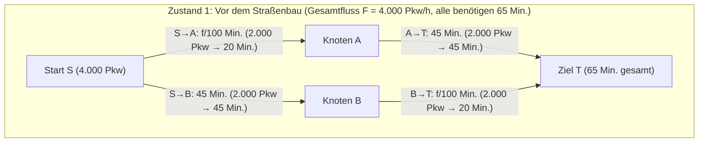
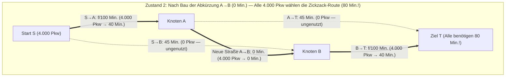

Stellen Sie sich vor, eine Verkehrsbehörde investiert Milliarden in den Bau einer neuen, kreuzungsfreien Schnellbrücke, um den morgendlichen Berufsverkehr zu entlasten. Der gesunde Menschenverstand legt nahe, dass eine zusätzliche Straße die Gesamtkapazität des Netzes erhöht und die durchschnittliche Fahrzeit verkürzen muss – schließlich wird keine bestehende Straße gesperrt, und wer die neue Brücke nicht nutzen möchte, kann einfach auf seiner gewohnten Route bleiben.

Doch im Jahr 1968 veröffentlichte der deutsche Mathematiker <strong>Dietrich Braess</strong> (damals an der Universität Münster, später Ruhr-Universität Bochum) in der Zeitschrift *Unternehmensforschung* seine bahnbrechende Arbeit *"Über ein Paradoxon aus der Verkehrsplanung"*. Braess bewies mathematisch: Wenn jeder Verkehrsteilnehmer seine Route individuell und eigennützig so wählt, dass seine persönliche Fahrzeit minimiert wird (<strong>Selfish Routing</strong>), <strong>kann der Bau einer neuen, verzögerungsfreien Verbindungsstraße dazu führen, dass sich im neuen Gleichgewicht die Fahrzeit für 100 % aller Fahrer strikt verlängert!</strong> Dieses Phänomen ging als <strong>Braess-Paradoxon</strong> in die Geschichte der Mathematik, Ökonomie und Informatik ein.

Noch verblüffender ist, dass das Braess-Paradoxon kein Resultat menschlicher Fehlentscheidungen oder unvollständiger Information ist. Es entsteht zwangsläufig als eindeutiges Nash-Gleichgewicht (<strong>Wardrop-Gleichgewicht</strong>) eines nichtkooperativen Überlastungsspiels (Congestion Game). Da auch unbelebte physikalische Systeme konvexe Potentialfunktionen minimieren, tritt das Paradoxon ebenso beim Paket-Routing im Internet, in Wechselstrom-Hochspannungsnetzen, in mesoskopischen Quantenringen und in der klassischen Mechanik auf: Wie <strong>Joel E. Cohen und Paul Horowitz</strong> 1991 in *Nature* zeigten, <strong>hebt sich ein an Federn und Fäden aufgehängtes schweres Gewicht entgegen der Schwerkraft nach oben, wenn man einen straff gespannten tragenden Faden in der Mitte mit einer Schere durchschneidet!</strong>

---

## 1. Dietrich Braess' Arbeit von 1968 und das 4-Knoten-Diamantnetzwerk

### 1.1 Netzwerkstruktur und Latenzfunktionen

Ein Gesamtverkehrsstrom von $F = 4.000\text{ Fahrzeugen/Stunde}$ (bzw. normiert $F = 1$) fährt jeden Morgen vom Startknoten $S$ zum Zielknoten $T$ über zwei Zwischenknoten $A$ und $B$. Die Fahrzeit (Latenzfunktion) $\ell_e(f_e)$ jeder gerichteten Kante $e \in E$ hängt wie folgt vom Kantenfluss $f_e$ ab:

1. <strong>Kante $S \to A$ (Engpass-Brücke)</strong>: Die Fahrzeit wächst linear mit der Verkehrsmenge $f_{SA}$:
   $$\ell_{SA}(f_{SA}) = \frac{f_{SA}}{100}\text{ Minuten}$$
2. <strong>Kante $A \to T$ (Breite Umgehungsautobahn)</strong>: Unempfindlich gegenüber Staus, konstante Fahrzeit:
   $$\ell_{AT}(f_{AT}) = 45\text{ Minuten}$$
3. <strong>Kante $S \to B$ (Breite Umgehungsautobahn)</strong>: Symmetrisch zu $A \to T$, konstante Fahrzeit:
   $$\ell_{SB}(f_{SB}) = 45\text{ Minuten}$$
4. <strong>Kante $B \to T$ (Engpass-Brücke)</strong>: Identisch gebaut wie $S \to A$, linear wachsende Fahrzeit:
   $$\ell_{BT}(f_{BT}) = \frac{f_{BT}}{100}\text{ Minuten}$$

### 1.2 Zustand 1: Gleichgewicht vor dem Bau der Abkürzung ($65$ Minuten)

Ohne Verbindung zwischen $A$ und $B$ stehen nur die obere Route $P_{\text{oben}} = (S \to A \to T)$ und die untere Route $P_{\text{unten}} = (S \to B \to T)$ zur Verfügung. Aus Symmetriegründen teilen sich die $4.000$ Fahrzeuge exakt $50:50$ auf ($f_{\text{oben}} = f_{\text{unten}} = 2.000$). Jeder Fahrer benötigt:
$$T_{\text{vorher}} = \frac{2000}{100} + 45 = 20 + 45 = 65\text{ Minuten}$$
Diese Aufteilung minimiert zugleich die gesellschaftlichen Gesamtkosten (<strong>Soziales Optimum $f^*$</strong>).

### 1.3 Zustand 2: Öffnung der verzögerungsfreien Abkürzung $A \to B$ ($80$ Minuten!)

Nun wird eine ultraschnelle Einbahnstraße von $A$ nach $B$ mit einer Fahrzeit von $\ell_{AB}(f_{AB}) = 0$ Minuten eröffnet.

Es entsteht eine dritte Route: der <strong>Zickzack-Pfad $P_{\text{zick}} = (S \to A \to B \to T)$</strong>. Eine Analyse mittels <strong>strikt dominanter Strategien</strong> zeigt, warum das alte Gleichgewicht komplett zusammenbricht:
1. <strong>Entscheidung am Start $S$ ($S \to A \to B$ vs. $S \to B$)</strong>: Selbst wenn alle $4.000$ Autos über die enge Brücke $S \to A$ fahren, dauert $S \to A$ maximal $\frac{4000}{100} = 40$ Minuten. Da $A \to B$ $0$ Minuten kostet, erreicht man Knoten $B$ über $S \to A \to B$ in <strong>höchstens $40$ Minuten</strong>, während die Autobahn $S \to B$ immer $45$ Minuten benötigt! Unabhängig vom Verhalten aller anderen Fahrer ist $S \to A$ immer mindestens $5$ Minuten schneller (strikt dominante Strategie). Folglich nutzt niemand mehr $S \to B$ ($f_{SB} = 0$).
2. <strong>Entscheidung am Knoten $A$ ($A \to B \to T$ vs. $A \to T$)</strong>: Von $A$ nach $T$ dauert die Autobahn $A \to T$ konstant $45$ Minuten, während der Weg über $A \to B \to T$ selbst bei voller Auslastung von $4.000$ Fahrzeugen höchstens $0 + \frac{4000}{100} = 40$ Minuten benötigt ($40 < 45$). Somit ist auch $A \to B \to T$ strikt dominant, und $A \to T$ verwaist vollständig ($f_{AT} = 0$).
3. <strong>Das neue eindeutige Gleichgewicht ($80$ Minuten)</strong>: Alle $4.000$ Fahrer drängen sich auf der Zickzack-Route $S \to A \to B \to T$ und überqueren beide Engpass-Brücken:
   $$T_{\text{nachher}} = \frac{4000}{100} + 0 + \frac{4000}{100} = 40 + 0 + 40 = 80\text{ Minuten!}$$
   Kein einzelner Fahrer kann durch Rückkehr auf $S \to A \to T$ oder $S \to B \to T$ Zeit sparen, da diese Routen nun $40 + 45 = 85$ Minuten dauern würden. Alle stecken in einem Mehrpersonen-<strong>Gefangenendilemma</strong> fest (+15 Minuten bzw. $+23{,}1\,\%$ für jeden!).

| Kennzahl | Zustand 1: Vor dem Bau von $A \to B$ (Soziales Optimum $f^*$) | Zustand 2: Nach Öffnung von $A \to B$ (Wardrop-Gleichgewicht $f^{\text{EQ}}$) | Auswirkung des Paradoxons |
| :--- | :--- | :--- | :--- |
| <strong>Fluss auf $S \to A \to T$</strong> | $2.000\text{ Pkw/h}$ ($20 + 45 = 65\text{ Min.}$) | $0\text{ Pkw/h}$ (würde $40 + 45 = 85\text{ Min.}$ dauern) | Autobahn $A \to T$ verwaist |
| <strong>Fluss auf $S \to B \to T$</strong> | $2.000\text{ Pkw/h}$ ($45 + 20 = 65\text{ Min.}$) | $0\text{ Pkw/h}$ (würde $45 + 40 = 85\text{ Min.}$ dauern) | Autobahn $S \to B$ verwaist |
| <strong>Fluss auf $S \to A \to B \to T$</strong> | Nicht vorhanden | $4.000\text{ Pkw/h}$ ($100\,\%$ des gesamten Verkehrs) | Belastet beide Engpässe doppelt |
| <strong>Fahrzeit pro Pendler</strong> | <strong>$65\text{ Minuten}$</strong> | <strong>$80\text{ Minuten}$</strong> | <strong>$+15\text{ Min.}$ ($+23{,}1\,\%$) länger für alle</strong> |
| <strong>Gesamtkosten $C(f)$</strong> | $260.000\text{ Pkw-Min.}$ | $320.000\text{ Pkw-Min.}$ | <strong>$\text{PoA} = \frac{80}{65} = \frac{16}{13} \approx 1{,}231$</strong> |

---

## 2. Wardrops zwei Prinzipien (1952) und die Beckmann-Rosenthal-Potentialfunktion (1956)

Auf einem gerichteten Graphen $G = (V, E)$ mit Gesamtnachfrage $F$, zulässigem Pfadfluss-Polytop $\mathcal{F} = \{f \ge 0 : \sum_{P \in \mathcal{P}} f_P = F\}$ und monoton wachsenden Kantenlatenzen $\ell_e(f_e)$ formulierte <strong>John Glen Wardrop (1952)</strong> zwei Grundprinzipien:

### 2.1 Wardrops erstes Prinzip (Nutzergleichgewicht $f^{\text{EQ}}$)
Im Gleichgewicht $f^{\text{EQ}}$ haben alle genutzten Pfade ($f_P^{\text{EQ}} > 0$) exakt dieselbe Latenz, und kein ungenutzter Pfad ist schneller:
$$f_P^{\text{EQ}} > 0 \implies \ell_P(f^{\text{EQ}}) \le \ell_{P'}(f^{\text{EQ}}) \quad (\forall P' \in \mathcal{P})$$
Dies ist äquivalent zur <strong>Variationsungleichung (Variational Inequality)</strong>:
$$\sum_{e \in E} \ell_e\bigl(f_e^{\text{EQ}}\bigr)\bigl(f_e - f_e^{\text{EQ}}\bigr) \ge 0 \quad (\forall f \in \mathcal{F})$$

### 2.2 Wardrops zweites Prinzip (Soziales Optimum $f^*$) und Pigou-Externalitäten
Das soziale Optimum $f^*$ minimiert die gesamten gesellschaftlichen Reisekosten $C(f) = \sum_{e \in E} f_e \ell_e(f_e)$. Die Ableitung nach $f_e$ liefert die <strong>sozialen Grenzkosten (Marginal Social Cost, MSC)</strong>:
$$\tilde{\ell}_e(f_e) = \frac{d}{df_e}\bigl[f_e \ell_e(f_e)\bigr] = \underbrace{\ell_e(f_e)}_{\text{Private Kosten}} + \underbrace{f_e \ell_e'(f_e)}_{\text{Pigou-Stauexternalität}}$$
Eigennützige Fahrer berücksichtigen nur ihre privaten Kosten $\ell_e(f_e)$ und ignorieren die <strong>Stauexternalität $f_e \ell_e'(f_e)$</strong>, die sie allen anderen $f_e$ Fahrern auf dieser Straße zufügen.

### 2.3 Die konvexe Potentialfunktion von Beckmann, McGuire und Winsten (1956)
Beckmann et al. (1956) zeigten, dass das Wardrop-Gleichgewicht $f^{\text{EQ}}$ genau das globale Minimum der <strong>Beckmann-Potentialfunktion</strong> $\Phi(f)$ ist:
$$\Phi(f) = \sum_{e \in E} \int_0^{f_e} \ell_e(u)\,du$$
Da $\frac{\partial \Phi(f)}{\partial f_P} = \sum_{e \in P} \ell_e(f_e) = \ell_P(f)$ gilt, stimmen die KKT-Optimalitätsbedingungen von $\Phi(f)$ exakt mit Wardrops erstem Prinzip überein. Für lineare Latenzen $\ell_e(u) = a_e u + b_e$ gilt:
$$\Phi(f) = \sum_{e \in E}\left(\frac{1}{2}a_e f_e^2 + b_e f_e\right) \quad \text{gegenüber} \quad C(f) = \sum_{e \in E}\left(a_e f_e^2 + b_e f_e\right)$$
Eigennütziges Routing halbiert also gewissermaßen die Wahrnehmung des quadratischen Stauterms $a_e f_e^2$ um den Faktor $\frac{1}{2}$.

---

## 3. Der Satz von Roughgarden & Tardos (2002): Beweis der Schranke $\text{PoA} \le 4/3$

Der von Koutsoupias und Papadimitriou (1999) eingeführte <strong>Preis der Anarchie (Price of Anarchy, $\text{PoA}$)</strong> ist definiert als $\text{PoA} = \frac{C(f^{\text{EQ}})}{C(f^*)}$. Bereits im 2-Kanten-Netzwerk von <strong>Arthur Cecil Pigou (1920)</strong> ($\ell_1(x)=1, \ell_2(x)=x, F=1$) ist $C(f^{\text{EQ}}) = 1$ und $C(f^*) = \min_{x \in [0,1]}(1 - x + x^2) = \frac{3}{4}$ (bei $x^* = \frac{1}{2}$), was $\text{PoA} = \frac{4}{3}$ ergibt.

2002 bewiesen <strong>Tim Roughgarden und Éva Tardos</strong> im *Journal of the ACM*, dass $\frac{4}{3}$ die scharfe obere Schranke für <em>jedes beliebige</em> Netzwerk mit affin-linearen Latenzen ist:

> <strong>Satz (Roughgarden & Tardos, 2002)</strong>:
> Für jedes gerichtete Netzwerk $G=(V,E)$ mit affin-linearen Latenzfunktionen $\ell_e(x) = a_e x + b_e$ ($a_e, b_e \ge 0$) gilt:
> $$\text{PoA}_{\text{linear}} = \frac{C(f^{\text{EQ}})}{C(f^*)} \le \frac{4}{3}$$

<strong>【Vollständiger Beweis】</strong>
1. <strong>Variationsungleichung</strong>: Für das Wardrop-Gleichgewicht $f^{\text{EQ}}$ und das soziale Optimum $f^*$ gilt $\sum_{e \in E} \ell_e(f_e^{\text{EQ}})(f_e^* - f_e^{\text{EQ}}) \ge 0$, also:
   $$C(f^{\text{EQ}}) = \sum_{e \in E} f_e^{\text{EQ}} \ell_e(f_e^{\text{EQ}}) \le \sum_{e \in E} f_e^* \ell_e(f_e^{\text{EQ}})$$
2. <strong>Quadratische Ergänzung pro Kante</strong>: Setze $x = f_e^{\text{EQ}} \ge 0$ und $y = f_e^* \ge 0$. Dann gilt:
   $$y \ell_e(x) = y(a_e x + b_e) = y(a_e y + b_e) + a_e(xy - y^2) = y \ell_e(y) + a_e\left[\frac{1}{4}x^2 - \left(y - \frac{x}{2}\right)^2\right] \le y \ell_e(y) + \frac{1}{4}a_e x^2$$
   Wegen $b_e x \ge 0$ folgt $a_e x^2 \le a_e x^2 + b_e x = x \ell_e(x)$ und somit:
   $$y \ell_e(x) \le y \ell_e(y) + \frac{1}{4} x \ell_e(x)$$
3. <strong>Summation über alle Kanten</strong>: Summiert über $e \in E$ ergibt sich:
   $$C(f^{\text{EQ}}) \le \sum_{e \in E} f_e^* \ell_e(f_e^{\text{EQ}}) \le \sum_{e \in E} f_e^* \ell_e(f_e^*) + \frac{1}{4}\sum_{e \in E} f_e^{\text{EQ}} \ell_e(f_e^{\text{EQ}}) = C(f^*) + \frac{1}{4}C(f^{\text{EQ}})$$
   Subtraktion von $\frac{1}{4}C(f^{\text{EQ}})$ liefert $\frac{3}{4}C(f^{\text{EQ}}) \le C(f^*) \implies \text{PoA} \le \frac{4}{3}$. $\blacksquare$

Für Polynomlatenzen vom Grad $d$ (wie die quartische <strong>BPR-Funktion</strong> $\ell_e(f_e) = t_e^0[1 + 0{,}15(f_e/c_e)^4]$ mit $d=4$) wächst der Preis der Anarchie gemäß:
$$\text{PoA}_d = \frac{(d+1)\sqrt[d]{d+1}}{(d+1)\sqrt[d]{d+1} - d} = \Theta\left(\frac{d}{\ln d}\right)$$
Für $d=4$ beträgt $\text{PoA}_4 \approx 2{,}1505$.

---

## 4. Physikalische Realisierungen: Das Feder-Faden-Paradoxon von Cohen & Horowitz (1991)

1991 bewiesen <strong>Joel E. Cohen und Paul Horowitz</strong> in *Nature*, dass ein mechanisches System aus zwei identischen Federn (Federkonstante $k$, Ruhelänge $L_0$), zwei unelastischen Sicherheitsfäden der Länge $L_s$ und einem kurzen zentralen Verbindungsfaden $A \to B$ (Länge $\approx 0$), das eine Masse $M$ (Gewichtskraft $F = Mg$) trägt, exakt dem Braess-Paradoxon unterliegt:
- <strong>Vor dem Durchschneiden des zentralen Fadens (Reihenschaltung)</strong>: Beide Federn hängen in Reihe, tragen jeweils die volle Last $F$ und dehnen sich um $\frac{F}{k}$. Für $L_s > L_0 + \frac{F}{k}$ hängen die Sicherheitsfäden schlaff herab, und die Gesamttiefe des Gewichts beträgt:
  $$Y_{\text{vorher}} = 2L_0 + \frac{2F}{k}$$
- <strong>Nach dem Durchschneiden des zentralen Fadens mit einer Schere (Parallelschaltung)</strong>: Die Sicherheitsfäden spannen sich, und die beiden Federn teilen sich die Last <strong>parallel</strong> je zur Hälfte ($T_1 = T_2 = \frac{F}{2}$)! Jede Feder dehnt sich nur noch um $\frac{F}{2k}$, sodass die neue Gleichgewichtstiefe lautet:
  $$Y_{\text{nachher}} = L_0 + \frac{F}{2k} + L_s$$
- Wählt man $L_0 + \frac{F}{k} < L_s < L_0 + \frac{3F}{2k}$ (z. B. $L_s = L_0 + \frac{5F}{4k}$), so folgt:
  $$\Delta Y = Y_{\text{nachher}} - Y_{\text{vorher}} = -\frac{F}{4k} < 0$$
  <strong>Das Durchschneiden des tragenden Mittelfadens lässt das schwere Gewicht entgegen der Schwerkraft um $\frac{F}{4k}$ nach oben steigen!</strong>

Analoge Effekte wurden in <strong>Wechselstrom-Übertragungsnetzen (Witthaut & Timme, 2012)</strong>, <strong>Halbleiter-Quantenringen (Pala et al., 2012)</strong> und <strong>metabolischen Netzwerken (Motter, 2010)</strong> nachgewiesen.

---

## 5. Reale Stadtplanung und Pigou-Maut (Congestion Pricing)

1. <strong>Stuttgart (1969)</strong>: Kurz nach Braess' Veröffentlichung führte ein Straßenneubau am Stuttgarter Schlossplatz zu massivem Verkehrschaos; erst als die neue Straße wieder gesperrt wurde, floss der Verkehr wieder flüssig.
2. <strong>New York City – 42nd Street (1990) & Broadway am Times Square (2009)</strong>: Der diagonal durch das Straßenraster von Manhattan verlaufende Broadway wirkte exakt wie die Abkürzung $A \to B$ im Braess-Netzwerk. Seine dauerhafte Umwandlung in eine Fußgängerzone am Times Square (2009) verkürzte die Fahrzeiten im umliegenden Netz um bis zu $17\,\%$.
3. <strong>Seoul – Abriss der Cheonggyecheon-Stadtautobahn (2003–2005)</strong>: Der vollständige Rückbau einer $5{,}8\text{ km}$ langen, sechsspurigen Hochstraße mit täglich <strong>$168.000$ Fahrzeugen</strong> zugunsten eines renaturierten Flusses führte nicht zum Kollaps, sondern beschleunigte den durchschnittlichen Verkehrsfluss in der Innenstadt von Seoul und senkte die Sommertemperatur vor Ort um $3{,}6^\circ\text{C}$.

Durch Erhebung einer <strong>Pigou-Stauabgabe (Marginal Cost Pricing)</strong> $\tau_e = f_e^* \ell_e'(f_e^*)$ auf jeder Kante wird die externe Stauwirkung internalisiert, sodass das Wardrop-Gleichgewicht exakt mit dem sozialen Optimum zusammenfällt ($\text{PoA} = 1$).
