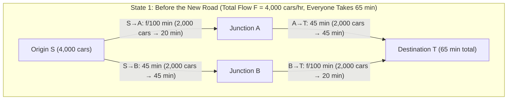
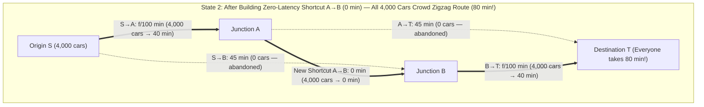

Imagine a metropolitan transportation authority spending billions of dollars to relieve severe morning rush-hour congestion by building a brand-new, zero-delay bridge connecting two major commuter arteries. Common sense—and naive engineering intuition—suggests that adding a new road can only help. After all, the total capacity of the road network has strictly increased, no existing roads were narrowed or removed, and anyone who dislikes the new bridge is completely free to keep driving along their old route. How could expanding the set of choices possibly hurt?

In 1968, the German mathematician <strong>Dietrich Braess</strong> published a landmark paper in operations research (*"Über ein Paradoxon aus der Verkehrsplanung"*) that shattered this intuition forever. Braess proved mathematically that when individual commuters choose their routes selfishly to minimize their own personal travel time—a decentralized regime known as <strong>selfish routing</strong>—<strong>adding a new, zero-latency shortcut link to a network can cause the equilibrium travel time of 100% of commuters to become strictly longer</strong>. This counterintuitive phenomenon is known across mathematics, economics, computer science, and physics as <strong>Braess's Paradox</strong>.

Even more remarkably, Braess's Paradox is not caused by bounded rationality, imperfect traffic information, or human psychology. It emerges inevitably as the unique Nash equilibrium (or <strong>Wardrop equilibrium</strong>) of a non-cooperative congestion game under complete information. Furthermore, because passive physical systems minimize convex potential energy functions that are mathematically isomorphic to the potential function of selfish traffic assignment, Braess's Paradox manifests directly in inanimate hardware:
- In <strong>internet packet routing</strong> (OSPF/BGP) and telecommunication queues, where adding a fiber-optic link can increase end-to-end packet latency.
- In <strong>electrical power grids</strong> and mesoscopic quantum nanostructures, where adding a transmission line or conductive channel can reduce network conductance and trigger blackouts.
- In <strong>classical mechanics</strong>, as demonstrated by <strong>Joel E. Cohen and Paul Horowitz</strong> in their famous 1991 *Nature* paper: if a heavy weight is suspended from a ceiling by a network of springs and strings, <strong>cutting a taut load-bearing string with scissors causes the hanging weight to rise upward against gravity</strong>.

In this comprehensive treatise, we dissect the full mathematical architecture of Braess's Paradox and selfish routing: from dominant-strategy equilibrium analysis on Braess's canonical 4-node diamond network, to <strong>John Glen Wardrop's Two Principles of Traffic Assignment (1952)</strong>, the <strong>Beckmann-McGuire-Winsten (1956) and Rosenthal (1973) convex potential function</strong>, a complete step-by-step proof of <strong>Tim Roughgarden and Éva Tardos's (2002) $\frac{4}{3}$ Price of Anarchy theorem</strong> (and its generalization to degree-$d$ polynomial latency functions), the exact derivation of the mechanical spring-and-string paradox, and real-world urban transformations—including the demolition of Seoul's Cheonggyecheon Elevated Expressway and Pigouvian congestion pricing.

---

## 1. Dietrich Braess's 1968 Landmark Paper and the 4-Node Diamond Network

In 1968, while working at the University of Münster, Dietrich Braess investigated how traffic distributes itself across a road network when every driver acts independently to minimize their own travel time. To demonstrate that network expansion can backfire, he constructed the canonical <strong>4-Node Diamond Network</strong> connecting an origin node $S$ (Start) to a destination node $T$ (Terminal) via two intermediate junctions $A$ and $B$.

### 1.1 Network Topology and Edge Latency Functions

Suppose that during the morning rush hour, a total traffic flow of $F = 4,000\text{ cars/hour}$ (or $F = 1$ in normalized units) must travel from origin $S$ to destination $T$. Every directed edge $e \in E$ is characterized by a non-decreasing <strong>latency function (travel-time function)</strong> $\ell_e(f_e)$, which gives the time in minutes required to traverse edge $e$ when $f_e$ cars/hour use that edge:

1. <strong>Edge $S \to A$ (Narrow Local Bridge)</strong>: This link is short but narrow and highly susceptible to congestion. Its travel time increases linearly with the flow $f_{SA}$ on it:
   $$\ell_{SA}(f_{SA}) = \frac{f_{SA}}{100}\text{ minutes}$$
   For example, if $2,000$ cars use $S \to A$, the travel time is $\frac{2000}{100} = 20$ minutes; if all $4,000$ cars crowd onto $S \to A$, the travel time doubles to $\frac{4000}{100} = 40$ minutes.
2. <strong>Edge $A \to T$ (Wide Multi-Lane Highway Bypass)</strong>: This highway is long, taking $45$ minutes to drive, but it is so wide that it never experiences congestion regardless of traffic volume:
   $$\ell_{AT}(f_{AT}) = 45\text{ minutes}$$
3. <strong>Edge $S \to B$ (Wide Multi-Lane Highway Bypass)</strong>: Symmetrically, this wide highway from $S$ to $B$ has a constant, flow-independent travel time:
   $$\ell_{SB}(f_{SB}) = 45\text{ minutes}$$
4. <strong>Edge $B \to T$ (Narrow Local Bridge)</strong>: Identical in physical capacity to $S \to A$, this narrow bridge's travel time scales linearly with the traffic flow $f_{BT}$ on it:
   $$\ell_{BT}(f_{BT}) = \frac{f_{BT}}{100}\text{ minutes}$$

### 1.2 State 1: Equilibrium Before Building the Shortcut ($65$ Minutes)

Initially, there is no direct connection between junction $A$ and junction $B$. Every driver departing from $S$ must choose between exactly two available paths:
- <strong>The Upper Route $P_{\text{up}} = (S \to A \to T)$</strong>, with total travel time $\ell_{\text{up}} = \frac{f_{SA}}{100} + 45$ minutes.
- <strong>The Lower Route $P_{\text{down}} = (S \to B \to T)$</strong>, with total travel time $\ell_{\text{down}} = 45 + \frac{f_{BT}}{100}$ minutes.

How does traffic split between these two routes? Suppose $3,000$ drivers chose the upper route and only $1,000$ chose the lower route. Then drivers on the upper route would suffer a $\frac{3000}{100} + 45 = 75$-minute commute, whereas drivers on the lower route would breeze through in $45 + \frac{1000}{100} = 55$ minutes. Seeing this $20$-minute gap, drivers on the upper route would immediately switch to the lower route until the travel times on both paths equalize.

By symmetry, the unique equilibrium occurs when the $4,000$ cars split evenly ($50\% / 50\%$):
- $f_{\text{up}} = 2,000\text{ cars/hour}$ on $S \to A \to T$
- $f_{\text{down}} = 2,000\text{ cars/hour}$ on $S \to B \to T$

At this equilibrium, every single commuter experiences a travel time of:
$$T_{\text{before}} = \frac{2000}{100} + 45 = 20 + 45 = 65\text{ minutes}$$
Neither route offers a faster alternative, so no driver has any incentive to unilaterally switch paths. Moreover, as we will verify shortly, this $50/50$ split also minimizes total societal travel time across all possible flow allocations.

### 1.3 State 2: Building the Zero-Latency Shortcut $A \to B$ ($80$ Minutes!)

Now suppose city planners build a gleaming, ultrafast one-way express bridge directly from junction $A$ to junction $B$ with <strong>zero travel time</strong>:
$$\ell_{AB}(f_{AB}) = 0\text{ minutes}$$

The new bridge creates a third possible path from $S$ to $T$: the <strong>Zigzag Route $P_{\text{zig}} = (S \to A \to B \to T)$</strong>, which traverses both narrow bridges $S \to A$ and $B \to T$ via the instantaneous connector $A \to B$.

Let us trace what happens using <strong>Strict Dominant Strategy Analysis</strong> from game theory:

1. <strong>The Initial Temptation</strong>:
   Moments after the $A \to B$ shortcut opens, when traffic is still split $2,000 / 2,000$ on the upper and lower routes, each narrow bridge takes $20$ minutes. An enterprising driver who tries the new zigzag route $S \to A \to B \to T$ experiences a travel time of:
   $$\ell_{\text{zig}} = \ell_{SA}(2000) + \ell_{AB} + \ell_{BT}(2000) = 20 + 0 + 20 = 40\text{ minutes!}$$
   Compared to the $65$-minute commute on the upper and lower routes, the zigzag route saves a massive $25$ minutes! Word spreads rapidly (or GPS navigation apps like Waze and Google Maps update in real time), and drivers begin pouring onto $S \to A \to B \to T$.
2. <strong>Why the Stampede Never Stops (Dominant Strategy Proof)</strong>:
   As more drivers switch to the zigzag path, the flow on $S \to A$ and $B \to T$ rises above $2,000$, pushing their travel times from $20$ minutes toward $30$, $35$, and $40$ minutes. One might intuitively expect this shift to stop once the zigzag path slows down to $65$ minutes. <strong>Why doesn't it stop at $65$ minutes?</strong>
   Look at the decision facing any individual driver at the two junctions:
   - <strong>Decision 1 at Origin $S$ (Comparing $S \to A \to B$ vs. $S \to B$)</strong>:
     Suppose a driver wants to reach junction $B$. Even if <em>every single one</em> of the $4,000$ cars on the road takes the narrow bridge $S \to A$, the travel time on $S \to A$ can never exceed:
     $$\ell_{SA}(f_{SA}) = \frac{f_{SA}}{100} \le \frac{4000}{100} = 40\text{ minutes}$$
     Once at $A$, crossing $A \to B$ takes $0$ minutes, so reaching junction $B$ via $S \to A \to B$ takes <strong>at most $40$ minutes</strong>. By contrast, taking the direct highway $S \to B$ <em>always</em> takes $45$ minutes! Thus, regardless of what the other $3,999$ drivers do, taking $S \to A \to B$ is <strong>strictly faster by at least $5$ minutes</strong> than taking $S \to B$. In game-theoretic terms, $S \to A$ <strong>strictly dominates</strong> $S \to B$. Consequently, $100\%$ of rational drivers take $S \to A$, leaving highway $S \to B$ completely empty ($f_{SB} = 0$).
   - <strong>Decision 2 at Junction $A$ (Comparing $A \to B \to T$ vs. $A \to T$)</strong>:
     Now all $4,000$ drivers arrive at junction $A$ and must reach destination $T$. They can either take the wide highway $A \to T$ (which always costs $45$ minutes) or cross the zero-latency bridge $A \to B$ ($0$ minutes) and take the narrow bridge $B \to T$. Even if all $4,000$ drivers take $B \to T$, its travel time is at most:
     $$\ell_{AB}(f_{AB}) + \ell_{BT}(f_{BT}) = 0 + \frac{f_{BT}}{100} \le \frac{4000}{100} = 40\text{ minutes}$$
     Since $40 < 45$, taking $A \to B \to T$ <strong>strictly dominates</strong> taking highway $A \to T$ by at least $5$ minutes! Therefore, $100\%$ of drivers at $A$ turn onto the shortcut $A \to B \to T$, leaving highway $A \to T$ completely empty ($f_{AT} = 0$).

3. <strong>The New Unique Nash/Wardrop Equilibrium ($80$ Minutes)</strong>:
   Because choosing $S \to A$ at $S$ and $A \to B \to T$ at $A$ are strictly dominant strategies for every individual driver, <strong>all $4,000$ cars crowd onto the zigzag path $S \to A \to B \to T$</strong>. Both narrow bridges $S \to A$ and $B \to T$ are now saturated with $4,000$ cars/hour, and every commuter's travel time jumps to:
   $$T_{\text{after}} = \ell_{SA}(4000) + \ell_{AB}(4000) + \ell_{BT}(4000) = \frac{4000}{100} + 0 + \frac{4000}{100} = 40 + 0 + 40 = 80\text{ minutes!}$$

Can any individual driver escape this $80$-minute nightmare by returning to their old $65$-minute route $S \to A \to T$ or $S \to B \to T$? <strong>No!</strong> Because the other $3,999$ drivers are clogging both narrow bridges ($S \to A$ takes $40$ minutes and $B \to T$ takes $40$ minutes), a lone driver who deviates to $S \to A \to T$ will spend $40$ minutes on $S \to A$ plus $45$ minutes on $A \to T$, totaling <strong>$85$ minutes</strong>! Similarly, deviating to $S \to B \to T$ costs $45 + 40 = 85$ minutes. Every driver is locked into an $80$-minute commute in a multi-player <strong>Prisoner's Dilemma</strong>: individual rationality has led to collective catastrophe, increasing everyone's commute by $15$ minutes ($+23.1\%$).

| Metric | State 1: Before Shortcut $A \to B$ (Also Social Optimum $f^*$) | State 2: After Zero-Latency Shortcut $A \to B$ (Wardrop Equilibrium $f^{\text{EQ}}$) | Paradoxical Impact |
| :--- | :--- | :--- | :--- |
| <strong>Available Paths</strong> | $P_{\text{up}}(S\to A\to T)$, $P_{\text{down}}(S\to B\to T)$ | $P_{\text{up}}$, $P_{\text{down}}$, $P_{\text{zig}}(S\to A\to B\to T)$ | 1 ultrafast link added |
| <strong>Flow on $S \to A \to T$</strong> | $2,000\text{ cars/hr}$ ($20 + 45 = 65\text{ min}$) | $0\text{ cars/hr}$ (would take $40 + 45 = 85\text{ min}$) | Highway $A \to T$ abandoned |
| <strong>Flow on $S \to B \to T$</strong> | $2,000\text{ cars/hr}$ ($45 + 20 = 65\text{ min}$) | $0\text{ cars/hr}$ (would take $45 + 40 = 85\text{ min}$) | Highway $S \to B$ abandoned |
| <strong>Flow on $S \to A \to B \to T$</strong> | N/A (link $A \to B$ absent) | $4,000\text{ cars/hr}$ ($100\%$ of all traffic) | Traverses both narrow bridges |
| <strong>Commute Time per Driver</strong> | <strong>$65\text{ minutes}$</strong> | <strong>$80\text{ minutes}$</strong> | <strong>$+15\text{ min}$ ($+23.1\%$) worse for 100% of drivers</strong> |
| <strong>Total Social Cost $C(f)$</strong> | $4,000 \times 65 = 260,000\text{ car-min}$ | $4,000 \times 80 = 320,000\text{ car-min}$ | <strong>$\text{PoA} = \frac{80}{65} = \frac{16}{13} \approx 1.231$</strong> |

*(Note: If the two wide highways $A \to T$ and $S \to B$ had a constant latency of $40$ minutes instead of $45$ minutes—or in normalized units $\ell_{SA}(x) = \ell_{BT}(x) = x$, $\ell_{AT} = \ell_{SB} = 1$, $\ell_{AB} = 0$ with total flow $F = 1$—then the travel time before the shortcut would be $\frac{1}{2} + 1 = \frac{3}{2} = 1.5$ ($60$ minutes) and the equilibrium travel time after the shortcut would be $1 + 0 + 1 = 2.0$ ($80$ minutes), achieving the exact worst-case linear ratio $\frac{2.0}{1.5} = \frac{4}{3} \approx 1.3333$, a $+33.3\%$ increase!)*

---

## 2. Wardrop's Two Principles (1952) and the Beckmann-Rosenthal Potential Function (1956)

To analyze arbitrary traffic and communication networks rigorously, we turn to the foundational mathematical framework established by British transport analyst <strong>John Glen Wardrop</strong> in 1952 and economists <strong>Martin Beckmann, C. B. McGuire, and Christopher B. Winsten</strong> in 1956, later generalized to finite congestion games by <strong>Robert W. Rosenthal</strong> in 1973.

### 2.1 Mathematical Formulation of Non-Atomic Congestion Games

Let $G = (V, E)$ be a directed graph with origin-destination (O-D) pairs $(s_1, t_1), \dots, (s_k, t_k)$, where pair $i$ has traffic demand $r_i > 0$. Let $\mathcal{P}_i$ denote the set of simple directed paths from $s_i$ to $t_i$, and let $\mathcal{P} = \bigcup_{i=1}^k \mathcal{P}_i$.
- A <strong>flow vector</strong> $f = (f_P)_{P \in \mathcal{P}}$ is <strong>feasible</strong> (written $f \in \mathcal{F}$) if it satisfies demand conservation and non-negativity:
  $$\sum_{P \in \mathcal{P}_i} f_P = r_i \quad (\forall i \in \{1, \dots, k\}), \qquad f_P \ge 0 \quad (\forall P \in \mathcal{P})$$
- Any path flow $f \in \mathcal{F}$ induces an <strong>edge flow</strong> $f_e$ on each edge $e \in E$:
  $$f_e = \sum_{P \in \mathcal{P} : e \in P} f_P$$
- Each edge $e \in E$ is equipped with a continuous, non-decreasing, continuously differentiable <strong>latency (cost) function</strong> $\ell_e : [0, \infty) \to [0, \infty)$. The total latency of a path $P \in \mathcal{P}$ under flow $f$ is the sum of its constituent edge latencies:
  $$\ell_P(f) = \sum_{e \in P} \ell_e(f_e)$$

The game is called <strong>non-atomic</strong> because each individual user controls an infinitesimal quantum of flow $df \to 0$, treating the aggregate congestion $\ell_e(f_e)$ on every edge as externally given when choosing a minimum-latency path.

### 2.2 Wardrop's First Principle: User Equilibrium ($f^{\text{EQ}}$)

In his seminal 1952 paper *"Some theoretical aspects of road traffic research"*, Wardrop stated his <strong>First Principle</strong> characterizing decentralized selfish routing—known as <strong>Wardrop Equilibrium</strong> or <strong>User Equilibrium (UE)</strong>:

> <strong>Wardrop's First Principle (User Equilibrium $f^{\text{EQ}}$)</strong>:
> *"The journey times on all the routes actually used are equal, and less than those which would be experienced by a single vehicle on any unused route."*

Formally, a feasible flow $f^{\text{EQ}} \in \mathcal{F}$ is at <strong>Wardrop Equilibrium</strong> if and only if for every O-D pair $i$ and every pair of paths $P, P' \in \mathcal{P}_i$:
$$f_P^{\text{EQ}} > 0 \implies \ell_P(f^{\text{EQ}}) \le \ell_{P'}(f^{\text{EQ}})$$
Equivalently, for each O-D pair $i$, there exists an equilibrium travel time $L_i \ge 0$ such that:
$$\begin{cases} \ell_P(f^{\text{EQ}}) = L_i & \text{if } f_P^{\text{EQ}} > 0 \\ \ell_P(f^{\text{EQ}}) \ge L_i & \text{if } f_P^{\text{EQ}} = 0 \end{cases}$$

As proved by M. J. Smith (1979) and Stella Dafermos (1980), this path-level condition can be expressed compactly in terms of edge flows as a <strong>Variational Inequality (VI)</strong>: a feasible flow $f^{\text{EQ}} \in \mathcal{F}$ is a Wardrop equilibrium if and only if for every feasible flow $f \in \mathcal{F}$:
$$\sum_{e \in E} \ell_e\bigl(f_e^{\text{EQ}}\bigr) \cdot \bigl(f_e - f_e^{\text{EQ}}\bigr) \ge 0 \quad (\forall f \in \mathcal{F})$$

### 2.3 Wardrop's Second Principle: Social Optimum ($f^*$) and Pigouvian Externalities

Wardrop's <strong>Second Principle</strong> characterizes the centralized ideal—the <strong>Social Optimum</strong> or <strong>System Optimum (SO)</strong> $f^*$—in which a benevolent traffic dictator routes vehicles so that *"the average (or total) journey time is a minimum."*

The <strong>Total Social Cost</strong> $C(f)$ of a flow $f \in \mathcal{F}$ is the aggregate travel time experienced by all users across the entire network:
$$C(f) = \sum_{P \in \mathcal{P}} f_P \ell_P(f) = \sum_{P \in \mathcal{P}} f_P \sum_{e \in P} \ell_e(f_e) = \sum_{e \in E} \left(\sum_{P \ni e} f_P\right) \ell_e(f_e) = \sum_{e \in E} f_e \ell_e(f_e)$$

A flow $f^* \in \mathcal{F}$ is a <strong>Social Optimum</strong> if it minimizes $C(f)$ over $\mathcal{F}$:
$$f^* = \arg\min_{f \in \mathcal{F}} C(f) = \arg\min_{f \in \mathcal{F}} \sum_{e \in E} f_e \ell_e(f_e)$$

Assuming $f_e \mapsto f_e \ell_e(f_e)$ is convex on $[0, \infty)$, we can take the first-order Karush-Kuhn-Tucker (KKT) optimality conditions of $C(f)$. Differentiating the edge social cost $f_e \ell_e(f_e)$ with respect to $f_e$ yields the <strong>Marginal Social Cost (MSC)</strong> $\tilde{\ell}_e(f_e)$ of edge $e$:
$$\tilde{\ell}_e(f_e) = \frac{d}{df_e}\bigl[ f_e \ell_e(f_e) \bigr] = \ell_e(f_e) + f_e \ell_e'(f_e)$$

Therefore, a feasible flow $f^* \in \mathcal{F}$ minimizes total social cost $C(f)$ if and only if it is a Wardrop equilibrium with respect to the <strong>marginal social cost functions</strong> $\tilde{\ell}_e(f_e) = \ell_e(f_e) + f_e \ell_e'(f_e)$ rather than the raw latencies $\ell_e(f_e)$:
$$f_P^* > 0 \implies \sum_{e \in P} \Bigl(\ell_e(f_e^*) + f_e^* \ell_e'(f_e^*)\Bigr) \le \sum_{e \in P'} \Bigl(\ell_e(f_e^*) + f_e^* \ell_e'(f_e^*)\Bigr) \quad (\forall P' \in \mathcal{P}_i)$$

Look closely at the decomposition of Marginal Social Cost:
$$\underbrace{\frac{d}{df_e}\bigl[f_e \ell_e(f_e)\bigr]}_{\text{Marginal Social Cost}} = \underbrace{\ell_e(f_e)}_{\text{Private Cost}} + \underbrace{f_e \ell_e'(f_e)}_{\text{Pigouvian Externality}}$$

1. <strong>Private Cost $\ell_e(f_e)$</strong>: This is the travel time experienced directly by the marginal driver entering edge $e$. Selfish drivers care <em>only</em> about this first term.
2. <strong>Pigouvian Congestion Externality $f_e \ell_e'(f_e)$</strong>: When an additional infinitesimal flow $df_e$ enters edge $e$, it slows down edge $e$ by $\ell_e'(f_e)\,df_e$. That extra delay is inflicted on <strong>all $f_e$ drivers who are already using edge $e$</strong>! Thus, $f_e \ell_e'(f_e)$ is the marginal congestion damage imposed on everyone else.

Because selfish drivers ignore the externality $f_e \ell_e'(f_e)$, they systematically over-utilize congestion-sensitive links (where $\ell_e'(f_e) > 0$, such as the narrow bridges $S \to A$ and $B \to T$ in Braess's network) and under-utilize congestion-immune links (where $\ell_e'(f_e) = 0$, such as the wide highways $A \to T$ and $S \to B$).

### 2.4 The Beckmann-McGuire-Winsten Convex Potential Function

Why does a Wardrop equilibrium $f^{\text{EQ}}$ always exist, and how can we compute it efficiently without solving a fixed-point problem over exponentially many paths?
In 1956, Beckmann, McGuire, and Winsten discovered a remarkable variational principle: decentralized selfish routing is mathematically equivalent to minimizing a single convex scalar function $\Phi(f)$, known as the <strong>Beckmann Potential Function</strong> (or Rosenthal Potential):

$$\Phi(f) = \sum_{e \in E} \int_0^{f_e} \ell_e(u)\,du$$

Let us verify why minimizing $\Phi(f)$ over the convex polytope $\mathcal{F}$ produces the exact Wardrop equilibrium $f^{\text{EQ}}$:
- By the Fundamental Theorem of Calculus and the chain rule (since $\frac{\partial f_e}{\partial f_P} = \mathbf{1}_{e \in P}$), the partial derivative of $\Phi(f)$ with respect to any path flow variable $f_P$ is simply the path latency $\ell_P(f)$:
  $$\frac{\partial \Phi(f)}{\partial f_P} = \sum_{e \in E} \frac{\partial}{\partial f_e}\left(\int_0^{f_e} \ell_e(u)\,du\right)\frac{\partial f_e}{\partial f_P} = \sum_{e \in P} \ell_e(f_e) = \ell_P(f)$$
- Because each $\ell_e(u)$ is continuous and non-decreasing ($\ell_e'(u) \ge 0$), its antiderivative $\int_0^{f_e} \ell_e(u)\,du$ has a non-negative second derivative $\ell_e'(f_e) \ge 0$ and is therefore <strong>convex</strong>.
- Consequently, $\Phi(f)$ is a continuous convex function defined on the non-empty, compact, convex polytope $\mathcal{F}$. Its first-order KKT optimality conditions state that $f^{\text{EQ}} \in \mathcal{F}$ minimizes $\Phi(f)$ if and only if
  $$\nabla \Phi(f^{\text{EQ}}) \cdot (f - f^{\text{EQ}}) = \sum_{e \in E} \ell_e\bigl(f_e^{\text{EQ}}\bigr)\bigl(f_e - f_e^{\text{EQ}}\bigr) \ge 0 \quad (\forall f \in \mathcal{F})$$
  which is <strong>identical</strong> to the Variational Inequality of Wardrop's First Principle!

This immediately establishes two cornerstone theorems of network science:
1. <strong>Universal Existence</strong>: Every non-atomic congestion game with continuous latencies possesses at least one Wardrop equilibrium.
2. <strong>Essential Uniqueness</strong>: Because $\Phi(f)$ is convex in edge flows, the set of Wardrop equilibria is a convex set, and for any two Wardrop equilibria $f, \tilde{f}$, the equilibrium latency on every single edge is identical: $\ell_e(f_e) = \ell_e(\tilde{f}_e)$ for all $e \in E$ (and if $\ell_e$ is strictly increasing, the edge flow $f_e^{\text{EQ}}$ itself is strictly unique).

Comparing $\Phi(f)$ and $C(f)$ side-by-side for affine linear latencies $\ell_e(u) = a_e u + b_e$ ($a_e, b_e \ge 0$) reveals the exact algebraic origin of selfish routing inefficiency:
$$\Phi(f) = \sum_{e \in E} \int_0^{f_e} (a_e u + b_e)\,du = \sum_{e \in E} \left(\frac{1}{2} a_e f_e^2 + b_e f_e\right)$$
$$C(f) = \sum_{e \in E} f_e (a_e f_e + b_e) = \sum_{e \in E} \left(a_e f_e^2 + b_e f_e\right)$$
Notice the factor of <strong>$\frac{1}{2}$</strong> in front of the quadratic congestion term $a_e f_e^2$ in $\Phi(f)$! Selfish drivers collectively minimize an objective function that discounts the quadratic congestion penalty $a_e f_e^2$ by exactly $50\%$.

---

## 3. Roughgarden & Tardos (2002): "How Bad is Selfish Routing?" and the Price of Anarchy ($\text{PoA} \le 4/3$)

Once we know that selfish routing minimizes $\Phi(f)$ rather than the true social cost $C(f)$, a fundamental quantitative question arises: <strong>How bad can the resulting inefficiency get?</strong> If a network contains thousands of braided diamond subgraphs, can the travel time at Wardrop equilibrium blow up to $10$ times or $100$ times the social optimum?

In 1999, <strong>Elias Koutsoupias and Christos Papadimitriou</strong> launched modern Algorithmic Game Theory by defining the <strong>Price of Anarchy ($\text{PoA}$)</strong> as the ratio between the cost of the worst-case Nash/Wardrop equilibrium and the cost of the centralized social optimum:
$$\text{PoA} = \frac{C(f^{\text{EQ}})}{C(f^*)} = \frac{\sum_{e \in E} f_e^{\text{EQ}} \ell_e(f_e^{\text{EQ}})}{\min_{f \in \mathcal{F}} \sum_{e \in E} f_e \ell_e(f_e)}$$

In their landmark 2002 *Journal of the ACM* paper *"How Bad is Selfish Routing?"*, <strong>Tim Roughgarden and Éva Tardos</strong> proved that for any network with linear (affine) latency functions, the Price of Anarchy is bounded above by <strong>$\frac{4}{3}$</strong>—and this bound is completely independent of the network topology!

### 3.1 Pigou's Two-Link Network (1920): The Simplest Tight Example

Before proving the general theorem, let us examine the simplest possible network exhibiting selfish routing inefficiency, introduced by British economist <strong>Arthur Cecil Pigou</strong> in his 1920 classic *The Economics of Welfare*.

Consider two parallel edges $e_1, e_2$ connecting $S$ to $T$ with total traffic demand $F = 1$:
- <strong>Upper Link $e_1$ (Inelastic Highway)</strong>: Constant latency $\ell_1(x) = 1$.
- <strong>Lower Link $e_2$ (Elastic Bridge)</strong>: Linear latency $\ell_2(x) = x$.

1. <strong>Wardrop Equilibrium $f^{\text{EQ}}$</strong>:
   For any flow $x \in [0, 1]$ on the lower link, its travel time is $\ell_2(x) = x \le 1 = \ell_1(1-x)$, and strictly less whenever $x < 1$. Thus, all selfish traffic takes the lower link: $f_2^{\text{EQ}} = 1, f_1^{\text{EQ}} = 0$, yielding equilibrium social cost:
   $$C(f^{\text{EQ}}) = 0 \cdot 1 + 1 \cdot 1 = 1$$
2. <strong>Social Optimum $f^*$</strong>:
   Routing $x$ units of flow on the lower link and $1 - x$ on the upper link yields total social cost:
   $$C(x) = (1 - x)\cdot 1 + x \cdot x = 1 - x + x^2$$
   Setting the derivative to zero ($\frac{dC}{dx} = -1 + 2x = 0$, which equates the marginal social cost $\text{MSC}_2(x) = 2x$ with $\text{MSC}_1 = 1$) gives the socially optimal split $x^* = \frac{1}{2}$, with minimum social cost:
   $$C(f^*) = \frac{1}{2}(1) + \frac{1}{2}\left(\frac{1}{2}\right) = \frac{3}{4} = 0.75$$

Taking the ratio gives the Price of Anarchy on Pigou's 2-link network:
$$\text{PoA}_{\text{Pigou}} = \frac{C(f^{\text{EQ}})}{C(f^*)} = \frac{1}{3/4} = \frac{4}{3} \approx 1.3333$$

### 3.2 Complete Step-by-Step Proof of Roughgarden & Tardos's $4/3$ Theorem

We now prove that no network—no matter how large or intricate—can ever exceed Pigou's $\frac{4}{3}$ ratio when edge latencies are affine.

> <strong>Theorem (Roughgarden & Tardos, JACM 2002)</strong>:
> Let $G = (V, E)$ be any directed multicommodity network where every edge $e \in E$ has an affine latency function $\ell_e(x) = a_e x + b_e$ with $a_e \ge 0$ and $b_e \ge 0$. Let $f^{\text{EQ}} \in \mathcal{F}$ be a Wardrop equilibrium and $f^* \in \mathcal{F}$ be a social optimum. Then:
> $$\text{PoA}_{\text{linear}} = \frac{C(f^{\text{EQ}})}{C(f^*)} \le \frac{4}{3}$$

<strong>Proof:</strong>

<strong>Step 1 (Applying the Variational Inequality of Wardrop Equilibrium):</strong>
By the Variational Inequality of Wardrop's First Principle (Section 2.2), since $f^{\text{EQ}}$ is a Wardrop equilibrium and $f^*$ is a feasible flow in $\mathcal{F}$, we have:
$$\sum_{e \in E} \ell_e\bigl(f_e^{\text{EQ}}\bigr)\bigl(f_e^* - f_e^{\text{EQ}}\bigr) \ge 0$$
Rearranging terms bounds the total equilibrium cost $C(f^{\text{EQ}})$ from above:
$$C(f^{\text{EQ}}) = \sum_{e \in E} f_e^{\text{EQ}} \ell_e\bigl(f_e^{\text{EQ}}\bigr) \le \sum_{e \in E} f_e^* \ell_e\bigl(f_e^{\text{EQ}}\bigr) \qquad (1)$$

<strong>Step 2 (Edge-by-Edge Algebraic Inequality via Completing the Square):</strong>
Fix any single edge $e \in E$, and for notational clarity write $x = f_e^{\text{EQ}} \ge 0$ and $y = f_e^* \ge 0$. Since $\ell_e(u) = a_e u + b_e$, we can relate the cross-term $y \ell_e(x)$ on the right-hand side of $(1)$ to the optimal edge cost $y \ell_e(y)$:
$$y \ell_e(x) = y(a_e x + b_e) = y(a_e y + b_e) + a_e(xy - y^2) = y \ell_e(y) + a_e(xy - y^2)$$
Now complete the square on the quadratic form $xy - y^2$ with respect to $y$:
$$xy - y^2 = \frac{1}{4}x^2 - \left(y - \frac{x}{2}\right)^2 \le \frac{1}{4}x^2$$
Because $\left(y - \frac{x}{2}\right)^2 \ge 0$ for all real $x, y$, this inequality holds unconditionally (with equality if and only if $y = \frac{x}{2}$, i.e., when the optimal flow on edge $e$ is exactly half the equilibrium flow!).
Furthermore, because $a_e \ge 0$, $b_e \ge 0$, and $x \ge 0$, we have $a_e x^2 \le a_e x^2 + b_e x = x(a_e x + b_e) = x \ell_e(x)$. Substituting this into the inequality above yields for every edge $e \in E$:
$$y \ell_e(x) \le y \ell_e(y) + \frac{1}{4} a_e x^2 \le y \ell_e(y) + \frac{1}{4} x \ell_e(x) \qquad (2)$$

<strong>Step 3 (Summing Over All Edges and Solving for $C(f^{\text{EQ}})$):</strong>
Substituting $x = f_e^{\text{EQ}}$ and $y = f_e^*$ into inequality $(2)$ and summing over all edges $e \in E$ gives:
$$C(f^{\text{EQ}}) \le \sum_{e \in E} f_e^* \ell_e\bigl(f_e^{\text{EQ}}\bigr) \le \sum_{e \in E} f_e^* \ell_e(f_e^*) + \frac{1}{4} \sum_{e \in E} f_e^{\text{EQ}} \ell_e\bigl(f_e^{\text{EQ}}\bigr) = C(f^*) + \frac{1}{4} C(f^{\text{EQ}})$$
Subtracting $\frac{1}{4} C(f^{\text{EQ}})$ from both sides yields:
$$\frac{3}{4} C(f^{\text{EQ}}) \le C(f^*) \implies \frac{C(f^{\text{EQ}})}{C(f^*)} \le \frac{4}{3} \qquad \blacksquare$$

### 3.3 Polynomial Latencies of Degree $d$, BPR Traffic Functions, and the Bicriteria Bound

What if edge latency functions grow faster than linearly—for instance, as polynomials of degree at most $d$, $\ell_e(x) = \sum_{k=0}^d a_{e,k} x^k$ ($a_{e,k} \ge 0$)?
In real-world highway engineering, traffic planners model road delay using the <strong>Bureau of Public Roads (BPR) quartic formula</strong> ($d = 4$):
$$\ell_e(f_e) = t_e^0 \left[ 1 + 0.15 \left(\frac{f_e}{c_e}\right)^4 \right]$$

In 2003, Roughgarden proved the <strong>Topology-Independence Theorem</strong>: for any class $\mathcal{L}$ of latency functions containing constant functions, the worst-case Price of Anarchy across all multicommodity networks is achieved on a 2-link Pigou network!
Specifically, for a monomial $\ell(x) = x^d$, the analog of Step 2 maximizes $y x^d - y^{d+1}$ with respect to $y \ge 0$. Taking the derivative with respect to $y$ gives:
$$\frac{\partial}{\partial y}\bigl(y x^d - y^{d+1}\bigr) = x^d - (d+1)y^d = 0 \implies y = \frac{x}{\sqrt[d]{d+1}} = (d+1)^{-1/d} x$$
Substituting this maximizer back into $y x^d - y^{d+1}$ yields the exact pointwise smoothness inequality for degree-$d$ polynomials:
$$y \ell_e(x) \le y \ell_e(y) + \mu_d \, x \ell_e(x), \qquad \text{where } \mu_d = \frac{d}{(d+1)\sqrt[d]{d+1}}$$
Summing over all edges gives $C(f^{\text{EQ}}) \le C(f^*) + \mu_d C(f^{\text{EQ}})$, which proves that for degree-$d$ polynomial latency functions:

$$\text{PoA}_d = \frac{1}{1 - \mu_d} = \frac{(d+1)\sqrt[d]{d+1}}{(d+1)\sqrt[d]{d+1} - d} = \Theta\left(\frac{d}{\ln d}\right)$$

| Latency Class $\mathcal{L}$ | Polynomial Degree $d$ | Optimal Pigou Split $x^* = (d+1)^{-1/d}$ | Smoothness Parameter $\mu_d$ | Exact Price of Anarchy $\text{PoA}_d = \frac{1}{1-\mu_d}$ | Decimal Value |
| :--- | :--- | :--- | :--- | :--- | :--- |
| <strong>Constant Latencies</strong> | $d = 0$ | $1.0000$ | $0$ | $1$ | <strong>$1.0000$</strong> ($+0.0\%$) |
| <strong>Affine / Linear Latencies</strong> | $d = 1$ | $2^{-1} = 0.5000$ | $\frac{1}{4} = 0.2500$ | $\dfrac{4}{3}$ | <strong>$1.3333$</strong> ($+33.3\%$) |
| <strong>Quadratic Latencies</strong> | $d = 2$ | $3^{-1/2} \approx 0.5774$ | $\frac{2}{3\sqrt{3}} \approx 0.3849$ | $\dfrac{3\sqrt{3}}{3\sqrt{3} - 2}$ | <strong>$1.6258$</strong> ($+62.6\%$) |
| <strong>Cubic Latencies</strong> | $d = 3$ | $4^{-1/3} \approx 0.6300$ | $\frac{3}{4\sqrt[3]{4}} \approx 0.4725$ | $\dfrac{4\sqrt[3]{4}}{4\sqrt[3]{4} - 3}$ | <strong>$1.8956$</strong> ($+89.6\%$) |
| <strong>Quartic (BPR Highway Function)</strong> | $d = 4$ | $5^{-1/4} \approx 0.6687$ | $\frac{4}{5\sqrt[4]{5}} \approx 0.5350$ | $\dfrac{5\sqrt[4]{5}}{5\sqrt[4]{5} - 4}$ | <strong>$2.1505$</strong> ($+115.1\%$) |
| <strong>General Continuous Monotone</strong> | $d \to \infty$ | $\to 1$ | $\to 1$ | Unbounded ($\infty$), but $C(f^{\text{EQ}}(F)) \le C(f^*(2F))$ | <strong>$\infty$</strong> (Bicriteria: $2\times$ capacity) |

For the standard quartic BPR highway delay model ($d = 4$), selfish routing can more than double total travel time ($\text{PoA}_4 \approx 2.1505$). And for M/M/1 queueing delay functions $\ell_e(x) = \frac{1}{\mu_e - x}$ near capacity $\mu_e$, the uncapacitated Price of Anarchy is unbounded. Yet Roughgarden and Tardos proved a universal <strong>Bicriteria Theorem</strong>: for <em>any</em> continuous non-decreasing latency functions whatsoever, the total travel time of selfish routing at traffic demand $F$ never exceeds the total travel time of a socially optimal routing carrying twice the traffic ($2F$), i.e., $C(f^{\text{EQ}}(F)) \le C(f^*(2F))$.

---

## 4. Physical and Biological Realizations: The Spring-and-String Paradox, Power Grids, and Quantum Rings

One might wonder whether Braess's Paradox is strictly a socio-economic quirk of human commuters. In 1991, <strong>Joel E. Cohen and Paul Horowitz</strong> proved in *Nature* (*"Paradoxical behaviour of mechanical and electrical networks"*) that Braess's Paradox is a fundamental mathematical property of passive physical networks governed by convex variational principles.

### 4.1 Why Inanimate Physics Obeys Wardrop Equilibrium

In a static mechanical network of springs and strings supporting a weight $F$, each element $e$ carries an internal tension force $f_e$, and stretches to an equilibrium length $\ell_e(f_e)$. By <strong>Dirichlet's Principle of Minimum Complementary Potential Energy</strong>, the tensions $f_e$ distribute across the branches of the network so as to minimize the total complementary elastic energy:
$$\Phi_{\text{mech}}(f) = \sum_{e \in E} \int_0^{f_e} \ell_e(u)\,du$$
Under the exact dictionary:
$$\text{Tension force } f_e \;\longleftrightarrow\; \text{Traffic flow } f_e, \qquad \text{Element length } \ell_e(f_e) \;\longleftrightarrow\; \text{Edge latency } \ell_e(f_e)$$
this mechanical energy functional $\Phi_{\text{mech}}(f)$ is <strong>mathematically identical</strong> to the Beckmann potential function $\Phi(f)$ of Wardrop's First Principle! Similarly, in nonlinear electrical networks governed by Kirchhoff's current and voltage laws, current $I_e$ corresponds to traffic flow $f_e$ and voltage drop $V_e(I_e)$ corresponds to travel time $\ell_e(f_e)$.

### 4.2 Exact Derivation of the Cohen-Horowitz Mechanical Spring Paradox

Consider the mechanical diamond network suspended from a rigid ceiling $S$ and supporting a heavy mass $M$ (exerting downward gravitational force $F = Mg$) at its bottom terminal $T$:

1. <strong>Two Identical Springs (Spring 1 on $S \to A$ and Spring 2 on $B \to T$)</strong>: Each has unstretched natural length $L_0$ and Hookean spring constant $k$. When subjected to tension $T_{\text{sp}}$, its total stretched length is:
   $$\ell_{\text{sp}}(T_{\text{sp}}) = L_0 + \frac{T_{\text{sp}}}{k}$$

```mermaid
flowchart TD
    subgraph Intact["State A: Central String A→B Intact (Springs in Series — Weight Hangs Low)"]
        C1["Ceiling S"] ===|"Spring 1 (Tension F, Length L0 + F/k)"| JA1["Node A"]
        C1 -.->|"Safety String S→B (Length Ls, Slack — Tension 0)"| JB1["Node B"]
        JA1 ===|"Central String A→B (Length 0, Taut — Tension F)"| JB1
        JA1 -.->|"Safety String A→T (Length Ls, Slack — Tension 0)"| W1["Hanging Weight T (Depth Y_before = 2L0 + 2F/k)"]
        JB1 ===|"Spring 2 (Tension F, Length L0 + F/k)"| W1
    end
    subgraph Severed["State B: Central String A→B Cut with Scissors! (Springs in Parallel — Weight Rises UP!)"]
        C2["Ceiling S"] ===|"Spring 1 (Tension F/2, Length L0 + F/2k)"| JA2["Node A"]
        C2 ===|"Safety String S→B (Taut — Tension F/2, Length Ls)"| JB2["Node B"]
        JA2 ===|"Safety String A→T (Taut — Tension F/2, Length Ls)"| W2["Hanging Weight T (Depth Y_after = L0 + Ls + F/2k < Y_before!)"]
        JB2 ===|"Spring 2 (Tension F/2, Length L0 + F/2k)"| W2
    end
```

2. <strong>Two Inextensible Safety Strings (String 1 on $S \to B$ and String 2 on $A \to T$)</strong>: Each is an inextensible cord of fixed length $L_s$. As long as the distance between its endpoints is less than $L_s$, the string hangs slack with zero tension; once taut, its length is rigidly fixed at $L_s$.
3. <strong>A Short Central Linking String ($A \to B$)</strong>: A short, taut string of negligible length ($\ell_c = 0$) connecting the bottom of Spring 1 ($A$) directly to the top of Spring 2 ($B$).

Let us compute the equilibrium vertical depth $Y$ of the hanging weight below the ceiling before and after <strong>cutting the central string $A \to B$ with scissors</strong>:

#### Case 1: Central String Intact (Series Configuration)
When the central string $A \to B$ ($\ell_c = 0$) connects Spring 1 directly to Spring 2, the two springs are stacked in <strong>series</strong>. Provided the safety strings have length $L_s > L_0 + \frac{F}{k}$, both safety strings hang completely slack ($T_{\text{safety}} = 0$).
Consequently, both Spring 1 and Spring 2 carry the <strong>entire weight $F$</strong> ($T_1 = T_2 = F$). Each spring stretches by $\frac{F}{k}$ to length $L_0 + \frac{F}{k}$, so the total vertical drop of the weight below the ceiling is:
$$Y_{\text{before}} = \left(L_0 + \frac{F}{k}\right) + 0 + \left(L_0 + \frac{F}{k}\right) = 2L_0 + \frac{2F}{k}$$

#### Case 2: Central String Severed (Parallel Configuration)
Now take a pair of scissors and snip the taut central linking string $A \to B$. With the series bridge gone, the two safety strings $S \to B$ and $A \to T$ immediately pull taut, reconfiguring the system into two symmetric <strong>parallel</strong> branches:
- Left branch ($S \to A \to T$): Spring 1 in series with Safety String 2.
- Right branch ($S \to B \to T$): Safety String 1 in series with Spring 2.

Because the weight $F$ is now shared equally between the two parallel branches, <strong>each spring carries only half the load ($T_1 = T_2 = \frac{F}{2}$)</strong>!
With half the tension, each spring stretches by only $\frac{F}{2k}$ instead of $\frac{F}{k}$. The new equilibrium vertical depth of the hanging weight below the ceiling is the length of one half-loaded spring plus one taut safety string:
$$Y_{\text{after}} = \left(L_0 + \frac{F}{2k}\right) + L_s = L_0 + L_s + \frac{F}{2k}$$

#### Condition for the Weight to Rise Against Gravity
Subtracting $Y_{\text{before}}$ from $Y_{\text{after}}$ gives the vertical displacement $\Delta Y$:
$$\Delta Y = Y_{\text{after}} - Y_{\text{before}} = \left(L_0 + L_s + \frac{F}{2k}\right) - \left(2L_0 + \frac{2F}{k}\right) = L_s - \left(L_0 + \frac{3F}{2k}\right)$$

Whenever the safety string length $L_s$ lies in the open interval
$$L_0 + \frac{F}{k} < L_s < L_0 + \frac{3F}{2k}$$
(for example, setting $L_s = L_0 + \frac{5F}{4k}$), the safety strings are slack before the cut ($L_s > L_0 + \frac{F}{k}$), and cutting the taut central string produces:
$$\Delta Y = -\frac{F}{4k} < 0 \implies Y_{\text{after}} < Y_{\text{before}}!$$
<strong>Snipping a taut, load-bearing string causes the heavy mass to rise upward against gravity by $\frac{F}{4k}$!</strong> Why? Because removing the central link forces the two springs out of an inefficient series configuration (where the full force $F$ stretches both springs in tandem) into a parallel load-sharing configuration (where each spring carries only $\frac{F}{2}$).

### 4.3 AC Power Grids, Quantum Mesoscopic Rings, and Metabolic Networks

Beyond classical mechanics, Braess's Paradox has been experimentally and theoretically confirmed across modern physics and biology:
1. <strong>AC Power Grids and Cascading Blackouts (Witthaut & Timme, 2012)</strong>: Using the second-order Kuramoto phase-oscillator model of alternating-current power grids, Dirk Witthaut and Marc Timme showed that building an additional high-capacity transmission line can induce circulating loop flows that overload neighboring lines, shrinking the domain of phase synchronization and triggering cascading power outages.
2. <strong>Mesoscopic Quantum Electron Transport (Pala et al., 2012)</strong>: Using scanning gate microscopy on an InGaAs/InAlAs semiconductor heterostructure, Pala et al. demonstrated that opening a central conductive quantum branch inside a 2-path mesoscopic ring caused current crowding and increased voltage drop, reducing total conductance in direct analogy to Braess's traffic network.
3. <strong>Metabolic Networks and Microfluidics (Motter, 2010)</strong>: In cellular metabolic networks, knocking out a redundant enzymatic pathway ("synthetic rescue") can relieve toxic intermediate bottlenecks and increase total biomass production rate.

---

## 5. Real-World Urban Interventions: Closing Major Roads to Speed Up Cities

Urban transportation history provides dramatic empirical confirmations of Braess's Paradox—cases where closing or demolishing major thoroughfares reduced citywide congestion.

### 5.1 Stuttgart (1969), NYC 42nd Street (1990), and Times Square (2009)

- <strong>Stuttgart, Germany (1969)</strong>: Shortly after Braess published his 1968 paper, urban planners in Stuttgart constructed a new street extension around Schlossplatz to ease downtown congestion. Instead, downtown traffic gridlocked immediately. When city engineers barricaded the newly opened street section, traffic speeds across downtown Stuttgart returned to normal.
- <strong>New York City — 42nd Street Earth Day Closure (1990)</strong>: On Earth Day 1990, NYC Transportation Commissioner Lucius Riccio closed bustling 42nd Street in Midtown Manhattan to automobile traffic. Critics predicted catastrophic "doomsday gridlock," yet traffic flow in Midtown actually improved because vehicles stopped piling into the bottlenecked intersections feeding 42nd Street.
- <strong>New York City — Broadway Pedestrianization at Times Square & Herald Square (2009)</strong>: In 2009, NYC DOT Commissioner Janette Sadik-Khan permanently closed Broadway through Times Square and Herald Square to motor vehicles, converting the diagonal avenue into pedestrian plazas. Geographically, Broadway cuts diagonally across Manhattan's orthogonal grid of avenues and streets—functioning precisely as the diagonal shortcut $A \to B$ in Braess's diamond network! Eliminating that diagonal shortcut simplified intersection signal phases and redistributed flow across parallel avenues, reducing northbound Midtown taxi travel times by $17\%$.

### 5.2 Seoul's Cheonggyecheon Elevated Expressway Demolition (2003–2005)

The most famous large-scale manifestation of Braess's Paradox in modern urban history occurred in <strong>Seoul, South Korea</strong> between 2003 and 2005.

For decades, the <strong>Cheonggyecheon Elevated Expressway</strong>—a massive $5.8$-kilometer, 6-lane concrete highway deck built over the historic Cheonggyecheon stream—carried more than <strong>$168,000\text{ vehicles per day}$</strong> straight through the heart of downtown Seoul. In 2003, Mayor Lee Myung-bak initiated a bold plan to completely demolish the elevated expressway and Daylight/restore the buried river beneath it into an ecological linear park.

Traffic engineers initially feared that removing a 6-lane artery carrying $168,000$ daily cars would paralyze the capital. Yet when demolition finished in 2005:
- Removing the expressway's congested on-ramps and off-ramps (the nodes $A$ and $B$ of a Braess network) eliminated severe localized queuing bottlenecks that had been spilling back onto surrounding surface streets.
- Combined with expanded Bus Rapid Transit (BRT) corridors and induced demand reversal, <strong>average vehicle speeds across downtown Seoul actually increased</strong> after the expressway was torn down!
- Simultaneously, uncovering the stream lowered local summer temperatures by $3.6^\circ\text{C}$, boosted urban biodiversity by over $600\%$, and catalyzed billions of dollars in surrounding economic revitalization.

---

## 6. Algorithmic Remedies: Network Design Hardness and Pigouvian Congestion Pricing

How should engineers and policymakers design networks to prevent Braess's Paradox?

### 6.1 NP-Hardness of Network Design for Selfish Users (Roughgarden, 2006)

Suppose we are given a candidate graph $G = (V, E)$ with affine edge latencies and want to select a subgraph $H \subseteq G$ (by deleting edges that cause Braess's Paradox) so as to minimize the Wardrop equilibrium travel time on $H$. In 2006, Tim Roughgarden proved a sobering computational complexity theorem:

> <strong>Theorem (Roughgarden, JCSS 2006)</strong>:
> Given a directed graph $G = (V, E)$ with affine latency functions and total demand $F$, finding a subgraph $H \subseteq G$ that minimizes the Wardrop equilibrium travel time is <strong>strongly NP-hard</strong>. Moreover, unless $\text{P} = \text{NP}$, no polynomial-time algorithm can guarantee an approximation ratio strictly better than $\frac{4}{3}$!

Because the trivial algorithm that deletes <em>zero</em> edges (simply outputting $H = G$ itself) already achieves a $\frac{4}{3}$-approximation by Roughgarden and Tardos's 2002 theorem, this inapproximability theorem implies that in the worst case, <strong>no polynomial-time algorithm can outperform doing nothing at all!</strong>

### 6.2 Restoring the Social Optimum via Pigouvian Marginal-Cost Tolls

Fortunately, economics offers a way to eliminate Braess's Paradox <em>without</em> demolishing roads or solving NP-hard subgraph selection problems: <strong>Pigouvian Congestion Pricing (Marginal Social Cost Pricing)</strong>.

Recall from Section 2.3 that at the social optimum $f^*$, the marginal social cost of edge $e$ is $\text{MSC}_e(f_e^*) = \ell_e(f_e^*) + f_e^* \ell_e'(f_e^*)$. If a municipal authority imposes an electronic congestion toll $\tau_e$ (measured in time-equivalent units) on each edge $e \in E$ equal to the marginal congestion externality at the social optimum:
$$\tau_e = f_e^* \ell_e'(f_e^*)$$
then every selfish driver faces an effective generalized edge cost of:
$$\hat{\ell}_e(f_e) = \ell_e(f_e) + \tau_e$$
Substituting $\hat{\ell}_e(f_e)$ into the Beckmann potential function yields:
$$\hat{\Phi}(f) = \sum_{e \in E} \int_0^{f_e} \bigl(\ell_e(u) + \tau_e\bigr)\,du$$
At $f = f^*$, the gradient of $\hat{\Phi}(f)$ is $\ell_e(f_e^*) + \tau_e = \ell_e(f_e^*) + f_e^* \ell_e'(f_e^*) = \frac{d}{df_e}[f_e \ell_e(f_e)]_{f=f^*}$, which matches the gradient of the social cost function $C(f)$! Thus, <strong>under Pigouvian tolls $\tau_e = f_e^* \ell_e'(f_e^*)$, the unique Wardrop equilibrium coincides exactly with the social optimum ($\text{PoA} = 1$)</strong>.

In Braess's 4-node diamond network ($F = 4,000$), charging a congestion toll of $\tau_{AB} \ge 15$ minutes on the shortcut $A \to B$ (or charging marginal-externality tolls on the narrow bridges $S \to A$ and $B \to T$, where $\ell'(f) = \frac{1}{100} > 0$, while leaving the wide highways $A \to T$ and $S \to B$ toll-free since $\ell'(f) = 0$) immediately deters the destructive stampede onto the zigzag route and restores optimal travel times—a principle now operating daily in the congestion pricing zones of Singapore, Stockholm, London, and Manhattan.

---

## 7. Conclusion

Braess's Paradox reveals a deep structural truth about complex interconnected systems: when individual agents optimize locally in the presence of congestion externalities, expanding capacity can degrade global performance. Whether manifested in commuter highways, internet routing tables, hanging spring networks, or AC power grids, the mathematical bridge between individual equilibrium ($\Phi(f)$) and collective welfare ($C(f)$) governs the efficiency of decentralized networks—and reminds us that sometimes, the smartest way to speed up a network is to close a road.

---

## References

1. <strong>Braess, D.</strong> (1968). "Über ein Paradoxon aus der Verkehrsplanung." *Unternehmensforschung*, 12(1), 258–268. (English translation: Braess, D., Nagurney, A., & Wakolbinger, T. (2005). "On a Paradox of Traffic Planning." *Transportation Science*, 39(4), 446–450.)
2. <strong>Wardrop, J. G.</strong> (1952). "Some theoretical aspects of road traffic research." *Proceedings of the Institution of Civil Engineers*, 1(3), 325–362.
3. <strong>Pigou, A. C.</strong> (1920). *The Economics of Welfare*. Macmillan and Co., London.
4. <strong>Beckmann, M., McGuire, C. B., & Winsten, C. B.</strong> (1956). *Studies in the Economics of Transportation*. Yale University Press.
5. <strong>Rosenthal, R. W.</strong> (1973). "A class of games possessing pure-strategy Nash equilibria." *International Journal of Game Theory*, 2(1), 65–67.
6. <strong>Koutsoupias, E., & Papadimitriou, C.</strong> (1999). "Worst-case equilibria." *STACS 1999*, 404–413.
7. <strong>Roughgarden, T., & Tardos, É.</strong> (2002). "How bad is selfish routing?" *Journal of the ACM*, 49(2), 236–259.
8. <strong>Roughgarden, T.</strong> (2003). "The price of anarchy is independent of the network topology." *Journal of Computer and System Sciences*, 67(2), 341–364.
9. <strong>Roughgarden, T.</strong> (2006). "On the severity of Braess's Paradox: Designing networks for selfish users is hard." *Journal of Computer and System Sciences*, 72(5), 922–953.
10. <strong>Cohen, J. E., & Horowitz, P.</strong> (1991). "Paradoxical behaviour of mechanical and electrical networks." *Nature*, 352(6337), 699–701.
11. <strong>Witthaut, D., & Timme, M.</strong> (2012). "Braess's paradox in oscillator networks, desynchronization and power outage." *New Journal of Physics*, 14(8), 083036.
12. <strong>Pala, M. G., et al.</strong> (2012). "Transport inefficiency in branched-out mesoscopic networks: An analog of the Braess paradox." *Physical Review Letters*, 108(7), 076802.
