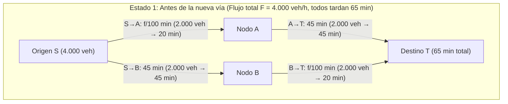
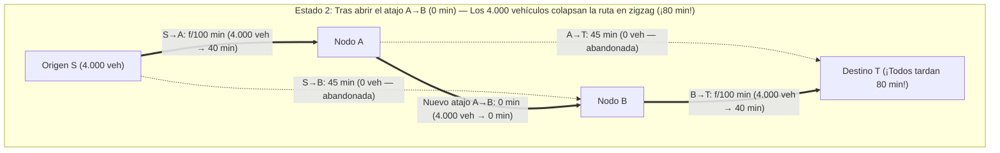

Imagine que la autoridad de transporte de una metrópoli invierte miles de millones de dólares en construir un puente exprés sin demoras para aliviar los atascos matutinos. El sentido común sugiere que añadir una carretera nueva solo puede mejorar el tráfico: la capacidad total de la red aumenta, no se elimina ninguna vía existente y quien no quiera usar el nuevo puente puede seguir tomando su ruta habitual. ¿Cómo podría perjudicar a todos el hecho de ampliar las opciones disponibles?

En 1968, el matemático alemán <strong>Dietrich Braess</strong> publicó un artículo histórico (*"Über ein Paradoxon aus der Verkehrsplanung"*) que demolió esta intuición. Braess demostró matemáticamente que cuando cada conductor elige su ruta de forma egoísta para minimizar su propio tiempo de viaje (<strong>enrutamiento egoísta / Selfish Routing</strong>), <strong>añadir un atajo de latencia cero puede hacer que el tiempo de viaje en equilibrio del 100 % de los conductores sea estrictamente mayor</strong>. Este fenómeno contraintuitivo se conoce como la <strong>paradoja de Braess</strong>.

Más sorprendente aún es que la paradoja de Braess no se debe a información imperfecta ni a irracionalidad humana: surge inevitablemente como el único equilibrio de Nash (<strong>equilibrio de Wardrop</strong>) de un juego de congestión no cooperativo. Además, dado que los sistemas físicos pasivos minimizan funciones de energía potencial convexas matemáticamente isomorfas al potencial de tráfico de Beckmann, la paradoja de Braess se manifiesta de forma idéntica en el enrutamiento de paquetes de Internet (OSPF/BGP), en redes eléctricas de corriente alterna, en anillos cuánticos mesoscópicos y en la mecánica clásica: como demostraron <strong>Joel E. Cohen y Paul Horowitz</strong> en *Nature* (1991), <strong>en una red de muelles y cuerdas que sostiene un peso pesado, ¡cortar con unas tijeras una cuerda central tensa hace que el peso suba hacia arriba en contra de la gravedad!</strong>

---

## 1. El artículo de Dietrich Braess (1968) y la red diamante de 4 nodos

### 1.1 Topología de la red y funciones de latencia

Supongamos que un flujo total de $F = 4.000\text{ vehículos/hora}$ (o $F = 1$ en unidades normalizadas) viaja desde el origen $S$ hasta el destino $T$ pasando por dos nodos intermedios $A$ y $B$. El tiempo de viaje (función de latencia) $\ell_e(f_e)$ de cada arco dirigido $e \in E$ en función de su flujo $f_e$ viene dado por:

1. <strong>Arco $S \to A$ (Puente estrecho congestionable)</strong>: Su tiempo de recorrido crece linealmente con el flujo $f_{SA}$:
   $$\ell_{SA}(f_{SA}) = \frac{f_{SA}}{100}\text{ minutos}$$
2. <strong>Arco $A \to T$ (Autopista amplia de circunvalación)</strong>: Inmune a la congestión, tiempo constante:
   $$\ell_{AT}(f_{AT}) = 45\text{ minutos}$$
3. <strong>Arco $S \to B$ (Autopista amplia de circunvalación)</strong>: Simétrica a $A \to T$, tiempo constante:
   $$\ell_{SB}(f_{SB}) = 45\text{ minutos}$$
4. <strong>Arco $B \to T$ (Puente estrecho congestionable)</strong>: Idéntico a $S \to A$, tiempo lineal:
   $$\ell_{BT}(f_{BT}) = \frac{f_{BT}}{100}\text{ minutos}$$

### 1.2 Estado 1: Equilibrio antes de construir el atajo ($65$ minutos)

Sin conexión entre $A$ y $B$, solo existen dos rutas: la ruta superior $P_{\text{sup}} = (S \to A \to T)$ y la ruta inferior $P_{\text{inf}} = (S \to B \to T)$. Por simetría, los $4.000$ vehículos se reparten al $50/50$ ($2.000$ en cada ruta) y cada conductor tarda:
$$T_{\text{antes}} = \frac{2000}{100} + 45 = 20 + 45 = 65\text{ minutos}$$
Este reparto coincide además con el <strong>óptimo social ($f^*$)</strong>.

### 1.3 Estado 2: Apertura del atajo de latencia cero $A \to B$ (¡$80$ minutos!)

Se inaugura una vía ultrarrápida desde $A$ hasta $B$ con tiempo de viaje $\ell_{AB}(f_{AB}) = 0$ minutos.

Aparece una tercera ruta: el <strong>camino en zigzag $P_{\text{zig}} = (S \to A \to B \to T)$</strong>. Mediante el análisis de <strong>estrategias estrictamente dominantes</strong>:
1. <strong>Decisión en el origen $S$ ($S \to A \to B$ frente a $S \to B$)</strong>: Incluso si los $4.000$ coches toman el puente estrecho $S \to A$, su demora máxima es $\frac{4000}{100} = 40$ minutos. Como cruzar $A \to B$ toma $0$ minutos, llegar a $B$ vía $S \to A \to B$ tarda <strong>como máximo $40$ minutos</strong>, frente a los $45$ minutos fijos de la autopista $S \to B$. Por tanto, tomar $S \to A$ es una estrategia estrictamente dominante y el $100\,\%$ de los conductores abandona $S \to B$ ($f_{SB} = 0$).
2. <strong>Decisión en el nodo $A$ ($A \to B \to T$ frente a $A \to T$)</strong>: Análogamente, ir de $A$ a $T$ vía $A \to B \to T$ tarda a lo sumo $0 + \frac{4000}{100} = 40$ minutos $< 45$ minutos, dominando estrictamente a la autopista $A \to T$ ($f_{AT} = 0$).
3. <strong>Nuevo equilibrio único ($80$ minutos)</strong>: Los $4.000$ vehículos se agolpan en la ruta en zigzag $S \to A \to B \to T$, cruzando ambos puentes estrechos:
   $$T_{\text{después}} = \frac{4000}{100} + 0 + \frac{4000}{100} = 40 + 0 + 40 = 80\text{ minutos!}$$
   Cualquier conductor que intente volver unilateralmente a $S \to A \to T$ o $S \to B \to T$ tardará $40 + 45 = 85$ minutos. Todos quedan atrapados en un <strong>dilema del prisionero</strong> (+15 minutos o $+23,1\,\%$ más lento para todos).

| Métrica | Estado 1: Antes del atajo $A \to B$ (Óptimo Social $f^*$) | Estado 2: Tras el atajo $A \to B$ (Equilibrio de Wardrop $f^{\text{EQ}}$) | Impacto paradójico |
| :--- | :--- | :--- | :--- |
| <strong>Flujo en $S \to A \to T$</strong> | $2.000\text{ veh/h}$ ($20 + 45 = 65\text{ min}$) | $0\text{ veh/h}$ (tardaría $40 + 45 = 85\text{ min}$) | Autopista $A \to T$ abandonada |
| <strong>Flujo en $S \to B \to T$</strong> | $2.000\text{ veh/h}$ ($45 + 20 = 65\text{ min}$) | $0\text{ veh/h}$ (tardaría $45 + 40 = 85\text{ min}$) | Autopista $S \to B$ abandonada |
| <strong>Flujo en $S \to A \to B \to T$</strong> | Inexistente | $4.000\text{ veh/h}$ ($100\,\%$ del tráfico) | Cruza ambos puentes estrechos |
| <strong>Tiempo por conductor</strong> | <strong>$65\text{ minutos}$</strong> | <strong>$80\text{ minutos}$</strong> | <strong>$+15\text{ min}$ ($+23,1\,\%$) peor para el 100 %</strong> |
| <strong>Coste social total $C(f)$</strong> | $260.000\text{ veh-min}$ | $320.000\text{ veh-min}$ | <strong>$\text{PoA} = \frac{80}{65} = \frac{16}{13} \approx 1,231$</strong> |

---

## 2. Los dos principios de Wardrop (1952) y la función de potencial de Beckmann (1956)

Sea $G = (V, E)$ un grafo dirigido con demanda total $F$, politopo de flujos factibles $\mathcal{F} = \{f \ge 0 : \sum_{P \in \mathcal{P}} f_P = F\}$ y latencias crecientes y diferenciables $\ell_e(f_e)$.

### 2.1 Primer principio de Wardrop (Equilibrio del usuario $f^{\text{EQ}}$)
En el equilibrio de Wardrop $f^{\text{EQ}}$, todos los caminos utilizados ($f_P^{\text{EQ}} > 0$) tienen el mismo tiempo de recorrido, menor o igual que el de cualquier camino no utilizado:
$$f_P^{\text{EQ}} > 0 \implies \ell_P(f^{\text{EQ}}) \le \ell_{P'}(f^{\text{EQ}}) \quad (\forall P' \in \mathcal{P})$$
Esto equivale a la <strong>desigualdad variacional (Variational Inequality)</strong>:
$$\sum_{e \in E} \ell_e\bigl(f_e^{\text{EQ}}\bigr)\bigl(f_e - f_e^{\text{EQ}}\bigr) \ge 0 \quad (\forall f \in \mathcal{F})$$

### 2.2 Segundo principio de Wardrop (Óptimo social $f^*$) y externalidades de Pigou
El óptimo social $f^*$ minimiza el coste social total $C(f) = \sum_{e \in E} f_e \ell_e(f_e)$, igualando el <strong>coste marginal social (MSC)</strong>:
$$\tilde{\ell}_e(f_e) = \frac{d}{df_e}\bigl[f_e \ell_e(f_e)\bigr] = \underbrace{\ell_e(f_e)}_{\text{Coste privado}} + \underbrace{f_e \ell_e'(f_e)}_{\text{Externalidad de congestión de Pigou}}$$

### 2.3 Función de potencial convexo de Beckmann-McGuire-Winsten (1956)
El equilibrio de Wardrop $f^{\text{EQ}}$ minimiza globalmente el <strong>potencial de Beckmann</strong>:
$$\Phi(f) = \sum_{e \in E} \int_0^{f_e} \ell_e(u)\,du \qquad \left(\text{pues } \frac{\partial \Phi(f)}{\partial f_P} = \sum_{e \in P} \ell_e(f_e) = \ell_P(f)\right)$$
Para latencias lineales $\ell_e(u) = a_e u + b_e$, comparando $\Phi(f) = \sum_e (\frac{1}{2}a_e f_e^2 + b_e f_e)$ con $C(f) = \sum_e (a_e f_e^2 + b_e f_e)$, vemos que el enrutamiento egoísta descuenta exactamente a la mitad ($\frac{1}{2}$) la penalización cuadrática por congestión.

---

## 3. Teorema de Roughgarden y Tardos (2002): Demostración de $\text{PoA} \le 4/3$

El <strong>Precio de la Anarquía ($\text{PoA}$)</strong> (Koutsoupias & Papadimitriou, 1999) se define como $\text{PoA} = \frac{C(f^{\text{EQ}})}{C(f^*)}$. En la red de 2 enlaces de <strong>Pigou (1920)</strong> ($\ell_1(x)=1, \ell_2(x)=x, F=1$), $C(f^{\text{EQ}}) = 1$ y $C(f^*) = \frac{3}{4}$ (en $x^* = \frac{1}{2}$), dando $\text{PoA} = \frac{4}{3}$.

> <strong>Teorema (Roughgarden & Tardos, JACM 2002)</strong>:
> Para cualquier red dirigida $G=(V,E)$ con funciones de latencia afines $\ell_e(x) = a_e x + b_e$ ($a_e, b_e \ge 0$), el Precio de la Anarquía cumple:
> $$\text{PoA}_{\text{lineal}} = \frac{C(f^{\text{EQ}})}{C(f^*)} \le \frac{4}{3}$$

<strong>【Demostración completa】</strong>
1. <strong>Desigualdad variacional</strong>: Como $\sum_{e \in E} \ell_e(f_e^{\text{EQ}})(f_e^* - f_e^{\text{EQ}}) \ge 0$, tenemos:
   $$C(f^{\text{EQ}}) = \sum_{e \in E} f_e^{\text{EQ}} \ell_e(f_e^{\text{EQ}}) \le \sum_{e \in E} f_e^* \ell_e(f_e^{\text{EQ}})$$
2. <strong>Completar el cuadrado en cada arco</strong>: Sean $x = f_e^{\text{EQ}} \ge 0$ e $y = f_e^* \ge 0$:
   $$y \ell_e(x) = y(a_e x + b_e) = y(a_e y + b_e) + a_e(xy - y^2) = y \ell_e(y) + a_e\left[\frac{1}{4}x^2 - \left(y - \frac{x}{2}\right)^2\right] \le y \ell_e(y) + \frac{1}{4}a_e x^2 \le y \ell_e(y) + \frac{1}{4} x \ell_e(x)$$
3. <strong>Suma sobre todos los arcos</strong>: Sumando para todo $e \in E$:
   $$C(f^{\text{EQ}}) \le \sum_{e \in E} f_e^* \ell_e(f_e^{\text{EQ}}) \le C(f^*) + \frac{1}{4}C(f^{\text{EQ}}) \implies \frac{3}{4}C(f^{\text{EQ}}) \le C(f^*) \implies \text{PoA} \le \frac{4}{3} \quad \blacksquare$$

Para polinomios de grado $d$ (como la función cuártica <strong>BPR</strong> $\ell_e(f_e) = t_e^0[1 + 0,15(f_e/c_e)^4]$ con $d=4$), la cota exacta es $\text{PoA}_d = \frac{(d+1)\sqrt[d]{d+1}}{(d+1)\sqrt[d]{d+1} - d}$ (siendo $\text{PoA}_4 \approx 2,1505$).

---

## 4. Realizaciones físicas: La paradoja de muelles y cuerdas de Cohen y Horowitz (1991)

En 1991, <strong>Joel E. Cohen y Paul Horowitz</strong> (*Nature*) demostraron que un sistema mecánico con dos muelles idénticos (constante $k$, longitud natural $L_0$), dos cuerdas de seguridad inextensibles de longitud $L_s$ y una cuerda central corta $A \to B$ (longitud $\approx 0$) que sostiene un peso $F = Mg$ exhibe la paradoja de Braess:
- <strong>Antes de cortar la cuerda central (Muelles en serie)</strong>: Ambos muelles soportan toda la fuerza $F$ y se estiran $\frac{F}{k}$ cada uno. Si $L_s > L_0 + \frac{F}{k}$, las cuerdas laterales cuelgan flojas y la profundidad del peso es:
  $$Y_{\text{antes}} = 2L_0 + \frac{2F}{k}$$
- <strong>Tras cortar la cuerda central con tijeras (Muelles en paralelo)</strong>: Las cuerdas de seguridad se tensan y los dos muelles pasan a trabajar en <strong>paralelo</strong>, soportando solo $\frac{F}{2}$ cada uno y estirándose $\frac{F}{2k}$. La nueva profundidad de equilibrio es:
  $$Y_{\text{después}} = L_0 + \frac{F}{2k} + L_s$$
- Si $L_0 + \frac{F}{k} < L_s < L_0 + \frac{3F}{2k}$ (por ejemplo $L_s = L_0 + \frac{5F}{4k}$), entonces:
  $$\Delta Y = Y_{\text{después}} - Y_{\text{antes}} = -\frac{F}{4k} < 0$$
  <strong>¡Cortar la cuerda tensa que sostiene el peso hace que la masa suba en contra de la gravedad una distancia $\frac{F}{4k}$!</strong>

---

## 5. Urbanismo real y peajes de congestión pigouvianos

1. <strong>Stuttgart (1969)</strong> y <strong>Nueva York — Calle 42 (1990) y Broadway en Times Square (2009)</strong>: La clausura al tráfico de Broadway (que cortaba diagonalmente la cuadrícula de Manhattan exactamente igual que el atajo $A \to B$ de Braess) agilizó el tráfico de Midtown hasta en un $17\,\%$.
2. <strong>Seúl — Demolición de la autopista elevada de Cheonggyecheon (2003–2005)</strong>: Demoler una autopista de 6 carriles con <strong>$168.000$ vehículos diarios</strong> para restaurar el río Cheonggyecheon eliminó los cuellos de botella de sus rampas, incrementó la velocidad media vehicular en el centro de Seúl y redujo la temperatura estival en $3,6^\circ\text{C}$.
3. <strong>Impuesto de Pigou</strong>: Aplicando un peaje $\tau_e = f_e^* \ell_e'(f_e^*)$ igual a la externalidad marginal de congestión en cada vía, el equilibrio de Wardrop coincide exactamente con el óptimo social ($\text{PoA} = 1$).
