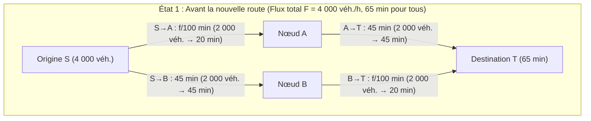
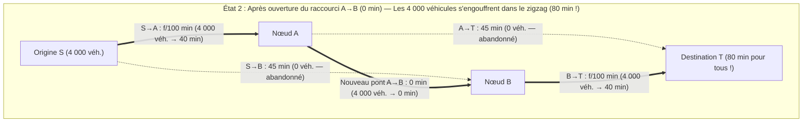

Imaginez qu'une autorité métropolitaine dépense des milliards d'euros pour construire un nouveau pont express à latence nulle afin de désengorger les embouteillages du matin. Le bon sens suggère que l'ajout d'une nouvelle route ne peut qu'améliorer la fluidité du trafic : la capacité totale du réseau augmente, aucune route existante n'est supprimée et chaque automobiliste reste libre d'emprunter son ancien itinéraire. Comment l'élargissement de l'ensemble des choix pourrait-il nuire à tout le monde ?

En 1968, le mathématicien allemand <strong>Dietrich Braess</strong> a publié un article fondateur (*"Über ein Paradoxon aus der Verkehrsplanung"*) qui a réduit cette intuition en miettes. Braess a démontré mathématiquement que lorsque chaque conducteur choisit son itinéraire de manière égoïste afin de minimiser son propre temps de trajet (<strong>routage égoïste / Selfish Routing</strong>), <strong>l'ajout d'un raccourci ultrarapide peut allonger strictement le temps de parcours à l'équilibre pour 100 % des usagers !</strong> Ce phénomène contre-intuitif est connu sous le nom de <strong>paradoxe de Braess</strong>.

Plus fascinant encore, ce paradoxe ne résulte ni d'une rationalité limitée ni d'un manque d'information : c'est l'unique équilibre de Nash (<strong>équilibre de Wardrop</strong>) d'un jeu de congestion non coopératif. Et parce que les systèmes physiques passifs minimisent une énergie potentielle convexe mathématiquement isomorphe au potentiel de Beckmann du trafic routier, le paradoxe de Braess apparaît à l'identique dans le routage Internet (OSPF/BGP), les réseaux électriques haute tension, les nanostructures quantiques et la mécanique classique — comme l'ont prouvé <strong>Joel E. Cohen et Paul Horowitz</strong> dans *Nature* en 1991 : <strong>dans un assemblage de ressorts et de cordes soutenant une masse lourde, couper aux ciseaux une corde centrale tendue fait monter le poids vers le haut contre la gravité !</strong>

---

## 1. L'article de Dietrich Braess (1968) et le réseau en diamant à 4 nœuds

### 1.1 Topologie du réseau et fonctions de latence

Supposons qu'un flux total de $F = 4\,000\text{ véhicules/heure}$ (ou $F = 1$ en unités normalisées) doive relier l'origine $S$ à la destination $T$ via deux nœuds intermédiaires $A$ et $B$. Le temps de parcours $\ell_e(f_e)$ de chaque arc orienté $e \in E$ dépend du flux $f_e$ :

1. <strong>Arc $S \to A$ (Pont étroit embouteillé)</strong> : Temps de parcours linéaire en fonction du flux :
   $$\ell_{SA}(f_{SA}) = \frac{f_{SA}}{100}\text{ minutes}$$
2. <strong>Arc $A \to T$ (Large autoroute de contournement)</strong> : Insensible à la congestion, temps constant :
   $$\ell_{AT}(f_{AT}) = 45\text{ minutes}$$
3. <strong>Arc $S \to B$ (Large autoroute de contournement)</strong> : Symétrique à $A \to T$, temps constant :
   $$\ell_{SB}(f_{SB}) = 45\text{ minutes}$$
4. <strong>Arc $B \to T$ (Pont étroit embouteillé)</strong> : Identique à $S \to A$, temps linéaire :
   $$\ell_{BT}(f_{BT}) = \frac{f_{BT}}{100}\text{ minutes}$$

### 1.2 État 1 : Équilibre avant le raccourci ($65$ minutes)

Sans liaison entre $A$ et $B$, seuls deux itinéraires existent : la route haute $P_{\text{haut}} = (S \to A \to T)$ et la route basse $P_{\text{bas}} = (S \to B \to T)$. Par symétrie, le trafic se divise à $50/50$ ($2\,000$ véhicules sur chaque route), et chaque conducteur met :
$$T_{\text{avant}} = \frac{2000}{100} + 45 = 20 + 45 = 65\text{ minutes}$$
Cette répartition correspond également à l'<strong>optimum social ($f^*$)</strong>.

### 1.3 État 2 : Ouverture du raccourci à latence nulle $A \to B$ ($80$ minutes !)

Les urbanistes inaugurent une liaison instantanée $A \to B$ avec $\ell_{AB}(f_{AB}) = 0$ minute.

Un troisième chemin apparaît : l'<strong>itinéraire en zigzag $P_{\text{zig}} = (S \to A \to B \to T)$</strong>. L'analyse par <strong>stratégies strictement dominantes</strong> explique pourquoi l'équilibre bascule :
1. <strong>Choix en $S$ ($S \to A \to B$ contre $S \to B$)</strong> : Même si la totalité des $4\,000$ voitures emprunte le pont $S \to A$, sa durée est au maximum de $\frac{4000}{100} = 40$ minutes. Avec $\ell_{AB} = 0$, rejoindre $B$ via $S \to A \to B$ prend <strong>au plus $40$ minutes</strong>, contre $45$ minutes par l'autoroute $S \to B$. Emprunter $S \to A$ est donc une stratégie strictement dominante : $100\,\%$ des conducteurs délaissent $S \to B$ ($f_{SB} = 0$).
2. <strong>Choix en $A$ ($A \to B \to T$ contre $A \to T$)</strong> : De même, rejoindre $T$ depuis $A$ via $A \to B \to T$ prend au plus $0 + \frac{4000}{100} = 40$ minutes, ce qui domine strictement les $45$ minutes de l'autoroute $A \to T$ ($f_{AT} = 0$).
3. <strong>Nouvel équilibre unique ($80$ minutes)</strong> : Les $4\,000$ voitures empruntent toutes le zigzag $S \to A \to B \to T$, traversant successivement les deux ponts étroits saturés :
   $$T_{\text{après}} = \frac{4000}{100} + 0 + \frac{4000}{100} = 40 + 0 + 40 = 80\text{ minutes !}$$
   Tout conducteur qui tenterait isolément de revenir à $S \to A \to T$ ou $S \to B \to T$ mettrait $40 + 45 = 85$ minutes. Tout le monde est piégé dans un <strong>dilemme du prisonnier</strong> collectif (+15 minutes, soit $+23,1\,\%$).

| Indicateur | État 1 : Avant le raccourci $A \to B$ (Optimum Social $f^*$) | État 2 : Après le raccourci $A \to B$ (Équilibre de Wardrop $f^{\text{EQ}}$) | Impact du paradoxe |
| :--- | :--- | :--- | :--- |
| <strong>Flux sur $S \to A \to T$</strong> | $2\,000\text{ véh./h}$ ($20 + 45 = 65\text{ min}$) | $0\text{ véh./h}$ (prendrait $40 + 45 = 85\text{ min}$) | Autoroute $A \to T$ désertée |
| <strong>Flux sur $S \to B \to T$</strong> | $2\,000\text{ véh./h}$ ($45 + 20 = 65\text{ min}$) | $0\text{ véh./h}$ (prendrait $45 + 40 = 85\text{ min}$) | Autoroute $S \to B$ désertée |
| <strong>Flux sur $S \to A \to B \to T$</strong> | Inexistant | $4\,000\text{ véh./h}$ ($100\,\%$ du trafic) | Double passage sur les ponts étroits |
| <strong>Temps de trajet individuel</strong> | <strong>$65\text{ minutes}$</strong> | <strong>$80\text{ minutes}$</strong> | <strong>$+15\text{ min}$ ($+23,1\,\%$) pour 100 % des usagers</strong> |
| <strong>Coût social total $C(f)$</strong> | $260\,000\text{ véh.-min}$ | $320\,000\text{ véh.-min}$ | <strong>$\text{PoA} = \frac{80}{65} = \frac{16}{13} \approx 1,231$</strong> |

---

## 2. Les deux principes de Wardrop (1952) et le potentiel convexe de Beckmann (1956)

Soit $G = (V, E)$ un graphe orienté avec une demande totale $F$, un polytope de flux admissibles $\mathcal{F} = \{f \ge 0 : \sum_{P \in \mathcal{P}} f_P = F\}$ et des fonctions de latence $\ell_e(f_e)$ croissantes et différentiables.

### 2.1 Premier principe de Wardrop (Équilibre utilisateur $f^{\text{EQ}}$)
À l'équilibre de Wardrop $f^{\text{EQ}}$, tous les chemins effectivement utilisés ($f_P^{\text{EQ}} > 0$) ont la même latence, inférieure ou égale à celle des chemins inutilisés :
$$f_P^{\text{EQ}} > 0 \implies \ell_P(f^{\text{EQ}}) \le \ell_{P'}(f^{\text{EQ}}) \quad (\forall P' \in \mathcal{P})$$
Ceci équivaut à l'<strong>inéquation variationnelle (Variational Inequality)</strong> :
$$\sum_{e \in E} \ell_e\bigl(f_e^{\text{EQ}}\bigr)\bigl(f_e - f_e^{\text{EQ}}\bigr) \ge 0 \quad (\forall f \in \mathcal{F})$$

### 2.2 Deuxième principe de Wardrop (Optimum social $f^*$) et externalités de Pigou
L'optimum social $f^*$ minimise le coût social total $C(f) = \sum_{e \in E} f_e \ell_e(f_e)$. Ses conditions d'optimalité égalisent le <strong>coût marginal social (MSC)</strong> :
$$\tilde{\ell}_e(f_e) = \frac{d}{df_e}\bigl[f_e \ell_e(f_e)\bigr] = \underbrace{\ell_e(f_e)}_{\text{Coût privé}} + \underbrace{f_e \ell_e'(f_e)}_{\text{Externalité de congestion de Pigou}}$$

### 2.3 La fonction de potentiel convexe de Beckmann-McGuire-Winsten (1956)
L'équilibre de Wardrop $f^{\text{EQ}}$ minimise globalement le <strong>potentiel de Beckmann</strong> :
$$\Phi(f) = \sum_{e \in E} \int_0^{f_e} \ell_e(u)\,du \qquad \left(\text{car } \frac{\partial \Phi(f)}{\partial f_P} = \sum_{e \in P} \ell_e(f_e) = \ell_P(f)\right)$$
Pour des latences affines $\ell_e(u) = a_e u + b_e$, on compare :
$$\Phi(f) = \sum_{e \in E}\left(\frac{1}{2}a_e f_e^2 + b_e f_e\right) \quad \text{et} \quad C(f) = \sum_{e \in E}\left(a_e f_e^2 + b_e f_e\right)$$
Le routage égoïste sous-évalue exactement de moitié ($\frac{1}{2}$) le terme quadratique de congestion $a_e f_e^2$.

---

## 3. Théorème de Roughgarden & Tardos (2002) : Preuve de la borne $\text{PoA} \le 4/3$

Le <strong>Prix de l'Anarchie ($\text{PoA}$)</strong>, défini par Koutsoupias et Papadimitriou (1999), mesure le rapport $\text{PoA} = \frac{C(f^{\text{EQ}})}{C(f^*)}$. Sur le réseau à 2 liens de <strong>Pigou (1920)</strong> ($\ell_1(x)=1, \ell_2(x)=x, F=1$), $C(f^{\text{EQ}}) = 1$ et $C(f^*) = \frac{3}{4}$ (pour $x^* = \frac{1}{2}$), soit $\text{PoA} = \frac{4}{3}$.

> <strong>Théorème (Roughgarden & Tardos, JACM 2002)</strong> :
> Pour tout réseau orienté $G=(V,E)$ doté de fonctions de latence affines $\ell_e(x) = a_e x + b_e$ ($a_e, b_e \ge 0$), le Prix de l'Anarchie vérifie :
> $$\text{PoA}_{\text{linéaire}} = \frac{C(f^{\text{EQ}})}{C(f^*)} \le \frac{4}{3}$$

<strong>【Démonstration complète】</strong>
1. <strong>Inéquation variationnelle</strong> : Comme $\sum_{e \in E} \ell_e(f_e^{\text{EQ}})(f_e^* - f_e^{\text{EQ}}) \ge 0$, on a :
   $$C(f^{\text{EQ}}) = \sum_{e \in E} f_e^{\text{EQ}} \ell_e(f_e^{\text{EQ}}) \le \sum_{e \in E} f_e^* \ell_e(f_e^{\text{EQ}})$$
2. <strong>Mise sous forme canonique par arc</strong> : Pour $x = f_e^{\text{EQ}} \ge 0$ et $y = f_e^* \ge 0$ :
   $$y \ell_e(x) = y(a_e x + b_e) = y(a_e y + b_e) + a_e(xy - y^2) = y \ell_e(y) + a_e\left[\frac{1}{4}x^2 - \left(y - \frac{x}{2}\right)^2\right] \le y \ell_e(y) + \frac{1}{4}a_e x^2$$
   Puisque $b_e x \ge 0$, $a_e x^2 \le a_e x^2 + b_e x = x \ell_e(x)$, d'où :
   $$y \ell_e(x) \le y \ell_e(y) + \frac{1}{4} x \ell_e(x)$$
3. <strong>Sommation sur tous les arcs</strong> : En sommant sur $e \in E$ :
   $$C(f^{\text{EQ}}) \le \sum_{e \in E} f_e^* \ell_e(f_e^{\text{EQ}}) \le C(f^*) + \frac{1}{4}C(f^{\text{EQ}}) \implies \frac{3}{4}C(f^{\text{EQ}}) \le C(f^*) \implies \text{PoA} \le \frac{4}{3} \quad \blacksquare$$

Pour des latences polynomiales de degré $d$ (comme la fonction quartique <strong>BPR</strong> $\ell_e(f_e) = t_e^0[1 + 0,15(f_e/c_e)^4]$ avec $d=4$), la borne exacte vaut $\text{PoA}_d = \frac{(d+1)\sqrt[d]{d+1}}{(d+1)\sqrt[d]{d+1} - d}$ (soit $\text{PoA}_4 \approx 2,1505$).

---

## 4. Réalisations physiques : Le paradoxe ressorts-cordes de Cohen & Horowitz (1991)

En 1991, <strong>Joel E. Cohen et Paul Horowitz</strong> (*Nature*) ont montré qu'un réseau mécanique composé de deux ressorts identiques (raideur $k$, longueur à vide $L_0$), de deux cordes de sécurité inextensibles de longueur $L_s$ et d'une courte cordelette centrale $A \to B$ (longueur $\approx 0$) soutenant un poids $F = Mg$ reproduit le paradoxe de Braess :
- <strong>Avant de couper la corde centrale (Ressorts en série)</strong> : Les deux ressorts supportent chacun toute la charge $F$ et s'allongent de $\frac{F}{k}$. Pour $L_s > L_0 + \frac{F}{k}$, les cordes de sécurité sont détendues et la profondeur du poids vaut :
  $$Y_{\text{avant}} = 2L_0 + \frac{2F}{k}$$
- <strong>Après avoir coupé la corde centrale aux ciseaux (Ressorts en parallèle)</strong> : Les cordes de sécurité se tendent et les deux ressorts se partagent la charge en <strong>parallèle</strong> ($\frac{F}{2}$ chacun), ne s'allongeant plus que de $\frac{F}{2k}$ ! La nouvelle profondeur d'équilibre est :
  $$Y_{\text{après}} = L_0 + \frac{F}{2k} + L_s$$
- Si $L_0 + \frac{F}{k} < L_s < L_0 + \frac{3F}{2k}$ (par exemple $L_s = L_0 + \frac{5F}{4k}$), alors :
  $$\Delta Y = Y_{\text{après}} - Y_{\text{avant}} = -\frac{F}{4k} < 0$$
  <strong>Couper la corde porteuse fait monter la masse contre la gravité de $\frac{F}{4k}$ !</strong>

---

## 5. Urbanisme réel et péage urbain de Pigou (Congestion Pricing)

1. <strong>Stuttgart (1969)</strong> et <strong>New York — 42e Rue (1990) & Times Square / Broadway (2009)</strong> : La fermeture aux voitures de Broadway (qui coupait en diagonale la grille orthogonale de Manhattan exactement comme le lien $A \to B$ de Braess) a réduit de $17\,\%$ les temps de parcours à Midtown.
2. <strong>Séoul — Démolition de l'autoroute surélevée de Cheonggyecheon (2003–2005)</strong> : La suppression d'une autoroute à 6 voies empruntée par <strong>$168\,000$ véhicules/jour</strong> au profit d'une rivière écologique a fluidifié et accéléré la circulation dans le centre de Séoul tout en abaissant la température estivale de $3,6^\circ\text{C}$.
3. <strong>Taxe pigouvienne</strong> : En imposant un péage de congestion $\tau_e = f_e^* \ell_e'(f_e^*)$ égal à l'externalité marginale sur chaque arc, l'équilibre égoïste s'aligne exactement sur l'optimum social ($\text{PoA} = 1$).
