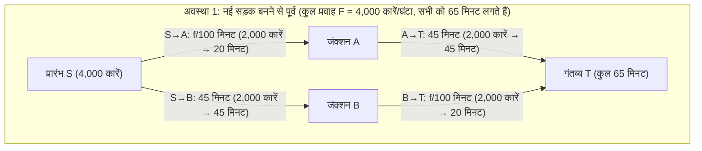
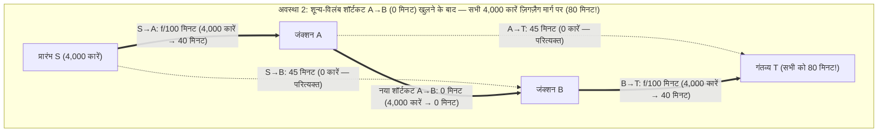

कल्पना कीजिए कि किसी महानगर का परिवहन विभाग सुबह के भीषण ट्रैफिक जाम को खत्म करने के लिए अरबों रुपये खर्च करके शून्य-विलंब (zero-latency) वाला एक नया एक्सप्रेस पुल बनाता है। सामान्य बुद्धि यही कहती है कि नई सड़क बनने से लाभ ही होगा—आखिर सड़क नेटवर्क की कुल क्षमता बढ़ गई है, कोई पुरानी सड़क बंद नहीं की गई है, और जो लोग नए पुल का उपयोग नहीं करना चाहते वे अपने पुराने रास्ते से जा सकते हैं। विकल्पों के बढ़ने से भला हर किसी को नुकसान कैसे हो सकता है?

किंतु 1968 में जर्मन गणितज्ञ <strong>डीट्रिच ब्रेयेस (Dietrich Braess)</strong> ने अपना ऐतिहासिक शोध-पत्र (*"Über ein Paradoxon aus der Verkehrsplanung"*) प्रकाशित किया जिसने इस सहज ज्ञान को पूरी तरह ध्वस्त कर दिया। ब्रेयेस ने गणितीय रूप से सिद्ध किया कि जब प्रत्येक चालक केवल अपने व्यक्तिगत यात्रा समय को न्यूनतम करने के लिए स्वार्थपूर्ण ढंग से मार्ग चुनता है (<strong>स्वार्थी रूटिंग / Selfish Routing</strong>), <strong>तो नेटवर्क में एक शून्य-विलंब शॉर्टकट सड़क जोड़ने से नए संतुलन (Equilibrium) में 100% सभी चालकों का यात्रा समय पहले से अधिक लंबा हो सकता है!</strong> इस प्रति-सहज (counterintuitive) परिघटना को <strong>ब्रेयेस का विरोधाभास (Braess's Paradox)</strong> कहा जाता है।

इससे भी अधिक आश्चर्यजनक बात यह है कि ब्रेयेस का विरोधाभास सूचना के अभाव या मानवीय अज्ञानता के कारण नहीं होता, बल्कि पूर्ण सूचना के अंतर्गत गैर-सहकारी भीड़ खेल (Congestion Game) के अद्वितीय नैश संतुलन (<strong>वार्ड्रॉप संतुलन / Wardrop Equilibrium</strong>) के रूप में अनिवार्य रूप से उत्पन्न होता है। चूंकि निर्जीव भौतिक प्रणालियां भी न्यूनतम स्थितिज ऊर्जा के सिद्धांत का पालन करती हैं जो गणितीय रूप से बेकमैन विभव फलन के समरूप है, इसलिए यह विरोधाभास इंटरनेट पैकेट रूटिंग (OSPF/BGP), एसी पावर ग्रिड, क्वांटम नैनो-संरचनाओं और शास्त्रीय यांत्रिकी में भी हूबहू प्रकट होता है—जैसा कि <strong>जोएल कोहेन और पॉल होरोविट्ज़ (Cohen & Horowitz, 1991)</strong> ने *Nature* पत्रिका में दिखाया: <strong>स्प्रिंग और धागों से लटके एक भारी द्रव्यमान के नेटवर्क में, भार संभाल रहे बीच के तने हुए धागे को कैंची से काटने पर लटका हुआ भार गुरुत्वाकर्षण के विरुद्ध ऊपर की ओर उठ जाता है!</strong>

---

## 1. डीट्रिच ब्रेयेस का 1968 का शोध-पत्र और 4-नोड डायमंड नेटवर्क

### 1.1 नेटवर्क संरचना और विलंब फलन (Latency Functions)

मान लीजिए कि सुबह के व्यस्त समय में कुल यातायात प्रवाह $F = 4,000\text{ कारें/घंटा}$ (या सामान्यीकृत इकाई में $F = 1$) प्रारंभिक बिंदु $S$ से गंतव्य $T$ की ओर दो मध्यवर्ती जंक्शनों $A$ और $B$ से होकर जाता है। प्रत्येक निर्देशित पथ (edge) $e \in E$ का यात्रा समय $\ell_e(f_e)$ उस पर चलने वाली कारों की संख्या $f_e$ पर निम्न प्रकार निर्भर करता है:

1. <strong>सड़क $S \to A$ (संकरा पुल)</strong>: संकरा होने के कारण इसका यात्रा समय प्रवाह $f_{SA}$ के समानुपाती रूप से बढ़ता है:
   $$\ell_{SA}(f_{SA}) = \frac{f_{SA}}{100}\text{ मिनट}$$
2. <strong>सड़क $A \to T$ (चौड़ा बाईपास राजमार्ग)</strong>: यह राजमार्ग बहुत चौड़ा है और कभी जाम नहीं होता, किंतु लंबा होने के कारण हमेशा नियत समय लेता है:
   $$\ell_{AT}(f_{AT}) = 45\text{ मिनट}$$
3. <strong>सड़क $S \to B$ (चौड़ा बाईपास राजमार्ग)</strong>: $A \to T$ के सममित, नियत यात्रा समय:
   $$\ell_{SB}(f_{SB}) = 45\text{ मिनट}$$
4. <strong>सड़क $B \to T$ (संकरा पुल)</strong>: $S \to A$ के समान संकरा पुल, जिसका यात्रा समय प्रवाह $f_{BT}$ के साथ रैखिक रूप से बढ़ता है:
   $$\ell_{BT}(f_{BT}) = \frac{f_{BT}}{100}\text{ मिनट}$$

### 1.2 अवस्था 1: शॉर्टकट बनने से पहले का संतुलन ($65$ मिनट)

जब $A$ और $B$ के बीच कोई सीधी सड़क नहीं है, तब केवल दो मार्ग उपलब्ध हैं: ऊपरी मार्ग $P_{\text{up}} = (S \to A \to T)$ और निचला मार्ग $P_{\text{down}} = (S \to B \to T)$। सममिति के कारण $4,000$ कारें $50:50$ के अनुपात में ($2,000$ कारें प्रत्येक मार्ग पर) बंट जाती हैं, और प्रत्येक चालक को लगने वाला समय है:
$$T_{\text{before}} = \frac{2000}{100} + 45 = 20 + 45 = 65\text{ मिनट}$$
यह विभाजन समाज के कुल यात्रा समय को न्यूनतम करने वाला <strong>सामाजिक इष्टतम (Social Optimum $f^*$)</strong> भी है।

### 1.3 अवस्था 2: शून्य-विलंब शॉर्टकट सड़क $A \to B$ खुलने के बाद ($80$ मिनट!)

अब मान लीजिए कि जंक्शन $A$ से $B$ तक $\ell_{AB}(f_{AB}) = 0$ मिनट यात्रा समय वाली एक अति-तीव्र सड़क $A \to B$ खोल दी जाती है।

इससे तीसरा विकल्प खुलता है: <strong>ज़िगज़ैग मार्ग $P_{\text{zig}} = (S \to A \to B \to T)$</strong>। खेल सिद्धांत के <strong>कठोर प्रभावी रणनीति विश्लेषण (Strictly Dominant Strategy Analysis)</strong> से देखें:
1. <strong>प्रारंभ $S$ पर निर्णय ($S \to A \to B$ बनाम $S \to B$)</strong>: भले ही सभी $4,000$ कारें संकरे पुल $S \to A$ पर चली जाएं, उसका अधिकतम समय $\frac{4000}{100} = 40$ मिनट होगा। चूंकि $A \to B$ में $0$ मिनट लगते हैं, इसलिए $S \to A \to B$ द्वारा $B$ तक पहुंचने में <strong>अधिकतम $40$ मिनट</strong> लगते हैं, जबकि राजमार्ग $S \to B$ में हमेशा $45$ मिनट लगते हैं! अतः $S \to A$ चुनना एक कठोर प्रभावी रणनीति है और $100\%$ चालक $S \to B$ को छोड़ देते हैं ($f_{SB} = 0$)।
2. <strong>जंक्शन $A$ पर निर्णय ($A \to B \to T$ बनाम $A \to T$)</strong>: इसी प्रकार, $A$ से $T$ जाने के लिए $A \to B \to T$ में अधिकतम $0 + \frac{4000}{100} = 40$ मिनट लगते हैं जो $A \to T$ के $45$ मिनट से हमेशा कम है ($40 < 45$)। अतः सभी चालक $A \to T$ को भी छोड़ देते हैं ($f_{AT} = 0$)।
3. <strong>नया अद्वितीय नैश संतुलन ($80$ मिनट)</strong>: परिणामस्वरूप, सभी $4,000$ कारें ज़िगज़ैग मार्ग $S \to A \to B \to T$ पर जमा हो जाती हैं और दोनों संकरे पुलों को पार करती हैं:
   $$T_{\text{after}} = \frac{4000}{100} + 0 + \frac{4000}{100} = 40 + 0 + 40 = 80\text{ मिनट!}$$
   यदि कोई एक चालक अकेले पुराने मार्ग $S \to A \to T$ या $S \to B \to T$ पर लौटना चाहे, तो उसे $40 + 45 = 85$ मिनट लगेंगे। सभी चालक <strong>कैदी की दुविधा (Prisoner's Dilemma)</strong> में फंस जाते हैं और हर किसी का समय $15$ मिनट ($+23.1\%$) बढ़ जाता है!

| मापदंड | अवस्था 1: शॉर्टकट $A \to B$ से पूर्व (सामाजिक इष्टतम $f^*$) | अवस्था 2: शॉर्टकट $A \to B$ के बाद (वार्ड्रॉप संतुलन $f^{\text{EQ}}$) | विरोधाभासी प्रभाव |
| :--- | :--- | :--- | :--- |
| <strong>$S \to A \to T$ पर प्रवाह</strong> | $2,000\text{ कारें/घंटा}$ ($20 + 45 = 65\text{ मि.}$) | $0\text{ कारें/घंटा}$ (चलने पर $40 + 45 = 85\text{ मि.}$) | राजमार्ग $A \to T$ खाली |
| <strong>$S \to B \to T$ पर प्रवाह</strong> | $2,000\text{ कारें/घंटा}$ ($45 + 20 = 65\text{ मि.}$) | $0\text{ कारें/घंटा}$ (चलने पर $45 + 40 = 85\text{ मि.}$) | राजमार्ग $S \to B$ खाली |
| <strong>$S \to A \to B \to T$ पर प्रवाह</strong> | अनुपस्थित | $4,000\text{ कारें/घंटा}$ ($100\%$ यातायात केंद्रित) | दोनों संकरे पुलों पर दोहरा भार |
| <strong>प्रति चालक यात्रा समय</strong> | <strong>$65\text{ मिनट}$</strong> | <strong>$80\text{ मिनट}$</strong> | <strong>सभी के लिए $+15\text{ मि.}$ ($+23.1\%$) की वृद्धि</strong> |
| <strong>कुल सामाजिक लागत $C(f)$</strong> | $260,000\text{ कार-मिनट}$ | $320,000\text{ कार-मिनट}$ | <strong>$\text{PoA} = \frac{80}{65} = \frac{16}{13} \approx 1.231$</strong> |

---

## 2. वार्ड्रॉप के दो सिद्धांत (1952) और बेकमैन-रोज़ेन्थल उत्तल विभव फलन (1956)

किसी निर्देशित ग्राफ $G = (V, E)$ में कुल मांग $F$, सुसंगत प्रवाह समुच्चय $\mathcal{F} = \{f \ge 0 : \sum_{P \in \mathcal{P}} f_P = F\}$ और अवकलनीय एकदिष्ट वर्धमान विलंब फलन $\ell_e(f_e)$ के लिए:

### 2.1 वार्ड्रॉप का प्रथम सिद्धांत (उपयोगकर्ता संतुलन $f^{\text{EQ}}$)
वार्ड्रॉप संतुलन $f^{\text{EQ}}$ में सभी प्रयुक्त मार्गों ($f_P^{\text{EQ}} > 0$) का यात्रा समय समान होता है और किसी भी अप्रयुक्त मार्ग के समय से अधिक नहीं होता:
$$f_P^{\text{EQ}} > 0 \implies \ell_P(f^{\text{EQ}}) \le \ell_{P'}(f^{\text{EQ}}) \quad (\forall P' \in \mathcal{P})$$
यह निम्न <strong>विचरणीय असमिका (Variational Inequality)</strong> के समतुल्य है:
$$\sum_{e \in E} \ell_e\bigl(f_e^{\text{EQ}}\bigr)\bigl(f_e - f_e^{\text{EQ}}\bigr) \ge 0 \quad (\forall f \in \mathcal{F})$$

### 2.2 वार्ड्रॉप का द्वितीय सिद्धांत (सामाजिक इष्टतम $f^*$) और पिगू बाह्यता
सामाजिक इष्टतम $f^*$ कुल सामाजिक लागत $C(f) = \sum_{e \in E} f_e \ell_e(f_e)$ को न्यूनतम करता है, जो <strong>सीमांत सामाजिक लागत (Marginal Social Cost, MSC)</strong> को बराबर करता है:
$$\tilde{\ell}_e(f_e) = \frac{d}{df_e}\bigl[f_e \ell_e(f_e)\bigr] = \underbrace{\ell_e(f_e)}_{\text{निजी लागत}} + \underbrace{f_e \ell_e'(f_e)}_{\text{पिगू भीड़ बाह्यता (Pigouvian Externality)}}$$

### 2.3 बेकमैन-मैकग्वायर-विंस्टन उत्तल विभव फलन (1956)
वार्ड्रॉप संतुलन $f^{\text{EQ}}$ <strong>बेकमैन विभव फलन (Beckmann Potential Function)</strong> $\Phi(f)$ को वैश्विक रूप से न्यूनतम करता है:
$$\Phi(f) = \sum_{e \in E} \int_0^{f_e} \ell_e(u)\,du \qquad \left(\text{क्योंकि } \frac{\partial \Phi(f)}{\partial f_P} = \sum_{e \in P} \ell_e(f_e) = \ell_P(f)\right)$$
रैखिक विलंब $\ell_e(u) = a_e u + b_e$ के लिए $\Phi(f) = \sum_e (\frac{1}{2}a_e f_e^2 + b_e f_e)$ तथा $C(f) = \sum_e (a_e f_e^2 + b_e f_e)$ की तुलना से स्पष्ट है कि स्वार्थी चालक द्विघात भीड़ लागत $a_e f_e^2$ को वास्तविकता से आधा ($\frac{1}{2}$) आंकते हैं।

---

## 3. रफगार्डन और टार्डोस प्रमेय (2002): अराजकता की कीमत ($\text{PoA} \le 4/3$) की उत्पत्ति

<strong>अराजकता की कीमत (Price of Anarchy, $\text{PoA}$)</strong> (Koutsoupias & Papadimitriou, 1999) को $\text{PoA} = \frac{C(f^{\text{EQ}})}{C(f^*)}$ के रूप में परिभाषित किया जाता है। <strong>पिगू के 2-लिंक नेटवर्क (1920)</strong> ($\ell_1(x)=1, \ell_2(x)=x, F=1$) में $C(f^{\text{EQ}}) = 1$ और $C(f^*) = \frac{3}{4}$ ($x^* = \frac{1}{2}$ पर), जिससे $\text{PoA} = \frac{4}{3}$ प्राप्त होता है।

> <strong>प्रमेय (Roughgarden & Tardos, JACM 2002)</strong>:
> किसी भी निर्देशित नेटवर्क $G=(V,E)$ में यदि सभी भुजाओं के विलंब फलन रैखिक $\ell_e(x) = a_e x + b_e$ ($a_e, b_e \ge 0$) हों, तो अराजकता की कीमत सदैव निम्न सीमा का पालन करती है:
> $$\text{PoA}_{\text{linear}} = \frac{C(f^{\text{EQ}})}{C(f^*)} \le \frac{4}{3}$$

<strong>【संपूर्ण उत्पत्ति (Proof)】</strong>
1. <strong>विचरणीय असमिका</strong>: चूंकि $\sum_{e \in E} \ell_e(f_e^{\text{EQ}})(f_e^* - f_e^{\text{EQ}}) \ge 0$, इसलिए:
   $$C(f^{\text{EQ}}) = \sum_{e \in E} f_e^{\text{EQ}} \ell_e(f_e^{\text{EQ}}) \le \sum_{e \in E} f_e^* \ell_e(f_e^{\text{EQ}})$$
2. <strong>प्रत्येक भुजा के लिए पूर्ण वर्ग असमिका</strong>: $x = f_e^{\text{EQ}} \ge 0$ और $y = f_e^* \ge 0$ रखने पर:
   $$y \ell_e(x) = y(a_e x + b_e) = y(a_e y + b_e) + a_e(xy - y^2) = y \ell_e(y) + a_e\left[\frac{1}{4}x^2 - \left(y - \frac{x}{2}\right)^2\right] \le y \ell_e(y) + \frac{1}{4}a_e x^2 \le y \ell_e(y) + \frac{1}{4} x \ell_e(x)$$
3. <strong>सभी भुजाओं पर योग</strong>: समस्त $e \in E$ पर योग करने पर:
   $$C(f^{\text{EQ}}) \le \sum_{e \in E} f_e^* \ell_e(f_e^{\text{EQ}}) \le C(f^*) + \frac{1}{4}C(f^{\text{EQ}}) \implies \frac{3}{4}C(f^{\text{EQ}}) \le C(f^*) \implies \text{PoA} \le \frac{4}{3} \quad \blacksquare$$

घात $d$ के बहुपद विलंब फलनों (जैसे चतुर्थ घात का <strong>BPR फलन</strong> $\ell_e(f_e) = t_e^0[1 + 0.15(f_e/c_e)^4]$, $d=4$) के लिए सटीक ऊपरी सीमा $\text{PoA}_d = \frac{(d+1)\sqrt[d]{d+1}}{(d+1)\sqrt[d]{d+1} - d}$ है ($d=4$ के लिए $\text{PoA}_4 \approx 2.1505$)।

---

## 4. भौतिक सत्यापन: कोहेन और होरोविट्ज़ का स्प्रिंग-धागा विरोधाभास (1991)

1991 में <strong>जोएल कोहेन और पॉल होरोविट्ज़</strong> (*Nature*) ने प्रदर्शित किया कि दो समान स्प्रिंगों (स्प्रिंग नियतांक $k$, प्राकृतिक लंबाई $L_0$), $L_s$ लंबाई की दो अवितान्य सुरक्षा डोरियों, और एक छोटे केंद्रीय जोड़ने वाले धागे $A \to B$ (लंबाई $\approx 0$) से लटके भार $F = Mg$ की यांत्रिक प्रणाली ब्रेयेस के विरोधाभास का पालन करती है:
- <strong>केंद्रीय धागा काटने से पहले (श्रेणीक्रम / Series)</strong>: दोनों स्प्रिंग पूरा भार $F$ सहते हैं और प्रत्येक $\frac{F}{k}$ खिंचता है। जब $L_s > L_0 + \frac{F}{k}$, सुरक्षा डोरियां ढीली रहती हैं और भार की गहराई होती है:
  $$Y_{\text{before}} = 2L_0 + \frac{2F}{k}$$
- <strong>कैंची से केंद्रीय धागा काटने के बाद (समांतर क्रम / Parallel)</strong>: सुरक्षा डोरियां तन जाती हैं और दोनों स्प्रिंग <strong>समांतर क्रम</strong> में आधा-आधा भार ($\frac{F}{2}$) बांट लेते हैं, जिससे प्रत्येक का खिंचाव घटकर $\frac{F}{2k}$ रह जाता है! नई संतुलन गहराई होती है:
  $$Y_{\text{after}} = L_0 + \frac{F}{2k} + L_s$$
- यदि $L_0 + \frac{F}{k} < L_s < L_0 + \frac{3F}{2k}$ (उदाहरणार्थ $L_s = L_0 + \frac{5F}{4k}$), तो:
  $$\Delta Y = Y_{\text{after}} - Y_{\text{before}} = -\frac{F}{4k} < 0$$
  <strong>अर्थात भार संभाल रहे तने हुए धागे को कैंची से काटने पर भारी द्रव्यमान गुरुत्वाकर्षण के विरुद्ध $\frac{F}{4k}$ ऊपर उठ जाता है!</strong>

---

## 5. वास्तविक शहरी नियोजन और पिगू भीड़ प्रभार (Congestion Pricing)

1. <strong>स्टटगार्ट (1969)</strong> और <strong>न्यूयॉर्क — 42वीं स्ट्रीट (1990) एवं टाइम्स स्क्वायर ब्रॉडवे (2009)</strong>: मैनहट्टन के ग्रिड को तिरछा काटने वाले ब्रॉडवे (जो ब्रेयेस के शॉर्टकट $A \to B$ की तरह काम कर रहा था) को वाहनों के लिए बंद करने से मिडटाउन में यात्रा समय $17\%$ घट गया।
2. <strong>सियोल — चोंग्येचोन एलिवेटेड एक्सप्रेसवे को हटाना (2003–2005)</strong>: प्रतिदिन <strong>$168,000$ वाहनों</strong> को ले जाने वाले $5.8\text{ किमी}$ लंबे 6-लेन राजमार्ग को तोड़कर चोंग्येचोन नदी को पुनर्जीवित करने से रैंप की बाधाएं समाप्त हो गईं, मध्य सियोल में वाहनों की औसत गति बढ़ गई और ग्रीष्मकालीन तापमान में $3.6^\circ\text{C}$ की कमी आई।
3. <strong>पिगू कर (Pigouvian Toll)</strong>: प्रत्येक सड़क पर सीमांत भीड़ बाह्यता के बराबर शुल्क $\tau_e = f_e^* \ell_e'(f_e^*)$ लगाने से स्वार्थी संतुलन सीधे सामाजिक इष्टतम ($\text{PoA} = 1$) में परिवर्तित हो जाता है।
