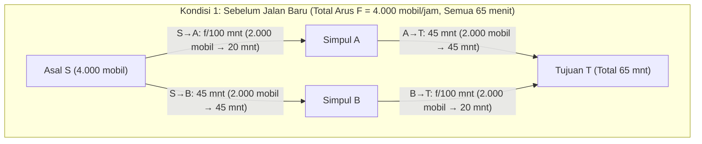
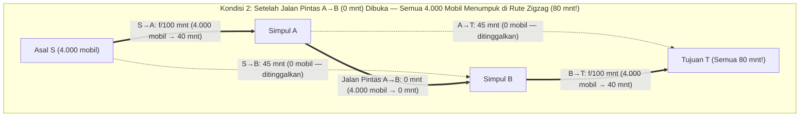

Bayangkan otoritas transportasi sebuah kota metropolitan menghabiskan милиaran dolar untuk membangun jembatan pintas baru tanpa hambatan guna mengurai kemacetan jam sibuk pagi hari. Akal sehat menyimpulkan bahwa penambahan jalan baru pasti mempercepat lalu lintas: kapasitas total jaringan jalan meningkat, tidak ada jalan lama yang ditutup, dan siapa pun yang tidak menyukai jembatan baru bebas tetap melewati rute lama mereka. Bagaimana mungkin memperluas pilihan justru merugikan semua orang?

Pada tahun 1968, matematikawan Jerman <strong>Dietrich Braess</strong> menerbitkan makalah bersejarah (*"Über ein Paradoxon aus der Verkehrsplanung"*) yang meruntuhkan intuisi tersebut. Braess membuktikan secara matematis bahwa ketika setiap pengendara memilih rute secara egois demi meminimalkan waktu tempuh pribadinya (<strong>perutean egois / Selfish Routing</strong>), <strong>menambahkan jalan pintas berlatensi nol justru dapat membuat waktu tempuh ekuilibrium bagi 100% pengendara menjadi lebih lama secara ketat!</strong> Fenomena kontradiktif ini dikenal sebagai <strong>Paradoks Braess (Braess's Paradox)</strong>.

Lebih mengejutkan lagi, Paradoks Braess bukan disebabkan oleh kurangnya informasi atau perilaku irasional manusia, melainkan muncul secara niscaya sebagai satu-satunya ekuilibrium Nash (<strong>ekuilibrium Wardrop</strong>) dalam permainan kemacetan non-kooperatif. Karena sistem fisik pasif juga meminimalkan energi potensial konveks yang isomorfik secara matematis dengan fungsi potensial Beckmann pada lalu lintas, Paradoks Braess muncul secara identik dalam perutean paket Internet (OSPF/BGP), jaringan listrik arus bolak-balik, cincin kuantum mesoskopik, hingga mekanika klasik — sebagaimana dibuktikan oleh <strong>Joel E. Cohen dan Paul Horowitz</strong> di jurnal *Nature* (1991): <strong>pada rangkaian pegas dan tali yang menahan beban berat, memotong tali tengah yang tegang dengan gunting justru membuat beban tersebut naik ke atas melawan gravitasi!</strong>

---

## 1. Makalah Dietrich Braess (1968) dan Jaringan Berlian 4-Simpul

### 1.1 Topologi Jaringan dan Fungsi Latensi

Misalkan arus lalu lintas total sebesar $F = 4.000\text{ mobil/jam}$ (atau $F = 1$ dalam satuan ternormalisasi) bergerak dari titik asal $S$ menuju tujuan $T$ melalui dua simpul perantara $A$ dan $B$. Waktu tempuh (fungsi latensi) $\ell_e(f_e)$ pada setiap sisi berarah $e \in E$ bergantung pada arus $f_e$:

1. <strong>Sisi $S \to A$ (Jembatan sempit rawan macet)</strong>: Waktu tempuh meningkat secara linear terhadap arus $f_{SA}$:
   $$\ell_{SA}(f_{SA}) = \frac{f_{SA}}{100}\text{ menit}$$
2. <strong>Sisi $A \to T$ (Jalan raya lingkar lebar)</strong>: Kebal terhadap kemacetan, waktu tempuh konstan:
   $$\ell_{AT}(f_{AT}) = 45\text{ menit}$$
3. <strong>Sisi $S \to B$ (Jalan raya lingkar lebar)</strong>: Simetris dengan $A \to T$, waktu tempuh konstan:
   $$\ell_{SB}(f_{SB}) = 45\text{ menit}$$
4. <strong>Sisi $B \to T$ (Jembatan sempit rawan macet)</strong>: Identik dengan $S \to A$, waktu tempuh linear:
   $$\ell_{BT}(f_{BT}) = \frac{f_{BT}}{100}\text{ menit}$$

### 1.2 Kondisi 1: Ekuilibrium Sebelum Pembangunan Jalan Pintas ($65$ Menit)

Tanpa penghubung antara $A$ dan $B$, hanya ada dua rute: rute atas $P_{\text{atas}} = (S \to A \to T)$ dan rute bawah $P_{\text{bawah}} = (S \to B \to T)$. Karena simetris, $4.000$ kendaraan terbagi rata $50/50$ ($2.000$ mobil di setiap rute), dan setiap pengendara menempuh waktu:
$$T_{\text{sebelum}} = \frac{2000}{100} + 45 = 20 + 45 = 65\text{ menit}$$
Pembagian ini sekaligus merupakan <strong>optimum sosial ($f^*$)</strong>.

### 1.3 Kondisi 2: Pembukaan Jalan Pintas Tanpa Latensi $A \to B$ ($80$ Menit!)

Pemerintah membuka jalan pintas satu arah super cepat dari $A$ ke $B$ dengan waktu tempuh $\ell_{AB}(f_{AB}) = 0$ menit.

Kini muncul rute ketiga: <strong>rute zigzag $P_{\text{zig}} = (S \to A \to B \to T)$</strong>. Melalui analisis <strong>strategi dominan ketat (Strictly Dominant Strategy)</strong>:
1. <strong>Keputusan di titik asal $S$ ($S \to A \to B$ vs. $S \to B$)</strong>: Sekalipun seluruh $4.000$ mobil melewati jembatan sempit $S \to A$, waktu tempuhnya paling lama $\frac{4000}{100} = 40$ menit. Karena melintasi $A \to B$ memakan $0$ menit, mencapai $B$ lewat $S \to A \to B$ memakan waktu <strong>paling lama $40$ menit</strong>, lebih cepat dibandingkan jalan raya $S \to B$ yang selalu $45$ menit. Maka memilih $S \to A$ adalah strategi dominan ketat, dan $100\%$ pengendara meninggalkan $S \to B$ ($f_{SB} = 0$).
2. <strong>Keputusan di simpul $A$ ($A \to B \to T$ vs. $A \to T$)</strong>: Demikian pula, dari $A$ ke $T$ lewat $A \to B \to T$ memakan waktu paling lama $0 + \frac{4000}{100} = 40$ menit $< 45$ menit, mendominasi secara ketat jalan raya $A \to T$ ($f_{AT} = 0$).
3. <strong>Ekuilibrium Baru yang Unik ($80$ Menit)</strong>: Seluruh $4.000$ kendaraan menumpuk di jalur zigzag $S \to A \to B \to T$, melewati kedua jembatan sempit:
   $$T_{\text{sesudah}} = \frac{4000}{100} + 0 + \frac{4000}{100} = 40 + 0 + 40 = 80\text{ menit!}$$
   Pengendara mana pun yang mencoba kembali sendirian ke rute lama $S \to A \to T$ atau $S \to B \to T$ akan membutuhkan $40 + 45 = 85$ menit. Semua orang terjebak dalam <strong>Dilema Tahanan (Prisoner's Dilemma)</strong> (+15 menit atau $+23,1\%$ lebih buruk bagi semua orang).

| Metrik | Kondisi 1: Sebelum Jalan Pintas $A \to B$ (Optimum Sosial $f^*$) | Kondisi 2: Sesudah Jalan Pintas $A \to B$ (Ekuilibrium Wardrop $f^{\text{EQ}}$) | Dampak Paradoks |
| :--- | :--- | :--- | :--- |
| <strong>Arus pada $S \to A \to T$</strong> | $2.000\text{ mobil/jam}$ ($20 + 45 = 65\text{ mnt}$) | $0\text{ mobil/jam}$ (akan memakan $40 + 45 = 85\text{ mnt}$) | Jalan raya $A \to T$ kosong |
| <strong>Arus pada $S \to B \to T$</strong> | $2.000\text{ mobil/jam}$ ($45 + 20 = 65\text{ mnt}$) | $0\text{ mobil/jam}$ (akan memakan $45 + 40 = 85\text{ mnt}$) | Jalan raya $S \to B$ kosong |
| <strong>Arus pada $S \to A \to B \to T$</strong> | Tidak ada | $4.000\text{ mobil/jam}$ ($100\%$ dari seluruh lalu lintas) | Melintasi dua jembatan sempit |
| <strong>Waktu Tempuh per Pengendara</strong> | <strong>$65\text{ menit}$</strong> | <strong>$80\text{ menit}$</strong> | <strong>$+15\text{ mnt}$ ($+23,1\%$) lebih lambat bagi 100% pengguna</strong> |
| <strong>Total Biaya Sosial $C(f)$</strong> | $260.000\text{ mobil-mnt}$ | $320.000\text{ mobil-mnt}$ | <strong>$\text{PoA} = \frac{80}{65} = \frac{16}{13} \approx 1,231$</strong> |

---

## 2. Dua Prinsip Wardrop (1952) dan Fungsi Potensial Konveks Beckmann (1956)

Pada graf berarah $G = (V, E)$ dengan total permintaan $F$, politop arus layak $\mathcal{F} = \{f \ge 0 : \sum_{P \in \mathcal{P}} f_P = F\}$, dan fungsi latensi monoton naik $\ell_e(f_e)$:

### 2.1 Prinsip Pertama Wardrop (Ekuilibrium Pengguna $f^{\text{EQ}}$)
Pada ekuilibrium Wardrop $f^{\text{EQ}}$, semua jalur yang digunakan ($f_P^{\text{EQ}} > 0$) memiliki waktu tempuh yang sama dan tidak lebih besar daripada jalur mana pun yang tidak digunakan:
$$f_P^{\text{EQ}} > 0 \implies \ell_P(f^{\text{EQ}}) \le \ell_{P'}(f^{\text{EQ}}) \quad (\forall P' \in \mathcal{P})$$
Hal ini ekuivalen dengan <strong>Pertidaksamaan Variasional (Variational Inequality)</strong>:
$$\sum_{e \in E} \ell_e\bigl(f_e^{\text{EQ}}\bigr)\bigl(f_e - f_e^{\text{EQ}}\bigr) \ge 0 \quad (\forall f \in \mathcal{F})$$

### 2.2 Prinsip Kedua Wardrop (Optimum Sosial $f^*$) dan Eksternalitas Pigou
Optimum sosial $f^*$ meminimalkan total biaya sosial $C(f) = \sum_{e \in E} f_e \ell_e(f_e)$, yang menyamakan <strong>Biaya Marginal Sosial (MSC)</strong>:
$$\tilde{\ell}_e(f_e) = \frac{d}{df_e}\bigl[f_e \ell_e(f_e)\bigr] = \underbrace{\ell_e(f_e)}_{\text{Biaya Privat}} + \underbrace{f_e \ell_e'(f_e)}_{\text{Eksternalitas Kemacetan Pigou}}$$

### 2.3 Fungsi Potensial Konveks Beckmann-McGuire-Winsten (1956)
Ekuilibrium Wardrop $f^{\text{EQ}}$ meminimalkan secara global <strong>potensial Beckmann</strong>:
$$\Phi(f) = \sum_{e \in E} \int_0^{f_e} \ell_e(u)\,du \qquad \left(\text{karena } \frac{\partial \Phi(f)}{\partial f_P} = \sum_{e \in P} \ell_e(f_e) = \ell_P(f)\right)$$
Untuk latensi linear $\ell_e(u) = a_e u + b_e$, membandingkan $\Phi(f) = \sum_e (\frac{1}{2}a_e f_e^2 + b_e f_e)$ dengan $C(f) = \sum_e (a_e f_e^2 + b_e f_e)$ menunjukkan bahwa perutean egois mendiskon penalti kemacetan kuadratik sebesar tepat setengahnya ($\frac{1}{2}$).

---

## 3. Teorema Roughgarden & Tardos (2002): Bukti Batas $\text{PoA} \le 4/3$

<strong>Harga Anarki ($\text{PoA}$)</strong> (Koutsoupias & Papadimitriou, 1999) didefinisikan sebagai $\text{PoA} = \frac{C(f^{\text{EQ}})}{C(f^*)}$. Pada jaringan 2-tautan <strong>Pigou (1920)</strong> ($\ell_1(x)=1, \ell_2(x)=x, F=1$), $C(f^{\text{EQ}}) = 1$ dan $C(f^*) = \frac{3}{4}$ (pada $x^* = \frac{1}{2}$), menghasilkan $\text{PoA} = \frac{4}{3}$.

> <strong>Teorema (Roughgarden & Tardos, JACM 2002)</strong>:
> Untuk setiap jaringan berarah $G=(V,E)$ dengan fungsi latensi afin linear $\ell_e(x) = a_e x + b_e$ ($a_e, b_e \ge 0$), Harga Anarki memenuhi:
> $$\text{PoA}_{\text{linear}} = \frac{C(f^{\text{EQ}})}{C(f^*)} \le \frac{4}{3}$$

<strong>【Bukti Lengkap】</strong>
1. <strong>Pertidaksamaan variasional</strong>: Karena $\sum_{e \in E} \ell_e(f_e^{\text{EQ}})(f_e^* - f_e^{\text{EQ}}) \ge 0$, diperoleh:
   $$C(f^{\text{EQ}}) = \sum_{e \in E} f_e^{\text{EQ}} \ell_e(f_e^{\text{EQ}}) \le \sum_{e \in E} f_e^* \ell_e(f_e^{\text{EQ}})$$
2. <strong>Melengkapkan kuadrat sempurna pada tiap sisi</strong>: Misalkan $x = f_e^{\text{EQ}} \ge 0$ dan $y = f_e^* \ge 0$:
   $$y \ell_e(x) = y(a_e x + b_e) = y(a_e y + b_e) + a_e(xy - y^2) = y \ell_e(y) + a_e\left[\frac{1}{4}x^2 - \left(y - \frac{x}{2}\right)^2\right] \le y \ell_e(y) + \frac{1}{4}a_e x^2 \le y \ell_e(y) + \frac{1}{4} x \ell_e(x)$$
3. <strong>Penjumlahan pada seluruh sisi</strong>: Menjumlahkan untuk seluruh $e \in E$:
   $$C(f^{\text{EQ}}) \le \sum_{e \in E} f_e^* \ell_e(f_e^{\text{EQ}}) \le C(f^*) + \frac{1}{4}C(f^{\text{EQ}}) \implies \frac{3}{4}C(f^{\text{EQ}}) \le C(f^*) \implies \text{PoA} \le \frac{4}{3} \quad \blacksquare$$

Untuk fungsi latensi polinomial berderajat $d$ (seperti fungsi kuartik <strong>BPR</strong> $\ell_e(f_e) = t_e^0[1 + 0,15(f_e/c_e)^4]$ dengan $d=4$), batas eksaknya adalah $\text{PoA}_d = \frac{(d+1)\sqrt[d]{d+1}}{(d+1)\sqrt[d]{d+1} - d}$ (untuk $d=4$, $\text{PoA}_4 \approx 2,1505$).

---

## 4. Realisasi Fisik: Paradoks Pegas-dan-Tali Cohen & Horowitz (1991)

Pada tahun 1991, <strong>Joel E. Cohen dan Paul Horowitz</strong> (*Nature*) membuktikan bahwa sistem mekanis dengan dua pegas identik (konstanta $k$, panjang alami $L_0$), dua tali pengaman tak-melar sepanjang $L_s$, dan seutas tali penghubung tengah yang pendek $A \to B$ (panjang $\approx 0$) yang menahan beban $F = Mg$ memperlihatkan Paradoks Braess:
- <strong>Sebelum tali tengah dipotong (Pegas seri)</strong>: Kedua pegas menahan beban penuh $F$ dan masing-masing memanjang sebesar $\frac{F}{k}$. Jika $L_s > L_0 + \frac{F}{k}$, kedua tali pengaman mengendur dan kedalaman beban adalah:
  $$Y_{\text{sebelum}} = 2L_0 + \frac{2F}{k}$$
- <strong>Setelah tali tengah digunting (Pegas paralel)</strong>: Tali pengaman menegang dan kedua pegas berbagi beban secara <strong>paralel</strong> ($\frac{F}{2}$ masing-masing), sehingga hanya memanjang $\frac{F}{2k}$. Kedalaman ekuilibrium baru menjadi:
  $$Y_{\text{sesudah}} = L_0 + \frac{F}{2k} + L_s$$
- Jika $L_0 + \frac{F}{k} < L_s < L_0 + \frac{3F}{2k}$ (misalnya $L_s = L_0 + \frac{5F}{4k}$), maka:
  $$\Delta Y = Y_{\text{sesudah}} - Y_{\text{sebelum}} = -\frac{F}{4k} < 0$$
  <strong>Menggunting tali penahan beban justru membuat beban berat tersebut naik ke atas melawan gravitasi sejauh $\frac{F}{4k}$!</strong>

---

## 5. Perencanaan Kota Nyata dan Tarif Kemacetan Pigou (Congestion Pricing)

1. <strong>Stuttgart (1969)</strong> dan <strong>New York City — 42nd Street (1990) & Broadway di Times Square (2009)</strong>: Penutupan permanen Broadway bagi kendaraan bermotor di Times Square (yang memotong diagonal jaringan jalan Manhattan persis seperti jalan pintas $A \to B$ pada jaringan Braess) mempercepat waktu tempuh taksi di Midtown hingga $17\%$.
2. <strong>Seoul — Pembongkaran Jalan Layang Cheonggyecheon (2003–2005)</strong>: Membongkar jalan raya layang 6-lajur sepanjang $5,8\text{ km}$ yang dilewati <strong>$168.000$ kendaraan per hari</strong> demi merestorasi sungai alami Cheonggyecheon terbukti menghilangkan kemacetan di jalur masuk/keluar, meningkatkan kecepatan rata-rata lalu lintas di pusat kota Seoul, serta menurunkan suhu musim panas sebesar $3,6^\circ\text{C}$.
3. <strong>Pajak Pigou</strong>: Dengan menerapkan tarif kemacetan $\tau_e = f_e^* \ell_e'(f_e^*)$ yang setara dengan eksternalitas marginal pada setiap ruas jalan, ekuilibrium Wardrop menyatu sempurna dengan optimum sosial ($\text{PoA} = 1$).
