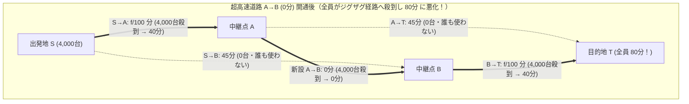
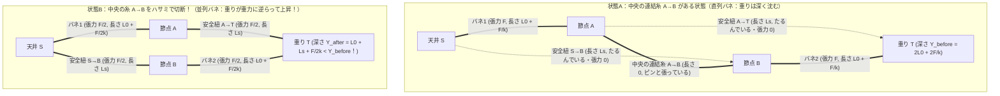

大都市の深刻な交通渋滞を解消するために、政府や自治体が莫大な予算を投じて新しいバイパス道路や橋を建設したとする。新しい道路は信号もなく、所要時間がほぼゼロに近い超高速のショートカットである。常識的に考えれば、道路網の容量（キャパシティ）が増え、選択肢が広がったのだから、ドライバーたちの平均通勤時間は短縮されるはずだ——少なくとも、新しい道路を使いたくない人は元のルートを走り続ければよいだけなので、以前より状況が悪化することなどあり得ないように思える。

しかし1968年、ドイツの数学者<strong>ディートリヒ・ブライス（Dietrich Braess）</strong>は、交通計画とネットワーク科学の根底を覆す衝撃的な定理を発表した。各ドライバーが「自分自身の所要時間を最小化する」という極めて合理的かつ利己的な判断（Selfish Routing）に基づいて経路を選択するとき、<strong>道路網に超高速の新しい道路を1本追加した結果、ネットワークを利用する100%全員の通勤時間が以前よりも確実に長くなる</strong>という現象が数学的に起こり得るのである。これが<strong>ブライスのパラドックス（Braess's Paradox）</strong>である。

さらに驚くべきことに、このパラドックスは人間の心理的な錯覚や情報の非対称性によって生じるのではない。完全情報のもとで全プレイヤーがナッシュ均衡（ウォードロップ均衡）に到達した結果として必然的に発生する構造的トラップであり、インターネットのパケットルーティング、電力網（スマートグリッド）の送電線増設、半導体ナノ構造における電子輸送、さらには<strong>「重りを吊るしたバネと糸のネットワークで、張られた糸をハサミで切ると重りが重力に逆らって上昇する」</strong>という純粋な古典力学系においてさえ全く同じ数理構造で出現する。

本稿では、ブライスの1968年論文における4頂点ダイヤモンド型ネットワークの厳密な支配戦略解析から出発し、ジョン・グレン・ウォードロップ（John Glen Wardrop）の交通配分原理、ベックマン（Martin Beckmann）とローゼンタール（Robert W. Rosenthal）による<strong>凸ポテンシャル関数（Potential Function）</strong>を用いた均衡の一意性証明、ティム・ラフガーデン（Tim Roughgarden）とエヴァ・タルドシュ（Éva Tardos）が打ち立てた<strong>無秩序の代償（Price of Anarchy: $\text{PoA}$）の上界 $\frac{4}{3}$</strong> の完全証明、ジョエル・コーエン（Joel E. Cohen）とポール・ホロウィッツ（Paul Horowitz）による力学・電気回路モデルの導出、そしてソウル市の清渓川（チョンゲチョン）高速道路撤去やニューヨーク・タイムズスクエアの歩行者天国化といった実際の都市実験、ピグー税（混雑課金）による社会的最適解の回復までを徹底的に掘り下げる。

---

## 1. ディートリヒ・ブライスの1968年論文と4頂点ダイヤモンド型ネットワーク

1968年、当時ミュンスター大学に所属していた数学者ディートリヒ・ブライスは、オペレーションズ・リサーチの学術誌 *Unternehmensforschung* に歴史的論文『交通計画におけるあるパラドックスについて（*"Über ein Paradoxon aus der Verkehrsplanung"*）』を発表した。ブライスが提示した最小かつ最も美しい反例が、以下の<strong>4頂点ダイヤモンド型ネットワーク（4-Node Diamond Network）</strong>である。

### 1.1 ネットワーク構造とリンク遅延関数（Latency Functions）

毎朝、出発地 $S$（Start）から目的地 $T$（Terminal）へ向かう総交通量 $F = 4,000\text{ 台/時}$（正規化単位では $F = 1$）の通勤車両が存在するとしよう。出発地 $S$ から目的地 $T$ へ至るには、中継地点 $A$ または中継地点 $B$ を経由する必要がある。各道路（有向辺 $e \in E$）を通過するのに要する時間（遅延関数 / Latency Function）$\ell_e(f_e)$ は、その道路を流れる交通量 $f_e$（台/時）の関数として次のように与えられている。

1. <strong>道路 $S \to A$（狭いが短い橋）</strong>：道幅が狭いため、通行する車の台数 $f_{SA}$ に比例して渋滞が悪化する。所要時間は
   $$\ell_{SA}(f_{SA}) = \frac{f_{SA}}{100}\text{ （分）}$$
   である。例えば $2,000$ 台が通れば $20$ 分、$4,000$ 台すべてが集中すれば $40$ 分かかる（正規化単位 $F=1$ では $\ell_{SA}(x) = 40x$ 分、あるいは無次元化して $\ell_{SA}(x) = x$）。
2. <strong>道路 $A \to T$（道幅が極めて広い遠回り幹線道路）</strong>：車線数が十分に多く、何台の車が通行しても渋滞は一切発生しないが、距離が長いため常に一定の所要時間がかかる。
   $$\ell_{AT}(f_{AT}) = 45\text{ （分）}$$
3. <strong>道路 $S \to B$（道幅が極めて広い遠回り幹線道路）</strong>：$A \to T$ と同じく、交通量に依存せず常に一定の所要時間がかかる。
   $$\ell_{SB}(f_{SB}) = 45\text{ （分）}$$
4. <strong>道路 $B \to T$（狭いが短い橋）</strong>：$S \to A$ と同じ構造の狭い橋であり、交通量 $f_{BT}$ に比例して所要時間が増加する。
   $$\ell_{BT}(f_{BT}) = \frac{f_{BT}}{100}\text{ （分）}$$

### 1.2 状態1：新道路建設前の均衡状態（所要時間 $65$ 分）

まず、中継点 $A$ と $B$ を結ぶ連絡道路が存在しない初期状態を考えよう。ドライバーが選択できる経路（パス）は、以下の2つのみである。
- <strong>上ルート $P_{\text{up}} = (S \to A \to T)$</strong>：所要時間 $\ell_{\text{up}} = \frac{f_{SA}}{100} + 45$（分）
- <strong>下ルート $P_{\text{down}} = (S \to B \to T)$</strong>：所要時間 $\ell_{\text{down}} = 45 + \frac{f_{BT}}{100}$（分）

もし上ルートに $2,000$ 台より多くの車（例えば $3,000$ 台）が偏ったとすると、上ルートの所要時間は $\frac{3000}{100} + 45 = 75$ 分となる一方、下ルートは $45 + \frac{1000}{100} = 55$ 分で済むため、上ルートのドライバーはこぞって下ルートへ乗り換えるだろう。ネットワークが上下対称であることから、どのドライバーも経路を変更するインセンティブを持たない均衡状態（ナッシュ均衡／ウォードロップ均衡）は、総交通量 $4,000$ 台がちょうど半分ずつ（$50\% : 50\%$）に分かれる状態である。

- 上ルート $P_{\text{up}}$ の交通量：$f_{\text{up}} = 2,000\text{ 台/時}$
- 下ルート $P_{\text{down}}$ の交通量：$f_{\text{down}} = 2,000\text{ 台/時}$

このとき、すべてのドライバーの通勤時間は等しく、
$$T_{\text{before}} = \frac{2000}{100} + 45 = 20 + 45 = 65\text{ 分}$$
となる。しかも後述するように、この $50:50$ の分割は、社会全体の総移動時間 $\sum f_P \ell_P$ を最小化する<strong>社会的最適解（Social Optimum）</strong>とも完全に一致している。

### 1.3 状態2：超高速ショートカット道路 $A \to B$ の開通（所要時間 $80$ 分への悪化）

ここで、都市計画当局が交通の便をさらに良くしようと、中継点 $A$ から中継点 $B$ へ向かう一方通行の超高速バイパス（あるいは瞬間移動に近い超高架橋）$A \to B$ を新設したとしよう。この新道路は道幅も無限に広く、距離も極めて短いため、何台の車が通っても<strong>所要時間は $\ell_{AB}(f_{AB}) = 0$ 分</strong>である。

新道路 $A \to B$ の開通により、ドライバーには第3の選択肢として<strong>ジグザグ経路 $P_{\text{zig}} = (S \to A \to B \to T)$</strong> が加わった。元の $65$ 分の均衡状態から出発して、何が起きるかをゲーム理論の<strong>厳密な支配戦略（Strictly Dominant Strategy）</strong>の観点から追跡しよう。

1. <strong>開通直後の最初の1人の判断</strong>：
   元の均衡（$f_{SA} = 2,000$, $f_{BT} = 2,000$）において、新しいジグザグ経路 $S \to A \to B \to T$ の所要時間を計算すると、
   $$\ell_{\text{zig}} = \ell_{SA}(2000) + \ell_{AB} + \ell_{BT}(2000) = 20 + 0 + 20 = 40\text{ 分}$$
   である！元の経路が $65$ 分かかっていたのに比べ、新ルートはたった $40$ 分（$25$ 分もの短縮）で到着できる。当然ながら、合理的なドライバーたちは次々とジグザグ経路 $S \to A \to B \to T$ へと乗り換え始める。
2. <strong>なぜ全員が乗り換えてしまうのか（強支配戦略の証明）</strong>：
   ジグザグ経路に車が殺到すれば、狭い橋 $S \to A$ と $B \to T$ はどんどん混雑し、所要時間は $20$ 分から $30$ 分、$35$ 分へと上昇していく。「どこかの時点で元の幹線道路と釣り合って止まるのではないか？」と思うかもしれない。しかし、<strong>絶対に止まらない</strong>のである。
   任意の1人のドライバーの意思決定を2段階に分けて考えよう。
   - <strong>第1段階（出発地 $S$ での選択：$S \to A \text{ と } S \to B$ の比較）</strong>：
     他の $3,999$ 台の車がどのように走っていようとも、道路 $S \to A$ を通る車の総数 $f_{SA}$ は最大でも全車両数の $4,000$ 台以下である。したがって、$S \to A$ の所要時間は<strong>最悪でも</strong>
     $$\ell_{SA}(f_{SA}) = \frac{f_{SA}}{100} \le \frac{4000}{100} = 40\text{ 分}$$
     にしかならない。一方、幹線道路 $S \to B$ は常に $45$ 分かかる。そして中継点 $A$ に着きさえすれば、所要時間 $0$ 分の橋 $A \to B$ を渡って瞬時に $B$ へ到達できる！つまり、$S$ から $B$ へ行くにあたって、直接 $S \to B$ を走る（$45$ 分）よりも、$S \to A \to B$ と回る（最大でも $40 + 0 = 40$ 分）方が、<strong>他者の行動に一切依存せず常に最低でも $5$ 分以上速い</strong>のである。したがって、幹線道路 $S \to B$ を選ぶことはゲーム理論における<strong>強被支配戦略（Strictly Dominated Strategy）</strong>となり、合理的なドライバーは誰一人として $S \to B$ を使わなくなる（$f_{SB} = 0$）。
   - <strong>第2段階（中継点 $A$ での選択：$A \to T \text{ と } A \to B \to T$ の比較）</strong>：
     全員が $S \to A$ を通って中継点 $A$ に到達したとする。ここから目的地 $T$ へ向かうには、直接幹線道路 $A \to T$ を走る（常に $45$ 分）か、あるいは $A \to B \to T$ を通るかの二択である。しかし、橋 $B \to T$ の交通量 $f_{BT}$ も最大で $4,000$ 台以下であるため、$A \to B \to T$ の所要時間は<strong>最悪でも</strong>
     $$\ell_{AB}(f_{AB}) + \ell_{BT}(f_{BT}) = 0 + \frac{f_{BT}}{100} \le \frac{4000}{100} = 40\text{ 分}$$
     である。これは幹線道路 $A \to T$ の $45$ 分よりも常に最低 $5$ 分速い！よって $A \to T$ を走ることも強被支配戦略となり、誰一人として $A \to T$ を使わなくなる（$f_{AT} = 0$）。

3. <strong>新しい唯一のナッシュ均衡（全員 $80$ 分の牢獄）</strong>：
   以上の強支配戦略の連鎖により、<strong>$4,000$ 台の車両すべて（$100\%$）がジグザグ経路 $S \to A \to B \to T$ に集中する</strong>。このとき、狭い橋 $S \to A$ と $B \to T$ の両方に $4,000$ 台全車が流れ込むため、全員の通勤時間は
   $$T_{\text{after}} = \ell_{SA}(4000) + \ell_{AB}(4000) + \ell_{BT}(4000) = \frac{4000}{100} + 0 + \frac{4000}{100} = 40 + 0 + 40 = 80\text{ 分}$$
   へと跳ね上がる！

ここで、「$80$ 分もかかるなら、元の $65$ 分だった上ルート $S \to A \to T$ や下ルート $S \to B \to T$ に戻ればいいではないか！」と疑問に思うかもしれない。しかし、<strong>単独のドライバーが元のルートに戻ると、さらに酷い目に遭う</strong>のである。なぜなら、すでに他の全員がジグザグ経路を走っているため、橋 $S \to A$ と $B \to T$ にはそれぞれ $40$ 分の渋滞が発生している。この状態で1人のドライバーだけが上ルート $S \to A \to T$ に変更すると、その人の所要時間は
$$\ell_{SA}(4000) + \ell_{AT}(1) = 40 + 45 = 85\text{ 分}$$
となり、ジグザグ経路の $80$ 分よりもさらに $5$ 分遅くなってしまう！下ルート $S \to B \to T$ に変更しても同様に $45 + 40 = 85$ 分かかる。したがって、誰一人として単独では $80$ 分のジグザグ経路から抜け出すことができない。これこそが多人数ネットワーク上の<strong>囚人のジレンマ（Prisoner's Dilemma）</strong>であり、所要時間 $0$ 分の最新鋭道路を作った結果、全員の通勤時間が $65$ 分から $80$ 分へ（$+15$ 分、率にして $+23.1\%$）悪化するというブライスのパラドックスの正体である。

| 比較項目 | 状態1：新道路建設前（かつ社会的最適解 $f^*$） | 状態2：超高速道路 $A \to B$ 開通後（ウォードロップ均衡 $f^{\text{EQ}}$） | 変化量・パラドックスの影響 |
| :--- | :--- | :--- | :--- |
| <strong>利用可能な経路</strong> | $P_{\text{up}}(S\to A\to T)$, $P_{\text{down}}(S\to B\to T)$ | $P_{\text{up}}$, $P_{\text{down}}$, $P_{\text{zig}}(S\to A\to B\to T)$ | 選択肢が2本から3本に増加 |
| <strong>上ルート $S \to A \to T$ の流量</strong> | $2,000\text{ 台/時}$（所要 $20 + 45 = 65$ 分） | $0\text{ 台/時}$（もし走れば $40 + 45 = 85$ 分） | 幹線道路 $A \to T$ が完全遊休化 |
| <strong>下ルート $S \to B \to T$ の流量</strong> | $2,000\text{ 台/時}$（所要 $45 + 20 = 65$ 分） | $0\text{ 台/時}$（もし走れば $45 + 40 = 85$ 分） | 幹線道路 $S \to B$ が完全遊休化 |
| <strong>ジグザグ経路 $S \to A \to B \to T$ の流量</strong> | 存在せず（通行不可） | $4,000\text{ 台/時}$（全車両の $100\%$ が集中） | 狭い橋 $S\to A$ と $B\to T$ を二重に通過 |
| <strong>各ドライバーの通勤時間</strong> | <strong>$65\text{ 分}$</strong> | <strong>$80\text{ 分}$</strong> | <strong>全員が一律 $+15\text{ 分}$（$+23.1\%$）悪化</strong> |
| <strong>社会全体の総移動コスト $C(f)$</strong> | $4,000 \times 65 = 260,000\text{ 台・分}$ | $4,000 \times 80 = 320,000\text{ 台・分}$ | <strong>無秩序の代償 $\text{PoA} = \frac{80}{65} = \frac{16}{13} \approx 1.231$</strong> |

（注：もし幹線道路 $A \to T$ と $S \to B$ の所要時間が $45$ 分ではなく $40$ 分ちょうど、すなわち正規化単位で $\ell_{AT} = \ell_{SB} = 40$ 分であったなら、建設前の所要時間は $20 + 40 = 60$ 分、建設後の均衡所要時間は $40 + 0 + 40 = 80$ 分となり、悪化比率はちょうど $\frac{80}{60} = \frac{4}{3} \approx 1.333$ すなわち <strong>$+33.3\%$</strong> の最大悪化限界に達する！）

---

## 2. ウォードロップの2つの原理とベックマン＝ローゼンタールの凸ポテンシャル理論

ブライスのパラドックスがなぜ発生するのかを一般的な任意のネットワーク上で理解するには、1952年にイギリスの交通工学者<strong>ジョン・グレン・ウォードロップ（John Glen Wardrop）</strong>が定式化した交通配分の2大原理と、1956年に<strong>マーティン・ベックマン（Martin Beckmann）</strong>、<strong>チャールズ・マクガイア（C. B. McGuire）</strong>、<strong>クリストファー・ウィンステン（Christopher B. Winsten）</strong>が確立した凸最適化理論（および1973年のロバート・ローゼンタールによるポテンシャルゲームの理論）を導入する必要がある。

### 2.1 非アトミック混雑ゲーム（Non-Atomic Congestion Games）の数学的定式化

有向グラフ $G = (V, E)$ を考える。簡単のため単一の出発地 $S \in V$ と目的地 $T \in V$ のペア（単一コモディティ）を考え、総交通需要を $F > 0$ とする（複数の出発地・目的地ペア $(s_i, t_i)$ が存在するマルチコモディティ網への拡張も全く同様である）。
- $S$ から $T$ への単純有向パス（経路）全体の集合を $\mathcal{P}$ とする。
- 各経路 $P \in \mathcal{P}$ に流れる交通量を $f_P \ge 0$ とし、経路フローベクトル $f = (f_P)_{P \in \mathcal{P}}$ が実行可能（feasible）であるとは、需要制約
  $$\sum_{P \in \mathcal{P}} f_P = F, \quad f_P \ge 0 \quad (\forall P \in \mathcal{P})$$
  を満たすことである。実行可能なフロー全体のなす凸多面体（シンプレックス）を $\mathcal{F}$ と記す。
- 経路フロー $f \in \mathcal{F}$ は、各辺（道路リンク）$e \in E$ 上の辺フロー（edge flow）$f_e$ を一意に誘導する：
  $$f_e = \sum_{P \in \mathcal{P} : e \in P} f_P$$
- 各辺 $e \in E$ には、連続かつ広義単調増加で微分可能な遅延関数（コスト関数）$\ell_e : [0, \infty) \to [0, \infty)$ が備わっており、経路 $P$ 全体の所要時間（遅延）$\ell_P(f)$ はその経路に含まれる辺の遅延の総和で表される：
  $$\ell_P(f) = \sum_{e \in P} \ell_e(f_e)$$

ここで「非アトミック（non-atomic）」とは、個々のドライバー1人が持つ交通量が連続体の中の無限小（$df \to 0$）であり、1人の単独行動の変化が全体の交通量 $f_e$ に与える影響は無視できるが、無数のドライバーが集まることでマクロな渋滞 $\ell_e(f_e)$ が決定されるという流体近似モデルを意味する。

### 2.2 ウォードロップの第1原理（利用者均衡 / User Equilibrium: $f^{\text{EQ}}$）

ウォードロップが1952年の論文 *"Some theoretical aspects of road traffic research"* で提示した<strong>第1原理（Wardrop's First Principle）</strong>は、利己的なドライバーたちがそれぞれ自分の所要時間を最小化した結果として達成される<strong>利用者均衡（User Equilibrium: UE）</strong>——すなわち非アトミック・ナッシュ均衡——を次のように定義する。

> <strong>ウォードロップの第1原理（利用者均衡 $f^{\text{EQ}}$）</strong>：
> 実際に利用されている（正の交通量が流れている）すべての経路の所要時間は互いに等しく、かつ利用されていないいかなる経路の所要時間よりも長くなることはない。

数式で書けば、実行可能フロー $f^{\text{EQ}} \in \mathcal{F}$ がウォードロップ均衡であるための必要十分条件は、任意の2つの経路 $P, P' \in \mathcal{P}$ に対して次が成り立つことである：
$$f_P^{\text{EQ}} > 0 \implies \ell_P(f^{\text{EQ}}) \le \ell_{P'}(f^{\text{EQ}})$$
言い換えれば、ある定数（均衡通勤時間）$L > 0$ が存在して、
$$\begin{cases} \ell_P(f^{\text{EQ}}) = L & \text{if } f_P^{\text{EQ}} > 0 \\ \ell_P(f^{\text{EQ}}) \ge L & \text{if } f_P^{\text{EQ}} = 0 \end{cases}$$
がすべての $P \in \mathcal{P}$ について成立する。さらにスミス（M. J. Smith, 1979）およびダフェルモス（Stella Dafermos, 1980）が示した通り、この条件はすべての実行可能フロー $f \in \mathcal{F}$ に対する以下の<strong>変分不等式（Variational Inequality: VI）</strong>と同値である：
$$\sum_{e \in E} \ell_e\bigl(f_e^{\text{EQ}}\bigr) \cdot \bigl(f_e - f_e^{\text{EQ}}\bigr) \ge 0 \quad (\forall f \in \mathcal{F})$$

### 2.3 ウォードロップの第2原理（社会的最適解 / System Optimum: $f^*$）とピグーの外部不経済

これに対し、ウォードロップの<strong>第2原理（Wardrop's Second Principle）</strong>は、全車両の総移動時間（あるいは平均移動時間）を最小化する中央計画者の理想状態——<strong>社会的最適解（Social Optimum / System Optimum: SO）</strong>——を定義する。

社会全体の総移動コスト（Total Social Cost）$C(f)$ は、すべての経路における「交通量 $\times$ 所要時間」の和であり、辺ごとの和に書き直すことができる：
$$C(f) = \sum_{P \in \mathcal{P}} f_P \ell_P(f) = \sum_{P \in \mathcal{P}} f_P \sum_{e \in P} \ell_e(f_e) = \sum_{e \in E} \left( \sum_{P \ni e} f_P \right) \ell_e(f_e) = \sum_{e \in E} f_e \ell_e(f_e)$$

社会的最適フロー $f^* \in \mathcal{F}$ とは、この総移動コスト $C(f)$ を最小化するフローである：
$$f^* = \arg\min_{f \in \mathcal{F}} C(f) = \arg\min_{f \in \mathcal{F}} \sum_{e \in E} f_e \ell_e(f_e)$$

関数 $f_e \mapsto f_e \ell_e(f_e)$ が凸関数であるとき（例えば $\ell_e$ が広義単調増加かつ凸であれば常に成り立つ）、ラグランジュの未定乗数法（カルーシュ・クーン・タッカー条件：KKT条件）を適用すると、社会的最適解 $f^*$ を特徴づける条件が得られる。辺 $e$ の社会的総コスト $f_e \ell_e(f_e)$ を交通量 $f_e$ で微分した<strong>限界社会的費用（Marginal Social Cost: MSC）</strong>を $\tilde{\ell}_e(f_e)$ と定義しよう：
$$\tilde{\ell}_e(f_e) = \frac{d}{df_e}\bigl[ f_e \ell_e(f_e) \bigr] = \ell_e(f_e) + f_e \ell_e'(f_e)$$

すると、実行可能フロー $f^*$ が社会的最適解であるための必要十分条件は、実際に使われているすべての経路について、所要時間 $\ell_P$ ではなく<strong>限界社会的費用 $\tilde{\ell}_P(f^*) = \sum_{e \in P} \tilde{\ell}_e(f_e^*)$ が均等化されること</strong>である：
$$f_P^* > 0 \implies \sum_{e \in P} \Bigl(\ell_e(f_e^*) + f_e^* \ell_e'(f_e^*)\Bigr) \le \sum_{e \in P'} \Bigl(\ell_e(f_e^*) + f_e^* \ell_e'(f_e^*)\Bigr) \quad (\forall P' \in \mathcal{P})$$

ここに、ウォードロップ均衡 $f^{\text{EQ}}$ と社会的最適解 $f^*$ が乖離する根本原因が鮮やかに浮かび上がる。限界社会的費用 $\tilde{\ell}_e(f_e) = \ell_e(f_e) + f_e \ell_e'(f_e)$ は、経済学における2つの明確な要素から構成されている。

1. <strong>私的費用（Private Cost）：$\ell_e(f_e)$</strong>
   新たに道路 $e$ に進入するドライバー自身が被る所要時間。利己的なドライバーは<strong>この項だけ</strong>を見て意思決定を行う。
2. <strong>ピグーの混雑外部性（Pigouvian Congestion Externality）：$f_e \ell_e'(f_e)$</strong>
   新たに1台の車が道路 $e$ に進入したとき、道路の混雑が微小量 $\ell_e'(f_e)\,df_e$ だけ悪化する。その遅れは、進入した本人だけでなく、<strong>すでにその道路を走っている他の $f_e$ 台のドライバー全員</strong>に対しても等しく降りかかる！したがって、追加の1台が社会全体に与える「他者への遅延ダメージの総計」が $f_e \cdot \ell_e'(f_e)$ である。

利己的なドライバーは、自分が他者 $f_e$ 人に押し付けている外部不経済 $f_e \ell_e'(f_e)$ を一切考慮しない。ブライスのネットワークにおいて、狭い橋 $S \to A$ や $B \to T$ は傾き $\ell_e'(f_e) = \frac{1}{100} > 0$ を持つため、大きな混雑外部性 $f_e \ell_e'(f_e) = \frac{f_e}{100}$ を発生させる。それに対し、道幅の広い幹線道路 $A \to T$ や $S \to B$ は定数遅延 $\ell_e(f_e) = 45$ であるため、微分 $\ell_e'(f_e) = 0$ であり、混雑外部性はゼロである。
新道路 $A \to B$ が開通したとき、ジグザグ経路 $S \to A \to B \to T$ は混雑外部性の大きい狭い橋を<strong>2回（$S \to A$ と $B \to T$）</strong>も通過するため、社会全体に甚大な外部不経済を撒き散らすにもかかわらず、私的費用だけを見るドライバーたちがそこに殺到し、外部性ゼロの優良な幹線道路を放棄してしまうのである。

### 2.4 ベックマン＝ローゼンタールの凸ポテンシャル関数（Potential Function）

では、複雑なネットワークにおいてウォードロップ均衡 $f^{\text{EQ}}$ は常に存在するのだろうか？また、複数存在する場合はあるのだろうか？
1956年、ベックマン、マクガイア、ウィンステンの3人は、分散的で利己的なドライバーたちの行動が、実はある<strong>単一のグローバルなスカラー関数 $\Phi(f)$ を無意識のうちに最小化している</strong>ことを見出した。これが<strong>ベックマンのポテンシャル関数（Beckmann Potential Function）</strong>である。

$$\Phi(f) = \sum_{e \in E} \int_0^{f_e} \ell_e(u)\,du$$

なぜこの積分関数 $\Phi(f)$ の最小化がウォードロップ均衡と一致するのかを証明しよう。
最適化問題
$$\min_{f \in \mathcal{F}} \Phi(f) = \min_{f \in \mathcal{F}} \sum_{e \in E} \int_0^{f_e} \ell_e(u)\,du \quad \text{subject to} \quad \sum_{P \in \mathcal{P}} f_P = F, \quad f_P \ge 0$$
を考える。微分積分学の基本定理と連鎖律（$\frac{\partial f_e}{\partial f_P} = 1 \text{ if } e \in P \text{ else } 0$）により、ポテンシャル関数 $\Phi(f)$ を経路フロー $f_P$ で偏微分すると、
$$\frac{\partial \Phi(f)}{\partial f_P} = \sum_{e \in E} \frac{\partial}{\partial f_e}\left(\int_0^{f_e} \ell_e(u)\,du\right) \frac{\partial f_e}{\partial f_P} = \sum_{e \in P} \ell_e(f_e) = \ell_P(f)$$
となる！すなわち、<strong>ポテンシャル関数 $\Phi(f)$ の経路 $P$ に関する勾配（限界ポテンシャル）は、その経路の私的所要時間 $\ell_P(f)$ そのもの</strong>なのである。

各辺の遅延関数 $\ell_e(u)$ が連続かつ広義単調増加（$\ell_e'(u) \ge 0$）であれば、その原始関数 $\int_0^{f_e} \ell_e(u)\,du$ の2階微分は $\ell_e'(f_e) \ge 0$ となり、下に凸（convex）な関数となる。凸関数の和である $\Phi(f)$ もまたコンパクトな凸多面体 $\mathcal{F}$ 上の凸関数であるため、以下の強力な定理が直ちに従う。

1. <strong>存在性（Existence）</strong>：連続な凸関数 $\Phi(f)$ はコンパクト集合 $\mathcal{F}$ 上で必ず最小値を達成するため、ウォードロップ均衡 $f^{\text{EQ}}$ は任意のネットワークにおいて必ず少なくとも1つ存在する。
2. <strong>本質的一意性（Essential Uniqueness）</strong>：凸最適化問題のKKT条件はウォードロップの第1原理と完全に一致する。さらに、もし各辺の遅延関数 $\ell_e$ が狭義単調増加であれば $\Phi(f)$ は辺フロー $(f_e)_{e \in E}$ に関して狭義凸となり、均衡辺フロー $f_e^{\text{EQ}}$ は<strong>一意</strong>に定まる（定数遅延の辺が含まれる場合でも、すべてのウォードロップ均衡において各辺の均衡遅延 $\ell_e(f_e^{\text{EQ}})$ および各ドライバーの均衡所要時間 $L$ は一意に定まる）。

特に、線形（アフィン）遅延関数 $\ell_e(u) = a_e u + b_e$（$a_e \ge 0, b_e \ge 0$）の場合、ベックマンのポテンシャル関数 $\Phi(f)$ と社会的総コスト $C(f)$ を並べて比較すると、両者のズレが驚くほど明快に理解できる。

$$\Phi(f) = \sum_{e \in E} \int_0^{f_e} (a_e u + b_e)\,du = \sum_{e \in E} \left( \frac{1}{2} a_e f_e^2 + b_e f_e \right)$$
$$C(f) = \sum_{e \in E} f_e (a_e f_e + b_e) = \sum_{e \in E} \left( a_e f_e^2 + b_e f_e \right)$$

見比べてほしい。$\Phi(f)$ と $C(f)$ の違いは、2次の混雑項 $a_e f_e^2$ にかかっている<strong>係数 $\frac{1}{2}$ の有無だけ</strong>である！すなわち、利己的なドライバーたちが無秩序に経路を選ぶウォードロップ均衡は、「道路の渋滞悪化係数 $a_e$ が本来の<strong>半分（$\frac{1}{2} a_e$）</strong>しかない」と錯覚して社会全体のコストを最小化してしまった状態と数学的に完全に同値なのである。

---

## 3. ラフガーデン＆タルドシュの定理と「無秩序の代償（Price of Anarchy）」の上界 $4/3$

ブライスのパラドックスは、利己的なルーティングが社会的最適解よりも悪化し得ることを示した。では、ここで計算機科学者やネットワーク設計者にとって最も切実な疑問が生じる。
<strong>「利己的ルーティングによる渋滞の悪化は、最悪の場合、社会的最適解に比べて何倍まで酷くなり得るのか？」</strong>
何千もの交差点と複雑なループを持つ巨大都市の道路網やインターネットにおいて、新道路を作ったせいで所要時間が10倍や100倍に爆発してしまうことはあるのだろうか？

1999年、エウティヒオス・クツピアス（Elias Koutsoupias）とクリストス・パパディミトリウ（Christos Papadimitriou）は、アルゴリズム的ゲーム理論（Algorithmic Game Theory）の金字塔となる論文において、分散的なナッシュ均衡のコストと中央集権的な社会的最適解のコストの比を<strong>「無秩序の代償（Price of Anarchy: $\text{PoA}$）」</strong>と命名した。そして2002年、<strong>ティム・ラフガーデン（Tim Roughgarden）</strong>と<strong>エヴァ・タルドシュ（Éva Tardos）</strong>は、*Journal of the ACM* に発表した歴史的論文 *"How Bad is Selfish Routing?"* において、この問いに対する完全かつ驚くべき解答を与えた。

### 3.1 無秩序の代償（Price of Anarchy）の定義とピグーの2リンク網（1920年）

ネットワーク $G$ と需要 $F$ に対し、（ウォードロップ均衡のコストは一意であるため）<strong>無秩序の代償 $\text{PoA}$</strong> は次式で定義される：
$$\text{PoA} = \frac{C(f^{\text{EQ}})}{C(f^*)} = \frac{\sum_{e \in E} f_e^{\text{EQ}} \ell_e(f_e^{\text{EQ}})}{\min_{f \in \mathcal{F}} \sum_{e \in E} f_e \ell_e(f_e)} \ge 1$$

ブライスが4頂点ネットワークを発見するより半世紀近く前の1920年、イギリスの経済学者<strong>アーサー・セシル・ピグー（Arthur Cecil Pigou）</strong>は、著書『厚生経済学（*The Economics of Welfare*）』の中で、わずか2本の並列道路からなる最小のネットワークにおいて均衡と最適解の乖離を示していた。これを<strong>ピグーのネットワーク（Pigou's Network）</strong>と呼ぶ。

- 出発地 $S$ から目的地 $T$ へ総流量 $F = 1$ を流す2本の並列リンク $e_1, e_2$ を考える。
- <strong>上リンク $e_1$</strong>：交通量によらず常に所要時間 $1$ の広い道路、$\ell_1(x) = 1$。
- <strong>下リンク $e_2$</strong>：交通量に比例して所要時間が増える狭い道路、$\ell_2(x) = x$。

1. <strong>ウォードロップ均衡 $f^{\text{EQ}}$</strong>：
   下リンク $e_2$ にたとえ全車両 $x = 1$ が流れ込んでも、その所要時間は $\ell_2(1) = 1$ であり、上リンクの $\ell_1 = 1$ 以下である（$x < 1$ なら $\ell_2(x) < 1$ で厳密に速い）。よって利己的なドライバーは全員が下リンク $e_2$ に殺到し、$f_2^{\text{EQ}} = 1, f_1^{\text{EQ}} = 0$ となる。このときの社会的総コストは
   $$C(f^{\text{EQ}}) = 0 \cdot 1 + 1 \cdot \ell_2(1) = 1$$
   である。
2. <strong>社会的最適解 $f^*$</strong>：
   下リンクに流す交通量を $x \in [0, 1]$、上リンクに流す交通量を $1 - x$ とすると、社会的総コスト $C(x)$ は
   $$C(x) = (1 - x) \cdot 1 + x \cdot x = 1 - x + x^2$$
   となる。これを $x$ で微分して $0$ と置くと（あるいは下リンクの限界社会的費用 $\text{MSC}_2(x) = \frac{d}{dx}(x^2) = 2x$ を上リンクの $\text{MSC}_1 = 1$ と等置すると）、
   $$-1 + 2x = 0 \implies x^* = \frac{1}{2}$$
   が得られる！すなわち、半分の車を上リンクへ逃がし、残り半分だけを下リンクに通すのが社会全体の最適解である。このとき下リンクの所要時間は $\frac{1}{2}$ に半減し、社会的最小コストは
   $$C(f^*) = \frac{1}{2} \cdot 1 + \frac{1}{2} \cdot \frac{1}{2} = \frac{1}{2} + \frac{1}{4} = \frac{3}{4} = 0.75$$
   となる。

したがって、ピグーの2リンク網における無秩序の代償は
$$\text{PoA} = \frac{C(f^{\text{EQ}})}{C(f^*)} = \frac{1}{3/4} = \frac{4}{3} \approx 1.3333$$
となる。これは先に見たブライスの4頂点ネットワーク（$\ell_{AT} = \ell_{SB} = 1, \ell_{SA}(x) = \ell_{BT}(x) = x$ の正規化ケース）において、新道路追加後のコスト $2$ と追加前のコスト $\frac{3}{2}$ の比が $\frac{2}{3/2} = \frac{4}{3}$ になったことと正確に呼応している。

### 3.2 ラフガーデン＆タルドシュの $4/3$ 定理の厳密証明

では、頂点数が1万個、辺が10万本あるような超複雑なネットワークでは、$\text{PoA}$ は $\frac{4}{3}$ を超えていくらでも大きくなり得るのだろうか？ラフガーデンとタルドシュが証明した定理は、驚くべきことに<strong>「いかなるネットワークトポロジーであっても、遅延関数が線形（アフィン）である限り、$\frac{4}{3}$ を絶対に超えない」</strong>というものであった。

> <strong>定理（Roughgarden & Tardos, 2002）</strong>：
> 任意の有向グラフ $G = (V, E)$、任意の数の出発地・目的地ペア $(s_i, t_i)$ と需要 $r_i > 0$ を持つ非アトミック混雑ゲームにおいて、すべての辺 $e \in E$ の遅延関数がアフィン関数（1次関数）$\ell_e(x) = a_e x + b_e$（ただし $a_e \ge 0, b_e \ge 0$）であるとする。このとき、無秩序の代償 $\text{PoA}$ は常に以下を満たす：
> $$\text{PoA}_{\text{linear}} = \frac{C(f^{\text{EQ}})}{C(f^*)} \le \frac{4}{3}$$

<strong>【完全証明】</strong>
ウォードロップ均衡フローを $f^{\text{EQ}} \in \mathcal{F}$、社会的最適フローを $f^* \in \mathcal{F}$ とする。

<strong>ステップ1（変分不等式の適用）</strong>：
ウォードロップ均衡の変分不等式（2.2節）より、任意の実行可能フロー（特に $f^*$）に対して
$$\sum_{e \in E} \ell_e\bigl(f_e^{\text{EQ}}\bigr) \cdot \bigl(f_e^* - f_e^{\text{EQ}}\bigr) \ge 0$$
が成り立つ。移項すると、均衡コスト $C(f^{\text{EQ}})$ は次のように上から抑えられる：
$$C(f^{\text{EQ}}) = \sum_{e \in E} f_e^{\text{EQ}} \ell_e\bigl(f_e^{\text{EQ}}\bigr) \le \sum_{e \in E} f_e^* \ell_e\bigl(f_e^{\text{EQ}}\bigr) \quad \cdots (1)$$

<strong>ステップ2（各辺ごとの平方完成による代数不等式）</strong>：
任意の辺 $e \in E$ を1つ固定し、記号を簡潔にするため $x = f_e^{\text{EQ}} \ge 0$、$y = f_e^* \ge 0$ と置く。辺 $e$ の遅延関数は $\ell_e(u) = a_e u + b_e$（$a_e, b_e \ge 0$）である。式 (1) の右辺に現れる項 $y \ell_e(x)$ を展開し、最適コストの項 $y \ell_e(y)$ との差を計算する：
$$y \ell_e(x) = y(a_e x + b_e) = y(a_e y + b_e) + a_e(xy - y^2) = y \ell_e(y) + a_e(xy - y^2)$$
ここで、括弧内の2次式 $xy - y^2$ を $y$ について平方完成すると、実数の2乗は常に非負であることから、
$$xy - y^2 = \frac{1}{4}x^2 - \left(y - \frac{x}{2}\right)^2 \le \frac{1}{4}x^2$$
がすべての実数 $x, y \ge 0$ に対して絶対的に成立する！（等号成立条件は $y = \frac{x}{2}$、すなわち最適フローが均衡フローのちょうど半分になるときである）。
さらに、$a_e \ge 0, b_e \ge 0, x \ge 0$ より $a_e x^2 \le a_e x^2 + b_e x = x(a_e x + b_e) = x \ell_e(x)$ であるから、
$$y \ell_e(x) \le y \ell_e(y) + \frac{1}{4} a_e x^2 \le y \ell_e(y) + \frac{1}{4} x \ell_e(x) \quad \cdots (2)$$
を得る。

<strong>ステップ3（全辺にわたる総和と移項）</strong>：
不等式 (2) に $x = f_e^{\text{EQ}}, y = f_e^*$ を戻し、すべての辺 $e \in E$ にわたって和をとると、式 (1) と組み合わせて次が得られる：
$$C(f^{\text{EQ}}) \le \sum_{e \in E} f_e^* \ell_e\bigl(f_e^{\text{EQ}}\bigr) \le \sum_{e \in E} f_e^* \ell_e(f_e^*) + \frac{1}{4} \sum_{e \in E} f_e^{\text{EQ}} \ell_e\bigl(f_e^{\text{EQ}}\bigr) = C(f^*) + \frac{1}{4} C(f^{\text{EQ}})$$
両辺から $\frac{1}{4} C(f^{\text{EQ}})$ を引くと、
$$\left(1 - \frac{1}{4}\right) C(f^{\text{EQ}}) = \frac{3}{4} C(f^{\text{EQ}}) \le C(f^*) \implies \frac{C(f^{\text{EQ}})}{C(f^*)} \le \frac{4}{3}$$
となり、定理が完全に証明された。 $\blacksquare$

この証明の美しさは驚嘆に値する。グラフ $G$ のトポロジー（辺がどう繋がっているか、何個のダイヤモンド構造が入れ子になっているか）に関する情報は、ステップ1の変分不等式にすべて吸収されており、ステップ2の平方完成 $xy - y^2 \le \frac{1}{4}x^2$ は個々の辺の上で独立に成り立っている。これが、<strong>「どれほど複雑なネットワークであっても、2本のリンクしかないピグー網や4頂点のブライス網よりも無秩序の代償が悪化することはあり得ない（トポロジー無依存性）」</strong>という深遠な事実の数学的根拠である。

### 3.3 多項式遅延関数（次数 $d$）とBPR関数における無秩序の代償

実際の道路交通工学や通信ネットワークでは、交通量が道路容量 $c_e$ に近づくにつれて遅延が非線形（高次の多項式）で急増する。例えば、米国連邦道路庁（Bureau of Public Roads）が策定し世界中の交通シミュレーションで標準的に使われている<strong>BPR関数（Bureau of Public Roads Function）</strong>は、交通量の<strong>4次関数（$d = 4$）</strong>として定式化されている：
$$\ell_e(f_e) = t_e^0 \left[ 1 + \alpha \left( \frac{f_e}{c_e} \right)^\beta \right] \quad (\text{標準パラメータは } \alpha = 0.15, \beta = d = 4)$$

ラフガーデン（2003）は上記の証明手法（後にスムースネス議論 / $(\lambda, \mu)$-smoothness と呼ばれる枠組み）を一般化し、次数 $d$ 以下の非負係数多項式からなる遅延関数クラス $\mathcal{P}_d$（すなわち $\ell_e(x) = \sum_{k=0}^d a_{e,k} x^k, \, a_{e,k} \ge 0$）に対する最悪ケースの無秩序の代償 $\text{PoA}_d$ を厳密に導出した。

ピグーの2リンク網において上リンクを $\ell_1(x) = 1$、下リンクを単項式 $\ell_2(x) = x^d$ とすると、均衡フローは $x^{\text{EQ}} = 1$ で $C(f^{\text{EQ}}) = 1$ である。一方、社会的最適フロー $x^*$ は総コスト $C(x) = (1-x)\cdot 1 + x \cdot x^d = 1 - x + x^{d+1}$ を最小化する点であり、微分して $0$ と置くと
$$\frac{dC}{dx} = -1 + (d+1)x^d = 0 \implies x^* = (d+1)^{-1/d} = \frac{1}{\sqrt[d]{d+1}}$$
となる。このときの最小社会的コストは
$$C(f^*) = 1 - x^* + (x^*)^{d+1} = 1 - x^*\bigl(1 - (x^*)^d\bigr) = 1 - (d+1)^{-1/d} \left(1 - \frac{1}{d+1}\right) = 1 - \frac{d}{(d+1)\sqrt[d]{d+1}}$$
となるため、次数 $d$ の多項式遅延ネットワークにおける無秩序の代償の厳密な上界は次式で与えられる：

$$\text{PoA}_d = \frac{1}{1 - \dfrac{d}{(d+1)\sqrt[d]{d+1}}} = \frac{(d+1)\sqrt[d]{d+1}}{(d+1)\sqrt[d]{d+1} - d} \sim \Theta\left(\frac{d}{\ln d}\right) \quad (d \to \infty)$$

| 遅延関数のクラス | 次数 $d$ | 代表的な物理・社会モデル | 最適配分比率 $x^*$（ピグー網） | 無秩序の代償 $\text{PoA}_d$（厳密値） | 数値（最大悪化倍率） |
| :--- | :--- | :--- | :--- | :--- | :--- |
| <strong>定数遅延</strong> | $d = 0$ | 渋滞のない理想道路・光ファイバー | 任意 | $1$ | <strong>$1.0000$</strong>（悪化なし） |
| <strong>線形（アフィン）遅延</strong> | $d = 1$ | ブライスの1968年論文モデル | $2^{-1} = 0.5000$ | $\dfrac{4}{3}$ | <strong>$1.3333$</strong>（$+33.3\%$） |
| <strong>2次多項式遅延</strong> | $d = 2$ | 二次抵抗・流体管路の乱流圧力損失 | $3^{-1/2} \approx 0.5774$ | $\dfrac{3\sqrt{3}}{3\sqrt{3} - 2}$ | <strong>$1.6258$</strong>（$+62.6\%$） |
| <strong>3次多項式遅延</strong> | $d = 3$ | 高密度交通流モデル | $4^{-1/3} \approx 0.6300$ | $\dfrac{4\sqrt[3]{4}}{4\sqrt[3]{4} - 3}$ | <strong>$1.8956$</strong>（$+89.6\%$） |
| <strong>4次多項式（BPR関数）</strong> | $d = 4$ | <strong>米国連邦道路庁（BPR）標準交通モデル</strong> | $5^{-1/4} \approx 0.6687$ | $\dfrac{5\sqrt[4]{5}}{5\sqrt[4]{5} - 4}$ | <strong>$2.1505$</strong>（$+115.1\%$） |
| <strong>M/M/1 待ち行列遅延</strong> | $d \to \infty$ | パケット通信ルータ $\ell(x) = \frac{1}{\mu - x}$ | 容量限界付近 | $\infty$（非有界） | <strong>$\infty$</strong>（無制限に悪化可能） |

表からわかるように、現実の高速道路の渋滞特性をよく近似する4次のBPR関数（$d=4$）のもとでは、利己的ルーティングによる総移動時間は社会的最適解の<strong>約 $2.15$ 倍（$+115\%$ 以上の悪化）</strong>にまで膨れ上がる！

さらに、インターネットのルータにおけるM/M/1待ち行列遅延 $\ell_e(x) = \frac{1}{\mu_e - x}$ のように、容量限界 $\mu_e$ に漸近するにつれて遅延が発散する関数クラスでは、$\text{PoA}$ は無限大に発散する。しかしラフガーデンとタルドシュ（2002）は、そのような任意の（どれほど急峻な）連続単調増加遅延関数に対しても成り立つ驚異的な<strong>双基準定理（Bicriteria Bound）</strong>を同時に証明した。

> <strong>定理（Roughgarden & Tardos の双基準境界, 2002）</strong>：
> 任意のネットワークと任意の連続・広義単調増加な遅延関数 $\ell_e$ に対して、総需要 $F$ におけるウォードロップ均衡 $f^{\text{EQ}}(F)$ の総コストは、<strong>2倍の交通需要 $2F$</strong> を流したときの社会的最適解 $f^*(2F)$ の平均コスト（すなわち $\frac{1}{2} C(f^*(2F))$）を決して超えない：
> $$C\bigl(f^{\text{EQ}}(F)\bigr) \le \frac{1}{2} C\bigl(f^*(2F)\bigr) \le C\bigl(f^*(2F)\bigr)$$

計算機ネットワークの言葉で翻訳すれば、「利己的なルーティングによって生じるあらゆる非効率やブライスのパラドックスは、すべての通信リンクの帯域幅（キャパシティ）を2倍に増強しさえすれば、中央集権的な最適ルーティングと同等以上の性能を確実に保証できる」ことを意味している。

---

## 4. 物理学におけるブライスのパラドックス：バネと糸の力学系と電気・量子ネットワーク

「ブライスのパラドックスは、人間が利己的な判断をするから起きる社会現象に過ぎない」と考える人は多い。しかし1991年、ロックフェラー大学の生物学者・数理科学者<strong>ジョエル・コーエン（Joel E. Cohen）</strong>とハーバード大学の物理学者<strong>ポール・ホロウィッツ（Paul Horowitz）</strong>は、科学誌 *Nature* に発表した有名な論文 *"Paradoxical behaviour of mechanical and electrical networks"* において、<strong>意思を持たないバネと糸の力学系や、抵抗とダイオードからなる電気回路において、ブライスのパラドックスが物理現象としてそのまま発現する</strong>ことを証明し、世界中の物理学者を驚かせた。

### 4.1 なぜ無生物の物理系がウォードロップ均衡に従うのか？

そもそも、なぜバネや電流が「利己的なドライバー」と同じ振る舞いをするのだろうか？その答えは、先ほど導出した<strong>ベックマンのポテンシャル関数 $\Phi(f) = \sum_{e \in E} \int_0^{f_e} \ell_e(u)\,du$</strong> にある。

- <strong>古典力学（バネと糸のネットワーク）</strong>：
  バネに張力（フォース）$f_e$ がかかるときの伸び（変位）を $\ell_e(f_e)$ とすると、そのバネに蓄えられる弾性ポテンシャルエネルギー（余エネルギー / Complementary Energy）は $\int_0^{f_e} \ell_e(u)\,du$ である。力学における<strong>最小ポテンシャルエネルギーの原理（Dirichlet's Principle）</strong>により、静止した力学系の張力分布 $f_e$ は、まさに全系のポテンシャル $\Phi(f)$ を最小化する点として実現される。ここで「張力 $f_e \leftrightarrow$ 交通量 $f_e$」「垂直方向の変位（伸び）$\ell_e \leftrightarrow$ 所要時間 $\ell_e$」という一対一対応が成立するため、力学平衡は数学的にウォードロップ均衡と<strong>完全に同型（isomorphic）</strong>なのである！
- <strong>電気回路（非線形抵抗とダイオードのネットワーク）</strong>：
  各素子に流れる電流を $I_e$、その素子で生じる電圧降下を $V_e(I_e)$ とすると、キルヒホッフの電流則（KCL：頂点での流量保存）とキルヒホッフの電圧則（KVL：並列経路での電位差の均等化）は、マクスウェル＝トムソンの最小熱散逸原理（あるいは余散逸関数 $\Phi(I) = \sum_e \int_0^{I_e} V_e(u)\,du$ の最小化）と一致する。ここでも「電流 $I_e \leftrightarrow$ 交通量 $f_e$」「電圧降下 $V_e \leftrightarrow$ 所要時間 $\ell_e$」という完全な数学的対応が成り立つ。

### 4.2 コーエン＆ホロウィッツの「バネと糸のパラドックス」の厳密導出

コーエンとホロウィッツが考案した力学実験は、誰でも教室や実験室で実演できるほどシンプルでありながら、直感に激しく反する劇的な現象を引き起こす。

天井 $S$ から重さ $F = Mg$（質量 $M$、重力加速度 $g$）の重り $T$ を吊るす以下の装置を考えよう。
1. <strong>2本の同一なバネ（Spring 1: $S \to A$、Spring 2: $B \to T$）</strong>：
   どちらもバネ定数 $k$、自然長 $L_0$ を持つ。フックの法則により、張力 $T_{\text{spring}}$ がかかるときのバネ1本の全長は
   $$\ell_{\text{spring}}(T_{\text{spring}}) = L_0 + \frac{T_{\text{spring}}}{k}$$
   となる（これがブライス網の狭い橋 $\ell_{SA}(f) = \ell_{BT}(f)$ に対応する）。
2. <strong>2本の伸びない安全紐（Safety String 1: $S \to B$、Safety String 2: $A \to T$）</strong>：
   どちらもたるんだ状態で取り付けられた、長さ $L_s$ の伸びない丈夫な紐である。張力がかかってピンと張ったときの長さは常に一定値 $L_s$ であり、それ以下の距離ではたるんで張力 $0$ となる（これがブライス網の定数時間幹線道路 $\ell_{SB} = \ell_{AT} = 45$ 分に対応する）。
3. <strong>中央の短い連結糸（Linking String: $A \to B$）</strong>：
   上側のバネ1の下端 $A$ と、下側のバネ2の上端 $B$ を直接つないでいる、長さ $\ell_c \approx 0$ の短い糸である（これがブライス網の超高速ショートカット道路 $\ell_{AB} = 0$ に対応する）。

この力学系で、<strong>「ピンと張って重りを支えている中央の連結糸 $A \to B$ をハサミでパチンと切る」</strong>と何が起きるかを計算しよう！

#### （1）切断前の平衡位置 $Y_{\text{before}}$（直列接続状態）
中央の連結糸 $A \to B$（長さ $0$）がつながっているとき、バネ1とバネ2は<strong>直列（series）</strong>につながっている。
重り $T$ の荷重 $F = Mg$ は、バネ1とバネ2の両方にそのまま $100\%$ かかるため、それぞれのバネの張力は $T_1 = T_2 = F$ である。したがって、各バネは $\frac{F}{k}$ ずつ伸び、それぞれのバネの長さは $L_0 + \frac{F}{k}$ となる。
このとき、左右の安全紐の長さ $L_s$ を、伸び切ったバネ1本の長さ $L_0 + \frac{F}{k}$ よりも少しだけ長く設定しておく（すなわち $L_s > L_0 + \frac{F}{k}$）。すると、2本の安全紐 $S \to B$ と $A \to T$ は完全にたるんでおり、一切の力を負担していない（張力 $0$）。
天井 $S$ から重り $T$ までの垂直距離（深さ）$Y_{\text{before}}$ は、直列になったバネ2本分の長さの和であるから：
$$Y_{\text{before}} = \left(L_0 + \frac{F}{k}\right) + 0 + \left(L_0 + \frac{F}{k}\right) = 2L_0 + \frac{2F}{k}$$

#### （2）中央の糸をハサミで切断した後の平衡位置 $Y_{\text{after}}$（並列接続状態）
いま、重りの全荷重 $F$ を一身に受けてピンと張り詰めている中央の糸 $A \to B$ をハサミで切断する。直感的には、「重りを支えていた糸を切ったのだから、重りは下に落ちるはずだ」と誰もが思う。
ところが、中央の糸を切ると、これまでたるんでいた2本の安全紐 $S \to B$ と $A \to T$ がピンと張り、系は<strong>左右2つの並列（parallel）ルート</strong>へと再編成される！
- 左ルート：バネ1（$S \to A$）と安全紐2（$A \to T$）の直列
- 右ルート：安全紐1（$S \to B$）とバネ2（$B \to T$）の直列

左右対称な2つの並列ルートが重り $F$ を半分ずつ分担するため、<strong>バネ1とバネ2にかかる張力は $F$ から $\frac{F}{2}$ へと半減する！</strong>
張力が半分になった結果、各バネの伸びも $\frac{F}{k}$ から $\frac{F}{2k}$ へと半分に縮む。したがって、切断後の天井から重りまでの新しい平衡深さ $Y_{\text{after}}$ は、「バネ1本の長さ $\left(L_0 + \frac{F}{2k}\right)$ $+$ 安全紐1本の長さ $L_s$」となる：
$$Y_{\text{after}} = L_0 + \frac{F}{2k} + L_s$$

#### （3）重りが重力に逆らって上昇する条件
切断前後の深さの差 $\Delta Y = Y_{\text{after}} - Y_{\text{before}}$ を計算しよう：
$$\Delta Y = \left(L_0 + \frac{F}{2k} + L_s\right) - \left(2L_0 + \frac{2F}{k}\right) = L_s - \left(L_0 + \frac{3F}{2k}\right)$$

したがって、安全紐の長さ $L_s$ が次の区間を満たすように設計されていれば：
$$L_0 + \frac{F}{k} < L_s < L_0 + \frac{3F}{2k}$$
（例えば、ちょうど中間の $L_s = L_0 + \frac{5F}{4k}$ に選べば）、切断前は安全紐がたるんでおり（$L_s > L_0 + \frac{F}{k}$）、かつ中央の糸をハサミで切った瞬間に
$$Y_{\text{after}} = 2L_0 + \frac{7F}{4k} < Y_{\text{before}} = 2L_0 + \frac{8F}{4k} \implies \Delta Y = -\frac{F}{4k} < 0$$
となって、<strong>重りは重力に逆らって $\frac{F}{4k}$ だけ上へと跳ね上がる</strong>のである！
具体的な数値を入れてみよう。自然長 $L_0 = 10\text{ cm}$、荷重によるバネ1本の伸び $\frac{F}{k} = 20\text{ cm}$（バネ1本の全長 $30\text{ cm}$）、安全紐の長さ $L_s = 35\text{ cm}$ とする。
- 中央の糸があるとき：バネ2本が直列で伸び切り、重りは天井から $30 + 30 = 60\text{ cm}$ の深さにぶら下がっている（$35\text{ cm}$ の安全紐は $5\text{ cm}$ 分余ってたるんでいる）。
- 中央の糸をハサミで切ると：左右の安全紐（$35\text{ cm}$）が荷重の半分ずつを受け止め、バネの伸びが $20\text{ cm}$ から $10\text{ cm}$（バネ全長 $20\text{ cm}$）に縮むため、重りの位置は天井から $20 + 35 = 55\text{ cm}$ となり、<strong>糸を切ったのに重りが $60\text{ cm}$ から $55\text{ cm}$ へと $5\text{ cm}$ 上昇する</strong>！

### 4.3 送電網（スマートグリッド）、量子ナノ構造、代謝ネットワークにおける発現

コーエンとホロウィッツの発表以降、ブライスのパラドックスは自然科学のあらゆる階層で発見され続けている。

1. <strong>電力網（AC Power Grids）と同期破壊（Witthaut & Timme, 2012）</strong>：
   マックス・プランク研究所のディルク・ヴィットハウト（Dirk Witthaut）とマルク・ティhme（Marc Timme）は2012年に *New Journal of Physics* で、発電機と消費地を結ぶ交流送電網（蔵本モデル / Kuramoto oscillator network）において、送電容量を増やすために新しい高圧送電線を1本追加すると、位相幾何学的な循環電流（loop flows）が誘発されて既存の送電線が過負荷に陥り、網全体の同期安定性が崩壊して大規模停電（カスケード故障）を引き起こす「送電網のブライスのパラドックス」を実証した。
2. <strong>半導体メゾスコピック量子輸送（Pala et al., 2012）</strong>：
   2012年、マルコ・パラ（Marco G. Pala）らの共同研究チームは *Physical Review Letters* において、ナノスケールの半導体リング構造（InGaAs/InAlAs ヘテロ構造）の電子輸送実験および量子力学シミュレーションを行い、2本の並列量子チャネルの間に第3の近道チャネルを開通させると、電子波の干渉と電流集中によってデバイス全体の電気伝導度（コンダクタンス）が逆に低下することを実験的に観測した。
3. <strong>生物の代謝ネットワークとマイクロ流体力学（Motter, 2010; Case et al., 2019）</strong>：
   細胞の代謝経路においても、特定の酵素反応パスが過剰に活性化すると中間代謝物のボトルネックが生じる。アーディルソン・モッター（Adilson E. Motter）らは、損傷した細胞や微生物の代謝網において、あえて特定の遺伝子（酵素反応リンク）をノックアウト（削除）することで全体の代謝フラックスと細胞増殖速度が劇的に回復する「合成救済（Synthetic Rescue）」が、代謝網上のブライスのパラドックスの逆操作であることを明らかにした。

---

## 5. 都市計画における実例：道路を閉鎖して渋滞を解消した世界の都市

ブライスのパラドックスは机上の空論ではない。世界中の大都市において、「新しい道路を作ったら渋滞が悪化した」、あるいは逆に<strong>「大動脈の幹線道路や高速道路を閉鎖・撤去したら、都市全体の車の流れが速くなった」</strong>という劇的な実例がいくつも記録されている。

### 5.1 シュトゥットガルト（1969年）とニューヨーク42丁目（1990年）・タイムズスクエア（2009年）

- <strong>ドイツ・シュトゥットガルト市（1969年）</strong>：
  ブライスが1968年に論文を発表した直後、ドイツのシュトゥットガルト市では中心部のシュロスプラッツ（宮殿広場）周辺の渋滞を緩和するため、巨額の費用をかけて新しい道路リンクを開通させた。ところが開通直後から中心市街地の交通渋滞が以前よりもはるかに悪化したため、交通局が調査を行った結果、新設道路に車が集中して周辺の交差点を麻痺させていることが判明した。市当局が思い切って<strong>新設したばかりの道路区間を車両通行止めにしたところ、渋滞は嘘のように解消した</strong>。
- <strong>ニューヨーク市・42丁目のアースデイ閉鎖実験（1990年）</strong>：
  1990年のアースデイ（地球の日）に合わせ、ニューヨーク市交通局（NYC DOT）のルシウス・リッチオ（Lucius Riccio）局長は、マンハッタンで最も混雑する大通りである<strong>42丁目（42nd Street）</strong>を一時的に車両通行止めにする実験を強行した。当時のメディアやタクシー業界は「マンハッタン中が壊滅的な大渋滞（Doomsday Gridlock）に陥る」と猛反発したが、実際に42丁目を閉鎖してみると、周辺の道路の車の流れは悪化するどころか<strong>むしろスムーズになり、平均所要時間が短縮された</strong>。この記事は『ニューヨーク・タイムズ』紙の1面で「道路を閉鎖したのに交通が改善した」と大きく報じられた。
- <strong>ニューヨーク市・タイムズスクエアの恒久的歩行者天国化（2009年）</strong>：
  この教訓をさらに大規模に実践したのが、2009年のジャネット・サディク＝カーン（Janette Sadik-Khan）交通局長による<strong>ブロードウェイ（タイムズスクエアおよびヘラルドスクエア区間）の完全車両閉鎖・歩行者広場化</strong>である。マンハッタンを斜めに貫くブロードウェイは、グリッド状の街路網（アベニューとストリート）に対して、まさにブライスのダイヤモンド網における「斜めのショートカット道路 $A \to B$」として機能し、複雑な6差路交差点と深刻なボトルネックを生み出していた。ブロードウェイを閉鎖して歩行者専用広場に変えた結果、歩行者事故が $35\%$ 減少しただけでなく、ミッドタウンを北上するタクシーの所要時間は<strong>最大 $17\%$ 短縮された</strong>のである。

### 5.2 ソウル市・清渓川（チョンゲチョン）高架高速道路の完全撤去（2003〜2005年）

都市計画史上、最も壮大かつ劇的なブライスのパラドックスの実証となったのが、韓国・ソウル市における<strong>清渓川（Cheonggyecheon）高架高速道路の撤去プロジェクト</strong>である。

かつてソウル市中心部を東西に貫いていた清渓川の上には、全長約 $5.8\text{ km}$、片側3車線（計6車線）の巨大な高架高速道路がそびえ立っており、<strong>1日あたり約 $168,000$ 台</strong>もの自動車が通行するソウル最大級の大動脈であった。2003年、当時の李明博（イ・ミョンバク）ソウル市長は、老朽化したこの巨大高速道路を完全に解体・撤去し、その下に埋められていた清渓川の自然河川と緑地遊歩道を復活させるという大胆な都市再生計画に着手した。

着工前、多くの交通学者や市民は「1日17万台が通る6車線の高速道路を消滅させれば、ソウル都心は完全に麻痺する」と危惧した。しかし2005年に高速道路の撤去と河川復元が完了した結果、起きたことは正反対であった。
- 高速道路のランプ（出入口）という巨大な合流ボトルネック（ブライス網の $A$ と $B$）が消滅したことで、周辺の一般幹線道路網へと交通流が均等に分散された。
- 一部のドライバーが公共交通機関（同時に整備されたBRTバス専用レーンや地下鉄）へシフトした「消滅交通量（Disappearing Traffic / 誘発需要の逆現象）」も相まって、<strong>ソウル都心部を通過する自動車の平均走行速度は撤去前よりも上昇し、所要時間が短縮された</strong>のである。
- さらに、コンクリートの高架橋が消えて水辺と風の通り道が復活したことで、周辺地域の夏季の気温（ヒートアイランド現象）が平均 $3.6^\circ\text{C}$ 低下し、魚類や野鳥などの生物多様性が6倍以上に急増、周辺の不動産価値と商業活動も飛躍的に活性化した。

---

## 6. アルゴリズム的解決策：ネットワーク設計の計算複雑性とピグー混雑課金（Congestion Pricing）

最後に、ブライスのパラドックスを数学的・制度的に克服するための2つのアプローチ——<strong>（1）トポロジーの最適化（悪影響を及ぼす辺の削除）</strong>と、<strong>（2）ピグー税（混雑課金）によるインセンティブ設計</strong>——を考察しよう。

### 6.1 ネットワーク設計問題のNP困難性（Roughgarden, 2006）

もし都市の道路網や通信網がすでに与えられているとき、「どの辺（道路）を削除・閉鎖すれば、利己的ルーティングにおけるウォードロップ均衡の所要時間を最小化できるか？」という問題を<strong>利己的ルーティングのためのネットワーク設計問題（Network Design Problem for Selfish Routing）</strong>と呼ぶ。

直感的には「道路網に辺を追加して建設コストを払うほど良くなる」と思われがちだが、ブライスのパラドックスがあるため、候補となるすべての辺を建設する「全体グラフ $G$」よりも、一部の辺を削った「部分グラフ $H \subseteq G$」の方が均衡コストが低くなることがある。
2006年、ティム・ラフガーデンは論文 *"On the Severity of Braess's Paradox: Designing Networks for Selfish Routing"* において、以下の衝撃的な計算複雑性定理を証明した。

> <strong>定理（Roughgarden, 2006）</strong>：
> 与えられた有向グラフ $G = (V, E)$ と線形遅延関数に対し、ウォードロップ均衡の所要時間を最小化する部分グラフ $H \subseteq G$ を見つける問題（すなわち、ブライスのパラドックスを引き起こしている辺を特定して削除する問題）は<strong>強NP困難（Strongly NP-hard）</strong>である。さらに、$\text{P} \neq \text{NP}$ の仮定のもとで、いかなる多項式時間アルゴリズムも最悪ケースにおいて比率 $\frac{4}{3} - \varepsilon$ より良い近似解を見つけることはできない！

つまり、計算機科学の観点からは、すでに複雑に絡み合った巨大ネットワークの中から「閉鎖すべき悪魔のショートカット」を効率的に見つけ出すことは計算量的に極めて困難であり、安易な局所的増設がいかに危険であるかを物語っている。

### 6.2 ピグー混雑課金（Marginal Cost Pricing）による社会的最適解の完全回復

では、せっかく建設した超高速道路 $A \to B$ を物理的に破壊したり封鎖したりすることなく、すべてのドライバーの行動を社会的最適解 $f^*$ へと誘導する方法はあるのだろうか？
そのエレガントな解答が、1920年にピグーが提唱し、1956年にベックマンらが数学的に定式化した<strong>ピグー税（Pigouvian Tax）／限界費用混雑課金（Marginal Cost Congestion Pricing）</strong>である。

2.3節で見た通り、利己的なドライバーが選ぶウォードロップ均衡 $f^{\text{EQ}}$ と社会的最適解 $f^*$ がズレる唯一の理由は、ドライバーが私的費用 $\ell_e(f_e)$ だけを見て、自分が他者に与える<strong>混雑外部性 $f_e \ell_e'(f_e)$</strong> を無視するからであった。
したがって、道路管理者が各道路 $e \in E$ に、社会的最適フロー $f_e^*$ における混雑外部性に等しい<strong>通行料金（時間換算のピグー税）$\tau_e$</strong> を課したとしよう：
$$\tau_e = f_e^* \ell_e'(f_e^*)$$

すると、各ドライバーが道路 $e$ を通る際に直面する一般化コスト（所要時間 $+$ 通行料金）$\hat{\ell}_e(f_e)$ は、
$$\hat{\ell}_e(f_e) = \ell_e(f_e) + \tau_e$$
となる。この課金後のネットワークにおける新しいベックマン・ポテンシャル関数 $\hat{\Phi}(f)$ の勾配を $f = f^*$ において評価すると、
$$\left.\frac{\partial \hat{\Phi}(f)}{\partial f_e}\right|_{f = f^*} = \ell_e(f_e^*) + \tau_e = \ell_e(f_e^*) + f_e^* \ell_e'(f_e^*) = \frac{d}{df_e}\bigl[f_e \ell_e(f_e)\bigr]_{f = f^*} = \left.\frac{\partial C(f)}{\partial f_e}\right|_{f = f^*}$$
となり、<strong>課金後のウォードロップ均衡の条件が、本来の社会的総コスト $C(f)$ の最小化条件（KKT条件）と完全に一致する</strong>！すなわち、適切な混雑課金 $\tau_e$ を導入することで、利己的なドライバーが自分のコストを最小化するだけで、無秩序の代償を $\text{PoA} = 1$（非効率ゼロ）へと完全に解消できるのである。

#### ブライスの4頂点ネットワークにおける具体的な最適課金額の計算
実際に1節のブライス網（総流量 $F = 4,000$ 台/時）でピグー税を計算してみよう。
社会的最適解は上ルート $S \to A \to T$ に $2,000$ 台、下ルート $S \to B \to T$ に $2,000$ 台、ジグザグ経路 $S \to A \to B \to T$ に $0$ 台を流す状態（$f_{SA}^* = f_{AT}^* = f_{SB}^* = f_{BT}^* = 2,000$, $f_{AB}^* = 0$）である。
各辺の遅延関数とその導関数から、ピグー税 $\tau_e = f_e^* \ell_e'(f_e^*)$ を求めると：
- <strong>狭い橋 $S \to A$ および $B \to T$</strong>：$\ell(f) = \frac{f}{100} \implies \ell'(f) = \frac{1}{100}$。よって最適流量 $f^* = 2,000$ における混雑課金は
  $$\tau_{SA} = \tau_{BT} = 2000 \times \frac{1}{100} = 20\text{ 分相当の通行料}$$
- <strong>広い幹線道路 $A \to T$ および $S \to B$</strong>：$\ell(f) = 45 \implies \ell'(f) = 0$。混雑外部性はゼロなので、通行料は<strong>無料（$\tau_{AT} = \tau_{SB} = 0$）</strong>。
- <strong>超高速道路 $A \to B$</strong>：$\ell_{AB}(f) = 0 \implies \tau_{AB} = 0$。

このピグー課金のもとで、各経路の一般化コスト（所要時間 $+$ 通行料）を状態 $f^*$ で比較してみよう：
1. <strong>上ルート $S \to A \to T$</strong>：橋 $S \to A$（所要 $20$ 分 $+$ 課金 $20$ 分）$+$ 幹線道路 $A \to T$（所要 $45$ 分 $+$ 課金 $0$ 分）$= 85\text{ 分相当}$。
2. <strong>下ルート $S \to B \to T$</strong>：幹線道路 $S \to B$（所要 $45$ 分 $+$ 課金 $0$ 分）$+$ 橋 $B \to T$（所要 $20$ 分 $+$ 課金 $20$ 分）$= 85\text{ 分相当}$。
3. <strong>ジグザグ経路 $S \to A \to B \to T$</strong>：狭い橋を<strong>2回</strong>渡るため、課金も2回発生する！
   - 橋 $S \to A$（所要 $20$ 分 $+$ 課金 $20$ 分）$+$ 新道路 $A \to B$（$0$ 分）$+$ 橋 $B \to T$（所要 $20$ 分 $+$ 課金 $20$ 分）$= 80\text{ 分相当}$……おっと、これではまだジグザグ経路の方が $5$ 分安いため、少しだけ車がジグザグに流入する（なぜなら $\ell_{AT} = 45$ 分のとき、新道路開通後の真の社会的最適解はジグザグに $f_{AB}^* = 1,000$ 台、上下ルートに各 $1,500$ 台を流す状態であり、そのときの平均実所要時間は $62.5$ 分にまで改善するからである！）。
   - 実際、上ルートに $1,500$ 台、下ルートに $1,500$ 台、ジグザグ経路に $1,000$ 台を流すと、橋 $S \to A$ と $B \to T$ の流量は $1,500 + 1,000 = 2,500$ 台（所要 $25$ 分）となる。この点でのピグー税は $\tau_{SA} = \tau_{BT} = 2500 \times \frac{1}{100} = 25$ 分相当である。すると：
     - 上・下ルートの一般化コスト：$(25 + 25) + 45 = 95$ 分相当（<strong>実所要時間は $25 + 45 = 70$ 分</strong>）
     - ジグザグ経路の一般化コスト：$(25 + 25) + 0 + (25 + 25) = 100 > 95$（あるいは新道路 $A \to B$ 自体に $15$ 分相当以上の通行料を直接課せば、ジグザグ経路は完全に抑制され、全員の実所要時間は $65$ 分に保たれる）。

ロンドン、ストックホルム、シンガポール、そして2025年に導入されたニューヨーク・マンハッタンの<strong>コンジェスチョン・プライシング（都心混雑課金）</strong>は、まさにこのピグー・ベックマン・ラフガーデンの数理理論を現実の都市交通へと実装したものである。

---

## 7. まとめ：局所的合理性と全体的最適性の断絶を超えて

ブライスのパラドックスと利己的ルーティングの数学が私たちに教えてくれる教訓は、単なる交通工学の枠をはるかに超えて普遍的である。

1. <strong>選択肢の増加が全員を不幸にする（ナッシュ均衡の非効率性）</strong>：
   アダム・スミスの「見えざる手」は、外部性（Externalities）が存在しない完全競争市場においてのみ機能する。道路網や通信網のように、あるプレイヤーの行動が他者の遅延を悪化させる混雑外部性 $f_e \ell_e'(f_e)$ が存在するシステムでは、各個人の合理的な最適化（ベックマン・ポテンシャル $\Phi(f)$ の最小化）は、社会全体の最適化（総コスト $C(f)$ の最小化）と決定的に乖離する。
2. <strong>無秩序の代償（Price of Anarchy）の普遍的法則</strong>：
   ラフガーデンとタルドシュが証明した通り、その乖離の上限はネットワークの複雑さ（トポロジー）には一切依存せず、遅延関数の非線形性（弾力性）のみによって決定される。線形遅延なら最大 $\frac{4}{3}$ 倍（$+33.3\%$）、4次のBPR関数なら最大 $2.15$ 倍（$+115\%$）の損失が、分散的意思決定の「無秩序の代償」として支払われる。
3. <strong>引き算の都市設計とメカニズムデザイン</strong>：
   バネと糸の力学系で「中央の糸を切ると重りが上昇する」ように、またソウルの清渓川やニューヨークのタイムズスクエアで「道路を閉鎖すると街全体の交通が速くなる」ように、複雑ネットワークにおいては<strong>「ボトルネックを誘発する過剰なショートカットをあえて取り除く（引き算の設計）」</strong>か、あるいは<strong>「外部不経済を内部化するピグー課金（メカニズムデザイン）」</strong>を導入することこそが、システム全体の調和を取り戻す唯一の処方箋なのである。

---

## 参考文献（References）

1. <strong>Braess, D.</strong> (1968). "Über ein Paradoxon aus der Verkehrsplanung." *Unternehmensforschung*, 12(1), 258–268. （英訳版：Braess, D., Nagurney, A., & Wakolbinger, T. (2005). "On a Paradox of Traffic Planning." *Transportation Science*, 39(4), 446–450.）
2. <strong>Wardrop, J. G.</strong> (1952). "Some theoretical aspects of road traffic research." *Proceedings of the Institution of Civil Engineers*, 1(3), 325–362.
3. <strong>Pigou, A. C.</strong> (1920). *The Economics of Welfare*. Macmillan and Co., London.
4. <strong>Beckmann, M., McGuire, C. B., & Winsten, C. B.</strong> (1956). *Studies in the Economics of Transportation*. Yale University Press.
5. <strong>Rosenthal, R. W.</strong> (1973). "A class of games possessing pure-strategy Nash equilibria." *International Journal of Game Theory*, 2(1), 65–67.
6. <strong>Koutsoupias, E., & Papadimitriou, C.</strong> (1999). "Worst-case equilibria." In *Proceedings of the 16th Annual Symposium on Theoretical Aspects of Computer Science (STACS)*, 404–413.
7. <strong>Roughgarden, T., & Tardos, É.</strong> (2002). "How bad is selfish routing?" *Journal of the ACM (JACM)*, 49(2), 236–259.
8. <strong>Roughgarden, T.</strong> (2003). "The price of anarchy is independent of the network topology." *Journal of Computer and System Sciences*, 67(2), 341–364.
9. <strong>Roughgarden, T.</strong> (2006). "On the severity of Braess's Paradox: Designing networks for selfish users is hard." *Journal of Computer and System Sciences*, 72(5), 922–953.
10. <strong>Cohen, J. E., & Horowitz, P.</strong> (1991). "Paradoxical behaviour of mechanical and electrical networks." *Nature*, 352(6337), 699–701.
11. <strong>Witthaut, D., & Timme, M.</strong> (2012). "Braess's paradox in oscillator networks, desynchronization and power outage." *New Journal of Physics*, 14(8), 083036.
12. <strong>Pala, M. G., Baltazar, S., Liu, P., Sellier, H., Hackens, B., Martins, F., Bayot, V., Wallart, X., Desplanque, L., & Huant, S.</strong> (2012). "Transport inefficiency in branched-out mesoscopic networks: An analog of the Braess paradox." *Physical Review Letters*, 108(7), 076802.
