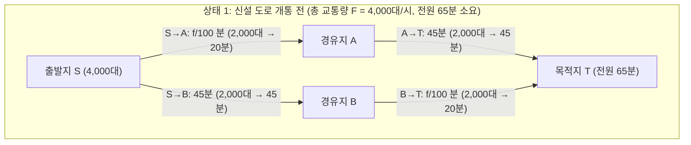
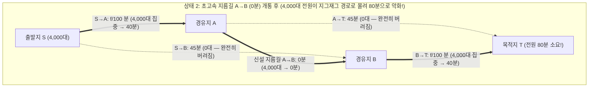

대도시의 극심한 출퇴근 교통 체증을 해결하기 위해 정부가 막대한 예산을 투입해 통행 시간이 거의 $0$분에 가까운 초고속 지름길 다리를 새로 건설했다고 가정해 보자. 상식적으로 생각하면 도로망의 전체 용량(Capacity)이 늘어났고 선택지가 넓어졌으므로 운전자들의 평균 통근 시간은 당연히 줄어들어야 한다. 적어도 새 다리를 이용하고 싶지 않은 사람은 원래 다니던 길로 계속 다니면 그만이므로, 도로를 짓기 전보다 상황이 나빠질 수는 없을 것처럼 보인다.

그러나 1968년 독일의 수학자 <strong>디트리히 브라에스(Dietrich Braess)</strong>는 교통 계획과 네트워크 과학의 상식을 완전히 뒤집는 역사적인 논문 *"Über ein Paradoxon aus der Verkehrsplanung"*(교통 계획における 한 역설에 대하여)을 발표했다. 각 운전자가 오직 자신의 통행 시간을 최소화하려는 합리적이고 이기적인 경로 선택(<strong>이기적 라우팅, Selfish Routing</strong>)을 할 때, <strong>도로망에 초고속 도로를 하나 추가한 결과 네트워크를 이용하는 100% 모든 운전자의 통근 시간이 이전보다 확실하게 길어지는 현상</strong>이 수학적으로 발생한다는 것이다. 이를 <strong>브라에스의 역설(Braess's Paradox)</strong>이라 부른다.

더욱 놀라운 점은 이 역설이 운전자들의 정보 부족이나 비합리적인 심리 때문에 일어나는 것이 아니라는 사실이다. 완전 정보 하에서 모든 참여자가 내시 균형(<strong>워드롭 균형, Wardrop Equilibrium</strong>)에 도달한 필연적 결과이며, 나아가 무생물 물리계 역시 볼록 퍼텐셜 에너지를 최소화하는 원리를 따르기 때문에 인터넷 패킷 라우팅(OSPF/BGP), 교류 전력망(Smart Grid), 반도체 양자 나노 구조는 물론, <strong>"천장에 매달린 용수철과 실의 네트워크에서 팽팽하게 하중을 지탱하던 가운데 실을 가위로 자르면 추(무게추)가 중력을 거슬러 위로 솟아오르는"</strong> 고전역학 실험(Cohen & Horowitz, 1991)에서도 똑같은 수학적 구조로 나타난다.

이 글에서는 브라에스의 4정점 다이아몬드 네트워크에 대한 강우월전략(Strictly Dominant Strategy) 분석부터 시작하여, <strong>존 글렌 워드롭(John Glen Wardrop, 1952)</strong>의 교통 배분 제1·제2원리, <strong>베크만(Beckmann, 1956)과 로젠탈(Rosenthal, 1973)</strong>의 볼록 퍼텐셜 함수(Potential Function), <strong>팀 러프가든(Tim Roughgarden)과 에바 타르도시(Éva Tardos, 2002)</strong>가 증명한 <strong>무질서의 대가(Price of Anarchy, $\text{PoA}$) 상한 $\frac{4}{3}$ 정리</strong>의 단계별 대수적 증명, 용수철-실 역학 역설의 유도, 그리고 2003년 일일 16만 8천 대가 다니던 <strong>서울 청계천 고가도로 철거</strong>가 어떻게 도심 통행 속도를 오히려 향상시켰는지에 이르기까지 깊이 있게 탐구한다.

---

## 1. 브라에스의 1968년 논문과 4정점 다이아몬드 네트워크

### 1.1 네트워크 구조와 링크 지연 함수(Latency Functions)

매일 아침 출발지 $S$(Start)에서 목적지 $T$(Terminal)로 이동하는 총 교통량 $F = 4,000\text{ 대/시}$(정규화 단위 $F = 1$)가 있다고 하자. 각 도로(유향 간선 $e \in E$)의 통행 시간(지연 함수) $\ell_e(f_e)$는 해당 도로를 지나는 교통량 $f_e$(대/시)에 따라 다음과 같이 주어진다.

1. <strong>도로 $S \to A$ (좁지만 짧은 다리)</strong>: 도로 폭이 좁아 통행 차량 수 $f_{SA}$에 비례하여 정체가 심해진다.
   $$\ell_{SA}(f_{SA}) = \frac{f_{SA}}{100}\text{ (분)}$$
   예를 들어 $2,000$대가 지나가면 $20$분, $4,000$대 전부가 몰리면 $40$분이 걸린다.
2. <strong>도로 $A \to T$ (넓지만 우회하는 간선도로)</strong>: 차선이 매우 넓어 교통량과 무관하게 항상 일정한 시간이 걸린다.
   $$\ell_{AT}(f_{AT}) = 45\text{ (분)}$$
3. <strong>도로 $S \to B$ (넓지만 우회하는 간선도로)</strong>: $A \to T$와 대칭으로 항상 $45$분이 소요된다.
   $$\ell_{SB}(f_{SB}) = 45\text{ (분)}$$
4. <strong>도로 $B \to T$ (좁지만 짧은 다리)</strong>: $S \to A$와 동일하게 교통량 $f_{BT}$에 비례하여 시간이 증가한다.
   $$\ell_{BT}(f_{BT}) = \frac{f_{BT}}{100}\text{ (분)}$$

### 1.2 상태 1: 새 도로 건설 전의 균형 상태 (전원 $65$분)

$A$와 $B$를 잇는 연결 도로가 없을 때 운전자가 선택할 수 있는 경로는 위쪽 경로 $P_{\text{up}} = (S \to A \to T)$와 아래쪽 경로 $P_{\text{down}} = (S \to B \to T)$ 두 개뿐이다. 대칭성에 의해 $4,000$대의 차량은 정확히 $2,000$대씩 반반($50:50$) 나뉘어 주행하며, 모든 운전자의 출근 시간은 다음과 같이 동일하다.
$$T_{\text{before}} = \frac{2000}{100} + 45 = 20 + 45 = 65\text{ 분}$$
어느 누구도 경로를 바꿀 유인이 없으며, 이 상태는 사회 전체의 총 통행 시간을 최소화하는 <strong>사회적 최적해(Social Optimum)</strong>와도 일치한다.

### 1.3 상태 2: 소요 시간 $0$분인 초고속 지름길 $A \to B$ 개통 후 ($80$분으로 악화!)

이제 당국이 경유지 $A$에서 $B$로 즉시 이동할 수 있는 소요 시간 $\ell_{AB}(f_{AB}) = 0$분짜리 초고속 연결 도로 $A \to B$를 개통했다고 하자.

새로운 세 번째 경로인 <strong>지그재그 경로 $P_{\text{zig}} = (S \to A \to B \to T)$</strong>가 열렸다. 게임 이론의 <strong>강우월전략(Strictly Dominant Strategy)</strong>으로 운전자들의 선택을 분석해 보자.

1. <strong>출발지 $S$에서의 선택 ($S \to A \to B$ 대 $S \to B$)</strong>:
   설령 $4,000$대 전부가 좁은 다리 $S \to A$로 몰리더라도 $S \to A$의 소요 시간은 최대 $\frac{4000}{100} = 40$분이다. $A$에서 $B$로 건너가는 데는 $0$분이 걸리므로, $S \to A \to B$로 가는 시간은 <strong>최악의 경우에도 $40$분 이하</strong>다. 반면 우회 간선도로 $S \to B$는 항상 $45$분이 걸린다! 따라서 다른 $3,999$명이 어떻게 행동하든 $S \to A$를 선택하는 것이 항상 최소 $5$분 이상 빠르다(강우월전략). 결국 모든 운전자가 $S \to B$를 버리고($f_{SB} = 0$) $S \to A$로 진입한다.
2. <strong>경유지 $A$에서의 선택 ($A \to B \to T$ 대 $A \to T$)</strong>:
   $A$에 도착한 운전자에게 간선도로 $A \to T$는 $45$분이 걸리지만, 다리 $A \to B$($0$분)를 건너 $B \to T$로 가는 경로는 $4,000$대 전원이 몰려도 최대 $0 + \frac{4000}{100} = 40$분밖에 걸리지 않는다($40 < 45$). 따라서 $A \to B \to T$ 역시 강우월전략이 되어 아무도 $A \to T$를 이용하지 않는다($f_{AT} = 0$).
3. <strong>유일한 내시 균형 (전원 $80$분의 감옥)</strong>:
   결국 $4,000$대 전원이 지그재그 경로 $S \to A \to B \to T$로 몰려 두 개의 좁은 다리를 모두 건너게 되며, 전원의 통근 시간은 다음과 같이 치솟는다.
   $$T_{\text{after}} = \frac{4000}{100} + 0 + \frac{4000}{100} = 40 + 0 + 40 = 80\text{ 분!}$$
   만약 어떤 운전자 한 명이 원래의 위쪽 경로 $S \to A \to T$나 아래쪽 경로 $S \to B \to T$로 혼자 돌아가려 하면 $40 + 45 = 85$분이 걸려 오히려 손해를 본다. 결국 모든 운전자가 다자간 <strong>죄수의 딜레마(Prisoner's Dilemma)</strong>에 갇혀 출근 시간이 $65$분에서 $80$분으로($+15$분, $+23.1\%$) 악화되는 것이다!

| 비교 항목 | 상태 1: 신설 도로 개통 전 (사회적 최적해 $f^*$) | 상태 2: 지름길 $A \to B$ 개통 후 (워드롭 균형 $f^{\text{EQ}}$) | 역설적 변화 및 영향 |
| :--- | :--- | :--- | :--- |
| <strong>위쪽 경로 $S \to A \to T$ 교통량</strong> | $2,000\text{ 대/시}$ ($20 + 45 = 65$분) | $0\text{ 대/시}$ (이동 시 $40 + 45 = 85$분) | 간선도로 $A \to T$ 완전 유휴화 |
| <strong>아래쪽 경로 $S \to B \to T$ 교통량</strong> | $2,000\text{ 대/시}$ ($45 + 20 = 65$분) | $0\text{ 대/시}$ (이동 시 $45 + 40 = 85$분) | 간선도로 $S \to B$ 완전 유휴화 |
| <strong>지그재그 경로 $S \to A \to B \to T$</strong> | 존재하지 않음 | $4,000\text{ 대/시}$ (전 차량의 $100\%$ 집중) | 좁은 다리 2곳을 모두 통과 |
| <strong>개별 운전자 통근 시간</strong> | <strong>$65\text{ 분}$</strong> | <strong>$80\text{ 분}$</strong> | <strong>전원 $+15\text{ 분}$ ($+23.1\%$) 악화</strong> |
| <strong>사회 전체 총 통행 비용 $C(f)$</strong> | $260,000\text{ 대·분}$ | $320,000\text{ 대·분}$ | <strong>무질서의 대가 $\text{PoA} = \frac{80}{65} \approx 1.231$</strong> |

---

## 2. 워드롭의 두 가지 원리(1952)와 베크만-로젠탈 볼록 퍼텐셜 함수(1956)

일반적인 유향 그래프 $G = (V, E)$에서 총 교통 수요를 $F$, 실행 가능한 경로 흐름 벡터의 집합을 $\mathcal{F} = \{f \ge 0 : \sum_{P \in \mathcal{P}} f_P = F\}$, 간선 흐름을 $f_e = \sum_{P \ni e} f_P$, 각 간선의 지연 함수를 단조증가 미분가능 함수 $\ell_e(f_e)$라 하자.

### 2.1 워드롭 제1원리(사용자 균형 $f^{\text{EQ}}$)와 변분 부등식
영국의 교통공학자 <strong>존 글렌 워드롭(John Glen Wardrop, 1952)</strong>의 제1원리에 따르면, 이기적 라우팅의 균형 $f^{\text{EQ}}$에서는 실제로 사용되는 모든 경로($f_P^{\text{EQ}} > 0$)의 통행 시간이 서로 같으며, 사용되지 않는 경로의 통행 시간보다 작거나 같다.
$$f_P^{\text{EQ}} > 0 \implies \ell_P(f^{\text{EQ}}) \le \ell_{P'}(f^{\text{EQ}}) \quad (\forall P' \in \mathcal{P})$$
이는 모든 실행 가능 흐름 $f \in \mathcal{F}$에 대해 다음 <strong>변분 부등식(Variational Inequality)</strong>을 만족하는 것과 동치이다.
$$\sum_{e \in E} \ell_e\bigl(f_e^{\text{EQ}}\bigr)\bigl(f_e - f_e^{\text{EQ}}\bigr) \ge 0 \quad (\forall f \in \mathcal{F})$$

### 2.2 워드롭 제2원리(사회적 최적해 $f^*$)와 피구 혼잡 외부성
사회 전체의 총 통행 시간 $C(f) = \sum_{e \in E} f_e \ell_e(f_e)$를 최소화하는 사회적 최적 흐름 $f^*$는 각 간선의 <strong>한계사회적비용(Marginal Social Cost, MSC)</strong>을 균등화한다.
$$\tilde{\ell}_e(f_e) = \frac{d}{df_e}\bigl[f_e \ell_e(f_e)\bigr] = \underbrace{\ell_e(f_e)}_{\text{사적 비용}} + \underbrace{f_e \ell_e'(f_e)}_{\text{피구 혼잡 외부성}}$$
이기적인 운전자는 자신의 사적 통행 시간 $\ell_e(f_e)$만 고려하고, 자신이 도로에 진입함으로써 이미 그 도로를 달리고 있는 다른 $f_e$명의 운전자에게 끼치는 추가 지연 피해인 <strong>피구 혼잡 외부성(Pigouvian Congestion Externality) $f_e \ell_e'(f_e)$</strong>를 무시하기 때문에 사회적 최적해에서 이탈하게 된다.

### 2.3 베크만-맥과이어-윈스텐 볼록 퍼텐셜 함수(Beckmann Potential Function)
1956년 Beckmann, McGuire, Winsten은 워드롭 균형 $f^{\text{EQ}}$가 다음 <strong>베크만 퍼텐셜 함수 $\Phi(f)$</strong>의 전역 최솟값과 정확히 일치함을 증명했다.
$$\Phi(f) = \sum_{e \in E} \int_0^{f_e} \ell_e(u)\,du$$
미적분학의 기본정리에 의해 $\frac{\partial \Phi(f)}{\partial f_P} = \sum_{e \in P} \ell_e(f_e) = \ell_P(f)$이므로, 볼록 함수 $\Phi(f)$의 KKT 최적 조건이 곧 워드롭 균형 조건이 된다. 특히 선형 지연 함수 $\ell_e(u) = a_e u + b_e$일 때:
$$\Phi(f) = \sum_{e \in E}\left(\frac{1}{2}a_e f_e^2 + b_e f_e\right) \quad \text{vs.} \quad C(f) = \sum_{e \in E}\left(a_e f_e^2 + b_e f_e\right)$$
즉 이기적 운전자들은 2차 혼잡 비용 항 $a_e f_e^2$를 실제의 절반($\frac{1}{2}$)으로 과소평가하여 행동하는 것과 수학적으로 동일하다!

---

## 3. 러프가든 & 타르도시 정리(2002): 무질서의 대가($\text{PoA} \le 4/3$) 완벽 증명

Koutsoupias와 Papadimitriou(1999)가 정의한 <strong>무질서의 대가(Price of Anarchy, $\text{PoA}$)</strong>는 균형 비용과 최적 비용의 비율 $\text{PoA} = \frac{C(f^{\text{EQ}})}{C(f^*)}$이다.
1920년 <strong>피구의 2링크 네트워크(Pigou's Network)</strong>($\ell_1(x)=1, \ell_2(x)=x, F=1$)에서 균형 해는 $x^{\text{EQ}}=1$로 $C(f^{\text{EQ}})=1$인 반면, 사회적 최적해는 $C(x) = (1-x) + x^2$을 최소화하는 $x^* = \frac{1}{2}$에서 $C(f^*) = \frac{3}{4}$이 되어 $\text{PoA} = \frac{4}{3}$가 된다.

2002년 <strong>팀 러프가든(Tim Roughgarden)과 에바 타르도시(Éva Tardos)</strong>는 선형 지연 함수를 갖는 그 어떤 복잡한 네트워크에서도 $\text{PoA}$가 절대 $\frac{4}{3}$를 넘지 못함을 증명했다.

> <strong>정리 (Roughgarden & Tardos, JACM 2002)</strong>:
> 임의의 유향 네트워크 $G=(V,E)$에서 모든 간선 $e \in E$의 지연 함수가 아핀 선형 함수 $\ell_e(x) = a_e x + b_e$ ($a_e, b_e \ge 0$)이면, 무질서의 대가는 항상 다음을 만족한다.
> $$\text{PoA}_{\text{linear}} = \frac{C(f^{\text{EQ}})}{C(f^*)} \le \frac{4}{3}$$

<strong>【증명】</strong>
1. <strong>변분 부등식 적용</strong>: 워드롭 균형 $f^{\text{EQ}}$와 최적 흐름 $f^*$에 대해 $\sum_{e \in E} \ell_e(f_e^{\text{EQ}})(f_e^* - f_e^{\text{EQ}}) \ge 0$이므로,
   $$C(f^{\text{EQ}}) = \sum_{e \in E} f_e^{\text{EQ}} \ell_e(f_e^{\text{EQ}}) \le \sum_{e \in E} f_e^* \ell_e(f_e^{\text{EQ}})$$
2. <strong>간선별 완전제곱식 부등식</strong>: 임의의 간선 $e$에서 $x = f_e^{\text{EQ}} \ge 0, y = f_e^* \ge 0$라 놓으면,
   $$y \ell_e(x) = y(a_e x + b_e) = y(a_e y + b_e) + a_e(xy - y^2) = y \ell_e(y) + a_e\left[\frac{1}{4}x^2 - \left(y - \frac{x}{2}\right)^2\right] \le y \ell_e(y) + \frac{1}{4}a_e x^2$$
   여기서 $b_e x \ge 0$이므로 $a_e x^2 \le a_e x^2 + b_e x = x \ell_e(x)$가 성립하여 다음을 얻는다.
   $$y \ell_e(x) \le y \ell_e(y) + \frac{1}{4} x \ell_e(x)$$
3. <strong>전체 간선에 대한 합산</strong>: 모든 $e \in E$에 대해 합산하면
   $$C(f^{\text{EQ}}) \le \sum_{e \in E} f_e^* \ell_e(f_e^{\text{EQ}}) \le \sum_{e \in E} f_e^* \ell_e(f_e^*) + \frac{1}{4}\sum_{e \in E} f_e^{\text{EQ}} \ell_e(f_e^{\text{EQ}}) = C(f^*) + \frac{1}{4}C(f^{\text{EQ}})$$
   좌변으로 이항하면 $\frac{3}{4}C(f^{\text{EQ}}) \le C(f^*) \implies \text{PoA} \le \frac{4}{3}$이 증명된다. $\blacksquare$

또한 차수가 최대 $d$인 다항식 지연 함수(예: 미국 연방도로청의 4차 <strong>BPR 함수</strong> $\ell_e(f_e) = t_e^0[1 + 0.15(f_e/c_e)^4]$, $d=4$)의 경우 정확한 상한은 다음과 같다.
$$\text{PoA}_d = \frac{(d+1)\sqrt[d]{d+1}}{(d+1)\sqrt[d]{d+1} - d} = \Theta\left(\frac{d}{\ln d}\right)$$
$d=4$일 때 $\text{PoA}_4 \approx 2.1505$로, 이기적 라우팅은 총 통행 시간을 최적해의 $2.15$배 이상으로 악화시킬 수 있다.

---

## 4. 물리·생물학적 구현: 가운데 실을 자르면 무게추가 위로 솟아오른다!

1991년 <strong>조엘 코언(Joel E. Cohen)과 폴 호로위츠(Paul Horowitz)</strong>는 *Nature* 논문에서 무생물 역학계의 브라에스 역설을 입증했다.
- 천장에서 용수철 상수 $k$, 자연 길이 $L_0$인 두 개의 동일한 용수철(좁은 다리 $S \to A, B \to T$에 대응)과 길이 $L_s$인 늘어나지 않는 두 개의 안전끈(간선도로 $S \to B, A \to T$에 대응), 그리고 두 용수철을 직렬로 이어주는 짧은 중앙 연결실 $A \to B$(길이 $\approx 0$)로 무게 $F = Mg$인 추를 매단다.
- <strong>가운데 실을 자르기 전 (직렬 연결)</strong>: 두 용수철이 직렬로 연결되어 각각 전체 하중 $F$를 온전히 받으므로 각각 $\frac{F}{k}$만큼 늘어난다. 안전끈 길이 $L_s > L_0 + \frac{F}{k}$이면 양쪽 안전끈은 느슨하게 처져 있다. 이때 추의 매달린 깊이는 다음과 같다.
  $$Y_{\text{before}} = 2L_0 + \frac{2F}{k}$$
- <strong>가운데 실을 가위로 자른 후 (병렬 연결)</strong>: 양쪽 안전끈이 팽팽해지면서 두 용수철이 <strong>병렬(parallel)</strong>로 하중을 절반($\frac{F}{2}$)씩 나누어 부담한다! 각 용수철의 늘어남이 $\frac{F}{2k}$로 절반이 되므로 새로운 평형 깊이는 다음과 같다.
  $$Y_{\text{after}} = L_0 + \frac{F}{2k} + L_s$$
- 만약 $L_0 + \frac{F}{k} < L_s < L_0 + \frac{3F}{2k}$ (예: $L_s = L_0 + \frac{5F}{4k}$)로 설정하면,
  $$\Delta Y = Y_{\text{after}} - Y_{\text{before}} = -\frac{F}{4k} < 0$$
  이 되어, <strong>하중을 지탱하던 팽팽한 실을 가위로 잘랐음에도 불구하고 무거운 추가 중력을 거슬러 $\frac{F}{4k}$만큼 위로 올라간다!</strong>

---

## 5. 실제 도시 계획 사례: 서울 청계천 고가도로 철거와 피구 혼잡통행료

현실 도시에서도 도로를 폐쇄하거나 철거했을 때 교통 흐름이 오히려 빨라진 극적인 사례들이 존재한다.
1. <strong>독일 슈투트가르트 (1969년)</strong> 및 <strong>뉴욕 42번가 (1990년)·타임스스퀘어 브로드웨이 보행자 광장화 (2009년)</strong>: 맨해튼 격자 도로망을 대각선으로 가로지르던 브로드웨이는 정확히 브라에스 네트워크의 지름길 $A \to B$ 역할을 하며 병목을 유발했다. 2009년 타임스스퀘어 구간을 차량 통행 금지 구역으로 바꾸자 미드타운 북행 택시 통행 시간이 오히려 $17\%$ 단축되었다.
2. <strong>서울 청계천 고가도로 완전 철거 (2003–2005년)</strong>: 하루 평균 <strong>$168,000$대</strong>의 차량이 통행하던 총연장 $5.8\text{ km}$, 왕복 6차로의 청계천 고가도로를 철거했을 때, 전문가들은 도심 교통 마비를 우려했다. 그러나 진출입 램프의 병목 현상이 사라지고 간선 급행버스(BRT) 및 주변 도로망으로 교통량이 고르게 분산되면서, <strong>고가도로 철거 후 서울 도심의 평균 차량 통행 속도는 오히려 빨라졌고</strong> 여름철 도심 기온은 $3.6^\circ\text{C}$ 낮아졌다.

### 피구 한계비용 혼잡통행료(Pigouvian Congestion Pricing)
도로를 물리적으로 철거하지 않고도 브라에스의 역설을 해결하는 방법은 각 간선 $e$에 사회적 최적 흐름 $f^*$에서의 혼잡 외부성과 같은 <strong>피구 혼잡통행료(Pigouvian Toll)</strong>
$$\tau_e = f_e^* \ell_e'(f_e^*)$$
를 부과하는 것이다. 일반화 비용 $\hat{\ell}_e(f_e) = \ell_e(f_e) + \tau_e$ 하에서 베크만 퍼텐셜의 기울기는 사회적 총비용 $C(f)$의 기울기와 완벽히 일치하게 되어 무질서의 대가가 $\text{PoA} = 1$로 사라진다.
