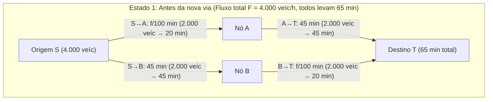
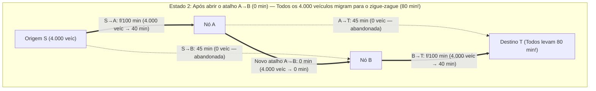

Imagine que a autoridade de trânsito de uma grande metrópole invista bilhões para construir uma nova ponte expressa com atraso zero a fim de aliviar o congestionamento matinal. O bom senso sugere que adicionar uma nova via só pode ajudar: a capacidade total da malha viária aumentou, nenhuma estrada existente foi fechada e quem não quiser usar a nova ponte pode simplesmente continuar pelo caminho antigo. Como expandir o conjunto de escolhas poderia prejudicar a todos?

Em 1968, o matemático alemão <strong>Dietrich Braess</strong> publicou um artigo histórico (*"Über ein Paradoxon aus der Verkehrsplanung"*) que destruiu essa intuição. Braess provou matematicamente que, quando cada motorista escolhe sua rota de forma egoísta para minimizar seu próprio tempo de viagem (<strong>roteamento egoísta / Selfish Routing</strong>), <strong>adicionar um atalho de latência zero pode fazer com que o tempo de viagem em equilíbrio de 100% dos motoristas se torne estritamente maior</strong>. Esse fenômeno contraintuitivo é conhecido como o <strong>Paradoxo de Braess</strong>.

Mais surpreendente ainda é que o Paradoxo de Braess não decorre de falta de informação nem de irracionalidade humana: ele surge inevitavelmente como o único equilíbrio de Nash (<strong>equilíbrio de Wardrop</strong>) de um jogo de congestionamento não cooperativo. Além disso, como sistemas físicos passivos minimizam funções de energia potencial convexas matematicamente isomorfas ao potencial de tráfego de Beckmann, o Paradoxo de Braess manifesta-se de forma idêntica no roteamento de pacotes da Internet (OSPF/BGP), em redes elétricas de alta tensão, em anéis quânticos mesoscópicos e na mecânica clássica — como demonstraram <strong>Joel E. Cohen e Paul Horowitz</strong> na revista *Nature* em 1991: <strong>em uma rede de molas e cordas que sustenta um peso pesado, cortar com uma tesoura um fio central esticado faz com que o peso suba contra a gravidade!</strong>

---

## 1. O artigo de Dietrich Braess (1968) e a Rede Diamante de 4 Nós

### 1.1 Topologia da rede e funções de latência

Suponha que um fluxo total de $F = 4.000\text{ veículos/hora}$ (ou $F = 1$ em unidades normalizadas) viaje da origem $S$ ao destino $T$ passando por dois nós intermediários $A$ e $B$. O tempo de percurso (função de latência) $\ell_e(f_e)$ de cada aresta direcionada $e \in E$ em função do seu fluxo $f_e$ é dado por:

1. <strong>Aresta $S \to A$ (Ponte estreita congestionável)</strong>: O tempo cresce linearmente com o fluxo $f_{SA}$:
   $$\ell_{SA}(f_{SA}) = \frac{f_{SA}}{100}\text{ minutos}$$
2. <strong>Aresta $A \to T$ (Rodovia larga de contorno)</strong>: Imune a congestionamentos, tempo constante:
   $$\ell_{AT}(f_{AT}) = 45\text{ minutos}$$
3. <strong>Aresta $S \to B$ (Rodovia larga de contorno)</strong>: Simétrica a $A \to T$, tempo constante:
   $$\ell_{SB}(f_{SB}) = 45\text{ minutos}$$
4. <strong>Aresta $B \to T$ (Ponte estreita congestionável)</strong>: Idêntica a $S \to A$, tempo linear:
   $$\ell_{BT}(f_{BT}) = \frac{f_{BT}}{100}\text{ minutos}$$

### 1.2 Estado 1: Equilíbrio antes da construção do atalho ($65$ minutos)

Sem ligação entre $A$ e $B$, existem apenas duas rotas: a rota superior $P_{\text{sup}} = (S \to A \to T)$ e a rota inferior $P_{\text{inf}} = (S \to B \to T)$. Por simetria, os $4.000$ veículos dividem-se em $50/50$ ($2.000$ em cada rota), e cada motorista leva:
$$T_{\text{antes}} = \frac{2000}{100} + 45 = 20 + 45 = 65\text{ minutos}$$
Essa divisão coincide também com o <strong>ótimo social ($f^*$)</strong>.

### 1.3 Estado 2: Abertura do atalho de latência zero $A \to B$ ($80$ minutos!)

Constrói-se uma via expressa instantânea de $A$ para $B$ com tempo de percurso $\ell_{AB}(f_{AB}) = 0$ minutos.

Surge uma terceira rota: o <strong>caminho em zigue-zague $P_{\text{zig}} = (S \to A \to B \to T)$</strong>. Pela análise de <strong>estratégias estritamente dominantes</strong>:
1. <strong>Decisão na origem $S$ ($S \to A \to B$ vs. $S \to B$)</strong>: Mesmo que todos os $4.000$ carros passem pela ponte estreita $S \to A$, seu tempo máximo é $\frac{4000}{100} = 40$ minutos. Como atravessar $A \to B$ leva $0$ minutos, chegar a $B$ via $S \to A \to B$ leva <strong>no máximo $40$ minutos</strong>, contra os $45$ minutos fixos da rodovia $S \to B$. Portanto, escolher $S \to A$ é uma estratégia estritamente dominante, e $100\%$ dos motoristas abandonam $S \to B$ ($f_{SB} = 0$).
2. <strong>Decisão no nó $A$ ($A \to B \to T$ vs. $A \to T$)</strong>: Da mesma forma, ir de $A$ até $T$ via $A \to B \to T$ leva no máximo $0 + \frac{4000}{100} = 40$ minutos $< 45$ minutos, dominando estritamente a rodovia $A \to T$ ($f_{AT} = 0$).
3. <strong>Novo equilíbrio único ($80$ minutos)</strong>: Todos os $4.000$ veículos acumulam-se na rota em zigue-zague $S \to A \to B \to T$, atravessando ambas as pontes estreitas:
   $$T_{\text{depois}} = \frac{4000}{100} + 0 + \frac{4000}{100} = 40 + 0 + 40 = 80\text{ minutos!}$$
   Qualquer motorista que tente voltar sozinho para $S \to A \to T$ ou $S \to B \to T$ levará $40 + 45 = 85$ minutos. Todos ficam presos em um <strong>Dilema do Prisioneiro</strong> coletivo (+15 minutos ou $+23,1\%$ mais lento para todos).

| Métrica | Estado 1: Antes do atalho $A \to B$ (Ótimo Social $f^*$) | Estado 2: Após o atalho $A \to B$ (Equilíbrio de Wardrop $f^{\text{EQ}}$) | Impacto do Paradoxo |
| :--- | :--- | :--- | :--- |
| <strong>Fluxo em $S \to A \to T$</strong> | $2.000\text{ veíc/h}$ ($20 + 45 = 65\text{ min}$) | $0\text{ veíc/h}$ (levaria $40 + 45 = 85\text{ min}$) | Rodovia $A \to T$ abandonada |
| <strong>Fluxo em $S \to B \to T$</strong> | $2.000\text{ veíc/h}$ ($45 + 20 = 65\text{ min}$) | $0\text{ veíc/h}$ (levaria $45 + 40 = 85\text{ min}$) | Rodovia $S \to B$ abandonada |
| <strong>Fluxo em $S \to A \to B \to T$</strong> | Inexistente | $4.000\text{ veíc/h}$ ($100\%$ do tráfego) | Cruza ambas as pontes estreitas |
| <strong>Tempo por motorista</strong> | <strong>$65\text{ minutos}$</strong> | <strong>$80\text{ minutos}$</strong> | <strong>$+15\text{ min}$ ($+23,1\%$) pior para 100%</strong> |
| <strong>Custo social total $C(f)$</strong> | $260.000\text{ veíc-min}$ | $320.000\text{ veíc-min}$ | <strong>$\text{PoA} = \frac{80}{65} = \frac{16}{13} \approx 1,231$</strong> |

---

## 2. Os Dois Princípios de Wardrop (1952) e a Função de Potencial de Beckmann (1956)

Seja $G = (V, E)$ um grafo direcionado com demanda total $F$, politopo de fluxos viáveis $\mathcal{F} = \{f \ge 0 : \sum_{P \in \mathcal{P}} f_P = F\}$ e funções de latência crescentes e diferenciáveis $\ell_e(f_e)$.

### 2.1 Primeiro Princípio de Wardrop (Equilíbrio do Usuário $f^{\text{EQ}}$)
No equilíbrio de Wardrop $f^{\text{EQ}}$, todos os caminhos efetivamente utilizados ($f_P^{\text{EQ}} > 0$) possuem o mesmo tempo de viagem, menor ou igual ao de qualquer caminho não utilizado:
$$f_P^{\text{EQ}} > 0 \implies \ell_P(f^{\text{EQ}}) \le \ell_{P'}(f^{\text{EQ}}) \quad (\forall P' \in \mathcal{P})$$
Isso equivale à <strong>desigualdade variacional (Variational Inequality)</strong>:
$$\sum_{e \in E} \ell_e\bigl(f_e^{\text{EQ}}\bigr)\bigl(f_e - f_e^{\text{EQ}}\bigr) \ge 0 \quad (\forall f \in \mathcal{F})$$

### 2.2 Segundo Princípio de Wardrop (Ótimo Social $f^*$) e Externalidades de Pigou
O ótimo social $f^*$ minimiza o custo social total $C(f) = \sum_{e \in E} f_e \ell_e(f_e)$, igualando o <strong>Custo Marginal Social (MSC)</strong>:
$$\tilde{\ell}_e(f_e) = \frac{d}{df_e}\bigl[f_e \ell_e(f_e)\bigr] = \underbrace{\ell_e(f_e)}_{\text{Custo privado}} + \underbrace{f_e \ell_e'(f_e)}_{\text{Externalidade de congestionamento de Pigou}}$$

### 2.3 Função de Potencial Convexo de Beckmann-McGuire-Winsten (1956)
O equilíbrio de Wardrop $f^{\text{EQ}}$ minimiza globalmente o <strong>potencial de Beckmann</strong>:
$$\Phi(f) = \sum_{e \in E} \int_0^{f_e} \ell_e(u)\,du \qquad \left(\text{pois } \frac{\partial \Phi(f)}{\partial f_P} = \sum_{e \in P} \ell_e(f_e) = \ell_P(f)\right)$$
Para latências lineares $\ell_e(u) = a_e u + b_e$, comparando $\Phi(f) = \sum_e (\frac{1}{2}a_e f_e^2 + b_e f_e)$ com $C(f) = \sum_e (a_e f_e^2 + b_e f_e)$, vê-se que o roteamento egoísta subestima exatamente pela metade ($\frac{1}{2}$) o termo quadrático de congestionamento.

---

## 3. Teorema de Roughgarden & Tardos (2002): Prova do limite $\text{PoA} \le 4/3$

O <strong>Preço da Anarquia ($\text{PoA}$)</strong> (Koutsoupias & Papadimitriou, 1999) é definido por $\text{PoA} = \frac{C(f^{\text{EQ}})}{C(f^*)}$. Na rede de 2 elos de <strong>Pigou (1920)</strong> ($\ell_1(x)=1, \ell_2(x)=x, F=1$), $C(f^{\text{EQ}}) = 1$ e $C(f^*) = \frac{3}{4}$ (em $x^* = \frac{1}{2}$), resultando em $\text{PoA} = \frac{4}{3}$.

> <strong>Teorema (Roughgarden & Tardos, JACM 2002)</strong>:
> Para qualquer rede direcionada $G=(V,E)$ com funções de latência afins $\ell_e(x) = a_e x + b_e$ ($a_e, b_e \ge 0$), o Preço da Anarquia satisfaz:
> $$\text{PoA}_{\text{linear}} = \frac{C(f^{\text{EQ}})}{C(f^*)} \le \frac{4}{3}$$

<strong>【Demonstração Completa】</strong>
1. <strong>Desigualdade variacional</strong>: Como $\sum_{e \in E} \ell_e(f_e^{\text{EQ}})(f_e^* - f_e^{\text{EQ}}) \ge 0$, temos:
   $$C(f^{\text{EQ}}) = \sum_{e \in E} f_e^{\text{EQ}} \ell_e(f_e^{\text{EQ}}) \le \sum_{e \in E} f_e^* \ell_e(f_e^{\text{EQ}})$$
2. <strong>Completamento de quadrado por aresta</strong>: Sejam $x = f_e^{\text{EQ}} \ge 0$ e $y = f_e^* \ge 0$:
   $$y \ell_e(x) = y(a_e x + b_e) = y(a_e y + b_e) + a_e(xy - y^2) = y \ell_e(y) + a_e\left[\frac{1}{4}x^2 - \left(y - \frac{x}{2}\right)^2\right] \le y \ell_e(y) + \frac{1}{4}a_e x^2 \le y \ell_e(y) + \frac{1}{4} x \ell_e(x)$$
3. <strong>Soma sobre todas as arestas</strong>: Somando para todo $e \in E$:
   $$C(f^{\text{EQ}}) \le \sum_{e \in E} f_e^* \ell_e(f_e^{\text{EQ}}) \le C(f^*) + \frac{1}{4}C(f^{\text{EQ}}) \implies \frac{3}{4}C(f^{\text{EQ}}) \le C(f^*) \implies \text{PoA} \le \frac{4}{3} \quad \blacksquare$$

Para polinômios de grau $d$ (como a função quártica <strong>BPR</strong> $\ell_e(f_e) = t_e^0[1 + 0,15(f_e/c_e)^4]$ com $d=4$), o limite exato é $\text{PoA}_d = \frac{(d+1)\sqrt[d]{d+1}}{(d+1)\sqrt[d]{d+1} - d}$ (sendo $\text{PoA}_4 \approx 2,1505$).

---

## 4. Realizações Físicas: O Paradoxo de Molas e Cordas de Cohen e Horowitz (1991)

Em 1991, <strong>Joel E. Cohen e Paul Horowitz</strong> (*Nature*) demonstraram que um sistema mecânico com duas molas idênticas (constante $k$, comprimento natural $L_0$), duas cordas de segurança inextensíveis de comprimento $L_s$ e um fio central curto $A \to B$ (comprimento $\approx 0$) sustentando um peso $F = Mg$ exibe o Paradoxo de Braess:
- <strong>Antes de cortar o fio central (Molas em série)</strong>: Ambas as molas suportam toda a carga $F$ e esticam $\frac{F}{k}$ cada. Se $L_s > L_0 + \frac{F}{k}$, as cordas laterais ficam frouxas e a profundidade do peso é:
  $$Y_{\text{antes}} = 2L_0 + \frac{2F}{k}$$
- <strong>Após cortar o fio central com uma tesoura (Molas em paralelo)</strong>: As cordas de segurança se esticam e as duas molas passam a dividir a carga em <strong>paralelo</strong> ($\frac{F}{2}$ cada), esticando apenas $\frac{F}{2k}$. A nova profundidade de equilíbrio é:
  $$Y_{\text{depois}} = L_0 + \frac{F}{2k} + L_s$$
- Se $L_0 + \frac{F}{k} < L_s < L_0 + \frac{3F}{2k}$ (por exemplo $L_s = L_0 + \frac{5F}{4k}$), então:
  $$\Delta Y = Y_{\text{depois}} - Y_{\text{antes}} = -\frac{F}{4k} < 0$$
  <strong>Cortar o fio tenso que sustenta o peso faz com que a massa suba contra a gravidade em $\frac{F}{4k}$!</strong>

---

## 5. Urbanismo Real e Pedágio Urbano de Pigou (Congestion Pricing)

1. <strong>Stuttgart (1969)</strong> e <strong>Nova York — Rua 42 (1990) e Broadway na Times Square (2009)</strong>: O fechamento para carros da Broadway (que cortava diagonalmente a malha ortogonal de Manhattan exatamente como o atalho $A \to B$ de Braess) reduziu em $17\%$ o tempo de viagem dos táxis em Midtown.
2. <strong>Seul — Demolição da Via Expressa Elevada de Cheonggyecheon (2003–2005)</strong>: A demolição de uma via expressa de 6 faixas por onde passavam <strong>$168.000$ veículos por dia</strong> para restaurar o rio Cheonggyecheon eliminou os gargalos das rampas de acesso, aumentou a velocidade média do trânsito no centro de Seul e reduziu a temperatura de verão em $3,6^\circ\text{C}$.
3. <strong>Taxa de Pigou</strong>: Cobrando um pedágio $\tau_e = f_e^* \ell_e'(f_e^*)$ igual à externalidade marginal de congestionamento em cada via, o equilíbrio de Wardrop alinha-se exatamente com o ótimo social ($\text{PoA} = 1$).
