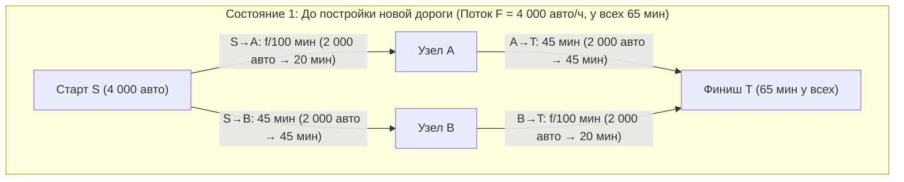
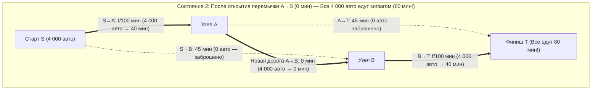

Представьте себе, что транспортное управление мегаполиса тратит миллиарды долларов на строительство нового бессветофорного моста с нулевой задержкой, чтобы разгрузить утренние пробки. Здравый смысл подсказывает, что новая дорога может только помочь: общая пропускная способность дорожной сети строго выросла, ни одна старая дорога не была закрыта, и любой водитель, которому не нравится новый мост, может продолжать ездить по прежнему маршруту. Как расширение свободы выбора может ухудшить положение абсолютно всех?

В 1968 году немецкий математик <strong>Дитрих Браес (Dietrich Braess)</strong> опубликовал в журнале *Unternehmensforschung* фундаментальную работу *"Über ein Paradoxon aus der Verkehrsplanung"*, которая навсегда разрушила эту интуицию. Браес математически строго доказал, что когда каждый водитель выбирает маршрут эгоистично, стремясь минимизировать собственное время в пути (<strong>эгоистичная маршрутизация / Selfish Routing</strong>), <strong>добавление новой сверхбыстрой дороги может привести к тому, что в новом равновесии время в пути строго увеличится для 100 % водителей!</strong> Это контринтуитивное явление получило название <strong>парадокса Браеса (Braess's Paradox)</strong>.

Ещё более поразительно то, что парадокс Браеса не связан с нехваткой информации или человеческой иррациональностью: он неизбежно возникает как единственное равновесие Нэша (<strong>равновесие Уордропа</strong>) в некооперативной игре перегрузки. Более того, поскольку пассивные физические системы минимизируют выпуклую потенциальную энергию, математически изоморфную потенциалу Бекмана для транспортных потоков, парадокс Браеса проявляется в маршрутизации пакетов в Интернете (OSPF/BGP), в высоковольтных электросетях, в мезоскопических квантовых кольцах и в классической механике: как показали <strong>Джоэл Коэн и Пол Хоровиц</strong> в журнале *Nature* (1991), <strong>в системе из пружин и нитей, удерживающей тяжёлый груз, разрезание ножницами натянутой центральной несущей нити заставляет груз подняться вверх против силы тяжести!</strong>

---

## 1. Статья Дитриха Браеса (1968) и 4-узловая ромбовидная сеть

### 1.1 Топология сети и функции задержки (Latency Functions)

Пусть общий поток $F = 4\,000\text{ автомобилей/час}$ (или $F = 1$ в нормированных единицах) движется из начального узла $S$ в конечный узел $T$ через два промежуточных узла $A$ и $B$. Время проезда (функция задержки) $\ell_e(f_e)$ каждого ориентированного ребра $e \in E$ зависит от потока $f_e$:

1. <strong>Ребро $S \to A$ (Узкий мост)</strong>: Время проезда линейно растёт с потоком $f_{SA}$:
   $$\ell_{SA}(f_{SA}) = \frac{f_{SA}}{100}\text{ минут}$$
2. <strong>Ребро $A \to T$ (Широкое обходное шоссе)</strong>: Не подвержено заторам, время постоянно:
   $$\ell_{AT}(f_{AT}) = 45\text{ минут}$$
3. <strong>Ребро $S \to B$ (Широкое обходное шоссе)</strong>: Симметрично $A \to T$, время постоянно:
   $$\ell_{SB}(f_{SB}) = 45\text{ минут}$$
4. <strong>Ребро $B \to T$ (Узкий мост)</strong>: Идентично $S \to A$, время линейно зависит от потока $f_{BT}$:
   $$\ell_{BT}(f_{BT}) = \frac{f_{BT}}{100}\text{ минут}$$

### 1.2 Состояние 1: Равновесие до постройки перемычки ($65$ минут)

В отсутствие связи между $A$ и $B$ доступны только два пути: верхний $P_{\text{верх}} = (S \to A \to T)$ и нижний $P_{\text{низ}} = (S \to B \to T)$. По симметрии поток $4\,000$ машин делится поровну $50/50$ ($2\,000$ на каждом маршруте), и каждый водитель тратит:
$$T_{\text{до}} = \frac{2000}{100} + 45 = 20 + 45 = 65\text{ минут}$$
Это распределение одновременно является <strong>общественным оптимумом ($f^*$)</strong>.

### 1.3 Состояние 2: Открытие мгновенной перемычки $A \to B$ ($80$ минут!)

Между узлами $A$ и $B$ открывается сверхскоростная односторонняя магистраль $A \to B$ с нулевым временем проезда $\ell_{AB}(f_{AB}) = 0$ минут.

Появляется третий маршрут — <strong>зигзагообразный путь $P_{\text{зиг}} = (S \to A \to B \to T)$</strong>. Анализ <strong>строго доминирующих стратегий</strong> показывает:
1. <strong>Выбор в узле $S$ ($S \to A \to B$ против $S \to B$)</strong>: Даже если все $4\,000$ машин поедут через узкий мост $S \to A$, время на нём составит максимум $\frac{4000}{100} = 40$ минут. Так как переезд $A \to B$ занимает $0$ минут, путь до $B$ через $S \to A \to B$ занимает <strong>не более $40$ минут</strong>, тогда как шоссе $S \to B$ всегда требует $45$ минут! Следовательно, выбор $S \to A$ — строго доминирующая стратегия, и $100\,\%$ водителей отказываются от $S \to B$ ($f_{SB} = 0$).
2. <strong>Выбор в узле $A$ ($A \to B \to T$ против $A \to T$)</strong>: Аналогично, путь из $A$ в $T$ через $A \to B \to T$ занимает максимум $0 + \frac{4000}{100} = 40$ минут $< 45$ минут, строго доминируя над шоссе $A \to T$ ($f_{AT} = 0$).
3. <strong>Новое единственное равновесие ($80$ минут)</strong>: Все $4\,000$ автомобилей устремляются по зигзагу $S \to A \to B \to T$, дважды проезжая по перегруженным узким мостам:
   $$T_{\text{после}} = \frac{4000}{100} + 0 + \frac{4000}{100} = 40 + 0 + 40 = 80\text{ минут!}$$
   Любой водитель, решивший в одиночку вернуться на старый маршрут $S \to A \to T$ или $S \to B \to T$, потратит $40 + 45 = 85$ минут. Все участники оказываются заперты в многопользовательской <strong>дилемме заключённого</strong> (+15 минут или $+23{,}1\,\%$ для каждого!).

| Показатель | Состояние 1: До дороги $A \to B$ (Общественный оптимум $f^*$) | Состояние 2: После открытия $A \to B$ (Равновесие Уордропа $f^{\text{EQ}}$) | Эффект парадокса |
| :--- | :--- | :--- | :--- |
| <strong>Поток по $S \to A \to T$</strong> | $2\,000\text{ авто/ч}$ ($20 + 45 = 65\text{ мин}$) | $0\text{ авто/ч}$ (заняло бы $40 + 45 = 85\text{ мин}$) | Шоссе $A \to T$ пустует |
| <strong>Поток по $S \to B \to T$</strong> | $2\,000\text{ авто/ч}$ ($45 + 20 = 65\text{ мин}$) | $0\text{ авто/ч}$ (заняло бы $45 + 40 = 85\text{ мин}$) | Шоссе $S \to B$ пустует |
| <strong>Поток по $S \to A \to B \to T$</strong> | Отсутствует | $4\,000\text{ авто/ч}$ ($100\,\%$ всего трафика) | Двойная нагрузка на узкие мосты |
| <strong>Время в пути водителя</strong> | <strong>$65\text{ минут}$</strong> | <strong>$80\text{ минут}$</strong> | <strong>$+15\text{ мин}$ ($+23{,}1\,\%$) хуже для всех</strong> |
| <strong>Общественные затраты $C(f)$</strong> | $260\,000\text{ авто-мин}$ | $320\,000\text{ авто-мин}$ | <strong>$\text{PoA} = \frac{80}{65} = \frac{16}{13} \approx 1{,}231$</strong> |

---

## 2. Два принципа Уордропа (1952) и выпуклый потенциал Бекмана (1956)

Пусть $G = (V, E)$ — ориентированный граф с общим спросом $F$, множеством допустимых потоков $\mathcal{F} = \{f \ge 0 : \sum_{P \in \mathcal{P}} f_P = F\}$ и неубывающими дифференцируемыми задержками рёбер $\ell_e(f_e)$.

### 2.1 Первый принцип Уордропа (Пользовательское равновесие $f^{\text{EQ}}$)
В равновесии Уордропа $f^{\text{EQ}}$ все используемые пути ($f_P^{\text{EQ}} > 0$) имеют одинаковое время проезда, не превышающее время на любом неиспользуемом пути:
$$f_P^{\text{EQ}} > 0 \implies \ell_P(f^{\text{EQ}}) \le \ell_{P'}(f^{\text{EQ}}) \quad (\forall P' \in \mathcal{P})$$
Это эквивалентно <strong>вариационному неравенству (Variational Inequality)</strong>:
$$\sum_{e \in E} \ell_e\bigl(f_e^{\text{EQ}}\bigr)\bigl(f_e - f_e^{\text{EQ}}\bigr) \ge 0 \quad (\forall f \in \mathcal{F})$$

### 2.2 Второй принцип Уордропа (Общественный оптимум $f^*$) и экстерналии Пигу
Общественный оптимум $f^*$ минимизирует суммарные затраты времени $C(f) = \sum_{e \in E} f_e \ell_e(f_e)$, выравнивая <strong>предельные общественные издержки (MSC)</strong>:
$$\tilde{\ell}_e(f_e) = \frac{d}{df_e}\bigl[f_e \ell_e(f_e)\bigr] = \underbrace{\ell_e(f_e)}_{\text{Частные издержки}} + \underbrace{f_e \ell_e'(f_e)}_{\text{Экстерналия перегрузки Пигу}}$$

### 2.3 Выпуклая потенциальная функция Бекмана–Макгуайра–Уинстена (1956)
Равновесие Уордропа $f^{\text{EQ}}$ доставляет глобальный минимум <strong>потенциалу Бекмана</strong>:
$$\Phi(f) = \sum_{e \in E} \int_0^{f_e} \ell_e(u)\,du \qquad \left(\text{так как } \frac{\partial \Phi(f)}{\partial f_P} = \sum_{e \in P} \ell_e(f_e) = \ell_P(f)\right)$$
Для линейных задержек $\ell_e(u) = a_e u + b_e$ сравнение $\Phi(f) = \sum_e (\frac{1}{2}a_e f_e^2 + b_e f_e)$ и $C(f) = \sum_e (a_e f_e^2 + b_e f_e)$ показывает, что эгоистичные водители учитывают квадратичный штраф за заторы $a_e f_e^2$ ровно вполовинную силу (множитель $\frac{1}{2}$).

---

## 3. Теорема Рафгардена и Тардош (2002): Доказательство оценки $\text{PoA} \le 4/3$

<strong>Цена анархии ($\text{PoA}$)</strong> (Koutsoupias & Papadimitriou, 1999) определяется как $\text{PoA} = \frac{C(f^{\text{EQ}})}{C(f^*)}$. На 2-звенной сети <strong>Пигу (1920)</strong> ($\ell_1(x)=1, \ell_2(x)=x, F=1$) имеем $C(f^{\text{EQ}}) = 1$ и $C(f^*) = \frac{3}{4}$ (при $x^* = \frac{1}{2}$), откуда $\text{PoA} = \frac{4}{3}$.

> <strong>Теорема (Roughgarden & Tardos, JACM 2002)</strong>:
> Для любой ориентированной сети $G=(V,E)$ с аффинными линейными функциями задержки $\ell_e(x) = a_e x + b_e$ ($a_e, b_e \ge 0$) Цена анархии удовлетворяет неравенству:
> $$\text{PoA}_{\text{linear}} = \frac{C(f^{\text{EQ}})}{C(f^*)} \le \frac{4}{3}$$

<strong>【Полное доказательство】</strong>
1. <strong>Вариационное неравенство</strong>: Из $\sum_{e \in E} \ell_e(f_e^{\text{EQ}})(f_e^* - f_e^{\text{EQ}}) \ge 0$ следует:
   $$C(f^{\text{EQ}}) = \sum_{e \in E} f_e^{\text{EQ}} \ell_e(f_e^{\text{EQ}}) \le \sum_{e \in E} f_e^* \ell_e(f_e^{\text{EQ}})$$
2. <strong>Выделение полного квадрата на каждом ребре</strong>: Обозначим $x = f_e^{\text{EQ}} \ge 0$ и $y = f_e^* \ge 0$:
   $$y \ell_e(x) = y(a_e x + b_e) = y(a_e y + b_e) + a_e(xy - y^2) = y \ell_e(y) + a_e\left[\frac{1}{4}x^2 - \left(y - \frac{x}{2}\right)^2\right] \le y \ell_e(y) + \frac{1}{4}a_e x^2 \le y \ell_e(y) + \frac{1}{4} x \ell_e(x)$$
3. <strong>Суммирование по всем рёбрам</strong>: Суммируя по $e \in E$, получаем:
   $$C(f^{\text{EQ}}) \le \sum_{e \in E} f_e^* \ell_e(f_e^{\text{EQ}}) \le C(f^*) + \frac{1}{4}C(f^{\text{EQ}}) \implies \frac{3}{4}C(f^{\text{EQ}}) \le C(f^*) \implies \text{PoA} \le \frac{4}{3} \quad \blacksquare$$

Для полиномиальных задержек степени $d$ (включая квартическую функцию <strong>BPR</strong> $\ell_e(f_e) = t_e^0[1 + 0{,}15(f_e/c_e)^4]$ при $d=4$) точная граница равна $\text{PoA}_d = \frac{(d+1)\sqrt[d]{d+1}}{(d+1)\sqrt[d]{d+1} - d}$ (при $d=4$ имеем $\text{PoA}_4 \approx 2{,}1505$).

---

## 4. Физические реализации: Пружинно-нитевой парадокс Коэна и Хоровица (1991)

В 1991 году <strong>Джоэл Коэн и Пол Хоровиц</strong> (*Nature*) показали, что механическая система из двух одинаковых пружин (жёсткость $k$, длина в ненагруженном состоянии $L_0$), двух нерастяжимых страховочных нитей длины $L_s$ и короткой центральной соединительной нити $A \to B$ (длина $\approx 0$), удерживающая груз $F = Mg$, демонстрирует парадокс Браеса:
- <strong>До разрезания центральной нити (Последовательное соединение)</strong>: Обе пружины несут полную нагрузку $F$ и растягиваются на $\frac{F}{k}$ каждая. При $L_s > L_0 + \frac{F}{k}$ боковые страховочные нити провисают, и глубина подвеса груза равна:
  $$Y_{\text{до}} = 2L_0 + \frac{2F}{k}$$
- <strong>После разрезания центральной нити ножницами (Параллельное соединение)</strong>: Страховочные нити натягиваются, и две пружины начинают работать <strong>параллельно</strong>, неся лишь половину веса $\frac{F}{2}$ каждая и растягиваясь только на $\frac{F}{2k}$. Новая равновесная глубина:
  $$Y_{\text{после}} = L_0 + \frac{F}{2k} + L_s$$
- Если $L_0 + \frac{F}{k} < L_s < L_0 + \frac{3F}{2k}$ (например, $L_s = L_0 + \frac{5F}{4k}$), то:
  $$\Delta Y = Y_{\text{после}} - Y_{\text{до}} = -\frac{F}{4k} < 0$$
  <strong>Разрезание натянутой несущей нити заставляет тяжёлый груз подняться вверх против силы тяжести на величину $\frac{F}{4k}$!</strong>

---

## 5. Реальное градостроительство и плата за перегрузку Пигу (Congestion Pricing)

1. <strong>Штутгарт (1969)</strong> и <strong>Нью-Йорк — 42-я улица (1990) и Бродвей на Таймс-сквер (2009)</strong>: Закрытие для автомобилей Бродвея (который пересекал прямоугольную сетку Манхэттена по диагонали, в точности как перемычка $A \to B$ у Браеса) ускорило движение такси в Мидтауне на $17\,\%$.
2. <strong>Сеул — Снос эстакадного шоссе Чхонгечхон (2003–2005)</strong>: Демонтаж 6-полосной эстакады с потоком <strong>$168\,000$ машин в сутки</strong> ради восстановления реки Чхонгечхон устранил бутылочные горлышки съездов, повысил среднюю скорость движения в центре Сеула и снизил летнюю температуру воздуха на $3{,}6^\circ\text{C}$.
3. <strong>Налог Пигу</strong>: Введение дорожного сбора $\tau_e = f_e^* \ell_e'(f_e^*)$, равного предельной экстерналии затора на каждом участке, совмещает равновесие Уордропа с общественным оптимумом ($\text{PoA} = 1$).
